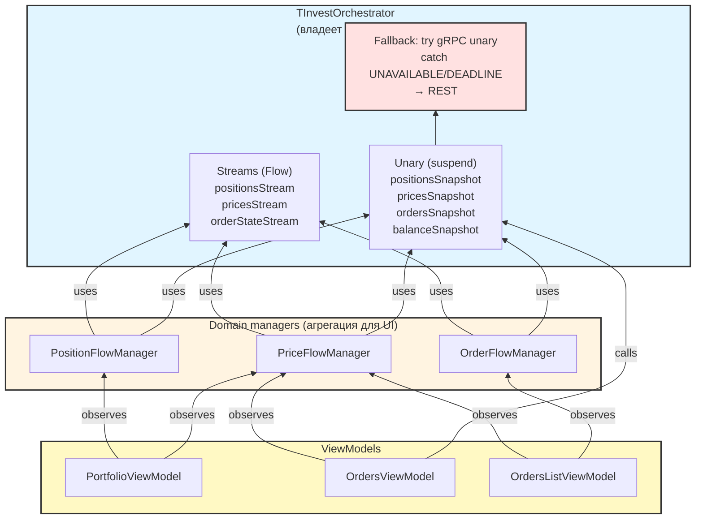

# ROADMAP-ARCHIVE

Закрытые задачи из `docs/ROADMAP.md`.

## Закрытые


### ✅ Единый источник цен (PriceStreamManager)

Реализовано в серии из 6 подкоммитов:
1. `PriceConsumer` enum + скелет `PriceFlowManager`.
2. Union + gRPC-стрим с пересозданием при смене union.
3. REST-fallback раз в 5 секунд.
4. Миграция `OrdersViewModel`.
5. Миграция `PortfolioViewModel` (+ фикс карточек в `OrdersScreen`:
   цена берётся из `uiState.currentPrice`, а не из медленного
   `portfolioPositions`).
6. Переименование `SharedPositionStreamManager` → `PositionFlowManager`.

### ✅ Унификация profitPercent для PortfolioPosition

Введён `calculateProfitPercent(yield, avgPrice, quantity, pointValue)` —
единая формула для всех типов инструментов. Для акций совпадает
с прежними формулами, для фьючерсов корректно учитывает
`pointValue`. Покрыто 11 тестами.

### ✅ Переход на DataStore

`SettingsRepository` и `TradingStateRepository` работают на
`DataStore<Preferences>`. `SharedPreferences` удалён из проекта
полностью. Все методы стали `suspend`, ViewModel'и обновляют
кэшированное состояние в `uiState` реактивно.

### ✅ Версионирование debug-сборок по последнему релизу

`versionName` debug-сборок получает префикс последнего релизного
тега: `1.0.2-dev.26.10.08.1430` вместо `1.26.10.08.1430`. Видно,
от какого релиза отпочковалась сборка.

Реализовано функцией `lastReleaseVersion()` в
`app/build.gradle.kts` — вызывает
`git tag --sort=-v:refname --list 'v*'`, fallback `0.0.0` при
отсутствии тегов. В `.gitlab-ci.yml` добавлен глобальный
`GIT_DEPTH: 0`, чтобы теги были видны в job'ах `test`-стадии.

Release-сборки не затронуты: при наличии
`-PreleaseVersionName=X.Y.Z` git не вызывается.

### ✅ Обновление Gradle 9.3.1 → 9.8.1

Wrapper обновлён до 9.8.1. Локальная сборка зелёная,
предупреждений об устаревании Kotlin DSL не осталось.

Попутно устранены устаревшие делегаты `by tasks.registering`
(удалены в Gradle 9.6) — заменены на
`tasks.register<Copy>("name") { ... }` в `build.gradle.kts`.

Kotlin 2.4.20 официально поддерживает Gradle до 9.7.0;
9.8.1 вне заявленного диапазона, но работает. Вернуться при
апгрейде Kotlin, если появятся проблемы.

### ✅ Обновление AGP 9.0.0 → 9.4.0

AGP обновлён до 9.4.0. Требования: Gradle 9.6.0+ (у нас 9.8.1),
JDK 17+ (у нас 25). Kotlin 2.4.20 и KSP 2.3.12 совместимы.

Плагин `org.jetbrains.kotlin.android` остался объявленным в root
build-скрипте. AGP 9.x его не требует, но и не конфликтует с ним —
сборка проходит с обоими. Удаление плагина — отдельная задача
по чистке, не часть этого апгрейда.

### ✅ Обновление зависимостей до актуальных версий

Обновлены:

- `androidx.core:core` 1.18.0 → 1.19.1
- `androidx.lifecycle:lifecycle-runtime-ktx` 2.9.4 → 2.11.0
- Compose BOM 2025.12.00 → 2026.09.00
- `androidx.navigation:navigation-compose` 2.9.8 → 2.10.2
- `kotlinx-coroutines-android` 1.10.2 → 1.11.0
- `kotlinx-coroutines-test` 1.10.2 → 1.11.0
- `io.grpc:*` 1.80.0 → 1.84.1
- `com.squareup.okhttp3:okhttp` 5.3.2 → 5.4.0
- `com.google.code.gson:gson` 2.13.2 → 2.14.0

Попутно:

- Убраны явные версии у `activity-compose`,
  `lifecycle-viewmodel-compose`, `lifecycle-runtime-compose` —
  управляются Compose BOM.
- Удалён дублирующий `grpc-stub` из блока «ManagedChannel»;
  он и так приходит транзитивно через `grpc-kotlin-stub` и
  `grpc-protobuf-lite`.

**Не трогали:** `protobuf-java` и `protobuf-kotlin` остаются
`3.25.8` — намеренный pin для совместимости с gRPC и
T-Invest SDK.

### ✅ Удаление legacy `.webp`-иконок

Удалены `ic_launcher.webp` и `ic_launcher_round.webp` из
`mipmap-{hdpi,mdpi,xhdpi,xxhdpi,xxxhdpi}/`. Файлы
`ic_launcher_foreground.webp` оставлены — на них ссылается
adaptive XML `mipmap-anydpi/ic_launcher.xml`. Иконка
в лаунчере проверена на устройстве.

**Возможное улучшение в будущем:** перенести
`ic_launcher_foreground` в `drawable-{density}/` или заменить
векторным foreground. Отдельная задача, не в этой.

### ✅ Смена лицензии GPL v3 → Apache 2.0

`LICENSE` заменён на Apache 2.0, `README.md` обновлён.
Автор один, стороннего GPL-кода нет, SPDX-заголовков
в исходниках нет. Юридическая оговорка о неотзываемости
GPL для уже распространённых копий зафиксирована в README.

### ✅ Обновление compileSdk до 37

`compileSdk = 37`, `targetSdk = 36`. AGP 9.4.0 поддерживает
API 37. Доступ к новым API Android 17 без активации изменений
поведения. `targetSdk` оставлен на 36 — Google Play пока
требует только его.

### ✅ Reconnect-loop для gRPC-стрима цен

`PriceStreamManager.runGrcpStream` теперь переподключается
при ошибке с экспоненциальным backoff.

**Сделано:**

- `subscribeLastPrices` обёрнут в
  `while (currentCoroutineContext().isActive)` с `try/catch`.
- `CancellationException` пробрасывается — штатная отмена job
  не логируется как ошибка.
- Backoff `[1s, 5s, 15s, 30s, 60s]`, cap 60 секунд — по
  рекомендации официальной документации T-Invest
  («Что делать при разрыве стрима»).
- Нормальное завершение стрима сервером (`collect` вернулся
  без исключения) сбрасывает счётчик попыток и переподключается
  без задержки.
- Логи с префиксом `[prices]`: `W [prices] gRPC error (attempt=N),
  retry in Xms` и `D [prices] gRPC stream completed by server,
  reconnecting`.
- Parallel polling (`runPolling`) не тронут — продолжает
  работать, прикрывая паузы между попытками.

**Итог:** при обрыве gRPC-стрима цены продолжают идти через
polling (раз в 5 с), а основной источник восстанавливается
самостоятельно. Один коммит: `feat(prices): add reconnect-loop
for gRPC price stream` (PR #10).

### ✅ Переименование fetchPositionsRest → fetchPositionsSnapshot

Метод в `BrokerApi` переименован: имя отражает семантику
(«снимок» vs «стрим»), а не транспорт.

**Сделано:**

- `domain/api/BrokerApi.kt` — интерфейс + KDoc очищен:
  убраны дублирующие формулировки, транспорт-зависимость
  описана явно (gRPC unary для T-Invest, REST для
  BCS / Finam).
- `data/api/TInvestBrokerApi.kt` — override.
- `data/api/TInvestMarketDataService.kt` — реализация
  + 2 внутренних вызова.
- `data/api/BcsBrokerApi.kt` — override + 2 внутренних
  вызова.
- `data/api/FinamBrokerApi.kt` — override + 2 внутренних
  вызова.
- `data/repository/InvestRepository.kt` — вызов.
- `docs/ROADMAP.md` — 5 упоминаний обновлены.

**Итог:** имя унифицировано по семантике (snapshot / stream),
транспорт больше не «протекает» в название. Разблокирует
задачи по fallback-каскадам для стримов (позиции, цены,
ордера), где важна прозрачность «снимок vs стрим».

Один коммит: `refactor(domain): rename fetchPositionsRest
to fetchPositionsSnapshot` (PR #17).

### ✅ gRPC-стрим позиций

gRPC-стрим позиций реализован и работает в боевом и
песочнице. Основной источник обновлений количества;
polling остаётся параллельным fallback'ом.

**Что сделано:**

- **Разведка артефакта SDK 1.51.0.** Подтверждено:
  `OperationsStreamServiceAsync.positionsStream` доступен,
  классы `PositionsStreamRequest` / `PositionsStreamResponse`
  есть. Сервис был и в 1.48.1 — прошлые попытки падали
  не из-за отсутствия классов, а из-за несуществующего
  имени `PositionsStreamServiceGrpc`.
- **`subscribePositionsGrpc`** в `TInvestMarketDataService`.
  Через `api.operationsStreamServiceAsync.positionsStream`,
  с `withInitialPositions = true` (сервер присылает
  снапшот при подключении).
- **Параллельная схема вместо последовательного каскада.**
  `merge(subscribePositionsGrpcWithReconnect, subscribePositionsPolling)`.
  gRPC и polling работают одновременно, эмитят в общий
  поток. Отказ от каскада: gRPC может молчать (в первых
  тестах — да), а polling обязан работать.
- **Автопереподключение gRPC** с экспоненциальным
  backoff `[1s, 5s, 15s, 30s, 60s]`. Ожидание появления
  API внутри flow (без early-return).
- **Обогащение в `PositionFlowManager`.** Полные события
  (от polling, `currentPrice != null`) обновляют
  `snapshotCache`. Неполные события (от gRPC, без P&L)
  дополняются `currentPrice`, `averagePositionPrice`,
  `expectedYield`, `isin`, `pointValue` из кэша.
- **Диагностический лог** `[positions]/gRPC: response — subs=, init=, pos=, ping=, case=`.
  Нужен, потому что `PING` приходит раз в 60 секунд;
  без него не отличить «стрим мёртв» от «стрим жив,
  изменений нет».

**Проверено:**

- Боевой аккаунт: `SUBSCRIPTIONS` → `INITIAL_POSITIONS`
  за 100 мс, затем `PING` раз в 60 секунд.
- Песочница: тот же flow, `hasPosition()` приходит при
  изменении позиции.
- **Обогащение работает:** gRPC-событие `POSITION` для
  `5f72f0f4-...` (qty=7) получило `price=103.54,
  yield=42.08` из кэша polling.
- 63 unit-теста зелёные, ktlint и detekt чистые.

**Ограничение:** валютные остатки (`moneyList`) gRPC-стрим
не отдаёт — обрабатываются только `securities` и `futures`.
Для UI это некритично: цена валюты = 1.0, polling приносит
полные данные.

**Итог:** задача разблокирует WS-уровень в каскаде позиций
(см. `### Каскад обновления позиций`). Миграция
`PositionFlowManager` на стрим как единственный источник
не потребовалась — параллельная схема оказалась надёжнее.

Один коммит с закрытием — см. `docs/ROADMAP.md` → этот
раздел.


___


### ✅ Compose Preview для компонентов

Добавлены `@Preview`-функции для ключевых Compose-компонентов.
Проверены в Android Studio на десктопе — рендерятся без ошибок.

**Вариант A (обязательный):**
- `AssetPositionCard` — 4 превью: акция с профитом,
  акция с убытком, фьючерс, выбранное состояние.
- `OrderCard` — 3 превью: market, limit, executed.

**Вариант B (опциональный):**
- `BrokerAccountDialog` — 3 превью: T-Invest, BCS без
  счетов, Finam без селектора.
- `ConfirmOrderDialog` — 3 превью: market, limit, paired.

**Попутные правки (при проверке на десктопе):**
- `modifier: Modifier = Modifier` перенесён с конца
  сигнатуры в начало в `AssetPositionCard` и `OrderCard`
  (Compose API convention, поведение не меняется).
- Применён `ktlintFormat` к 4 файлам (import ordering,
  blank lines, multiline wrapping).

**Вариант C** (превью экранов после разделения на
wrapper + content) — остаётся в задаче «Рефакторинг
архитектурного долга → Compose-экраны».

Проверено: сборка зелёная, 63 теста, ktlint и detekt
чистые, превью рендерятся в Android Studio.


___


### ✅ Оркестратор стримов и Ktor WS transport

Полный WS-транспорт для T-Invest: позиции, цены, статусы
заявок. Три фазы закрыты, все live-tested на проде.

**Фаза 1 — Оркестратор (2026-10-19).**
- `StreamCombinators.kt` — `streamWithFallback(primary, fallback, polling)`.
- `TInvestOrchestrator.kt` — композиция уровней.
- `TInvestBrokerApi` делегирует в оркестратор.
- `retryWithBackoff` — обёртка gRPC-primary, чтобы обрыв
  канала не ронял `merge()` и не терял WS-fallback.

**Фаза 2 — WS для позиций (2026-10-20).**
- `:transport-ktor` KMP-модуль (Android target).
- `TInvestPositionsWebSocket` — Ktor CIO engine.
- Канал в URL path: `wss://.../ws/tinkoff.public.invest.api.contract.v1.OperationsStreamService/PositionsStream`.
- `encodeDefaults = true` — иначе `withInitialPositions`
  не сериализуется, сервер не присылает снапшот.
- Sandbox URL — `sandbox-invest-public-api.tbank.ru/ws/...`.
- `money` / `blocked` из WS склеиваются с валютной позицией
  из polling по `currency` в `PositionStreamManager.enrichAndCache`.
- Sandbox WS — серверное ограничение (закрывает без кадра,
  подтверждено websocat), в `docs/ISSUES.md`.
- `DebugConfig` — флаги для изоляции источников.

**Фаза 3 — WS для цен и ордеров (2026-10-21).**
- DTO: `MarketDataStreamDto`, `OrderStateStreamDto` + 10 тестов.
- `TInvestPricesWebSocket` — incremental subscription
  (`setInterest` + SUBSCRIBE/UNSUBSCRIBE без переподключения),
  hot `SharedFlow`, `logFrames` под `BuildConfig.DEBUG`.
- `TInvestOrderStateWebSocket` — per-account, как позиции.
- Мапперы: `TInvestPricesWsMapper`, `TInvestOrderStateWsMapper`
  (+10 тестов).
- Оркестратор: `pricesStream(uids)`, `orderStateStream(accountId)`.
- Все WS-клиенты создаются только при `!sandbox` (sandbox WS
  не работает — `docs/ISSUES.md`).
- `DebugConfig.ENABLE_ORDER_STATE_DEBUG` — временный хук для
  live-теста (UI-потребителя `subscribeOrderState` пока нет).
  Default off.

**Live-тесты на проде (2026-10-21):**

- Позиции: `subscriptions` + `initialPositions` за 100 мс,
  `ping` раз в 60 сек.
- Цены: `SUBSCRIPTION_STATUS_SUCCESS` + поток `lastPrice`
  для SBER, TMON@, BRZ6 (~1–2 сек между обновлениями).
- Ордера: `RESULT_SUBSCRIPTION_STATUS_OK` + кадры `orderState`
  (NEW, CANCELLED), маппер отработал.

**Ключевые находки:**
- `subscriptionAction: "SUBSCRIPTION_ACTION_SUBSCRIBE"` в payload
  обязателен. Без него — `SUBSCRIPTION_STATUS_SUBSCRIPTION_ACTION_IS_INVALID`.
- `instrumentId` принимает uid и `ticker_classCode`.
- `OrderStateStream` event-only: чужие заявки (с другого
  устройства) не видны до первого события. Полный snapshot
  — через gRPC unary `getOrders` / `getStopOrders`, REST-fallback
  в задаче «Ktor REST transport для polling».

**Что осталось (в отдельных задачах):**
- `OrderFlowManager` с map + polling — отдельная задача.
- REST fallback для unary (`getOrders`, `getStopOrders`).
- UI-потребитель `subscribeOrderState` — когда появится,
  добавить `stop()` в `TInvestOrderStateWebSocket`
  (ROADMAP → «Add stop() to TInvestOrderStateWebSocket»).
- BCS / Finam WS.


___


### ✅ OrderStreamManager — snapshot + stream merge

Единая точка агрегации активных заявок счёта. Polling
(gRPC unary `getOrders` + `getStopOrders`, 15 сек) + stream
(`subscribeOrderState`, gRPC + WS fallback). `StateFlow<List<OrderListItem>>`
для UI.

**Что сделано:**
- `domain/api/OrderStreamManager.kt` — `@Singleton`, `start`/`stop`,
  `hasLoaded`, merge polling + stream, `Dispatchers.IO.limitedParallelism(1)`
  (без mutex).
- `domain/api/OrderCache.kt` — `internal`, TTL-эвикция по двум
  меткам (`lastSeenAt` / `lastStreamAt`). Чистая Kotlin, без
  Android/DataStore — domain layer.
- `OrderState.toOrderListItem()` — extension в `OrderModels.kt`.
- `OrdersListViewModel` — подписка на `combine(orders, hasLoaded)`
  вместо одноразового `getAllOrdersResult`. `loadOrders()` теперь
  только `getAccounts` + `start()`. `onCleared` → `stop()`.
- `A1a/A1b` (перед A): `OrderState` расширен `orderType` и
  `tscalpInstrumentId`; reflection в gRPC-маппере заменён на
  typed getters SDK 1.51.0.

**Почему TTL:** `OrderStateStream` не отдаёт stop-orders (asyncapi)
и может терять regular-события при обрыве. Без эвикции отменённые
и исполненные заявки остаются в кэше навсегда (фантомы в popup
«Список заявок»). Эвикция — только при успешном polling-цикле
(если polling упал, `lastSeenAt` не обновляется — эвикция снесла
бы валидные).

**Live-тест (2026-10-21):**
- Стоп-заявка с другого устройства → исчезла из UI через 30–45 сек
  (TTL, stream по stop не приходит — ожидаемо).
- Лимитная заявка с другого устройства → исчезла мгновенно
  (`stream: ... status=CANCELLED`).
- Фантомные не возвращались.

**Наблюдение:** `stream: ... status=CANCELLED` пришёл дважды в
одну миллисекунду — gRPC-stream и WS одновременно доставили
одно событие (`streamWithFallback` = merge). `OrderCache.putFromStream`
идемпотентен, UI не задвоил. Причина шума в логах — не баг.

**Что осталось (в отдельных задачах):**
- Snapshot «чужих» заявок при полном отказе gRPC (WS жив) — только
  события, не snapshot. REST fallback: ROADMAP → «Ktor REST
  transport для polling» (получил `getOrders` / `getStopOrders` в
  план).
- Доменная модель в `sealed interface Order { Regular, Stop }`:
  ROADMAP → «Split order domain into sealed Regular/Stop».


___


### ✅ Add stop() to TInvestOrderStateWebSocket

`TInvestOrderStateWebSocket` приведён к lifecycle
`TInvestPricesWebSocket`: соединение живёт в переданном `scope`,
управляется `setInterest(accountId)` / `stop()`.

**Что сделано:**
- `scope: CoroutineScope` в конструктор.
- `setInterest(accountId)` вместо `subscribeOrderState(accountId)`:
  идемпотентен для того же счёта, пересоздаёт соединение при
  смене счёта (incremental в `OrderStateStream` нет).
- `stop()` — cancel соединения и сброс интереса.
- `states: SharedFlow<OrderStateStreamResponseDto>` — hot, без
  буфера (SUSPEND). Заявки критичны (`CANCELLED` / `FILL` нельзя
  терять); Ktor буферизует кадры при отсутствии подписчика.
- `logFrames: Boolean` — паритет с prices, `BuildConfig.DEBUG`.
- `TInvestBrokerApi.deinitialize` вызывает
  `orderStateWebSocket?.stop()` перед обнулением.
- `buildOrderStateWsFallback` — через `setInterest` + `states`.

**Триггер (сработал 2026-10-21):** `OrderFlowManager` стал
постоянным потребителем `subscribeOrderState`. Без `stop()`
WS-соединение переживало `deinitialize()`.

**Гейт:** `testDebugUnitTest / lintDebug / ktlintCheck / detekt /
transport-ktor:allTests` — зелёные.


___


### ✅ Переименование `*StreamManager` → `*FlowManager`

**Мобильная работа:** полное закрытие (правки `.kt` — через
proot; сборка и тесты — на десктопе).

**Контекст:** семантическое разделение слоёв.
- **Оркестратор** (`TInvestOrchestrator`) — владеет транспортами,
  работает со стримами (gRPC, WS) и unary-запросами.
- **Менеджеры** (`PositionFlowManager`, `PriceFlowManager`,
  `OrderFlowManager`) — агрегируют данные из разных
  источников (транспортные стримы, polling) в единый `StateFlow`
  для ViewModel.

Слово `Stream` в названии менеджеров перегружено: оно означает
и транспортный стрим, и Kotlin `Flow`. По сути менеджер
производит `Flow` (в виде `StateFlow`) из данных от разных
источников. Имя `*FlowManager` лучше отражает эту роль и
разводит семантику с оркестратором.

**Файлы:**
- `domain/api/PositionStreamManager.kt` → `PositionFlowManager.kt`
- `domain/api/PriceStreamManager.kt` → `PriceFlowManager.kt`
- `domain/api/OrderStreamManager.kt` → `OrderFlowManager.kt`
- Все места использования: ViewModel, DI, тесты, KDoc.

**Шаги:**
1. `git mv` трёх файлов менеджеров.
2. Переименовать классы и переменные во всех ссылках.
3. Сборка и тесты.
4. Обновить документацию (`AGENTS.md`, `docs/*.md`), если там
   упоминаются старые имена.

**Ограничения:**
- Не менять логику менеджеров, только имена.
- Не смешивать с задачей «Ktor REST transport для polling» —
  отдельный PR (chore).

**Критерий готовности:**
- В кодовой базе не осталось `*StreamManager`.
- Сборка и тесты зелёные.

**Оценка:** ~30–40 минут.


___


### ✅ Race в start/stop `*FlowManager` — дублирование стримов

**Мобильная работа:** частичное (правки `.kt` — через proot;
сборка и тесты — на десктопе).

**Контекст:** в `start/stop/reapplyDebugFlags` трёх менеджеров
(`PositionFlowManager`, `PriceFlowManager`, `OrderFlowManager`)
есть критическая секция без синхронизации между проверкой
идемпотентности и присваиванием `job`. При двух параллельных
вызовах (main + worker) оба проходят проверку и создают по
job'у, второй перезаписывает ссылку — первый становится orphan
и продолжает эмитить в `_flow` до перезапуска процесса.

Подтверждено логом 2026-10-22: два `Перезапуск потока позиций`
из разных нитей в одну миллисекунду, два `[stream/gRPC/TInvest]:
connecting (attempt=1)`, два `[WS/ktor/TInvest] connecting`.
Полный разбор — `docs/ISSUES.md` → «Race в start/stop
*FlowManager — дублирование стримов».

**Предусловия:** нет.

**Файлы:**
- `app/src/main/kotlin/.../domain/api/PositionFlowManager.kt`
- `app/src/main/kotlin/.../domain/api/PriceFlowManager.kt`
- `app/src/main/kotlin/.../domain/api/OrderFlowManager.kt`
- `app/src/test/kotlin/.../domain/api/PositionFlowManagerTest.kt`
  (дополнить тест на конкурентный `start`)

**Шаги:**
1. В каждый менеджер добавить `private val startLock = Any()`.
2. Обернуть в `synchronized(startLock)`:
   - `PositionFlowManager`: `start` / `stop` / `reapplyDebugFlags`;
   - `PriceFlowManager`: `setInterest` / `clearInterest` /
     `reapplyDebugFlags`;
   - `OrderFlowManager`: `start` / `stop`.
3. Гейт: полный набор.

Unit-тест на race (два параллельных `start()` → один
`subscribePositions`) вынесен в отдельную задачу
(«Race-тесты для `*FlowManager`»): без fake-broker
`TInvestBrokerAPI` (final class, `@Inject constructor`) тест
не воспроизводит race, а sequential-вариант утверждает
неверное поведение.

**Референсы:**
- `docs/ISSUES.md` → «Race в start/stop *FlowManager —
  дублирование стримов» — симптом, interleaving, последствия.
- `docs/ROADMAP.md` → «Оркестратор стримов и Ktor WS transport»
  — downstream композиция корректна, проблема upstream.

**Ограничения:**
- Не менять публичные контракты (`start` / `stop` / `setInterest`
  — те же сигнатуры).
- Не удалять debug-тумблеры — они нужны для live-тестов
  транспортов. Фикс `synchronized` закрывает и их race.
- `synchronized`, не `Mutex`: в критической секции нет
  suspension points.

**Критерий готовности:**
- При старте приложения в logcat — **по одному** `connecting`
  на каждый транспорт (gRPC, WS), не два.
- Полный гейт зелёный.

**Live-тест (2026-10-22, эмулятор Pixel 8a, Android 14):**

Было (до фикса, лог 2026-10-22, старая сборка):

    PositionFlowManager: Перезапуск потока позиций: null → 2309452027
    PositionFlowManager: Перезапуск потока позиций: null → 2309452027
    TInvestMarketData:   [stream/gRPC/TInvest]: connecting (attempt=1)
    TInvestMarketData:   [stream/gRPC/TInvest]: connecting (attempt=1)
    TInvestWS:           [WS/ktor/TInvest]  connecting (attempt=1)
    TInvestWS:           [WS/ktor/TInvest]  connecting (attempt=1)

Стало (после фикса, новая сборка):

    PositionFlowManager: Перезапуск потока позиций: null → 2309452027
    TInvestMarketData:   [stream/gRPC/TInvest]: connecting (attempt=1)
    TInvestWS:           [WS/ktor/TInvest]  connecting (attempt=1)
    PositionFlowManager: Поток позиций уже запущен для 2309452027
    PositionFlowManager: Поток позиций уже запущен для 2309452027

Второй вызов `start()` (из `PortfolioViewModel`) теперь корректно
отсекается проверкой идемпотентности — race между проверкой и
присвоением `job` закрыт `synchronized(startLock)`.

`PriceFlowManager`: два `setInterest` (из разных ViewModel) идут
**последовательно**, с законным изменением union
(`0 → 1 → 2`), каждое изменение → ровно один `restart`. Дублей
транспорта нет.

Debug-тумблеры (`toggleGrpc` / `toggleWs` / `toggleRest`) проверены
на лету: `reapplyDebugFlags` даёт ровно один `stopped` + один
`started`, `forceRest` перенаправляет polling на
`[REST/ktor/TInvest]`. Приложение живо, крашей в logcat нет.

**Оценка:** ~40 минут.

**Зависимости:** нет. **Разблокирует** корректное поведение
менеджеров при добавлении BCS / Finam (без orphan job'ов и
лишнего расхода rate-limits), а также корректную проверку
8 комбинаций debug-переключателей
(ROADMAP → «Полировка debug-переключателей») — иначе
проверка ловит race самого `reapplyDebugFlags`, а не
тестируемую логику.

**Открытые вопросы:** нет.


___


### ✅ Ktor REST transport для polling (prices)

**Мобильная работа:** невозможно (требует сборки и проверки
на реальных данных).

Реализован REST fallback только для цен — единственный
REST-метод, доведённый до production в этой задаче. Остальные
методы вынесены в отдельные задачи (см. ниже).

**Что сделано (PR #30, PR #31):**
- `TInvestRestTransport` в `:transport-ktor` — Ktor Client,
  метод `getLastPrices`.
- `pricesRestFallback` в `TInvestOrchestrator` — автоматический
  fallback gRPC → REST на `UNAVAILABLE` / `DEADLINE_EXCEEDED`.
- `DebugConfig.forceRest` — принудительный REST для live-теста.
- Unary-обёртки в оркестраторе (шаги 1a/1b, PR #30).
- Live-тест (2026-10-22 17:13): `forceRest=true` →
  `[REST/ktor/TInvest] POST .../GetLastPrices` → цены
  обновляются, крашей нет.

**Что НЕ вошло (вынесено в отдельные задачи):**
- REST для позиций / заявок / баланса — см.
  `### Ktor REST для позиций/заявок/баланса`.
- Миграция BCS на Ktor — см. `


___


### ✅ Race-тесты для `*FlowManager` (мок-инфраструктура)

**Мобильная работа:** невозможно (сборка и прогон тестов —
на десктопе).

**Контекст:** при фиксе race в `start/stop` (задача «Race в
start/stop `*FlowManager`») unit-тест на конкурентный `start`
не был написан: `TInvestBrokerAPI` — final class с
`@Inject constructor` и множеством зависимостей
(`channelFactory`, `httpClient`, `orchestrator`).

**Уточнение 2026-10-22 (при старте задачи):** `mockk` **уже
подключён** в `app/build.gradle.kts`
(`testImplementation("io.mockk:mockk:1.13.13")`). ROADMAP
говорил «mockk отсутствует» — это устарело, mockk добавлен в
одной из предыдущих сессий и не использовался. Значит,
setup-шага нет, начинаем сразу с тестов.

**Зачем:** синхронизация сейчас держится на код-ревью. Без
теста регрессия (убрали `synchronized` при рефакторинге) не
будет поймана. При добавлении BCS / Finam race повторится на
каждом новом менеджере — тест-контракт должен существовать
до этого.

**Варианты:**

- **A. Добавить `mockk`.** `io.mockk:mockk` подключается,
  мокирует `TInvestBrokerAPI` (final class — mockk справится
  через inline-agent). Тест: 50 параллельных `start()` из
  разных корутин → `subscribePositions` вызван ровно 1 раз.
- **B. Рефакторинг `BrokerApi`.** Вынести интерфейс
  `BrokerStreamSource` для `subscribePositions` /
  `subscribeOrderState` / `subscribeLastPrices`, инжектить
  в менеджеры, fake реализация в тестах. ~2–3 ч (рефакторинг
  + тесты).
- **C. Тест-хук.** `@VisibleForTesting internal fun
  startCountForTest()` — счётчик внутри менеджера, тест
  на sequential идемпотентность. Race не проверяется
  (полумера).

**Рекомендация:** **A**. Минимальное проникновение в
production-код, race проверяется реально.

**Файлы:**
- `app/src/test/kotlin/.../domain/api/PositionFlowManagerTest.kt` —
  новый тест `concurrent start creates single job`.
- `app/src/test/kotlin/.../domain/api/OrderFlowManagerTest.kt` —
  новый файл, аналогичный тест.
- `app/src/test/kotlin/.../domain/api/PriceFlowManagerTest.kt` —
  новый файл, тест на `setInterest` race.

**Шаги:**
1. `PositionFlowManager` — `start` race: 50 параллельных
   `start("acc")`, `subscribePositions` called once.
2. `OrderFlowManager` — `start` race: тот же паттерн,
   `subscribeOrderState` + `ordersSnapshot` once.
3. `PriceFlowManager` — `setInterest` race: `subscribeLastPrices`
   once (AtomicInteger activeCount == 1).
4. `PositionFlowManager` — `reapplyDebugFlags` race: 50
   параллельных после `start`, activeCount == 1.
5. `PriceFlowManager` — `reapplyDebugFlags` race: тот же паттерн.
6. Проверка «красный без fix» для каждого теста.
7. Гейт: полный набор.

Тесты `stop` (Position, Order) и `clearInterest + setInterest`
interleaved — рассмотрены, отклонены:
- `stop` в изоляции не race (нет check-then-set).
- `clearInterest + setInterest` interleaved — defensive тест
  от несуществующего сценария (методы вызываются только из
  `Dispatchers.Main.immediate`), инвариант требует рефлексии
  на private `interests`, тест будет flaky.

**Референсы:**
- `docs/ISSUES.md` → «Race в start/stop `*FlowManager` —
  дублирование стримов» — симптом, interleaving.
- `docs/ROADMAP.md` → «Race в start/stop `*FlowManager`» —
  фикс без теста (deferred test).

**Ограничения:**
- Не менять production-код под тесты (никаких
  `@VisibleForTesting` хуков, никаких open-модификаторов на
  `TInvestBrokerAPI`).
- Не использовать mockk вне этого теста — только точечно
  для fake-broker.
- Не смешивать с рефакторингом `BrokerApi` — отдельная задача,
  если понадобится.

**Критерий готовности:**
- Тест на race для каждого из трёх менеджеров — красный при
  удалённом `synchronized`, зелёный с ним (проверка:
  временно убрать `synchronized` в одной ветке, прогнать —
  должен упасть).
- Полный гейт зелёный.

**Оценка:** ~1.5 часа фактически (5 тестов + 3 доп. проверки
«красный без fix»). Mockk setup не понадобился.

**Зависимости:** нет. Разблокирована — фикс из «Race в
start/stop `*FlowManager`» в `dev` (PR #34), тест проверяет
его от регрессии.

**Открытые вопросы:**
- mockk inline-agent может конфликтовать с существующими
  instrumentation-тестами (если появятся). Проверить при
  старте.
- Нужны ли фейки для `BrokerManager` или хватит `emptyMap()`
  + мокнутого брокера. Уточнить при написании первого теста.


___


### ✅ Ktor REST для позиций/заявок/баланса

**Мобильная работа:** невозможно (сборка и проверка на реальных данных).

**Целевая архитектура транспорта:**

Оркестратор — единственное место, где живёт транспорт. Стримы (Flow) и unary (suspend) оба проходят через него. Менеджеры вызывают `xxxStream` для стрима и `xxxSnapshot` в polling-loop, не зная про REST. Fallback gRPC→REST живёт только в оркестраторе.



**Что уже сделано (PR #30):**
- **Шаг 1a** — unary-обёртки в оркестраторе: `positionsSnapshot`, `pricesSnapshot`, `ordersSnapshot`, `balanceSnapshot`. Тонкие делегаты, без fallback.
- **Шаг 1b** — переключение менеджеров на эти обёртки: `PriceFlowManager.runPolling` и `OrderFlowManager.collectPolling` больше не дёргают репозиторий напрямую, а идут через `broker.pricesSnapshot()` / `broker.ordersSnapshot()`, которые делегируют в оркестратор.

**Что осталось (Шаг 2 и 3):**
- **Шаг 2** — REST transport и fallback:
  - `TInvestRestTransport` в `:transport-ktor` (Ktor Client).
  - В `TInvestOrchestrator` обернуть unary-методы: `try { gRPC } catch (UNAVAILABLE | DEADLINE_EXCEEDED | UNIMPLEMENTED) { REST }`.
  - Логика: только на транспортные ошибки, не на бизнес-ошибки.
- **Шаг 3** — live-тест fallback:
  - `DebugConfig.FORCE_REST_FOR_POLLING` (уже есть для цен, расширить на позиции/заявки/баланс).
  - Live-тест: позиции, заявки, баланс обновляются через REST при `FORCE_REST` и при физическом отключении gRPC.

**Файлы:**
- `transport-ktor/src/commonMain/kotlin/.../TInvestRestTransport.kt` — добавить методы `fetchPositionsSnapshot`, `getBalance`, `getOrders`, `getStopOrders`.
- `app/src/main/kotlin/.../data/orchestrator/TInvestOrchestrator.kt` — добавить fallback (сейчас там только `pricesRestFallback`).
- `app/src/main/kotlin/.../di/DataModule.kt` — прокинуть REST-транспорт в оркестратор для новых методов.

**Референсы:**
- `TInvestRestTransport.getLastPrices` — образец.
- `docs/rate-limits.md` — REST лимиты (6 запросов/сек).

**Ограничения:**
- Не трогать BCS — отдельная задача.
- Не менять публичный контракт `BrokerApi`.
- Логика fallback — в оркестраторе (как `pricesRestFallback`).

**Критерий готовности:**
- REST-фолбэк работает для всех четырёх методов.
- `forceRest` перенаправляет позиции, заявки, баланс на REST.
- Тесты зелёные.

**Оценка:** ~2–3 часа.

**Зависимости:** нет. **Разблокирует:** устойчивость polling при полном отказе gRPC.

**Открытые вопросы:**
- Формат REST-ответов для `getOrders` / `getStopOrders` — совпадает ли с gRPC по структуре? Уточнить при реализации.
- `getPositions` и `fetchPositionsSnapshot` — REST-метод один и тот же или разные? Уточнить по Swagger.


___


### ✅ Debug-тумблеры: применить ко всем менеджерам

**Мобильная работа:** невозможно (сборка + live-тест).

**Контекст:** во время live-теста StreamState (2026-10-23,
`docs/live-test.md`, режим B) обнаружены четыре бага в
`SettingsViewModel` и `OrderFlowManager`. Планировали StreamState
без этой задачи — выяснилось, что сценарий
`LIVE → INITIALIZING → POLLING` невозможен без фикса тумблеров,
а `→ STOPPED` для Order не срабатывает.

**Матрица флагов (семантика, полная, 8 комбинаций):**

`disableGrpc` / `disableWs` отключают только соответствующие
стримы, unary (polling) не трогают. `forceRest` переключает
unary с gRPC на REST, стримы не трогает. Полная матрица:

| `disableGrpc` | `disableWs` | `forceRest` | Стримы    | Unary (polling) |
| ------------- | ----------- | ----------- | --------- | --------------- |
| off           | off         | off         | gRPC + WS | gRPC unary      |
| on            | off         | off         | WS only   | gRPC unary      |
| off           | on          | off         | gRPC only | gRPC unary      |
| on            | on          | off         | нет       | gRPC unary      |
| off           | off         | on          | gRPC + WS | REST            |
| on            | off         | on          | WS only   | REST            |
| off           | on          | on          | gRPC only | REST            |
| on            | on          | on          | нет       | REST            |

Ключевое следствие: `forceRest=true` сам по себе **не**
отключает стрим — только unary уходит на REST. Отключение
стрима — через `disableGrpc` / `disableWs`. Этот контракт —
для live-тестов и `DebugConfig: только для debug-сборок`.

**Диагностика (по коду, 2026-10-23):**

Для каждого бага — файл, симптом, причина, как чинить.

**B1 — `toggleGrpc` / `toggleWs` не применяют флаги на лету.**

- **Файл:** `presentation/screens/settings/SettingsViewModel.kt`
  (`toggleGrpc` ~334, `toggleWs` ~340).
- **Симптом:** включение `disableGrpc` / `disableWs` в Настройках
  не даёт `LIVE → INITIALIZING` ни у одного менеджера. Флаги
  применяются только при следующем
  `setInterest` / `clearInterest` / `start`.
- **Причина:** оба метода устанавливают `DebugConfig.*`,
  обновляют `_uiState`, но **не вызывают** `reapplyDebugFlags()`.
- **Fix:** в обоих методах после `_uiState.update` — три вызова:
  `priceFlowManager.reapplyDebugFlags()`,
  `positionFlowManager.reapplyDebugFlags()`,
  `orderFlowManager.reapplyDebugFlags()`.

**B2 — `toggleRest` не перезапускает Order.**

- **Файл:** `presentation/screens/settings/SettingsViewModel.kt`
  (`toggleRest` ~346).
- **Симптом:** включение `forceRest` не переводит Order на REST.
- **Причина:** `toggleRest` вызывает reapply только для Price и
  Position, `orderFlowManager` пропущен.
- **Fix:** добавить `orderFlowManager.reapplyDebugFlags()`.

**B3 — у `OrderFlowManager` нет `reapplyDebugFlags()`.**

- **Файл:** `domain/api/OrderFlowManager.kt`.
- **Симптом:** B1/B2-фиксы без этого метода не скомпилируются.
- **Причина:** метод есть только у `PositionFlowManager` (~251)
  и `PriceFlowManager` (~147). Order добавлен в агрегацию
  позже, метод не добавлен.
- **Fix:** симметрично `PositionFlowManager`:

  ```kotlin
  fun reapplyDebugFlags() =
      synchronized(startLock) {
          val accountId = currentAccountId ?: return@synchronized
          AppLogger.d(TAG, "reapplyDebugFlags: restarting stream")
          doStart(accountId, forceRestart = true)
      }
  ```

  **No-op** если `currentAccountId == null` — не стартовать
  Order по тумблеру, если UI ещё не открывал вкладку «Заявки».

**B4 — logout не останавливает `OrderFlowManager`.**

- **Файл:** `presentation/screens/settings/SettingsViewModel.kt`
  (`clearBrokerCredentials`, TInvest-ветка ~150).
- **Симптом:** при logout `PositionFlowManager` и `PriceFlowManager`
  уходят в STOPPED (в live-тесте: 17:15:03.167 / .170), а Order
  остаётся в POLLING.
- **Причина:** в `clearBrokerCredentials` есть
  `positionFlowManager.stop()`, но `orderFlowManager.stop()` —
  нет. `OrdersListViewModel.onCleared()` вызывает `stop()`, но
  при logout из «Настроек» VM не уничтожается (`onCleared` не
  срабатывает). `PriceFlowManager` останавливается через
  `clearInterest` из ViewModel-цепочки — у Order такого
  механизма нет, только `stop()`.
- **Fix:** в TInvest-ветке `clearBrokerCredentials`, рядом с
  `positionFlowManager.stop()` — `orderFlowManager.stop()`.

**Дополнительно — инъекция в `SettingsViewModel`.**

- **Файл:** `presentation/screens/settings/SettingsViewModel.kt`.
- `@Inject` конструктор — добавить `orderFlowManager: OrderFlowManager`.
  Без неё B1/B2/B4-фиксы не скомпилируются.

**Следствие:** сценарий live-теста `disableGrpc && disableWs →
LIVE → INITIALIZING → POLLING` невозможен ни для одного
менеджера (B1/B2/B3), а `→ STOPPED` для Order не наступает
(B4).

**Предусловия:** нет.

**Файлы:**
- `domain/api/OrderFlowManager.kt` — новый
  `reapplyDebugFlags()` (B3).
- `presentation/screens/settings/SettingsViewModel.kt` —
  - `@Inject` конструктор: `orderFlowManager: OrderFlowManager`
    (без этого B1/B2/B4 не компилируются);
  - `toggleGrpc` / `toggleWs` → reapply на всех трёх (B1);
  - `toggleRest` → добавить Order (B2);
  - `clearBrokerCredentials` (TInvest-ветка) → добавить
    `orderFlowManager.stop()` рядом с
    `positionFlowManager.stop()` (B4).
- `domain/api/OrderFlowManagerTest.kt` — тесты на
  `reapplyDebugFlags` (B3).

**Шаги:**

1. **B3.** `OrderFlowManager.reapplyDebugFlags()` — симметрично
   `PositionFlowManager`: `synchronized(startLock) {
   currentAccountId ?: return@synchronized; doStart(accountId,
   forceRestart = true) }`. **No-op** если менеджер не
   запущен — не стартовать Order по тумблеру, если UI ещё
   не открывал вкладку «Заявки».
2. `SettingsViewModel` — `@Inject` конструктор: добавить
   `orderFlowManager: OrderFlowManager`.
3. **B1.** `SettingsViewModel.toggleGrpc` — добавить
   `priceFlowManager.reapplyDebugFlags()`,
   `positionFlowManager.reapplyDebugFlags()`,
   `orderFlowManager.reapplyDebugFlags()`.
4. **B1.** `SettingsViewModel.toggleWs` — то же.
5. **B2.** `SettingsViewModel.toggleRest` — добавить
   `orderFlowManager.reapplyDebugFlags()`.
6. **B4.** `SettingsViewModel.clearBrokerCredentials`
   (TInvest-ветка) — добавить `orderFlowManager.stop()`
   рядом с `positionFlowManager.stop()`. **Не трогать**
   `priceFlowManager` — Price останавливается через
   `clearInterest` из ViewModel-цепочки (подтверждено
   live-тестом).
7. `OrderFlowManagerTest` — B3-тесты (см. «Резюме по тестам»).
8. Гейт: полный набор (`testDebugUnitTest / lintDebug /
   ktlintCheck / detekt`).
9. Live-тест (`docs/live-test.md`, режим B):
   `disableGrpc` → `disableWs` → `toggleRest` → logout.
   Критерии — в «Резюме по тестам».

**Референсы:**
- `PositionFlowManager.kt:251` — образец метода.
- `PriceFlowManager.kt:147` — образец.
- `docs/live-test.md` — процедура повторного live-теста.
- `docs/ISSUES.md` — запись про race в `start/stop`
  (PR #34) — `synchronized(startLock)` обязателен.

**Ограничения:**
- Не менять поведение `forceRest` — только добавить Order
  в `toggleRest`.
- `OrderFlowManager.reapplyDebugFlags()` не должен
  запускать Order, если `currentAccountId == null`
  (симметрия с `stop()`).
- `synchronized(startLock)` в Order сохранить — регрессия
  race-фикса PR #34 недопустима.

**Критерий готовности:**
- `disableGrpc && disableWs` в Настройках → три
  `LIVE → INITIALIZING → POLLING` (Position, Price, Order).
- Live-тест StreamState проходит полностью (включая
  `→ STOPPED`).
- Тест на `reapplyDebugFlags` в Order зелёный.
- Полный гейт зелёный.

**Резюме по тестам:**

- **Unit (покрывается):** B3 — `OrderFlowManagerTest`:
  - `reapplyDebugFlags after start creates single active stream`
    (симметрия с `PositionFlowManagerTest` /
    `PriceFlowManagerTest`);
  - `reapplyDebugFlags before start is no-op`.
- **Unit (не покрывается, причина):** B1, B2, B4 — фиксы в
  `SettingsViewModel`, для unit-теста нужна mock-инфраструктура
  (`DataStore`, `BrokerManager`, `TInvestBrokerAPI`,
  `InvestRepository`, `TradingStateRepository`, три
  `*FlowManager`). Это отдельная задача по тестам ViewModel-слоя
  (ROADMAP → «Рефакторинг ViewModel-слоя»). Покрытие — live-тест.
- **Live (по `docs/live-test.md`, режим B, один сценарий):**
  - `disableGrpc` → три `LIVE → INITIALIZING → POLLING`;
  - `disableWs` → без изменений в состоянии (уже POLLING);
  - `toggleRest` → Order перезапускается (видно в логе
    `OrderFlowManager: reapplyDebugFlags`);
  - logout → три `→ STOPPED` (Position / Price / Order).

**Оценка:** ~1.5 часа (B3 15 мин, `@Inject` 5 мин, B1 10 мин,
B2 5 мин, B4 5 мин, B3-тесты 15 мин, gate 5 мин, live 30 мин).

**Зависимости:** нет. **Блокирует** `### StreamState в
data-слое`. **Предшествует** `### DebugConfig: только для
debug-сборок`.

**Открытые вопросы:** нет.

**Что сделано:**
- **B1.** `toggleGrpc` / `toggleWs` вызывают `reapplyDebugFlags()` на всех трёх менеджерах (`SettingsViewModel`).
- **B2.** `toggleRest` добавляет `orderFlowManager.reapplyDebugFlags()`.
- **B3.** `OrderFlowManager.reapplyDebugFlags()` + `forceRestart` в `doStart` + `@Inject orderFlowManager` в `SettingsViewModel`.
- **B4.** `clearBrokerCredentials` (TInvest) вызывает `orderFlowManager.stop()` рядом с `positionFlowManager.stop()`.
- Матрица 8 комбинаций флагов — `docs/ROADMAP.md` (`3304f07`).
- Live-тест (2026-10-23): 4 угла матрицы + logout, B1–B4 подтверждены; `19:09:10.075 Order: POLLING → STOPPED`.
- 2 unit-теста в `OrderFlowManagerTest` (race + no-op).


___


### ✅ StreamState в data-слое

**Мобильная работа:** невозможно (требует сборки и проверки
реактивного поведения).
**Подтверждение:** выполнено (2026-10-23, `docs/live-test.md`,
режим B). Live-лог подтвердил переходы для Position / Price /
Order:

- старт: `STOPPED → INITIALIZING → LIVE` (Position — сразу,
  Price — через ~6 сек; Order — `→ POLLING`, event-only);
- toggle (`disableGrpc` + `disableWs`): `LIVE/POLLING →
  INITIALIZING → POLLING` (несколько раз за сессию);
- STALE (авиарежим 31–35 сек): три `POLLING → STALE`
  (19:32:13–19:32:21);
- восстановление (возврат сети): три `STALE → POLLING`
  (19:34:21–19:34:29);
- logout: три `→ STOPPED` (19:34:52).

**Следующий шаг:** выполнен — live-тест StreamState
(2026-10-23, см. `**Подтверждение:**`). Следующий —
`### Унификация имён и KDoc в *FlowManager` (приоритет,
«не менее горячая»).

**Контекст:** нужна индикация того, получает ли менеджер данные
из быстрого источника (стрим) или из медленного (polling),
или данные вообще перестали поступать.

**Важно:** `StreamState` сигнализирует **менеджер** (так как он
агрегирует данные и знает источники), а не оркестратор.

**Предусловия:** нет (разблокировано PR #30, #37; фикс
race — PR #34 — в `dev`).

**Файлы:**
- `domain/models/StreamState.kt` — новый файл.
- `data/orchestrator/TInvestOrchestrator.kt` — разделить
  `positionsStream` (stream-only) и `positionsSnapshot`
  (unary с fallback).
- `data/api/TInvestBrokerAPI.kt` — новый `positionsSnapshot`
  (TInvest-specific, по образцу `ordersSnapshot`).
- `domain/api/BrokerApi.kt` — KDoc `subscribePositions`
  (обновить: stream-only).
- `domain/api/PositionFlowManager.kt` — рефакторинг (Вариант B) +
  `connectionState`.
- `domain/api/PriceFlowManager.kt` — структурный рефакторинг
  (Order-style) + `connectionState`.
- `domain/api/OrderFlowManager.kt` — `connectionState`.
- `domain/models/PositionStreamItem.kt` — KDoc (центральная модель).
- `docs/streams.md` — раздел «PositionsStream» (polling перенесён
  в менеджер).

**Шаги:**

1. **Рефакторинг `PositionFlowManager` (Вариант B).**
   Сейчас `TInvestOrchestrator.positionsStream` возвращает
   **готовый merge** stream+polling
   (`streamWithFallback(primary, fallback, polling = positionsPolling(...))`),
   а `PositionFlowManager` просто собирает его — не зная источника.
   Привести к схеме `OrderFlowManager` (Order-style):
   - В `TInvestOrchestrator.positionsStream` убрать `polling =
     positionsPolling(...)` — оставить stream-only (gRPC + WS).
     Удалить private `positionsPolling`.
   - `positionsSnapshot(accountId, sandboxMode): List<PositionStreamItem>`
     — return type меняется с `List<PortfolioPosition>`;
     конвертация через `marketData.convertToStreamItem`.
   - `TInvestBrokerAPI.positionsSnapshot(accountId): List<PositionStreamItem>`
     — новый TInvest-specific метод, делегирует в оркестратор.
   - `PositionFlowManager.start` — Order-style:
     - scope → `Dispatchers.IO.limitedParallelism(1)` (mutable
       `snapshotCache` разделяется stream/polling, нужна
       сериализация; Price без этого — у него нет mutable state).
     - один `job`, внутри `coroutineScope { launch { collectStream };
       launch { runPolling } }`.
     - при смене accountId — `snapshotCache.clear()` +
       `_flow.resetReplayCache()` (фикс ISSUES «Позиции не
       обновляются при смене счёта»).
     - `synchronized(startLock)` сохранить (регрессия race-фикса
       PR #34 недопустима).
   - `collectStream(broker, accountId)`:
     `broker.subscribePositions(accountId).collect { emitEnriched(it) }`.
   - `runPolling(broker, accountId)`: цикл раз в 10 сек через
     `broker.positionsSnapshot(accountId)`, `emitEnriched` на
     каждый элемент; NOT_FOUND → выход из цикла; прочие ошибки —
     лог + продолжение.
   - `emitEnriched(item)`: `enrichAndCache(item)?.let { _flow.emit(it) }`.
   - `enrichAndCache` — `private` (Clean: детали реализации не
     торчат наружу; тесты — через `_flow.collect`).
   - `reapplyDebugFlags` — `doStart(accountId, forceRestart = true)`.
   - `stop` — cancel `job`, `_flow.resetReplayCache()`,
     `currentAccountId = null`.
2. Создать `enum class StreamState { INITIALIZING, LIVE, POLLING, STALE, STOPPED }`
   в `domain/models/StreamState.kt`.
3. `PriceFlowManager` — структурный рефакторинг + `connectionState`:
   - Структура: `streamJob` / `pollingJob` (два независимых `Job?`)
     → один `job` + `coroutineScope { launch { runGrcpStream };
     launch { runPolling }; launch { stateWatchdog } }` (Order-style).
     Отмена всех трёх job'ов одним `job.cancel()`.
   - `connectionState: StateFlow<StreamState>`:
     - LIVE — эмиссия из `runGrcpStream` за последние 15 сек;
     - POLLING — эмиссия только из `runPolling`, стрим молчит > 15 сек;
     - STALE — нет эмиссий из обоих > 30 сек;
     - STOPPED — union пуст (`restart(emptySet())`).
4. `PositionFlowManager` — аналогично (LIVE = эмиссия из
   `collectStream`, POLLING = только `runPolling`, STALE = нет
   эмиссий > 30 сек, STOPPED = `stop()` или пустой accountId).
5. `OrderFlowManager` — аналогично (LIVE = эмиссия из
   `collectStream`, POLLING = только `collectPolling`, STALE =
   нет эмиссий > 30 сек, STOPPED = `stop()`). Переименование
   `collectPolling` → `runPolling` — в задаче унификации,
   здесь не трогаем.
6. «Биржа закрыта» ≠ STALE: если polling возвращает цену
   (пусть и неизменную), состояние остаётся POLLING.

**Тесты:**
- `enrichAndCache` — `private`. `PositionFlowManagerTest.kt` переписать:
  тесты 1–4 (ws currency × 3, full share × 1) — через `_flow.collect`
  вместо прямого вызова.
- Тесты 5–6 (`concurrent start`, `reapplyDebugFlags`) — без изменений.
- Новые тесты на `StreamState`-переходы (integration, в каждом
  `*FlowManagerTest`): Position — LIVE + polling-only POLLING;
  Price — LIVE; Order — LIVE + polling-only POLLING.
- Price polling-only намеренно не покрыт: `runPolling` стартует с
  `delay(5_000)`, тест занял бы 5+ секунд. Путь
  `INITIALIZING + onPollingSuccess → POLLING` покрыт
  `StreamStateTrackerTest`, плюс live-тест на десктопе.
- `TInvestOrchestratorFallbackTest` — обновить под новый
  `positionsSnapshot: List<PositionStreamItem>`.

**Референсы:**
- `OrderFlowManager.kt` — образец Order-style (один job,
  `limitedParallelism(1)`, `collectStream`/`collectPolling`).
- `PriceFlowManager.kt` — образец `_connectionState`-поля.

**Ограничения:**
- **Не менять** публичный контракт `prices: SharedFlow<...>`.
- Не путать STALE с отсутствием интереса — STOPPED при пустом union.
- `synchronized(startLock)` сохранить — регрессия race-фикса
  PR #34 недопустима.
- `enrichAndCache` — `private`. `PositionFlowManagerTest.kt`
  переписать: тесты через `_flow.collect` вместо прямого
  вызова `enrichAndCache`.

**Критерий готовности:**
- `connectionState` реактивно меняется при переключении
  источников и при отсутствии данных.
- В `logcat` при смене состояния видно `[stream] state: LIVE → POLLING`
  (или аналогичное).
- При старте — ровно один `connecting` на транспорт
  (регрессия race не вернулась).
- `docs/streams.md` обновлён: раздел «PositionsStream» →
  polling перенесён в `PositionFlowManager`.
- `TInvestOrchestratorFallbackTest` обновлён под новый
  `positionsSnapshot`.

**Оценка:** ~2.5 часа (оркестратор 20 мин, broker 10 мин,
PositionFlowManager 45 мин, PriceFlowManager структурный
рефакторинг + StreamState 45 мин, StreamState в Position/Order
20 мин, KDoc PositionStreamItem 15 мин, тесты 30 мин, docs 10 мин).

**Зависимости:** нет.

**Связанные задачи (обязательны к закрытию после):**
- `### Унификация имён и KDoc в *FlowManager` — переименования
  в Price/Order, KDoc.
- `### DebugConfig: только для debug-сборок` — флаги в release.

**Планировали / Сделали (ревизия 2026-10-23):**

- **Планировали:** enum + `connectionState` в трёх менеджерах;
  рефакторинг `PositionFlowManager` (Variant B); структурный
  рефакторинг `PriceFlowManager` — как отдельная задача.
- **Сделали:** всё, кроме пункта «структурный рефакторинг Price
  отдельно» — он вошёл в эту задачу по решению 2026-10-23
  (Option B). Плюс создан `docs/live-test.md` (процедура
  live-теста, не планировалась).
- **Отличие:** `PriceFlowManager` реструктурирован здесь, а не
  в `### Унификация имён и KDoc в *FlowManager`. Обоснование:
  без единого `job` нельзя добавить третий (stateWatchdog) без
  трёх независимых `Job?` — структурный рефакторинг стал
  необходимым для StreamState, а не отдельной чисткой.

**Что сделано (фактически):**

- `StreamState` enum + `StreamStateTracker` (14 тестов на fake-time)
- `PositionFlowManager`: Order-style, polling перенесён из оркестратора
- `PriceFlowManager`: единый `job` + `coroutineScope`, `disableGrpc && disableWs` в `runGrcpStream`
- `OrderFlowManager`: `connectionState` hooks только
  (`reapplyDebugFlags` — **не добавлен**, см. ниже)
- `connectionState: StateFlow<StreamState>` во всех трёх менеджерах
- Фикс replay-cache при смене счёта (ISSUES)
- `docs/streams.md` обновлён
- `docs/live-test.md` создан (процедура, режимы A/B)

**Обнаружено и решено (2026-10-23):**

Live-тест (`docs/live-test.md`, режим B) показал: старт-переходы
`INITIALIZING → LIVE` у Position и Price — корректны; Order
стартует в `POLLING` (стрим не успел). Но сценарий
`disableGrpc && disableWs → LIVE → INITIALIZING → POLLING`
**не срабатывает** из-за трёх багов в `SettingsViewModel`
(B1/B2/B3, см. `### Debug-тумблеры`). Переход `→ STOPPED`
не проверен (logout в окне захвата не выполнен).

**Решено:** B1/B2/B3 (toggle flags — `reapplyDebugFlags` на
всех трёх менеджерах, Order `reapplyDebugFlags`, `@Inject`
`orderFlowManager` в `SettingsViewModel`) и B4 (Order
`stop()` при logout) — fixed in PR #39 (`0ca10f1`).
Повторный live-тест StreamState (2026-10-23) — зелёный,
все переходы подтверждены (см. `**Подтверждение:**`).

**Текущее состояние:** закрыта 2026-10-23. Live-тест
(`docs/live-test.md`, режим B) подтвердил все переходы:

- **Position:** `STOPPED → INITIALIZING → LIVE` при старте;
  watchdog `LIVE → POLLING` (15 сек без стрим-эмиссий);
  toggle → `POLLING → INITIALIZING → POLLING`; авиарежим →
  `POLLING → STALE` (через ~34 сек); возврат сети →
  `STALE → POLLING`; logout → `LIVE → STOPPED`.
- **Price:** `STOPPED → INITIALIZING → POLLING` при старте
  (event-only, первый `lastPrice` не успел за 6 сек);
  toggle → `POLLING → INITIALIZING → POLLING`; авиарежим →
  `POLLING → STALE` (через ~35 сек); возврат сети →
  `STALE → POLLING`; далее toggle → `INITIALIZING → LIVE`;
  logout → `LIVE → STOPPED`.
- **Order:** `STOPPED → INITIALIZING → POLLING` при старте
  (event-only); toggle → `POLLING → INITIALIZING → POLLING`;
  авиарежим → `POLLING → STALE` (через ~38 сек); возврат
  сети → `STALE → POLLING`; logout → `POLLING → STOPPED`.

Все четыре перехода (`INITIALIZING → LIVE/POLLING`, toggle,
STALE/восстановление, STOPPED) подтверждены. `STALE` ранее
не входил в критерий — добавлен перед live-тестом (коммит
`8627b4a`). B1–B4 из live-теста Debug-тумблеров исправлены
(PR #39, `0ca10f1`), повторный live-тест StreamState —
зелёный.


___


### ✅ Унификация имён и KDoc в *FlowManager

**Мобильная работа:** невозможно (сборка и тесты).

**Связанная:** с `### StreamState` — закрыта 2026-10-23 (`a02ce24`).
**Контекст:** после рефакторинга `PositionFlowManager` (StreamState,
Variant B) три менеджера организованы единообразно по структуре
(Order-style), но имена методов и redundant-проверки различаются.

**Что меняется:**
- `PriceFlowManager`: `runGrcpStream` → `collectStream`
  (опечатка `Grcp` → `Grpc`, глагол `run` → `collect`).
  Убрать `if (DebugConfig.forceRest) return` в начале
  `runGrcpStream` — **семантически неверно**: `forceRest`
  переключает unary на REST, а не отключает стрим. Стрим
  отключается через `disableGrpc && disableWs` (эта проверка
  остаётся). При `forceRest=true` стрим должен работать —
  через gRPC/WS согласно `disableGrpc`/`disableWs`.
- `OrderFlowManager`: `collectPolling` → `runPolling` (природа
  polling — unary, не stream; глагол `run`).
- KDoc на domain-модели в `Portfolio.kt`: `PortfolioPosition`
  и **`PositionStreamItem`** (хвост StreamState — сейчас inline
  `//`, не KDoc). По полям — часть неочевидна: `pointValue`,
  `profit` (серверный `expectedYield` при >0, иначе клиентский),
  `instrumentType` (строковый enum), `money`/`blocked` у currency.
- KDoc на `PriceFlowManager` / `OrderFlowManager` — проверить
  полноту (какие поля, зачем, откуда).
- KDoc на `_prices: replay=0` — объяснить семантику (цены —
  one-shot updates; `_flow: replay=1` позиции — stateful
  snapshot; это не консистентно, но осознанно).
- **Рассмотреть** KDoc на `InstrumentUi`, `OrderListItem`,
  `OrderState` (поглощено из `### KDoc на PortfolioPosition`).
- **Решить:** разовая задача (только эти модели) или
  консистентный подход — KDoc на всех domain-моделях.
  Решение — в этой задаче, при старте.

**Планировали / Сделали (ревизия 2026-10-23):**

- **Планировали:** переименования (`runGrcpStream` →
  `collectStream`, `collectPolling` → `runPolling`, `Grcp` →
  `Grpc`), убрать redundant `DebugConfig` в Price, KDoc.
- **Сделали:** полностью (см. `**Что сделано:**`). Задача начата и закрыта 2026-10-23.
- **Отличие:** планировали структурный рефакторинг Price
  здесь — сделали в StreamState (см. «Не входит в задачу»
  ниже).

**Не входит в задачу:** структурный рефакторинг Price
(`streamJob`/`pollingJob` → один `job` + `coroutineScope`) —
выполнен в `### StreamState в data-слое`.

**Поглощает задачи:** `### KDoc на PortfolioPosition` —
удалена этой правкой. Содержимое (рассмотреть `InstrumentUi`,
`OrderListItem`, `OrderState`; решение разовая vs консистентный;
оценка) перенесено в «Что меняется» и «Оценка». Ревизия
2026-10-23 сохранена в истории (коммит `ccabc4a`).

**Файлы:**
- `domain/api/PriceFlowManager.kt`
- `domain/api/OrderFlowManager.kt`
- `domain/models/Portfolio.kt` (KDoc на `PortfolioPosition`
  и `PositionStreamItem`)
- `domain/models/Instruments.kt` — рассмотреть KDoc на `InstrumentUi`
- `domain/models/OrderModels.kt` — рассмотреть KDoc на
  `OrderListItem`, `OrderState`

**Шаги:**

1. **Price.** `runGrcpStream` → `collectStream` (опечатка
   `Grcp` → `Grpc`, глагол `run` → `collect`). Обновить вызов
   в `restart` (`launch { collectStream(union) }`), сигнатуру,
   KDoc, все `AppLogger.d(TAG, "... runGrcpStream ...")` — на
   `collectStream`. `runPolling` — без изменений (уже верно).
2. **Price.** Удалить `if (DebugConfig.forceRest) return` в
   начале `collectStream` (было `runGrcpStream`). `if
   (DebugConfig.disableGrpc && disableWs) return` — **оставить**.
   `forceRest` = unary через REST, стрим не трогает;
   отключение стрима — `disableGrpc && disableWs`.
3. **Order.** `collectPolling` → `runPolling` (симметрия с
   `PriceFlowManager`: polling — unary, глагол `run`).
   Обновить `launch { collectPolling(broker, accountId) }`,
   сигнатуру, KDoc, все `AppLogger.d(TAG, "... collectPolling ...")`.
   `collectStream` — без изменений (уже верно).
4. **KDoc на `Portfolio.kt`.** `PortfolioPosition` — KDoc на
   поля: `profit` (серверный `expectedYield` при >0, иначе
   клиентский), `profitPercent` (формула),
   `pointValue` (только futures), `instrumentType` (строковый
   enum — какие значения), `averagePrice` (nullable — что
   значит null). `PositionStreamItem` — inline `//` → KDoc
   (хвост StreamState, обещали): `money`/`blocked` (валюта,
   формула не подтверждена), `currency`, `tscalpInstrumentId`.
5. **KDoc на `PriceFlowManager` / `OrderFlowManager`** —
   проверить полноту: что за `job`, `stateTracker`,
   `startLock`, `_prices` / `_orders`, зачем `limitedParallelism(1)`.
6. **KDoc на `PriceFlowManager._prices: replay=0`** —
   объяснить контраст с `_flow: replay=1` (Position): цены —
   one-shot updates (подписчик подтягивает актуальное через
   `pricesSnapshot`); позиции — stateful snapshot (нужен
   replay=1, чтобы новый подписчик получил текущее состояние).
   Не консистентно, но осознанно.
7. **Рассмотреть KDoc на `InstrumentUi`, `OrderListItem`,
   `OrderState`** — решить на старте задачи: разовая (в этой
   задаче) или консистентный подход (отдельная задача в
   ROADMAP). Если отдельная — записать в ROADMAP, не
   блокировать эту.
8. **Гейт:** `testDebugUnitTest / lintDebug / ktlintCheck /
   detekt` — зелёный. Тесты не меняются: `runGrcpStream` /
   `collectPolling` — private, тесты на них не ссылаются
   (проверено `grep`).

**Референсы:**
- `PositionFlowManager` — образец пары `collectStream` /
  `runPolling` (уже после StreamState).
- `StreamStateTracker.kt` — образец KDoc на `internal`-классе.
- `docs/ROADMAP.md` → `### Debug-тумблеры` → «Матрица флагов» —
  семантика `forceRest` / `disableGrpc` / `disableWs`.

**Ограничения:**
- Не менять поведение — только переименования + KDoc.
- `if (DebugConfig.disableGrpc && disableWs) return` в
  `collectStream` — **оставить** (стрим отключается здесь,
  не через `forceRest`).
- Логи: `AppLogger.d(TAG, "... runGrcpStream ...")` и
  `"... collectPolling ..."` — обновить на новые имена
  (иначе лог врёт).
- KDoc на `InstrumentUi` / `OrderListItem` / `OrderState` —
  **только если** решено «разовая»; иначе — отдельная задача,
  в этой не трогаем.

**Критерий готовности:**
- `runGrcpStream` → `collectStream` в `PriceFlowManager.kt`
  (вызов, сигнатура, KDoc, логи); `Grcp` → `Grpc` в KDoc.
- `collectPolling` → `runPolling` в `OrderFlowManager.kt`
  (вызов, сигнатура, KDoc, логи).
- `if (DebugConfig.forceRest) return` удалён в
  `collectStream`; `disableGrpc && disableWs` — остался.
- KDoc на `PortfolioPosition` и `PositionStreamItem` —
  все неочевидные поля (см. шаг 4).
- KDoc на `PriceFlowManager` / `OrderFlowManager` /
  `_prices: replay=0` — см. шаги 5, 6.
- Решение по `InstrumentUi` / `OrderListItem` / `OrderState`
  зафиксировано: сделано в этой задаче или отдельная задача
  в ROADMAP.
- Гейт зелёный.

**Резюме по тестам:**
- Unit — **не меняются**: `runGrcpStream` / `collectPolling` —
  private, тесты на них не ссылаются; `setInterest` / `start` /
  `stop` — сигнатуры не меняются. Гейт — доказательство.
- KDoc — тесты не нужны.
- Live — **не нужен** (refactor без изменения поведения).
- Если `InstrumentUi` / `OrderListItem` / `OrderState` KDoc
  попадут в эту задачу — +30 мин, без тестов.

**Оценка:** ~1.5-2 часа (переименования + удаление
`forceRest`-check 30 мин; KDoc на `PortfolioPosition` +
`PositionStreamItem` 30-40 мин; KDoc на Price/Order + `_prices`
20-30 мин; решение по `InstrumentUi` / `OrderListItem` /
`OrderState` 10-15 мин; гейт 5 мин). Если 3 модели — в
отдельную задачу, оценка ~1-1.5 часа.

**Связано:**
- блокируется `### StreamState в data-слое` (закрыта 2026-10-23,
  `a02ce24`).
- поглощает `### KDoc на PortfolioPosition` (удалена этой правкой).
- **Разблокирует** `### DebugConfig: только для debug-сборок` —
  после переименований `DebugConfig`-флаги проверяются по
  актуальным именам.

**Открытые вопросы (решены 2026-10-23):**

- `InstrumentUi` / `OrderListItem` / `OrderState` — разовая
  задача (в этой) или консистентный подход (отдельная)?
  **Решено:** variant A — KDoc в этой задаче, коммит
  `95c1960`.
- `runGrcpStream` → `collectStream`: переименовывать ли
  `runPolling` → тоже `collectPolling` (для симметрии
  `collectStream` + `collectPolling`)?
  **Решено:** `runPolling` **не** переименовываем — пара
  `collectStream` / `runPolling` (Q-U1).

**Что сделано:**
- **Переименования:** `runGrcpStream` → `collectStream` в
  `PriceFlowManager` (вызов, сигнатура, логи);
  `collectPolling` → `runPolling` в `OrderFlowManager`
  (вызов, сигнатура).
- **`forceRest`-check удалён** в `collectStream`
  (`PriceFlowManager`). `disableGrpc && disableWs` —
  оставлен. Семантика флагов — по матрице
  (`### Debug-тумблеры`).
- **KDoc на `Portfolio.kt`:** `PortfolioPosition` и
  `PositionStreamItem` — `@property` на все неочевидные поля,
  inline-комментарии сохранены дословно.
- **KDoc на `*FlowManager`:** `_prices: replay=0`
  (контраст с `_flow: replay=1`), `scope`
  (`limitedParallelism(1)`), `stateWatchdog`, `runPolling`,
  `collectStream`, `stateTracker`.
- **KDoc на domain-моделях** (variant A): `InstrumentUi`
  (`ttech_uid` T-Invest-specific, `ttech_figi` временно),
  `OrderState` (transport, без stop), `OrderListItem`
  (sum-type через `isStopOrder`, ссылка на
  `### Split order domain`).
- **Поглощена** `### KDoc на PortfolioPosition` — удалена
  (содержимое в этой задаче).
- **Гейт** зелёный на каждом шаге; тесты не менялись
  (private-методы).


___


### ✅ DebugConfig: только для debug-сборок

**Мобильная работа:** невозможно.

**Контекст:** в задаче «Ktor REST transport для polling»
добавлены флаги `DebugConfig.forceRest` / `disableGrpc` /
`disableWs` + UI-тумблеры в Settings для динамической проверки
транспортов. Флаги доступны в release-сборке, UI-секция
отображается. Идея — активировать только в debug.

**Планировали / Сделали (ревизия 2026-10-23):**

- **Планировали:** `BuildConfig.DEBUG`-гейт в `DebugConfig` +
  скрыть UI-секцию в Settings.
- **Сделали:** полностью. Код уже был корректен к моменту старта — задача закрыта статической проверкой (grep + чтение кода), без правок. См. `**Что сделано:**`.
- **Отличие:** из live-теста StreamState выяснилось, что флаги
  не применяются на лету (B1/B2/B3 в `### Debug-тумблеры`).
  Эта задача — про скрытие в release, не про применение.
  Порядок: сначала Debug-тумблеры (флаги работают), потом
  DebugConfig (флаги скрыты в release).

**Что меняется:**
- `DebugConfig`: флаги проверяют `BuildConfig.DEBUG` (в release
  всегда `false`).
- Settings: секция debug-переключателей отображается только
  при `BuildConfig.DEBUG`.
- Проверить: есть ли `BuildConfig.DEBUG` в других местах проекта
  для консистентности.

**Файлы:**
- `data/orchestrator/DebugConfig.kt`
- `presentation/screens/settings/SettingsViewModel.kt`
- `presentation/screens/settings/SettingsScreen.kt`

**Оценка:** ~1-1.5 часа.

**Связано:** с `### StreamState` — закрыта 2026-10-23 (`a02ce24`).

**Что сделано:**
- **Гейт в `DebugConfig`** (сеттеры): `field = BuildConfig.DEBUG && value`
  в `disableGrpc` / `disableWs` / `forceRest`. В release
  (`BuildConfig.DEBUG == false`) любое присваивание даёт `false` —
  даже если кто-то вызовет `toggle*` из release-кода.
- **KDoc** на `DebugConfig`: «Не для прода. В release-сборке
  все флаги принудительно `false`». `internal object` — не виден
  за пределами модуля.
- **UI-секция скрыта** (`SettingsScreen.kt:976`):
  `if (BuildConfig.DEBUG) { DebugSwitchesSection(uiState, viewModel) }`.
- **Консистентность `BuildConfig.DEBUG`** в проекте (5 мест):
  `DebugConfig` (3 сеттера), `SettingsScreen:976`, `AppLogger:18`,
  `TInvestBrokerApi:147,156` (`logFrames`), `TScalpApplication:251`
  (AppMetrica `withLogs`).
- **Live-тест не требуется:** критерий задачи — статический
  гейт, не runtime-поведение. Закрытие по grep + чтению кода.


___


### ✅ TInvest-specific методы в *FlowManager

**Мобильная работа:** невозможно.


**Контекст:** `PriceFlowManager`, `OrderFlowManager`,
`PositionFlowManager` кастуют
`brokerManager.getBroker(TINVEST) as? TInvestBrokerAPI` и
вызывают TInvest-specific `pricesSnapshot`/`ordersSnapshot`/
`positionsSnapshot`. Эти методы — **не** методы `BrokerApi`.
Причина: polling с fallback gRPC→REST живёт в оркестраторе,
методы брокер-специфичны. Отступление от Clean: domain-слой
знает про data-implementation (`TInvestBrokerAPI`).

**Планировали / Сделали (ревизия 2026-10-23):**

- **Планировали:** ревизия после StreamState.
- **Сделали:** C-вариант реализован. 5 коммитов в `feature/tinvest-specific-snapshot` (1a–1d), см. `**Что сделано:**`.
- **Отличие:** после StreamState у всех трёх менеджеров есть
  `*Snapshot`-вызов через каст к `TInvestBrokerAPI`
  (`positionsSnapshot` добавлен в StreamState). Вопрос «выносить
  ли в `BrokerApi`» стал острее: теперь каст в трёх местах, а
  не в двух.

**Решение (Clean, 2026-10-23):**

Вариант **C — композиция**: `BrokerApi.snapshot: BrokerSnapshotApi?`.

- `BrokerSnapshotApi` (новый, `domain/api/`) — три метода:
  `pricesSnapshot`, `ordersSnapshot`, `positionsSnapshot`.
- `BrokerApi.snapshot: BrokerSnapshotApi?` — опциональный
  контракт. `TInvestBrokerAPI`: `override val snapshot = this`.
  `BcsBrokerApi` / `FinamBrokerApi`: `override val snapshot = null`.
- Managers: `brokerManager.getBroker(TINVEST)?.snapshot` вместо
  каста `as? TInvestBrokerAPI`. При `null` — `return` +
  `AppLogger.e` (STALE, не POLLING: честно «брокер не
  поддерживает», а не «пустые данные»).

**Отклонено:**

- **A. Расширить `BrokerApi`** тремя `*Snapshot` с default
  `emptyMap`/`emptyList` — God-interface (22 функции), default
  маскирует «не поддерживает» под «пусто».
- **B. Каст к `BrokerSnapshotApi`** (`broker as?
  BrokerSnapshotApi`) — каст остаётся, только к абстракции.
  C чище: явный контракт через `null`.
- **D. Ролевые интерфейсы** (`PortfolioApi`, `OrdersApi`,
  `MarketDataApi`, `StreamsApi`, `SnapshotApi`) — **отдельная
  задача** `### Рефакторинг BrokerApi-реализаций` (в
  «Рефакторинг архитектурного долга»). План — обновляется
  отдельно.

**Известный долг (B из обсуждения):** `fetchPositionsSnapshot`
возвращает `PortfolioPosition` (presentation-модель) —
кандидат на унификацию на `PositionStreamItem`. Отдельная
задача, не в этой. Упомянуто в arch-doc (раздел 7).

**Что меняется:**

- Новый `domain/api/BrokerSnapshotApi.kt`:
  `suspend fun pricesSnapshot(ids: List<String>): Map<String, Double?>`,
  `suspend fun ordersSnapshot(accountId: String): List<OrderListItem>`,
  `suspend fun positionsSnapshot(accountId: String): List<PositionStreamItem>`.
- `domain/api/BrokerApi.kt`: `val snapshot: BrokerSnapshotApi?`.
- `data/api/TInvestBrokerApi.kt`: `override val snapshot =
  this` + `override` на трёх `*Snapshot` (перенести из «вне
  BrokerApi»).
- `data/api/BcsBrokerApi.kt` / `FinamBrokerApi.kt`: `override
  val snapshot: BrokerSnapshotApi? get() = null`.
- `domain/api/PositionFlowManager.kt` / `PriceFlowManager.kt` /
  `OrderFlowManager.kt`: заменить `as? TInvestBrokerAPI` →
  `?.snapshot`, при `null` — `AppLogger.e` + `return`.
- `fetchPositionsSnapshot` (в `BrokerApi`) — **оставить**,
  KDoc: полный `PortfolioPosition` для UI + база для
  оркестратора; не дубль `positionsSnapshot` (partial).

**Файлы:**
- `domain/api/BrokerSnapshotApi.kt` (новый)
- `domain/api/BrokerApi.kt`
- `data/api/TInvestBrokerApi.kt`
- `data/api/BcsBrokerApi.kt`
- `data/api/FinamBrokerApi.kt`
- `domain/api/PositionFlowManager.kt`
- `domain/api/PriceFlowManager.kt`
- `domain/api/OrderFlowManager.kt`
- Тесты: `PositionFlowManagerTest.kt`,
  `PriceFlowManagerTest.kt`, `OrderFlowManagerTest.kt`

**Шаги:**

1. Создать `BrokerSnapshotApi` (3 метода + KDoc).
2. `BrokerApi.snapshot: BrokerSnapshotApi?` (KDoc: опциональный,
   `null` = не поддерживает).
3. `TInvestBrokerAPI`: `override val snapshot = this`;
   три метода → `override`.
4. `BcsBrokerApi` / `FinamBrokerApi`: `override val snapshot =
   null`.
5. Managers (3): `brokerManager.getBroker(TINVEST)?.snapshot`;
   при `null` — `AppLogger.e` + `return`.
6. KDoc на `BrokerApi.fetchPositionsSnapshot` — развести с
   `positionsSnapshot`.
7. Тесты (3): `*Snapshot`-моки переезжают на
   `BrokerSnapshotApi` (мок через `every { mockBroker.snapshot }
   returns mockSnapshot`). Остальные моки `TInvestBrokerAPI`
   без изменений.
8. Гейт: `testDebugUnitTest / lintDebug / ktlintCheck / detekt`.

**Ограничения:**

- Не менять поведение `fetchPositionsSnapshot` (UI-путь).
- `snapshot == null` в менеджере — `return` (no-op), не
  `emptyMap`/`emptyList` (иначе ложный POLLING вместо STALE).
- `synchronized(startLock)` в managers сохранить.
- Не смешивать с D (ролевые интерфейсы) — отдельная задача.
- BCS / Finam `snapshot = null` — до реализации `*Snapshot` в
  этих брокерах (отдельные задачи).

**Критерий готовности:**

- `BrokerSnapshotApi` создан, 3 метода.
- `BrokerApi.snapshot` добавлен.
- `TInvestBrokerAPI.snapshot = this`; три метода — `override`.
- `BcsBrokerApi` / `FinamBrokerApi` — `snapshot = null`.
- Три менеджера не кастуют `TInvestBrokerAPI` для `*Snapshot`
  (grep `as? TInvestBrokerAPI` в managers — пусто).
- KDoc на `fetchPositionsSnapshot` — разведён с
  `positionsSnapshot`.
- Все тесты зелёные.
- Гейт зелёный.

**Резюме по тестам:**

- Unit (меняются): `PositionFlowManagerTest` (8 тестов),
  `PriceFlowManagerTest` (4), `OrderFlowManagerTest` (5) —
  добавлено `every { mockBroker.snapshot } returns mockBroker`
  + в Price `every { mockBroker.isInitialized } returns true`.
  `coEvery { mockBroker.pricesSnapshot / ordersSnapshot /
  positionsSnapshot }` остаются как есть (mockk матчит по
  method descriptor, а не по типу интерфейса).
- Unit (без изменений): `subscribePositions` /
  `subscribeOrderState` / start/stop — `TInvestBrokerAPI`-мок
  сохраняется.
- Live — не нужен (refactor без изменения поведения;
  fallback-логика уже в оркестраторе).
- Оценка тестов: +15 мин на три файла.

**Оценка:** ~2-3 часа (BrokerSnapshotApi 20 мин, BrokerApi 10,
TInvest 20, BCS/Finam 10, managers 30, KDoc 15, тесты 30,
гейт 15).

**Связано:**
- с `### StreamState в data-слое` — закрыта 2026-10-23
  (`a02ce24`), предпосылка выполнена.
- разблокирует корректную работу BCS / Finam (после
  реализации `snapshot` в этих брокерах — отдельные задачи).
- D (ролевые интерфейсы) — `### Рефакторинг
  BrokerApi-реализаций` (в «Рефакторинг архитектурного
  долга»).
- `### Архитектурный документ` — раздел 7 обновлён
  C-вариантом.

**Открытые вопросы:**
- BCS / Finam `snapshot = null` — до реализации `*Snapshot`
  в этих брокерах. Fallback polling (`subscribePositions` →
  `fetchPositionsSnapshot`) на уровне брокера работает.
- **4 `as? TInvestBrokerAPI` вне scope** (не `*Snapshot`, не в
  этой задаче; зафиксировано 2026-10-23):
  - `data/repository/InstrumentRepository.kt:35` —
    `fetchFullInstrument`;
  - `TScalpApplication.kt:89` — `restoreTInvest` (initialize);
  - `presentation/screens/settings/SettingsViewModel.kt:133` —
    `deinitialize`;
  - `presentation/screens/settings/SettingsViewModel.kt:236` —
    `initialize`.
  Кандидат на расширение `### TInvest-specific` (следующая
  итерация) или отдельную задачу. Пока — известный долг, в
  arch-doc «Известные долги».
- D (ролевые) — план в `### Рефакторинг BrokerApi-реализаций`
  (обновляется отдельной правкой).

**Что сделано:**
- **1a** (`cd4e377`) — `domain/api/BrokerSnapshotApi.kt`
  (3 метода + KDoc); `BrokerApi.snapshot: BrokerSnapshotApi?`;
  `TInvestBrokerAPI: BrokerApi, BrokerSnapshotApi`,
  `snapshot = this`, три метода `override`.
- **1b** (`854230d`) — `BcsBrokerApi` / `FinamBrokerApi`:
  `override val snapshot: BrokerSnapshotApi? = null`.
- **1c-i + 1d-i** (`cfbfc20`) — `PositionFlowManager` без каста:
  `broker.snapshot`, `null` → `AppLogger.e` + skip `runPolling`
  (stream живёт); `collectStream(broker: BrokerApi)`,
  `runPolling(snapshotApi: BrokerSnapshotApi)`; тест +8 stubs.
- **1c-ii + 1d-ii** (`db806c7`) — `OrderFlowManager` аналогично;
  лог generic (`broker.name.key`); тест +5 stubs.
- **1c-iii + 1d-iii** (`9fb9280`) — `PriceFlowManager.runPolling`
  без каста, добавлен `isInitialized` check (было отсутствует;
  поведение унифицировано с Position/Order); тест +8 stubs
  (isInitialized + snapshot).
- **1d** (`2153b03`) — KDoc `BrokerApi.fetchPositionsSnapshot`
  разведён с `BrokerSnapshotApi.positionsSnapshot`
  (full `PortfolioPosition` для UI vs partial
  `PositionStreamItem` для merge).
- **Гейт** зелёный на каждом шаге: `testDebugUnitTest /
  lintDebug / ktlintCheck / detekt`.


___


### ✅ StreamsApi: выделение роли из BrokerApi

**Мобильная работа:** невозможно (сборка + тесты).


**Контекст.**

`BrokerApi` содержит три стрим-метода: `subscribePositions`,
`subscribeOrderState`, `subscribeLastPrices`. Их потребители:

- `PositionFlowManager` — `broker.subscribePositions(accountId)`.
- `OrderFlowManager` — `broker.subscribeOrderState(accountId)`.
- `PriceFlowManager` — `repository.subscribeLastPrices(broker, union)`
  (legacy-обёртка в `InvestRepository`, единственный потребитель
  которой — `PriceFlowManager`, подтверждено grep).

Все три потребителя берут `brokerManager.getBroker(TINVEST)` и
вызывают один метод. Это идеальные кандидаты на роль. Паттерн
nullable-val уже работает для `BrokerSnapshotApi`
(`val snapshot: BrokerSnapshotApi?`), три менеджера используют
`broker.snapshot` без кастов.

**Проблема.** Сейчас менеджеры видят fat `BrokerApi` (19 методов)
ради одного метода каждый. Рефакторинг на nullable-val роль
сужает зависимость до 3 методов, честно декларирует
«не поддерживаю» для BCS/Finam.

**Цель:** `StreamsApi` — отдельная роль в `domain.api` по образцу
`BrokerSnapshotApi`. `BrokerApi.streams: StreamsApi?`. Менеджеры
инжектят `BrokerApi` (fat, до шага гибрид-DI) и берут
`broker.streams?.<метод>`. Legacy `InvestRepository.subscribeLastPrices`
удаляется — `PriceFlowManager` идёт напрямую.

**Решение (nullable-val, Scenario2).**

- Методы `StreamsApi`:
  `subscribePositions(accountId): Flow<PositionStreamItem>`,
  `subscribeOrderState(accountId): Flow<OrderState>`,
  `subscribeLastPrices(uids): Flow<Pair<String, Double>>`.
- `BrokerApi.streams: StreamsApi?` — nullable.
- TInvest: `streams = this` — все 3 работают (gRPC + WS fallback
  через `TInvestOrchestrator`).
- BCS: `streams = null` — ни один из 3 не работает как стрим.
  `subscribePositions` — polling-loop, транспорт соединения с BCS
  сломан, отладка отложена. `subscribeOrderState` → `flowOf()`;
  `subscribeLastPrices` → `emptyFlow()`. Заглушки.
- Finam: `streams = null` — все методы заглушки.
- Потребители:
  - `PositionFlowManager.collectStream`:
    `broker.streams?.subscribePositions(accountId)`.
    При `null` — стрим не запускается, polling остаётся
    (через `broker.snapshot?.positionsSnapshot`).
  - `OrderFlowManager.collectStream`:
    `broker.streams?.subscribeOrderState(accountId)`.
  - `PriceFlowManager.collectStream`:
    `broker.streams?.subscribeLastPrices(union)`.
    Убрать зависимость от `repository`.

**Предусловия.**

- Umbrella `### Рефакторинг ролей BrokerApi (nullable-val, Scenario2)`
  утверждена (`f0847f6`, `5cc8251`).
- `BrokerSnapshotApi` работает как прецедент (три менеджера
  используют `broker.snapshot`, кастов нет).

**Файлы.**

Новые:
- `domain/api/StreamsApi.kt`.

Правятся:
- `domain/api/BrokerApi.kt` — `val streams: StreamsApi?`.
- `data/api/TInvestBrokerApi.kt` — `override val streams = this`.
- `data/api/BcsBrokerApi.kt` — `override val streams = null` +
  закомментировать polling-loop в `subscribePositions`, заглушка
  `emptyFlow()` + KDoc.
- `data/api/FinamBrokerApi.kt` — `override val streams = null`
  (заглушки уже, проверить).
- `domain/api/PositionFlowManager.kt` —
  `broker.streams?.subscribePositions`.
- `domain/api/OrderFlowManager.kt` —
  `broker.streams?.subscribeOrderState`.
- `domain/api/PriceFlowManager.kt` —
  `broker.streams?.subscribeLastPrices`. Убрать зависимость от
  `InvestRepository`.
- `data/repository/InvestRepository.kt` — удалить метод
  `subscribeLastPrices` (строки 223, 231).

Тесты:
- `app/src/test/.../PositionFlowManagerTest.kt` —
  `every { broker.streams } returns broker` (поддерживает) +
  `returns null` (не поддерживает).
- `app/src/test/.../OrderFlowManagerTest.kt` — то же.
- `app/src/test/.../PriceFlowManagerTest.kt` — убрать
  `mockRepo.subscribeLastPrices` (5 мест), добавить `mockStreams`.

**Шаги.**

1. Создать `StreamsApi` (3 метода + KDoc).
2. `BrokerApi.streams: StreamsApi?` (KDoc: nullable-val,
   `null` = не поддерживает).
3. `TInvestBrokerAPI`: `override val streams: StreamsApi get() = this`.
4. `BcsBrokerApi`: `override val streams: StreamsApi? get() = null`
   + закомментировать polling-loop в `subscribePositions`,
   заменить на `emptyFlow()` + KDoc.
5. `FinamBrokerApi`: `override val streams: StreamsApi? get() = null`.
6. `PositionFlowManager.collectStream`:
   `broker.streams?.subscribePositions(accountId)?.collect { ... }`.
   При `null` — стрим не запускается, polling остаётся.
7. `OrderFlowManager.collectStream`: аналогично
   `broker.streams?.subscribeOrderState(accountId)`.
8. `PriceFlowManager.collectStream`:
   `broker.streams?.subscribeLastPrices(union)?.collect { ... }`.
   Убрать `repository: InvestRepository` из конструктора.
9. `InvestRepository`: удалить `subscribeLastPrices` (метод +
   импорты).
10. Тесты: `PositionFlowManagerTest`, `OrderFlowManagerTest` —
    `every { broker.streams } returns broker` в настройке;
    `PriceFlowManagerTest` — 5 моков `mockRepo.subscribeLastPrices`
    → `mockStreams.subscribeLastPrices`.
11. Гейт: `testDebugUnitTest / lintDebug / ktlintCheck / detekt`.

**Тесты.**

- `PositionFlowManagerTest`:
  - стрим работает (`streams != null`) — события приходят через
    `subscribePositions`;
  - стрим не работает (`streams = null`) — polling работает
    (если `snapshot != null`), `StreamState` переходит в
    `POLLING`.
- `OrderFlowManagerTest`: то же.
- `PriceFlowManagerTest`: замена моков `mockRepo` на
  `mockStreams.subscribeLastPrices(any())`.

**Референсы.**

- `BrokerSnapshotApi.kt` — прецедент nullable-val роли.
- `PositionFlowManager.kt:162`, `OrderFlowManager.kt:237`,
  `PriceFlowManager.kt:218` — текущие callsite'ы.
- `BcsBrokerApi.kt` (`subscribePositions` с polling-loop) —
  заглушка.
- `InvestRepository.kt:223, 231` — legacy-метод.

**Ограничения.**

- **Не менять публичный контракт `BrokerApi`.** `subscribePositions`,
  `subscribeOrderState`, `subscribeLastPrices` — остаются (fat,
  для `InvestRepository`). Добавляется только `val streams`.
- **BCS `subscribePositions` — закомментировать**, не удалять
  полностью. Сохраняет след для будущей реализации.
- **Не выводить `PriceFlowManager` из `BrokerApi`.** Он инжектит
  `brokerManager.getBroker(TINVEST)` (уже так), плюс `streams`.
- **`synchronized(startLock)`** в менеджерах сохранить.
- **Прямая Hilt-инъекция роли** — не на этом шаге. Гибрид-DI
  применяем после #1–#9 (паттерн должен устояться).

**Критерий готовности.**

- `StreamsApi` создан (3 метода + KDoc).
- `BrokerApi.streams: StreamsApi?` добавлен.
- TInvest: `streams = this`; BCS: `streams = null` (заглушки);
  Finam: `streams = null`.
- Три менеджера используют `broker.streams?.<метод>` вместо
  `broker.<метод>` / `repository.subscribeLastPrices`.
- `InvestRepository.subscribeLastPrices` удалён.
- `grep "broker.subscribe" app/src/main` в трёх менеджерах —
  пусто (только через `broker.streams?.`).
- `grep "repository.subscribeLastPrices" app/src` — пусто.
- Все тесты зелёные.
- Гейт зелёный.

**Что сделано:** 2026-10-25, 5 коммитов в
`feature/streams-api` (5d3e80c → 4a3143f).

- **#1** `StreamsApi` — новый интерфейс в `domain.api` (3 метода:
  `subscribePositions`, `subscribeOrderState` (`suspend`), `subscribeLastPrices`)
  + KDoc. Коммит `5d3e80c`.
- **#2–5** `BrokerApi.streams: StreamsApi?`; TInvest `streams = this`
  (`override`, `StreamsApi` добавлен в supertypes); BCS `streams = null`,
  сломанный polling-loop в `subscribePositions` закомментирован и
  заменён на `emptyFlow()` (транспорт BCS не отлажен до успешного
  соединения — решение зафиксировано в KDoc); Finam `streams = null`.
  Все три брокера + `BrokerApi` в одном коммите `f8569ee`.
- **#6** `PositionFlowManager` → `broker.streams?.subscribePositions`,
  `PositionFlowManagerTest` — `every { mockBroker.streams } returns mockBroker`
  во всех 8 тестах. Коммит `42b651b`.
- **#7** `OrderFlowManager` → `broker.streams?.subscribeOrderState`,
  `OrderFlowManagerTest` — то же в 5 тестах. Коммит `14f9fff`.
- **#8** `PriceFlowManager` → `broker.streams?.subscribeLastPrices`
  (через локальную `val streams = brokerManager.getBroker(broker)?.streams`
  перед `while`); убрана зависимость от `InvestRepository`;
  `InvestRepository.subscribeLastPrices` удалён (легаси-обёртка,
  единственный потребитель — `PriceFlowManager`, подтверждено grep);
  `PriceFlowManagerTest` — `mockRepo` → `mockStreams`, `every` в 4 тестах,
  `verify` → `mockStreams.subscribeLastPrices(any())`. Коммит `4a3143f`.
- **#9** Поглощён #8: `InvestRepository.subscribeLastPrices` удалён в том
  же коммите `4a3143f`, отдельного не потребовалось.
- **#10** Поглощён #6–#8: тесты правились в каждом шаге по 5a (коммит
  только после зелёного гейта); отдельного коммита под тесты нет.
- **#11** Финальный прогон гейта (2026-10-25):
  `testDebugUnitTest / lintDebug / ktlintCheck / detekt` — зелёные,
  143 теста, только известный warning `statusBarColor`
  (`Theme.kt:48`, в `docs/ISSUES.md`).
- **Критерий готовности** — все три grep-проверки пройдены:
  `broker.subscribe` в трёх менеджерах — пусто;
  `repository.subscribeLastPrices` в `app/src` — пусто;
  все три менеджера маршрутизируют через `broker.streams`
  (Position/Order напрямую, Price через локальную `val streams`).

**Оценка:** ~2.5–3 ч (StreamsApi 15 мин, BrokerApi 5, TInvest 5,
BCS 20 + заглушка, Finam 5, PositionFlowManager 20,
OrderFlowManager 20, PriceFlowManager 30, InvestRepository
удаление 5, тесты 30–40, гейт 10).

**Зависимости.**

- Umbrella `### Рефакторинг ролей BrokerApi (nullable-val, Scenario2)`
  (`f0847f6`, `5cc8251`).
- `BrokerSnapshotApi` как прецедент (закрыт).

**Связанные задачи.**

- Umbrella — `### Рефакторинг ролей BrokerApi (nullable-val, Scenario2)`.
- `### Broker lifecycle API` — #2 в порядке, следующий шаг.
- `### TInvest-specific: fetchFullInstrument` — #3.
- `### PortfolioApi: ревизия fetchPositionsSnapshot` — #9.
- `### Рефакторинг BrokerApi-реализаций` (D) — #11 (уборка
  после всех ролей).

**Открытые вопросы.**

- `BcsBrokerApi.subscribePositions` — заглушка `emptyFlow()`,
  закомментировать polling-loop. Восстановление — задача
  `### Реализация BCS Broker API` (в ROADMAP явно не выделена,
  это пробел; может быть создана позже, но не в этой задаче).
- `BcsBrokerApi.subscribeOrderState` — `flowOf()`,
  `subscribeLastPrices` — `emptyFlow()`. Уже заглушки, ничего
  не меняется.
- После #1 (StreamsApi) — следующая роль `### Broker lifecycle API`
  (#2), по плану из этой секции.


___


### ✅ Broker lifecycle API

**Мобильная работа:** невозможно (сборка + live-тест login/logout/restart).


**Контекст:** в коде 8 `as? <ConcreteApi>` в lifecycle/auth
(проверено grep 2026-10-25):

| Файл:строка | Каст | Метод |
|---|---|---|
| `TScalpApplication:89` | `as? TInvestBrokerAPI` | `initialize` |
| `TScalpApplication:180` | `as? BcsBrokerApi` | `initialize` |
| `SettingsViewModel:133` | `as? TInvestBrokerAPI` | `deinitialize` |
| `SettingsViewModel:135` | `as? BcsBrokerApi` | `deinitialize` |
| `SettingsViewModel:137` | `as? FinamBrokerApi` | `deinitialize` |
| `SettingsViewModel:236` | `as? TInvestBrokerAPI` | `initialize` |
| `SettingsViewModel:268` | `as? BcsBrokerApi` | `initialize` |
| `SettingsViewModel:296` | `as? FinamBrokerApi` | `initialize` |

(`InstrumentRepository:35` — `fetchFullInstrument`, это #3
`### TInvest-specific: fetchFullInstrument`, не #2.)

Сигнатуры `initialize` **разные** у трёх брокеров:
- TInvest — `fun initialize(token, sandbox: Boolean)`;
- BCS — **`suspend fun initialize(refreshToken, clientId)`**;
- Finam — `fun initialize(token)`.

`SettingsViewModel.initializeTInvest/Bcs/Finam` возвращают
`Boolean` (успех/провал для UI). BCS `clientId` — derived
(`trade-api-write` / `trade-api-read`) из `isWriteMode`,
конвертация сейчас снаружи (`TScalpApplication:180`,
`SettingsViewModel:268`).

**Цель:** убрать касты, ввести общий lifecycle-контракт с
типизированными credentials. Clean: domain не знает про
data-implementation (`TInvestBrokerAPI`, `BcsBrokerApi`,
`FinamBrokerApi`).

**Предусловия:**
- **Желательно после** `### Архитектурный документ` — lifecycle
  слой должен быть описан (раздел 1 «Слои», раздел 8
  «Обработка ошибок» / auth). Не блокер.

*2026-10-25: предусловие «требует `### TInvest-specific`
закрытой» удалено — это #3 в порядке, идёт после #2, не
блокирует. `StreamsApi` (#1) закрыт, паттерн nullable-val
установлен.*

**Варианты:**

- **A. Sealed credentials + lifecycle interface.**
  `sealed interface BrokerCredentials { TInvest(token, sandbox);
  Bcs(refreshToken, isWriteMode); Finam(token) }`.
  `BrokerLifecycleApi { suspend fun initialize(credentials:
  BrokerCredentials); fun deinitialize() }`.
  `BrokerApi.lifecycle: BrokerLifecycleApi?`. Каждый брокер
  реализует `initialize(credentials)` через `when` (принимает
  только свой тип, иначе `IllegalArgumentException`).
  **+** Полный Clean, типизация на compile-time.
  **−** `when` + runtime проверка типа; `IllegalArgumentException`
  при неверном типе.

- **B. Три метода в `BrokerLifecycleApi`** — **отклонено
  по 2c.** `initializeTInvest` / `initializeBcs` /
  `initializeFinam` с default-реализациями no-op.
  **+** Без `when`, compile-time проверка на уровне интерфейса.
  **−** Интерфейс знает про всех брокеров (протекание data
  в domain); у BCS/Finam — no-op заглушки вместо честной
  типизации. Нарушение Clean, отклонено.

- **C. Оставить как есть, KDoc на каст.** — **отклонено.**
  Не Clean, каст остаётся.

**Рекомендация и решение: A** (утверждено 2026-10-25) —
единый контракт, типизация, минимальное протекание (sealed
credentials — domain-модель, не data).

**Решение (форма, утверждено 2026-10-25).**

    sealed interface BrokerCredentials {
        data class TInvest(val token: String, val sandbox: Boolean) : BrokerCredentials
        data class Bcs(val refreshToken: String, val isWriteMode: Boolean) : BrokerCredentials
        data class Finam(val token: String) : BrokerCredentials
    }

    interface BrokerLifecycleApi {
        suspend fun initialize(credentials: BrokerCredentials): Boolean
        fun deinitialize()
    }

- `initialize` — `suspend` (у BCS `initialize` suspend),
  возвращает `Boolean` (успех/провал для UI;
  `SettingsViewModel.initializeTInvest/Bcs/Finam` сейчас
  возвращают `Boolean`).
- `deinitialize` — `Unit` (сейчас у всех трёх — `Unit`).
- BCS `clientId = if (isWriteMode) "trade-api-write" else "trade-api-read"`
  — конвертация **внутри** `BcsBrokerApi.initialize`, не
  снаружи. `TScalpApplication:180` и `SettingsViewModel:268`
  перестают конвертировать.

**Файлы:**
- `domain/api/BrokerCredentials.kt` (новый) — sealed interface.
- `domain/api/BrokerLifecycleApi.kt` (новый) — `initialize`,
  `deinitialize`.
- `domain/api/BrokerApi.kt` — `val lifecycle: BrokerLifecycleApi?`.
- `data/api/TInvestBrokerApi.kt` — `BrokerLifecycleApi` в
  supertypes (рядом с `BrokerApi, BrokerSnapshotApi, StreamsApi`);
  `override val lifecycle: BrokerLifecycleApi get() = this`;
  `initialize(credentials)` через `when (credentials) { is TInvest
  -> ...; else -> error }`.
- `data/api/BcsBrokerApi.kt`, `FinamBrokerApi.kt` — то же, свой
  `when`.
- `TScalpApplication` — без каста:
  - `restoreTInvest` (line 89): `broker.lifecycle?.initialize(BrokerCredentials.TInvest(token, sandbox))`;
  - `restoreBcs` (line 180): `broker.lifecycle?.initialize(BrokerCredentials.Bcs(refreshToken, isWriteMode))`;
    `clientId` больше не вычисляется снаружи — уехал в
    `BcsBrokerApi.initialize`.
- `SettingsViewModel.clearBrokerCredentials` / `initializeTInvest` /
  `initializeBcs` / `initializeFinam` — без каста: через
  `broker.lifecycle?.initialize(credentials)` /
  `broker.lifecycle?.deinitialize()`.
- Тесты: **сложно** (mock DataStore + BrokerManager + 3 брокера).
  **Дефолт** — без unit-тестов, live-тест.

**Шаги:**

1. `BrokerCredentials` (sealed interface, 3 data-класса).
2. `BrokerLifecycleApi` (initialize, deinitialize + KDoc).
3. `BrokerApi.lifecycle: BrokerLifecycleApi?`.
4. TInvest / BCS / Finam: `BrokerLifecycleApi` в supertypes
   (`TInvestBrokerAPI : BrokerApi, BrokerSnapshotApi, StreamsApi,
   BrokerLifecycleApi`); `override val lifecycle: BrokerLifecycleApi
   get() = this`; `initialize(credentials)` через `when` с
   проверкой типа (неверный тип — `IllegalArgumentException`).
5. `TScalpApplication`: убрать касты, через `lifecycle`.
6. `SettingsViewModel`: убрать касты, через `lifecycle`.
7. Гейт: `testDebugUnitTest / lintDebug / ktlintCheck / detekt`.
8. **Live-тест** (обязателен): login TInvest / BCS / Finam →
   logout → restart приложения. Проверить:
   - login: `initialize` через lifecycle, `isInitialized = true`;
   - logout: `deinitialize`, `isInitialized = false`;
   - restart: `restoreTInvest` восстанавливает по сохранённым
     credentials.

**Ограничения:**
- **Не менять поведение** login/logout/restore — только каст → lifecycle.
- `lifecycle == null` (BCS/Finam без реализации) — `AppLogger.e`
  + `return` (no-op). После реализации `lifecycle` в BCS/Finam —
  отдельные задачи.
- **Live-тест обязателен** — critical path (старт приложения).
- `synchronized(startLock)` в менеджерах не трогать.
- Не смешивать с `### TInvest-specific: fetchFullInstrument`
  (отдельная задача, `BrokerInstrumentApi`).

**Критерий готовности:**
- `BrokerCredentials` + `BrokerLifecycleApi` созданы.
- `BrokerApi.lifecycle` добавлен.
- TInvest/BCS/Finam — `lifecycle = this` + `initialize` через `when`.
- `grep "as? TInvestBrokerAPI" TScalpApplication.kt SettingsViewModel.kt` — пусто.
- Login / logout / restart приложения работают (live-тест).
- Гейт зелёный.

**Что сделано:** 2026-10-25, 5 коммитов в
`feature/broker-lifecycle-api` (508875a → 013f938).

- **#1** `BrokerCredentials` sealed interface (TInvest / Bcs /
  Finam с типизированными полями) + KDoc. Коммит `508875a`.
- **#2** `BrokerLifecycleApi` — `suspend fun initialize(credentials):
  Boolean` + `fun deinitialize()`. KDoc: почему `initialize`
  возвращает `Boolean`, почему B-вариант (3 метода) отклонён по 2c.
  Коммит `5fbbe19`.
- **#3–#4** `BrokerApi.lifecycle: BrokerLifecycleApi?`; TInvest
  добавляет `BrokerLifecycleApi` в supertypes (сейчас
  `BrokerApi, BrokerSnapshotApi, StreamsApi, BrokerLifecycleApi`),
  `lifecycle = this`; BCS/Finam — `lifecycle = this`;
  `initialize(credentials)` через `when` с проверкой типа
  (`IllegalArgumentException` на неверный тип); BCS derives
  `clientId` из `isWriteMode` **внутри** `initialize(credentials)`.
  `deinitialize()` помечен `override` во всех трёх (сигнатура
  совпадала с интерфейсом, нужен был только модификатор). Коммит
  `b142bbd`.
- **#5** `TScalpApplication`: 2 каста (`as? TInvestBrokerAPI` в
  `restoreTInvest`, `as? BcsBrokerApi` в `restoreBcs`) →
  `lifecycle?.initialize(BrokerCredentials.<Type>)`.
  `resolveTInvestAccountId` / `tryOpenSandboxAccount` — сигнатура
  `TInvestBrokerAPI` → `BrokerApi` (использовались только
  `getAccounts` / `openSandboxAccount`, доступные через
  fat-интерфейс). Коммит `3742534`.
- **#6** `SettingsViewModel`: 6 кастов → 1× `lifecycle?.deinitialize()`
  (в `clearBrokerCredentials`, вместо `when (brokerName)` с тремя
  кастами) + 3× `lifecycle?.initialize(BrokerCredentials.<Type>)`
  (`initializeTInvest` / `initializeBcs` / `initializeFinam`).
  `clientId`-конвертация уехала внутрь `BcsBrokerApi.initialize`.
  Коммит `f239fc4`.
- **ISSUES:** зафиксирована «Асимметрия lifecycle: старт менеджеров
  после login vs restore» (первое обнаружение — в live-тесте этой
  задачи). Коммит `013f938`.
- **Гейт** зелёный на каждом шаге: `testDebugUnitTest / lintDebug /
  ktlintCheck / detekt`.
- **Live-тест** (2026-10-25, эмулятор/девайс, `docs/live-test.md`,
  режим B): **TInvest — PASS**. Проверены:
  - старт с сохранёнными credentials → `restoreTInvest`, стримы
    gRPC+WS поднимаются, `anyInitialized = true`;
  - logout → `clearBrokerCredentials: TINVEST deinitialized`,
    `anyInitialized = false`;
  - login (sandbox=false) → `initializeTInvest: success`, стримы
    переподнялись;
  - force-stop + restart → автоматический `restoreTInvest`, стримы
    поднялись.
  Красных флагов нет: `IllegalArgumentException` — 0,
  `lifecycle.initialize failed` — 0, `ClassCastException` — 0.
- **BCS/Finam live-test — deferred.** Оба брокера — заглушки
  (`### Реализация BCS Broker API`, `### Реализация Finam Broker
  API`). Тест сейчас вернул бы «initialize: success, стримы не
  идут». Отдельная задача `### Live-test Broker lifecycle API:
  BCS/Finam` в «Планируемые», триггер — закрытие этих двух задач.
- **Критерий готовности:**
  - `grep "as? TInvestBrokerAPI|as? BcsBrokerApi|as? FinamBrokerApi"`
    в `TScalpApplication` и `SettingsViewModel` — пусто (8/8
    устранены);
  - `BrokerCredentials.` — 2 в App + 3 в Settings;
  - `lifecycle?.` — 2 в App + 4 в Settings;
  - гейт зелёный;
  - live-тест TInvest PASS.

**Оценка:** ~3–4 часа (credentials 20, lifecycle 15, BrokerApi 5,
TInvest/BCS/Finam 40, TScalpApplication 25, SettingsViewModel 30,
гейт 15, live-тест 30). Если с unit-тестами — +2 ч (сложная
mock-инфраструктура).

**Зависимости:**
- **Желательно после** `### Архитектурный документ` (lifecycle
  слой должен быть описан).
- **Требует** `### TInvest-specific` закрытой (`2153b03`) —
  прецедент C-варианта.

**Связано:**
- `### Рефакторинг ролей BrokerApi (nullable-val, Scenario2)` — umbrella, #2 в порядке.
- `### StreamsApi: выделение роли из BrokerApi` (#1, закрыт
  2026-10-25) — установил паттерн nullable-val, на который
  опирается эта задача.
- `### TInvest-specific: fetchFullInstrument` (#3) — другой
  каст (не auth), идёт **после** этой задачи, не блокирует.
- `### Архитектурный документ` — раздел 1 (слои) и раздел 8
  (ошибки/auth).
- `### Рефакторинг BrokerApi-реализаций` (D) — lifecycle в
  ролевых интерфейсах.

**Открытые вопросы:**
- Вариант A (sealed credentials) или B (три метода)? Дефолт — A.
- После реализации `lifecycle` в BCS/Finam — `deinitialize`
  у BCS уже есть, `initialize` — по месту. Отдельные задачи
  при интеграции BCS/Finam.
- Unit-тесты для lifecycle — **сложно** (mock DataStore +
  BrokerManager + 3 брокера). Дефолт — без, live-тест.


___


### ✅ Move domain/api into roles/ and managers/

**Мобильная работа:** невозможно (сборка + тесты).


**Контекст:** после закрытия umbrella `### Рефакторинг ролей
BrokerApi (nullable-val, Scenario2)` (#1–#11) в `domain/api/`
накопится ~18 файлов: 9 ролей (интерфейсы `*Api`), агрегатор
`BrokerApi`, `BrokerCredentials` (часть контракта
`BrokerLifecycleApi`), три `*FlowManager`, `OrderCache`,
`StreamStateTracker`, `PriceConsumer`. Плоский пакет перестаёт
быть навигируемым; контракты ролей не отделены от агрегатора
и менеджеров.

**Цель:** структурировать `domain/` по семантическим
подпакетам.

```
domain/
├── api/
│   ├── BrokerApi.kt                  (фасад, остаётся)
│   └── roles/
│       ├── BrokerSnapshotApi.kt
│       ├── StreamsApi.kt
│       ├── BrokerLifecycleApi.kt
│       ├── BrokerCredentials.kt
│       └── (#4–#9 роли при реализации)
├── managers/
│   ├── PositionFlowManager.kt
│   ├── PriceFlowManager.kt
│   ├── OrderFlowManager.kt
│   ├── OrderCache.kt
│   ├── StreamStateTracker.kt
│   └── PriceConsumer.kt
├── models/                           (без изменений)
└── usecases/                         (без изменений)
```

**Правила разбиения:**
- `api/` — только фасад `BrokerApi.kt` (fat-интерфейс).
- `api/roles/` — все роли nullable-val (`*Api.kt`)
  и `BrokerCredentials.kt` (часть контракта
  `BrokerLifecycleApi`).
- `managers/` — три `*FlowManager`, их internal детали
  (`OrderCache`, `StreamStateTracker`), публичный enum
  `PriceConsumer`.
- `models/`, `usecases/` — без изменений.
- `presentation/`, `data/` — без изменений.

**Предусловия:** нет (пересмотрено 2026-10-25).
Первоначальный план требовал «umbrella #1–#11 закрыт, все
роли (#4–#9) реализованы». Отклонение от первоначального
плана: перенос выполняется **до** #3–#9, чтобы структура
устаканилась сразу и новые роли создавались в целевом
месте, без второй миграции. Блокер снят — перенос
существующих файлов делается сейчас, будущие (#3–#9) сразу
пишутся в `api/roles/`.

**Файлы:**
- `git mv` 13 файлов (10 основных + 3 теста):
  - `domain/api/{BrokerSnapshotApi,StreamsApi,BrokerLifecycleApi,BrokerCredentials}.kt`
    → `domain/api/roles/`;
  - `domain/api/{PositionFlowManager,PriceFlowManager,OrderFlowManager,OrderCache,StreamStateTracker,PriceConsumer}.kt`
    → `domain/managers/`;
  - `test/.../domain/api/{PositionFlowManagerTest,PriceFlowManagerTest,OrderFlowManagerTest}.kt`
    → `test/.../domain/managers/`.
- Импорты в ~30 файлах по всему проекту (`presentation/`,
  `data/`, тесты).
- `AGENTS.md` → «Проект» — упомянуть структуру
  `domain/api/roles/`, `domain/managers/`.
- `docs/architecture.md` — **не существует** на момент
  выполнения Move (это задача `### Архитектурный документ` в
  «Планируемые»). При её создании учесть структуру
  `roles/` / `managers/` (раздел 1 «Слои», раздел 7
  «BrokerApi + roles»).

**Шаги:**
1. `git mv` файлов ролей → `domain/api/roles/`.
2. `git mv` менеджеров + internal → `domain/managers/`.
3. Массовая замена `import com.gitlab.biomorf.tscalp.domain.api.<File>`
   → `.api.roles.<File>` / `.managers.<File>` в ~30 файлах
   (sed / python).
4. Гейт: `testDebugUnitTest / lintDebug / ktlintCheck / detekt`.
5. `AGENTS.md`, `docs/architecture.md` — обновить структуру.

**Критерий готовности:**
- Файлы ролей — в `domain/api/roles/`.
- Менеджеры — в `domain/managers/`.
- В `app/src` нет импортов старых путей к перенесённым файлам
  (проверить `grep -rn "import com.gitlab.biomorf.tscalp.domain.api.<File>"`
  по каждому из 10 имён — пусто).
- Гейт зелёный.

**Что сделано:** 2026-10-25, PR #46 (merge `cc718f7`),
5 коммитов в `feature/move-domain-structure`
(`06b2fbf` → `0ff31bd`).

- **git mv 15 файлов** (renamed, 10 production + 5 tests):
  - 4 роли → `domain/api/roles/`:
    `BrokerSnapshotApi`, `StreamsApi`, `BrokerLifecycleApi`,
    `BrokerCredentials`;
  - 6 менеджеров/утилит → `domain/managers/`:
    `PositionFlowManager`, `PriceFlowManager`, `OrderFlowManager`,
    `OrderCache`, `StreamStateTracker`, `PriceConsumer`;
  - 5 тестов → `test/.../domain/api/managers/`:
    `PositionFlowManagerTest`, `PriceFlowManagerTest`,
    `OrderFlowManagerTest`, `OrderCacheTest`,
    `StreamStateTrackerTest`.
- **Package-декларации** обновлены во всех 15 перенесённых файлах.
- **Импорты** обновлены в 10 внешних потребителях
  (`TScalpApplication`, три брокера, три ViewModel,
  `OrdersListViewModel`); в `BrokerApi.kt` добавлены 4 импорта
  ролей (были same-package); в трёх менеджерах — по 2 импорта
  (`BrokerApi`, `BrokerSnapshotApi`, были same-package).
- **AGENTS.md:** новый блок «**Структура `domain/`:**» под
  разделом «Проект» (что где лежит, правило «новая роль — в
  `api/roles/`, новый менеджер — в `managers/`»).
- **CI-цикл** (3 итерации):
  1. `d92637b` — `fix(test): add missing StreamsApi import`
     (CI упал на `compileDebugUnitTestKotlin`: `Unresolved
     reference StreamsApi` в `PriceFlowManagerTest`, был
     same-package до mv).
  2. `5d13e1a` — `fix(domain): ktlint issues` (порядок ролей-
     импортов в `BrokerApi.kt`, два unused imports в
     `PriceFlowManager.kt`).
  3. `gate` зелёный на `0ff31bd` (`fast-check` +
     `full-build`).
- **Отклонения, зафиксированные в PR body:**
  - 5a: WIP-коммиты без локального гейта (proot на телефоне
    не запускает Gradle). `fast-check` на CI покрыл те же
    четыре задачи; правило 5a в этом же PR переформулировано
    под WIP-vs-PR boundary (`0ff31bd`).
  - 5g категория 2: AGENTS.md-правка ушла в feature вместо
    прямого push в `dev` (ошибка инструктирования, не
    cherry-picked обратно — merge PR сам её занёс).
  - 5g.4/5g.5: `mark done` отложен до этого коммита — разовое
    исключение (см. ниже), правило не изменено.
- **Критерий готовности:** все `grep`-проверки пройдены
  (нет старых `domain.api.<File>` импортов для перенесённых
  файлов), `gate` на CI зелёный, AGENTS.md содержит блок
  структуры.

**Оценка:** ~1.5 ч (git mv 10 мин, import-правка 30 мин,
гейт 10 мин, docs 15 мин, резерв 25 мин).

**Зависимости:** после закрытия umbrella (всех #1–#11).

**Связано:**
- Umbrella `### Рефакторинг ролей BrokerApi (nullable-val,
  Scenario2)` — источник всех ролей и менеджеров.
- `docs/architecture.md` — раздел 1 (слои) и раздел 7
  (BrokerApi).

**Открытые вопросы:** нет.


___


### ✅ TInvest-specific: fetchFullInstrument

**Мобильная работа:** невозможно (сборка + тесты).


**Контекст:** после `### TInvest-specific` (C-вариант, `2153b03`)
в коде остался **один** `as? TInvestBrokerAPI` для метода
`fetchFullInstrument` (полный доменный инструмент по uid) —
`InstrumentRepository:35`. Тот же layer violation, что был у
`*Snapshot`, но другая семантика (полный `InstrumentUi`,
не partial stream item).

*2026-10-25: остальные касты (`TScalpApplication.restoreTInvest`,
`TScalpApplication.restoreBcs`, `SettingsViewModel.initialize*`,
`SettingsViewModel.deinitialize*`) устранены в задаче
`### Broker lifecycle API` (#2 umbrella, закрыта 2026-10-25,
merge `0318a8c`). Единственный оставшийся каст lifecycle /
`*Snapshot` пути в `app/src/main` — этот (`fetchFullInstrument`).*

**Предусловия:** нет. `### TInvest-specific` закрыта (`2153b03`),
`### Broker lifecycle API` закрыта (`0318a8c`).

**Файлы:**
- `domain/api/roles/BrokerInstrumentApi.kt` (новый) —
  `suspend fun fetchFullInstrument(uid: String): InstrumentUi?`.
- `domain/api/BrokerApi.kt` — `val instrument: BrokerInstrumentApi?`.
- `data/api/TInvestBrokerApi.kt` — `BrokerInstrumentApi` в
  supertypes (сейчас `BrokerApi, BrokerSnapshotApi, StreamsApi,
  BrokerLifecycleApi`; станет 5); `override val instrument = this`;
  `fetchFullInstrument` → `override`.
- `data/api/BcsBrokerApi.kt` / `FinamBrokerApi.kt` —
  `override val instrument: BrokerInstrumentApi? = null`.
- `data/repository/InstrumentRepository.kt` — `loadAndCache`
  (private, каст сейчас там на строке 35): без каста,
  `broker.instrument?.fetchFullInstrument(uid)`.
- Тесты: `InstrumentRepositoryTest` (если есть) — мок
  `every { broker.instrument } returns mockk(...)`.

**Шаги:**

1. Создать `BrokerInstrumentApi` (1 метод + KDoc).
2. `BrokerApi.instrument: BrokerInstrumentApi?` (KDoc: опциональный,
   `null` = не поддерживает — InstrumentRepository вернёт `null`).
3. `TInvestBrokerAPI`: `BrokerInstrumentApi` в supertypes
   (`BrokerApi, BrokerSnapshotApi, StreamsApi, BrokerLifecycleApi,
   BrokerInstrumentApi`); `override val instrument: BrokerInstrumentApi
   get() = this`; `override suspend fun fetchFullInstrument`.
4. `BcsBrokerApi` / `FinamBrokerApi`: `override val instrument = null`.
5. `InstrumentRepository.loadAndCache`: без каста, при
   `instrument == null` → `null`.
6. **Тесты:** `InstrumentRepositoryTest` **не существует** —
   добавлять не нужно (прокси-метод, тривиальная делегация;
   тест `loadAndCache` потребовал бы mock `BrokerManager` +
   `BrokerInstrumentApi` ради одной строки — не окупается).
   Если позже появится — `every { broker.instrument } returns
   mockk(...)`.
7. Гейт: `testDebugUnitTest / lintDebug / ktlintCheck / detekt`.

**Референсы:**
- `5c2bfc0` (`BrokerSnapshotApi`, `### TInvest-specific`) — образец
  C-варианта: новый интерфейс `domain/api/BrokerXxxApi.kt` с
  одним–тремя методами; `BrokerApi.xxx: BrokerXxxApi?`;
  `TInvest = this`; BCS/Finam = `null`; при `null` в
  repository — `return null` + `AppLogger.e` (не путать с
  STALE в менеджерах). `synchronized` не нужен (stateless).
- `TInvestBrokerApi:334` — текущая сигнатура
  `suspend fun fetchFullInstrument(uid: String): InstrumentUi?`
  (не `override`, т.к. не в `BrokerApi`).

**Ограничения:**
- Не менять поведение `fetchFullInstrument` (TInvest возвращает
  `InstrumentUi`, как сейчас).
- BCS/Finam `instrument = null` → `InstrumentRepository` вернёт
  `null` (текущее поведение — `BcsBrokerApi`/`FinamBrokerApi` не
  реализуют метод).
- Не смешивать с `### Broker lifecycle API` — отдельная задача.

**Критерий готовности:**
- `BrokerInstrumentApi` создан, 1 метод.
- `BrokerApi.instrument` добавлен.
- `TInvestBrokerAPI.instrument = this`.
- BCS/Finam `instrument = null`.
- `grep "as? TInvestBrokerAPI" InstrumentRepository.kt` — пусто
  (был в `loadAndCache`, строки 35–36).
- Гейт зелёный.

**Что сделано:** 2026-10-25, 4 WIP-коммита в
`feature/broker-instrument-api` (`71c04d9` → `0d48be3`),
PR — см. ниже.

- **#1** `domain/api/roles/BrokerInstrumentApi.kt` — новый
  интерфейс (1 метод `suspend fun fetchFullInstrument(uid):
  InstrumentUi?` + KDoc, разграничивающий с
  `UserInstrumentsApi.findInstruments`). Коммит `71c04d9`.
- **#2–#4** (объединены в один коммит `b2ef717`: без
  объединения WIP-состояние не компилировалось —
  `InstrumentRepository:36` вызывал `broker.fetchFullInstrument`,
  который удалялся из `BrokerApi`):
  - `BrokerApi.instrument: BrokerInstrumentApi?` (nullable-val,
    рядом с `lifecycle`);
  - `TInvestBrokerAPI`: `BrokerInstrumentApi` в supertypes,
    `instrument = this`, `fetchFullInstrument` → `override
    suspend fun`;
  - BCS/Finam: `instrument = null`;
  - `InstrumentRepository.loadAndCache`: без каста
    `as? TInvestBrokerAPI`, `broker.instrument?.fetchFullInstrument
    ?: return null`, импорт `TInvestBrokerAPI` убран.
- **CI-цикл (3 итерации):**
  1. `8ba59f9` — `fix: drop BrokerInstrumentApi supertype from
     BCS/Finam`. Причина: supertype = «реализую все методы»,
     у BCS/Finam `fetchFullInstrument` нет → `Class ... is
     not abstract and does not implement abstract member
     suspend fun fetchFullInstrument(uid: String)`. Nullable-val
     требует **два** отдельных факта: `instrument = null`
     и **отсутствие** supertype.
  2. `0d48be3` — `fix: reorder role imports to lexicographic
     order`. Причина: `BrokerInstrumentApi` вставился после
     `BrokerLifecycleApi` (позиционный anchor), но
     `BrokerInstrumentApi < BrokerLifecycleApi` по алфавиту.
     Правильный порядок: `BrokerCredentials <
     BrokerInstrumentApi < BrokerLifecycleApi <
     BrokerSnapshotApi < StreamsApi`. Исправлено в 4 файлах
     (`BrokerApi`, 3 брокера).
  3. `gate` зелёный на `0d48be3` (`fast-check` +
     `full-build`).
- **Критерий готовности:**
  - `BrokerInstrumentApi` создан (1 метод + KDoc).
  - `BrokerApi.instrument` добавлен.
  - `TInvestBrokerAPI.instrument = this`; BCS/Finam
    `instrument = null` (без supertype).
  - `grep "as? TInvestBrokerAPI" InstrumentRepository.kt` —
    пусто.
  - `gate` зелёный.
- **Workflow-находка (для будущей правки AGENTS.md):**
  вставка role-импорта — **по алфавитному порядку**, не по
  позиционному anchor. Третье повторение в цепочке #1→#2→#3
  (каждый раз ktlint ловил, каждый раз отдельный fix-коммит).
  Зафиксировать в AGENTS.md как правило перед #4, вместе с
  уроком «nullable-val supertype = реализовать все методы,
  не ставить supertype если метод не реализован».

**Оценка:** ~30–40 мин (интерфейс 10, BrokerApi 5, TInvest 10,
BCS/Finam 5, repository 5, гейт 5).

**Зависимости:** разблокирована (`### TInvest-specific` закрыта).

**Связано:**
- `### Рефакторинг ролей BrokerApi (nullable-val, Scenario2)` — umbrella, #3 в порядке.
- `### Broker lifecycle API` — закрыта 2026-10-25 (`0318a8c`),
  устранила 8 кастов lifecycle/auth. Настоящая задача —
  последний оставшийся каст в `app/src/main`.
- `### Архитектурный документ` — раздел 7 дополнить
  `BrokerInstrumentApi`.
**Открытые вопросы:** нет.


___


### ✅ OrdersApi

**Мобильная работа:** невозможно (сборка + тесты).


**Контекст.**

`BrokerApi` содержит 6 методов заявок: `postOrder`,
`postStopOrder`, `getOrders`, `getStopOrders`, `cancelOrder`,
`cancelStopOrder`. Потребитель один — `InvestRepository`
(6 callsite: `postOrderResult`, `postStopOrderResult`,
`getAllOrdersResult` — `getOrders` + `getStopOrders`,
`cancelOrderResult`, `cancelStopOrderResult`).

Реализации (проверено grep 2026-10-25):
- `TInvestBrokerAPI` — 6/6, все делегируют в
  `TInvestOrdersService`.
- `BcsBrokerApi` — 1/6: `postOrder` реальный (HTTP POST),
  `postStopOrder` → фейковый ID (`"bcs-stop-${millis}"`),
  `getOrders` / `getStopOrders` → `emptyList`, `cancelOrder`
  / `cancelStopOrder` → `UnsupportedOperationException`.
- `FinamBrokerApi` — 0/6, все заглушки
  (`TODO("Not yet implemented")`, `emptyList`).

**Цель.** `OrdersApi` — nullable-val роль по образцу
`BrokerSnapshotApi` / `StreamsApi` / `BrokerLifecycleApi` /
`BrokerInstrumentApi`. `BrokerApi.orders: OrdersApi?`.
`InvestRepository` переходит на `broker.orders?.<метод>`;
при `null` — `AppResult.Failure(AppError.Unknown("Брокер
не поддерживает заявки"))` (вместо текущего
`UnsupportedOperationException` / `emptyList`).

**Решение (nullable-val, Scenario2).**
- Методы `OrdersApi`: 6 (см. контекст).
- TInvest: supertype `OrdersApi` (суммарно
  `BrokerApi, BrokerSnapshotApi, StreamsApi,
  BrokerLifecycleApi, BrokerInstrumentApi, OrdersApi`);
  `orders = this` (6/6 реализованы).
- BCS: `orders = null`, **без** supertype (1/6 — только
  `postOrder`; supertype требовал бы реализации всех 6).
- Finam: `orders = null`, **без** supertype (0/6).
- `InvestRepository`: 6 callsite → `broker.orders?.<метод>`.
- KDoc на `BrokerApi.orders`: `null` = не поддерживает.

**Предусловия:**
- Umbrella `### Рефакторинг ролей BrokerApi (nullable-val,
  Scenario2)` — #1 StreamsApi, #2 BrokerLifecycleApi,
  #3 BrokerInstrumentApi закрыты; Move закрыт.

**Файлы:**
- `domain/api/roles/OrdersApi.kt` (новый).
- `domain/api/BrokerApi.kt` — `val orders: OrdersApi?`.
- `data/api/TInvestBrokerApi.kt` — supertype `OrdersApi`,
  `orders = this`, 6 методов → `override`.
- `data/api/BcsBrokerApi.kt` — `orders = null`, **без**
  supertype.
- `data/api/FinamBrokerApi.kt` — `orders = null`, **без**
  supertype.
- `data/repository/InvestRepository.kt` — 6 callsite.

**Шаги:**
1. `OrdersApi` (6 методов + KDoc).
2. `BrokerApi.orders: OrdersApi?`.
3. TInvest: supertype + `orders = this`, 6 методов →
   `override`.
4. BCS: `orders = null` (без supertype).
5. Finam: `orders = null` (без supertype).
6. `InvestRepository`: 6 callsite → `broker.orders?.<метод>`;
   при `null` — `AppResult.Failure(...)`.
7. Гейт: `testDebugUnitTest / lintDebug / ktlintCheck / detekt`.

**Тесты.** `InvestRepositoryTest` не существует. Замена
`broker.postOrder(...)` → `broker.orders?.postOrder(...)` —
тривиальная делегация (proxy-методы). **Дефолт:** без новых
тестов (по образцу #3). Если позже появится
`InvestRepositoryTest` — мок `every { broker.orders } returns
mockStreams`.

**Референсы:**
- `f8569ee` (#1 StreamsApi) — образец: supertype у TInvest,
  `null` у BCS/Finam.
- `b142bbd` (#2 BrokerLifecycleApi) — образец: supertype
  ставится только там, где методы реализованы.
- `8ba59f9` (#3 fix) — контр-пример: supertype без
  реализации → ошибка компиляции.
- `InvestRepository.kt:102-215` — текущие 6 callsite.

**Ограничения:**
- **Supertype только у TInvest.** BCS/Finam — `null` **без**
  supertype (AGENTS.md «Nullable-val роли»).
- **Импорты по алфавиту** (AGENTS.md «Порядок импортов при
  вставке»).
- Не смешивать с `### Split order domain into sealed
  Regular/Stop` — там доменные модели, здесь роль.
- `InvestRepository` остаётся на fat `BrokerApi` (отклонение
  по 2c, зафиксировано в umbrella). Переход 6 callsite на
  `broker.orders?.` — не отказ от отклонения, а использование
  роли там, где она есть.
- `synchronized(startLock)` в менеджерах не трогать.

**Критерий готовности:**
- `OrdersApi` создан (6 методов + KDoc).
- `BrokerApi.orders: OrdersApi?`.
- TInvest `orders = this` + supertype; BCS/Finam
  `orders = null` без supertype.
- `InvestRepository`: `grep "broker.postOrder\|broker.postStopOrder\|broker.getOrders\|broker.getStopOrders\|broker.cancelOrder\|broker.cancelStopOrder"` — пусто
  (только `broker.orders?.`).
- Гейт зелёный.

**Что сделано:** 2026-10-25, 2 WIP-коммита в
`feature/orders-api` (`7612c97` → `977c1d0`), PR — см. ниже.

- **#1** `domain/api/roles/OrdersApi.kt` — новый интерфейс
  (6 методов: `postOrder`, `postStopOrder`, `getOrders`,
  `getStopOrders`, `cancelOrder`, `cancelStopOrder` + KDoc
  с правилом «supertype = реализую все методы»).
  Коммит `7612c97`.
- **#2** (объединено, без промежуточной красной сборки):
  - `BrokerApi.orders: OrdersApi?` (nullable-val, рядом с
    `instrument`);
  - `TInvestBrokerAPI`: supertype `OrdersApi`, `orders = this`;
    **rename** `private val orders = TInvestOrdersService(state)`
    → `ordersService` (конфликт с `override val orders`):
    + orchestrator arg + 6 usages;
  - `BcsBrokerApi` / `FinamBrokerApi`: `orders = null`, **без**
    supertype (BCS 1/6, Finam 0/6);
  - `InvestRepository`: 5 методов (`postOrderResult`,
    `postStopOrderResult`, `cancelStopOrderResult`,
    `getAllOrdersResult`, `cancelOrderResult`) →
    `broker.orders ?: return Failure(...)` + `ordersApi.<метод>`
    (симметрично существующему `broker ?: return Failure`
    паттерну). Коммит `977c1d0`.
- **CI-цикл — 1 итерация.** Впервые без fix-коммитов (в #1, #2,
  #3 было 2–3 цикла). Уроки AGENTS.md сработали:
  - импорты по алфавиту (`add_import_sorted`, не positional
    anchor);
  - supertype только там, где реализованы все методы
    (BCS/Finam — `null` без supertype);
  - grep на конфликт `private val` перед `override val`
    (нашёл `private val orders` = `TInvestOrdersService`
    до правки, переименовал заранее).
- **Критерий готовности:**
  - `OrdersApi` создан (6 методов + KDoc);
  - `BrokerApi.orders` добавлен;
  - TInvest `orders = this` + supertype; BCS/Finam
    `orders = null` без supertype;
  - `grep "broker.postOrder|broker.postStopOrder|broker.getOrders|
    broker.getStopOrders|broker.cancelOrder|broker.cancelStopOrder"`
    в `InvestRepository.kt` — пусто (все через `ordersApi`);
  - `gate` зелёный на `977c1d0` (`fast-check` +
    `full-build`).

**Оценка:** ~2 ч (OrdersApi 15 мин, BrokerApi 5, TInvest 20,
BCS/Finam 10, InvestRepository 6 callsite 40, гейт 15,
резерв 15).

**Зависимости:** umbrella #1–#3 закрыты, Move закрыт.

**Связано:**
- Umbrella `### Рефакторинг ролей BrokerApi (nullable-val,
  Scenario2)` — #4 в порядке.
- `### Split order domain into sealed Regular/Stop` — отдельная
  задача (модели), не блокирует.
- `### Ktor REST для позиций/заявок/баланса` (закрыта) —
  `ordersSnapshot`, не путать с ролью.
- `### OrderFlowManager` / `### Add stop() ...` — менеджеры,
  не роль.

**Открытые вопросы:** нет.


___


### ✅ AccountsApi

**Мобильная работа:** невозможно (сборка + тесты).


**Контекст.**

`BrokerApi` содержит один метод счетов:
`getAccounts(sandboxMode: Boolean): List<BrokerAccount>`.

Потребители (grep 2026-10-25):
- `InvestRepository.getAccountsResult` (стр. 48) — обёртка
  над `broker.getAccounts`, потребитель `SettingsViewModel`
  через репозиторий;
- `TScalpApplication.resolveTInvestAccountId` (стр. 138) —
  fallback при старте (`getAccounts` в try/catch, при
  падении — `savedAccountId`).

Реализации:
- `TInvestBrokerAPI` — реальный (`marketData.getAccounts`,
  gRPC или sandbox-сервис);
- `BcsBrokerApi` — реальный (HTTP GET к портфелю, парсинг
  `accounts` из ответа);
- `FinamBrokerApi` — заглушка (`= emptyList()`, 0/3).

Конфликта имени `private val accounts` в брокерах **нет**
(проверено grep — в отличие от `orders` в #4).

**Цель.** `AccountsApi` — nullable-val роль по образцу
`BrokerSnapshotApi` / `StreamsApi` / `BrokerLifecycleApi` /
`BrokerInstrumentApi` / `OrdersApi`. `BrokerApi.accounts:
AccountsApi?`. `InvestRepository` и `TScalpApplication`
переходят на `broker.accounts?.getAccounts(...)`; при `null`
— `AppResult.Failure` (в `InvestRepository`) или fallback
на `savedAccountId` (в `TScalpApplication`).

**Решение (nullable-val, Scenario2).**
- Метод `AccountsApi`: `getAccounts(sandboxMode)`.
- TInvest: supertype `AccountsApi`, `accounts = this` (реальный);
- BCS: supertype `AccountsApi`, `accounts = this` (реальный);
- Finam: `accounts = null`, **без** supertype (0/3 —
  заглушка `emptyList`).
- `InvestRepository.getAccountsResult`: `broker.accounts
  ?: return Failure(...)` + `accountsApi.getAccounts(...)`.
- `TScalpApplication.resolveTInvestAccountId`:
  `broker.accounts?.getAccounts(sandbox)`; при `null` или
  исключении — fallback на `savedAccountId` (как сейчас при
  `try/catch`).

**Предусловия:**
- Umbrella `### Рефакторинг ролей BrokerApi (nullable-val,
  Scenario2)` — #1–#4 закрыты; Move закрыт.

**Файлы:**
- `domain/api/roles/AccountsApi.kt` (новый).
- `domain/api/BrokerApi.kt` — `val accounts: AccountsApi?`.
- `data/api/TInvestBrokerApi.kt` — supertype `AccountsApi`,
  `accounts = this`, `getAccounts` → `override`.
- `data/api/BcsBrokerApi.kt` — supertype `AccountsApi`,
  `accounts = this`, `getAccounts` → `override`.
- `data/api/FinamBrokerApi.kt` — `accounts = null`,
  **без** supertype.
- `data/repository/InvestRepository.kt` —
  `getAccountsResult`: 1 callsite.
- `TScalpApplication.kt` — `resolveTInvestAccountId`:
  1 callsite (в try/catch).

**Шаги:**
1. `AccountsApi` (1 метод + KDoc).
2. `BrokerApi.accounts: AccountsApi?`.
3. TInvest: supertype + `accounts = this`, `getAccounts` →
   `override`.
4. BCS: supertype + `accounts = this`, `getAccounts` →
   `override`.
5. Finam: `accounts = null` (без supertype).
6. `InvestRepository`: `broker.accounts ?: return Failure` +
   `accountsApi.getAccounts(...)`.
7. `TScalpApplication.resolveTInvestAccountId`:
   `broker.accounts?.getAccounts(sandbox)` + fallback на
   `savedAccountId` при `null` (try/catch оставить на месте —
   `getAccounts` может кинуть `UNAVAILABLE`, fallback
   сохраняется).
8. Гейт: `testDebugUnitTest / lintDebug / ktlintCheck /
   detekt`.

**Тесты.** `InvestRepositoryTest` не существует.
`TScalpApplication` — live-test (fallback при падении
`getAccounts`). Замена в `InvestRepository` — тривиальная
делегация. **Дефолт:** без новых unit-тестов (по образцу
#3, #4).

**Референсы:**
- `f8569ee` (#1 StreamsApi) — образец supertype у TInvest,
  `null` у BCS/Finam.
- `b142bbd` (#2 BrokerLifecycleApi) — supertype только там,
  где методы реализованы.
- `cccbdd5` (#4 OrdersApi) — образец `broker.orders ?:
  Failure` паттерна в `InvestRepository`, и **1 итерация CI**
  (уроки #1–#3 в AGENTS.md).

**Ограничения:**
- **Supertype только у TInvest и BCS** (реальные реализации).
  Finam — `null` **без** supertype (AGENTS.md «Nullable-val
  роли»).
- **Импорты по алфавиту** (AGENTS.md «Порядок импортов при
  вставке»).
- **`TScalpApplication`: try/catch оставить.** `getAccounts`
  может кинуть `UNAVAILABLE: UNAUTHENTICATED: 40003` —
  fallback на `savedAccountId` обязателен (см. `docs/ISSUES.md`
  → «restoreTInvest не использует сохранённый accountId при
  падении getAccounts», закрыто).
- Не смешивать с `### Реализация BCS Broker API` /
  `### Реализация Finam Broker API` — там реализация,
  здесь роль.
- `synchronized(startLock)` в менеджерах не трогать.

**Критерий готовности:**
- `AccountsApi` создан (1 метод + KDoc).
- `BrokerApi.accounts: AccountsApi?`.
- TInvest/BCS `accounts = this` + supertype; Finam
  `accounts = null` без supertype.
- `InvestRepository`: `grep "broker.getAccounts"` — пусто
  (только `accountsApi.getAccounts`).
- `TScalpApplication`: `broker.getAccounts` → `broker.accounts?.getAccounts`.
  `grep "broker.getAccounts"` в `TScalpApplication` — пусто.
- Гейт зелёный.

**Что сделано:** 2026-10-25, 2 WIP-коммита в
`feature/accounts-api` (`d0dabfb` → `216ec9b`), PR — см. ниже.

- **#1** `domain/api/roles/AccountsApi.kt` — новый интерфейс
  (1 метод `suspend fun getAccounts(sandboxMode):
  List<BrokerAccount>` + KDoc). Коммит `d0dabfb`.
- **#2** (объединено):
  - `BrokerApi.accounts: AccountsApi?` (nullable-val, рядом
    с `orders`);
  - `TInvestBrokerAPI`: supertype `AccountsApi`,
    `accounts = this` (реальный, `marketData.getAccounts`);
  - `BcsBrokerApi`: supertype `AccountsApi`, `accounts = this`
    (реальный, HTTP GET к портфелю);
  - `FinamBrokerApi`: `accounts = null`, **без** supertype
    (0/3 — заглушка `emptyList()`);
  - `InvestRepository.getAccountsResult`: `broker.accounts
    ?: return Failure(...)` + `accountsApi.getAccounts(...)`
    (симметрично `orders` паттерну из #4);
  - `TScalpApplication.resolveTInvestAccountId`:
    `broker.accounts?.getAccounts(sandbox)` внутри
    существующего `try/catch`; `accounts` стал
    `List<BrokerAccount>?`, null-check (fallback на
    `savedAccountId`) сохранён. Коммит `216ec9b`.
- **CI-цикл — 1 итерация.** Второй раз подряд без
  fix-коммитов (#4 первый). Уроки AGENTS.md применены:
  импорты по алфавиту (`add_import_sorted`), supertype только
  у TInvest/BCS (Finam `null` без supertype), grep на
  конфликт `private val` перед `override val` (в брокерах
  `private val accounts` нет — в отличие от `orders` в #4).
- **Workflow-находка (для AGENTS.md при следующей правке):**
  при anchor на одну строку с отступом — проверять точное
  число пробелов через `repr()` / `len(lstrip())`, не по
  визуальной оценке. В шаге 2 anchor в `TScalpApplication`
  не сработал с 20 пробелами, реально 16.
- **Критерий готовности:**
  - `AccountsApi` создан (1 метод + KDoc);
  - `BrokerApi.accounts` добавлен;
  - TInvest/BCS `accounts = this` + supertype; Finam
    `accounts = null` без supertype;
  - `grep "broker.getAccounts"` в `InvestRepository` и
    `TScalpApplication` — пусто (все через `accountsApi` /
    `broker.accounts?.`);
  - `gate` зелёный на `216ec9b`.

**Оценка:** ~1 ч (AccountsApi 10 мин, BrokerApi 5, TInvest 10,
BCS 10, Finam 5, InvestRepository 10, TScalpApplication 15,
гейт 10, резерв 5).

**Зависимости:** umbrella #1–#4 закрыты, Move закрыт.

**Связано:**
- Umbrella `### Рефакторинг ролей BrokerApi (nullable-val,
  Scenario2)` — #5 в порядке.
- `### Реализация Finam Broker API` — реализация `getAccounts`
  у Finam, отдельная задача (не блокирует).
- `### Реализация BCS Broker API` — не заведена в ROADMAP,
  упомянута в KDoc `BcsBrokerApi`, пробел (не блокирует).

**Открытые вопросы:** нет.


___


### ✅ SandboxApi

**Мобильная работа:** невозможно (сборка + тесты).


**Контекст.**

`BrokerApi` содержит 3 sandbox-метода:
`openSandboxAccount()`, `closeSandboxAccount(accountId)`,
`sandboxPayIn(accountId, amount)`.

**SandboxApi — T-Invest-специфичная роль.** У BCS и Finam
песочницы нет и не будет — это не «пока не реализовали», а
свойство брокера. Поэтому сигнатура интерфейса **без**
параметра `sandboxMode`: у TInvest все 3 метода — всегда
sandbox, у BCS/Finam — не применимо.

Реализации (grep 2026-10-25):
- `TInvestBrokerAPI` — 3/3 реальные (через `marketData.*`:
  `openSandboxAccount`, `closeSandboxAccount`, `sandboxPayIn`);
- `BcsBrokerApi` — 0/3 рабочих: `open`/`close` →
  `UnsupportedOperationException`, `payIn` → no-op + warning;
- `FinamBrokerApi` — 0/3: `open`/`close` →
  `TODO("Not yet implemented")`, `payIn` — заглушка.

**Цель.** `SandboxApi` — nullable-val роль по образцу
`AccountsApi` / `OrdersApi` / `BrokerInstrumentApi`.
`BrokerApi.sandbox: SandboxApi?`. Потребители переходят на
`broker.sandbox?.<метод>`; при `null` —
`AppResult.Failure` (в `InvestRepository`) или fallback
(в `TScalpApplication`).

**Решение (nullable-val, Scenario2).**
- TInvest: supertype `SandboxApi`, `sandbox = this` (3/3).
- BCS: `sandbox = null`, **без** supertype (0/3 —
  `UnsupportedOperationException`/no-op).
- Finam: `sandbox = null`, **без** supertype (0/3 —
  `TODO`).
- `InvestRepository`: 3 callsites
  (`sandboxPayInResult`, `openSandboxAccountResult`,
  `closeSandboxAccountResult`) → `broker.sandbox ?: return
  Failure(...)` + `sandboxApi.<метод>` (по образцу #4/#5).
- `TScalpApplication.tryOpenSandboxAccount`:
  `broker.sandbox?.openSandboxAccount()` внутри
  существующего `try/catch`. При `null` — тихо вернёт
  `null` (сейчас BCS/Finam кидают исключение → `try/catch`
  ловит → `null`; поведение не меняется).

**Предусловия:**
- Umbrella `### Рефакторинг ролей BrokerApi (nullable-val,
  Scenario2)` — #1–#5 закрыты.

**Файлы:**
- `domain/api/roles/SandboxApi.kt` (новый).
- `domain/api/BrokerApi.kt` — `val sandbox: SandboxApi?`.
- `data/api/TInvestBrokerApi.kt` — supertype `SandboxApi`,
  `sandbox = this`, 3 метода → `override`.
- `data/api/BcsBrokerApi.kt` — `sandbox = null`, **без**
  supertype.
- `data/api/FinamBrokerApi.kt` — `sandbox = null`, **без**
  supertype.
- `data/repository/InvestRepository.kt` — 3 callsites.
- `TScalpApplication.kt` — `tryOpenSandboxAccount`
  (1 callsite).

**Шаги:**
1. `SandboxApi` (3 метода + KDoc с «T-Invest-specific»).
2. `BrokerApi.sandbox: SandboxApi?`.
3. TInvest: supertype + `sandbox = this`, 3 метода →
   `override`.
4. BCS: `sandbox = null` (без supertype).
5. Finam: `sandbox = null` (без supertype).
6. `InvestRepository`: 3 callsites → `broker.sandbox ?:
   return Failure` + `sandboxApi.<метод>`.
7. `TScalpApplication.tryOpenSandboxAccount`:
   `broker.sandbox?.openSandboxAccount()` внутри `try/catch`.
8. Гейт: `testDebugUnitTest / lintDebug / ktlintCheck /
   detekt`.

**Тесты.** `InvestRepositoryTest` не существует,
`TScalpApplication` — live-test (`tryOpenSandboxAccount` в
sandbox-режиме). Замена в `InvestRepository` — тривиальная
делегация. **Дефолт:** без новых unit-тестов (по образцу
#3–#5).

**Референсы:**
- `f8569ee` (#1 StreamsApi) — образец supertype у TInvest,
  `null` у BCS/Finam.
- `977c1d0` (#4 OrdersApi) — образец `broker.orders ?:
  Failure` паттерна в `InvestRepository`.
- `216ec9b` (#5 AccountsApi) — образец `broker.accounts ?:
  Failure` + null-через-`?.` в `TScalpApplication` с
  сохранением `try/catch`.

**Ограничения:**
- **Supertype только у TInvest.** BCS/Finam — `null` без
  supertype (AGENTS.md «Nullable-val роли»). Не потому, что
  «не реализовали», а потому что **песочницы нет по природе
  брокера** — это фиксируется в KDoc `SandboxApi`.
- **Импорты по алфавиту** (AGENTS.md «Порядок импортов при
  вставке»).
- **Anchor indent через `repr()`** (AGENTS.md «Anchor на
  строку с отступом — проверять `repr()`»): в
  `TScalpApplication.tryOpenSandboxAccount` anchor на одну
  строку `broker.openSandboxAccount()` — считать отступ
  через `repr()` перед скриптом.
- Не смешивать с `### Реализация Finam Broker API` /
  `### Реализация BCS Broker API` — у BCS/Finam песочницы
  не будет, задачи не блокируют.
- `synchronized(startLock)` в менеджерах не трогать.

**Критерий готовности:**
- `SandboxApi` создан (3 метода + KDoc, «T-Invest-specific»).
- `BrokerApi.sandbox: SandboxApi?`.
- TInvest `sandbox = this` + supertype; BCS/Finam
  `sandbox = null` без supertype.
- `InvestRepository`: `grep "broker.openSandboxAccount|
  broker.closeSandboxAccount|broker.sandboxPayIn"` — пусто
  (все через `sandboxApi`).
- `TScalpApplication`: `grep "broker.openSandboxAccount"` —
  пусто (через `broker.sandbox?.`).
- Гейт зелёный.

**Что сделано:** 2026-10-25, 2 WIP-коммита в
`feature/sandbox-api` (`c440f6f` → `14ef2cf`), PR — см. ниже.

- **#1** `domain/api/roles/SandboxApi.kt` — новый интерфейс
  (3 метода `openSandboxAccount`, `closeSandboxAccount`,
  `sandboxPayIn` + KDoc с фиксацией «T-Invest-specific: у
  BCS/Finam песочницы нет по природе брокера, `sandbox =
  null` постоянно»). Коммит `c440f6f`.
- **#2** (объединено):
  - `BrokerApi.sandbox: SandboxApi?` (nullable-val, рядом с
    `accounts`);
  - `TInvestBrokerAPI`: supertype `SandboxApi`,
    `sandbox = this` (3/3 реальные);
  - `BcsBrokerApi`: `sandbox = null`, **без** supertype (0/3:
    `UnsupportedOperationException` / no-op);
  - `FinamBrokerApi`: `sandbox = null`, **без** supertype (0/3:
    `TODO`);
  - `InvestRepository`: 3 callsites → `broker.sandbox ?:
    return Failure(...)` + `sandboxApi.<метод>`
    (`sandboxPayInResult` получает новый null-check на
    `broker.sandbox`, `open`/`close` уже имели `broker ?:`,
    sandbox-check добавлен после);
  - `TScalpApplication.tryOpenSandboxAccount`:
    `broker.sandbox?.openSandboxAccount()` (anchor indent 12
    проверен через `repr()` — правило AGENTS.md применено,
    в отличие от #5, где anchor был записан с 20 пробелами
    при фактических 16). При `null` — тихо вернёт `null`
    (было: BCS/Finam бросали, ловились, `null`; поведение
    не изменилось). Коммит `14ef2cf`.
- **CI-цикл — 1 итерация.** Третий раз подряд без
  fix-коммитов (#4, #5, #6). Уроки AGENTS.md применены:
  импорты по алфавиту (`add_import_sorted`), supertype только
  у TInvest, `repr()` для anchor с отступом.
- **Критерий готовности:**
  - `SandboxApi` создан (3 метода + KDoc с «T-Invest-specific»);
  - `BrokerApi.sandbox` добавлен;
  - TInvest `sandbox = this` + supertype; BCS/Finam
    `sandbox = null` без supertype;
  - `grep "broker.openSandboxAccount|broker.closeSandboxAccount|
    broker.sandboxPayIn"` в `InvestRepository.kt` и
    `TScalpApplication.kt` — пусто (все через `sandboxApi` /
    `broker.sandbox?.`);
  - `gate` зелёный на `14ef2cf`.

**Оценка:** ~1.5 ч (SandboxApi 10 мин, BrokerApi 5,
TInvest 10, BCS 5, Finam 5, InvestRepository 3 callsites 25,
TScalpApplication 15, гейт 10, резерв 15).

**Зависимости:** umbrella #1–#5 закрыты.

**Связано:**
- Umbrella `### Рефакторинг ролей BrokerApi (nullable-val,
  Scenario2)` — #6 в порядке.
- `### Реализация Finam Broker API` — реализация `sandboxPayIn`
  у Finam, **не блокирует** (у Finam песочницы не будет).
- `### Реализация BCS Broker API` — не заведена в ROADMAP,
  пробел (не блокирует).

**Открытые вопросы:** нет.


___


### ✅ UserInstrumentsApi

**Мобильная работа:** невозможно (сборка + тесты).


**Контекст.**

`BrokerApi` содержит 2 метода инструментов для
**пользовательского пути** (поиск и статусы торговли):
- `findInstruments(query: String): List<InstrumentUi>` —
  bulk-поиск, для фьючерсов возвращает **неполный**
  `InstrumentUi` (без margin, `pointValue` из
  minPriceIncrement); полный инструмент — через
  `BrokerInstrumentApi.fetchFullInstrument` (#3, отдельная
  роль);
- `getTradingStatuses(ids): Map<String, TradingAvailability>` —
  статусы доступности торговли.

**Не путать с `BrokerInstrumentApi` (#3).** Тот — внутренняя
инфраструктура (один uid → один полный инструмент, кэш
`InstrumentRepository`). `UserInstrumentsApi` —
пользовательский путь (bulk-поиск, статусы).

Реализации (grep 2026-10-25):
- `TInvestBrokerAPI` — **2/2** реальных
  (`marketData.findInstruments`, `marketData.getTradingStatuses`);
- `BcsBrokerApi` — 0/2 (`emptyList` / все `UNKNOWN`);
- `FinamBrokerApi` — 0/2 (`emptyList` / `emptyMap`).

Потребители (grep 2026-10-25):
- `InvestRepository.searchInstrumentsResult` (стр. 63) —
  `findInstruments` через `getDefaultBroker()`;
- `InvestRepository.getTradingStatusesResult` (стр. 200) —
  `getTradingStatuses` через `getBroker(brokerName)`;
- `SearchCache.search` (стр. 41) — `findInstruments` через
  `getBroker(brokerName)`.

**Цель.** `UserInstrumentsApi` — nullable-val роль по
образцу `OrdersApi` / `AccountsApi` / `SandboxApi`.
`BrokerApi.userInstruments: UserInstrumentsApi?` (имя с
префиксом `user`, чтобы в фасаде не путать с `instrument:
BrokerInstrumentApi?`). Потребители переходят на
`broker.userInstruments?.<метод>`; при `null` — `AppResult.Failure`
(в `InvestRepository`) или `emptyList` (в `SearchCache`).

**Решение (nullable-val, Scenario2).**
- Методы `UserInstrumentsApi`: `findInstruments`,
  `getTradingStatuses`.
- TInvest: supertype `UserInstrumentsApi`,
  `userInstruments = this` (2/2).
- BCS: `userInstruments = null`, **без** supertype (0/2).
- Finam: `userInstruments = null`, **без** supertype (0/2).
- `InvestRepository.searchInstrumentsResult`: `broker.userInstruments
  ?: return Failure(...)` + `userInstruments.findInstruments(...)`.
- `InvestRepository.getTradingStatusesResult`: аналогично.
- `SearchCache.search`: `broker.userInstruments?.findInstruments(query)
  ?: emptyList()` (текущее поведение при `emptyList` сохраняется).

**Предусловия:**
- Umbrella `### Рефакторинг ролей BrokerApi (nullable-val,
  Scenario2)` — #1–#6 закрыты; Move закрыт.

**Файлы:**
- `domain/api/roles/UserInstrumentsApi.kt` (новый).
- `domain/api/BrokerApi.kt` — `val userInstruments:
  UserInstrumentsApi?`.
- `data/api/TInvestBrokerApi.kt` — supertype
  `UserInstrumentsApi`, `userInstruments = this`, 2 метода →
  `override`.
- `data/api/BcsBrokerApi.kt` — `userInstruments = null`, **без**
  supertype.
- `data/api/FinamBrokerApi.kt` — `userInstruments = null`,
  **без** supertype.
- `data/repository/InvestRepository.kt` — 2 callsites
  (`searchInstrumentsResult:63`, `getTradingStatusesResult:200`).
- `data/repository/SearchCache.kt` — 1 callsite (`search:41`).

**Шаги:**
1. `UserInstrumentsApi` (2 метода + KDoc с разграничением от
   `BrokerInstrumentApi`).
2. `BrokerApi.userInstruments: UserInstrumentsApi?`.
3. TInvest: supertype + `userInstruments = this`, 2 метода →
   `override`.
4. BCS: `userInstruments = null` (без supertype).
5. Finam: `userInstruments = null` (без supertype).
6. `InvestRepository`: 2 callsites → `broker.userInstruments
   ?: return Failure` + `userInstruments.<метод>`.
7. `SearchCache`: `broker.userInstruments?.findInstruments(query)
   ?: emptyList()`.
8. Гейт: `testDebugUnitTest / lintDebug / ktlintCheck /
   detekt`.

**Тесты.** `InvestRepositoryTest` / `SearchCacheTest` не
существуют. Замена — тривиальная делегация. **Дефолт:** без
новых unit-тестов (по образцу #3–#6).

**Референсы:**
- `f8569ee` (#1 StreamsApi) — образец supertype у TInvest,
  `null` у BCS/Finam.
- `cccbdd5` (#4 OrdersApi), `08c5c4f` (#5 AccountsApi) —
  образец `broker.<role> ?: Failure` в `InvestRepository`.
- `dc909e6` (#6 SandboxApi) — образец для проверки anchor
  через `repr()` (в `SearchCache.search` отступы — смотреть
  до скрипта).

**Ограничения:**
- **Supertype только у TInvest.** BCS/Finam — `null` без
  supertype (AGENTS.md «Nullable-val роли»).
- **Импорты по алфавиту** (AGENTS.md «Порядок импортов при
  вставке»): `UserInstrumentsApi` идёт **последним** среди
  `domain.api.roles.*` (`...StreamsApi < UserInstrumentsApi`).
- **Anchor indent через `repr()`** (AGENTS.md «Anchor на
  строку с отступом — проверять `repr()`»): в
  `SearchCache.search` и `InvestRepository` anchor на одну
  строку — отступы смотреть через `repr()`, не визуально.
- **`getTradingStatusesResult` уже обрабатывает `ids.isEmpty()`**
  — этот check оставить до `userInstruments`-check
  (возврат `Success(emptyMap())` для пустого списка без
  обращения к брокеру).
- Не смешивать с `### Реализация BCS Broker API` /
  `### Реализация Finam Broker API`.
- `synchronized(startLock)` в менеджерах не трогать.

**Критерий готовности:**
- `UserInstrumentsApi` создан (2 метода + KDoc, разграничение
  с `BrokerInstrumentApi`).
- `BrokerApi.userInstruments: UserInstrumentsApi?`.
- TInvest `userInstruments = this` + supertype; BCS/Finam
  `userInstruments = null` без supertype.
- `grep "broker.findInstruments\|broker.getTradingStatuses"`
  в `InvestRepository` / `SearchCache` — пусто (все через
  `userInstruments`).
- Гейт зелёный.

**Что сделано:** 2026-10-25, 2 WIP-коммита в
`feature/user-instruments-api` (`c35762f` → `abcfdbe`),
PR — см. ниже.

- **#1** `domain/api/roles/UserInstrumentsApi.kt` — новый
  интерфейс (2 метода `findInstruments`, `getTradingStatuses`
  + KDoc с разграничением от `BrokerInstrumentApi`:
  bulk-поиск без margin для фьючерсов vs один полный
  инструмент по uid). Коммит `c35762f`.
- **#2** (объединено):
  - `BrokerApi.userInstruments: UserInstrumentsApi?`
    (nullable-val, рядом с `sandbox`); префикс `user` —
    чтобы не путать с `instrument: BrokerInstrumentApi?`
    из #3;
  - `TInvestBrokerAPI`: supertype `UserInstrumentsApi`,
    `userInstruments = this` (2/2);
  - `BcsBrokerApi`: `userInstruments = null`, **без**
    supertype (0/2 — `emptyList` / все `UNKNOWN`);
  - `FinamBrokerApi`: `userInstruments = null`, **без**
    supertype (0/2 — `emptyList` / `emptyMap`);
  - `InvestRepository`: 2 callsites
    (`searchInstrumentsResult`, `getTradingStatusesResult`) →
    `broker.userInstruments ?: return Failure(...)` +
    `userInstrumentsApi.<метод>`. `getTradingStatusesResult`
    сохраняет ранний `ids.isEmpty() → Success(emptyMap())`
    до check на `userInstruments`;
  - `SearchCache.search`:
    `broker.userInstruments?.findInstruments(query) ?:
    emptyList()` — текущее поведение для неподдерживающих
    брокеров (пустой результат) сохранено. Коммит `abcfdbe`.
- **CI-цикл — 1 итерация.** Четвёртый раз подряд без
  fix-коммитов (#4, #5, #6, #7). Уроки AGENTS.md применены:
  импорты по алфавиту (`UserInstrumentsApi` — последним
  среди `domain.api.roles.*`), supertype только у TInvest,
  `repr()` для anchor с отступом (`InvestRepository` —
  12, `SearchCache` — 16).
- **Критерий готовности:**
  - `UserInstrumentsApi` создан (2 метода + KDoc);
  - `BrokerApi.userInstruments` добавлен;
  - TInvest `userInstruments = this` + supertype;
    BCS/Finam `userInstruments = null` без supertype;
  - `grep "broker.findInstruments|broker.getTradingStatuses"`
    в `InvestRepository` / `SearchCache` — пусто (все через
    `userInstruments` / `userInstrumentsApi`);
  - `gate` зелёный на `abcfdbe`.

**Оценка:** ~1.25 ч (UserInstrumentsApi 10 мин, BrokerApi 5,
TInvest 10, BCS 5, Finam 5, InvestRepository 2 callsites 15,
SearchCache 10, гейт 10, резерв 15).

**Зависимости:** umbrella #1–#6 закрыты, Move закрыт.

**Связано:**
- Umbrella `### Рефакторинг ролей BrokerApi (nullable-val,
  Scenario2)` — #7 в порядке.
- `### TInvest-specific: fetchFullInstrument` (#3, закрыта) —
  разграничение `UserInstrumentsApi.findInstruments` (bulk,
  неполный) vs `BrokerInstrumentApi.fetchFullInstrument`
  (один uid, полный).
- `### Реализация BCS Broker API` / `### Реализация Finam
  Broker API` — реализация `findInstruments` /
  `getTradingStatuses` у BCS/Finam, отдельные задачи (не
  блокируют).

**Открытые вопросы:** нет.


___


### ✅ BalanceApi

**Мобильная работа:** невозможно (сборка + тесты).


**Контекст.**

`BrokerApi` содержит один метод баланса:
`getBalance(accountId): Double` — свободный остаток по счёту
(в рублях или в валюте счёта).

Реализации (grep 2026-10-25):
- `TInvestBrokerAPI` — реальный (`orchestrator.balanceSnapshot`,
  gRPC unary с REST fallback; prod — `getMarginAttributes`,
  sandbox — расчёт из портфеля);
- `BcsBrokerApi` — заглушка (`return 0.0`, «API БКС не
  предоставляет прямого метода баланса»);
- `FinamBrokerApi` — заглушка (`return 0.0`).

Потребитель: `InvestRepository.getBalanceResult` (стр. 88) —
обёртка над `broker.getBalance`. Прямой потребитель
`OrdersViewModel:592` — **через репозиторий**, не через
`BrokerApi`.

Конфликта `private val balance` в брокерах нет (проверено
grep).

**Цель.** `BalanceApi` — nullable-val роль по образцу
`AccountsApi` / `OrdersApi` / `SandboxApi` /
`UserInstrumentsApi`. `BrokerApi.balance: BalanceApi?`.
`InvestRepository` переходит на `broker.balance ?:
return Failure(...)` + `balanceApi.getBalance(...)`.

**Решение (nullable-val, Scenario2).**
- Метод `BalanceApi`: `getBalance(accountId): Double`.
- TInvest: supertype `BalanceApi`, `balance = this` (1/1).
- BCS: `balance = null`, **без** supertype (0/1 —
  заглушка `return 0.0`).
- Finam: `balance = null`, **без** supertype (0/1 —
  заглушка `return 0.0`).
- `InvestRepository.getBalanceResult`: `broker.balance
  ?: return Failure(...)` + `balanceApi.getBalance(...)`.

**Предусловия:**
- Umbrella `### Рефакторинг ролей BrokerApi (nullable-val,
  Scenario2)` — #1–#7 закрыты.

**Файлы:**
- `domain/api/roles/BalanceApi.kt` (новый).
- `domain/api/BrokerApi.kt` — `val balance: BalanceApi?`.
- `data/api/TInvestBrokerApi.kt` — supertype `BalanceApi`,
  `balance = this`, `getBalance` → `override` (уже
  `override`, сигнатура совпадает — доп. правок нет).
- `data/api/BcsBrokerApi.kt` — `balance = null`, **без**
  supertype.
- `data/api/FinamBrokerApi.kt` — `balance = null`, **без**
  supertype.
- `data/repository/InvestRepository.kt` — 1 callsite
  (`getBalanceResult:88`).

**Шаги:**
1. `BalanceApi` (1 метод + KDoc).
2. `BrokerApi.balance: BalanceApi?`.
3. TInvest: supertype + `balance = this`, `getBalance` →
   `override`.
4. BCS: `balance = null` (без supertype).
5. Finam: `balance = null` (без supertype).
6. `InvestRepository`: 1 callsite → `broker.balance ?:
   return Failure` + `balanceApi.getBalance(...)`.
7. Гейт: `testDebugUnitTest / lintDebug / ktlintCheck /
   detekt`.

**Тесты.** `InvestRepositoryTest` не существует. Замена —
тривиальная делегация. **Дефолт:** без новых unit-тестов
(по образцу #3–#7).

**Референсы:**
- `f8569ee` (#1 StreamsApi) — образец supertype у TInvest,
  `null` у BCS/Finam.
- `cccbdd5` (#4 OrdersApi), `08c5c4f` (#5 AccountsApi) —
  образец `broker.<role> ?: Failure` в `InvestRepository`.
- `dc909e6` (#6 SandboxApi) — образец проверки anchor через
  `repr()`.

**Ограничения:**
- **Supertype только у TInvest.** BCS/Finam — `null` без
  supertype (AGENTS.md «Nullable-val роли»).
- **Импорты по алфавиту** (AGENTS.md «Порядок импортов при
  вставке»): `BalanceApi` идёт **первым** среди
  `domain.api.roles.*` (раньше `BrokerCredentials`).
- **Anchor indent через `repr()`** (AGENTS.md «Anchor на
  строку с отступом — проверять `repr()`»): в
  `InvestRepository.getBalanceResult` anchor на одну
  строку — отступы смотреть через `repr()`, не визуально.
- Не смешивать с `### Реализация BCS Broker API` /
  `### Реализация Finam Broker API` — реализация `getBalance`
  у BCS/Finam, отдельные задачи (не блокируют).
- `synchronized(startLock)` в менеджерах не трогать.

**Критерий готовности:**
- `BalanceApi` создан (1 метод + KDoc).
- `BrokerApi.balance: BalanceApi?`.
- TInvest `balance = this` + supertype; BCS/Finam
  `balance = null` без supertype.
- `InvestRepository`: `grep "broker.getBalance"` — пусто
  (только `balanceApi.getBalance`).
- Гейт зелёный.

**Что сделано:** 2026-10-25, 2 WIP-коммита в
`feature/balance-api` (`74f3cd5` → `4ac3e6f`), PR — см. ниже.

- **#1** `domain/api/roles/BalanceApi.kt` — новый интерфейс
  (1 метод `suspend fun getBalance(accountId): Double` + KDoc).
  Коммит `74f3cd5`.
- **#2** (объединено):
  - `BrokerApi.balance: BalanceApi?` (nullable-val, рядом с
    `userInstruments`);
  - `TInvestBrokerAPI`: supertype `BalanceApi`,
    `balance = this` (1/1 реальный, через
    `orchestrator.balanceSnapshot` — gRPC unary с REST
    fallback; prod — `getMarginAttributes`, sandbox — расчёт
    из портфеля);
  - `BcsBrokerApi`: `balance = null`, **без** supertype
    (0/1 — заглушка `return 0.0`);
  - `FinamBrokerApi`: `balance = null`, **без** supertype
    (0/1 — заглушка `return 0.0`);
  - `InvestRepository.getBalanceResult`: `broker.balance ?:
    return Failure(...)` + `balanceApi.getBalance(accountId)`
    (по образцу #6 `sandboxPayInResult`). Коммит `4ac3e6f`.
- **CI-цикл — 1 итерация.** Пятый раз подряд без
  fix-коммитов (#4, #5, #6, #7, #8). Уроки AGENTS.md
  применены: импорты по алфавиту (`BalanceApi` —
  первым среди `domain.api.roles.*`), supertype только у
  TInvest, `repr()` для anchor с отступом.
- **Workflow-находка (для AGENTS.md при следующей правке):**
  при anchor на многострочный блок с KDoc / кириллицей —
  проверять через `repr()` / `cat -A`, не полагаться на
  «визуально похоже». В шаге 2 anchor
  `InvestRepository.getBalanceResult` (с KDoc «Пополнение
  счёта в песочнице.») не совпал с первого раза, пришлось
  делать точечную замену одной строки. Второй случай за #8
  (`TScalpApplication` в #5 был первым); категория — та же,
  что «Anchor на строку с отступом — проверять `repr()`»,
  но для блоков.
- **Критерий готовности:**
  - `BalanceApi` создан (1 метод + KDoc);
  - `BrokerApi.balance` добавлен;
  - TInvest `balance = this` + supertype; BCS/Finam
    `balance = null` без supertype;
  - `grep "broker.getBalance"` в `InvestRepository.kt` —
    пусто (только `balanceApi.getBalance`);
  - `gate` зелёный на `4ac3e6f`.

**Оценка:** ~30 мин (BalanceApi 10 мин, BrokerApi 5,
TInvest 5, BCS 3, Finam 3, InvestRepository 1 callsite 5,
гейт 10, резерв 5). Совпадает с umbrella row #8 (`30 мин`).

**Зависимости:** umbrella #1–#7 закрыты.

**Связано:**
- Umbrella `### Рефакторинг ролей BrokerApi (nullable-val,
  Scenario2)` — #8 в порядке.
- `### Реализация BCS Broker API` / `### Реализация Finam
  Broker API` — реализация `getBalance` у BCS/Finam,
  отдельные задачи (не блокируют).

**Открытые вопросы:** нет.


___


### ✅ Портфельный снимок: fetchPortfolioPositions + унификация на PositionStreamItem

**Мобильная работа:** невозможно (сборка + тесты).


**Контекст.** `BrokerApi.fetchPositionsSnapshot(accountId, sandboxMode)`
возвращает `List<PortfolioPosition>` — presentation-модель
(`totalValue`, `profitPercent`, `priceChangePercent` — вычисляемые
для карточки). Domain-контракт возвращает presentation-модель —
нарушение Clean (dependency rule: presentation зависит от domain,
а не наоборот).

**Порочный круг в data-слое (grep 2026-10-25).**

- `TInvestMarketDataService.fetchPositionsSnapshot` (149)
  → `List<PortfolioPosition>` (data → presentation);
- `TInvestOrchestrator:100/103/107` → `convertToStreamItem`
  → `PositionStreamItem` (presentation → domain);
- `TInvestBrokerApi:98` (REST fallback) → `toPortfolioPosition`
  → `PortfolioPosition` (снова presentation);
- `InvestRepository:192` → `broker.fetchPositionsSnapshot`
  → `List<PortfolioPosition>` в UI.

Три экземпляра `convertToStreamItem` (все удаляются при B):
- `TInvestMarketDataService:347` — живой, 3 использования в
  оркестраторе;
- `BcsBrokerApi:284` — мёртвый (polling-loop закомментирован
  в #1, `streams = null`);
- `FinamBrokerApi:191` — мёртвый (Finam `streams = null`).

`toPortfolioPosition` (`Portfolio.kt:168`) используется только в
`TInvestBrokerApi:98` (REST fallback) — при B переезжает в
`InvestRepository.fetchPositionsResult`.

**Роль nullable-val НЕ вводится.** Это рефакторинг сигнатуры +
переименование в data-слое, не новая роль. `PortfolioApi` как
отдельный интерфейс не создаётся — ни `val portfolio: PortfolioApi?`,
ни `PortfolioApi.kt`. B-вариант меняет возвращаемый тип
`BrokerApi.fetchPositionsSnapshot` и убирает `convertToStreamItem`.

**Переименование метода (в рамках #9).**
`BrokerApi.fetchPositionsSnapshot` → `fetchPortfolioPositions`.

- После B оба метода (`fetchPortfolioPositions` и
  `BrokerSnapshotApi.positionsSnapshot`) возвращают
  `List<PositionStreamItem>`. Разница семантики должна читаться
  из имени, а не только из KDoc.
- Схема: `BrokerSnapshotApi.*Snapshot` — partial для merge в
  менеджере; `BrokerApi.fetch*` / `get*` — полные данные для UI.
- `fetchPortfolioPositions` алигнится с `PortfolioPosition`
  (domain-модель) и endpoint'ом `GetPortfolio` (T-Invest SDK,
  BCS `/portfolio`).
- Rename трогает те же файлы, что и B, — маргинальная стоимость
  нулевая. Отдельная задача «rename» создала бы 2 PR с
  пересекающимися файлами и риск конфликта.

**UI-санкция (правило 1 AGENTS.md).** B меняет два видимых поля
карточки:
1. `profit` для позиций с `expectedYield ≤ 0`: клиентский fallback
   `(currentPrice - avgPrice) * quantity` исчезает, profit =
   серверный `expectedYield` (может быть 0 при падении цены).
2. `profitPercent` для фьючерсов: переходит на
   `calculateProfitPercent` с `pointValue` (сейчас без `pointValue` —
   некорректно).

Санкционировано пользователем 2026-10-25 («согласен на оба изменения
UI»). Профит-формула (серверный vs клиентский приоритет) —
отдельная задача `### Рефакторинг расчёта P&L для PortfolioPosition`.

**Решение (принято 2026-10-25): B — унификация на `PositionStreamItem`.**

- `BrokerApi.fetchPortfolioPositions` (was `fetchPositionsSnapshot`)
  → `List<PositionStreamItem>`.
- `TInvestMarketDataService.fetchPortfolioPositions` →
  `List<PositionStreamItem>` (partial — без вычисляемых
  `profitPercent`; P&L считается через `toPortfolioPosition` в
  domain).
- `TInvestOrchestrator`: убрать `convertToStreamItem` в 3 местах
  (100, 103, 107).
- `TInvestBrokerApi:98` (REST fallback): `toPortfolioPosition`
  убрать; маппинг `RestPortfolioResponse → PositionStreamItem` —
  внутри `TInvestRestTransport`.
- `BcsBrokerApi.fetchPortfolioPositions` →
  `List<PositionStreamItem>` (переписать `mapNotNull` на
  построение `PositionStreamItem`).
- `FinamBrokerApi.fetchPortfolioPositions` →
  `emptyList<PositionStreamItem>()`.
- `InvestRepository.fetchPositionsResult`: конвертация
  `List<PositionStreamItem> → List<PortfolioPosition>` через
  `toPortfolioPosition()`. Метод репозитория **не переименовываем**:
  он возвращает уже `PortfolioPosition` (presentation), имя
  корректно.
- Удалить `convertToStreamItem` во всех 3 экземплярах.

**Дублирование `fetchPortfolioPositions` vs
`BrokerSnapshotApi.positionsSnapshot` (решено — оставить оба).**
После B оба возвращают `List<PositionStreamItem>`, семантика разная:
- `fetchPortfolioPositions` — full snapshot (P&L от polling), для
  UI через `InvestRepository.fetchPositionsResult` →
  `toPortfolioPosition`;
- `positionsSnapshot` — partial snapshot (события без
  `currentPrice`), для merge со stream в `PositionFlowManager`.
- Имена это передают: `Portfolio*` = полный портфель (UI),
  `*Snapshot` = partial для merge (транспорт).

**Варианты (для истории).**
- **A. KDoc + отклонение по 2c** — отклонено. Дёшево (~20 мин),
  но долг остаётся. Выбрано B по 2 «чистота приоритет».
- **B. Унификация на `PositionStreamItem` + rename** — принято.
- **C. `PortfolioApi` с `fetchFullPortfolio`** — отклонено по 2c:
  формализует нарушение, не решает.

**Файлы (10):**
- `domain/api/BrokerApi.kt` — сигнатура + rename + KDoc.
- `data/api/TInvestMarketDataService.kt` — rename +
  возвращаемый тип `PositionStreamItem`; удалить
  `convertToStreamItem`.
- `data/orchestrator/TInvestOrchestrator.kt` — тип
  `positionsRestFallback`; убрать `convertToStreamItem` (3×);
  вызовы rename.
- `data/api/TInvestBrokerApi.kt` — rename; REST fallback (98):
  убрать `toPortfolioPosition`.
- `transport-ktor/.../TInvestRestTransport.kt` — новый маппер
  `RestPortfolioResponse → PositionStreamItem`.
- `data/api/BcsBrokerApi.kt` — rename + переписать на
  `PositionStreamItem`; удалить `convertToStreamItem`.
- `data/api/FinamBrokerApi.kt` — rename +
  `emptyList<PositionStreamItem>()`; удалить `convertToStreamItem`.
- `data/repository/InvestRepository.kt` — конвертация через
  `toPortfolioPosition`; вызов rename.
- `domain/api/roles/BrokerSnapshotApi.kt` — KDoc (разграничение
  с `fetchPortfolioPositions`).
- `domain/models/Portfolio.kt` — `toPortfolioPosition` без
  изменений.

**Шаги:**
1. Rename `fetchPositionsSnapshot` → `fetchPortfolioPositions`:
   `BrokerApi`, `TInvestMarketDataService`, `TInvestBrokerApi`,
   `BcsBrokerApi`, `FinamBrokerApi`, `InvestRepository` (вызов),
   `TInvestOrchestrator` (вызов). Grep-проверка: старых
   `fetchPositionsSnapshot` нет.
2. `BrokerApi.fetchPortfolioPositions` →
   `List<PositionStreamItem>` + KDoc.
3. `TInvestMarketDataService.fetchPortfolioPositions` →
   `List<PositionStreamItem>` (переписать 60+ строк).
4. `TInvestRestTransport`: маппер
   `RestPortfolioResponse → PositionStreamItem`.
5. `TInvestBrokerApi:98`: REST fallback через новый маппер, без
   `toPortfolioPosition`.
6. `TInvestOrchestrator`: типы + убрать `convertToStreamItem` (3×).
7. `BcsBrokerApi.fetchPortfolioPositions` →
   `List<PositionStreamItem>`.
8. `FinamBrokerApi.fetchPortfolioPositions` →
   `emptyList<PositionStreamItem>()`.
9. Удалить `convertToStreamItem` (3 экземпляра).
10. `InvestRepository.fetchPositionsResult` → конвертация через
    `toPortfolioPosition`.
11. KDoc на `BrokerApi.fetchPortfolioPositions`,
    `BrokerSnapshotApi.positionsSnapshot`,
    `InvestRepository.fetchPositionsResult`.
12. Гейт: `testDebugUnitTest / lintDebug / ktlintCheck / detekt`.

**Тесты.**
- Новый `InvestRepositoryTest` (или аналог) на конвертацию
  `PositionStreamItem → PortfolioPosition`: 3 граничных случая
  (`currentPrice = null`, `expectedYield = null`, `pointValue = null`).
- `PositionFlowManagerTest` — не меняется (`positionsSnapshot`
  не тронут).

**Референсы.**
- `Portfolio.kt:168` — `toPortfolioPosition` (уже есть).
- `BrokerSnapshotApi.positionsSnapshot` — partial snapshot для
  merge.
- `PositionFlowManager:181` — потребитель `positionsSnapshot`.
- `TInvestMarketDataService:149` — текущая реализация
  (возвращает `PortfolioPosition`).
- `TInvestMarketDataService:347` — `convertToStreamItem`.

**Ограничения.**
- **Nullable-val роль НЕ вводится.** `PortfolioApi` не создаётся.
- **`PortfolioPosition` не менять без санкции** (UI-модель).
- **UI-санкция получена** (правило 1): profit-fallback и
  profitPercent фьючерсов.
- **`positionsSnapshot` не трогать** — отдельный метод для merge.
- **`InvestRepository.fetchPositionsResult` не переименовывать** —
  возвращает `PortfolioPosition` (presentation), имя корректно.
- **Не смешивать с `### Рефакторинг расчёта P&L`** — там приоритет
  серверный/клиентский `profit`, отдельная задача.
- **Не смешивать с `### TInvest-specific методы в *FlowManager`** —
  там `BrokerSnapshotApi`, здесь `fetchPortfolioPositions`.

**Критерий готовности.**
- `grep "fetchPositionsSnapshot"` в `app/src` — пусто (rename
  завершён).
- `BrokerApi.fetchPortfolioPositions` возвращает
  `List<PositionStreamItem>`.
- Все 3 брокера возвращают `List<PositionStreamItem>`.
- `convertToStreamItem` удалён во всех 3 экземплярах
  (`grep "convertToStreamItem"` — пусто).
- `InvestRepository.fetchPositionsResult` конвертирует через
  `toPortfolioPosition`.
- UI: карточка показывает profit / profitPercent (изменения
  санкционированы).
- Гейт зелёный.

**Что сделано:** 2026-10-25/26, 5 WIP-коммитов в
`feature/portfolio-snapshot-refactor`
(`bb9b58b` → `359e4f7`), PR — см. ниже.

- **WIP-1 (bb9b58b)** rename `fetchPositionsSnapshot` →
  `fetchPortfolioPositions`. Pure rename, 16 вхождений в 10
  файлах (включая KDoc). `TInvestRestTransport.fetchPositionsSnapshot`
  не переименовывался — низкоуровневый REST-транспорт, сырой DTO.
- **WIP-2a (fb57fe5)** новый `RestPosition.toStreamItem()` в
  `RestMappers.kt` + 2 теста. Готовит маппер для WIP-2b
  (REST fallback в `TInvestBrokerApi`). `Q-currentPrice-null = A`:
  `currentPrice ?: 0.0` — сохраняет поведение
  `enrichAndCache`.
- **WIP-2b (9cc6cbe)** унификация `fetchPortfolioPositions` на
  `List<PositionStreamItem>`:
  - `BrokerApi` сигнатура → `List<PositionStreamItem>` +
    KDoc разграничивает с `BrokerSnapshotApi.positionsSnapshot`;
  - `TInvestMarketDataService.fetchPortfolioPositions`
    переписан → `PositionStreamItem` (без totalValue /
    profitPercent); удалён `internal convertToStreamItem`;
  - `TInvestOrchestrator`: `positionsRestFallback` → `List<PositionStreamItem>`;
    убраны 3× `.map { convertToStreamItem }`;
  - `TInvestBrokerApi:98` REST fallback → `toStreamItem`;
  - `BcsBrokerApi.fetchPortfolioPositions` → `PositionStreamItem`;
    удалён `convertToStreamItem`;
  - `FinamBrokerApi.fetchPortfolioPositions` →
    `emptyList<PositionStreamItem>()`; удалён
    `convertToStreamItem`; `subscribePositions` `trySend(pos)`
    напрямую;
  - `InvestRepository.fetchPositionsResult` →
    `.map { it.toPortfolioPosition() }`;
  - `TInvestOrchestratorFallbackTest` обновлён;
  - **Порочный круг data → presentation → domain → presentation
    устранён.** 3 экземпляра `convertToStreamItem` удалены
    (TInvest — live; BCS и Finam — мёртвые с #1).
- **WIP-2c (268b49c)** удалён мёртвый
  `RestPosition.toPortfolioPosition()` (единственный потребитель
  был в `TInvestBrokerApi:98`, переехал на `toStreamItem`) +
  2 теста + импорты.
- **Попутно (359e4f7)** — **баг Move** (#1.5), не #9:
  managers лежали в `domain/api/managers/`, package был
  `domain.managers`, detekt `InvalidPackageDeclaration`
  (11 файлов). Package → `domain.api.managers`; импорты
  потребителей и порядок импортов исправлены
  `ktlintFormat`. Гейт после фикса: `BUILD SUCCESSFUL`.
- **UI-изменения (санкция получена в #9):**
  - `profit`: убран fallback
    `(currentPrice - avgPrice) * quantity`; profit = серверный
    `expectedYield` (может быть 0 при падении цены);
  - `profitPercent`: для фьючерсов → `calculateProfitPercent`
    с `pointValue` (было — без `pointValue`, некорректно);
  - `name = ticker` (временное; полное закрытие —
    `### Обогащение name в PortfolioPosition (вариант C)`).
- **Локальный полный гейт**
  (`clean testDebugUnitTest lintDebug ktlintCheck detekt`) —
  зелёный на `359e4f7` (после fix Move). `testDebugUnitTest`
  — все тесты, `detekt` — без `InvalidPackageDeclaration`.
- **Критерий готовности:**
  - `grep "fetchPositionsSnapshot" app/src` — пусто
    (кроме `TInvestRestTransport`, вне `app/src`);
  - все 3 брокера возвращают `List<PositionStreamItem>`;
  - `grep "convertToStreamItem"` — пусто;
  - `InvestRepository.fetchPositionsResult` конвертирует через
    `toPortfolioPosition`;
  - гейт зелёный.

**Оценка:** ~4.5–5.5 ч (rename 30 мин, BrokerApi 15,
TInvestMarketDataService 60, TInvestRestTransport + маппер 40,
TInvestBrokerApi 20, TInvestOrchestrator 20, BCS 30, Finam 5,
удаление `convertToStreamItem` 10, InvestRepository 15, KDoc 20,
тесты 30, гейт 15, резерв 20).

**Зависимости:** umbrella #1–#8 закрыты. Move закрыт.

**Связано:**
- `### Рефакторинг ролей BrokerApi (nullable-val, Scenario2)` —
  umbrella, #9 в порядке. **Не роль**, рефакторинг сигнатуры +
  rename.
- `### Рефакторинг расчёта P&L для PortfolioPosition` — приоритет
  серверный/клиентский `profit`, отдельная задача (поглощает
  fallback-логику).
- `### TInvest-specific методы в *FlowManager` — `BrokerSnapshotApi`,
  не путать.
- `### Рефакторинг архитектурного долга (detekt-группа 3)` →
  `#### BrokerApi-реализации`.
- `docs/architecture.md` (раздел 7) — при создании.

**Открытые вопросы:** нет.


___


### ✅ detekt: ignoreFailures=false

**Мобильная работа:** невозможно (сборка + тесты).


**Контекст.**

`app/build.gradle.kts:392` — `ignoreFailures = true` в
`tasks.withType<dev.detekt.gradle.Detekt>`. `ktlint { ignoreFailures =
false }` (стр. 384) — уже правильно; detekt — нет. Расхождение с
ROADMAP → `### detekt enforcement` (там записано `false`).
Обнаружено в #9: 11 файлов managers имели
`InvalidPackageDeclaration`, detekt ругался, но
`BUILD SUCCESSFUL`.

**Диагностика (grep + прогон 2026-10-26).**

- Прогон `./gradlew :app:detekt --rerun-tasks` — **пустой**
  (`e:` / `warn:` нет).
- `config/detekt/detekt.yml` — `active: true` только у
  `MagicNumber` (warn-уровень).
- `app/detekt-baseline.xml` — 45 записей, **все** `MagicNumber`
  (baseline покрывает все срабатывания).
- `LongMethod`, `CyclomaticComplexMethod`, `TooManyFunctions`,
  `LargeClass` — **`active: false`**. `@Suppress` в коде для них
  — мёртвый груз (правило не запускается). Включение этих
  правил — отдельная задача (см. «Связано»).

**Следствие.** `ignoreFailures = false` **не сломает** сборку —
нарушений включённых правил вне baseline нет. Задача сводится к
одной строке.

**Цель.** Привести `ignoreFailures` в соответствие с ROADMAP
(`false`), чтобы `e:` от detekt блокировали merge (enforcement).

**Файлы:**
- `app/build.gradle.kts` — `ignoreFailures = false` (стр. 392).

**Шаги:**
1. `ignoreFailures = true` → `false` в `app/build.gradle.kts`.
2. Локальный гейт:
   `./gradlew :app:clean :app:testDebugUnitTest :app:lintDebug
   :app:ktlintCheck :app:detekt --rerun-tasks`.
   Ожидаемо: `BUILD SUCCESSFUL`, только `statusBarColor`.
3. PR + CI `gate` на PR — подтверждение.

**Ограничения:**
- Не подавлять ошибки через `ignoreFailures = true` — цель
  обратная.
- Не включать архитектурные правила (`LongMethod` и др.) в
  этой задаче — отдельная задача.
- Не удалять и не добавлять `@Suppress` — вне scope.
- Не смешивать с другой задачей.

**Критерий готовности:**
- `ignoreFailures = false` в `build.gradle.kts`.
- `./gradlew :app:detekt` — `BUILD SUCCESSFUL` с 0 `e:`.
- Гейт зелёный.

**Что сделано:** 2026-10-26, 1 коммит в
`feature/detekt-enforcement` (`a0e2496`), PR — см. ниже.

- `chore(build): enable detekt enforcement` — `ignoreFailures =
  true` → `false` в `tasks.withType<dev.detekt.gradle.Detekt>`
  (`app/build.gradle.kts:392`).
- Диагностика (2026-10-26): прогон `./gradlew :app:detekt
  --rerun-tasks` — пустой (`e:` / `warn:` нет);
  `config/detekt/detekt.yml` — `active: true` только у
  `MagicNumber` (warn, 45 записей в baseline). Нарушений
  включённых правил вне baseline нет — одной строки
  достаточно.
- Локальный полный гейт: `clean testDebugUnitTest lintDebug
  ktlintCheck detekt --rerun-tasks` — `BUILD SUCCESSFUL`,
  только `statusBarColor`.
- **Критерий готовности:** `ignoreFailures = false` в
  `build.gradle.kts`; `./gradlew :app:detekt` — `BUILD
  SUCCESSFUL` с 0 `e:`; гейт зелёный.

**Оценка:** ~15 мин (правка 1 мин, гейт 5 мин, PR-цикл 5 мин,
резерв 4 мин). Прежняя `~1 ч` (включала разбор ошибок и
baseline) — устарела, разбирать нечего.

**Зависимости:** нет.

**Связано:**
- `### detekt enforcement` (закрыта) — там записано `false`,
  здесь — привести код в соответствие.
- `### detekt: включить архитектурные правила` — создаётся
  при mark done этой задачи (`LongMethod`,
  `CyclomaticComplexMethod`, `TooManyFunctions`, `LargeClass`
  → `active: true`, разбор `@Suppress`, перенос долга в
  `### Рефакторинг архитектурного долга (detekt-группа 3)`).
- `### Рефакторинг архитектурного долга (detekt-группа 3)` —
  рефакторинг, не включение правил. Разные задачи.
- Born-in-#9: обнаружено при финальном гейте #9
  (`359e4f7` исправил только `InvalidPackageDeclaration` в
  managers, не `ignoreFailures`).

**Открытые вопросы:** нет.


___


### ✅ Рефакторинг BrokerApi-реализаций (D)

**Мобильная работа:** невозможно (сборка + тесты).


**Контекст.** Секция писалась до umbrella `### Рефакторинг
ролей BrokerApi (nullable-val, Scenario2)`. Половина плана
уже сделана в #1–#9:

- «Разделить `BrokerApi` на ролевые интерфейсы» — закрыто
  (9 nullable-val ролей, не супертипы как планировалось).
- `BrokerSnapshotApi` — в `domain/api/roles/` с #1.
- `fetchPositionsSnapshot` возвращает `PositionStreamItem` (#9).
- TInvest разбит на `TInvestMarketDataService` +
  `TInvestOrdersService`.

**Файлы:** `data/api/TInvestBrokerApi.kt` (357 строк, 22 функции),
`data/api/BcsBrokerApi.kt` (392, 25), `data/api/FinamBrokerApi.kt`
(257, 24).

**Пути решения (TInvest).**

`TInvestBrokerAPI` — 18 делегатов через `marketData` /
`ordersService` / `orchestrator` + ~10 не-делегатов (WS, REST,
lifecycle, 9 nullable-val properties). Вынести:

- `TInvestWsService` — `positionsWebSocket`,
  `pricesWebSocket`, `orderStateWebSocket`, `wsScope`, 3
  `buildWsFallback*`. Constructor `(state: TInvestApiState)`.
- `TInvestRestService` — `restTransport` + 4 REST
  fallback-замыкания (`pricesRestFallback`,
  `positionsRestFallback`, `ordersRestFallback`,
  `balanceRestFallback`). Constructor `(state: TInvestApiState)`.
- `initialize` / `deinitialize` / `isInitialized` + 9 nullable-val
  properties — **остаются в фасаде** (lifecycle + nullable-val).

После выноса `@Suppress("TooManyFunctions")` с
`TInvestBrokerApi` **остаётся** (18 функций > порог detekt 11;
снятие — через `### detekt: включить архитектурные правила`).

**TInvestApiState.** Остаётся в `TInvestBrokerAPI` (владелец
lifecycle), сервисы получают через конструктор. Не выносить
в Hilt `@Singleton` — mutable state, владелец должен быть
виден. При обнаружении мутаций из WS/REST-сервисов —
reconsider.

**Отложено до API-задач (BCS/Finam).**

- `BcsBrokerApi` (392 строки, 25 функций) — 22 из 25 заглушки
  (`emptyList`, `throw UnsupportedOperationException`, no-op).
  Разбивка = 3 сервиса × 6 заглушек. При реализации
  `### Реализация BCS Broker API` (в ROADMAP пока **не
  заведена** — пробел) код переписывается с нуля. Не
  окупается сейчас.
- `FinamBrokerApi` (257 строк, 24 функции) — всё заглушки.
  Отложить до `### Реализация Finam Broker API`.

**Что сделано:** 2026-10-26, 1 WIP-коммит в
`feature/brokerapi-impl-refactor` (`8a5963c`), PR — см. ниже.

- **WIP-1** `refactor(data): extract WS/REST transport from
  TInvestBrokerAPI` (`8a5963c`):
  - `TInvestWsService` — 3 WS-клиента + `wsScope` +
    `buildWsFallback*` + `initialize(token, sandbox)` + `stop()`;
    companion с `WS_BASE_URL_*`, `WS_*_CHANNEL`, `buildWsUrl`.
  - `TInvestRestService` — `restTransport` + 4 REST
    fallback-замыкания + `initialize` + `stop`; companion с
    `REST_BASE_URL_*`, `buildRestUrl`. Зависит от
    `TInvestApiState` (`state.sandboxMode` в
    `balanceRestFallback`).
  - `TInvestBrokerAPI` — фасад держит `state`, `marketData`,
    `ordersService`, `wsService`, `restService`, `orchestrator`,
    `initialize`/`deinitialize`, `initialize(credentials)`,
    9 nullable-val properties, 18 делегатов. `initialize` /
    `deinitialize` вызывают lifecycle сервисов. Closures
    оркестратора — через сервисы.
  - **Размер:** `357 → 231` строк (`−126`).
- **`@Suppress("TooManyFunctions")` на фасаде остаётся:**
  18 функций > порог detekt 11. Снятие — через
  `### detekt: включить архитектурные правила` (если фасад
  будет разбит дальше).
- **BCS/Finam отложены** (см. `**Отложено до API-задач**`
  в контексте): BCS — 22 из 25 заглушки, Finam — всё
  заглушки. Разбивка — при реализации их API.
- **gRPC-стримы не вынесены** (решение Q-grpc = C):
  `TInvestMarketDataService` остаётся unary + streaming;
  gRPC-стримы тесно связаны с unary через `state.api`,
  разносить — создавать связь между сервисами; фасад
  от этого не похудеет.
- **Локальный полный гейт:** `clean testDebugUnitTest
  lintDebug ktlintCheck detekt --rerun-tasks` —
  `BUILD SUCCESSFUL`, только `statusBarColor`.
- **Критерий готовности:** `TInvestWsService` /
  `TInvestRestService` созданы; `TInvestBrokerAPI`
  делегирует в них; `@Suppress` остаётся (18 > 11);
  гейт зелёный.

**Оценка:** ~1–1.5 ч (чтение 15 мин, `TInvestWsService` 30,
`TInvestRestService` 20, делегирование 15, снятие
`@Suppress` + гейт 10). Прежняя `~3–4 ч` — устарела (половина
уже сделана, BCS/Finam отложены).

**Связано:**
- `### Рефакторинг ролей BrokerApi (nullable-val, Scenario2)` —
  umbrella, #11 в порядке; уборка после всех ролей.
- `### detekt: включить архитектурные правила` — снимет
  остальные 8 `@Suppress("TooManyFunctions")` (BCS, Finam,
  `InvestRepository`, `SettingsRepository`,
  `TInvestMarketDataService`, `BrokerApi`,
  `SettingsViewModel`, `PortfolioViewModel`).
- `### Разбивка InvestRepository по доменным областям` —
  следующий шаг после #11 по Clean-долгу.
- `### Реализация BCS Broker API` — **не заведена** в
  ROADMAP (пробел, отмечен в #9). BCS-разбивка отложена до
  неё.
- `### Реализация Finam Broker API` — Finam-разбивка
  отложена до неё.
- `docs/architecture.md`, раздел 7 — при создании.


___


### ✅ Рефакторинг ролей BrokerApi (nullable-val, Scenario2)

**Мобильная работа:** невозможно (сборка + тесты на десктопе).


**Контекст.**

`BrokerApi` — fat-интерфейс: 19 методов + 3 свойства
(`name`, `isInitialized`, `snapshot`). Три реализации:
`TInvestBrokerAPI` (полная), `BcsBrokerApi` (25 функций,
большинство — заглушки: `UnsupportedOperationException`,
`emptyList`, no-op), `FinamBrokerApi` (24 функции, все —
заглушки). Потребителей: 52 callsite в 9 файлах (по grep
`broker\.` — нижняя граница). Кастов `as? <ConcreteApi>` — 9
в 3 файлах (`TScalpApplication`, `SettingsViewModel`,
`InstrumentRepository`).

**Прецедент.** Паттерн nullable-val уже работает для
`BrokerSnapshotApi`: `val snapshot: BrokerSnapshotApi?` в
`BrokerApi`; `TInvestBrokerAPI.snapshot = this`,
`BcsBrokerApi.snapshot = null`, `FinamBrokerApi.snapshot = null`.
Используется тремя менеджерами (`PositionFlowManager`,
`OrderFlowManager`, `PriceFlowManager`) через `broker.snapshot`,
без кастов. Это то, что расширяем.

**Решение (Scenario2).**

Каждая роль — отдельный интерфейс в `domain.api.roles`; в
`BrokerApi` — `val <role>: <RoleApi>?`. Брокер:
`override val <role> = this` (поддерживает) или `= null`
(не поддерживает). Потребители с узкими нуждами (менеджеры,
`SettingsViewModel`, `TScalpApplication`, `SearchCache`,
`InstrumentRepository`) инжектят роль напрямую (гибрид DI:
resolver + инъекция для дефолтного брокера — утверждено).
`InvestRepository` остаётся на fat `BrokerApi` — осознанное
отклонение.

**Обоснование по 2c (3 обязательных элемента).**

1. **Правило Clean, которое нарушено.** Interface Segregation
   Principle: `InvestRepository` зависит от fat `BrokerApi`
   (19 методов, 29 callsite, использует все). `BrokerApi`
   остаётся fat — нет ISP на callsite для `InvestRepository`.

2. **Clean-альтернатива (B→A).** Супертипы
   (`BrokerApi : Roles`) → `BrokerRoleResolver` → удаление
   `BrokerApi`. Все потребители, включая `InvestRepository`,
   мигрируют на resolver.
   - **+:** полный ISP на определении и на callsite;
     `BrokerApi` удалён; единый механизм DI.
   - **−:** +5–7 ч и +2 PR; риск переделки 29 callsite в
     `InvestRepository`; при супертипах у BCS/Finam — заглушки
     (`throw` / `emptyList`), то есть фиктивный контракт
     («метод есть, но не работает») — тоже не Clean.

3. **Выгоды Scenario2 относительно B→A.**
   - Продолжает **существующий паттерн** (`snapshot` уже
     nullable-val), не ломает его.
   - **2 из 9 шагов уже в ROADMAP** (`### Broker lifecycle API`,
     `### TInvest-specific: fetchFullInstrument`) — не новая
     работа, а закрытие существующих задач в едином стиле.
   - Каждый PR **независим** — можно остановиться на любом
     шаге, откат тривиален.
   - **`InvestRepository` (29 callsite) не трогается** —
     самый рискованный файл вне работы.
   - **Честная опциональность:** `null` = «не поддерживаю»,
     компилятор заставляет проверить (`?.`, `?:`, `!!`).
   - **Меньше на ~5–7 ч и ~2 PR** (по сравнению с B→A).
   - **Цена:** `BrokerApi` остаётся fat — фиксация в KDoc
     (шаг #10).

**Порядок работ (#1–#11).**

Сверху — роли с потребителями-**не-фасадами** (менеджеры,
`SearchCache`, `TScalpApplication`, `SettingsViewModel`).
Низ — роли, нужные только `InvestRepository` (фасад, ему
fat-интерфейс подходит). Если остановиться после #3 —
3/4 потребителей мигрированы.

| # | Роль / задача | Где | Потребители (callsite) | Касты | Оценка |
|---|---|---|---|---|---|
| 1 | `StreamsApi` | ✅ done | 3 менеджера (по 1) + `InvestRepository.subscribeLastPrices` (legacy, удалён) | 0 | 2.5–3 ч |
| 2 | `BrokerLifecycleApi` | ✅ done | `SettingsViewModel` (6), `TScalpApplication` (2) | 8 | 3–4 ч |
| 3 | `BrokerInstrumentApi` | ✅ done | `InstrumentRepository` (1) | 1 | 45 мин |
| 4 | `OrdersApi` | ✅ done | `InvestRepository` (6) | 0 | 2 ч |
| 5 | `AccountsApi` | ✅ done | `TScalpApplication` (1), `InvestRepository` (1) | 0 | 1 ч |
| 6 | `SandboxApi` | ✅ done | `InvestRepository` (3), `TScalpApplication` (1) | 0 | 1.5 ч |
| 7 | `UserInstrumentsApi` | ✅ done | `InvestRepository` (2), `SearchCache` (1) | 0 | 1.25 ч |
| 8 | `BalanceApi` | ✅ done | `InvestRepository` (1) | 0 | 30 мин |
| 9 | Рефакторинг портфельного снимка | ✅ done | 3 брокера + `InvestRepository` + orchestrator + REST | 0 | 4.5–5.5 ч |
| 10 | KDoc на `BrokerApi` (fat, отклонение по 2c) | ✅ done | — | — | 15 мин |
| 11 | `Рефакторинг BrokerApi-реализаций` (D) | ✅ done | — | — | ~1–1.5 ч |

Суммарно по ролям (#1–#10): **~11.5–13.5 ч**. `#11` — отдельно,
**~3–4 ч**.

**Детали по новым ролям (#1, #4–#8, #10).**
Для #2, #3, #9, #11 — подробные планы в отдельных секциях
(ссылки в «Связанные задачи» ниже), здесь не дублируются.

**#1 StreamsApi (~2.5–3 ч).** См. отдельную секцию `### StreamsApi: выделение роли из BrokerApi` (шаг #1 в порядке). Содержит полный план: файлы, шаги, тесты, критерий готовности.

**#4 OrdersApi (~1.5 ч).**
- Методы: `postOrder(BrokerOrderRequest): OrderResult`,
  `postStopOrder(StopOrderRequest): String`,
  `getOrders(accountId): List<OrderListItem>`,
  `getStopOrders(accountId): List<OrderListItem>`,
  `cancelOrder(accountId, orderId)`,
  `cancelStopOrder(accountId, stopOrderId)`.
- Файл: `domain/api/roles/OrdersApi.kt` (новый).
- `BrokerApi.orders: OrdersApi?`.
- TInvest: `orders = this` (все 6 через
  `TInvestOrdersService` — работают). BCS: `orders = null`
  (у BCS работают только `postOrder`; `postStopOrder` —
  заглушка, `getOrders`/`getStopOrders` — `emptyList`,
  `cancel*` — `UnsupportedOperationException`. Частичная
  поддержка не выражается nullable-val одной роли — честно
  `null`). Finam: `null`.
- Потребители: `InvestRepository` — 6 callsite (`postOrderResult`,
  `postStopOrderResult`, `getAllOrdersResult` — `getOrders` +
  `getStopOrders`, `cancelOrderResult`, `cancelStopOrderResult`).
  Замены: `broker.postOrder` → `broker.orders?.postOrder ?: throw
  AppError.Unknown("Брокер не поддерживает заявки")` (внутри
  `runCatchingAppResult` — упадёт в `Failure`, ок).
- Тесты: `InvestRepositoryTest` (если есть) — мок `broker.orders`.
- Критерий: `InvestRepository` не вызывает `broker.postOrder`
  напрямую, только через `broker.orders?.`.
- Зависимости: после #1 (паттерн nullable-val обкатан).

**#5 AccountsApi (~1 ч).**
- Метод: `getAccounts(sandboxMode): List<BrokerAccount>`.
  Sandbox-операции — в `SandboxApi` (#6), чтобы BCS честно
  поддерживал `getAccounts`, но не sandbox.
- Файл: `domain/api/roles/AccountsApi.kt` (новый).
- `BrokerApi.accounts: AccountsApi?`.
- TInvest: `accounts = this`. BCS: `accounts = this`
  (`getAccounts` реализован через портфель). Finam: `null`.
- Потребители:
  - `TScalpApplication`: `broker.getAccounts(sandbox)` →
    `broker.accounts?.getAccounts(sandbox)` (в
    `restoreTInvest` — каст уходит по #2, но `getAccounts`
    остаётся). При `null` — fallback на `savedAccountId`.
  - `InvestRepository.getAccountsResult` —
    `broker.accounts?.getAccounts(sandbox)`.
- Тесты: `InvestRepositoryTest` (если есть) — мок `broker.accounts`.
  `TScalpApplication` — live-тест.
- Критерий: `broker.getAccounts` напрямую — пусто (только через
  `broker.accounts?.`).
- Зависимости: после #1.

**#6 SandboxApi (~1 ч).**
- Методы: `openSandboxAccount(): String`,
  `closeSandboxAccount(accountId)`,
  `sandboxPayIn(accountId, amount: SandboxMoney)`.
- Файл: `domain/api/roles/SandboxApi.kt` (новый).
- `BrokerApi.sandbox: SandboxApi?`.
- TInvest: `sandbox = this`. BCS: `sandbox = null` (у BCS
  `open`/`close` → `UnsupportedOperationException`, `payIn` —
  no-op с warning. Смешанное поведение — честно `null`).
  Finam: `null`.
- Потребители: `InvestRepository` — 3 callsite
  (`sandboxPayInResult`, `openSandboxAccountResult`,
  `closeSandboxAccountResult`). Замены:
  `broker.sandbox?.` + `?: AppResult.Failure(AppError.Unknown("Брокер не поддерживает песочницу"))`.
- Тесты: `InvestRepositoryTest` (если есть) — мок `broker.sandbox`.
- Критерий: `broker.openSandboxAccount` / `sandboxPayIn` /
  `closeSandboxAccount` напрямую — пусто.
- Зависимости: после #5 (симметрия).

**#7 UserInstrumentsApi (~1 ч).**
- Методы: `findInstruments(query): List<InstrumentUi>`,
  `getTradingStatuses(ids): Map<String, TradingAvailability>`.
- Файл: `domain/api/roles/UserInstrumentsApi.kt` (новый).
- `BrokerApi.instruments: UserInstrumentsApi?`.
- TInvest: `instruments = this`. BCS: `instruments = null`
  (`findInstruments` → `emptyList`, `getTradingStatuses` →
  `UNKNOWN` — заглушки). Finam: `null`.
- Потребители: `SearchCache` — 1 callsite
  (`broker.findInstruments` → `broker.instruments?.findInstruments
  ?: emptyList()`), `InvestRepository.getTradingStatusesResult`
  — 1 (`broker.instruments?.getTradingStatuses`).
- Тесты: `SearchCacheTest` (если есть) — мок `broker.instruments`.
- Критерий: `broker.findInstruments` / `broker.getTradingStatuses`
  напрямую — пусто.
- Зависимости: после #1.

**#8 BalanceApi (~30 мин).**
- Метод: `getBalance(accountId): Double`.
- Файл: `domain/api/roles/BalanceApi.kt` (новый).
- `BrokerApi.balance: BalanceApi?`.
- TInvest: `balance = this`. BCS: `balance = null` (у BCS
  `getBalance` возвращает `0.0` — заглушка). Finam: `null`.
- Потребители: `InvestRepository.getBalanceResult` — 1
  (`broker.balance?.getBalance ?: 0.0`).
- Тесты: `InvestRepositoryTest` (если есть).
- Критерий: `broker.getBalance` напрямую — пусто.
- Зависимости: после #1.

**#10 KDoc на BrokerApi (~15 мин).**
- Файл: `domain/api/BrokerApi.kt` — KDoc на интерфейсе.
- Что: «fat-интерфейс осознанно. Потребители с узкими нуждами
  инжектят роль напрямую (`StreamsApi`, `BrokerLifecycleApi`,
  ...); доступ — через `broker.<role>?`. `InvestRepository` —
  мультиброкерный фасад на fat `BrokerApi`: 29 callsite, все
  методы. Отклонение по 2c: нарушено ISP для `InvestRepository`;
  Clean-альтернатива — B→A (супертипы → `BrokerRoleResolver`,
  +5–7 ч, +2 PR, риск 29 callsite); выгоды Scenario2 —
  продолжает существующий паттерн `snapshot`, каждый PR
  независим, `InvestRepository` не трогается, честная
  опциональность».
- Оценка: 15 мин.
- Зависимости: после #1–#9 (фиксация итогового состояния).

**Связанные задачи.**

- `### StreamsApi: выделение роли из BrokerApi` — #1. Отдельная секция, полный план.
- `### Broker lifecycle API` — #2. Отдельная секция, полный
  план (вариант A: `BrokerCredentials` sealed +
  `BrokerLifecycleApi?`).
- `### TInvest-specific: fetchFullInstrument` — #3. Отдельная
  секция, полный план (`BrokerInstrumentApi?`).
- `### PortfolioApi: ревизия fetchPositionsSnapshot` — #9.
  Отдельная секция (ревизия `fetchPositionsSnapshot` vs
  `positionsSnapshot`; варианты A/B/C).
- `### Рефакторинг BrokerApi-реализаций` (detekt-группа 3,
  `#### BrokerApi-реализации`) — #11. «Уборка» после всех
  ролей: разбить `TInvestBrokerAPI` / `BcsBrokerApi` /
  `FinamBrokerApi` на сервисы по образцу
  `TInvestMarketDataService` / `TInvestOrdersService`.
- `### TInvest-specific методы в *FlowManager` (закрыта) —
  **предшественник** umbrella: паттерн nullable-val
  (`BrokerSnapshotApi?`) установлен здесь.
- `### Рефакторинг архитектурного долга (detekt-группа 3)` —
  общий контекст: `TooManyFunctions` на `BrokerApi` (19) и
  реализациях (25/24/22).
- `docs/architecture.md` → раздел 7 (BrokerApi) — обновить
  после umbrella: перечислить все роли и паттерн nullable-val.

**Критерий готовности (umbrella).**

- Все 9 ролей выделены (#1–#9): `StreamsApi`,
  `BrokerLifecycleApi`, `BrokerInstrumentApi`, `OrdersApi`,
  `AccountsApi`, `SandboxApi`, `UserInstrumentsApi`, `BalanceApi`,
  `PortfolioApi`.
- `BrokerApi` содержит 9 nullable-val (snapshot + 8 новых ролей,
  включая `lifecycle`, `instrument`, `portfolio`).
- `InvestRepository` — на fat `BrokerApi`; вызовы, затронутые
  nullable-val ролями, адаптированы (`broker.<role>?.`).
- KDoc на `BrokerApi` фиксирует отклонение по 2c (все три
  элемента: правило, альтернатива, выгоды).
- 9 кастов `as? <ConcreteApi>` устранены (#2 — 6, #3 — 1,
  #5 — 2).
- Гейт (`testDebugUnitTest / lintDebug / ktlintCheck / detekt`)
  зелёный на каждом шаге.

**Что сделано:** 2026-10-26, umbrella закрыт: 11/11
шагов. Каждый шаг — отдельная секция в «Закрытых»:

- #1 `StreamsApi` — PR #44.
- #2 `BrokerLifecycleApi` — PR #45.
- Move (`roles/` + `managers/`) — PR #46.
- #3 `BrokerInstrumentApi` — PR #47.
- #4 `OrdersApi` — PR #48.
- #5 `AccountsApi` — PR #49.
- #6 `SandboxApi` — PR #50.
- #7 `UserInstrumentsApi` — PR #51.
- #8 `BalanceApi` — PR #52.
- #9 Портфельный снимок (`fetchPortfolioPositions` +
  `PositionStreamItem`) — PR #53.
- #10 KDoc на fat `BrokerApi` — прямой push в `dev`
  (`38d4f17`).
- #11 Рефакторинг BrokerApi-реализаций (`TInvestWsService`,
  `TInvestRestService`) — PR #55.

Промежуточное (не шаг umbrella): `### detekt:
ignoreFailures=false` — PR #54.

**Не вводилась роль:** `PortfolioApi` (вариант C отклонён
в #9, рефакторинг сигнатуры + rename, не новая роль).

**Не вынесено:** gRPC-стримы из `TInvestMarketDataService`
(решение Q-grpc = C, #11): тесная связь с unary через
`state.api`, фасад от этого не похудеет.

**Обнаружено в #9:** `### detekt: включить архитектурные
правила` создана ошибочно (правила активны по дефолту
`buildUponDefaultConfig`); будет слита с `### Рефакторинг
архитектурного долга (detekt-группа 3)` — отдельным
docs-коммитом.

**Оценка.** ~11.5–13.5 ч по ролям (#1–#10). #11 — отдельно,
~3–4 ч.

**Зависимости.** Нет. **Разблокирует**
`### Рефакторинг BrokerApi-реализаций` (D).

**Открытые вопросы.**

- `PortfolioApi` (#9): форма — `fetchFullPortfolio` с
  `PortfolioPosition` (презентационная модель, отклонение по
  2c с KDoc) или унификация на `PositionStreamItem` (чистый
  domain-контракт)? Решится в `### PortfolioApi: ревизия
  fetchPositionsSnapshot` на шаге 1 (ревизия
  `fetchPositionsSnapshot` vs `BrokerSnapshotApi.positionsSnapshot`).
- `BcsBrokerApi.orders`: `postOrder` работает, остальное —
  заглушки. Честный nullable-val → `orders = null`.
  Если BCS-торговля через `postOrder` понадобится —
  разделить `OrdersApi` на `OrdersQueryApi` /
  `OrdersCommandApi` (отдельная задача
  `### Реализация BCS Broker API`).
- `BcsBrokerApi.sandbox`: `payIn` — no-op, `open`/`close` —
  throw. Честный nullable-val → `sandbox = null`.
- После umbrella — нужен ли `BrokerRoleResolver`? Пока нет
  (один потребитель fat — `InvestRepository`). Пересмотреть
  при появлении второго мультиброкерного фасада или второго
  разработчика.
- `:domain-api` отдельным Gradle-модулем — в рамках
  KMP-миграции, не сейчас (утверждено).


___


### ✅ Разбивка InvestRepository по доменным областям

**Мобильная работа:** невозможно (сборка + тесты).

**Что сделано:** Phase 1 — 4 интерфейса в `domain/api/repository/`
(`Accounts`, `MarketData`, `Orders`, `Portfolio`), 4
`*RepositoryImpl` в `data/repository/`, 4 `@Binds` в
`di/RepositoryBindingModule.kt`. Phase 2 — 4 потребителя
мигрированы (`SettingsViewModel`, `OrdersListViewModel`,
`PortfolioViewModel`, `OrdersViewModel`), `InvestRepository.kt`
удалён, `provideInvestRepository` удалён. Phase 3 — гейт
зелёный; KDoc `BrokerApi` **отложен**: вынесен отдельной
задачей `### BrokerApi: ревизия fat-части после InvestRepository
split` (2d). Промежуточный PR #1 не открывался (исключение,
пользователь).

**Контекст.**

`InvestRepository` (`data/repository/`, 357 строк, 16 функций
по grep 2026-10-26; KDoc «17 функций» устарел) — последний
fat-репозиторий. Уже разбиты: `InstrumentRepository`,
`SearchCache`, `SettingsRepository`, `TradingStateRepository`.
`InvestRepository` совмещает 4 доменные области + 2 роли:
фасад над `BrokerApi` и точка конвертации в `PortfolioPosition`
(domain-модель для UI) через `toPortfolioPosition`.

**Clean-граница (второй слой долга).**

`InvestRepository` в `data.repository.*`; 4 ViewModel импортируют
его **напрямую**. В Clean ViewModel → domain-интерфейс, data —
реализует. Сейчас граница слоя нарушена. Разбивка без выноса
интерфейсов ISP не закрывает.

**Потребители (grep 2026-10-26).**

| Потребитель | Методы `InvestRepository` | Интерфейсы |
|---|---|---|
| `PortfolioViewModel` | `fetchPositionsResult`, `getTradingStatusesResult`, `getAccountsResult`, `sandboxPayInResult` | Portfolio, MarketData, Accounts |
| `OrdersViewModel` | `getAccountsResult` (×3), `getLastPricesResult` (×2), `checkTradeAvailabilityResult`, `postStopOrderResult`, `postOrderResult`, `getBalanceResult`, `getTradingStatusesResult`, `fetchPositionsResult` | Accounts, MarketData, Orders, Portfolio (все 4) |
| `SettingsViewModel` | `getAccountsResult`, `openSandboxAccountResult`, `closeSandboxAccountResult` | Accounts |
| `OrdersListViewModel` | `getAccountsResult` (×2), `cancelStopOrderResult`, `cancelOrderResult` | Accounts, Orders |
| `PriceFlowManager` | ? (импорт `InvestRepository` в конструкторе есть, `repository.` вызовов grep не нашёл — проверить на старте) | TBD |

**Возможные мёртвые методы (проверить на старте Фазы 1).**

- `searchInstrumentsResult` — не вызывается ни одним ViewModel
  (`SearchCache` покрывает поиск); вероятно мёртв.
- `subscribePositions` — не вызывается из ViewModel (менеджеры
  ходят через `broker.subscribePositions`).
- `subscribeLastPrices` — не вызывается из ViewModel; в
  `PriceFlowManager` был удалён в #1 step 8 (StreamsApi);
  вероятно мёртв.
- `getAllOrdersResult` — не вызывается (`OrderFlowManager`
  ходит через `broker.orders?.getOrders + getStopOrders`).

Если подтверждено — удалить в Фазе 1 **до** создания
интерфейсов (сокращает поверхность).

**Цель.** 4 domain-интерфейса в `domain.api.repository.*`,
4 data-реализации. ViewModel → domain. `InvestRepository`
удалён. Каждый PR — зелёный, откат тривиален.

**Три фазы — три PR** (по 4b: одна фаза — один логически
завершённый шаг, зелёный гейт в конце).

### Фаза 1 — domain-интерфейсы + data-реализации (без миграции)

**Цель.** Новая структура работает рядом со старой.
`InvestRepository` не тронут, потребители работают как есть.

**Шаги.**

1. Диагностика мёртвых методов (4 grep на весь `app/src`).
   Удалить мёртвые из `InvestRepository` (если подтверждено).
2. Создать 4 интерфейса в `domain/api/repository/`
   (сигнатуры — ниже).
3. Создать 4 `*Impl` в `data/repository/`, каждый —
   constructor `(brokerManager: BrokerManager)`, `@Singleton`,
   реализует интерфейс, тела методов **дословно** из
   `InvestRepository`.
4. `di/RepositoryModule`: 4 `@Binds` `interface -> Impl`.
   `provideInvestRepository` **оставить** (потребители ещё
   на нём).
5. Гейт. PR #1.

**Сигнатуры интерфейсов (только реально используемые методы;
если мёртвые подтвердятся — не включать).**

`domain/api/repository/AccountsRepository.kt`:

    interface AccountsRepository {
        suspend fun getAccountsResult(
            brokerName: BrokerName,
            sandboxMode: Boolean,
        ): AppResult<List<BrokerAccount>>

        suspend fun openSandboxAccountResult(
            brokerName: BrokerName,
        ): AppResult<String>

        suspend fun closeSandboxAccountResult(
            brokerName: BrokerName,
            accountId: String,
        ): AppResult<Unit>

        suspend fun sandboxPayInResult(
            accountId: String,
            amount: SandboxMoney,
        ): AppResult<Unit>
    }

`domain/api/repository/MarketDataRepository.kt`:

    interface MarketDataRepository {
        suspend fun getLastPricesResult(
            ids: List<String>,
        ): AppResult<Map<String, Double?>>

        suspend fun getTradingStatusesResult(
            brokerName: BrokerName,
            ids: List<String>,
        ): AppResult<Map<String, TradingAvailability>>

        // searchInstrumentsResult — добавить, если окажется
        // используемым; иначе не включать.
    }

`domain/api/repository/OrdersRepository.kt`:

    interface OrdersRepository {
        suspend fun postOrderResult(
            request: BrokerOrderRequest,
        ): AppResult<OrderResult>

        suspend fun postStopOrderResult(
            request: StopOrderRequest,
        ): AppResult<String>

        suspend fun cancelStopOrderResult(
            accountId: String,
            orderId: String,
        ): AppResult<Unit>

        suspend fun cancelOrderResult(
            brokerName: BrokerName,
            accountId: String,
            orderId: String,
        ): AppResult<Unit>

        suspend fun checkTradeAvailabilityResult(
            brokerName: BrokerName,
            accountId: String,
            tscalpInstrumentId: String,
            direction: OrderDirection,
            quantity: Long,
        ): AppResult<TradeCheckResult>
    }

`domain/api/repository/PortfolioRepository.kt`:

    interface PortfolioRepository {
        suspend fun fetchPositionsResult(
            brokerName: BrokerName,
            accountId: String,
            sandboxMode: Boolean,
        ): AppResult<List<PortfolioPosition>>

        suspend fun getBalanceResult(
            accountId: String,
        ): AppResult<Double>
    }

**Замечание по `PortfolioPosition`.** `PortfolioPosition` —
domain-модель (`domain/models/Portfolio.kt`), не presentation.
Возврат из domain-интерфейса корректен. UI-конвертация
(`PositionStreamItem → PortfolioPosition`) — уже в
`fetchPositionsResult` через `toPortfolioPosition()` (#9).

**Оценка Фазы 1:** ~2–2.5 ч.

### Фаза 2 — миграция потребителей, удаление InvestRepository

**Цель.** Все потребители на domain-интерфейсах,
`InvestRepository.kt` удалён.

**Шаги.**

1. Мигрировать по одному (порядок — по простоте):
   - `SettingsViewModel` (1 интерфейс — `AccountsRepository`);
   - `OrdersListViewModel` (2 — `Accounts`, `Orders`);
   - `PortfolioViewModel` (3 — `Portfolio`, `MarketData`,
     `Accounts`);
   - `OrdersViewModel` (4 — все).
   Каждый — свой коммит, гейт после каждого.
2. `PriceFlowManager`: если `repository` не используется —
   удалить параметр из конструктора; если используется —
   мигрировать на `MarketDataRepository`.
3. Удалить `InvestRepository.kt`.
4. `RepositoryModule`: удалить `provideInvestRepository`.
5. Гейт. PR #2.

**Оценка Фазы 2:** ~2 ч.

### Фаза 3 — cleanup

**Шаги.**

1. KDoc `BrokerApi` — заменить упоминания `InvestRepository`
   на актуальные (`OrdersRepository`, `PortfolioRepository`,
   `AccountsRepository`, `MarketDataRepository`).
2. `docs/architecture.md` (при создании) — учесть 4
   domain-интерфейса.
3. Гейт. PR #3.

**Оценка Фазы 3:** ~30 мин.

**Файлы (по фазам).**

Фаза 1:
- `domain/api/repository/{Accounts,MarketData,Orders,Portfolio}Repository.kt`
  (новые).
- `data/repository/{Accounts,MarketData,Orders,Portfolio}RepositoryImpl.kt`
  (новые).
- `data/repository/InvestRepository.kt` — удалить мёртвые методы
  (если подтверждено).
- `di/RepositoryModule.kt` — 4 `@Binds`.

Фаза 2:
- 4 ViewModel + `PriceFlowManager` — конструктор + импорты.
- `data/repository/InvestRepository.kt` — удалить.
- `di/RepositoryModule.kt` — удалить `provideInvestRepository`.

Фаза 3:
- `domain/api/BrokerApi.kt` — KDoc.

**Тесты.**

Unit-тестов на репозитории нет (`InvestRepositoryTest` не
существует). Миграция — чистый рефакторинг, поведение не
меняется. Гейт (`testDebugUnitTest / lintDebug / ktlintCheck /
detekt`) — доказательство неизменности. Если в ходе миграции
обнаружится новая логика — точечный тест в соответствующем
data-репозитории.

**Референсы.**
- `docs/ROADMAP.md` → `### Рефакторинг архитектурного долга
  (detekt-группа 3)` → `#### Репозитории` — ref.
- `docs/ROADMAP.md` → `### Рефакторинг ролей BrokerApi
  (nullable-val, Scenario2)` — паттерн nullable-val в
  `domain.api`.
- `app/src/main/kotlin/.../di/RepositoryModule.kt` — текущий
  биндинг.

**Ограничения.**
- Не менять поведение репозиториев — только структуру.
- Не смешивать с `SettingsRepository` (15 функций) — отдельная
  задача (по 2d).
- Не смешивать с #11 (уборка реализаций `BrokerApi`) — там
  `data/api` (брокеры), здесь `data/repository` (фасады).
- **`InvestRepository` — осознанное отклонение по 2c** (fat для
  мультиброкерного фасада, зафиксировано в KDoc `BrokerApi`).
  Разбивка **не устраняет** отклонение полностью: 4 репозитория
  тоже фасады над `BrokerApi`. Главная выгода — Clean-граница
  (ViewModel → domain), не удаление фасада. Clean-альтернатива —
  супертипы + resolver (отклонена в `BrokerApi` KDoc).
- Другие репозитории (`SettingsRepository`,
  `InstrumentRepository`, `SearchCache`,
  `TradingStateRepository`) остаются на прямых data-зависимостях
  от ViewModel — это **отдельный** Clean-долг, не в scope.
- Полный локальный гейт перед каждым PR (5a).

**Критерий готовности.**
- 4 domain-интерфейса в `domain.api.repository.*`.
- 4 data-реализации в `data.repository.*`.
- 4 ViewModel + `PriceFlowManager` инжектят domain-интерфейсы.
- `grep "import com.gitlab.biomorf.tscalp.data.repository.InvestRepository"`
  в `presentation/` и `domain/` — пусто.
- `InvestRepository.kt` удалён.
- KDoc `BrokerApi` обновлён (нет висячих ссылок).
- Гейт зелёный.

**Оценка:** ~5–6 ч (Фаза 1 — 2–2.5 ч, Фаза 2 — 2 ч,
Фаза 3 — 30 мин, резерв — 30 мин). Старая `~2 часа` в
`#### Репозитории` устарела (без Clean-границы и миграции
ViewModel).

**Зависимости:**
- **После** `### Рефакторинг BrokerApi-реализаций` (#11) —
  `BrokerApi` в финальном виде.
- **До** KMP-миграции — обязательное условие (data может быть
  Android-only, domain-интерфейсы — KMP).

**Связано:**
- `### Рефакторинг архитектурного долга (detekt-группа 3)`
  → `#### Репозитории` — ref.
- `### Рефакторинг ролей BrokerApi (nullable-val,
  Scenario2)` — параллельная работа в `domain.api`.
- `docs/architecture.md` — раздел 1 при создании.

**Открытые вопросы.**
- `PriceFlowManager`: параметр `repository: InvestRepository`
  в конструкторе, но вызовов `repository.` нет (grep
  2026-10-26). Если unused — удалить в Фазе 2 (не мигрировать).
- `searchInstrumentsResult`, `subscribePositions`,
  `subscribeLastPrices`, `getAllOrdersResult` — вероятно мёртвы.
  Проверить на старте Фазы 1 (перед созданием интерфейсов).
- Sandbox — в `AccountsRepository` (счета + sandbox) или
  отдельный репозиторий? Рекомендация: в `AccountsRepository`
  (близкие домены: оба про «счёт»).
- `SettingsRepository` (15 функций) — отдельная задача, не в
  scope.


___


### ✅ H21b. Domain-интерфейсы для 4 репозиториев

**Мобильная работа:** невозможно (сборка + тесты).

**Что сделано:**

- `refreshInstrument` удалён из `InstrumentRepository` (0 callsites
  в `app/src`, шаг 1 H21b).
- 4 domain-интерфейса в `domain/api/repository/`:
  `InstrumentRepository` (1 метод), `SearchCacheRepository`
  (2), `SettingsRepository` (12 suspend + 1 fun Flow),
  `TradingStateRepository` (3). Итого 19 членов.
- 4 data-класса переименованы (`git mv`) в `*Impl`:
  `InstrumentRepositoryImpl`, `SearchCacheImpl`,
  `SettingsRepositoryImpl`, `TradingStateRepositoryImpl`.
  Все — `: <Interface>` + `override` на каждом члене.
  `InstrumentRepositoryImpl` и `SearchCacheImpl` получили
  `@Singleton @Inject constructor` (были только `@Provides`).
- `SettingsRepositoryImpl.confirmOrdersEnabledFlow` — `val` →
  `fun` (вариант 2, 2026-10-27).
- `RepositoryBindingModule`: +4 `@Binds` (итого 8).
- `RepositoryModule`: −2 `@Provides` (Instrument, SearchCache).
  Файл теперь содержит только `UseCaseModule` (Н37 — вне
  scope, отдельной задачей).
- 5 потребителей мигрированы (не 3, как в исходном плане):
  `SettingsViewModel`, `PortfolioViewModel`, `OrdersViewModel`,
  `OrdersListViewModel`, `TScalpApplication`.
- `OrdersViewModel`: `searchCache: SearchCache` →
  `SearchCacheRepository`; `confirmOrdersEnabledFlow.collect`
  → `confirmOrdersEnabledFlow().collect`.
- Гейт зелёный. Первый прогон KSP упал (`SettingsRepository`
  и `TradingStateRepository` supertype ERROR) — два недостающих
  импорта интерфейсов в `*Impl`; исправлено, повторный гейт
  зелёный.

**Контекст (clean-audit Н21):** `OrdersViewModel`,
`PortfolioViewModel`, `SettingsViewModel` инжектят
`InstrumentRepository`, `SearchCache`, `SettingsRepository`,
`TradingStateRepository` из `data.repository.*` напрямую. По
Clean presentation должна зависеть от domain-интерфейса, а
data — реализовывать его. `InvestRepository` покрыт отдельной
задачей `### Разбивка InvestRepository по доменным областям`.

**Соответствие Clean:** отклонение (открыто).

**Нарушенное правило Clean:** dependency rule — presentation
не должна знать про data (зависимость наружу).

**Clean-альтернатива:** `domain.api.repository.*` — по одному
интерфейсу на репозиторий; data реализует через `@Binds`;
VM инжектит интерфейс. Плюсы: Clean-дисциплина,
KMP-совместимость, фейки в тестах. Минусы: переезд 4
репозиториев (~3–4 ч) + правка DI.

**Выгоды (для «отклонение по 2c»):** —.

**Предусловия:** `### Разбивка InvestRepository по доменным
областям` (закрыта — интерфейсы `AccountsRepository`,
`MarketDataRepository`, `OrdersRepository`,
`PortfolioRepository` уже созданы, паттерн установлен).

**Файлы:**
- `domain/api/repository/InstrumentRepository.kt` (новый) —
  интерфейс: `getInstrument(tscalpInstrumentId): InstrumentUi?`,
  `loadAndCache(uid): InstrumentUi?`, `invalidate(...)`.
- `domain/api/repository/SearchCacheRepository.kt` (новый) —
  `search(broker, query): List<InstrumentUi>`,
  `invalidate(broker, query)`.
- `domain/api/repository/SettingsRepository.kt` (новый) —
  интерфейс для `SettingsRepository` (полный список методов
  см. `data/repository/SettingsRepository.kt`).
- `domain/api/repository/TradingStateRepository.kt` (новый) —
  `save(snapshot)`, `load(): TradingStateSnapshot`, `clear()`.
- `data/repository/InstrumentRepository.kt`,
  `SearchCache.kt`, `SettingsRepository.kt`,
  `TradingStateRepository.kt` — `: <Iface>`.
- `di/RepositoryModule.kt` — 4 `@Binds`.
- `OrdersViewModel.kt`, `PortfolioViewModel.kt`,
  `SettingsViewModel.kt` — импорты и конструкторы.

**Шаги:**
1. Создать 4 интерфейса (сигнатуры — из существующих классов).
2. Классы в `data.repository` → `: <Iface>`.
3. `RepositoryModule`: 4 `@Binds` `interface -> Impl`.
4. Мигрировать `OrdersViewModel` (4 инъекции).
5. Мигрировать `PortfolioViewModel` (2).
6. Мигрировать `SettingsViewModel` (3).
7. Гейт: `testDebugUnitTest / lintDebug / ktlintCheck / detekt`.

**Тесты:** новые тесты не обязательны (переезд, поведение
не меняется). Гейт — доказательство.

**Референсы:** `### Разбивка InvestRepository` — паттерн
интерфейсов + `@Binds`. `docs/clean-audit.md` → Н21.

**Ограничения:** не менять поведение репозиториев — только
структуру. Не смешивать с `### Разбивка InvestRepository`
(отдельная задача). Не смешивать с Н22 (`BrokerRegistry`) —
отдельная задача.

**Критерий готовности:** в `presentation/` нет импортов
`com.gitlab.biomorf.tscalp.data.repository.{InstrumentRepository,
SearchCache, SettingsRepository, TradingStateRepository}`;
все 3 VM инжектят domain-интерфейсы; гейт зелёный.

**Оценка:** ~3–4 ч (интерфейсы 1 ч, `: Iface` + DI 1 ч,
VM 3 файла 1.5 ч, гейт 15 мин, резерв 15 мин).

**Зависимости:** `### Разбивка InvestRepository по доменным
областям`.

**Связано:** `docs/clean-audit.md` → Н21; `### Разбивка
InvestRepository по доменным областям`.

**Диагностика (2026-10-27).**

- **Потребители (7 импортов в 3 ViewModel):** `SettingsViewModel`
  (Settings + TradingState), `PortfolioViewModel` (Settings),
  `OrdersViewModel` (Instrument + SearchCache + Settings +
  TradingState).
- **Методы (живые, вызываемые из presentation):**
  - `SettingsRepository` — 12: `isSandboxMode` (×10),
    `loadDefaultAccountId` (×5), `hasSavedToken` (×4),
    `saveBrokerCredentials` (×3), `saveToken` (×2),
    `isConfirmOrdersEnabled` (×2), `confirmOrdersEnabledFlow`,
    `getToken`, `setSandboxMode`, `setConfirmOrdersEnabled`,
    `saveDefaultAccountId`, `loadBrokerCredentials`,
    `clearBrokerCredentials`.
  - `InstrumentRepository` — 2: `getInstrument` (×1),
    `refreshInstrument` (**0 вызовов — проверить на шаге 1
    grep по всему `app/src/main`; если 0 — удалить**).
  - `SearchCache` — 2: `search` (×2), `invalidate` (×2).
  - `TradingStateRepository` — 3: `save`, `load`, `clear`.
- **Готовность к `@Binds`:** `SettingsRepository` ✅
  (`@Singleton @Inject constructor`), `TradingStateRepository`
  ✅ (`@Singleton @Inject constructor`), `InstrumentRepository`
  ❌ (нет `@Inject`, провайдится `@Provides` в
  `RepositoryModule`), `SearchCache` ❌ (то же).
- **Паттерн:** переименование data-классов в `*Impl`
  (`git mv` + `: <Interface>`), 4 `@Binds` в
  `RepositoryBindingModule`, удаление `@Provides` для
  `InstrumentRepository` / `SearchCache` из `RepositoryModule`
  (согласовано с InvestRepository split).

**Открытые вопросы.**

- `InstrumentRepository.refreshInstrument` — вероятно мёртв.
  Проверить на шаге 1: `grep -rn "refreshInstrument" app/src/main`.
  Если 0 — удалить до создания интерфейса.
- `SettingsRepository` — 12 функций (не 15: KDoc устарел),
  все вызываются. В интерфейс — все 12.
- `confirmOrdersEnabledFlow` — **функция**
  `fun confirmOrdersEnabledFlow(): Flow<Boolean>` (решение
  2026-10-27), не `val`. Консистентно с 4 существующими
  интерфейсами (только `fun`).
- `RepositoryModule → UseCaseModule.kt` (clean-audit Н37:
  два `@Module` в одном файле) — **отдельная задача**, не в
  scope H21b. После H21b `RepositoryModule` будет содержать
  только `UseCaseModule`. Не раздуваем H21b.

**Резолюция открытых вопросов (2026-10-27).**

- `InstrumentRepository.refreshInstrument` — 0 callsites,
  удалён на шаге 1.
- `SettingsRepository` — 12 функций (KDoc 15 устарел), все в
  интерфейсе.
- `confirmOrdersEnabledFlow` — `fun` (вариант 2), реализовано.
- `RepositoryModule → UseCaseModule.kt` — отдельная задача
  (clean-audit Н37), не в scope H21b. Файл
  `RepositoryModule.kt` содержит только `UseCaseModule`.


___


### ✅ H3. Move OrdersListViewModel to presentation/screens/orders/

**Мобильная работа:** полное закрытие (git mv + правка импорта
через proot).

**Что сделано:** (PR #58, `dev`, 2026-10-27). `git mv`
`ui/components/OrdersListViewModel.kt` →
`presentation/screens/orders/OrdersListViewModel.kt`. `package` обновлён:
`com.gitlab.biomorf.tscalp.ui.components` →
`com.gitlab.biomorf.tscalp.presentation.screens.orders`. Импорт в
`OrdersListDialog.kt` обновлён. Других потребителей не было (grep:
только `OrdersListDialog.kt`). Локальный Gradle-гейт не запускался
(mobile/proot); CI `gate` на PR — зелёный.

**Контекст (clean-audit Н3):** `OrdersListViewModel` живёт в
`ui.components` (рядом с `OrdersListDialog.kt`), остальные
ViewModel — в `presentation/screens/*/`. Нарушение конвенции
пакетов проекта.

**Соответствие Clean:** отклонение (открыто).

**Нарушенное правило Clean:** не Clean в строгом смысле —
архитектурная конвенция пакетов.

**Clean-альтернатива:** `OrdersListViewModel` в
`presentation/screens/orders/` (рядом со своим экраном).
Плюсы: консистентность. Минусы: —.

**Выгоды (для «отклонение по 2c»):** —.

**Предусловия:** нет.

**Файлы:**
- `ui/components/OrdersListViewModel.kt` →
  `presentation/screens/orders/OrdersListViewModel.kt` (git mv).
- `ui/components/OrdersListDialog.kt` — правка импорта.
- `docs/clean-audit.md` — Н3 → `исправлено`, копия в
  «Исправленные (L1)».

**Шаги:**
1. `git mv` файла.
2. Правка `package` в перенесённом файле.
3. Правка импорта в `OrdersListDialog.kt`.
4. Проверка: `grep -rn "ui.components.OrdersListViewModel" app/src`
   — пусто.
5. Гейт: `testDebugUnitTest / lintDebug / ktlintCheck / detekt`.
6. `docs/clean-audit.md` → Н3 `исправлено`, копия в
   «Исправленные (L1)».

**Тесты:** не меняются (переезд). Гейт — доказательство.

**Референсы:** `docs/clean-audit.md` → Н3.

**Ограничения:** только mv + импорт, никакой логики. Не
смешивать с `### Рефакторинг ViewModel-слоя`.

**Критерий готовности:** `OrdersListViewModel` в
`presentation/screens/orders/`; `grep` старых импортов — пусто;
гейт зелёный.

**Оценка:** ~10 мин.

**Зависимости:** нет.

**Связано:** `docs/clean-audit.md` → Н3;
`### Рефакторинг ViewModel-слоя` (отдельно, не блокирует).

**Открытые вопросы:** нет.


___


### ✅ H23. DebugFlagsRepository (scope B: Н23 + Н38)

**Мобильная работа:** полное закрытие (proot + PR, гейт на CI).

**Что сделано:** (PR #59, `dev`, 2026-10-28). `domain/api/DebugFlagsRepository.kt` (3 var). `DebugConfig`: `internal object` → `internal @Singleton class @Inject` (BuildConfig.DEBUG-гейт сохранён; `DISABLE_POLLING` удалён, 2d). `internal abstract fun bindDebugFlagsRepository` (`@Binds`). 5 потребителей: SettingsViewModel (9), PriceFlowManager (2), TInvestOrchestrator (11), TInvestBrokerAPI, DataModule. Тесты: PriceFlowManagerTest (4), TInvestOrchestratorFallbackTest (5). 4 волны CI-падений (EXPOSED_PARAMETER_TYPE, NO_VALUE_FOR_PARAMETER, import order ×2). Оценка план ~90–100 мин, факт ~15 мин wall time (AGENTS-LESSONS урок 12).

**Контекст (clean-audit Н23 + Н38).** Два потребителя
`data.orchestrator.DebugConfig` в не-data слоях:
- **Н23:** `SettingsViewModel` (presentation) импортирует
  `DebugConfig`, читает/пишет `disableGrpc`, `disableWs`,
  `forceRest` через `toggleGrpc/toggleWs/toggleRest`.
- **Н38:** `PriceFlowManager` (domain) импортирует
  `DebugConfig`, использует в `collectStream`
  (`if (DebugConfig.disableGrpc && DebugConfig.disableWs) return`).

Одна реализация (`DebugConfig`), один интерфейс, один PR.
`TInvestOrchestrator` (data) тоже читает `DebugConfig`
(11 callsites), но data→data легально — до тех пор, пока
`DebugConfig` остаётся `object`. При A2a (`object` →
`class @Inject`) оркестратор **обязан** инжектить
`DebugFlagsRepository` — иначе не компилируется.

**Соответствие Clean:** отклонение (открыто).

**Нарушенное правило Clean:** dependency rule —
presentation (Н23) и domain (Н38) не должны знать про
`data.orchestrator`.

**Clean-альтернатива (форма A2a).**
`domain.api.DebugFlagsRepository` — интерфейс с
геттерами/сеттерами; `data.orchestrator.DebugConfig`
становится `internal class @Inject constructor() :
DebugFlagsRepository` (с сохранением `BuildConfig.DEBUG`-гейта
в сеттерах); `@Binds` в `RepositoryBindingModule`. Все три
потребителя (presentation, domain, data) инжектят интерфейс.

Плюсы: одна реализация без обёртки-класса, единая точка
через интерфейс, `BuildConfig.DEBUG`-гейт в одном месте.

Минусы: `TInvestOrchestrator` (11 callsites) обязан
правиться; `DebugConfig` из `object` в `class` — `@Inject`
во всех потребителях (Hilt резолвит `internal` в том же
модуле); `PriceFlowManagerTest` — +1 параметр в 4+ местах.

**Выгоды (для «отклонение по 2c»):** —.

**Предусловия:** H21b закрыта (паттерн `domain.api` → `data`
через `@Binds` установлен, PR #57).

**Файлы:**
- `domain/api/DebugFlagsRepository.kt` (новый) — интерфейс:
  `var disableGrpc: Boolean`, `var disableWs: Boolean`,
  `var forceRest: Boolean`.
- `data/orchestrator/DebugConfig.kt` — `object` →
  `internal class @Inject constructor() : DebugFlagsRepository`,
  все три `var` — `override`. `DISABLE_POLLING` (`const val`,
  0 callsites) — удалить (2d: мёртвый код).
- `di/RepositoryBindingModule.kt` — `@Binds`.
- `presentation/screens/settings/SettingsViewModel.kt` —
  +1 параметр конструктора, 6 callsites (3 чтения 84–86,
  3 записи 348/357/366).
- `domain/api/managers/PriceFlowManager.kt` — +1 параметр
  конструктора, 1 callsite (стр. 207).
- `data/orchestrator/TInvestOrchestrator.kt` — +1 параметр
  конструктора, 11 callsites.
- `test/.../PriceFlowManagerTest.kt` — +1 параметр
  `debugFlagsRepository = mockk(relaxed = true)` в 4+ местах.

**Шаги:**
1. Создать `DebugFlagsRepository` (3 `var`).
2. `DebugConfig`: `object` → `internal class @Inject
   constructor() : DebugFlagsRepository`, `override` на 3
   `var`. `DISABLE_POLLING` удалить (0 callsites, 2d).
3. `RepositoryBindingModule`:
   `@Binds DebugConfig : DebugFlagsRepository`.
4. `TInvestOrchestrator`: +1 параметр конструктора,
   11 callsites `DebugConfig.` → `debugFlagsRepository.`.
5. `SettingsViewModel`: +1 параметр, 6 callsites.
6. `PriceFlowManager`: +1 параметр, 1 callsite.
7. `PriceFlowManagerTest`: +1 параметр в 4+ местах.
8. Гейт: `testDebugUnitTest / lintDebug / ktlintCheck /
   detekt`.

**Тесты.** `PriceFlowManagerTest` — +1 параметр (мок).
Новые тесты не обязательны (переезд, поведение не
меняется). Гейт — доказательство.

**Референсы.** `docs/clean-audit.md` → Н23, Н38. Закрытые
`### Debug-тумблеры`, `### DebugConfig: только для
debug-сборок` — функционал работает; переезд API — эта
задача. Паттерн — `### Разбивка InvestRepository по
доменным областям` (PR #56), `### H21b. Domain-интерфейсы
для 4 репозиториев` (PR #57).

**Ограничения.**
- Не менять поведение флагов — только структуру.
- Сохранить `BuildConfig.DEBUG`-гейт в сеттерах `DebugConfig`
  (release = false).
- `PriceFlowManager` не должен видеть `data.orchestrator`
  (только через `domain.api.DebugFlagsRepository`).
- `TInvestOrchestrator` — data→data, но при A2a через
  интерфейс для единообразия (не через concrete class).

**Критерий готовности.**
- `grep "data.orchestrator.DebugConfig" app/src/main/kotlin/
  com/gitlab/biomorf/tscalp/presentation app/src/main/kotlin/
  com/gitlab/biomorf/tscalp/domain` — пусто.
- `SettingsViewModel`, `PriceFlowManager`,
  `TInvestOrchestrator` инжектят `DebugFlagsRepository`.
- `DISABLE_POLLING` удалён.
- Гейт зелёный.

**Оценка:** ~70–75 мин (интерфейс 5, `DebugConfig` class 15,
`@Binds` 2, `TInvestOrchestrator` 25, `SettingsViewModel` 8,
`PriceFlowManager` 5, тест 5, гейт + PR-цикл 10).

**Зависимости:** H21b (закрыта, PR #57).

**Связано:** `docs/clean-audit.md` → Н23, Н38; закрытые
`### Debug-тумблеры`, `### DebugConfig: только для
debug-сборок`; H22 (`BrokerRegistry`) — следующий шаг
по clean-долгу, не блокирует.

**Открытые вопросы:** нет (A2a принят 2026-10-27, scope B
принят 2026-10-27).


___


### ✅ H22. BrokerRegistry

**Мобильная работа:** полное закрытие (proot + PR, гейт на CI).

**Что сделано:** (PR #60, `dev`, 2026-10-28). `domain/api/BrokerRegistry.kt` (6 членов). `git mv` `di/BrokerManager.kt` → `data/registry/BrokerRegistryImpl.kt`, `: BrokerRegistry`. `DataModule.provideBrokerManager` → `provideBrokerRegistry` (`@Provides`, ctor с `Map<BrokerName, BrokerApi>`). 11 main: 3 VM + 3 менеджера + 6 `*RepositoryImpl` + `TScalpApplication` → `domain.api.BrokerRegistry`. 4 KDoc `[BrokerManager]` → `[BrokerRegistry]`. 3 теста: 17 конструирований `BrokerRegistryImpl(...)`. Закрывает Н22, Н29, Н40, Н44. Связанные вне scope: Н35, Н50, Н51 (задачи в ROADMAP не заведены). Оценка план ~1–2 ч, факт ~10 мин wall time.

**Контекст (clean-audit Н22, Н29, Н40, Н44).** `di.BrokerManager`
инжектят 11 файлов в трёх слоях:
- **Н22 (критично):** `OrdersViewModel`, `PortfolioViewModel`,
  `SettingsViewModel` (presentation → `di`).
- **Н40 (критично):** `PositionFlowManager`, `PriceFlowManager`,
  `OrderFlowManager` (domain → `di`).
- **Н44 (критично):** 6 `*RepositoryImpl` в `data/repository`
  (data → `di`, тот же слой, но сборочная утечка).
- **Н29 (критично):** сам `di/BrokerManager.kt` — domain-сервис
  в сборочном слое (computeAnyInitialized, getDefaultBroker с
  «TInvest = default», refreshInitializationState, anyInitialized
  StateFlow).

**Соответствие Clean:** отклонение (открыто).

**Нарушенное правило Clean:** dependency rule — presentation,
domain и data зависят от `di` (сборочный слой); domain-сервис
живёт в `di/`.

**Clean-альтернатива.** `domain.api.BrokerRegistry` — интерфейс
(`anyInitialized: StateFlow<Boolean>`, `getBroker`,
`getDefaultBroker`, `getAvailableBrokerNames`, `getAllBrokers`,
`refreshInitializationState`). Реализация — `git mv`
`di/BrokerManager.kt` → `data/registry/BrokerRegistryImpl.kt`,
класс `: BrokerRegistry`. DI — `@Provides @Singleton
provideBrokerRegistry(...)` в `DataModule` (не `@Binds`:
конструктор принимает `Map<BrokerName, BrokerApi>`, не
`@Inject`).

Плюсы: presentation/domain/data → `domain.api`; `di/` содержит
только DI; `BrokerRegistry` в KMP-модуле; закрывает 4 записи
clean-audit одним PR.

Минусы: 11 файлов main + 3 теста (17 конструирований) — механическая
миграция.

**Выгоды (для «отклонение по 2c»):** —.

**Решения (2026-10-28):**
- **`refreshInitializationState` остаётся в `BrokerRegistry`.**
  Side-effect, KDoc-пометка «временный, рефакторинг lifecycle —
  отдельная задача». Удаление требует рефакторинга
  `BrokerLifecycleApi.initialize` + правки 6 callsites + Н50/Н51 —
  вне scope H22.
- **Переименование обязательно:** `git mv` `di/BrokerManager.kt`
  → `data/registry/BrokerRegistryImpl.kt`. Без него Н29 остаётся
  открытой.
- **DI:** `@Provides` (не `@Binds`) — `BrokerRegistryImpl`
  конструируется с `Map<BrokerName, BrokerApi>`, который собирается
  в `provideBrokerRegistry` из трёх брокеров.

**Связанные проблемы (вне scope, отдельные задачи).**

- **Н35** (`provideBrokerManager` — domain-конфигурация в `di`).
  Список брокеров и порядок вкладок живут в `DataModule`. После
  H22 переезжает в `provideBrokerRegistry`, но конфигурация
  остаётся в DI. **Задача в ROADMAP не заведена.**
- **Н50** (`restoreTInvest` — domain-логика выбора счёта в
  `TScalpApplication`). **Задача в ROADMAP не заведена.**
- **Н51** (`refreshInitializationState` — 2 callsites в app,
  всего 6). Закрывается при рефакторинге lifecycle
  (`BrokerLifecycleApi.initialize` сам обновляет состояние).
  **Задача в ROADMAP не заведена.**

**Предусловия:** H21b, H23 (паттерн `domain.api` → `data`
установлен). Аудит L4/L7/L8 — для дизайна.

**Файлы:**
- `domain/api/BrokerRegistry.kt` (новый) — интерфейс.
- `di/BrokerManager.kt` → `data/registry/BrokerRegistryImpl.kt`
  (`git mv` + `: BrokerRegistry`).
- `di/DataModule.kt` — `provideBrokerManager` →
  `provideBrokerRegistry`, возвращает `BrokerRegistry`.
- 3 VM (Orders, Portfolio, Settings), 3 менеджера, 6
  `*RepositoryImpl`, `TScalpApplication` — импорт `di.BrokerManager`
  → `domain.api.BrokerRegistry`, конструктор.
- 3 теста: `BrokerManager(...)` → `BrokerRegistryImpl(...)`.

**Шаги:**
1. `domain/api/BrokerRegistry.kt` — интерфейс.
2. `git mv` `di/BrokerManager.kt` → `data/registry/BrokerRegistryImpl.kt`,
   класс `: BrokerRegistry`, `override` на 6 членах.
3. `DataModule.provideBrokerManager` → `provideBrokerRegistry`,
   возвращает `BrokerRegistry`, тело — `BrokerRegistryImpl(brokers)`.
4. Миграция 11 файлов main (импорт + тип).
5. 3 теста: `BrokerManager` → `BrokerRegistryImpl` (17 мест).
6. Гейт: `testDebugUnitTest / lintDebug / ktlintCheck / detekt`.

**Тесты.** `SettingsViewModel` init не затронут. Тесты
конструируют `BrokerManager` напрямую → `BrokerRegistryImpl`
(17 замен). Новые тесты не нужны — переезд, поведение 1:1.

**Референсы.** `docs/clean-audit.md` → Н22, Н29, Н40, Н44.
`### Broker lifecycle API` (закрыта) — `lifecycle` nullable-val,
аналогичный паттерн.

**Ограничения.**
- Не удалять `refreshInitializationState` (решение A).
- Не трогать `BrokerLifecycleApi.initialize`.
- Не закрывать Н35, Н50, Н51 (связанные, вне scope).
- Не смешивать с переименованием (уже в scope, один PR).

**Критерий готовности.**
- `grep "di.BrokerManager" app/src/main` — пусто.
- 3 VM + 3 менеджера + 6 репозиториев + app инжектят
  `domain.api.BrokerRegistry`.
- `di/BrokerManager.kt` удалён, `data/registry/BrokerRegistryImpl.kt`
  существует.
- Гейт зелёный.

**Оценка:** ~1–2 ч (интерфейс 20 мин, `git mv` + реализация 20,
DI 10, 11 файлов main 30, 3 теста 15, гейт 15). Факт — по уроку
12 (scriptable, ожидается ~15 мин wall time).

**Зависимости:** H21b, H23.

**Связано:** `docs/clean-audit.md` → Н22, Н29, Н40, Н44;
Н35, Н50, Н51 (вне scope, задачи в ROADMAP не заведены).

**Открытые вопросы:** нет (решения 2026-10-28: A + A + `@Provides`).


___


### ✅ BrokerApi: ревизия fat-части после InvestRepository split

**Мобильная работа:** полное закрытие (proot + PR, гейт на CI).

**Что сделано:** (PR #61, `dev`, 2026-10-28). 3 новых роли: `PortfolioApi`, `MarketDataApi`, `TradeCheckApi`. `BrokerApi`: −19 fat (0 `fun`), +3 nullable-val (12 ролей), `@Suppress("TooManyFunctions")` снят, KDoc 2c переписан. `TInvestBrokerApi`: +3 supertypes + `= this`, `private val marketData` → `marketDataService`, 10 usages renamed. `BcsBrokerApi`: +PortfolioApi supertype + `= this`, `marketData`/`tradeCheck = null`, −2 orphan override. `FinamBrokerApi`: 3 `= null`, −15 orphan override. 3 репозитория: `broker.<role> ?: Failure` + `val api = ...`. Закрывает Н25, Н70. Оценка план ~1.5–2 ч, факт — значительно больше из-за серии ошибок парсинга и `.tmp`-инцидента (AGENTS-LESSONS 40–50).

**Контекст (clean-audit Н25, Н70).** `BrokerApi` — fat-интерфейс:
19 fat-методов + 9 nullable-val ролей. После InvestRepository split
(PR #56), H21b (PR #57), H23 (PR #59), H22 (PR #60) fat-часть
потеряла потребителя. Grep 2026-10-28:
- **16 из 19 fat-методов мёртвы** — 0 прямых вызовов, дублируют
  роли: `getAccounts`, `openSandboxAccount`, `closeSandboxAccount`,
  `subscribePositions`, `subscribeLastPrices`, `getBalance`,
  `sandboxPayIn`, `findInstruments`, `postOrder`, `postStopOrder`,
  `getStopOrders`, `cancelStopOrder`, `getOrders`, `cancelOrder`,
  `getTradingStatuses`, `subscribeOrderState`.
- **3 живых без роли:** `fetchPortfolioPositions` (PortfolioRepositoryImpl),
  `getLastPricesByTscalpInstrumentId` (MarketDataRepositoryImpl),
  `checkTradeAvailability` (OrdersRepositoryImpl).

KDoc 2c врёт: «29 callsite в `InvestRepository`» — `InvestRepository`
удалён, 16 fat-методов мёртвы, 3 живых вызываются из `*RepositoryImpl`
(не «29 callsite в одном потребителе»).

**Соответствие Clean:** отклонение (закрывается).

**Нарушенное правило Clean:** ISP — fat `BrokerApi` с мёртвыми
методами и ложным обоснованием 2c.

**Clean-альтернатива (форма B — вынос 3 живых в роли).**
3 новые роли в `domain/api/roles/`:
- `PortfolioApi` — `fetchPortfolioPositions(accountId, sandboxMode):
  List<PositionStreamItem>`;
- `MarketDataApi` — `getLastPricesByTscalpInstrumentId(ids):
  Map<String, Double?>`;
- `TradeCheckApi` — `checkTradeAvailability(accountId,
  tscalpInstrumentId, brokerUid, direction, quantity): TradeCheckResult`.

`BrokerApi`: +3 nullable-val (`portfolio`, `marketData`, `tradeCheck`)
→ 12 ролей; −16 fat-методов; `@Suppress("TooManyFunctions")` снять
(0 `fun` в интерфейсе, только `val`); KDoc 2c переписать: «fat-часть
удалена (16 дублей ролей); 3 живых вынесены в роли. Nullable-val —
единый паттерн для 12 ролей».

Supertype-план (по факту реализаций 2026-10-28):
- `PortfolioApi`: TInvest + BCS (`= this`), Finam `null`;
- `MarketDataApi`: TInvest (`= this`), BCS/Finam `null`;
- `TradeCheckApi`: TInvest (`= this`), BCS/Finam `null`.

Плюсы: мёртвый код удалён; KDoc честный; `@Suppress` снят;
12 ролей — единый паттерн; `*RepositoryImpl` (3 потребителя)
инжектят роль через `broker.<role>?` (паттерн H21b/H22).

Минусы: 3 новых интерфейса + 3 nullable-val + правка 3
репозиториев; удаление 16 override + 16 fat-методов.

**Выгоды (для «отклонение по 2c»):** —.

**Предусловия:** InvestRepository split (PR #56), H21b (PR #57),
H23 (PR #59), H22 (PR #60) — закрыты.

**Файлы:**
- `domain/api/roles/PortfolioApi.kt`, `MarketDataApi.kt`,
  `TradeCheckApi.kt` (новые).
- `domain/api/BrokerApi.kt` — +3 nullable-val, −16 fat, −`@Suppress`,
  KDoc переписан.
- `data/api/TInvestBrokerApi.kt` — +3 supertypes + 3 `= this`,
  −16 override.
- `data/api/BcsBrokerApi.kt` — `PortfolioApi` supertype + `= this`,
  −16 override; `marketData = null`, `tradeCheck = null`.
- `data/api/FinamBrokerApi.kt` — `portfolio = null`,
  `marketData = null`, `tradeCheck = null`, −16 override.
- `data/repository/PortfolioRepositoryImpl.kt` —
  `broker.portfolio?.fetchPortfolioPositions(...)`.
- `data/repository/MarketDataRepositoryImpl.kt` —
  `broker.marketData?.getLastPricesByTscalpInstrumentId(...)`.
- `data/repository/OrdersRepositoryImpl.kt` —
  `broker.tradeCheck?.checkTradeAvailability(...)`.

**Шаги:**
1. 3 новых роли (интерфейсы + KDoc).
2. `BrokerApi`: +3 nullable-val, −16 fat, −`@Suppress`, KDoc.
3. `TInvestBrokerApi`: +3 supertypes + `= this`, −16 override.
4. `BcsBrokerApi`: `PortfolioApi` supertype + `= this`;
   −16 override.
5. `FinamBrokerApi`: 3 `= null`, −16 override.
6. 3 репозитория: `broker.<role>?.` + `Failure` при `null`.
7. Гейт.

**Тесты.** Не меняются — правка интерфейса + реализаций +
3 callsites. `TInvestOrchestratorFallbackTest`,
`OrderFlowManagerTest`, `PositionFlowManagerTest`,
`PriceFlowManagerTest` — не затронуты (3 живых вызываются из
`*RepositoryImpl`, не из тестов; `subscribePositions` и др.
мёртвые fat уже не используются). Гейт — доказательство.

**Референсы.** `docs/clean-audit.md` → Н25, Н70.
`### AccountsApi` (#5), `### OrdersApi` (#4) — паттерн ролей.

**Ограничения.**
- Не менять 9 существующих ролей (только 3 новых).
- Не менять поведение 3 живых — только структуру (nullable-val).
- `TInvestOrchestrator`, `TInvestMarketDataService`,
  `TInvestOrdersService` — не трогать (реализуют 3 живых внутри
  брокера).
- BCS/Finam: supertype только там, где реальная реализация
  (`PortfolioApi` BCS). Заглушки → `null` без supertype (AGENTS
  «Nullable-val роли»).

**Критерий готовности.**
- 3 новые роли в `domain/api/roles/`.
- `BrokerApi` fat-методов 0, nullable-val 12.
- `@Suppress("TooManyFunctions")` снят.
- KDoc 2c переписан (нет «29 callsite», нет «fat осознанно»).
- 3 репозитория — через `broker.<role>?.`.
- Гейт зелёный.

**Оценка:** ~1.5–2 ч. **Факт:** ~15–20 мин (scriptable, урок 12).

**Зависимости:** InvestRepository split (#56), H21b (#57),
H23 (#59), H22 (#60).

**Связано:** `docs/clean-audit.md` → Н25, Н70;
`### AccountsApi`, `### OrdersApi`, `### StreamsApi`,
`### Broker lifecycle API` — паттерн nullable-val.

**Открытые вопросы:** нет (форма B принята 2026-10-28).


___


### ✅ H4. OrderType из data, не из UI

**Мобильная работа:** полное закрытие (proot + PR, гейт на CI).

**Что сделано:** 2026-10-28, растворён в Split order (коммит `ec9c7d5`). `TradePhrases.stringToOrderType` удалён; `Order.orderType: OrderTypeSelection` заполняется в мапперах `TInvestOrdersMapper` / `RestMappers`; `OrdersListDialog` использует `order.orderType` напрямую.

**Контекст (clean-audit Н4):** `OrdersListDialog.kt` в `OrderCard` передаёт `orderType = TradePhrases.stringToOrderType(order.type)`. Конверсия «сырое значение из data -> domain-модель» выполняется в presentation.

**Соответствие Clean:** отклонение (открыто).

**Нарушенное правило Clean:** presentation не должна маппить сырые данные в domain-модели — это забота data-слоя (маппер).

**Clean-альтернатива:** `OrderListItem.type: String` -> `OrderTypeSelection` в `TInvestOrdersMapper` (data). UI получает готовый `OrderTypeSelection`. Плюсы: presentation без маппинга. Минусы: зависит от `### Split order domain into sealed Regular/Stop` (там переделка модели `OrderListItem`).

**Выгоды (для «отклонение по 2c»):** —.

**Предусловия:** `### Split order domain into sealed Regular/Stop` (закрыта — модель `Order` с `sealed interface` и `Regular`/`Stop`).

**Файлы:**
- `data/api/TInvestOrdersMapper.kt` — маппинг `type` -> `OrderTypeSelection`.
- `domain/models/OrderModels.kt` — `OrderListItem.type` меняется на `OrderTypeSelection` (в рамках Split order).
- `ui/components/OrdersListDialog.kt` — убрать `TradePhrases.stringToOrderType`.
- `util/TradePhrases.kt` — удалить `stringToOrderType` (переезд в data-маппер).

**Шаги:**
1. После Split order: `OrderListItem` (или `Order`) получает `orderType: OrderTypeSelection`.
2. `TInvestOrdersMapper` маппит строку в enum.
3. `OrdersListDialog.kt`: `orderType = order.type` (без конверсии).
4. `TradePhrases.stringToOrderType` — удалить (или переехать в `data/error/` если нужен где-то ещё).
5. Гейт: `testDebugUnitTest / lintDebug / ktlintCheck / detekt`.

**Тесты:** маппер (4–5 типов: MARKET, LIMIT, STOP_LOSS, TAKE_PROFIT, STOP_LIMIT).

**Референсы:** `docs/clean-audit.md` -> Н4. `### Split order domain into sealed Regular/Stop`.

**Ограничения:** не смешивать с `### Split order domain into sealed Regular/Stop` — задача выполняется **внутри** Split (отдельный PR после Split).

**Критерий готовности:** в `OrdersListDialog.kt` нет `stringToOrderType`; маппинг в data; гейт зелёный.

**Оценка:** ~30 мин.

**Зависимости:** `### Split order domain into sealed Regular/Stop`.

**Связано:** `docs/clean-audit.md` -> Н4, Н17 (TradePhrases переезд).

**Открытые вопросы:** `OrderTypeSelection` уже в domain — маппинг `String` -> enum логично в data. Внутри Split order — нормально.


___


### ✅ Split order domain into sealed Regular/Stop

**Мобильная работа:** частичное (live-тест UI).

**Что сделано:** 2026-10-28 (коммит `ec9c7d5`). `OrderListItem` → `sealed interface Order` с `Regular` / `Stop`; мапперы `TInvestOrdersMapper` / `RestMappers` / `OrderState.toOrder()`; `OrdersApi.getOrders → List<Regular>`, `getStopOrders → List<Stop>`; `OrderCache` / `OrderFlowManager` на `Order`; `executedPrice` / `executedQuantity` перенесены в `Regular` (ранее терялись); `Stop.price` = реальная цена сделки (`getPrice`), не дубль `stopPrice`.

**Триггер к реализации:** UI начнёт использовать поля из
stream-событий (`executedQuantity`, `executedPrice`), которые
сейчас в `OrderListItem` отсутствуют; или появится третья
модель заявки (например, для Finam); или `isStopOrder: Boolean`
начнёт обрастать доп. nullable-полями «только для stop».

**Контекст:** `domain/models/OrderModels.kt` содержит две
модели заявок:

- `OrderListItem` — используется unary-путём (`getOrders`,
  `getStopOrders`) через `InvestRepository` → `OrdersListViewModel`
  → UI. Содержит `isStopOrder: Boolean` + `stopPrice: Double?`
  как sum-type через флаг.
- `OrderState` — используется stream-путём
  (`subscribeOrderState` → `OrderFlowManager` — A).
  Transport-модель WS/gRPC, без stop-полей (asyncapi:
  `OrderStateStream` не стримит stop-orders).

Проблема: `OrderListItem` — God-модель в зачатке. Расширение
stream-полями (`executedQuantity`, `executedPrice`) через
nullable-поля сделает её хуже. `isStopOrder: Boolean` —
антипаттерн «флаг + опциональное поле» вместо sum-type.
Отмена заявки выбирает `cancelOrder` vs `cancelStopOrder`
через флаг — компилятор не проверяет.

**Форма (выбрана `sealed interface`, не `sealed class`):**

    sealed interface Order {
        val orderId: String
        val ticker: String
        val tscalpInstrumentId: String
        val instrumentType: String
        val direction: String
        val quantity: Long
        val status: String
        val orderDate: Long?

        data class Regular(
            override val orderId: String,
            // ... common
            val price: Double,
            val orderType: String,
            val executedQuantity: Long? = null,
            val executedPrice: Double? = null,
        ) : Order

        data class Stop(
            override val orderId: String,
            // ... common
            val stopPrice: Double,
            val limitPrice: Double? = null,
            val orderType: String,
        ) : Order
    }

**Обоснование `sealed interface` (осознанное отклонение от
существующего `sealed class AppResult` в проекте):**

1. `Order` — чистый value type, без shared state и поведения.
   Только `val`-контракт. Всё это — признак interface.
2. Композиция понадобится: `Order.Regular : Order, Cancellable`
   и `Order.Stop : Order, Cancellable` с разными реализациями
   `cancel()` через разные use cases. Sealed class закрывает
   эту возможность (только одно наследование).
3. Официальная рекомендация Kotlin 1.5+: `sealed interface`
   для sum types без shared state.
4. `AppResult` — не тот же кейс: у него `sealed class` с
   генерик-параметром и фабричными методами. Оставляем как
   есть; см. «Связанный вопрос» ниже.

**Предусловия:**
- `OrderFlowManager` (задача A) реализован и вмержен.
- Ревизия формы по фактическим полям, которые UI потребляет
  из stream: возможно, `executedQuantity` / `executedPrice`
  не нужны в UI вообще — тогда `Regular` не расширяем.

**Что меняется:**
- `domain/models/OrderModels.kt`: `OrderListItem` → удалить,
  добавить `sealed interface Order` с `Regular` / `Stop`.
- `data/api/TInvestOrdersMapper.kt`: `mapOrder` → `Order.Regular`,
  `mapStopOrder` → `Order.Stop` (без `isStopOrder: true`).
- `data/api/TInvestOrderStateWsMapper.kt`: `mapOrderState` →
  `Order.Regular` (stream не отдаёт stop).
- `domain/api/OrderFlowManager.kt` (из A): `Map<orderId, Order>`.
- `data/repository/InvestRepository.kt`: `getAllOrdersResult` →
  `List<Order>`.
- `domain/api/BrokerApi.kt`: `getOrders`, `getStopOrders`,
  `subscribeOrderState` — типы меняются.
- `data/api/{BcsBrokerApi,FinamBrokerApi}.kt` — сигнатуры
  (сейчас возвращают `emptyList()`, правка косметическая).
- `ui/components/OrdersListViewModel.kt`: `OrderListItem` → `Order`,
  `when` по типу для карточки и отмены.
- `ui/components/OrdersListDialog.kt`, `OrdersScreen.kt`:
  карточка заявки — `when (order) { is Regular -> ..., is Stop -> ... }`.
- `ui/components/OrderCard.kt` (если есть): отображение stop-цены
  только для `Stop`.

**Шаги:**
1. Заменить `OrderListItem` на `sealed interface Order` +
   `Regular` / `Stop` в `OrderModels.kt`.
2. Обновить `TInvestOrdersMapper`: `mapOrder` → `Regular`,
   `mapStopOrder` → `Stop`. Убрать `isStopOrder` из обоих.
3. Обновить `TInvestOrderStateWsMapper`: `mapOrderState` →
   `Regular`.
4. Обновить `InvestRepository`: сигнатура `getAllOrdersResult`.
5. Обновить `BrokerApi`: три сигнатуры.
6. Обновить `BcsBrokerApi`, `FinamBrokerApi` — сигнатуры.
7. Обновить `OrderFlowManager` (A): `Map<String, Order>`.
8. Обновить `OrdersListViewModel`: коллекция `List<Order>`,
   `when` для отмены (`Regular` → `cancelOrder`,
   `Stop` → `cancelStopOrder`).
9. Обновить UI-карточку: `when` по типу для отображения
   (stop-цена, тип, кнопка отмены).
10. Обновить тесты: мапперы, ViewModel, если есть.
11. Гейт: полный набор (testDebugUnitTest + lintDebug +
    ktlintCheck + detekt).
12. Ручная проверка: создать лимитную и stop-заявку, отменить
    обе через UI.

**Файлы (ключевые):**
- `domain/models/OrderModels.kt`
- `data/api/TInvestOrdersMapper.kt`
- `data/api/TInvestOrderStateWsMapper.kt`
- `data/repository/InvestRepository.kt`
- `domain/api/BrokerApi.kt`
- `data/api/BcsBrokerApi.kt`, `data/api/FinamBrokerApi.kt`
- `domain/api/OrderFlowManager.kt` (A)
- `ui/components/OrdersListViewModel.kt`
- `ui/components/OrderCard.kt`, `OrdersListDialog.kt`,
  `OrdersScreen.kt`

**Ограничения:**
- Не смешивать с A: A закрывает stream-snapshot, B —
  рефакторинг моделей. Отдельные PR.
- UI-изменения требуют санкции (правило 1 AGENTS.md).
  Тексты/иконки карточки stop-заявки согласовать до правки.
- Не удалять `OrderState` (transport-модель) — она остаётся
  для WS/gRPC DTO → domain-конверсии.
- Не менять `StopOrderRequest` (домен для отправки stop-заявки) —
  это отдельная сущность, не путать.

**Критерий готовности:**
- `OrderListItem` удалён, `sealed interface Order` используется
  везде.
- `when` по `Order` exhaustive (компилятор проверяет).
- UI: лимитная и stop-заявки отображаются и отменяются
  корректно.
- Тесты зелёные, гейт зелёный.

**Оценка:** ~5–6 часов (модели + мапперы 1.5 ч, репозиторий +
BrokerApi + брокеры 1 ч, ViewModel + UI 2 ч, тесты + гейт +
ручная проверка 1–1.5 ч).

**Зависимости:** блокируется задачей A (`OrderFlowManager`).
**Разблокирует** унификацию доменных моделей заявок между
брокерами (BCS, Finam).

**Открытые вопросы:**
- Нужны ли `executedQuantity` / `executedPrice` в UI-карточке?
  Сейчас в `OrderListItem` их нет; stream их отдаёт. Решить
  после ревизии A: если UI не показывает — `Regular` без них.
- Как в `OrdersScreen` отображать `Stop` vs `Regular`?
  Отдельные карточки или одна с `when`-ветвлением? Решить
  перед реализацией (нужна санкция на UI).
- **Связанный вопрос: `AppResult` / `AppError`.** Сейчас
  `sealed class`. Пересмотреть на `sealed interface` по той
  же логике (нет shared state, только `val`-контракт), но
  **только после оценки необходимости**: если рефакторинг B
  пройдёт гладко и выявит реальную пользу `sealed interface`,
  вернуться к `AppResult`. Отдельная задача пока не заводится.


___


### ✅ H24. Обогащение PositionStreamItem — в один метод

**Мобильная работа:** полное закрытие (proot + PR, гейт на CI).

**Что сделано:** 2026-10-29 (PR #69). SSoT-helper `PortfolioPosition.mergeWith(item: PositionStreamItem)` в `domain/models/Portfolio.kt` (канон по `PortfolioViewModel`): `quantity` из события, `currentPrice`/`averagePrice`/`pointValue` non-null fallback, `totalValue = currentPrice * quantity`, `profit` = `expectedYield`, `profitPercent` через `calculateProfitPercent`, `isin`/`classCode` — `ifBlank { old }`. Оба VM используют `old.mergeWith(item)`. Политики (фильтр partial в Orders, без фильтра в Portfolio) — presentation.

**Отклонение от плана:** вместо `portfolioFlow` в `PositionFlowManager` — SSoT-helper в domain-модели. Причина: `PortfolioPosition` содержит presentation-поля, эмитить их из domain-менеджера — углубление clean-audit Н5. `mergeWith` сохраняет SSoT без нарушения dependency rule.

**Контекст (clean-audit Н24):** `OrdersViewModel.updatePositionPnl` и `PortfolioViewModel.updatePortfolioItem` реализуют одну логику (обогащение `PositionStreamItem` -> `PortfolioPosition` через `toPortfolioPosition` / `calculateProfitPercent`), но с разной реализацией (в одной — `index == -1` -> добавить, в другой — аналогично, но с доп. полями `isin`/`classCode`). Дублирование, рассинхронизация.

**Соответствие Clean:** отклонение (открыто).

**Нарушенное правило Clean:** не строго Clean — DRY / Single Source of Truth для конверсии.

**Clean-альтернатива:** вынести обогащение в `PositionFlowManager` (domain.api.managers) — эмитит готовые `PortfolioPosition`, VM не парсит `PositionStreamItem`. Плюсы: одна точка правды, VM — тонкие. Минусы: ~2 ч, переписать 2 VM + менеджер.

**Выгоды (для «отклонение по 2c»):** —.

**Предусловия:** H21b (VM не видят data).

**Файлы:**
- `domain/api/managers/PositionFlowManager.kt` — эмитит `PortfolioPosition` (или параллельный `portfolioFlow`).
- `presentation/screens/orders/OrdersViewModel.kt` — удалить `updatePositionPnl`, подписаться на новый поток.
- `presentation/screens/portfolio/PortfolioViewModel.kt` — удалить `updatePortfolioItem`, аналогично.
- `domain/models/Portfolio.kt` — `toPortfolioPosition` остаётся, используется менеджером.

**Шаги:**
1. Решить: `PositionFlowManager.portfolioFlow: SharedFlow<PortfolioPosition>` (параллельно с `flow: SharedFlow<PositionStreamItem>`) или заменить `flow` на `PortfolioPosition`.
2. Реализовать эмиссию в менеджере.
3. `OrdersViewModel` / `PortfolioViewModel` — подписка на новый поток, удалить дублирующую логику.
4. Гейт: `testDebugUnitTest / lintDebug / ktlintCheck / detekt`.

**Тесты:** `PositionFlowManagerTest` — эмиссия `PortfolioPosition` с обогащением (по образцу существующих тестов на `flow`).

**Референсы:** `docs/clean-audit.md` -> Н24.

**Ограничения:** не менять публичный контракт `PriceFlowManager.prices` (не трогается). `PositionFlowManager.flow` — оставить или заменить по решению шага 1. `synchronized(startLock)` в менеджере — сохранить.

**Критерий готовности:** `updatePositionPnl` и `updatePortfolioItem` удалены; обогащение в `PositionFlowManager`; гейт зелёный.

**Оценка:** ~2 ч.

**Зависимости:** H21b.

**Связано:** `docs/clean-audit.md` -> Н24; `### Рефакторинг ViewModel-слоя`.

**Открытые вопросы (решены):** `portfolioFlow` не создан (см. Отклонение от плана). `flow: SharedFlow<PositionStreamItem>` оставлен без изменений — используется для будущих нужд (`### UI: отображение blocked`).


___


### ✅ H17–H20. Перенос presentation-утилит из util

**Мобильная работа:** полное закрытие (proot + PR, гейт на CI).

**Контекст (clean-audit Н17–Н20):** `util/` содержит
presentation-код (`TradePhrases` — Compose, `CurrencyUtils` —
presentation-формат), платформенные зависимости (`AppLogger` —
`android.util.Log`) и transport-зависимости
(`AppResultExtensions` — `io.grpc`). `util` — grab-bag без
слоя; domain видит платформу и gRPC транзитивно.

**Соответствие Clean:** отклонение (открыто).

**Нарушенное правило Clean:** dependency rule — presentation-
код и платформенные/transport-зависимости в shared-слое
`util/`.

**Clean-альтернатива:**
- `TradePhrases` → `presentation/util/TradePhrases.kt` (Compose +
  UI-тексты), `presentation/theme/TradeColors.kt` (цвета).
- `CurrencyUtils` → `presentation/util/Format.kt`.
- `AppLogger` → `domain.log.Logger` (интерфейс) +
  `data.log.AndroidAppLogger` (реализация через
  `android.util.Log` + `BuildConfig.DEBUG`); `@Binds`. Domain
  инжектит `Logger`.
- `AppResultExtensions` → `data/error/AppErrorMapper.kt`
  (per-broker по образцу `#### Классификатор ошибок`).

Плюсы: `util` становится Compose-free, KMP-совместимым; domain
не видит платформу. Минусы: ~30+ callsites `AppLogger.*` →
`logger.*`, инъекция в каждый класс.

**Выгоды (для «отклонение по 2c»):** —. Но отметить: правило
AGENTS «Логирование: `AppLogger`, не `android.util.Log`»
фактически закрепляет отклонение без 2c-фиксации. Решение
(переезд на `Logger` **или** 2c-фиксация) — открытый вопрос
внизу.

**Что сделано (H17–H19):**
- H17 (PR #64): `TradePhrases` → `presentation/components/`; `stringToOrderType` удалён в Split order (`ec9c7d5`).
- H18 (PR #64): `CurrencyUtils` → `presentation/util/CurrencyFormat.kt` с параметром `currency`; `TradeDetails`/`TradeCheckResult` несут числа, форматирование в presentation.
- H19 (PR #65–#67): `domain.log.Logger` + `data.log.AndroidAppLogger` + `di.LogModule`; 148 callsites мигрированы; `util/AppLogger.kt` удалён.

**H20 (сделано, PR #70):** `AppResultExtensions` → `data/error/AppErrorMapper.kt` + `data/api/error/` (broker-таблицы).

**Предусловия:** нет.

**Файлы:**
- `util/TradePhrases.kt` → `presentation/util/TradePhrases.kt`,
  `presentation/theme/TradeColors.kt`.
- `util/CurrencyUtils.kt` → `presentation/util/Format.kt`.
- `util/AppLogger.kt` → `domain/log/Logger.kt` (интерфейс) +
  `data/log/AndroidAppLogger.kt` (реализация).
- `util/AppResultExtensions.kt` → `data/error/AppErrorMapper.kt`.
- `di/LogModule.kt` (новый) — `@Binds Logger →
  AndroidAppLogger`.
- ~30+ callsites `AppLogger.*` в data/domain/presentation —
  заменить на инжектированный `Logger`.
- ~10 callsites `TradePhrases.*`, `formatCurrency`,
  `formatPrice` — правка импортов.
- ~5 callsites `toAppError`, `runCatchingAppResult` — правка
  импортов (data-only; domain не должен видеть).

**Шаги:**
1. **Решение по AppLogger** (решено): переезд на `Logger`-интерфейс (H19, PR #65–#67).
2. Если переезд: `Logger` в `domain.log`, `AndroidAppLogger`
   в `data.log`, `@Binds`, замена `AppLogger.*` на
   `logger.*` (~30 callsites).
3. `TradePhrases` → `presentation/util/` + `TradeColors`.
4. `CurrencyUtils` → `presentation/util/Format.kt`.
5. `AppResultExtensions` → `data/error/AppErrorMapper.kt`.
6. Гейт: `testDebugUnitTest / lintDebug / ktlintCheck /
   detekt`.

**Тесты:** `AppLogger` не тестировался; `TradePhrases` не
тестировался. Если переезд `AppLogger` — не тестируется
напрямую (тонкая обёртка). `AppErrorMapper` — если переезд,
то +тест на 1–2 сценария.

**Референсы:** `docs/clean-audit.md` → Н17–Н20.
`### Классификатор ошибок` в `### Рефакторинг
архитектурного долга` — образец для `AppErrorMapper`.

**Ограничения:** не смешивать 4 переезда в один PR — каждый
отдельным коммитом (5a «один коммит — одна задача»; эта
umbrella-задача — исключение, но подшаги внутри разные).
Сохранить поведение `formatCurrency`/`formatPrice`
(локаль, «₽», «пт»).

**Критерий готовности:** `util/` содержит только
platform-free shared (или пуст); `presentation/` не содержит
Compose в `util/`-пути; `domain/` не видит `android.util.Log`
и `io.grpc` транзитивно; гейт зелёный.

**Оценка:** ~4–5 ч (AppLogger-переезд 2.5–3 ч, TradePhrases
30 мин, CurrencyUtils 15 мин, AppResultExtensions 1 ч,
гейт 15 мин). Если AppLogger — 2c-фиксация вместо переезда,
~1.5–2 ч.

**Зависимости:** H23 (`DebugFlagsRepository` — паттерн
`domain.api` → `data` через `@Binds` установлен).

**Связано:** `docs/clean-audit.md` → Н17, Н18, Н19, Н20;
`### Классификатор ошибок` (в ROADMAP → `### Рефакторинг
архитектурного долга`).

**Открытые вопросы:**
- **AppLogger:** переезд на `Logger`-интерфейс (Clean) или
  2c-фиксация «AppLogger как глобальный фасад, согласовано
  в AGENTS» (три обязательных элемента: правило нарушено —
  domain видит платформу транзитивно; Clean-альтернатива —
  Logger+DI; выгоды — zero-ceremony, ~30 callsites не
  трогаются). Решение — на старте.
- **Приоритет подшагов внутри:** если AppLogger — переезд,
  начинать с него (влияет на 30+ файлов).'


___


### ✅ Рефакторинг расчёта P&L для PortfolioPosition

**Мобильная работа:** частичное (live-тест данных).

**Что сделано:** 2026-10-29. Проблемы #1 (условная логика `if expectedYield > 0 else client`) и #2 (фьючерсы без `pointValue` в клиентском расчёте) устранены ранее (H9 «Портфельный снимок» / H24 `mergeWith`). Сейчас `PortfolioPosition.profit = expectedYield` (чистый passthrough), `profitPercent` — через `calculateProfitPercent` (учитывает `pointValue`). KDoc обновлён.

Проблема #3 (fallback, когда `expectedYield == null`) вынесена отдельной задачей `### P&L: client-side fallback для PortfolioPosition` (низкий приоритет).

**Контекст:** расчёт `profit` и `profitPercent` в
`TInvestMarketDataService.fetchPositionsSnapshot` содержит
непоследовательность, которая может давать расхождения между
прибыльными и убыточными позициями.

**Обнаруженные проблемы:**

1. **Условная логика выбора источника.** Текущий код:
   ```kotlin
   val profit: Double? = if (expectedYield > 0.0) {
       expectedYield          // серверный P&L
   } else if (avgPrice != null && avgPrice > 0.0) {
       (currentPrice - avgPrice) * quantity  // клиентский
   } else null
   ```
    - Для **положительного** P&L — берётся серверный
      `expectedYield`.
    - Для **отрицательного** или **нулевого** — клиентский
      расчёт.
    - Профит и убыток считаются по разным формулам.
    - `expectedYield == 0.0` (нет изменения) уходит в клиентскую
      ветку.

2. **Клиентский расчёт для фьючерсов.** Формула
   `(currentPrice - avgPrice) * quantity` **не учитывает
   `pointValue`**. Для фьючерсов цена в пунктах, реальный
   P&L зависит от стоимости пункта. В закрытой задаче
   «Унификация profitPercent для PortfolioPosition» починили
   `profitPercent`, но не сам `profit`.

3. **Источники серверного P&L.** `expectedYield` от T-Invest
   может отличаться от `(currentPrice - avgPrice) * quantity`
   из-за комиссий, дивидендов, корпоративных событий,
   НКД по облигациям. Серверный — точнее, но не всегда
   положительный/нулевой корректно обрабатывается.

**Связано:** задача «gRPC-стрим позиций». Стрим
`PositionsStream` даёт только `balance` (количество) и
идентификаторы, но **не даёт** `expectedYield`,
`averagePositionPrice`, `currentPrice`. Если рефакторинг
P&L не сделан до интеграции стрима, карточки потеряют P&L
при переходе на gRPC.

**Варианты решения:**

**A. Только серверный `expectedYield`.**
- `profit = expectedYield` всегда (если оно есть в ответе).
- Плюс: единая формула, точнее учёт комиссий/дивидендов.
- Минус: зависимость от того, что сервер всегда присылает
  поле. Если `expectedYield` = 0, непонятно — это «нет
  изменения» или «сервер не посчитал».

**B. Только клиентский расчёт.**
- `profit = (currentPrice - avgPrice) * quantity * pointValue`
  — универсальная формула.
- Плюс: работает без серверного `expectedYield`, единая
  логика для всех типов инструментов.
- Минус: не учитывает комиссии, дивиденды, корпоративные
  события. Для точного P&L — недостаточно.

**C. Гибрид с приоритетом серверного.**
- Если `expectedYield` есть (не null) — используем его.
- Иначе — клиентский расчёт.
- Плюс: серверный в приоритете (точнее), клиентский —
  fallback.
- Минус: нужно чётко определить, когда `expectedYield`
  считается «есть» (в proto у него double, нет отдельного
  `hasExpectedYield`).

**D. Разделить поля.**
- `profit` — всегда серверный `expectedYield`.
- `clientProfit` — клиентский расчёт.
- UI решает, что показывать.
- Плюс: обе цифры доступны для сверки.
- Минус: удвоение модели, UI должен выбрать.

**Рекомендация:** **A** для `profit`, с fallback на
клиентский расчёт только если сервер вернул 0 и это
подозрительно (нужен критерий). `profitPercent` — уже
унифицирован, оставить.

**Файлы:**
- `data/api/TInvestMarketDataService.kt` — метод
  `fetchPositionsSnapshot`.
- `domain/models/Portfolio.kt` — модель и
  `calculateProfitPercent`, если потребуется.
- `domain/models/Instruments.kt` — `FutureUi.pointValue`,
  если потребуется.

**Шаги:**

1. Собрать данные на реальных аккаунтах: сравнить серверный
   `expectedYield` и клиентский расчёт на разных позициях
   (акции, фьючерсы, положительный / отрицательный /
   нулевой P&L).
2. Определить, воспроизводится ли расхождение и в каких
   случаях.
3. Выбрать вариант (A/B/C/D).
4. Реализовать.
5. Покрыть unit-тестами:
    - акция с положительным P&L;
    - акция с отрицательным P&L;
    - фьючерс с положительным P&L (проверка `pointValue`);
    - фьючерс с отрицательным P&L;
    - отсутствие `expectedYield`.

**Референсы:**
- `docs/ROADMAP.md` → «Унификация profitPercent для
  PortfolioPosition» (закрытая) — что уже сделано.
- Официальная документация T-Invest API → `PositionData` →
  `expectedYield`, `averagePositionPrice`.
- Proto-контракт: `ru.tinkoff.piapi.contract.v1.PositionData`.

**Ограничения:**
- Не менять модель `PortfolioPosition` без согласования —
  она используется в UI.
- Не смешивать с задачей «gRPC-стрим позиций» — отдельная
  работа.
- Серверный `expectedYield` остаётся приоритетным, если
  применим вариант A или C.

**Критерий готовности:**
- Формула расчёта P&L однозначна (не зависит от знака).
- Фьючерсы корректно учитывают `pointValue`.
- Поведение покрыто unit-тестами.
- Расхождения серверного и клиентского P&L либо устранены,
  либо объяснены и задокументированы.

**Оценка:** ~2–3 часа (включая сбор данных на реальных
аккаунтах).

**Зависимости:** нет. **Желательно до** интеграции
gRPC-стрима позиций — иначе переход на стрим сломает P&L
в карточках.


___


### ✅ H1. PortfolioPosition factory для UI

**Мобильная работа:** полное закрытие (proot + PR, гейт на CI).

**Что сделано:** 2026-10-29 (PR #68). `emptyPortfolioPosition(instrument, currentPrice, pointValue, instrumentType)` в `domain/models/Portfolio.kt`; `OrdersScreen` — 2 raw `PortfolioPosition(...)` → фабрика.

**Контекст (clean-audit Н1):** `OrdersScreen.kt` (два места: основной инструмент ~353, парный ~580) вручную вызывает `PortfolioPosition(...)` с `profit = null`, `profitPercent = null` для инструмента, которого нет в портфеле. Presentation конструирует domain-модель в обход domain-логики.

**Соответствие Clean:** отклонение (открыто).

**Нарушенное правило Clean:** dependency rule — presentation не конструирует domain-модели в обход domain-логики.

**Clean-альтернатива:** domain-функция `emptyPortfolioPosition(instrument, currentPrice)` (или фабрика во ViewModel). UI получает готовую модель. Плюсы: правила конструирования в domain/presentation-фабрике. Минусы: ~30 мин + правка `OrdersUiState`.

**Выгоды (для «отклонение по 2c»):** —.

**Предусловия:** нет.

**Файлы:**
- `domain/models/Portfolio.kt` — новая функция `emptyPortfolioPosition(instrument: InstrumentUi, currentPrice: Double?): PortfolioPosition`.
- `presentation/screens/orders/OrdersScreen.kt` — два места, заменить конструктор на вызов.
- `presentation/screens/orders/OrdersUiState.kt` — если фабрика во ViewModel (вариант), поле-хелпер.

**Шаги:**
1. Решить: фабрика в domain (`emptyPortfolioPosition`) или во ViewModel.
2. Реализовать.
3. Заменить два места в `OrdersScreen`.
4. Гейт: `testDebugUnitTest / lintDebug / ktlintCheck / detekt`.

**Тесты:** unit-тест на фабрику (пустой инструмент, instrument не в портфеле, `currentPrice = null` -> `0.0`).

**Референсы:** `docs/clean-audit.md` -> Н1.

**Ограничения:** не менять сигнатуру `PortfolioPosition` — это текущий контракт (см. Н5). Не смешивать с Н5.

**Критерий готовности:** в `OrdersScreen` нет прямого `PortfolioPosition(...)`; гейт зелёный.

**Оценка:** ~30 мин.

**Зависимости:** H22.

**Связано:** `docs/clean-audit.md` -> Н1, Н5 (концептуальное разделение модели — отдельно, последним).

**Открытые вопросы:** фабрика в domain или во ViewModel? Рекомендация — domain (`emptyPortfolioPosition`), чтобы UI не собирал модель вручную даже через фабрику.

### ✅ KMP: заменить java.time.Instant в Instruments

**Мобильная работа:** полное закрытие.

**Статус:** исправлено (PR #73, `dev`, 2026-10-30).

**Контекст:** `domain/models/Instruments.kt:5` импортирует `java.time.Instant` (JVM-only). Блокер KMP (аудит 2026-10-29).

**Соответствие Clean:** соответствует.

**Нарушенное правило Clean:** —.

**Clean-альтернатива:** —.

**Выгоды (для «отклонение по 2c»):** —.

**Предусловия:** нет.

**Файлы:** `domain/models/Instruments.kt`.

**Шаги:**
1. Заменить `java.time.Instant` → `Long` (epoch) или `kotlinx-datetime.Instant`.
2. Проверить callsites (`grep -rn "Instant" app/src`).
3. Гейт.

**Тесты:** если поле используется — проверить.

**Референсы:** `docs/architecture.md` → «KMP readiness».

**Ограничения:** не тянуть `kotlinx-datetime` целиком, если хватает `Long`.

**Критерий готовности:** в `domain/models/Instruments.kt` нет `java.*`.

**Оценка:** ~15 мин.

**Зависимости:** нет.

**Связано:** umbrella `### KMP: domain → commonMain`.

**Открытые вопросы:** `Long` или `kotlinx-datetime.Instant`? Зависит от того, нужны ли даты в `Instruments`.


___


### ✅ KMP: System.currentTimeMillis → Clock-интерфейс

**Мобильная работа:** невозможно (сборка, тесты).

**Статус:** исправлено (PR #73, `dev`, 2026-10-30).

**Контекст:** `System.currentTimeMillis()` в `OrderFlowManager` (×2), `StreamStateTracker` (×5). JVM-only. Блокер KMP (аудит 2026-10-29).

**Соответствие Clean:** соответствует.

**Нарушенное правило Clean:** —.

**Clean-альтернатива:** —.

**Выгоды (для «отклонение по 2c»):** —.

**Предусловия:** нет.

**Файлы:** `domain/api/managers/OrderFlowManager.kt`, `domain/api/managers/StreamStateTracker.kt`, новый `domain/clock/Clock.kt`.

**Шаги:**
1. `domain/clock/Clock.kt` — `interface Clock { fun now(): Long }` (инжект, KMP-friendly, тестируется fake'ом).
2. `OrderFlowManager`: +`clock: Clock` в `@Inject constructor`.
3. `StreamStateTracker`: +`clock: Clock`; `now: Long = clock.now()` в 5 методах.
4. Тесты: fake `Clock` (уже есть fake-time в `StreamStateTrackerTest`).
5. Гейт.

**Тесты:** `StreamStateTrackerTest` — уже fake-time.

**Референсы:** `docs/architecture.md` → «KMP readiness».

**Ограничения:** не смешивать с Koin (инжект `Clock` — Hilt сейчас, Koin потом).

**Критерий готовности:** нет `System.currentTimeMillis` в `domain/`.

**Оценка:** ~30 мин.

**Зависимости:** нет.

**Связано:** umbrella `### KMP: domain → commonMain`.

**Открытые вопросы:** `Clock` (интерфейс) или `expect fun`? Рекомендация: `Clock` — тестируется fake'ом, KMP-friendly.


___


### ✅ KMP: инжект CoroutineDispatcher вместо Dispatchers.IO

**Мобильная работа:** полное закрытие (proot + PR, гейт на CI).

**Статус:** исправлено (PR #74, `dev`, 2026-10-30).

**Контекст:** в `domain/api/managers/` три менеджера (`OrderFlowManager:97`, `PriceFlowManager:113`, `PositionFlowManager:102`) создают scope через `Dispatchers.IO.limitedParallelism(1)`. `Dispatchers.IO` — JVM-only, блокер KMP. Найдено при KMP phase 1 (#3 Clock): задача #3 закрыла `System.currentTimeMillis`, но `Dispatchers.IO` в тех же файлах осталась. `limitedParallelism(1)` — KMP-safe (coroutines 1.6+, у нас 1.11.0), проблема только в `Dispatchers.IO`. Сериализация доступа к мутабельному state (`snapshotCache`, `OrderCache`, `stateTracker`) — доменное требование, её сохраняем.

**Соответствие Clean:** отклонение (открыто).

**Нарушенное правило Clean:** dependency rule — domain видит платформенную деталь (`Dispatchers.IO`) вместо KMP-типа.

**Clean-альтернатива:** инжект `CoroutineDispatcher` через DI (`di/DispatcherModule.kt`: `@Provides @Singleton managerDispatcher: CoroutineDispatcher = Dispatchers.IO` на Android; на iOS/native — `Dispatchers.Default`). Менеджер: `constructor(..., managerDispatcher: CoroutineDispatcher)`, `scope = CoroutineScope(managerDispatcher.limitedParallelism(1) + …)`. Плюсы: domain не видит платформу, DI решает «IO vs Default», тестируемо (`Unconfined`/`StandardTestDispatcher`), консистентно с `Clock`-инжектом. Минусы: +1 модуль, +3 конструктора, +5 правок тестов.

**Выгоды (для «отклонение по 2c»):** —.

**Предусловия:** KMP phase 1 (#1, #3) закрыта (PR #73).

**Файлы:**
- `di/DispatcherModule.kt` (новый) — `@Provides @Singleton CoroutineDispatcher = Dispatchers.IO`.
- `domain/api/managers/OrderFlowManager.kt` — +1 параметр конструктора, scope.
- `domain/api/managers/PriceFlowManager.kt` — +1 параметр, scope.
- `domain/api/managers/PositionFlowManager.kt` — +1 параметр, scope.
- `app/src/test/.../OrderFlowManagerTest.kt` — +1 аргумент (`Dispatchers.Unconfined`), fake-clock тест.
- `app/src/test/.../PriceFlowManagerTest.kt` — +1 аргумент.
- `app/src/test/.../PositionFlowManagerTest.kt` — +1 аргумент.

**Шаги:**
1. `di/DispatcherModule.kt` — `@Provides @Singleton fun provideManagerDispatcher(): CoroutineDispatcher = Dispatchers.IO`.
2. `OrderFlowManager` — +`managerDispatcher: CoroutineDispatcher`, scope на `managerDispatcher.limitedParallelism(1)`.
3. `PriceFlowManager` — то же.
4. `PositionFlowManager` — то же.
5. Тесты 3 менеджеров — +`managerDispatcher = Dispatchers.Unconfined`.
6. `OrderFlowManagerTest` — fake-clock тест (регрессия: `clock.now()` вместо `System.currentTimeMillis()`).
7. Гейт.

**Тесты:** fake-clock тест в `OrderFlowManagerTest` — `FakeClock` с контролируемым `now: Instant`; trigger polling → `putFromPolling(item, fakeClock.now())`; продвинуть fakeClock за `ttl` → `evictStale` → запись удалена. Регрессия: если кто-то заменит `clock.now()` на `System.currentTimeMillis()`, тест падает.

**Референсы:** `di/TimeModule.kt` (образец), `OrderFlowManagerTest`, `StreamStateTrackerTest` (fake-time).

**Ограничения:** не менять `limitedParallelism(1)` (доменная сериализация); не трогать `Clock` (#3, закрыто); не смешивать с Koin (#2, отдельная фаза); BCS/Finam — не в scope.

**Критерий готовности:** `grep "Dispatchers.IO" app/src/main/kotlin/com/gitlab/biomorf/tscalp/domain` — пусто; 3 менеджера инжектят `CoroutineDispatcher`; fake-clock тест зелёный; гейт зелёный.

**Оценка:** ~2–3 ч (DispatcherModule 15 мин, 3 менеджера 30, 3 теста 30, fake-clock 45, гейт/PR 15).

**Зависимости:** KMP phase 1 (#1, #3) — закрыта (PR #73).

**Связано:** umbrella `### KMP: domain → commonMain`; `docs/architecture.md` → «KMP readiness» #4.

**Открытые вопросы:**
- На iOS/native — `Dispatchers.Default` (в native `Dispatchers.IO` нет). `DispatcherModule` в `:app` (Android) даёт IO; при KMP-переезде — `androidMain`/`iosMain`-варианты. Сейчас — только Android.


___


### ✅ Пакет 3: Н26 + Н50

**Мобильная работа:** полное закрытие (proot + PR, гейт на CI).

**Статус:** исправлено (PR #77, `dev`, 2026-10-31).

**Контекст:** два связанных рефакторинга lifecycle-слоя (clean-audit Н26 + Н50). Н26: `BrokerLifecycleApi.initialize(credentials: BrokerCredentials)` — runtime `when` + `throw IllegalArgumentException` вместо compile-time; generic-альтернатива не работает (JVM erasure: `as? BrokerLifecycleApi<TInvestCredentials>` проверяет только `BrokerLifecycleApi`). Н50: `restoreTInvest` + `resolveTInvestAccountId` + `tryOpenSandboxAccount` (+ `restoreBcs`) — domain-логика выбора счёта в `TScalpApplication` (composition root).

**Соответствие Clean:** соответствует (nullable-val паттерн + domain-сервис).

**Нарушенное правило Clean:** —.

**Clean-альтернатива:** —.

**Выгоды (для «отклонение по 2c»):** —.

**Предусловия:** нет.

**Файлы:**

Н26:
- `domain/api/roles/TInvestLifecycleApi.kt` (новый).
- `domain/api/roles/BcsLifecycleApi.kt` (новый).
- `domain/api/roles/FinamLifecycleApi.kt` (новый).
- `domain/api/BrokerApi.kt` — −1 `lifecycle: BrokerLifecycleApi?`, +3 nullable-val (`lifecycleTInvest`, `lifecycleBcs`, `lifecycleFinam`).
- `domain/api/roles/BrokerLifecycleApi.kt` — **удалить** (заменён 3 интерфейсами).
- `data/api/TInvestBrokerApi.kt` — `TInvestLifecycleApi` в supertype, `lifecycleTInvest = this`, `lifecycleBcs/Finam = null`; `initialize(credentials: BrokerCredentials.TInvest)` без `when`.
- `data/api/BcsBrokerApi.kt` — то же для BCS.
- `data/api/FinamBrokerApi.kt` — то же для Finam.
- `TScalpApplication.kt` — 2 callsites (`restoreTInvest`, `restoreBcs`).
- `presentation/screens/settings/SettingsViewModel.kt` — 4 callsites (`initializeTInvest/Bcs/Finam`, `clearBrokerCredentials` через `when` на 3 ветки).

Н50:
- `domain/api/managers/BrokerLifecycleManager.kt` (новый) — `restoreTInvest(broker)`, `restoreBcs(broker)`, `private resolveTInvestAccountId(...)`, `private tryOpenSandboxAccount(...)`.
- `TScalpApplication.kt` — `restoreBrokerConnection` делегирует в `BrokerLifecycleManager`.
- `app/src/test/kotlin/.../domain/api/managers/BrokerLifecycleManagerTest.kt` (новый) — 5–6 сценариев.

**Шаги:**

**Н26 (первым — от него зависит Н50):**
1. Создать 3 интерфейса в `domain/api/roles/`.
2. `BrokerApi`: −`lifecycle`, +3 nullable-val.
3. 3 реализации: supertype + `= this` для своего; `null` без supertype для чужих; `initialize(credentials: BrokerCredentials.<X>)` без `when`.
4. Удалить `BrokerLifecycleApi.kt`.
5. `TScalpApplication`: 2 callsites → `lifecycleTInvest/Bcs?.initialize(...)`.
6. `SettingsViewModel`: `initialize*` → 3 разных nullable-val; `clearBrokerCredentials` → `when (brokerName) { TINVEST -> lifecycleTInvest?.deinitialize(); BCS -> lifecycleBcs?.deinitialize(); FINAM -> lifecycleFinam?.deinitialize() }` (вариант A — явный `when`, `BrokerRegistry` уже в `domain.api`).
7. Гейт, коммит Н26.

**Н50 (вторым):**
8. `BrokerLifecycleManager` — перенос `restoreTInvest`, `restoreBcs`, `resolveTInvestAccountId`, `tryOpenSandboxAccount` из `TScalpApplication`.
9. `TScalpApplication.restoreBrokerConnection` → делегирование в `BrokerLifecycleManager` через `when (brokerName)`.
10. Тесты `BrokerLifecycleManagerTest` (5–6 сценариев).
11. Гейт, коммит Н50.

**Тесты:**

Н26: `SettingsViewModel` — без unit (нет mock-инфраструктуры, live-test). Реализации — gate.

Н50: `BrokerLifecycleManagerTest` — 5–6 сценариев: savedAccountId валиден; savedAccountId нет, accounts не пуст (первый); accounts пусто + sandbox → openSandbox; getAccounts падает + savedAccountId → fallback; getAccounts падает + null + sandbox → openSandbox; getAccounts падает + null + не sandbox → null. Mock: `BrokerRegistry`, `SettingsRepository` (domain.api.repository), `PositionFlowManager`, `Logger`.

**Референсы:**

`### Broker lifecycle API` (закрыта, PR #45) — исходный nullable-val паттерн, который сейчас заменяется на 3 интерфейса. `### H22. BrokerRegistry` (закрыта, PR #60) — `BrokerRegistry` уже в `domain.api` (можно использовать). `docs/clean-audit.md` → Н26, Н50.

**Ограничения:**

Н26:
- Не возвращать fat-методы `BrokerApi` — только nullable-val.
- `BrokerLifecycleApi.kt` — удалить (KDoc `BrokerApi` и clean-audit обновляются в тех же коммитах).
- `when (brokerName)` в `clearBrokerCredentials` — вариант A (явные 3 ветки), не extension-хелпер.

Н50:
- `restoreBcs` — в scope (расширение, согласовано).
- `TScalpApplication` остаётся composition root — `restoreBrokerConnection` + `when (brokerName)` не переносятся.
- Не менять поведение: `savedAccountId` читается до `getAccounts`, fallback на saved при падении `getAccounts`, sandbox-fallback.

**Критерий готовности:**

Н26: `grep "BrokerLifecycleApi" app/src/` — пусто (файл удалён, callsites мигрированы); `initialize` в каждой реализации принимает только свой `BrokerCredentials.<X>`; `clearBrokerCredentials` — 3 ветки `when`.

Н50: `grep "resolveTInvestAccountId\|tryOpenSandboxAccount" app/src/main/.../TScalpApplication.kt` — пусто (перенесены в `BrokerLifecycleManager`); `BrokerLifecycleManagerTest` — 5–6 тестов зелёные; `TScalpApplication` делегирует.

Гейт (`testDebugUnitTest / lintDebug / ktlintCheck / detekt`) — зелёный на каждом шаге.

**Оценка:** ~4.5–5 ч (Н26 ~1.5–2 ч, Н50 ~2–2.5 ч, гейт/PR ~30 мин).

**Зависимости:** нет.

**Связано:** clean-audit Н26, Н50; `### Broker lifecycle API` (закрыта); `### H22. BrokerRegistry` (закрыта); `docs/ISSUES.md` → «Асимметрия lifecycle».

**Открытые вопросы:**
- `BrokerLifecycleApi` — удалять или оставить как deprecated? Рекомендация: удалить (0 callsites после миграции; иначе `@Deprecated` висит без задачи).
- `restoreBcs` — тесты аналогичные `restoreTInvest`? Рекомендация: 2–3 сценария (saved, getAccounts падает + saved, getAccounts падает + null).
- `refreshInitializationState()` (Н51) — в scope? Рекомендация: **вне scope** (Н51 — отдельная задача, связана с жизненным циклом инициализации).


___


### ✅ Пакет A: retryWithBackoff resilience (Н60 + Н61)

**Мобильная работа:** полное закрытие (proot + PR, гейт на CI).

**Статус:** исправлено (PR #79, `dev`, 2026-10-31).

**Контекст:** clean-audit Н60 + Н61 в `data/orchestrator/StreamCombinators.kt` (после переезда Н32): `retryWithBackoff` (а) не различает non-retryable ошибки — `UNAUTHENTICATED` / `NOT_FOUND` / `PERMISSION_DENIED` / `INVALID_ARGUMENT` / `FAILED_PRECONDITION` retry-loop вечно (высоко); (б) при normal completion `attempt = 0` и новый цикл без `delay` — busy loop (высоко). Обе в ISSUES.

**Соответствие Clean:** не строго Clean — resilience-логика.

**Нарушенное правило Clean:** —.

**Clean-альтернатива:** (а) классификация по `Status.fromThrowable(e).code`; (б) `delay(1_000)` при normal completion.

**Выгоды:** —.

**Предусловия:** нет.

**Файлы:** `data/orchestrator/StreamCombinators.kt`.

**Шаги:**
1. Н60: `catch (e: Exception)` → `Status.fromThrowable(e).code`; non-retry (`NOT_FOUND`, `UNAUTHENTICATED`, `PERMISSION_DENIED`, `INVALID_ARGUMENT`, `FAILED_PRECONDITION`) — `throw e`; retry (`UNAVAILABLE`, `DEADLINE_EXCEEDED`, `INTERNAL`, `UNKNOWN`) — backoff; `RESOURCE_EXHAUSTED` — backoff с отдельной задержкой.
2. Н61: после `source().collect { }` (normal completion) — `attempt = 0; delay(1_000)` перед новым циклом.
3. Тесты: `StreamCombinatorsTest` (новый) — non-retryable → throw, normal completion → delay.
4. Гейт.

**Тесты:** `StreamCombinatorsTest` — 3 теста.

**Референсы:** `docs/clean-audit.md` → Н60, Н61; `docs/ISSUES.md` → «gRPC retry: бесконечный retry…», «…busy loop…»; `PriceFlowManager.collectStream` — образец `delay(1_000)`.

**Ограничения:** не менять `mergeStreamSources` (Н32a, закрыта); не трогать fallback-логику оркестратора.

**Критерий готовности:** non-retryable → throw; normal completion → `delay(1_000)`; тесты зелёные.

**Оценка:** ~55 мин.

**Зависимости:** нет.

**Что сделано:** Н60 — `isRetryable`/`retryDelay`, non-retry → `throw`, `RESOURCE_EXHAUSTED` → `delays.max()`; Н61 — `NORMAL_COMPLETION_DELAY_MS` на normal completion. `StreamCombinatorsTest` (5 PASSED). Коммиты `fe58413`, `6bf349d`, `181de0f`.

**Связано:** clean-audit Н60, Н61; ISSUES.

**Открытые вопросы:** `RESOURCE_EXHAUSTED` — отдельная задержка (2×60с?) или стандартный backoff? Рекомендация: стандартный backoff + отдельная задача «Rate-limiter» для unary.


___


### ✅ Пакет D: BrokerRegistry domain-config (Н35)

**Мобильная работа:** полное закрытие (proot + PR, гейт на CI).

**Статус:** исправлено (PR #80, `dev`, 2026-10-31).

**Контекст:** clean-audit Н35. `DataModule.provideBrokerRegistry` содержит domain-конфигурацию: `mapOf(TINVEST to tinvest, BCS to bcs, FINAM to finam)` и порядок вкладок. При добавлении 4-го брокера — правка в `di/`.

**Соответствие Clean:** отклонение (открыто).

**Нарушенное правило Clean:** domain-knowledge (список брокеров + порядок) в `di`.

**Clean-альтернатива:** `BrokerRegistryImpl(brokers: Set<BrokerApi>)` — `Map<BrokerName, BrokerApi>` через `BrokerName.entries` (порядок из enum). `defaultBroker: BrokerName = TINVEST` — константа в domain. `DataModule.provideBrokerRegistry(brokers: Set<BrokerApi>)` — тонкий DI.

**Выгоды:** —.

**Предусловия:** нет.

**Файлы:** `domain/api/BrokerRegistry.kt`, `data/registry/BrokerRegistryImpl.kt`, `di/DataModule.kt`.

**Шаги:**
1. `BrokerRegistryImpl(brokers: Set<BrokerApi>)` — маппинг через `BrokerName.entries`.
2. `defaultBroker: BrokerName = TINVEST` — в `BrokerRegistry` (companion/константа).
3. `DataModule.provideBrokerRegistry(brokers: Set<BrokerApi>)` — `@Provides`, собирает `Set` из 3 брокеров.
4. Гейт.

**Тесты:** `BrokerRegistryImplTest` (новый, если нет) — порядок из `BrokerName.entries`, `defaultBroker`.

**Референсы:** `docs/clean-audit.md` → Н35; `### H22. BrokerRegistry` (закрыта).

**Ограничения:** не менять `BrokerRegistry` интерфейс (6 методов); не трогать `TInvestBrokerAPI`/`BcsBrokerApi`/`FinamBrokerApi`.

**Критерий готовности:** `provideBrokerRegistry` не содержит `mapOf`; порядок — из enum; `defaultBroker` — domain-константа.

**Оценка:** ~1–1.5 ч.

**Зависимости:** нет.

**Связано:** clean-audit Н35; `### H22. BrokerRegistry`.

**Что сделано:** `BrokerRegistry` companion — `defaultBroker: BrokerName = TINVEST`; `BrokerRegistryImpl(brokers: Set<BrokerApi>)` — map по `name`, порядок из `BrokerName.entries`; `DataModule.provideBrokerRegistry` — тонкий DI; `BrokerRegistryImplTest` (5 PASSED); 18 тестовых конструирований обновлены. Коммит `7494262`.

**Открытые вопросы:** `defaultBroker` — в `BrokerRegistry` companion или отдельный `BrokerDefaults`? Рекомендация: companion `BrokerRegistry`.


___


### ✅ Пакет B: SettingsRepository split (Н68)

**Контекст:** clean-audit Н68. `SettingsRepository` (12 функций) + `SettingsRepositoryImpl` (12) — `@Suppress("TooManyFunctions")`; 4 области: credentials брокеров, счёт по умолчанию, режим sandbox, подтверждение заявок.

**Соответствие Clean:** отклонение (открыто).

**Нарушенное правило Clean:** SRP — 4 области в одном репозитории.

**Clean-альтернатива:** 4 репозитория: `BrokerCredentialsRepository`, `AccountPreferencesRepository`, `SandboxPreferencesRepository`, `TradingPreferencesRepository`.

**Выгоды:** один репозиторий, простая навигация.

**Предусловия:** нет.

**Файлы:** 4 интерфейса в `domain/api/repository/`, 4 `*Impl` в `data/repository/`, 4 `@Binds` в `RepositoryBindingModule`, потребители (`SettingsViewModel`, `TScalpApplication`, `BrokerLifecycleManager`, `TradingStateRepositoryImpl`?) — миграция.

**Шаги:**
1. 4 интерфейса.
2. 4 `*Impl` (тела из `SettingsRepositoryImpl`).
3. `@Binds` ×4; удалить `SettingsRepository` / `Impl`.
4. Миграция потребителей (по одному коммиту).
5. Гейт.

**Тесты:** существующие тесты репозитория — обновить callsites; новых не требуется.

**Референсы:** `docs/clean-audit.md` → Н68; `### Разбивка InvestRepository` (образец).

**Ограничения:** DataStore-ключи не менять (обратная совместимость); один коммит на репозиторий.

**Критерий готовности:** `grep "@Suppress("TooManyFunctions")"` в 4 новых — пусто; потребители мигрированы; гейт.

**Оценка:** ~2 ч.

**Зависимости:** нет.

**Что сделано:** `SettingsRepository` (13 методов) разбит на 4 интерфейса в `domain/api/repository/`: `BrokerCredentialsRepository` (6), `AccountPreferencesRepository` (2), `SandboxPreferencesRepository` (2), `TradingPreferencesRepository` (3); 4 `*Impl` в `data/repository/` + `SettingsKeys` (общие DataStore-ключи, legacy-формат сохранён). 4 `@Binds` — в новый `PreferencesRepositoryBindingModule` (`RepositoryBindingModule` иначе превышал `TooManyFunctions`: 13 > 11, после удаления — 12). Мигрированы 6 потребителей: `BrokerLifecycleManager`, `TScalpApplication`, `SettingsViewModel` (21 callsite), `PortfolioViewModel` (5), `OrdersViewModel` (7), `OrdersListViewModel` (2); `BrokerLifecycleManagerTest` — 2 мока вместо `mockSettings`. `SettingsRepository` / `SettingsRepositoryImpl` / `bindSettingsRepository` удалены; `RepositoryBindingModule` — 8 binds. Коммиты `d96687a`, `ec464bd`, `ad53ef5`.

**Связано:** clean-audit Н68; `### Разбивка InvestRepository`.

**Открытые вопросы:** `TradingStateRepository` — отдельный, не трогаем. `BrokerLifecycleManager` инжектит `SettingsRepository` — миграция в `BrokerCredentialsRepository`.


___


### ✅ Н62: TInvestWsService.initialize не вызывает stop()

**Контекст:** clean-audit Н62 (формулировка уточнена 2026-10-31). `TInvestWsService.initialize` пересоздаёт `wsScope` и клиентов без предварительного `stop()`. Старый `wsScope` (со старыми `pricesWebSocket`/`orderStateWebSocket`) не отменяется — утечка при ре-логине и при переключении prod → sandbox (`if (sandbox) return` стоит до любого `stop()`, старые prod-клиенты остаются). `TInvestBrokerApi.initialize` вызывает `wsService.initialize(...)` без `wsService.stop()` — усугубляет. `positionsWebSocket` — cold flow (Н87), без активного коллектора соединения нет; при `stop()` достаточно `= null`.

**Соответствие Clean:** не строго Clean — ресурсный leak в lifecycle.

**Нарушенное правило Clean:** —.

**Clean-альтернатива:** `stop()` первой строкой `TInvestWsService.initialize` (до `if (sandbox) return`). Плюсы: нет утечки. Минусы: нет.

**Выгоды (для «отклонение по 2c»):** —.

**Предусловия:** нет.

**Файлы:** `data/api/TInvestWsService.kt`.

**Шаги:**
1. `TInvestWsService.initialize`: `stop()` первой строкой, до `if (sandbox) return`.
2. Live-тест: ре-логин (settings → logout → login), переключение prod/sandbox — в logcat нет двух `connecting` на prices/orderState.
3. Гейт.

**Тесты:** без unit (WS lifecycle — live-test). Гейт.

**Референсы:** `docs/clean-audit.md` → Н62; `docs/ISSUES.md` → «TInvestBrokerAPI.initialize() не закрывает предыдущий positionsWebSocket» (уточнить запись).

**Ограничения:** не менять поведение `if (sandbox) return` (WS не создаются в sandbox — серверное ограничение); не трогать `positionsWebSocket` (cold flow, Н87).

**Критерий готовности:** ре-логин / смена режима не оставляет старый `wsScope`; в логах нет дублей `connecting`.

**Оценка:** ~20 мин + live-тест.

**Зависимости:** нет.

**Что сделано:** `TInvestWsService.initialize` — `stop()` первой строкой (до `if (sandbox) return`): старый `wsScope` (prices / orderState) отменяется, клиенты закрываются. `TInvestBrokerApi.initialize` не менялся (делегирует в `wsService.initialize`). Коммит `2e2df67`. Live-тест PASS (2026-10-31): logout → нет `connecting`; login → ровно 1 `connecting` на prices и 1 на positions; sandbox → нет `connecting`.

**Связано:** clean-audit Н62; `docs/ISSUES.md` → «TInvestBrokerAPI.initialize...»; Н87 (cold flow positions).

**Открытые вопросы:** нет.


___


### ✅ Пакет C: TInvestMarketDataService split (Н63)

**Мобильная работа:** невозможно (сборка + тесты на десктопе, 8 коммитов с гейтом).

**Контекст:** clean-audit Н63. `TInvestMarketDataService` — 620 строк, 15 public-функций, `@Suppress("TooManyFunctions")` (стр. 62), +2 точечных `@Suppress` (`CyclomaticComplexMethod` на `fetchPortfolioPositions`, `DEPRECATION` на `fetchFullInstrument`). 8+ доменных областей: счета, портфель, gRPC-стримы позиций, баланс, инструменты, цены/статусы, gRPC-стримы цен/ордеров, проверка. Потребители: `TInvestBrokerApi` (10 делегатов) + `TInvestOrchestrator` (6 методов через конструктор `marketData: TInvestMarketDataService`). `TInvestApiState` (4 `@Volatile` поля: `api`, `channels`, `token`, `sandboxMode`) шарится.

**Соответствие Clean:** соответствует (реализовано: 6 сервисов).

**Нарушенное правило Clean:** — (закрыто: SRP восстановлен разбиением на 6 сервисов).

**Clean-альтернатива:** 6 сервисов (все `internal class` в `data/api/`):
- `TInvestAccountsService` — `getAccounts`, `openSandboxAccount`, `closeSandboxAccount`, `sandboxPayIn`;
- `TInvestPortfolioService` — `fetchPortfolioPositions` + private `getPortfolio`, `getBalance`;
- `TInvestPositionsService` — `subscribePositionsGrpc`, `subscribePositionsGrpcWithReconnect` + private `convertSecurity`/`convertFuture`;
- `TInvestInstrumentsService` — `fetchFullInstrument`, `findInstruments`;
- `TInvestPricesService` — `getLastPricesByTscalpInstrumentId`, `subscribeLastPrices`;
- `TInvestTradingService` — `getTradingStatuses`, `checkTradeAvailability`, `subscribeOrderState`.

`TInvestApiState` шарится, владелец — `TInvestBrokerApi` (не Hilt `@Singleton`). Плюсы: SRP, `@Suppress("TooManyFunctions")` снимается, точечные `@Suppress` (`CyclomaticComplexMethod`, `DEPRECATION`) уходят вместе с декомпозицией. Минусы: 6 файлов вместо 1, +3 параметра в `TInvestOrchestrator` (4 сервиса вместо одного), правка 10 делегатов + 6 callsites оркестратора.

**Выгоды (для «отклонение по 2c»):** —.

**Предусловия:** нет.

**Файлы:**
- 6 новых сервисов в `app/src/main/kotlin/.../data/api/`: `TInvestAccountsService.kt`, `TInvestPortfolioService.kt`, `TInvestPositionsService.kt`, `TInvestInstrumentsService.kt`, `TInvestPricesService.kt`, `TInvestTradingService.kt`.
- `app/src/main/kotlin/.../data/api/TInvestBrokerApi.kt` — конструктор (6 сервисов вместо `marketDataService`), 10 делегатов.
- `app/src/main/kotlin/.../data/orchestrator/TInvestOrchestrator.kt` — конструктор (4 сервиса: positions, prices, trading, portfolio вместо `marketData`), 6 callsites.
- `app/src/main/kotlin/.../data/api/TInvestMarketDataService.kt` — удалить (после 6 коммитов сервисов).
- `app/src/test/.../data/orchestrator/TInvestOrchestratorFallbackTest.kt` — 4 мока сервисов вместо `TInvestMarketDataService`.

**Шаги (шаг 0 — переезд + 6 коммитов сервисов + финальный, один push в конце):**

0. **Переезд `data/api/` по подпапкам (Н53).** `git mv` 17 файлов:
   `common/` (`CustomTrustManager.kt`, `RestMappers.kt`),
   `tinvest/` (13 `TInvest*`), `bcs/` (`BcsBrokerApi.kt`),
   `finam/` (`FinamBrokerApi.kt`); `error/` без изменений.
   Обновить package-декларации и 14 строк импорта в 8 файлах
   (4 main + 4 test). Гейт. Коммит. Причина «до split»:
   новые 6 сервисов создаются сразу в `tinvest/services/`,
   импорты правильные с рождения, без второй волны правок.
1. **`TInvestAccountsService`.** Создать (`getAccounts`, `openSandboxAccount`, `closeSandboxAccount`, `sandboxPayIn`). Переключить 4 делегата в `TInvestBrokerApi`. Удалить эти функции из `TInvestMarketDataService`. Гейт. Коммит.
2. **`TInvestPortfolioService`.** Создать (`fetchPortfolioPositions` + private `getPortfolio`, `getBalance`). Переключить 1 делегат в `TInvestBrokerApi` + 2 callsites в `TInvestOrchestrator` (`fetchPortfolioPositions`, `getBalance`). Удалить из `TInvestMarketDataService`. Гейт. Коммит.
3. **`TInvestPositionsService`.** Создать (`subscribePositionsGrpc`, `subscribePositionsGrpcWithReconnect` + private `convertSecurity`/`convertFuture`). Переключить 1 callsite в `TInvestOrchestrator` (`subscribePositionsGrpcWithReconnect`). Удалить из `TInvestMarketDataService`. Гейт. Коммит.
4. **`TInvestInstrumentsService`.** Создать (`fetchFullInstrument`, `findInstruments`). Переключить 2 делегата в `TInvestBrokerApi`. Удалить из `TInvestMarketDataService`. Гейт. Коммит.
5. **`TInvestPricesService`.** Создать (`getLastPricesByTscalpInstrumentId`, `subscribeLastPrices`). Переключить 1 делегат в `TInvestBrokerApi` + 2 callsites в `TInvestOrchestrator`. Удалить из `TInvestMarketDataService`. Гейт. Коммит.
6. **`TInvestTradingService`.** Создать (`getTradingStatuses`, `checkTradeAvailability`, `subscribeOrderState`). Переключить 2 делегата в `TInvestBrokerApi` + 1 callsite в `TInvestOrchestrator`. Удалить из `TInvestMarketDataService`. Гейт. Коммит.
7. **Финал.** Удалить `TInvestMarketDataService.kt` (файл пуст). Обновить `TInvestOrchestratorFallbackTest` (4 мока). Проверить KDoc `TInvestBrokerApi` (стр. 39: «TInvestMarketDataService — счета, портфель...» → 6 сервисов). Гейт. Коммит. **Один push** в `feature/tinvest-market-data-split`, PR.

**Тесты:** `TInvestOrchestratorFallbackTest` — 4 мока (`mockPositionsService`, `mockPricesService`, `mockTradingService`, `mockPortfolioService`). Остальные тесты не затронуты (потребители — 2 файла main + 1 test). Новых тестов не требуется (перенос 1:1, поведение не меняется; гейт — доказательство).

**Референсы:**
- `docs/clean-audit.md` → Н63.
- `### Рефакторинг BrokerApi-реализаций (D)` (закрыта) — образец: `TInvestWsService`, `TInvestRestService` (в `data/api/`, `internal class`, `TInvestApiState` через конструктор).
- AGENTS.md «Nullable-val роли» — паттерн supertype = «реализую все методы».

**Ограничения:**
- Все 6 сервисов — `internal class`. Потребитель один (`TInvestBrokerApi` в том же пакете `data.api`), сервисы — деталь реализации фасада.
- Sandbox-методы (`open`/`close`/`payIn`) — в `TInvestAccountsService` (одна доменная область «счёт»), не отдельный сервис.
- `getPortfolio` — `private` helper `TInvestPortfolioService` (0 callsites снаружи, 1 внутренний в `fetchPortfolioPositions`).
- gRPC-стримы не выносить в отдельный «Streams»-сервис (Q-grpc = C): `subscribeOrderState` — в `TInvestTradingService`, `subscribePositionsGrpc` — в `TInvestPositionsService`, `subscribeLastPrices` — в `TInvestPricesService`.
- `TInvestApiState` — владелец `TInvestBrokerApi`, сервисы получают через конструктор. Не выносить в Hilt `@Singleton`.
- `@Suppress("TooManyFunctions")` снять после финального коммита (у каждого сервиса ≤ 11 функций: `TInvestPositionsService` 4, `TInvestTradingService` 3, остальные 2–4).
- `@Suppress("CyclomaticComplexMethod")` на `fetchPortfolioPositions` — снять после декомпозиции (вынести `enrichWithInstrumentData` + `enrichWithMarginData` в private helpers; если сложность < порога — снять, иначе оставить и завести отдельную задачу).
- `@Suppress("DEPRECATION")` на `fetchFullInstrument` — оставить (T-Invest SDK deprecation, не наш долг).
- **Один push в конце** (все коммиты локально, 7 штук), не push после каждого коммита. PR после push.
- Локальный гейт (`testDebugUnitTest / lintDebug / ktlintCheck / detekt`) после каждого коммита (5a desktop).

**Критерий готовности:**
- `TInvestMarketDataService.kt` удалён.
- 6 сервисов, все `internal class`, каждый ≤ 11 функций.
- `TInvestBrokerApi` делегирует в 6 сервисов; `TInvestOrchestrator` — в 4 (positions, prices, trading, portfolio).
- `TInvestOrchestratorFallbackTest` — 4 мока, зелёный.
- Гейт зелёный.
- Один PR.

**Оценка:** ~4–4.5 ч (6 сервисов + перенос функций 2–2.5 ч, 10 делегатов + 6 callsites оркестратора 30–45 мин, удаление старого файла + KDoc 15 мин, тесты 15 мин, гейт ×7 30 мин).

**Зависимости:** нет.


**Что сделано:** фактическая последовательность (ROADMAP-план скорректирован по ходу):
- шаг 0 — переезд `data/api/` по подпапкам (выполнен до старта сессии).
- шаг 1 (`0fc3dfd`) — `TInvestAccountsService` (4 делегата).
- шаг 2 (`ba4ef81`) — **`TInvestInstrumentsService`** (вместо `TInvestPortfolioService` по плану): `fetchFullInstrument`, `findInstruments`, `fetchProtoInstrument`, `getFuturesMargin`, `findInstrumentShorts`. Причина: `fetchProtoInstrument`/`getFuturesMargin` используются и в `fetchFullInstrument` (instruments), и в `fetchPortfolioPositions` (portfolio); направление `portfolio -> instruments` корректно, сервис создан раньше плана.
- шаг 3 (`256cf69`) — **`getBalance` → `TInvestAccountsService`** (вместо `TInvestPortfolioService`): баланс — атрибут счёта; `checkTradeAvailability` (trading) зависит от accounts, не от portfolio.
- шаг 4 (`6a1d154`) — `TInvestPortfolioService` (`fetchPortfolioPositions` + private `getPortfolio`).
- шаг 5 (`ead9e92`) — `TInvestPricesService` (`getLastPricesByTscalpInstrumentId`, `subscribeLastPrices`).
- шаг 6 (`bc6757c`) — `TInvestTradingService` (`getTradingStatuses`, `subscribeOrderState`, `checkTradeAvailability`).
- шаг 7 (`9fb105c`, PR #84) — **rename** `TInvestMarketDataService.kt` → `TInvestPositionsService.kt` (вместо удаления по плану): после шагов 1–6 в файле остались только positions-функции (`subscribePositionsGrpc`, `convertSecurity`, `convertFuture`, `subscribePositionsGrpcWithReconnect`, `retryDelayMs`) — это единственный живой positions-сервис, удалять нечего. `git mv` сохранил историю (`git log --follow`). `@Suppress("TooManyFunctions")` снят.

**Текущее состояние:** закрыта 2026-10-31. 6 сервисов (`Accounts`, `Instruments`, `Portfolio`, `Positions`, `Prices`, `Trading`) + `TInvestBrokerApi` делегирует в 7 (включая `Orders`); `TInvestOrchestrator` — в 6 (`positions`, `orders`, `accounts`, `portfolio`, `prices`, `trading`). `@Suppress("TooManyFunctions")` снят с бывшего god-класса. **Не выполнено из плана:** `@Suppress("CyclomaticComplexMethod")` на `fetchPortfolioPositions` — **оставлен** (перенесён 1:1, декомпозиция не делалась; отдельная задача). `@Suppress("DEPRECATION")` на `getFuturesMargin` — **оставлен** (T-Invest SDK deprecation, не наш долг).

**Связано:** clean-audit Н63, Н53 (переезд — шаг 0); `### Рефакторинг BrokerApi-реализаций (D)` (образец); `### Рефакторинг архитектурного долга` → `#### Data-слой T-Invest` (декомпозиция `fetchPortfolioPositions` — входит в эту задачу).

**Открытые вопросы:** нет (все дефолты зафиксированы при планировании 2026-10-31).


___


### ✅ T-Invest REST: findInstruments fallback

**Мобильная работа:** полное закрытие (proot + PR, гейт на CI).

**Контекст:** `findInstruments` (поиск инструментов) идёт только через gRPC-путь (`TInvestMarketDataService.findInstruments` → `findInstrumentShorts` → `fetchProtoInstrument`). REST-fallback в `TInvestOrchestrator` для него отсутствует — в отличие от цен, заказов, баланса, где fallback уже работает (`pricesSnapshot` / `ordersSnapshot` / `balanceSnapshot`). При недоступности gRPC (`UNAVAILABLE` / `DEADLINE_EXCEEDED` / `UNIMPLEMENTED`) поиск инструментов ломается, хотя REST T-Invest умеет `InstrumentsService/FindInstrument`. Найдено при ревизии Н47 (`SearchCacheImpl` — внешний `withContext(Dispatchers.IO)` был избыточен, потому что gRPC-путь уже защищён; для REST-пути защита должна быть внутри транспорта/оркестратора).

**Вариант реализации: B (full parity, N+1).** Вариант A (degraded, один REST-запрос `FindInstrument` -> `List<InstrumentShort>` -> `InstrumentUi`) **невозможен**: у `InstrumentShort` нет полей `currency` и `lot`, без которых `InstrumentUi` не собирается (8 обязательных полей в `domain/models/InstrumentUi`). Поэтому fallback повторяет gRPC-путь: `FindInstrument` -> для каждого `uid` -> `GetInstrumentBy` (REST) -> полный `Instrument` -> `InstrumentUi`. Следствие: N+1 unary-запросов на каждый fallback-поиск; fallback редкий (только когда gRPC недоступен), но rate-limit для unary становится актуальнее — записано в `docs/ISSUES.md`.


**Соответствие Clean:** соответствует (transport-level fallback — существующий паттерн оркестратора).

**Нарушенное правило Clean:** —.

**Clean-альтернатива:** —.

**Выгоды (для «отклонение по 2c»):** —.

**Предусловия:** Пакет C закрыт (PR #84).

**Файлы:**
- `transport-ktor/src/commonMain/.../ktor/TInvestRestTransport.kt` — DTO (`RestFindInstrumentRequest`, `RestInstrumentShortResponse`, `RestInstrumentResponse`, `RestInstrument` ~30-40 полей) + `findInstrument(query)` + `getInstrumentBy(uid)`.
- `app/src/main/kotlin/.../data/api/tinvest/TInvestRestMappers.kt` — маппер `RestInstrument -> InstrumentUi` (эквивалент `TInvestInstrumentMapper.mapProtoToDomain`).
- `app/src/main/kotlin/.../data/api/tinvest/TInvestRestService.kt` — `findInstrumentsRestFallback(query): List<InstrumentUi>` (N+1: `findInstrument` -> `getInstrumentBy` на каждый uid -> маппер).
- `app/src/main/kotlin/.../data/orchestrator/TInvestOrchestrator.kt` — `+findInstrumentsRestFallback: (suspend (String) -> List<InstrumentUi>)?` + `findInstrumentsWithFallback(query)` по образцу `pricesSnapshot` (forceRest -> REST; иначе try gRPC / catch `isTransportError` -> REST).
- `app/src/main/kotlin/.../data/api/tinvest/TInvestBrokerApi.kt` — `findInstruments` -> `orchestrator.findInstrumentsWithFallback(query)` (сейчас идёт в `instrumentsService.findInstruments` напрямую).
- `app/src/test/.../data/orchestrator/TInvestOrchestratorFallbackTest.kt` — 2 теста (fallback на `UNAVAILABLE`; отсутствие fallback на `INVALID_ARGUMENT`).

**Шаги:**
1. `TInvestRestTransport`: DTO (`RestFindInstrumentRequest`, `RestInstrumentShortResponse`, `RestInstrumentResponse`, `RestInstrument`).
2. `TInvestRestTransport.findInstrument(query): List<RestInstrumentShortResponse>` (REST `InstrumentsService/FindInstrument`).
3. `TInvestRestTransport.getInstrumentBy(uid): RestInstrumentResponse` (REST `InstrumentsService/GetInstrumentBy`).
4. `TInvestRestMappers`: `RestInstrument.toInstrumentUi(): InstrumentUi` — маппер по образцу `TInvestInstrumentMapper.mapProtoToDomain`.
5. `TInvestRestService.findInstrumentsRestFallback(query): List<InstrumentUi>` — N+1: `findInstrument` -> `getInstrumentBy` на каждый uid -> маппер.
6. `TInvestOrchestrator.findInstrumentsWithFallback(query)` + `+findInstrumentsRestFallback` в ctor.
7. `TInvestBrokerApi.findInstruments` -> `orchestrator.findInstrumentsWithFallback(query)`.
8. `TInvestOrchestratorFallbackTest`: +2 теста. Гейт (`:app` + `:transport-ktor:allTests`).

**Тесты:** `TInvestOrchestratorFallbackTest` — 2 теста (fallback на `UNAVAILABLE`, отсутствие fallback на бизнес-ошибку). По образцу существующих `pricesSnapshot`-тестов.

**Референсы:** `TInvestOrchestrator.pricesSnapshot` / `ordersSnapshot` / `balanceSnapshot` — образец fallback-паттерна. `TInvestRestTransport.getLastPrices` — образец REST-метода. Официальная документация T-Invest → `InstrumentsService.FindInstrument`.

**Ограничения:**
- `TInvestMarketDataService.findInstruments` (gRPC-путь) не менять — остаётся primary.
- Fallback только на транспортные ошибки (`UNAVAILABLE` / `DEADLINE_EXCEEDED` / `UNIMPLEMENTED`), не на бизнес.
- Новых зависимостей не тянуть (Ktor уже есть).

**Критерий готовности:** при `forceRest=true` или gRPC `UNAVAILABLE` `findInstruments` возвращает результаты через REST; тест fallback зелёный.

**Оценка:** ~4–5 ч (DTO + 2 REST-метода 1.5 ч, маппер `RestInstrument -> InstrumentUi` 1 ч, `findInstrumentsRestFallback` 30 мин, оркестратор 30 мин, BA 10 мин, тесты 30 мин, гейт 15 мин).

**Зависимости:** нет.


**Что сделано:**
- `6d73701` — `feat(transport)`: 6 DTO (`RestFindInstrumentRequest`, `RestFindInstrumentResponse`, `RestInstrumentShort` — 14 полей, `RestGetInstrumentByRequest`, `RestInstrumentResponse`, `RestInstrument` — 22 поля) + `findInstrument(query)` + `getInstrumentBy(uid)` в `TInvestRestTransport`.
- `83f9fd3` — `feat(data)`: `RestInstrument.toInstrumentUi()` в `TInvestRestMappers`, 4 функции (`toInstrumentUi` — диспетчер, `toFutureUi`, `toShareUi`, `toDefaultUi`), каждая <60 строк, без `@Suppress("LongMethod")`.
- `c458f25` — `feat(data)`: `TInvestRestService.findInstrumentsRestFallback(query)` (N+1: `findInstrument` → `getInstrumentBy` на каждый uid → маппер), рядом с 4 существующими REST-fallback.
- `8506d40` — `feat(data)`: `TInvestOrchestrator` — `+instruments` ctor, `+findInstrumentsRestFallback` ctor, `findInstrumentsWithFallback(query)` (mirrors `pricesSnapshot`: `forceRest` → REST; try gRPC / catch transport → REST); `TInvestBrokerApi.findInstruments` → orchestrator; 2 теста в `TInvestOrchestratorFallbackTest`.

**Текущее состояние:** закрыта 2026-10-31. Fallback работает: при `forceRest=true` или gRPC `UNAVAILABLE` / `DEADLINE_EXCEEDED` / `UNIMPLEMENTED` поиск идёт через REST. Покрыто 2 тестами (fallback на `UNAVAILABLE`, отсутствие fallback на `INVALID_ARGUMENT`). **Не проверено live:** N+1 unary-запросов на fallback (rate-limit T-Invest — 6 unary/сек; rate-limiter — отдельная задача в ROADMAP, отмечено в `docs/ISSUES.md` после merge). Формат REST-ответа `GetInstrumentBy` — по proto `Instrument`; при live-тесте подтвердить.

**Связано:** Н47 (`SearchCacheImpl` — внешний `withContext` убран); `### Ktor REST для позиций/заявок/баланса` (закрыта — образец); `### Rate-limiter для unary-запросов T-Invest` (fallback добавит unary-запросы).

**Открытые вопросы:**
- ~~`FindInstrument` REST-эндпоинт возвращает `List<InstrumentShort>` — какие поля доступны в REST-ответе?~~ Закрыто: `InstrumentShort` содержит `uid`, `ticker`, `classCode`, `isin`, `instrumentType`, `name`, `figi`; `currency`/`lot` отсутствуют -> отсюда обязательность варианта B (N+1).
- ~~`GetInstrumentBy` REST-метод для `fetchFullInstrument` — отдельная задача или в эту?~~ Решено: `getInstrumentBy` входит в эту задачу как часть fallback-цепочки B. `fetchFullInstrument` gRPC-путь не меняется.


___


### ✅ Instrument: C-min (Phase 1)

**Мобильная работа:** полное закрытие (proot + PR, гейт на CI).

**Контекст:** центральная доменная модель `Instrument` реорганизована: nullable-поля (`classCode`, `currency`, `lot`), `+ settlementCurrency`, `moneyPerPointOfPrice` extension, `instrumentType` → enum `InstrumentType`, `InstrumentUi`/`FutureUi`/`ShareUi` → `Instrument`/`Future`/`Share`. Проектирование — `docs/domain_models.md` §1–§10; реализация — §7 (14 шагов). Phase 2 (sealed interface) вынесена отдельно — `### Instrument: Phase 2 (sealed interface)`.

**Что сделано:**

- `ttech_uid` удалён (слит с `tscalpInstrumentId`); `ttech_figi: String` → `figi: String?` (шаги 1–2, коммит `241b8cb`).
- `classCode` / `currency` → `String? = null`, `lot: Int` → `Long? = null`, `+ settlementCurrency: String? = null` (шаги 3–6, коммит `d9df967`).
- `moneyPerPointOfPrice` — extension на `Instrument` (`minPriceIncrementAmount / minPriceIncrement`, 1.0 fallback); `FutureUi.pointValue` удалён; 8 кастов `as? FutureUi` → extension; `expirationDate` / `firstTradeDate` / `lastTradeDate` в `Instrument` (шаги 7–9, коммит `47a5e0e` + fix `241b8cb`).
- `enum InstrumentType` (14 значений, `fromBrokerString` на `Map` — detekt complexity 1); `instrumentType: String` → `InstrumentType` в `Instrument`, `Future`, `Share`, `Order`, `OrderState`, `PositionStreamItem`, `PortfolioPosition`; `pointValue` → `moneyPerPointOfPrice` в снимках `Portfolio.kt` (шаги 10–11, коммиты `b44d26d`, `d9df967`, `01161b0`).
- `InstrumentUi` → `Instrument`, `FutureUi` → `Future`, `ShareUi` → `Share` (21 файл main+test); proto `Instrument` — alias `as ProtoInstrument` в 2 файлах; extensions `TInvestRestMappers.toInstrumentUi` → `toInstrument` и т.д. (шаги 12–14, коммит `6f75478`).
- Warnings `Unnecessary safe call on non-null receiver` — 5 шт убрано (4 в `OrdersViewModel`, 1 в `CalculateTradeDetailsUseCase`).
- ktlint: import order `Instrument` < `InstrumentType` (5 файлов); alias в конце `ru.tinkoff` группы (1 файл).
- `grep "InstrumentUi\|FutureUi\|ShareUi\|ttech_uid\|ttech_figi\|minPriceIncrementAmount\|pointValue"` в `app/src/main` = 0.
- `grep "as? FutureUi"` = 0.

**Оценка:** план ~3 ч; факт — 14 коммитов (включая 4 fix'а на ktlint/detekt и 1 на import order после rename), 6 CI-итераций. Основные задержки — anchor'ы для массовых замен (визуальные отступы vs regex) и data class constraints (`override val` обязательны).

**Связано:** `docs/domain_models.md` §7; `docs/clean-audit.md` → Н7 (закрыт), Н6 (частично — god-класс остаётся до Phase 2); `### Instrument: Phase 2 (sealed interface)` (следующая фаза).

### ✅ Instrument: Phase 2 (sealed interface)

**Мобильная работа:** полное закрытие (proot + PR, гейт на CI).

**Контекст:** `open class Instrument` (39 полей, god-класс) → `sealed interface Instrument` (22 поля: core 4 + common 10 + 8 флагов) + 7 `data class` (`Share`, `Future`, `Bond`, `Option`, `Etf`, `Currency`, `Other`). `mapProtoToDomain` split на 7 мапперов (`mapFuture` / `mapShare` / `mapBond` / `mapOption` / `mapEtf` / `mapCurrency` / `mapOther`), `toInstrument` split на 7 (`toFuture` / `toShare` / `toBond` / `toOption` / `toEtf` / `toCurrency` / `toOther`), оба — dispatcher по `InstrumentType`. Подробности — `docs/domain_models.md` §8 (11 шагов).

**Что сделано:**

- `Instruments.kt`: `open class Instrument` (39) → `sealed interface Instrument` (22) + 7 `data class` (коммит `bf34061`). Margin/risk (10) — в `Future` (до `### Margin/risk`). Удалены 7 YAGNI-полей (`first1minCandleDate`, `first1dayCandleDate`, `countryOfRisk`, `countryOfRiskName`, `sector`, `brand`, `requiredTests`) + 4 «не включаем» (`tradingStatus`, `instrumentExchange`, `assetUid`, `positionUid`). `minPriceIncrementAmount` → `priceStepCost` (§2/§4).
- `TInvestInstrumentMapper`: 7 мапперов + dispatcher (коммит `53810b9`). Каждая функция ~25 строк (было 146 строк в одной).
- `TInvestRestMappers`: split на 2 файла — `TInvestRestMappers.kt` (6 функций, dispatcher) + `TInvestRestInstrumentMappers.kt` (7 функций) (коммит `f9d53b9`, detekt `TooManyFunctions`).
- `CalculateTradeDetailsUseCaseTest`: `Share(...)` / `Future(...)` вместо `Instrument(...)` (sealed — нельзя конструировать); `minPriceIncrementAmount` → `priceStepCost` (коммит `08f0132`).
- `clean-audit` Н6 (`InstrumentUi` god-класс) — закрывается.
- 0.2 (BCS mapping) / 0.3 (Finam mapping) — **отложены** до `### Реализация BCS Broker API` / `### Реализация Finam Broker API` (в §10 §8).

**Оценка:** план ~5 ч; факт — 3 коммита + 5 fix-коммитов (4 ktlint/detekt + 1 import order + 1 trailing newline + split `TooManyFunctions`) = 9 коммитов, 4 CI-цикла. Основные задержки — ktlint на split-мапперах (multiline signatures, import order, alias) и detekt `TooManyFunctions` (split `TInvestRestMappers`).

**Связано:** `docs/domain_models.md` §8; `docs/clean-audit.md` → Н6 (закрыт); `### Реализация BCS Broker API` (0.2); `### Реализация Finam Broker API` (0.3); `### T-Invest: subtype-specific поля` (шаг 3); `### Margin/risk → TradeCheckResult` (margin из `Future`).

### ✅ Portfolio: модель портфеля

**Мобильная работа:** частичное (live-тест UI — мультисчётность, шапка счёта с балансом, отображение `lockedQuantity`). Правки `.kt` через proot; гейт — CI `gate` на PR.

**Контекст:** проектирование завершено в `docs/domain_models.md` → `## Портфель (Portfolio)` (§1–§12). Текущее состояние: одна модель `PortfolioPosition` (`domain/models/Portfolio.kt`) с presentation-полями (`totalValue`, `profitPercent`), `PositionFlowManager` эмитит `SharedFlow<PositionStreamItem>`, UI на одном счёте. Целевое (по проекту): `Position` (sealed interface + плоские subtypes `SharePosition` / `FuturePosition` / `BondPosition` / `EtfPosition`), `AccountBalance` (деньги по валюте, отдельно от позиции), `AccountPortfolio` (агрегат счёта), `PortfolioSheet` (`Map<AccountKey, AccountPortfolio>`), `AccountKey(brokerName, accountId)`. Мультиброкерность и мультисчётность — обязательны (на Портфеле одновременно счета разных брокеров, у одного брокера — несколько счетов). `Position.instrument: Instrument` — композиция, поля `Instrument` не дублируются. `moneyPerPointOfPrice` — extension из `Instruments` C-min §7 шаг 7.

**Соответствие Clean:** соответствует.

**Нарушенное правило Clean:** —.

**Clean-альтернатива:** —.

**Выгоды (для «отклонение по 2c»):** —.

**Предусловия:**
- `### Instrument: C-min → sealed interface (две фазы)` — **Phase 2** (sealed interface) закрыта. Проектирование — сейчас (документ), реализация — после Phase 2. Это ключевое: `Position` ссылается на `Instrument` (sealed), `SharePosition.instrument: Share` и т.д.
- Проектирование `docs/domain_models.md` §Портфель — закрыто (этот документ).

**Файлы:**
- `app/src/main/kotlin/.../domain/models/Portfolio.kt` — новые модели: `Position` (sealed) + `SharePosition` / `FuturePosition` / `BondPosition` / `EtfPosition`; `AccountBalance`; `AccountPortfolio`; `PortfolioSheet`; `AccountKey`. Удалить `PortfolioPosition`, `PositionStreamItem`, `toPortfolioPosition`, `mergeWith` (если больше не нужны).
- `app/src/main/kotlin/.../domain/models/Instruments.kt` — extension `moneyPerPointOfPrice` на `Instrument` (если ещё не создан в C-min).
- `app/src/main/kotlin/.../domain/api/managers/PositionFlowManager.kt` — эмитит `PortfolioSheet` (`Map<AccountKey, AccountPortfolio>`); merge stream + polling на уровне счетов.
- `app/src/main/kotlin/.../data/api/tinvest/...` — мапперы T-Invest: `GetPortfolio` (gRPC) / REST fallback / `PositionsStream` WS → `AccountPortfolio` (позиции + `AccountBalance` из `moneyList`). `fetchPortfolioPositions` → `PortfolioSheet` (или per-account).
- `app/src/main/kotlin/.../data/api/bcs/...` — мапперы BCS: `GET /portfolio` / `wss://.../portfolio/ws` → `AccountPortfolio`. Разделение по `type` (`moneyLimit` → `AccountBalance`, `depoLimit` / `futuresHolding` → `Position`, `futuresLimit` — открытый вопрос §10, `otcLimit` — пропускать).
- `app/src/main/kotlin/.../data/api/finam/...` — мапперы Finam при реализации (`GetAccount` gRPC / REST → `AccountPortfolio`).
- `app/src/main/kotlin/.../presentation/screens/portfolio/PortfolioViewModel.kt` — на `PortfolioSheet`.
- `app/src/main/kotlin/.../presentation/screens/portfolio/PortfolioScreen.kt` — по счетам: шапка счёта с балансом (`AccountBalance.total`), список позиций.
- `app/src/main/kotlin/.../presentation/screens/orders/OrdersViewModel.kt` — если использует `PortfolioPosition` — на `Position`.
- `app/src/main/kotlin/.../presentation/components/AssetPositionCard.kt` — принимает `Position`.
- `app/src/main/kotlin/.../presentation/util/PositionFormatter.kt` — принимает `Position` (или отдельные поля).
- Тесты: `PositionFlowManagerTest`, мапперы T-Invest / BCS, `Position` getters, `AccountBalance.total`, `AccountPortfolio.totalProfit`.

**Шаги:** подробно в `docs/domain_models.md` §Портфель §8 (8 шагов). Кратко:
1. `Position` (sealed interface) + `SharePosition` / `FuturePosition` / `BondPosition` / `EtfPosition`.
2. `AccountBalance` + `AccountPortfolio` + `PortfolioSheet` + `AccountKey`.
3. `moneyPerPointOfPrice` — extension на `Instrument`, использовать в `totalValue` / `profitPercent`.
4. Мапперы `TInvestPortfolioMapper` / `BcsPortfolioMapper` / `FinamPortfolioMapper` — из DTO в `AccountPortfolio`.
5. `PositionFlowManager` — эмитит `PortfolioSheet` вместо `SharedFlow<PositionStreamItem>`; merge stream + polling на уровне счетов.
6. UI — `AssetPositionCard` принимает `Position`; `PortfolioScreen` — по счетам, шапка счёта с балансом.
7. Удалить `PortfolioPosition`, `PositionStreamItem` (если больше не нужен), `toPortfolioPosition`, `mergeWith`.
8. Гейт.

**Тесты:**
- `Position` getters: `totalValue` (shares = 1.0 ×; futures = `pointValue` ×), `profitPercent`, `priceChangePercent` (null для Finam FORTS).
- `AccountBalance.total`.
- `AccountPortfolio.totalProfit` (все `profit == null` → `null`; часть `null` → сумма non-null).
- Мапперы T-Invest / BCS — по образцу `TInvestInstrumentMapper` (Phase 1 / Phase 2).
- `PositionFlowManager` — эмиссия `PortfolioSheet` (мультисчётность).
- Live-тест UI (санкция): мультисчётность (T-Invest + BCS одновременно), шапка счёта с балансом, `lockedQuantity` на карточке.

**Референсы:**
- `docs/domain_models.md` → `## Портфель (Portfolio)` §1–§12 — источник истины для модели.
- `docs/domain_models.md` → `## Instruments` — композиция `Position.instrument: Instrument`.
- `docs/architecture.md` → «Data flow: позиции» — текущее состояние (`PortfolioPosition`, `PositionFlowManager`).
- `docs/clean-audit.md` → Н5 (`PortfolioPosition` — presentation-поля), Н15.
- `docs/streams.md` → «WebSocket (T-Invest)» — `moneyList`, sandbox-ограничение.
- BCS: `https://trade-api.bcs.ru/http/portfolio`, `https://trade-api.bcs.ru/websocket/portfolio/`.
- Finam: `https://api.finam.ru/docs/grpc/#introduction`, `https://api.finam.ru/docs/async-api/#introduction`, `https://api.finam.ru/docs/rest/`.

**Ограничения:**
- **UI-санкция** (правило 1 AGENTS): шапка счёта с балансом, мультисчётность на `PortfolioScreen`, отображение `lockedQuantity` — согласовать до правки.
- `money` / `blocked` — в `AccountBalance`, не в `Position`. Формула `money ↔ blocked ↔ quantity` не подтверждена (§10).
- `name` — через `instrument.name` (композиция). `### Обогащение name в PortfolioPosition (вариант C)` — **отменяется** (name уже в `Instrument`).
- `quantity: Double` — компромисс (Finam поддерживает дробное; presentation-формат «10 шт» vs «10.5 шт» — в UI).
- `futuresLimit` (BCS) — открытый вопрос §10, при реализации BCS — live-проверка.
- `lockedQuantity` для Finam — `null` (у Finam `maintenance_margin` — деньги ГО, не количество бумаг).
- `totalProfit` / `equity` — не включаем как поля; `AccountPortfolio.totalProfit` — extension (сумма per-position profit).
- `positions` в Finam `GetAccount` включает теоретические позиции (по неисполненным заявкам) — §10, при реализации Finam.
- Не смешивать с `### UI: отображение blocked на валютной карточке` — после этой задачи `blocked` уже в `AccountBalance`; задача пересматривается (UI-шапка счёта, а не поле карточки).
- Не смешивать с `### Margin/risk → TradeCheckResult` — там margin/risk (account-specific), здесь портфель.

**Критерий готовности:**
- `Position` (sealed) + плоские subtypes в `domain/models/Portfolio.kt`.
- `AccountBalance` / `AccountPortfolio` / `PortfolioSheet` / `AccountKey` — в `domain/models/Portfolio.kt`.
- `PositionFlowManager` эмитит `PortfolioSheet`.
- Мапперы T-Invest и BCS работают (unit-тесты); Finam — заглушка до реализации.
- `PortfolioScreen` показывает несколько счетов, шапка счёта с балансом (санкция UI).
- `grep "PortfolioPosition"` в `app/src/main` — пусто.
- `grep "PositionStreamItem"` в `app/src/main` — пусто (если удалён).
- Гейт зелёный.

**Оценка:** ~12–16 ч (модель 1–1.5 ч, мапперы T-Invest 2–3 ч, мапперы BCS 1.5–2 ч, `PositionFlowManager` 2–3 ч, VM + UI 2–3 ч, удаление старого 30 мин, тесты 1–2 ч, гейт + PR-цикл 30 мин). Finam — при реализации отдельно, не в этой задаче.

**Зависимости:** `### Instrument: C-min → sealed interface (две фазы)` — Phase 2.

**Что сделано:**

- Модель `domain/models/Portfolio.kt`: `Position` (sealed interface, 7 subtypes — `SharePosition` / `FuturePosition` / `BondPosition` / `OptionPosition` / `EtfPosition` / `CurrencyPosition` / `OtherPosition`, симметрично `Instrument`) + `AccountBalance` + `AccountPortfolio` + `PortfolioSheet` + `AccountKey`. `Position.instrument: Instrument` типизирован per-subtype. Computed getters `totalValue` / `profitPercent`. `PositionStreamItem + accountId: String? + isDomesticCurrency: Boolean`.
- `BrokerName + domesticCurrency: String` (`"rub"` у всех трёх; расширяемо).
- Конвертеры `PositionStreamItem.toPosition(instrument): Position?` / `toAccountBalance(): AccountBalance?` (16 тестов: 7 subtypes + edge cases). Обратный `Position.toStreamItem()` (internal, для orchestrator). `PositionCommon` private-класс (detekt без `@Suppress`).
- `PortfolioApi.fetchPortfolioPositions` → `AccountPortfolio` (было `List<PositionStreamItem>`). `TInvestPortfolioService` собирает `AccountPortfolio` из `GetPortfolio` через `toPosition`; `balances = emptyList()` (GetPortfolio не даёт `money/blocked`). BCS — заглушка, `### Реализация BCS Broker API`.
- `PositionFlowManager` multi-account: `start(accountKeys: Set<AccountKey>, sandboxMode: Boolean)`. Эмитит `sheet: StateFlow<PortfolioSheet>` (SSoT); polling через `PortfolioApi` per-account + merge stream-partial в существующие `Position`; domestic currency → `mergeBalance` в `AccountBalance`; `instrumentCache: Map<AccountKey, Map<String, Instrument>>`. Legacy `flow: SharedFlow<PositionStreamItem>` retained. `connectionState` — один агрегат. `snapshotCache` + `enrichAndCache` удалены.
- `PortfolioViewModel` — на `sheet`, multi-account `loadPortfolio`. Adapter `Position → PortfolioPosition` с overlay `currentPrice` / `priceChangePercent` (tick-to-tick). `uiState.sheet` + `uiState.accountId`.
- `PortfolioScreen` per-account: `AccountHeaderCard` (broker + маска счёта + RUB `AccountBalance.total` + «Пополнить» в sandbox TINVEST); группировка по `AccountKey`; `lockedQuantity` на карточке («В блоке: N»); `EmptyPortfolioCard`. Глобальная карточка «Баланс» удалена.
- `PortfolioPosition` (legacy) — `+accountId` / `+lockedQuantity`; остаётся для `OrdersViewModel` (`### OrdersViewModel: миграция на PortfolioSheet`).
- `docs/architecture.md` → «Data flow: позиции» переписан под `PortfolioSheet`.
- 11 коммитов в `feature/portfolio-model`: `39dc02a` (bugfix `moneyPerPointOfPrice = 1.0`), `d4f8ac5` (модель), `10b3ffe` (`isDomesticCurrency`), `b7790dd` (конвертеры), `6d2b322` (API → `AccountPortfolio`), `6275051` (`PositionFlowManager` multi-account + sheet), `6a40ec3` (account-фильтр), `e159795` (VM на sheet), `a0d0c4d` (per-account поля + lockedQuantity), `0a9504d` (per-account Screen), `2501972` (architecture docs).

**Отклонения от плана:**

- 7 subtypes `Position` (не 4): симметрично sealed `Instrument`, exhaustive `when`. `CurrencyPosition` — иностранная валюта, RUB — в `AccountBalance`.
- Reverse-adapter `Position.toStreamItem()` (internal) вместо C-full миграции `PositionFlowManager` на `AccountPortfolio` (C-lite отклонён как промежуточный слой; миграция orchestrator/`BrokerSnapshotApi` — отдельная задача).
- `payInSandbox(accountId)` — per-account кнопка в шапке; default-account preference удалён (multi-account, первый счёт).
- BCS — заглушка `AccountPortfolio(emptyList, emptyList)`.
- `priceChangePercent` = tick-to-tick из overlay `PriceFlowManager` (`Position.priceChangePercent = null` до задачи `### Position: источники priceChangePercent и lockedQuantity`).
- `PortfolioPosition` расширен `accountId` / `lockedQuantity` (legacy), удаление — задача `### OrdersViewModel: миграция на PortfolioSheet`.
**Связано:**
- `docs/domain_models.md` → `## Портфель (Portfolio)` §1–§12 — источник модели.
- `### ✅ H5. PortfolioPosition removed` — **закрывает Н5**: `Position` (domain) создан, `toPortfolioPosition` / `mergeWith` удалены, legacy `PortfolioPosition` удалён, `PortfolioRepository → List<Position>`. Закрыто в merge `d04ecc4`, PR #90.
- `### Обогащение name в PortfolioPosition (вариант C)` — **отменяется** (`name` — через `instrument.name`).
- `### UI: отображение blocked на валютной карточке` — **пересматривается** после этой задачи (шапка счёта вместо поля карточки).
- `### Instrument: C-min → sealed interface (две фазы)` — предусловие.
- `### Margin/risk → TradeCheckResult` — параллельная работа, не конфликтует.
- `docs/clean-audit.md` → Н5, Н15.

**Открытые вопросы:** 7 из `docs/domain_models.md` §Портфель §10 (BCS `futuresLimit`, Finam теоретические позиции, Finam `current_price_currency` / `average_price_currency`, источник `money` / `blocked` для T-Invest gRPC/REST и BCS, `lockedQuantity` для Finam, `totalProfit` и Finam `unrealized_profit`, `PortfolioSheet` Map vs List — финал Map).


___


### ✅ OrdersViewModel: миграция на PortfolioSheet

**Мобильная работа:** частичное (live-тест карточки заявки при 2 счетах с одной бумагой).

**Контекст:** `Portfolio: модель портфеля` вводит `PortfolioSheet` (`StateFlow`) — единственный публичный эмитируемый тип `PositionFlowManager`. `OrdersViewModel` пока потребляет legacy `flow: SharedFlow<PositionStreamItem>` (KDoc-пометка «временно»). Задача — мигрировать `OrdersViewModel` на `sheet`, удалить `flow`. **Сразу за этим** закрывается архитектурный долг `OrdersViewModel`:
- clean-audit M002 — `postOrder` (200 строк) orchestration в VM;
- clean-audit M012 — `MutableStateFlow`-поля (`selectedSearchBroker`, `showSearchBrokerDialog`, `selectedPairSearchBroker`, `showPairSearchBrokerDialog`) вместо `OrdersUiState`;
- clean-audit M010 — `isConfirmOrdersEnabled()` — метод вместо state;
- clean-audit M009 — `showConfirmDialog` / `pendingDirection` в UI вместо VM.

**Соответствие Clean:** соответствует (устраняет отклонения по 2c).

**Нарушенное правило Clean:** M002 (business-logic в VM), M012 (несколько `StateFlow`), M010 (метод вместо state), M009 (состояние в UI).

**Clean-альтернатива:** `PostOrderUseCase` (domain) + `OrdersUiState` (единый state) + `onBuyClick`/`onSellClick`/`onConfirm` в VM. Плюсы: тестируемо без mock VM-инфраструктуры, единый data flow. Минусы: ~6–8 ч.

**Выгоды:** —.

**Предусловия:** `### Portfolio: модель портфеля` — закрыта (feature-ветка merge в `dev`).

**Файлы:**
- `presentation/screens/orders/OrdersViewModel.kt` — миграция на `sheet`, `PostOrderUseCase`, `OrdersUiState`-поля.
- `presentation/screens/orders/OrdersUiState.kt` — новые поля (`showConfirmDialog`, `pendingDirection`, `selectedSearchBroker`, `showSearchBrokerDialog`, `selectedPairSearchBroker`, `showPairSearchBrokerDialog`).
- `presentation/screens/orders/OrdersScreen.kt` — `when (order)` по `is Regular` / `is Stop`, чтение state из `uiState`.
- `domain/usecases/PostOrderUseCase.kt` (новый) — orchestration торговой операции.
- `domain/api/managers/PositionFlowManager.kt` — удалить `flow: SharedFlow<PositionStreamItem>` и `_flow` / `_flow.resetReplayCache`.
- `domain/models/Portfolio.kt` — `PositionStreamItem` остаётся internal, но `toPosition()` уже есть; удалить `toPortfolioPosition` / `mergeWith` / `emptyPortfolioPosition`, если не используются после `Portfolio: модель портфеля`.

**Шаги (утверждено 2026-11-03, 9 коммитов):**

1. `feat(domain): PostOrderUseCase` — orchestration торговой операции в domain (`ordersRepository`, `prepareOrderRequest`, `sandboxPreferencesRepository`). Возвращает структурированный `PostOrderOutcome` (Q-OM.1=A). Unit-тесты. VM пока не трогаем — старый `postOrder` живёт.
2. `refactor(presentation): OrdersViewModel.postOrder → PostOrderUseCase` — тело `postOrder` в VM сокращается до `useCase.execute(...)` + `_uiState.update` + `refreshLastSelectedInstruments`. Удалено ~180 строк из VM.
3. `refactor(presentation): OrdersUiState +M009/M012-поля` — `showConfirmDialog: Boolean`, `pendingDirection: OrderDirection?`, `selectedSearchBroker`, `showSearchBrokerDialog`, `selectedPairSearchBroker`, `showPairSearchBrokerDialog`.
4. `refactor(presentation): OrdersViewModel M012 — mutableStateOf → _uiState.update` — 4 поля `mutableStateOf` в VM заменены на state-поля; публичные сеттеры (`openSearchBrokerDialog()`, `selectSearchBroker(...)`, `dismissSearchBrokerDialog()` и аналоги для pair).
5. `refactor(presentation): OrdersScreen M009 + M010 + M012` — `remember { mutableStateOf }` → `uiState.showConfirmDialog` / `uiState.pendingDirection`; `viewModel.X.value` → `uiState.X`; `isConfirmOrdersEnabled()` → `uiState.confirmOrdersEnabled`; `pendingDirection` — `OrderDirection` enum (не строки «Покупка»/«Продажа»).
6. `refactor(presentation): OrdersViewModel на sheet` — `positionFlowManager.flow.collect { updatePositionPnl }` → `sheet.collect` с adapter (по `currentAccountId` + `Position → PortfolioPosition`); `updatePositionPnl` удалён; `getBalanceResult` / `refreshLastSelectedInstruments` — из `sheet.accounts[currentKey].balances` / `.positions`.
7. `cleanup: PositionFlowManager -flow -_flow` — удалить `flow: SharedFlow<PositionStreamItem>` + `_flow`; `toPortfolioPosition` / `mergeWith` / `emptyPortfolioPosition` — если после шага 6 не используются.
8. `docs(clean-audit): M002, M009, M010, M012 → исправлено` — перенос в «Исправленные (L1)».
9. `docs(roadmap): mark done` — перенос секции в «Закрытые» с `**Что сделано:**` (5g.4).

**Решения (утверждено 2026-11-03):**

- **Q-OM.1 = A.** `PostOrderUseCase` возвращает `PostOrderOutcome` (sealed):
  `Success(primary: PrimaryOutcome, paired: PairedOutcome?)` |
  `InsufficientFunds(balance, required)` | `Error(message)`.
  `PrimaryOutcome` = `Regular(orderId, executedLots, totalLots)` | `Stop(orderId)`.
  `PairedOutcome` = `Regular(ticker, orderId, quantity)` | `Stop(ticker, orderId, quantity)` | `Failed(message)`.
  VM форматирует presentation-сообщения (✅/❌ и т.д.) — domain без presentation.
- **Q-OM.2 = A.** `pendingDirection: OrderDirection?` (enum `BUY`/`SELL`), не строка «Покупка»/«Продажа».
  VM-методы `onBuyClick`/`onSellClick` ставят `pendingDirection = BUY`/`SELL`;
  `onConfirm` вызывает `viewModel.postOrder(direction)`. Screen-условие `if (pendingDirection == "Покупка")` уходит.
- **Q-OM.3 = A.** 9 коммитов (см. «Шаги»).

**Тесты:** `OrdersViewModelTest` (новый, если нет) — 3–4 теста: `onBuyClick` ставит `showConfirmDialog = true` + `pendingDirection`; `onConfirm` вызывает `PostOrderUseCase`; `sheet.collect` обновляет позиции по `currentAccountId`. Live-тест: 2 счёта с SBER — обновление карточки заявки идёт на правильный счёт.

**Референсы:** `docs/clean-audit.md` → M002, M009, M010, M012. `### Portfolio: модель портфеля` (blocker). `### Рефакторинг ViewModel-слоя` (M002/M012 входят туда; эта задача — их часть).

**Ограничения:**
- Не смешивать с `Portfolio: модель портфеля` — отдельный PR, немедленно после.
- UI-изменения `OrdersScreen.kt` — согласовать с пользователем до правки (правило 1 AGENTS).
- Не менять поведение торгового пути (только вынос orchestration в UseCase + state в UiState).

**Критерий готовности:**
- `grep "positionFlowManager.flow" app/src/main` — пусто.
- `grep "flow: SharedFlow<PositionStreamItem>" app/src/main` — пусто.
- `OrdersViewModel.postOrder` — нет (orchestration в `PostOrderUseCase`).
- `grep "MutableStateFlow" OrdersViewModel` — только `_uiState`.
- `grep "remember { mutableStateOf" OrdersScreen` — пусто (или только UI-локальные, не торговые).
- Live-тест: 2 счёта — карточка заявки корректна, P&L на правильном счёте.
- Гейт зелёный.
- clean-audit M002, M009, M010, M012 — `исправлено`.

**Оценка:** ~6–8 ч (миграция `sheet` 1 ч, `PostOrderUseCase` 2 ч, `OrdersUiState`-поля 1 ч, `OrdersScreen` 1 ч, удаление `flow` 30 мин, тесты 1 ч, live-тест 1 ч, гейт 30 мин).

**Зависимости:** `### Portfolio: модель портфеля` (blocker).


**Что сделано:**

- 9 коммитов в `feature/ordersvm-on-sheet` (`2b1e67d`..`f5e1209`).
- **PostOrderUseCase** (`domain/usecases/PostOrderUseCase.kt`): `PostOrderInput` / `PairedOrderInput` (вход), `PostOrderOutcome` (`Success` / `InsufficientFunds` / `Error` / `InvalidRequest`), `PrimaryOutcome` / `PairedOutcome`, `CheckResult` (internal). 7 unit-тестов. VM форматирует сообщения — domain без presentation.
- **OrdersViewModel.postOrder** сокращён с ~200 до ~22 строк: `buildOrderInput` (suspend) → `postOrderUseCase.execute` → dispatch outcome в 4 private handler'а. `ordersRepository` / `prepareOrderRequest` удалены из конструктора (0 потребителей вне postOrder).
- **OrdersUiState** +6 полей: `showConfirmDialog`, `pendingDirection: OrderDirection?`, `selectedSearchBroker`, `showSearchBrokerDialog`, `selectedPairSearchBroker`, `showPairSearchBrokerDialog`. Все M012/M009 — в state.
- **OrdersViewModel** M012: 4 `mutableStateOf` → `_uiState.update`; `onBuyClick`/`onSellClick` ставят `showConfirmDialog = true` + `pendingDirection = BUY/SELL` (если `confirmOrdersEnabled`) или вызывают `postOrder` сразу; `onConfirmOrder` / `onDismissConfirmDialog`.
- **OrdersScreen** M009/M010/M012: `remember { mutableStateOf }` → `uiState.*`; `viewModel.X.value` → `uiState.X`; `isConfirmOrdersEnabled()` → `uiState.confirmOrdersEnabled`. `ConfirmOrderDialog` — `pendingDirection: OrderDirection?`. Кнопки — `onClick = { viewModel.onBuyClick() }`.
- **PositionFlowManager** на multi-account `sheet` (в `Portfolio: модель портфеля`), legacy `flow: SharedFlow<PositionStreamItem>` **удалён**; `_flow`, `MutableSharedFlow`, `SharedFlow`, `asSharedFlow` импорты убраны.
- **Portfolio.kt**: `toPortfolioPosition` / `mergeWith` удалены (0 потребителей). `internal Position.toLegacyPortfolioPosition()` добавлен (VM + `PortfolioRepositoryImpl`). KDoc `PositionFlowManager` почищен от устаревшей `flow`-ссылки.
- **OrdersViewModel.updatePositionsFromSheet**: `sheet.collect` → фильтр по `selectedAccountId` + `AccountKey(TINVEST, activeAccount)` → map `toLegacyPortfolioPosition`.
- **PositionFlowManagerTest**: тест `flow emits both polling and stream items` → `sheet reflects both polling and stream updates`.
- **clean-audit**: M002, M009, M010, M012 → «Исправленные (L1)», `### ✅`, таблица L1 очищена.

**Найдено вне scope (при live-тесте в песочнице 2026-11-03):**

- **Pre-existing bug (акции, счёт из карточки).** При выборе счёта в свойствах карточки (диалог `openBrokerDialog` → `saveBrokerSettings`) покупка акции идёт на другой счёт, пока в Настройках не выбран нужный активный счёт. У фьючерсов работает. Воспроизводится на `dev` без наших правок — `saveBrokerSettings`, `refreshLastSelectedInstruments`, `postOrder`-резолв `accountId` идентичны. Задача: `### Orders: счёт из свойств карточки не применяется к акциям`.
- **Pre-existing bug (P&L в песочнице).** На песочном счёте `profit`/`profitPercent` на карточке заявки — нули (на боевом — корректно). Похоже, `expectedYield` в `GetPortfolio` sandbox не приходит или `= 0`. Задача: `### Orders: P&L в песочнице (expectedYield)`.
- **Регресс от `Portfolio: модель портфеля` (баланс в песочнице).** Глобальная карточка «Баланс» удалена (Q-C8.3=A), `AccountBalance` в шапке счёта показывает «нет данных» в песочнице, кнопка «Пополнить» не работает. Причина: `GetPortfolio` не возвращает `money/blocked`; `AccountBalance` пуст; `payInSandbox` требует `accountId` из UI-выбора. Задача: `### Portfolio: баланс и пополнение в песочнице`.

**Связано:** clean-audit M002, M009, M010, M012; `### Рефакторинг ViewModel-слоя` (эта задача — часть); `### Portfolio: модель портфеля`.

**Открытые вопросы:**
- `accountId` в `PositionStreamItem` — остаётся после удаления `flow` (internal-поле для диагностики, без публичных потребителей). Закрыто решением 2026-11-03.
- UI-санкция на `OrdersScreen` — **получена** (2026-11-03): M009 — багфикс (диалог подтверждения переживает поворот); M010/M012 — структурный рефакторинг без видимых изменений. Закрыто.
- `PostOrderUseCase` — в этом PR (не отдельной задачей). Закрыто решением 2026-11-03.


___


### ✅ Обогащение name в PortfolioPosition (вариант C)

**Мобильная работа:** полное закрытие (proot + PR, гейт на CI).

**Контекст.** В задаче `### Портфельный снимок: fetchPortfolioPositions
+ унификация на PositionStreamItem` (#9) выбран вариант A по
полю `name`: после унификации на `PositionStreamItem`
`toPortfolioPosition()` заполняет `name = ticker` («SBER»
вместо «Сбербанк»). Это **временное** решение (по 2d):
`PositionStreamItem` — domain-модель, у неё нет поля `name`
(presentation-атрибут). Полное закрытие — эта задача.

**Отклонение от 5g (осознанное).** Задача стоит не в начале
«Планируемых», а сразу после #9 (источник). Правило «свежее
сверху» отклонено здесь осознанно: связь с #9 важнее порядка,
рядом видно, что `name = ticker` — временное решение.
При следующей ревизии ROADMAP (если #9 уйдёт в «Закрытые»)
пересмотреть позицию.

**Clean-отклонение (2c).** `name = ticker` в #9 — принятое
отклонение от Clean: presentation-атрибут в domain-модели
отсутствует, но UI без него показывает тикер вместо имени.

**Цель.** Вернуть в карточке портфеля display name
(«Сбербанк», «Газпром») вместо тикера, чисто по Clean —
без добавления presentation-поля в domain-модель.

**Варианты.**
- **A. Принять `name = ticker` навсегда.** Отклонено в #9.
- **B. Добавить `name: String = ""` в `PositionStreamItem`.**
  Отклонено в #9 по 2c: presentation-поле в domain.
- **C. Presentation-обогащение.** Обогащать `name` в
  presentation-слое (ViewModel) или в `InvestRepository`, где
  доступен `InstrumentRepository`. Чисто по Clean.
  - **+** Domain-модель не знает про presentation-атрибуты.
  - **−** Требует инъекции `InstrumentRepository` в выбранную
    точку (правка DI).

**Рекомендация: C.**

**Файлы (вариант C, минимум):**
- `data/repository/InvestRepository.kt` — обогащение в
  `fetchPositionsResult` (точка доступа к `PortfolioPosition`,
  одна правка, не задевает ViewModel'и).
- `di/RepositoryModule.kt` — если DI `InvestRepository`
  меняется (`InstrumentRepository` в конструктор).
- `presentation/screens/portfolio/PortfolioViewModel.kt` —
  проверить, что ViewModel не обогащает `name` сама
  (иначе двойная работа).
- `presentation/screens/orders/OrdersViewModel.kt` — аналогично.

**Шаги (вариант C):**
1. Решить точку обогащения: `InvestRepository.fetchPositionsResult`
   (рекомендуется) или ViewModel.
2. Внедрить `InstrumentRepository` в выбранную точку (constructor
   injection, правка DI).
3. На каждую позицию: `name = instrumentRepository
   .getInstrument(tscalpInstrumentId)?.name ?: ticker`.
4. Тесты: обогащение работает, при отсутствии в кэше — fallback
   на ticker. Один тест в новом `InvestRepositoryTest` (или
   `InstrumentRepositoryTest` — если существует).
5. Гейт: `testDebugUnitTest / lintDebug / ktlintCheck / detekt`.

**Ограничения.**
- **UI-изменение** (правило 1): карточка снова показывает name
  вместо ticker — согласовано в #9 (вариант C как целевой).
- Не смешивать с #9 — отдельная задача.
- Не менять `PortfolioPosition` (UI-модель) без санкции.
- Не добавлять `name` в `PositionStreamItem` — это вариант B,
  отклонён по 2c.
- Не смешивать с `### Рефакторинг расчёта P&L для
  PortfolioPosition` — там profit/profitPercent, здесь name.

**Критерий готовности.**
- Карточка портфеля показывает display name («Сбербанк»),
  fallback на ticker («SBER»), если name недоступен.
- `PositionStreamItem` **не** содержит поля `name` (нет
  presentation-полей в domain).
- Гейт зелёный.

**Оценка:** ~1.5 ч (DI + правка 40 мин, тесты 30 мин,
гейт 20 мин).

**Зависимости:** после #9 (закрыт в той же feature-ветке).

**Связано:**
- `### Портфельный снимок: fetchPortfolioPositions + унификация
  на PositionStreamItem` (#9) — источник (Q-name-field,
  вариант C).
- `### Рефакторинг расчёта P&L для PortfolioPosition` —
  тоже presentation-обогащение в domain (profit, profitPercent),
  концептуально смежная задача.

**Что сделано:**

- Реализовано как побочный эффект `### Portfolio: модель портфеля` (feature/portfolio-model).
- `toPortfolioPosition()` (с `name = ticker`) удалён в `a859185 cleanup: remove legacy flow + dead position converters`.
- `PortfolioPosition` получает `name` из `Instrument.name` в двух адаптерах: `PortfolioRepositoryImpl.toLegacyPortfolioPosition` и `PortfolioViewModel.toUiPosition`.
- `emptyPortfolioPosition(instrument, ...)` — `name = instrument.name`.
- `PositionStreamItem` **не** содержит поля `name` (критерий готовности выполнен).
- Для `OrdersScreen` (карточка заявки) `name` также приходит из `Instrument` через `toLegacyPortfolioPosition` (fix в PR #89).
**Открытые вопросы:** нет.


___


### ✅ H5. PortfolioPosition removed

**Мобильная работа:** полное закрытие (proot + PR, гейт на CI).

**Контекст:** `PortfolioPosition` содержит presentation-поля (`totalValue`, `profitPercent`, `priceChangePercent`) и физически лежит в `domain/models/Portfolio.kt`; возвращается из domain-интерфейса `PortfolioRepository.fetchPositionsResult → AppResult<List<PortfolioPosition>>` (dependency rule наружу). Отклонение осознанно принято в #9.

**Что уже сделано (feature/portfolio-model, PR #89):** создана domain-модель `Position` (sealed interface, 7 subtypes) с computed getters `totalValue` / `profitPercent`; `toPortfolioPosition` / `PortfolioPosition.mergeWith` удалены (`a859185`); оба адаптера (`toLegacyPortfolioPosition`, `toUiPosition`) заполняют `name = instrument.name`.

**Соответствие Clean:** отклонение (устранено в **Что сделано:**).

**Нарушенное правило Clean:** dependency rule — presentation-модель в domain-пакете + возвращается из domain-интерфейса.

**Clean-альтернатива:** полностью избавиться от `PortfolioPosition`, использовать `Position` (domain) в UI напрямую. `PortfolioPositionUi` **не создавать** (лишняя сущность; `Position` уже даёт всё через `instrument.*` + computed getters). Плюсы: dependency rule чистая, presentation-модели нет вовсе, меньше сущностей. Минусы: `PositionFormatter` переписать на чистые функции; `AssetPositionCard` принимает `Position` + overlay-параметры.

**Выгоды:** —.

**Предусловия:** нет (все блокеры — H1, H22, H24, `Рефакторинг расчёта P&L` — закрыты).

**Файлы:** ключевые:
- `domain/models/Portfolio.kt` — удалить `PortfolioPosition`, `toLegacyPortfolioPosition`, `calculateProfitPercent`, `emptyPortfolioPosition`; добавить `emptyPosition(...)`.
- `domain/api/repository/PortfolioRepository.kt` — `fetchPositionsResult → AppResult<List<Position>>`.
- `data/repository/PortfolioRepositoryImpl.kt` — без adapter.
- `presentation/screens/portfolio/PortfolioUiState.kt` — удалить `positions` (UI читает `sheet.accounts`).
- `presentation/screens/portfolio/PortfolioViewModel.kt` — удалить `toUiPosition` / `recomputePositions`.
- `presentation/screens/portfolio/PortfolioScreen.kt` — из `sheet.accounts` напрямую.
- `presentation/screens/orders/OrdersUiState.kt` — `portfolioPositions: List<Position>`.
- `presentation/screens/orders/OrdersViewModel.kt` — без adapter.
- `presentation/screens/orders/OrdersScreen.kt` — `emptyPosition` вместо `emptyPortfolioPosition`.
- `presentation/components/AssetPositionCard.kt` — `position: Position` + `displayCurrentPrice: Double?` + `priceChangePercent: Double?`.
- `presentation/util/PositionFormatter.kt` — чистые функции.
- `presentation/util/PositionFormatterTest.kt` — переписать.
- `domain/models/CalculateProfitPercentTest.kt` — удалить.

**Шаги:** кратко:
1. Domain: `PortfolioRepository → List<Position>`, `emptyPosition`, удаление legacy.
2. Presentation: `PortfolioUiState` без `positions`, `PortfolioViewModel` на `sheet`, `PortfolioScreen` на `sheet.accounts`.
3. `OrdersUiState` / `OrdersViewModel` на `Position`.
4. `AssetPositionCard(position: Position, displayCurrentPrice, priceChangePercent)`.
5. `PositionFormatter` — чистые функции.
6. Тесты + Preview.
7. Гейт.

**Тесты:** `PositionFormatterTest` (22 теста → переписать на чистые функции); `PortfolioConvertersTest` — дополнить `emptyPosition`; `CalculateProfitPercentTest` — удалить.

**Референсы:** `docs/clean-audit.md` → Н5; `### ✅ Portfolio: модель портфеля`; merge `d04ecc4`, PR #90.

**Ограничения:** UI-правки (`OrdersScreen`, `PortfolioScreen`, `AssetPositionCard`) — санкция по правилу 1. Не смешивать с другими задачами. `Position` (domain) не менять — только потребители.

**Критерий готовности:** `grep -rn "PortfolioPosition" app/src` — пусто; `PortfolioRepository → List<Position>`; UI на `Position`; гейт зелёный.

**Оценка:** ~5.5–6 ч.

**Зависимости:** нет.

**Связано:** `docs/clean-audit.md` → Н5; `### ✅ Portfolio: модель портфеля` (PR #89); `### ✅ OrdersViewModel: миграция на PortfolioSheet` (PR #89); `### Ревизия ссылок на PortfolioPosition после H5` — следующая задача (docs-only, 30–45 мин).

**Что сделано:** `PortfolioPosition`, `calculateProfitPercent`, `emptyPortfolioPosition`, `toLegacyPortfolioPosition` удалены из `domain/models/Portfolio.kt`. `PortfolioRepository.fetchPositionsResult → AppResult<List<Position>>`. `emptyPosition(instrument, currentPrice, accountId, brokerName, lockedQuantity)` — dispatcher по `Instrument` (7 subtypes). `PortfolioUiState.positions` удалён; `PortfolioViewModel` на `sheet` + `prices`/`priceChangePercents` overlay; `sheetState`/`pricesMap`/`priceChangePercentsMap` удалены. `OrdersUiState.portfolioPositions → List<Position>`; `toLegacyPortfolioPosition` adapter убран. `AssetPositionCard(position: Position, displayCurrentPrice: Double?, priceChangePercent: Double?)`. `PositionFormatter` — чистые функции с примитивами. `PositionFormatterTest` переписан (26 тестов); `PortfolioConvertersTest` +7 кейсов `emptyPosition`; `CalculateProfitPercentTest` удалён.

**Открытые вопросы:** нет. Решения — в истории merge `d04ecc4`, PR #90.


___


### ✅ UI: SearchResultItem extract (пакет A, частично)

**Мобильная работа:** полное закрытие (proot + PR, гейт на CI).

**Контекст:** (clean-audit Н94) `InstrumentSearchField` (153 строки, `@Suppress("LongMethod", "CyclomaticComplexMethod")`) содержал дублирующийся блок `SearchResultItem` (recent + results, 2× одинаковый `ListItem`). Extract без изменения визуала: `SearchResultItem`.

**Соответствие Clean:** соответствует (extract без изменения поведения).

**Нарушенное правило Clean:** —.

**Clean-альтернатива:** —.

**Выгоды (для «отклонение по 2c»):** —.

**Предусловия:** нет.

**Файлы:**
- `presentation/screens/orders/OrdersScreen.kt` — extract `SearchResultItem`.
- `presentation/components/OrderCard.kt` — **не трогали** (см. «Что сделано»).

**Шаги:**
1. `OrdersScreen.kt` — private `@Composable fun SearchResultItem(instrument, tradingStatuses, onClick)`, заменены 2 callsites.
2. `InstrumentSearchField` — `@Suppress` **оставлен** (функция после extract ~113 строк > 60).
3. `OrderCard.kt` — **не трогали** (без `@Suppress`, extract без detekt-выгоды).
4. Preview / гейт — CI `gate` (PR #91).

**Тесты:** не меняются. Preview + гейт.

**Референсы:** `docs/clean-audit.md` → Н94. `### Рефакторинг архитектурного долга (detekt-группа 3)` → `#### Compose-экраны` / `#### Compose-компоненты`.

**Ограничения:** не менять UI. `@Suppress` снимать только если detekt зелёный.

**Критерий готовности:** `SearchResultItem` — 1 функция, 2 callsites; `@Suppress` на `InstrumentSearchField` **остаётся** (функция > 60); `OrderCard` **не трогали** (отклонение от плана, обосновано); гейт зелёный.

**Оценка:** ~30–40 мин.

**Зависимости:** нет.

**Связано:** `### ✅ UI: extract composables — пакет B (частично)`; Н94.

**Что сделано:** `SearchResultItem` — extract (убрано дублирование 40 строк). `InstrumentSearchField`: 153 → ~113 строк. **Не сделано (отклонение от плана A):** `@Suppress("LongMethod", "CyclomaticComplexMethod")` на `InstrumentSearchField` — **остаётся** (функция > 60, complexity > 14); `OrderCard` — **не трогали** (без `@Suppress`, extract без detekt-выгоды). Merge `aa06690`, PR #91.

**Открытые вопросы:** нет. Решения — в истории merge `aa06690`, PR #91.


___


### ✅ UI: extract composables — пакет B (частично)

**Мобильная работа:** полное закрытие (proot + PR, гейт на CI).

**Контекст:** (clean-audit Н94) 4 Compose-функции под `@Suppress`, каждая >120 строк: `AssetCardContent` (193), `AssetPositionCard` (144), `PortfolioScreen` (161), `BrokerAccountDialog` (125). Extract без изменения визуала.

**Соответствие Clean:** соответствует.

**Нарушенное правило Clean:** —.

**Clean-альтернатива:** —.

**Выгоды (для «отклонение по 2c»):** —.

**Предусловия:** пакет A закрыт (паттерн extract установлен).

**Файлы:**
- `presentation/components/AssetPositionCard.kt` — `AssetCardContent` → 2 подкомпонента; `AssetPositionCard` → 2 подкомпонента.
- `presentation/screens/portfolio/PortfolioScreen.kt` — `PortfolioAccountBlock`.
- `presentation/components/BrokerAccountDialog.kt` — `BrokerSelector` + `AccountSelector`.

**Шаги:**
1. `AssetCardContent` — extract `AssetCardHeader` + `AssetCardLowerSection`.
2. `AssetPositionCard` (внешняя) — extract `SwipeActionButtons` + `DraggableCardContent`.
3. `PortfolioScreen` — extract `PortfolioAccountBlock`.
4. `BrokerAccountDialog` — extract `BrokerSelector` + `AccountSelector` (вместо `BrokerList` + `AccountList` + `DialogActions` из плана; `DialogActions` отменён — кнопки `AlertDialog` не extract'ятся).
5. `SwipeActionButtons` — `BoxScope.SwipeActionButtons` (CI: `Unresolved reference 'matchParentSize'`).
6. `@Suppress` — снят только на `BrokerAccountDialog`; на `AssetPositionCard` / `AssetCardHeader` / `AssetCardLowerSection` (`LongMethod` 68–72 > 60) и `PortfolioScreen` (`LongMethod` + `CyclomaticComplexMethod` 16 > 14) возвращён с KDoc-пометкой после CI detekt.
7. Гейт (CI `gate`, PR #91).

**Тесты:** не меняются. Preview + гейт.

**Референсы:** `docs/clean-audit.md` → Н94. `### Рефакторинг архитектурного долга` → `#### Compose-компоненты`.

**Ограничения:** не менять UI. Каждый `@Suppress` снимать только если detekt зелёный.

**Критерий готовности:** extract в 4 функциях; `@Suppress` **снят** только на `BrokerAccountDialog`; `@Suppress` на 3 функциях остаётся (функции объективно > 60 / > 14); Preview 1:1; гейт зелёный.

**Оценка:** ~1.5–2 ч.

**Зависимости:** пакет A.

**Связано:** `### ✅ UI: SearchResultItem extract (пакет A, частично)`; `### UI: OrdersScreen decompose (пакет C)`; Н94.

**Что сделано:** extract в 4 функциях — `AssetCardHeader` + `AssetCardLowerSection`, `SwipeActionButtons` (`BoxScope` extension) + `DraggableCardContent`, `PortfolioAccountBlock`, `BrokerSelector` + `AccountSelector`. `BrokerAccountDialog` — `@Suppress("LongMethod")` снят (функция после extract < 60). **Не сделано (отклонения от плана B):** `DialogActions` не выделен (кнопки `AlertDialog` нельзя извлечь — параметры компонента); `@Suppress` на `AssetPositionCard` (70) / `AssetCardHeader` (68) / `AssetCardLowerSection` (72) — возвращён (`LongMethod` > 60), с KDoc-пометкой «Н94»; `PortfolioScreen` — `@Suppress("LongMethod", "CyclomaticComplexMethod")` возвращён (139 строк, complexity 16). Дальнейшая декомпозиция до < 60 — `Н94` / `#### Compose-компоненты`. Merge `aa06690`, PR #91.

**Открытые вопросы:** нет. Решения — в истории merge `aa06690`, PR #91.


___


### ✅ UI: OrdersScreen decompose (пакет C, частично)

**Мобильная работа:** полное закрытие (proot + PR, гейт на CI).

**Контекст:** (clean-audit Н94, M008) `OrdersScreen` (662 строки, `@Suppress("LongMethod", "CyclomaticComplexMethod")`) — самый большой экран. Extract без визуальных изменений. `M008` (расчёт `pairExecPrice` / `pairedOrderType` в Composable) — **частично** (вынесено в pure-функцию `calculatePairExec`, полный перенос в VM — отдельная задача).

**Соответствие Clean:** соответствует (extract без изменения поведения; M008 — частично, остаток отдельно).

**Нарушенное правило Clean:** —.

**Clean-альтернатива:** —.

**Выгоды (для «отклонение по 2c»):** —.

**Предусловия:** пакеты A и B закрыты.

**Файлы:**
- `presentation/screens/orders/OrdersScreen.kt` — 10 подкомпонентов.

**Шаги:**
1. `OrdersScreenHeader` (был с A).
2. `OrdersInstrumentSection`.
3. `OrdersQuantityRow`.
4. `OrdersTypeChips`.
5. `OrdersPriceFields`.
6. `OrdersPairSection`.
7. `OrdersBottomButtons`.
8. `OrdersScreenShadows` (`BoxScope`).
9. `TradingBrokerDialog` / `SearchBrokerDialog` / `PairSearchBrokerDialog`.
10. `OrdersConfirmDialogSection` + `calculatePairExec` (pure, M008 частично).
11. `@Suppress("LongMethod", "CyclomaticComplexMethod")` → `@Suppress("LongMethod")` (Cyclomatic снят, LongMethod 221 > 60 остаётся).
12. `@file:Suppress("TooManyFunctions")` — файл 18 функций (было 3), KDoc-пометка.
13. Гейт (CI `gate`, PR #92).

**Тесты:** не меняются. CI `gate`.

**Референсы:** `docs/clean-audit.md` → Н94, M008. `### Рефакторинг архитектурного долга` → `#### Compose-экраны`.

**Ограничения:** не менять UI. M008 — вне scope (перенос в VM — отдельно).

**Критерий готовности:** `OrdersScreen` < 200 строк **не достигнут** (221 — близко, дальше без логики нельзя); 10 подкомпонентов — сделаны; `CyclomaticComplexMethod` снят; `LongMethod` остаётся (KDoc); гейт зелёный.

**Оценка:** ~2–3 ч. Факт: ~2.5 ч (с 4 фиксами CI: импорты, ktlint, detekt).

**Зависимости:** пакеты A, B.

**Связано:** `### ✅ UI: SearchResultItem extract (пакет A, частично)`, `### ✅ UI: extract composables — пакет B (частично)`; Н94; M008 (частично, полный перенос — отдельно).

**Что сделано:** 10 подкомпонентов (Header, InstrumentSection, QuantityRow, TypeChips, PriceFields, PairSection, BottomButtons, ScreenShadows, 3 BrokerDialog, ConfirmDialogSection). `calculatePairExec` — pure-функция (расчёт `pairExecPrice` / `pairedOrderType` вне Composable). `OrdersScreen`: 662 → 221 строк. `CyclomaticComplexMethod` снят (complexity ~7 < 14). `@Suppress("LongMethod")` на `OrdersScreen` (221 > 60) с KDoc-пометкой «Н94». `@Suppress("LongMethod")` на `OrdersPriceFields` (63) и `OrdersQuantityRow` (62) — новые, после extract. `@file:Suppress("TooManyFunctions")` (18 функций в файле) с KDoc-пометкой. Merge `5d4e867`, PR #92.

**Что не сделано (отклонения от плана C):**
- `OrdersScreen` < 200 строк — **221**, не достигнуто (нужна дальнейшая декомпозиция: sidebar-навигация, статусы).
- `@Suppress` полностью не снят: `LongMethod` на `OrdersScreen` (221), `OrdersPriceFields` (63), `OrdersQuantityRow` (62), `OrdersPairSection` (LongMethod+Cyclomatic), `InstrumentSearchField` (LongMethod+Cyclomatic).
- `@file:Suppress("TooManyFunctions")` — 18 функций, разнесение по файлам (`OrdersBrokerDialogs.kt`, `OrdersPairTrading.kt`, `OrdersSearch.kt`) — отдельная задача.
- `M008` — **частично**: расчёт `pairExecPrice`/`pairedOrderType` в pure-функции `calculatePairExec`, но не в VM. Полный перенос — отдельная задача.

**Открытые вопросы:** нет. Решения — в истории merge `5d4e867`, PR #92.


___


### ✅ OrdersScreen.kt: split helper-composable files

**Мобильная работа:** полное закрытие (proot + PR, гейт на CI).

**Контекст:** (clean-audit Н94) после пакета C (PR #92) `OrdersScreen.kt` содержал 18 функций (было 3): `OrdersScreen` + 10 helper-composable + `SearchResultItem` / `InstrumentSearchField` / `getInstrumentTypeColor` / `ApiNotInitializedCard` / `calculatePairExec`. `@file:Suppress("TooManyFunctions")` — маркер долга (18 > 11). Файл ~1050 строк. Разнесение по файлам — устранение `@file:Suppress` без изменения поведения.

**Соответствие Clean:** соответствует (организация файлов, без изменения поведения).

**Нарушенное правило Clean:** —.

**Clean-альтернатива:** —.

**Выгоды (для «отклонение по 2c»):** —.

**Предусловия:** `### ✅ UI: OrdersScreen decompose (пакет C, частично)` — закрыта (PR #92).

**Файлы:**
- `presentation/screens/orders/OrdersScreen.kt` — оставлено 3 функции: `OrdersScreen`, `OrdersScreenHeader`, `ApiNotInitializedCard` (`getInstrumentTypeColor` переехал в `OrdersSearch.kt`).
- `presentation/screens/orders/OrdersBrokerDialogs.kt` (новый) — `TradingBrokerDialog`, `SearchBrokerDialog`, `PairSearchBrokerDialog`.
- `presentation/screens/orders/OrdersPairTrading.kt` (новый) — `OrdersPairSection`, `OrdersPriceFields`, `OrdersTypeChips`, `OrdersQuantityRow`, `calculatePairExec`.
- `presentation/screens/orders/OrdersSearch.kt` (новый) — `OrdersInstrumentSection`, `SearchResultItem`, `InstrumentSearchField`, `getInstrumentTypeColor`.
- `presentation/screens/orders/OrdersConfirmDialog.kt` (новый) — `OrdersConfirmDialogSection`.
- `presentation/screens/orders/OrdersBottomButtons.kt` (новый) — `OrdersBottomButtons`, `OrdersScreenShadows` (`BoxScope`).

**Шаги:**
1. Создать 5 новых файлов, вырезать функции из `OrdersScreen.kt`.
2. Обновить `private` -> `internal` для всех cross-file функций.
3. Удалить `@file:Suppress("TooManyFunctions")` из `OrdersScreen.kt`.
4. Fix unused imports (первый CI-цикл: 5 файлов + `OrdersScreen.kt`).
5. Fix `Unnecessary safe call` (2 шт., pre-existing).
6. Fix `MagicNumber` (2× `tween(200)` -> const; 5 colors -> `@Suppress`).
7. Fix `const` position (after imports, not before).
8. Гейт (CI, зелёный).

**Тесты:** не меняются. CI `gate` + ручной запуск экрана (визуал 1:1).

**Референсы:** `docs/clean-audit.md` → Н94. `### Рефакторинг архитектурного долга` → `#### Compose-экраны`.

**Ограничения:** не менять UI. `calculatePairExec` — `internal` (используется в `OrdersConfirmDialogSection`).

**Критерий готовности:** `@file:Suppress("TooManyFunctions")` снят; `OrdersScreen.kt` = 3 функции; 5 новых файлов; импорты в порядке; гейт зелёный.

**Оценка:** ~20–30 мин по плану; факт — 4 CI-цикла (unused imports ×2, MagicNumber, const position), ~1.5 ч.

**Зависимости:** `### ✅ UI: OrdersScreen decompose (пакет C, частично)` (PR #92).

**Связано:** `docs/clean-audit.md` → Н94 (маркер `@file:Suppress`); `### UI: InstrumentColors в presentation/theme` (запланировано — 5 цветов `getInstrumentTypeColor` общие с `AssetPositionCard.kt`); `### M008: перенос pairExec в OrdersViewModel` (после split — `calculatePairExec` в `OrdersPairTrading.kt`).

**Что сделано:** 5 новых файлов (`OrdersBrokerDialogs`, `OrdersConfirmDialog`, `OrdersBottomButtons`, `OrdersPairTrading`, `OrdersSearch`), все cross-file функции — `internal`. `OrdersScreen.kt`: 1043 -> 289 строк, 3 функции. `@file:Suppress("TooManyFunctions")` снят. Unused imports: 151 удалено в 5 файлах + 27 в `OrdersScreen.kt`. `Unnecessary safe call` — 2 фикса (`?.` -> `.`, non-null receiver). `MagicNumber`: `PRICE_FIELDS_ANIMATION_MS = 200` const (2× `tween(200)`), `@Suppress("MagicNumber")` на `getInstrumentTypeColor` (5 цветов). Merge `5bb9184`, PR #93.

**Что не сделано (отклонения от плана):**
- `getInstrumentTypeColor` остался в `OrdersSearch.kt` с `@Suppress("MagicNumber")` — вынос 5 цветов в `presentation/theme` — задача `### UI: InstrumentColors в presentation/theme` (планируется; трогает `AssetPositionCard.kt` — out of split scope).
- `@Suppress("LongMethod")` на `OrdersScreen` (221 > 60) — остаётся с KDoc (Н94).
- 4 CI-цикла на fix (unused imports, safe call, MagicNumber, const position) — плановая оценка «1 цикл» не учла, что `ktlint`-pравила применяются ко всем файлам сразу, а копипаст импортов — «с запасом».

**Открытые вопросы:** нет. Решения — в истории merge `5bb9184`, PR #93.


___


### ✅ M008: перенос pairExec в OrdersViewModel

**Мобильная работа:** полное закрытие (proot + PR, гейт на CI).

**Контекст:** (clean-audit M008) расчёт `pairExecPrice` / `pairedOrderType` для парной торговли — business-логика в Composable (`OrdersScreen.kt`). После пакета C (PR #92) расчёт вынесен в **pure-функцию** `calculatePairExec(uiState)` (вне Composable), но всё ещё в presentation-слое. Цель — перенести в `OrdersViewModel` / UseCase, чтобы `OrdersUiState` нёс готовые `pairExecPrice` / `pairedOrderType`.

**Соответствие Clean:** соответствует (перенос business-логики в VM, чистый data flow).

**Нарушенное правило Clean:** —.

**Clean-альтернатива:** —.

**Выгоды (для «отклонение по 2c»):** —.

**Предусловия:** нет (пакет C закрыт, `calculatePairExec` — pure-функция).

**Файлы:**
- `presentation/screens/orders/OrdersUiState.kt` — +`pairExecPrice: Double = 0.0`, +`pairedOrderType: OrderTypeSelection? = null`.
- `domain/usecases/CalculatePairExecUseCase.kt` (новый) — `PairExecInput` / `PairExecResult` / `execute(input)`. `PairOrderMapper` уже в `domain/usecases` — переиспользуется без переезда. Решение UseCase (не private в VM) — см. «Открытые вопросы».
- `presentation/screens/orders/OrdersViewModel.kt` — `@Inject` + `calculatePairExecUseCase`; private `updatePairExecDetails()` — собирает `PairExecInput` из `_uiState`, вызывает `execute(...)`, пишет результат в `_uiState`; 13 триггеров.
- `presentation/screens/orders/OrdersConfirmDialog.kt` — читает `uiState.pairExecPrice` / `uiState.pairedOrderType`; `calculatePairExec(uiState)` удалён.
- `presentation/screens/orders/OrdersPairTrading.kt` — `calculatePairExec` удалён (перенесён в domain), импорт `PairOrderMapper` удалён.
- `app/src/test/kotlin/.../domain/usecases/CalculatePairExecUseCaseTest.kt` (новый) — 5 тестов.

**Шаги:**
1. `OrdersUiState` — +2 поля (`pairExecPrice`, `pairedOrderType`).
2. `domain/usecases/CalculatePairExecUseCase` — `PairExecInput` / `PairExecResult` / `execute(input)`. Тест `CalculatePairExecUseCaseTest` (5 кейсов, без VM mock-инфраструктуры).
3. `OrdersViewModel` — `@Inject` + `calculatePairExecUseCase`; private `updatePairExecDetails()` — собирает `PairExecInput` из `_uiState`, вызывает `execute(...)`, `_uiState.update { copy(pairExecPrice, pairedOrderType) }`.
4. **13 триггеров** `updatePairExecDetails()`:
   - **7× рядом с `updateTradeDetails()`**: `checkApiInitialization`, `onInstrumentSelected`, `onQuantityChanged`, `onPairedInstrumentSelected`, `onOrderTypeChanged`, `onLimitPriceChanged`, `onStopPriceChanged`.
   - **6 доп.** (меняют `pendingDirection` / `pairedInstrument` / `pairTradingEnabled` без `updateTradeDetails`): `onBuyClick`, `onSellClick`, `onConfirmOrder`, `onDismissConfirmDialog`, `setPairTradingEnabled`, `clearPairSearch`.
   - `onPairedMultiplierChanged` — **не триггер** (в `PairExecInput` multiplier не входит).
5. `OrdersConfirmDialog` — читает `uiState.pairExecPrice` / `uiState.pairedOrderType`. `calculatePairExec` удаляется из `OrdersPairTrading.kt`; импорт `PairOrderMapper` — тоже (в domain используется).
6. Гейт (CI `gate` на feature).

**Тесты:** `CalculatePairExecUseCaseTest` (новый) — 5 кейсов: pairTrading disabled → `0.0`/`null`; no paired instrument → `0.0`/`null`; limit buy → `executionPrice` + `StopLoss`; limit sell → `executionPrice` + `TakeProfit`; market → `pairCurrentPrice`. Mock-инфраструктура VM не нужна (UseCase — чистая функция). VM-тест на триггеры не заводится — триггеры покрыты через 14 callsites (`grep`) и live-тест в песочнице.

**Референсы:** `docs/clean-audit.md` → M008. `### ✅ UI: OrdersScreen decompose (пакет C, частично)` (PR #92) — где `calculatePairExec` появился. `### Рефакторинг ViewModel-слоя` — общий контекст.

**Ограничения:** не менять поведение (расчёт 1:1). `PairOrderMapper` — не трогать (только импорт). `OrdersConfirmDialogSection` — не менять сигнатуру, только источник данных (`uiState.*`).

**Критерий готовности:** `calculatePairExec` удалён из `OrdersPairTrading.kt` (`grep -rn '\bcalculatePairExec\b' app/src/main` = 0, кроме `CalculatePairExecUseCase`); `OrdersUiState` содержит `pairExecPrice` / `pairedOrderType`; `OrdersViewModel` обновляет их при 13 триггерах; `CalculatePairExecUseCaseTest` (5 тестов) зелёный; гейт зелёный.

**Оценка:** ~2 ч (state 5 мин, `CalculatePairExecUseCase` + тест 45 мин, VM + 13 триггеров 30 мин, `OrdersConfirmDialog` + удаление `calculatePairExec` 15 мин, гейт + CI 25 мин). **Факт:** ~4 ч с учётом 5 ktlint-циклов на форматировании (AGENTS-LESSONS 78) — стоимость mobile-гейта без `ktlintFormat`, не работы.

**Что сделано:** `CalculatePairExecUseCase` в `domain/usecases` (`PairExecInput` / `PairExecResult` / `execute(input)`) — переиспользует `PairOrderMapper`. `OrdersUiState` +`pairExecPrice` / `pairedOrderType`. `OrdersViewModel`: `@Inject` + `calculatePairExecUseCase`, private `updatePairExecDetails()`, **13 триггеров** (7× рядом с `updateTradeDetails` + 6 доп.: `onBuyClick`, `onSellClick`, `onConfirmOrder`, `onDismissConfirmDialog`, `setPairTradingEnabled`, `clearPairSearch`). `OrdersConfirmDialog` читает `uiState.pairExecPrice` / `uiState.pairedOrderType`. `calculatePairExec` удалён из `OrdersPairTrading.kt`. `CalculatePairExecUseCaseTest` (5 тестов). 5 ktlint-циклов (AGENTS-LESSONS 78). Merge `34ffed5`, PR #94.

**Зависимости:** `### ✅ UI: OrdersScreen decompose (пакет C, частично)` — закрыта (PR #92).

**Связано:** `docs/clean-audit.md` → M008; `### Рефакторинг ViewModel-слоя`.

**Открытые вопросы:** `calculatePairExec` — перенести в `domain/usecases` (`CalculatePairExecUseCase`) или оставить private в VM? **Решено (2026-11-05, PR #94):** UseCase. Аргументы: (а) тестируется без VM mock-инфраструктуры (в mobile/proot VM-тест невозможен); (б) консистентно с `PostOrderUseCase` (уже в `domain/usecases`); (в) Clean — бизнес-правило в domain, не в presentation. Исходный дефолт «private в VM» отменён — расчёт перестал быть «простым» после появления `pendingDirection` (M009) как входного поля.


___


### ✅ Н65: закрыть в clean-audit (mapProtoToDomain уже разбит)

**Мобильная работа:** полное закрытие (proot + PR, гейт на CI).

**Контекст:** (clean-audit Н65) `TInvestInstrumentMapper.mapProtoToDomain` — `@Suppress("LongMethod")` (118 строк). **Фактически уже разбит**: `mapFuture` / `mapShare` / `mapProtoToDomain`-dispatcher (Phase 2, `### ✅ Instrument: Phase 2 (sealed interface)`, PR #83). `grep "LongMethod" TInvestInstrumentMapper.kt` — пусто. Clean-audit отстал. Задача — docs-only.

**Соответствие Clean:** не применимо (docs-only).

**Нарушенное правило Clean:** —.

**Clean-альтернатива:** —.

**Выгоды (для «отклонение по 2c»):** —.

**Предусловия:** нет.

**Файлы:**
- `docs/clean-audit.md` — Н65 → `исправлено`, перенос в `### Исправленные (L6)`, `### ✅`, `**Что сделано:**` (PR #83); удалить строку таблицы L6.

**Шаги:**
1. `grep -nE "mapProtoToDomain|mapFuture|mapShare|LongMethod" app/src/main/kotlin/com/gitlab/biomorf/tscalp/data/api/tinvest/TInvestInstrumentMapper.kt` — подтвердить, что разбито.
2. `docs/clean-audit.md`: Н65 → `### ✅ Н65`, `**Статус:** исправлено (PR #83)`, `**Что сделано:**`, перенос в `### Исправленные (L6)`.
3. Удалить строку `| Н65. ...` из таблицы L6.
4. `git diff --check`.
5. Коммит `docs(clean-audit): Н65 исправлено (PR #83)` — прямой push в `dev` (docs-only, 5g кат. 2).

**Тесты:** не требуются.

**Референсы:** `docs/clean-audit.md` → Н65. `### ✅ Instrument: Phase 2 (sealed interface)` (PR #83).

**Ограничения:** не трогать код (`TInvestInstrumentMapper` — не менять).

**Критерий готовности:** Н65 в `### Исправленные (L6)` с `### ✅`; таблица L6 без Н65; `git diff --check` чистый.

**Оценка:** ~5 мин.

**Что сделано:** clean-audit Н65 → `исправлено` (merge `a48988a`): `mapProtoToDomain` разбит на dispatcher + 7 мапперов (`mapFuture` / `mapShare` / `mapBond` / `mapOption` / `mapEtf` / `mapCurrency` / `mapOther`), `@Suppress("LongMethod")` снят (PR #83, `53810b9` + `fb6a67d`). Дубликат строки в таблице L6 убран.

**Зависимости:** нет.

**Связано:** `### ✅ Instrument: Phase 2 (sealed interface)`.

**Открытые вопросы:** нет.


___


### ✅ UI: InstrumentColors в presentation/theme

**Мобильная работа:** полное закрытие (proot + PR, гейт на CI).

**Контекст:** (clean-audit Н94, остаток) `getInstrumentTypeColor`
(`presentation/screens/orders/OrdersSearch.kt:228`) и `when` в
`presentation/components/AssetPositionCard.kt:387–391` —
**один и тот же** маппинг 5 цветов `InstrumentType`
(`SHARE 0xFF1565C0`, `BOND 0xFFE65100`, `ETF 0xFF2E7D32`,
`CURRENCY 0xFF6A1B9A`, `else 0xFF757575`), дубликат. Палитра
должна жить в `presentation/theme/` — общая для всего UI.
`getInstrumentTypeColor` при этом несёт `@Suppress("MagicNumber")`
с KDoc-ссылкой на эту задачу — после переезда `@Suppress`
снимается. Также `@file:Suppress("TooManyFunctions")` с
`OrdersScreen.kt` уже снят (split #93), `getInstrumentTypeColor`
живёт в `OrdersSearch.kt`, но по смыслу — это `theme`-код, не
`orders`-код.

**Соответствие Clean:** соответствует (организация presentation
без изменения поведения).

**Нарушенное правило Clean:** —.

**Clean-альтернатива:** —.

**Выгоды (для «отклонение по 2c»):** —.

**Предусловия:** `### ✅ OrdersScreen.kt: split helper-composable files`
(закрыта, `022fe15`) — `getInstrumentTypeColor` уже в
`OrdersSearch.kt`.

**Файлы:**
- `presentation/theme/InstrumentColors.kt` (новый) — 5 `val`:
  `InstrumentShare`, `InstrumentBond`, `InstrumentEtf`,
  `InstrumentCurrency`, `InstrumentOther`; функция
  `fun getInstrumentTypeColor(instrumentType: InstrumentType): Color`
  — `when` по 5 типам.
- `presentation/screens/orders/OrdersSearch.kt` —
  `getInstrumentTypeColor` удаляется (переехал в theme);
  импорт `getInstrumentTypeColor` из `theme`;
  `@Suppress("MagicNumber")` + KDoc-ссылка снимаются.
- `presentation/components/AssetPositionCard.kt` — `when`
  (стр. 387–391) заменяется на `getInstrumentTypeColor(instrumentType)`;
  импорт из `theme`; свой `when` (5 цветов) удаляется.

**Шаги:**
1. `presentation/theme/InstrumentColors.kt` — 5 `val` + `getInstrumentTypeColor`, `when` по 5 типам (`SHARE`/`BOND`/`ETF`/`CURRENCY`/`else`), цвета — hex 1:1 как в `OrdersSearch.kt`.
2. `OrdersSearch.kt` — удалить `@Suppress("MagicNumber")` + KDoc-ссылку + локальную `getInstrumentTypeColor`; импорт `presentation.theme.getInstrumentTypeColor`; callsite (`val typeColor = ...`) не меняется.
3. `AssetPositionCard.kt` — удалить локальный `when` (стр. 387–391), заменить на `getInstrumentTypeColor(instrument.instrumentType)`; импорт из `theme`.
4. Гейт: `testDebugUnitTest / lintDebug / ktlintCheck / detekt`.

**Тесты:** не меняются (чистая замена констант, поведение 1:1). Визуальная проверка: карточки с типами `SHARE` / `BOND` / `ETF` / `CURRENCY` (и `else`) — те же цвета.

**Референсы:** `docs/clean-audit.md` → Н94. `### ✅ OrdersScreen.kt: split helper-composable files` (закрыта, PR #93). `presentation/theme/Color.kt` — образец оформления `val`-палитры.

**Ограничения:**
- Не менять hex (`0xFF1565C0` и т.д.) — только перенос.
- Не трогать цвета «действие» / «динамика цены» в `AssetPositionCard.kt` (`Color(0xFFC62828)` «удалить», `Color(0xFF2E7D32)` «вверх», `Color(0x2200C853)` / `Color(0x22FF1744)` полупрозрачные фоны) — отдельная семантика, отдельная задача. Здесь — **только 5 цветов `InstrumentType`**.
- `getInstrumentTypeColor` — остаётся `fun` (не `val` + map): вызов один и тот же в двух местах, `when` exhaustive по `InstrumentType` (компилятор проверяет).

**Критерий готовности:**
- `presentation/theme/InstrumentColors.kt` создан, 5 `val` + `getInstrumentTypeColor`.
- `grep "Color(0xFF1565C0)\|Color(0xFFE65100)\|Color(0xFF2E7D32)\|Color(0xFF6A1B9A)\|Color(0xFF757575)"` в `presentation/screens/orders/` и `presentation/components/AssetPositionCard.kt` — пусто (все hex — только в `theme/InstrumentColors.kt`).
- `grep "@Suppress(\"MagicNumber\")"` над `getInstrumentTypeColor` в `OrdersSearch.kt` — пусто.
- `AssetPositionCard.kt` не содержит локального `when` по `InstrumentType` (только вызов функции).
- UI-рендер 1:1 (те же цвета на карточках).
- Гейт зелёный.

**Оценка:** ~30–40 мин (файл theme 10 мин, `OrdersSearch.kt` 10 мин, `AssetPositionCard.kt` 5 мин, гейт 10 мин).

**Что сделано:** `presentation/theme/InstrumentColors.kt` (новый) — 5 `val` (`InstrumentShare` / `InstrumentBond` / `InstrumentEtf` / `InstrumentCurrency` / `InstrumentOther`) + `internal fun getInstrumentTypeColor` (`when` по 5 типам, hex 1:1). `OrdersSearch.kt` — локальная `getInstrumentTypeColor` + `@Suppress("MagicNumber")` + KDoc-ссылка удалены, импорт из `theme`, неиспользуемые `Color` / `InstrumentType` импорты убраны. `AssetPositionCard.kt` — локальный `when` (5 цветов) → `getInstrumentTypeColor(instrument.instrumentType)`, импорт из `theme`, неиспользуемый `InstrumentType` импорт убран. Fix `30b82ad` (unused import), merge `e28af70`, PR #95.

**Зависимости:** нет.

**Связано:** `docs/clean-audit.md` → Н94 (остаток `@Suppress("MagicNumber")`); `### ✅ OrdersScreen.kt: split helper-composable files` (закрыта, PR #93); `### M008: перенос pairExec в OrdersViewModel` (следующая, не пересекается); `### UI: ActionColors в presentation/theme` (**не заведена** — потенциально: 5+ цветов «действие» / «динамика цены» в `AssetPositionCard.kt`, отдельная семантика, отдельная задача, если понадобится).

**Открытые вопросы:** нет.


___


### ✅ Рефакторинг data-слоя T-Invest (Н64)

**Мобильная работа:** полное закрытие (proot + PR, гейт на CI).

**Контекст:** (clean-audit Н64) `TInvestPortfolioService.fetchPortfolioPositions` (59 строк, `@Suppress("CyclomaticComplexMethod")`) — декомпозиция не сделана при Пакете C (перенесена 1:1). KDoc ссылается на «ROADMAP → Рефакторинг data-слоя T-Invest» — задача не заведена до сейчас. Декомпозиция: извлечь `enrichWithInstrumentData` + `enrichWithMarginData`, оставить `fetchPortfolioPositions` = `getPortfolio` + map + enrich. Снять `@Suppress`.

**Соответствие Clean:** соответствует (декомпозиция, SRP).

**Нарушенное правило Clean:** —.

**Clean-альтернатива:** —.

**Выгоды (для «отклонение по 2c»):** —.

**Предусловия:** `### TInvestBrokerApi: снять @Suppress("TooManyFunctions")` — закрыт.

**Файлы:**
- `data/api/tinvest/TInvestPortfolioService.kt` — extract 2 private функций, снять `@Suppress("CyclomaticComplexMethod")`.

**Шаги:**
1. Прочитать `fetchPortfolioPositions` (строки 47–105): выделить 2 фазы (instrument + margin).
2. Extract `enrichWithInstrumentData(position, proto)`.
3. Extract `enrichWithMarginData(position, proto)`.
4. `fetchPortfolioPositions` — `getPortfolio` + `.map { enrichWithInstrumentData(enrichWithMarginData(it)) }`.
5. Снять `@Suppress("CyclomaticComplexMethod")` — если detekt зелёный.
6. Гейт.

**Тесты:** существующие — не меняются. Если `fetchPortfolioPositions` покрыт unit-тестом — проверить 1:1. Обычно тестов нет (data-слой).

**Референсы:** `docs/clean-audit.md` → Н64. `### ✅ Пакет C: TInvestMarketDataService split` (PR #84). `### Рефакторинг архитектурного долга` → `#### Data-слой T-Invest`.

**Ограничения:** не менять поведение `fetchPortfolioPositions`. Не трогать `getPortfolio`. Не смешивать с `### T-Invest: subtype-specific поля` (отдельная).

**Критерий готовности:** `@Suppress("CyclomaticComplexMethod")` снят; `fetchPortfolioPositions` 20–25 строк; 2 helper'а; гейт зелёный.

**Оценка:** ~40–50 мин.

**Что сделано:** `fetchPortfolioPositions` (59 строк → 20) декомпозирована: `getPortfolio` + `mapNotNull { enrichWithInstrumentData(pos, accountId) }`. `private suspend enrichWithInstrumentData(pos, accountId): Position?` — `fetchProtoInstrument` + `getFuturesMargin` (для futures) + `mapProtoToDomain` + `toPosition`. `private fun enrichWithMarginData(pos, instrument, accountId): PositionStreamItem` — чистая сборка `PositionStreamItem` (14 полей, включая `isDomesticCurrency`). `@Suppress("CyclomaticComplexMethod")` снят. Поведение 1:1 (те же позиции, `balances = emptyList()`, комментарий про `money/blocked` сохранён — 5g.4). Merge `662d1e4`, PR #96.

**Зависимости:** `### TInvestBrokerApi: снять @Suppress("TooManyFunctions")`.

**Связано:** Н64; PR #84.

**Открытые вопросы:** нет.


___


### ✅ TInvestBrokerApi: 2c-фиксация TooManyFunctions

**Мобильная работа:** полное закрытие (proot + PR, гейт на CI).

**Контекст:** `TInvestBrokerApi` (262 строки) несёт `@Suppress("TooManyFunctions", "PARAMETER_NAME_CHANGED_ON_OVERRIDE")`. После nullable-val рефакторинга (`### BrokerApi: ревизия fat-части`, PR #61) все методы стали `override`; detekt считает **все** (`ignoreOverridden` в `config/detekt/detekt.yml` **не выставлен**). Факт: **26 функций** (25 `override` + 1 non-override `initialize`) > 11 → detekt red. `@Suppress("TooManyFunctions")` **не мёртв**. `PARAMETER_NAME_CHANGED_ON_OVERRIDE` — осознанно (KDoc), **оставить**.

**Соответствие Clean:** отклонение по 2c (принято).

**Нарушенное правило Clean:** `TooManyFunctions` — 26 > 11 (SRP).

**Clean-альтернатива:** декомпозировать фасад на N классов по областям (Accounts / Orders / MarketData / …) по образцу `TInvestMarketDataService` split (PR #84). Плюсы: +SRP. Минусы: ~3–4 ч, ломает nullable-val паттерн (`BrokerApi` — единая точка входа).

**Выгоды (по 2c):** (а) 26 функций — тонкие делегаты в 7 сервисов (~1–2 строки на каждую), не god-класс по сложности; (б) роли уже вынесены в `val` (nullable-val, PR #61); (в) декомпозиция — отдельная задача, если понадобится.

**Предусловия:** нет.

**Файлы:**
- `data/api/tinvest/TInvestBrokerApi.kt` — строка 52.

**Шаги:**
1. `@Suppress("TooManyFunctions", "PARAMETER_NAME_CHANGED_ON_OVERRIDE")` → `@Suppress("PARAMETER_NAME_CHANGED_ON_OVERRIDE")`.
2. Гейт: `detekt`. Если зелёный — done. Если красный — вернуть + 2c-фиксация в KDoc (в этом же PR).
3. PR + CI `gate`.

**Тесты:** не меняются.

**Референсы:** `docs/clean-audit.md` → Н70. `### ✅ Пакет C: TInvestMarketDataService split` (PR #84).

**Ограничения:** только `TInvestBrokerApi:52`. Не трогать BCS/Finam (заглушки, отдельные задачи).

**Критерий готовности:** `@Suppress` снят; `detekt` зелёный (или возвращён с 2c-фиксацией); гейт зелёный.

**Оценка:** ~5–10 мин.

**Что сделано:** `@Suppress("TooManyFunctions", "PARAMETER_NAME_CHANGED_ON_OVERRIDE")` возвращён (fix `4221803`, после `07bfb75`): CI detekt «26 функций > 11» — снятие откатано. KDoc 2c-фиксация: правило / Clean-альтернатива / выгоды (заменил устаревший `// 22 функции`). Merge `662d1e4`, PR #96.

**Зависимости:** нет.

**Связано:** Н70; PR #61, PR #84.

**Открытые вопросы:** нет.


___


### ✅ Нормализация разделителей в плановых документах

**Мобильная работа:** полное закрытие (proot + PR, гейт на CI).

**Контекст:** сессия M008 + Н65 (2026-11-05) — 8 ложных post-assert на `---` / пустых строках между `###`-блоками. Причина: текущий формат `\n\n\n\n---\n` нестабилен — `mark done` (5g.4) переносит блок в конец файла, финальный `---` теряется, следующий `mark done` его не ожидает. Плюс: ручное «3 пустые или 1» — источник ошибок. **Решение — вариант A+:** между `###`-блоками — 4 пустые строки (без `---`); `---` — только между `##`-секциями. Один regex для нормализации (`re.sub(r'\n+### ', '\n\n\n\n\n### ', ...)`); `mark done` = `cut + \n\n\n\n\n + block + \n`, `---` не трогается.

**Соответствие Clean:** не применимо (docs-only).

**Нарушенное правило Clean:** —.

**Clean-альтернатива:** —.

**Выгоды (для «отклонение по 2c»):** —.

**Предусловия:** нет.

**Файлы:**
- `AGENTS.md` → `### Порядок секций в плановых документах` (2768–2811) — заменить блок «Разделитель между блоками» на A+.
- `docs/ROADMAP.md` — reformat (108 `###`, ~100 `---`): убрать `---` из середины, нормализовать `###`-разделители до 4 пустых строк, `---` только между `##`-секциями (2 шт.).
- `docs/ci-roadmap.md` — reformat (22 `###`, 10 `---`, 2 `##`): то же.

**Шаги:**
1. **Диагностика:** для каждого файла — `grep -cE '^---$'`, `grep -cE '^### '`, `grep -cE '^## '`, границы секций. Fence (`~~~` / `\`\`\``) с `###` внутри — не трогать.
2. **`AGENTS.md`:** заменить текст «Разделитель между блоками» (строки 2797–2811) на A+.
3. **`docs/ROADMAP.md`:** reformat в границах `## Планируемые` и `## Закрытые` (не трогая `## Шаблон задачи` с `~~~markdown`-fence), `git diff --check`.
4. **`docs/ci-roadmap.md`:** reformat — то же.
5. Гейт: docs-only, `git diff --check` + ручная проверка `git diff` (только whitespace).
6. PR → CI `gate` → merge → post-PR 5f.

**Тесты:** не требуются (docs-only).

**Референсы:** `AGENTS.md` → «Порядок секций»; уроки 4c (скрипты), 4d (идемпотентность), 4i (шаблон), 79/80 (post-assert scope).

**Ограничения:** не менять контент — только whitespace и `---`; `## Шаблон задачи` в ROADMAP не трогать (внутри `~~~markdown`-fence); в `ci-roadmap.md` — проверить fence с `###` внутри, тоже не трогать.

**Критерий готовности:**
- `grep -cE '^---$'` в `ROADMAP.md` = 2 (только между `##`-секциями), в `ci-roadmap.md` = 1.
- `grep -B4 '^### '` — 4 пустые строки перед каждым `###` (включая первый в секции).
- `git diff --check` чистый.
- `AGENTS.md` содержит правило A+ (4 пустые / `---` только `##`).

**Что сделано:**
- `AGENTS.md` — 2-level separator rule (`d5b03f7`) + 4i mandatory template (`9c4ae62`).
- `docs/ROADMAP.md` — normalized (`3bfa45e`): 97 `___` all 4/4, `____`→`___`, dedup tail.
- `docs/ci-roadmap.md` — normalized (`dfaf83c`): 22 `###` all 4 blanks, 7 `___` all 4/4, 2 `---` (h2 boundaries).

**Оценка:** ~1–1.5 ч.

**Зависимости:** нет.

**Связано:** `AGENTS.md` → «Порядок секций»; `AGENTS-LESSONS` 79/80.

**Открытые вопросы:** нет.


___


### ✅ Вынос закрытых задач в архивные журналы
**Дата закрытия:** 2026-11-05

**Мобильная работа:** полное закрытие (proot + PR, гейт на CI).

**Контекст:** `docs/ROADMAP.md` разросся до ~10200 строк; `## Закрытые задачи` — ~9900 строк (~98%), `## Планируемые` — ~80 строк (2%). Перекос: рабочий список теряется в архиве. То же — `docs/ci-roadmap.md` (22 `###`, ~1300 строк, растёт). Вынести закрытые задачи в отдельные журналы (`docs/ROADMAP-ARCHIVE.md`, `docs/CI-ROADMAP-ARCHIVE.md`), в ROADMAP/ci-roadmap оставить ссылку. Плюс: у каждой закрытой задачи — поле `**Дата закрытия:** YYYY-MM-DD` (по заголовку `### ✅`), чтобы архив был хронологическим.

**Соответствие Clean:** не применимо (docs-only).

**Нарушенное правило Clean:** —.

**Clean-альтернатива:** —.

**Выгоды (для «отклонение по 2c»):** —.

**Предусловия:** нет.

**Файлы:**
- `docs/ROADMAP.md` — вынести `## Закрытые задачи` в `ROADMAP-ARCHIVE.md`; оставить `## Закрытые задачи` с ссылкой на архив.
- `docs/ci-roadmap.md` — то же, `CI-ROADMAP-ARCHIVE.md`.
- `docs/ROADMAP-ARCHIVE.md` (новый) — все `### ✅` из ROADMAP, с `**Дата закрытия:**`.
- `docs/CI-ROADMAP-ARCHIVE.md` (новый) — все `### ✅` из ci-roadmap, с `**Дата закрытия:**`.
- `AGENTS.md` → 5g.4 (`mark done`) — `cut` из `## Планируемые`, `append` в `<archive>`, с `**Дата закрытия:** <today>`. Плюс — `### Порядок секций` (если `## Закрытые` остаётся — уточнить, что в нём ссылка, не задачи).

**Шаги:**
1. **Дата закрытия для существующих.** Для каждого `### ✅` — `git log -1 --format=%ad --date=short --grep="mark <task> done"`; fallback — `—` (если коммит не найден). Скрипт — line-based, по заголовкам.
2. **ROADMAP-ARCHIVE.md:** создать, перенести `## Закрытые` (все `### ✅`) с `**Дата закрытия:**` (шаг 1). `## Закрытые` в ROADMAP — оставить заголовок + ссылку.
3. **CI-ROADMAP-ARCHIVE.md:** то же для ci-roadmap.
4. **AGENTS.md 5g.4:** обновить `mark done` — `cut` из `## Планируемые`, `append` в `ROADMAP-ARCHIVE.md` (не в `## Закрытые`), `**Дата закрытия:** <today>`.
5. **AGENTS.md «Порядок секций»:** уточнить — `## Закрытые` в журнале — ссылка, не задачи.
6. **`git diff --check`, `git diff --stat`** — только whitespace/переносы.
7. **PR → CI `gate` → merge → post-PR 5f.**

**Тесты:** не требуются (docs-only).

**Референсы:** `AGENTS.md` → 5g.4 (`mark done`), «Порядок секций»; `docs/git-flow.md`.

**Ограничения:**
- Не менять содержание `### ✅`-секций — только перенос + `**Дата закрытия:**`.
- `git log --follow` не сохранит историю **секции** (только файла) — приемлемо.
- `## Планируемые` — не трогать (только вставка/удаление по `mark done`).
- `AGENTS.md` — правка **только** 5g.4 + «Порядок секций», не «журнал».

**Критерий готовности:**
- `docs/ROADMAP.md` < 1000 строк; `## Закрытые` — ссылка на `ROADMAP-ARCHIVE.md`.
- `docs/ROADMAP-ARCHIVE.md` — все `### ✅` (109), у каждого `**Дата закрытия:**`.
- `docs/ci-roadmap.md` < 500 строк; `## Закрытые` — ссылка на `CI-ROADMAP-ARCHIVE.md`.
- `docs/CI-ROADMAP-ARCHIVE.md` — все `### ✅` (22), у каждого `**Дата закрытия:**`.
- `AGENTS.md` 5g.4 обновлён (`append` в archive, `**Дата закрытия:** <today>`).
- `git diff --check` чистый.

**Что сделано:**
- `AGENTS.md` (`ef056e3`): 11 точек — 5g.4 (mark done -> archive + date), 5d, 5f, «Порядок секций».
- `docs/ROADMAP.md` + `docs/ROADMAP-ARCHIVE.md` (`00d1ffe`): 81 задача, ROADMAP 10269 -> 2504, ARCHIVE 7772.
- `docs/ci-roadmap.md` + `docs/CI-ROADMAP-ARCHIVE.md` (`00d1ffe`): 14 задач, ci-roadmap 1334 -> 825, CI-ARCHIVE 515.

**Оценка:** ~2–3 ч (даты 30 мин, ROADMAP-ARCHIVE 45 мин, CI-ROADMAP-ARCHIVE 20 мин, AGENTS 20 мин, проверка 20 мин, PR 15 мин).

**Зависимости:** нет.

**Связано:** `AGENTS.md` → 5g.4, «Порядок секций».

**Открытые вопросы:**
- **Дата закрытия для существующих `### ✅`** — из `git log --grep="mark <task> done"`? **Дефолт:** да, fallback `—`. **Альтернатива:** `2026-11-05` (дата выноса) для всех — **нет**, теряется хронология.
- **`ROADMAP-ARCHIVE.md` — один файл** или по годам (`ROADMAP-ARCHIVE-2026.md`)? **Дефолт:** один файл, при росте >5000 — разбить.
- **`**Дата закрытия:**` — ISO-8601 (`2026-11-05`)** или `**Дата закрытия:** 5 ноября 2026`? **Дефолт:** ISO.
- **`AGENTS.md` «Порядок секций»** — `## Закрытые` остаётся (ссылка) или удаляется? **Дефолт:** остаётся, но с пометкой «ссылка на архив».


___


### ✅ Переход на edge-to-edge (statusBarColor deprecated)

**Мобильная работа:** частичное (live-тест UI на 4 версиях Android — desktop).

**Контекст:** `window.statusBarColor` / `window.navigationBarColor` deprecated. С Android 15 (targetSdk 35+) система применяет edge-to-edge принудительно. На `targetSdk=36` текущий `window.statusBarColor = colorScheme.primary.toArgb()` в `Theme.kt:48` **игнорируется** на Android 15+, но **перебивает** `enableEdgeToEdge()` на Android 12–14. Плюс `isAppearanceLightStatusBars = darkTheme` (Theme.kt:49) — инверсия (в тёмной теме `true` = тёмные иконки на тёмном фоне, нечитаемо).

`enableEdgeToEdge()` в `MainActivity:15` — уже есть (без аргументов, `SystemBarStyle.auto`).

**Соответствие Clean:** соответствует.

**Нарушенное правило Clean:** —.

**Clean-альтернатива:** —.

**Выгоды (для «отклонение по 2c»):** —.

**Предусловия:** нет.

**Файлы:**
- `app/src/main/kotlin/com/gitlab/biomorf/tscalp/presentation/theme/Theme.kt` — удалить `SideEffect { window.statusBarColor = ...; isAppearanceLightStatusBars = darkTheme }`; удалить импорты `Activity`, `SideEffect`, `toArgb`, `LocalView`, `WindowCompat`.
- `app/src/main/kotlin/com/gitlab/biomorf/tscalp/MainActivity.kt` — `enableEdgeToEdge()` уже есть; возможно, добавить `enableEdgeToEdge(statusBarStyle = SystemBarStyle.auto(...))` при необходимости (по live-тесту).
- `app/src/main/kotlin/com/gitlab/biomorf/tscalp/presentation/MainScreen.kt` — `Scaffold` (bottomBar) — по live-тесту, возможно `contentWindowInsets` adjustment.
- `app/src/main/kotlin/com/gitlab/biomorf/tscalp/presentation/screens/settings/SettingsScreen.kt` — 2 `Scaffold` (124, 944) — по live-тесту.
- `app/src/main/kotlin/com/gitlab/biomorf/tscalp/presentation/screens/portfolio/PortfolioScreen.kt` — `Scaffold` (55) — по live-тесту.
- `app/src/main/kotlin/com/gitlab/biomorf/tscalp/presentation/screens/orders/OrdersScreen.kt` — своего `Scaffold` нет (внутри `MainScreen`), проверка live.
- `app/src/main/res/values/themes.xml` — `android:Theme.Material.Light.NoActionBar` (старая тема, но без конфликтующих `windowTranslucentStatus` / `windowDrawableSystemBarBackgrounds`). Не трогаем, если live-тест не выявит проблему.

**Шаги:**
1. `Theme.kt` — удалить блок `SideEffect` (строки 44–51) + 5 импортов.
2. Полный локальный гейт (desktop).
3. Live-тест на Android **12, 13, 14, 15**:
   - statusbar прозрачный; иконки читаемы (светлая/тёмная тема);
   - контент не под statusbar (top app bar отступает);
   - нет двойного отступа сверху на Portfolio/Settings (2 `Scaffold` друг в друге);
   - bottom nav не перекрывает контент;
   - Orders (без своего Scaffold) корректен.
4. Если п.3 выявил двойной отступ — второй коммит: `MainScreen.Scaffold(contentWindowInsets = WindowInsets.navigationBars)` (или аналог).
5. PR.

**Тесты:** нет unit-тестов (UI-тема). Доказательство — live-тест на 4 версиях Android.

**Референсы:**
- Официальная документация: `https://developer.android.com/develop/ui/views/layout/edge-to-edge`.
- `enableEdgeToEdge()` — `androidx.activity:activity-compose`.
- `ScaffoldDefaults.contentWindowInsets` — Material3.

**Ограничения:**
- **UI-санкция** (правило 1 AGENTS) — получена.
- **Live-тест обязателен** перед merge. Без него — не мержить.
- Не менять `themes.xml` (старая `Material.Light.NoActionBar`) — отдельная задача, если live-тест покажет.
- Не смешивать с рефакторингом `Theme.kt` (`DarkColorScheme` / `LightColorScheme` — стабильны).

**Критерий готовности:**
- `grep -rn "statusBarColor\|WindowCompat\|isAppearanceLightStatusBars" app/src/main --include="*.kt"` — пусто.
- `enableEdgeToEdge()` в `MainActivity` — есть (не менялось).
- Live-тест на 4 версиях Android — PASS (все 5 пунктов из шага 3).
- Гейт зелёный (`testDebugUnitTest / lintDebug / ktlintCheck / detekt`).

**Оценка:** ~2 ч (правка Theme.kt 15 мин, гейт 1 мин, live-тест 4 версии 1–1.5 ч, PR 10 мин).

**Зависимости:** нет.

**Что сделано:**

- `Theme.kt` — удалён `SideEffect { window.statusBarColor = colorScheme.primary.toArgb(); isAppearanceLightStatusBars = darkTheme }` + 5 неиспользуемых импортов (`Activity`, `SideEffect`, `toArgb`, `LocalView`, `WindowCompat`). Коммит `93f4eb5`.
- `MainScreen.kt` — `NavigationBar` лишён хардкода `height(80.dp)`; M3 сам добавляет `navigationBars` insets. Коммит `93f4eb5`.
- `PortfolioScreen.kt` / `SettingsScreen.kt` (2 `Scaffold`) — `contentWindowInsets = WindowInsets(0, 0, 0, 0)` (убрать двойной слой от внешнего `MainScreen.Scaffold`). Коммит `93f4eb5`.
- `PortfolioScreen.kt` / `SettingsScreen.kt` (3 `TopAppBar`) — `windowInsets = WindowInsets(0, 0, 0, 0)`; `TopAppBarDefaults.windowInsets` больше не дублирует statusbar-height, единственный источник — `MainScreen.Scaffold`. Коммит `231067d`.
- PR #90 (`feature/edge-to-edge`).

**Live-тест (desktop, эмуляторы):**
- Android 11 (API 30): PASS. Statusbar прозрачный, иконки читаемы (светлая/тёмная), отступ сверху небольшой и одинаковый на всех 3 вкладках, navbar над системной навигацией.
- Android 14 (API 34): PASS. Всё то же, отступы как на 11.
- Android 15 (API 35): PASS. Целевая версия (принудительный edge-to-edge); отступы, statusbar, navbar — как на 11/14.
- Android 12 / 13 — не прогонялись. `WindowInsets` / `enableEdgeToEdge` API стабильны с API 30; правка не версионно-специфична (снимает override, который на 15 игнорировался, а на 11–14 дублировал инсеты). Риск минимальный.

**Отклонение от плана:** в ROADMAP было «live-тест на 4 версиях Android». Фактически — 3 (11, 14, 15). 12/13 — не гоняли (поведение insets — подмножество 14). Покрыты ключевые классы: minSdk (11), последняя «старая» (14), целевая (15). Отдельного «догоняющего» теста не заводим.


**Связано:** PR #90 (`feature/edge-to-edge`); `docs/ISSUES.md` — записи про `statusBarColor` нет (не заводилась).

**Открытые вопросы:**
- Нужен ли `SystemBarStyle.auto(...)` явно в `enableEdgeToEdge()` или дефолт корректен? Решится live-тестом.
- Нужны ли `contentWindowInsets` в `Scaffold`'ах (двойной отступ)? Решится live-тестом.


___


### ✅ Portfolio: баланс и пополнение в песочнице

**Мобильная работа:** частичное (live-тест в песочнице).

**Контекст:** После `Portfolio: модель портфеля` (PR #88) в песочнице per-account шапка счёта показывает «нет данных» вместо баланса RUB, а кнопка «Пополнить» визуально не даёт результата. Причины:
- `TInvestPortfolioService.fetchPortfolioPositions` возвращает `AccountPortfolio(balances = emptyList())` — `GetPortfolio` не отдаёт `money/blocked`.
- `PortfolioViewModel.loadPortfolio` не дозапрашивает баланс отдельно (`portfolioRepository.getBalanceResult` — единственный потребитель `OrdersViewModel`, для low-balance warning).
- `payInSandbox(accountId)` работает (`sandboxPayInResult` → `broker.sandbox.sandboxPayIn`), после успеха `loadPortfolio()`. Но `loadPortfolio` не заполняет `AccountBalance` → результат пополнения не виден.

**Соответствие Clean:** соответствует.

**Нарушенное правило Clean:** —.

**Clean-альтернатива:** —.

**Выгоды:** —.

**Предусловия:** `### Portfolio: модель портфеля` — закрыта (PR #88).

**Файлы:**
- `presentation/screens/portfolio/PortfolioViewModel.kt` — `loadPortfolio` per-account `getBalanceResult`, заполнение `AccountBalance` в `sheet.accounts[accountKey].balances`.
- `presentation/screens/portfolio/PortfolioScreen.kt` — per-account `AccountHeaderCard` уже показывает `AccountBalance.total`, если `balances` заполнены; правок UI может не потребоваться.
- `presentation/screens/portfolio/PortfolioUiState.kt` — без изменений (глобальный `balance` не используем).

**Шаги:**
1. `PortfolioViewModel.loadPortfolio` — для каждого счёта `portfolioRepository.getBalanceResult(account.id)`; собрать `AccountBalance(currency = "rub", money = balance, blocked = 0.0)`. Merge в `sheet.accounts[accountKey].balances` (сохраняя существующие валюты).
2. `payInSandbox` — после успеха `loadPortfolio` (уже есть). Проверить, что обновлённый `AccountBalance` отображается в шапке счёта.
3. `PortfolioScreen` — проверить, что per-account `AccountHeaderCard` показывает баланс RUB (не «нет данных»), когда `balances` не пуст. Правок UI может не потребоваться.
4. Тесты: не требуются (нет mock-инфры; live-тест в песочнице).

**Тесты:** live-тест в песочнице: `loadPortfolio` — баланс RUB виден в per-account шапке (не «нет данных»), «Пополнить» → баланс увеличился.

**Референсы:** `docs/architecture.md` → «Data flow: позиции»; `### Position: источники priceChangePercent и lockedQuantity` (альтернативный источник `AccountBalance` — `GetPositions`); PR #88 (регресс).

**Ограничения:**
- Не менять `TInvestPortfolioService` (пустой `balances`) — альтернатива `GetPositions` — в задаче `Position: источники priceChangePercent и lockedQuantity`.
- `getBalanceResult` возвращает `Double` (не `AppResult<AccountBalance>`). `blocked` = `0.0` (нет данных из `BalanceApi`).
- Глобальная карточка «Баланс» не восстанавливается (решение пользователя 2026-11-03): только per-account в шапке счёта.

**Критерий готовности:**
- В песочнице после `loadPortfolio` — баланс RUB виден в per-account шапке (не «нет данных»).
- «Пополнить» — после успеха баланс обновляется в шапке.
- На боевом счёте — регресс не вносится (тот же `getBalanceResult`, что и сейчас для `OrdersViewModel`).
- Гейт зелёный.

**Оценка:** ~1.5–2 ч (VM 45 мин, live-тест 30 мин, гейт 15 мин, резерв).

**Зависимости:** нет.

**Что сделано:**

- `PositionFlowManager.start/doStart` — новый параметр `seed: PortfolioSheet? = null`; `applySeed()` merge-ит seed в `_sheet` (новый счёт → весь снимок, существующий → только `balances`; positions остаются из manager'а). Вызов на первом старте и на идемпотентном пути. Коммит `c7bc083`.
- `PortfolioViewModel.loadPortfolio` — `seedSheet(accounts, sandbox)` (извлечён из `loadPortfolio` — detekt LongMethod) собирает seed per-account: `getBalanceResult(account.id)` → `AccountBalance(currency = "rub", money = balance, blocked = 0.0)`. Ошибка `getBalanceResult` → лог `warn`, `balances = emptyList()` (не блокирует seed positions).
- `PortfolioViewModel.startPositionUpdates(keys, sandbox, seed = sheet)` — прокидывает seed в `start`.
- `Position.mergeStreamItem(item)` — вынесен из класса как top-level private extension (`mergePartial`). Detekt `TooManyFunctions` (было 12 > 11) — без `@Suppress`.

**Live-тест (T-Invest sandbox, 3 счёта):**
- Баланс RUB виден в шапке каждого счёта (было «нет данных»).
- «Пополнить» → +100 000 ₽; повторно → ещё +100 000 ₽.
- Polling каждые 10 сек **не затирает** баланс.
- Вкладка «Заявки»: low-balance warning (`OrdersViewModel`) не сломан.

**Отклонение от плана:** ROADMAP §3 гласил «`PortfolioScreen` — правок UI может не потребоваться». Фактически — UI не трогали вообще: `AccountHeaderCard` уже рендерил `balances`, когда они есть. Правки только в domain (`PositionFlowManager`) и data-flow (`PortfolioViewModel`). UI-санкция получена на изменение видимого (баланс вместо «нет данных»), но код `*Screen.kt` / `*Card.kt` — без изменений.

**Не сделано (вне scope):** `blocked` и валюты кроме RUB. Источник — `GetPositions` (money/blocked), задача `### Position: источники priceChangePercent и lockedQuantity`. `getBalanceResult` возвращает `Double` (не `AccountBalance`).


**Связано:** `### Position: источники priceChangePercent и lockedQuantity` (альтернативный источник `AccountBalance` через `GetPositions`); PR #88 (регресс).

**Открытые вопросы:** `getBalanceResult` возвращает `Double` — для `AccountBalance` нужны `money` и `blocked`. Сейчас `money = balance`, `blocked = 0.0`. Если `blocked` нужен — отдельная задача (через `GetPositions`).


___


### ✅ InitializeBrokerUseCase (M004 + M007)

**Мобильная работа:** частичное (live-test UI подключения к T-Invest / BCS / Finam через «Подключиться»).

**Контекст:** `SettingsViewModel.initializeTInvest/Bcs/Finam` (clean-audit M004) выполняют login-orchestration в VM: save creds → init → refresh state. `SettingsScreen` (clean-audit M007) вызывает их из `scope.launch { ... }` в `onClick` кнопки «Подключиться», оркеструет start/success/failure. `InitializeBrokerUseCase` закрывает обе находки: бизнес-логика уходит в `domain.usecases`, VM — тонкий (`connect*`), UI — просто `onClick { vm.connect*(...) }`.

**Соответствие Clean:** соответствует (orchestration в domain.usecases — целевой слой).

**Нарушенное правило Clean:** —.

**Clean-альтернатива:** —.

**Выгоды (для «отклонение по 2c»):** —.

**Предусловия:** нет.

**Файлы:**
- `domain/usecases/InitializeBrokerUseCase.kt` (новый) — `suspend fun execute(credentials: BrokerCredentials): AppResult<Boolean>`; диспетчеризация по sealed `when`.
- `presentation/screens/settings/SettingsViewModel.kt` — `initialize*` → `connect*`; общий private `connect(credentials, successMessage, markConnected)`.
- `presentation/screens/settings/SettingsScreen.kt` — 3 callsites.

**Шаги:**
1. `InitializeBrokerUseCase` — 3 ветки:
   - TInvest: `saveBrokerCredentials` → `lifecycleTInvest.initialize` → `refreshInitializationState`.
   - Bcs: `lifecycleBcs.initialize` → `saveBrokerCredentials` → `refreshInitializationState` (порядок как сейчас — не сохранять битый токен).
   - Finam: `saveToken` → `lifecycleFinam.initialize` → `refreshInitializationState`.
   - Успех — `AppResult.Success(true)`; исключение — `AppResult.Failure(AppError.Unknown(...))` + лог.
2. `SettingsViewModel` — 3 `connect*` метода. `_uiState.update` (statusMessage / isError / tInvestConnected / bcsConnected / finamConnected) — в VM, не в usecase.
3. `SettingsScreen` — 3 callsite на `connect*`.
4. Гейт после каждого шага.
5. Live-test через UI.
6. `clean-audit` M004, M007 → `исправлено`.
7. `ROADMAP` mark done.

**Тесты:** live-test через UI. Mock-инфраструктура (`BrokerRegistry` + `BrokerLifecycleApi` + `BrokerCredentialsRepository` + DataStore) — избыточна; live-test покрывает сценарий.

**Референсы:**
- `docs/clean-audit.md` → M004, M007.
- `domain/api/roles/BrokerCredentials.kt` (sealed).
- `domain/api/BrokerRegistry.kt`.

**Ограничения:**
- `clearBrokerCredentials` не трогаем (сейчас `initialize*` её не вызывает; описание M004 устарело).
- Порядок save/init — 1:1 как сейчас (BCS — init → save; TInvest/Finam — save → init).
- `withContext(Dispatchers.IO)` **не добавляем** в usecase (M005 — исправлено; репозитории/менеджеры dispatch-safe). Если live-test покажет ANR — отдельная задача.
- UI: тексты, кнопки, поля — без изменений; только callsite-rename.
- `SettingsScreen.kt` — UI-санкция получена.

**Критерий готовности:**
- `InitializeBrokerUseCase.execute(credentials): AppResult<Boolean>`.
- `SettingsViewModel` — 3 `connect*`; `initialize*` удалены; `_uiState`-логика в VM.
- `SettingsScreen` — 3 callsite на `connect*`.
- Live-test: TInvest / BCS connect → success; Finam → success (заглушка) или понятная ошибка без краша.
- Гейт зелёный.
- `clean-audit` M004, M007 → `исправлено`.

**Оценка:** ~3–3.5 ч.

**Зависимости:** нет.

**Что сделано:**

- `domain/usecases/InitializeBrokerUseCase.kt` — `@Singleton @Inject constructor(BrokerRegistry, BrokerCredentialsRepository, Logger)`, `suspend fun execute(credentials: BrokerCredentials): AppResult<Boolean>`. `when` по sealed `BrokerCredentials`, 3 private ветки с сохранённым порядком save/init 1:1 (TInvest: save→init; Bcs: init→save — не сохранять битый токен; Finam: save→init). `refreshInitializationState()` один раз после успеха. `CancellationException` пробрасывается; прочие `Exception` → `AppResult.Failure(AppError.Unknown(...))` + лог. Без `withContext(Dispatchers.IO)` (репозиторий и lifecycle API suspend-safe; M005). Коммит `89a5125`.
- `SettingsViewModel` — конструктор +`initializeBrokerUseCase`; `initializeTInvest/Bcs/Finam` → `connectTInvest/Bcs/Finam` (тонкие обёртки над private `connect(credentials, successMessage, markConnected)`). `_uiState.update` (statusMessage / isError / `*Connected` флаги) — в VM; `brokerManager` / `lifecycle*` / `saveBrokerCredentials` из VM удалены. Коммит `fd2c6ff`.
- `SettingsScreen` — 3 callsite `initialize*` → `connect*`. Тексты, кнопки, поля UI не менялись. Коммит `fd2c6ff`.
- `docs/clean-audit.md` — M004, M007 → `исправлено`, перенесены в `### Исправленные (L1)`.

**Live-тест (Android 14 эмулятор, через UI):**
- **TInvest** (sandbox): вставить токен → «Подключиться» → статус «Подключено к Т-Инвестициям (режим песочница)», `tInvestConnected = true`.
- **BCS** (refresh token): «Подключиться» → статус «Подключено к БКС (полный доступ / только чтение)», `bcsConnected = true`.
- **Finam** (заглушка): «Подключиться» → успех (заглушка `initialize = true`), без краша.
- Регрессов в Портфеле нет (связка `lifecycle` / `BrokerRegistry.anyInitialized` работает).

**Отклонение от плана:** VM и Screen изменены **одним коммитом** `fd2c6ff` (не двумя). Причина: при разделении `initialize*` → `connect*` в VM ломается компиляция `SettingsScreen` (вызывает удалённые `initialize*`). Один логически завершённый шаг «VM + Screen на usecase» — один коммит. В ROADMAP §Шаги п.2–3 разделялись, но по 4b «один шаг — одна логически завершённая правка» — это один шаг.


**Связано:** `### Рефакторинг ViewModel-слоя` (M004), `### Рефакторинг Compose-экранов` (M007).

**Открытые вопросы:**
- `withContext(Dispatchers.IO)` в usecase — не добавляем (M005). Если live-test покажет ANR — пересмотреть.
- `BrokerCredentials` property names — сверить при компиляции.


___


### ✅ M003: payInSandbox → PayInSandboxUseCase

**Дата закрытия:** 2026-11-06

**Мобильная работа:** частичное (live-тест sandbox pay-in).

**Контекст:** clean-audit M003 — `PortfolioViewModel.payInSandbox` выполняет
orchestration (вызов `accountsRepository.sandboxPayInResult` + разбор
`AppResult` + логирование). Это business-orchestration в VM, а не
presentation. Фактический размер — 29 строк (clean-audit говорит «275–343»
= 68 строк — устарело).

**Соответствие Clean:** соответствует (orchestration → domain.usecases).

**Нарушенное правило Clean:** —.

**Clean-альтернатива:** —.

**Выгоды (для «отклонение по 2c»):** —.

**Предусловия:** нет.

**Файлы:**
- `domain/usecases/PayInSandboxUseCase.kt` (новый) — `suspend fun execute(accountId: String, amount: SandboxMoney): AppResult<Unit>`, обёртка над `AccountsRepository.sandboxPayInResult` + логирование.
- `presentation/screens/portfolio/PortfolioViewModel.kt` — `payInSandbox` → тонкий (вызов usecase, `_uiState.update` для isLoading/statusMessage/isError, `loadPortfolio()` после успеха).
- `docs/clean-audit.md` — M003 → `исправлено`.

**Шаги:**
1. `PayInSandboxUseCase` — `@Singleton @Inject constructor(accountsRepository, logger)`, `execute(accountId, amount: SandboxMoney): AppResult<Unit>`. `CancellationException` пробрасывается; прочие `Exception` → `AppResult.Failure`. Лог — внутри usecase.
2. `PortfolioViewModel.payInSandbox` → тонкий: `when (execute) { Success -> loadPortfolio(); Failure -> _uiState.update(...) }`.
3. `docs(clean-audit)`: M003 → Исправленные (L1), ссылка на M003-задачу.
4. `docs(roadmap)`: mark M003 done.
5. Live-test sandbox.

**Тесты:** unit-тест на `PayInSandboxUseCase` (mockk: success → `AppResult.Success`, failure → `AppResult.Failure`, exception → `AppResult.Failure`).

**Референсы:** `InitializeBrokerUseCase` (образец), `AccountsRepository.sandboxPayInResult`, clean-audit M003.

**Ограничения:**
- `_uiState.update` (isLoading/statusMessage/isError) — остаётся в VM (presentation).
- `loadPortfolio()` после успеха — в VM (триггер, не business).
- UI не трогаем (Composable `PortfolioScreen` — без изменений).
- Clean-audit M003 упоминает «275–343» — устарело, обновлю при mark done (фактически 29 строк).

**Критерий готовности:** `payInSandbox` — тонкий (≤15 строк); usecase покрыт unit-тестом; live-test sandbox PASS; гейт зелёный; clean-audit M003 → `исправлено`.

**Оценка:** ~1.5 ч.

**Зависимости:** нет.

**Что сделано:**

- `domain/usecases/PayInSandboxUseCase.kt` (новый) — `@Singleton @Inject constructor(accountsRepository, logger)`, `suspend fun execute(accountId, amount: SandboxMoney): AppResult<Unit>`. Success → `AppResult.Success(Unit)` + `logger.d`; Failure → passthrough + `logger.e`. `CancellationException` пробрасывается; прочие `Exception` → `AppResult.Failure(AppError.Unknown(...))` + `logger.e`. Логирование — внутри usecase. Коммит `b120cd3`.
- `PortfolioViewModel.payInSandbox` — тонкий (~20 строк): `_uiState.update(isLoading = true)` + `payInSandboxUseCase.execute(...)`; `is AppResult.Success -> loadPortfolio()`; `is AppResult.Failure -> _uiState.update(isLoading = false, statusMessage, isError = true)`. `accountsRepository` остаётся в конструкторе (используется в `loadPortfolio`). `@Suppress("LongMethod")` и KDoc «Архитектурный долг» сняты — функция ~20 строк (< 60). Коммит `b120cd3`.
- `PayInSandboxUseCaseTest` (новый) — 4 кейса: success, failure passthrough, exception → `AppError.Unknown`, `CancellationException` rethrow. Коммит `b120cd3`.

**Live-тест (Android 14 эмулятор, sandbox):** 4 пополнения на 4 разных песочных счёта. Цепочка `PortfolioViewModel → PayInSandboxUseCase → AccountsRepository` отработала 1:1: `Пополнение счёта <id> через Т-Инвестиции` → `PayInSandboxUseCase: execute: accountId=<id>, amount=100000 RUB` → `sandboxPayIn: success` → `loadPortfolio: 3 accounts`. `isLoading` крутится и гаснет, баланс растёт на 100 000 ₽. PASS.

**Отклонение от плана:** в плане «Лог — внутри usecase», фактически логи разделены по слоям:
- `logger.d("Пополнение счёта <id> через ...")` — **остаётся в VM** (presentation-событие клика, не business).
- `logger.d("sandboxPayIn: success")` — **в usecase** (заменил «Пополнение выполнено успешно»).
- `logger.e("sandboxPayIn failed: ...")` — **в usecase** (заменил `payInSandbox: sandboxPayIn failed`).

**Связано:** `#### ViewModel-слой` (umbrella), clean-audit M003, `### M006` (следующая).

**Открытые вопросы:** нет.


___


### ✅ BrokerCredentialsRepository: hasSavedTokenFlow (B2, M006-предзадача)

**Дата закрытия:** 2026-11-06

**Мобильная работа:** полное закрытие (proot + PR, гейт на CI).

**Контекст:** M006 (рефакторинг settings-VM, A2) требует реактивного
`connected`-флага для панелей брокеров. Сейчас `BrokerCredentialsRepository`
содержит только `suspend`-методы (`hasSavedToken`, `getToken`, …);
`SettingsViewModel` использует `init { hasSavedToken }` + `markConnected`
в `connect*` — это **не реактивно**: после `restore*` в `TScalpApplication`
(VM создана раньше, credentials восстановлены позже) `connected` не
обновится. Плюс после A2 каждая panel-VM держит свой `connected` —
императивный `init + update` требует cross-VM связи или внешних writers
(плохо). Реактивный flow снимает обе проблемы.

**Соответствие Clean:** соответствует (расширение domain-контракта
репозитория; dependency rule не нарушен).

**Нарушенное правило Clean:** —.

**Clean-альтернатива:** —.

**Выгоды (для «отклонение по 2c»):** —.

**Предусловия:** нет.

**Файлы:**
- `domain/api/repository/BrokerCredentialsRepository.kt` — +`hasSavedTokenFlow(brokerName): Flow<Boolean>`.
- `data/repository/BrokerCredentialsRepositoryImpl.kt` — через `dataStore.data.map { it[SettingsKeys.tokenKey(brokerName)] != null }`.
- `app/src/test/kotlin/.../data/repository/BrokerCredentialsRepositoryImplTest.kt` (новый) — 3 кейса.

**Шаги:**
1. `BrokerCredentialsRepository` — `fun hasSavedTokenFlow(brokerName: BrokerName): Flow<Boolean>` + KDoc «реактивный hasSavedToken, для panel-VM connected (M006)». Существующие методы не трогать.
2. `BrokerCredentialsRepositoryImpl` — `dataStore.data.map { it[SettingsKeys.tokenKey(brokerName)] != null }`.
3. `BrokerCredentialsRepositoryImplTest` — 3 кейса: пусто → `false`; после `saveToken` → `true`; после `clearBrokerCredentials` → `false`. Fake `DataStore` через `PreferenceDataStoreFactory.create` + `TemporaryFolder`, `runTest` + `TestScope` (не `Dispatchers.IO` — KMP-safe).
4. Гейт.

**Тесты:** `BrokerCredentialsRepositoryImplTest` (3 PASSED). Существующих тестов на этот репозиторий нет.

**Референсы:** `TradingPreferencesRepositoryImpl.confirmOrdersEnabledFlow()` — уже существующий flow-образец в проекте; androidx DataStore docs (`dataStore.data: Flow<Preferences>`).

**Ограничения:**
- Не трогать остальные `suspend`-методы `BrokerCredentialsRepository` (обратная совместимость).
- Не добавлять `loadBrokerCredentialsFlow` (для panel-VM достаточно `init { load }`, внешних writers нет).
- Не добавлять flow в `SandboxPreferencesRepository` / `AccountPreferencesRepository` / `TradingPreferencesRepository` — отдельная задача `### PreferencesRepositories: Flow` (не блокер M006). У `TradingPreferences` уже есть `confirmOrdersEnabledFlow()`.
- Fake `DataStore` через `TemporaryFolder` (не `mockk<DataStore>` — mockk плохо работает с холодными flow).
- Тесты используют `kotlinx-coroutines-test` (`runTest` + `TestScope`), не `Dispatchers.IO` — KMP-safe (плавный переход к KMP, `Dispatchers.IO` уходит).

**Критерий готовности:**
- `BrokerCredentialsRepository.hasSavedTokenFlow` реализован.
- `BrokerCredentialsRepositoryImplTest` — 3 PASSED.
- Гейт зелёный (`testDebugUnitTest / lintDebug / ktlintCheck / detekt`).

**Оценка:** ~1–1.5 ч.

**Зависимости:** нет. **Разблокирует** `### Рефакторинг settings-VM (A2, M006)`.

**Что сделано:**

- `domain/api/repository/BrokerCredentialsRepository.kt` — +`fun hasSavedTokenFlow(brokerName: BrokerName): Flow<Boolean>` + KDoc (реактивный аналог `hasSavedToken`; для panel-VM `connected` в M006). Импорт `kotlinx.coroutines.flow.Flow`. Коммит `4d44f8c`.
- `data/repository/BrokerCredentialsRepositoryImpl.kt` — `override fun hasSavedTokenFlow(brokerName): Flow<Boolean> = dataStore.data.map { prefs -> prefs[SettingsKeys.tokenKey(brokerName)] != null }`. Импорты `Flow`, `map`. Коммит `4d44f8c`.
- `data/repository/BrokerCredentialsRepositoryImplTest.kt` (новый) — 3 кейса: пусто → `false`; после `saveToken` → `true`; после `clearBrokerCredentials` → `false`. `PreferenceDataStoreFactory` + `TemporaryFolder` + `runTest`/`TestScope` (без `Dispatchers.IO`, KMP-safe). Коммит `4d44f8c`.

**Проверки перед merge:**
- `ktlintFormat` — `exit=0`.
- Локальный гейт (desktop): `testDebugUnitTest / lintDebug / ktlintCheck / detekt` `--rerun-tasks` — `BUILD SUCCESSFUL`.
- `git diff --cached --check` — чисто.

**Связано:** M006 (зависимая), clean-audit M006, M004/M007 (использовали нереактивный паттерн), `#### Compose-экраны`.

**Открытые вопросы:** fake `DataStore` через `TemporaryFolder` или `File.createTempFile`? **Дефолт:** `TemporaryFolder` (auto-cleanup).


___


### ✅ Рефакторинг settings-VM: 6 VM-специфичных (A2, M006)

**Дата закрытия:** 2026-11-06

**Мобильная работа:** частичное (live-тест settings).

**Контекст:** clean-audit M006 — `TInvestSettingsPanel` (`SettingsScreen.kt`
line 175–525, 350 строк) оркестрирует business в UI: `getAccountsResult`
в `LaunchedEffect` → **если `defaultAccountId.isBlank()` и `accounts`
не пусты — выбрать первый + `saveDefaultAccountId`** (business-правило
в UI, M2); `openSandboxAccountResult` / `closeSandboxAccountResult`
в `scope.launch` → `getAccountsResult` → `saveDefaultAccountId` (M2).
Аналогичный долг в BCS/Finam-панелях (меньше оркестрации, но state
в `remember` вместо VM — M5). `SettingsViewModel` — 20+ функций,
единый `SettingsUiState` — дальнейший рост упирается в
`@Suppress("TooManyFunctions")`. `clearBrokerCredentials` —
orchestration ~50 строк (repo clear + tradingState + deinit +
stop managers + refresh + state), не тонкий метод; переносится
в `DisconnectBrokerUseCase`.

**Расширение scope (2026-11-06):** не только TInvest (M006 в
clean-audit), но и BCS / Finam / TradeSettings / InfoSettings.
Цель — симметричная структура (1 VM = 1 область state), пока есть
время. Адаптация BCS/Finam после `### Реализация BCS/Finam Broker API`
возможна (принять, не блокер).

**Соответствие Clean:** соответствует (оркестрация → usecase,
state → panel-VM, UI → рендер; dependency rule не нарушен).

**Нарушенное правило Clean:** —.

**Clean-альтернатива:** —.

**Выгоды (для «отклонение по 2c»):** —.

**Предусловия:**
- `### ✅ BrokerCredentialsRepository: hasSavedTokenFlow (B2)` — закрыта
  (реактивный `connected`).
- M004 / M007 (`InitializeBrokerUseCase`, тонкие `connect*`) — закрыты.

**Файлы:**

Новые usecase (domain.usecases):
- `LoadBrokerAccountsUseCase.kt` — `execute(brokerName, sandboxMode): AppResult<LoadAccountsResult>`; get + auto-select-first-if-blank.
- `OpenSandboxAccountUseCase.kt` — `execute(brokerName, sandboxMode): AppResult<OpenResult>`; open + saveDefault(new) + reload accounts.
- `CloseSandboxAccountUseCase.kt` — `execute(brokerName, sandboxMode, accountId): AppResult<List<BrokerAccount>>`; close + saveDefault("") + reload accounts.
- `DisconnectBrokerUseCase.kt` — `execute(brokerName): AppResult<Unit>`; clear repo + tradingState (TInvest) + lifecycle deinit + position/order manager stop (TInvest) + refresh (перенос из `SettingsViewModel.clearBrokerCredentials`).
- `ToggleDebugFlagUseCase.kt` — `execute(flag: DebugFlag, enabled: Boolean)`; `DebugFlag { GRPC, WS, REST }`; set flag (in-memory) + `reapplyDebugFlags()` × 3 managers (Price/Position/Order).
- `SetSandboxModeUseCase.kt` — `execute(enabled: Boolean): AppResult<LoadAccountsResult>`; set preference (DataStore) + reload accounts via `LoadBrokerAccountsUseCase` (domain → domain).
- Тесты на все 6.

Новые panel-VM (presentation.screens.settings):
- `TInvestSettingsViewModel.kt` + `TInvestUiState` — `availableAccounts`, `defaultAccountId`, `sandboxMode`, `isRefreshing`, `statusMessage`, `isError`, `connected` (via `hasSavedTokenFlow`), `anyApiInitialized` (via `brokerRegistry.anyInitialized`).
- `BcsSettingsViewModel.kt` + `BcsUiState` — `refreshToken`, `isWriteMode`, `connected`, `statusMessage`, `isError`.
- `FinamSettingsViewModel.kt` + `FinamUiState` — `token`, `connected`, `statusMessage`, `isError`.
- `TradeSettingsViewModel.kt` + `TradeUiState` — `isConfirmOrdersEnabled`.
- `InfoSettingsViewModel.kt` + `InfoUiState` — `disableGrpc`, `disableWs`, `forceRest`.
- Тесты на все 5.

Изменения:
- `SettingsViewModel.kt` — сузить до `getAvailableBrokerNames()` (для корневого TabRow + Pager). Удалить `getAccountsResult`, `openSandboxAccountResult`, `closeSandboxAccountResult`, `connectTInvest/Bcs/Finam`, `setSandboxMode`, `setConfirmOrdersEnabled`, `toggleGrpc/Ws/Rest`, `saveBrokerCredentials`, `loadBrokerCredentials`, `saveToken`, `getToken`, `hasSavedToken`, `saveDefaultAccountId`, `loadDefaultAccountId`, `isSandboxMode`, `isConfirmOrdersEnabled`, `clearBrokerCredentials` (перенесено в `DisconnectBrokerUseCase`), `clearStatus`. Всё — в panel-VM / usecase.
- `SettingsScreen.kt` — панели берут `hiltViewModel<XSettingsViewModel>()`, читают state, не оркестрируют.
- `SettingsUiState` — удалить.
- `docs/clean-audit.md` — M006 → `исправлено` (на mark done).

**Шаги:**
1. `LoadBrokerAccountsUseCase` + тест.
2. `OpenSandboxAccountUseCase` + тест.
3. `CloseSandboxAccountUseCase` + тест.
3.5. `DisconnectBrokerUseCase` + тест (вставлен 2026-11-06:
     пробел в плане — `clearBrokerCredentials` orchestration).
4. `TInvestSettingsViewModel` + `TInvestUiState` + тест.
5. `BcsSettingsViewModel` + `BcsUiState` + тест.
6. `FinamSettingsViewModel` + `FinamUiState` + тест.
7. `TradeSettingsViewModel` + `TradeUiState` + тест.
7.5. `ToggleDebugFlagUseCase` + тест (вставлен 2026-11-06:
     пробел в плане — `toggle*` orchestration + `reapply × 3`).
7.7. `SetSandboxModeUseCase` + тест (вставлен 2026-11-06:
     пробел в плане — `setSandboxMode` = set preference + reload).
8. `InfoSettingsViewModel` + `InfoUiState` + тест.
9. `SettingsScreen.kt` — TInvest-панель на новую VM.
10. `SettingsScreen.kt` — BCS-панель.
11. `SettingsScreen.kt` — Finam-панель.
12. `SettingsScreen.kt` — `TradeSettingsContent`.
13. `SettingsScreen.kt` — `InfoSettingsContent`.
14. `SettingsViewModel` — сузить до `getAvailableBrokerNames`.
15. `SettingsUiState` — удалить.
16. Гейт + live-test.

Каждый шаг — отдельный коммит (4b). Между шагами — сборка / гейт.

**Тесты:**
- Usecase-тесты: 6 файлов × 3–5 кейсов (success, failure passthrough, exception → Unknown, CancellationException rethrow) — по образцу `PayInSandboxUseCaseTest`.
- VM-тесты: 5 файлов × 3–5 кейсов (init, load, connect, clear, business-rule). `MainDispatcherRule` (новый, в рамках M006) + mockk.
- Live-test: переключение вкладок → панели не крешатся; connect BCS / Finam (заглушки); open / close sandbox счёта TInvest → список обновился; выбор счёта по умолчанию → сохранился и отобразился; logout → state корректный.

**Референсы:**
- `PayInSandboxUseCase` + `PayInSandboxUseCaseTest` (M003, `b120cd3`) — образец usecase.
- `InitializeBrokerUseCase` + `SettingsViewModel.connect*` (M004/M007) — образец тонкой VM.
- `PortfolioViewModel.payInSandbox` (M003) — образец тонкого VM-метода.
- `TradingPreferencesRepositoryImpl.confirmOrdersEnabledFlow` — flow-паттерн.
- clean-audit M006.

**Ограничения:**
- **UI визуально не меняется** — та же разметка, тексты, кнопки. Меняется только источник state (`remember` → `panelUiState`) и кто оркестрирует (`LaunchedEffect`/`scope.launch` в UI → usecase + VM-методы). Если по ходу окажется, что нужна правка видимого UI — отдельное согласование (правило 1).
- **VM тонкая** — только state + delegation (`usecase.execute + _uiState.update`). Никакой оркестрации в VM (M2).
- **Бизнес-правила — в usecase**, не в VM и не в UI. Например «auto-select-first-if-blank» живёт в `LoadBrokerAccountsUseCase`, не в `TInvestSettingsViewModel`.
- **Нет VM → VM зависимостей.** Каждая panel-VM инжектит только usecase + repository + logger.
- **`disconnect`** — через `DisconnectBrokerUseCase` (не в panel-VM, не в `SettingsViewModel`). Orchestration ~50 строк (repo clear + tradingState + deinit + stop managers + refresh) — domain-логика. Panel-VM только `usecase.execute + _uiState.update`.
- **`toggle*`** (gRPC / WS / REST) — через `ToggleDebugFlagUseCase` (set flag + `reapply` × 3 managers — orchestration, не в VM). UI по-прежнему 3 тумблера, 3 `toggle*` в `InfoSettingsViewModel` — тонкие фасады.
- **`setSandboxMode`** — через `SetSandboxModeUseCase` (set preference + reload accounts — 2 шага, не в VM).
- **`connect*`** — в panel-VM, тонкие (`initializeBrokerUseCase.execute` + `_uiState.update`).
- **`connected`** — реактивно через `hasSavedTokenFlow` (B2). Императивный `init + markConnected` запрещён (не увидит `restore*`).
- **`isSandboxMode`** — в `TInvestSettingsViewModel` (единственный writer).
- **`anyApiInitialized`** — в `TInvestSettingsViewModel` (единственный потребитель; через `brokerRegistry.anyInitialized` flow).
- **`onAccountSelected`** — тонкий в `TInvestSettingsViewModel` (save + `_uiState.update`), не отдельный usecase.

**Критерий готовности:**
- `TInvestSettingsPanel` — < 100 строк, 0 `scope.launch`, `LaunchedEffect` только с `vm.loadAccounts(...)` (никакой оркестрации).
- BCS / Finam / Trade / Info панели — по тому же паттерну.
- `SettingsViewModel` — 1 метод (`getAvailableBrokerNames`), `@Suppress("TooManyFunctions")` снят.
- `SettingsUiState` удалён.
- 6 usecase покрыты тестами, 5 panel-VM покрыты тестами.
- Live-test PASS.
- Гейт зелёный.
- clean-audit M006 → `исправлено`.

**Оценка:** ~7–9 ч (usecases 2.5–3.5 ч, 5 VM 2–3 ч, 5 panel-rewrite 1.5–2 ч, `SettingsViewModel`/`SettingsUiState` 30 мин, live-test 1 ч).

**Зависимости:** `### BrokerCredentialsRepository: hasSavedTokenFlow (B2)`.

**Что сделано:**

- 6 usecase в `domain.usecases`: `LoadBrokerAccountsUseCase`, `OpenSandboxAccountUseCase`, `CloseSandboxAccountUseCase`, `DisconnectBrokerUseCase`, `ToggleDebugFlagUseCase`, `SetSandboxModeUseCase` (+ тесты на каждый, 3-5 кейсов).
- 5 panel-VM в `presentation.screens.settings`: `TInvestSettingsViewModel` + `TInvestUiState`, `BcsSettingsViewModel` + `BcsUiState`, `FinamSettingsViewModel` + `FinamUiState`, `TradeSettingsViewModel` + `TradeUiState`, `InfoSettingsViewModel` + `InfoUiState` (+ тесты на каждый, 3-6 кейсов).
- `SettingsViewModel`: 361 → 31 строк, 1 метод (`getAvailableBrokerNames`), 1 инжект (`BrokerRegistry`). `SettingsUiState` удалён. `@Suppress("TooManyFunctions")` снят.
- `SettingsScreen.kt`: все 5 панелей переписаны на panel-VM. UI визуально не изменился (тексты, кнопки, разметка — 1:1). Оркестрация (`LaunchedEffect` / `scope.launch` с `getAccountsResult` / `openSandboxAccountResult` / etc.) ушла из UI.
- `TInvestUiState.token`: input перенесён из Compose `remember` в VM-state (фикс двух UX-багов: после disconnect поле показывало отозванный токен; после успешного connect поле показывало секрет).
- `MainDispatcherRule` (новый, в `testutil/`) — для panel-VM тестов. `StandardTestDispatcher`, не `Dispatchers.IO` (KMP-safe).

**План изменён 2 docs-коммитами в `dev` до кода:** `28f7488` (`DisconnectBrokerUseCase` — пробел в плане), `a78ca17` (`ToggleDebugFlagUseCase` + `SetSandboxModeUseCase` — ещё 2 пробела, найдены при step 7 / step 8). Все 3 — orchestration в старом `SettingsViewModel`, не покрытая исходным M006-планом.

**Live-тест (Android 14 эмулятор, sandbox):** 12/12. TInvest 8/8 (open panel, disconnect, connect sandbox, open / close sandbox account, auto-select default, sandbox ↔ prod, logout); BCS connect / disconnect (заглушка, цепочка работает); Info 3 debug toggle (`ToggleDebugFlagUseCase` → `reapplyDebugFlags` × 3 managers); Finam / Trade — заглушки, механически OK (VM subscribes, no crash). PASS.

**Отклонение от плана:** A2-план (изначально TInvest-only по clean-audit M006) расширен на BCS / Finam / Trade / Info по решению пользователя. Причина — симметрия структуры (1 VM = 1 область state), пока есть время; адаптация BCS / Finam после реализации их API возможна (принять, не блокер).

**Связано:** clean-audit M006, M003 (образец usecase), M004/M007 (образец тонкой VM), `### Реализация BCS/Finam Broker API` (возможна адаптация panel-VM после), `#### Compose-экраны`.


___


### ✅ OrdersViewModel: разбить на несколько VM

**Дата закрытия:** 2026-11-08

**Мобильная работа:** частичное (live-test Orders).

**Подтверждение:** выполнено (2026-11-08, live-test 16 PASS 4/4: save per-card + force-stop + restore (`startPositionUpdates: global=null, accounts=[acc-B]` перед `loadAccounts`, per-card восстановлен); переключение без перепоиска (без `SelectInstrumentUseCase`); покупка на правильный счёт (`PlaceOrderUseCase: execute`, без error, sheet `POLLING → LIVE`); реактивность sheet без `cards: instrument not found`). Шаги 11a–15 закрыты.

**Контекст:** `OrdersViewModel` после M013 / A4 — ~1200 строк, 57 функций, 23 `viewModelScope.launch`, 17 injected deps. Смешивает Search / Form / Dialogs / Coord + lifecycle. `@Suppress("TooManyFunctions", "LargeClass")`.

**Соответствие Clean:** соответствует (split по SRP; cross-VM — через domain или UI-оркестрацию, не через `_uiState` другого VM; M1/M2/M5/M7 в scope — 0, см. «Поправки диагностики»).

**Нарушенное правило Clean:** —.

**Clean-альтернатива:** —.

**Выгоды (для «отклонение по 2c»):** —.

**Предусловия:** Фаза 1 (domain-prep) закрыта. A4 (per-card accountId, restore `lastSelectedInstruments`) закрыта. История — коммиты `61caac2`..`6a74867` (feature/orders-vm-split).

**История плана.** Исходный план (4 VM, шаги 1–18) отменён 2026-11-07 после углублённой диагностики. Находки: `onInstrumentSelected` / `onPairedInstrumentSelected` — Form, не Search; `syncPriceInterest` — Form; `startPositionUpdates` — Coord/lifecycle; `refreshLastSelectedInstruments` — Coord (уже реактивно через A3); `saveBrokerSettings → startPositionUpdates` — дубль (A4-b-1); `onAccountSelected` / `retryLoadAccounts` — dead code; `portfolioPositions` — устаревает. Lifecycle-в-domain (manager подписка на state) — отменён (нарушает SRP, переворачивает M2, риск рекурсии).

**Отклонения по факту (11a–15, 2026-11-07/08):**

- **N1.** `OrderSearchViewModel` 16 → 17 функций (`+clearStatus` для snackbar) → `@Suppress("TooManyFunctions")` (2c KDoc). Задача `### OrderSearchViewModel: reduce functions` (ROADMAP, D2 `d64e1be`).
- **N2.** `OrdersScreen` complexity 17 > 14 → extract `OrdersScreenSnackbar` / `OrdersSnackbarEffects` / `OrdersSnackbarHost` (11b, `910ea5a`); в 13d-E-A — `StatusEffect` split (3 канала).
- **N3.** `LaunchedEffect(uiState.statusMessage)` N3-дубль (pre-existing) — перенесён 1:1, **убран** в 13d-E-A (`15bb148`, 2 канала: coord + form).
- **N4.** `PlaceOrderUseCase` (13d-C-A1, `a793c38`) — **новый usecase**, не в исходном плане 13d. Принцип «только через domain»: cross-VM параметры (`defaultAccountId`, `cards`) **отклонены** — данные резолвятся в usecase через `CardsRepository.identities` + `AccountSelectionRepository.selected(TINVEST)`.
- **N5.** `RefreshSelectedInstrumentsUseCase` (13b, `7bfe60c`) — **M1, не M2** (pure enrichment, не orchestration). Прецедент 2a (актуальность решений vs «так в плане»).
- **N6.** `SelectPairedInstrumentUseCase` (13c, `5b08830`) — **без `save`** (`saveState()` в Coord 1:1, K8a). Иначе дубль DataStore write.
- **N7.** `activeCard` / `activePairedCard` → `OrdersCoordState.activeCardFor(instrument)` / `.activePairedCardFor(instrument)` (13d-F, `9776172`) — **M014** (новая запись clean-audit, `0b04b71`). 2c-фиксация: cross-VM computed → pure extension.
- **N8.** `@Suppress("TooManyFunctions")` Form-VM (30 методов) — 2c KDoc (13d-B, `0a03dde`). Задача `### OrderFormViewModel: reduce functions` (ROADMAP, D2 `d64e1be`).
- **N9.** `companion object` → в конец Form-VM (15, `7b758d6`). Стилистика Kotlin.
- **N10.** `isLoading` Form vs Coord — split (Coord `loadAccounts` / Form `postOrder`); UI `isLoading = formState.isLoading || coordState.isLoading` (13d-E-B, `2768c50`). Фикс UX-регресса.
- **N11.** `tradingStatuses` — Coord passthrough (P1, M5-free), `updateTradingStatuses` без `_uiState.update` (SSoT через `TradingStatusRepository`, 13d-F). `statusMessage` / `isError` — Form-level / Coord-level раздельно (задача `### M6: one-shot events (StatusEvent)`, D2 `d64e1be`).
- **N12.** Шаги 12b, 13d, 14a разбиты на подшаги (A/B/C, A–F, —): `12b-A`/`-B`/`-C`, `13d-A`..`-F`, `14a` одним. Причина — компиляция между шагами (4a/4b: «крупные задачи дробятся»).

**Итог Фазы 1 (закрыта):** 5 usecase (`LoadPortfolioUseCase`, `CheckBrokerInitializationUseCase`, `LoadOrdersAccountsUseCase`, `CancelOrderUseCase`, `LoadCardAccountsUseCase`), 3 репозитория (`CardsRepository`, `AccountSelectionRepository`, `TradingStatusRepository`), `TradingStateRepository.state`. Коммиты `d32553d`..`61a74d3`. Live-test partial (5/7; 3–4 deferred, `NoneInitialized`-ветка — pre-existing `BrokerRegistry.anyInitialized`, `docs/ISSUES.md`).

**Актуальный план Фазы 2 (14 шагов, пересмотр 2026-11-07):**

**Целевая архитектура — 4 VM:**

| VM | State (поля) | Cross-VM |
|---|---|---|
| `OrderSearchViewModel` | searchQuery, searchResults, isSearching, isSearchActive, searchBroker, pairSearchQuery, pairSearchResults, isPairSearching, pairSearchBroker, showSearchBrokerDialog, selectedSearchBroker, showPairSearchBrokerDialog, selectedPairSearchBroker (**13**) | — (UI оркестрирует user-action, P4) |
| `OrderDialogsViewModel` | showBrokerDialog, dialogInstrumentTicker, selectedBroker, selectedAccountIdDialog, dialogAccounts, swipeResetTrigger (**6**) | → Coord: `CardsRepository.identities` (A4-b-1) |
| `OrderFormViewModel` | ticker, quantity, limitPrice, stopPrice, orderType, expirationType, expireDate, pairTradingEnabled, pairedMultiplier, pairExecPrice, pairedOrderType, executionPrice, costOverlay, multiplierOverlay, selectedInstrument, pairedInstrument, currentPrice, pairCurrentPrice, currentPointValue, pairedPointValue, selectedPriceChangePercent, isPriceLoading, showConfirmDialog, pendingDirection, freeBalance, confirmOrdersEnabled, isLoading (Form), statusMessage (Form), isError (Form) (**29**) | → `SelectInstrumentUseCase`, `SelectPairedInstrumentUseCase`, `TradingStateRepository.state`, `PriceFlowManager.setInterest`, `CardsRepository`, `PositionFlowManager.sheet` |
| `OrdersViewModel` (Coord) | accounts, selectedAccountId, isApiInitialized, lastSelectedInstruments, isLoading (Coord), statusMessage (Coord), isError (Coord) (**7**) + **passthrough** `tradingStatuses: StateFlow<Map> = tradingStatusRepository.statuses` | ← Dialogs: `identities`; passthrough `TradingStatusRepository.statuses` |

**Cross-VM связи — 5, все через domain или UI-оркестрацию (не через `_uiState`):**

1. **Search → Form** (user-action, **UI оркестрирует**, P4 KDoc): `onSearchResultSelected` + `formVM.onInstrumentSelected`; `onPairedSearchResultSelected` + `formVM.onPairedInstrumentSelected`.
2. **Dialogs → Coord** (domain): `saveBrokerSettings` → `SaveCardSettingsUseCase` → `CardsRepository.identities` → Coord подписан (A4-b-1).
3. **Coord → Form** (data-flow, domain): `PositionFlowManager.sheet` — оба читают.
4. **Search → UI** (data-flow, domain): Coord passthrough `TradingStatusRepository.statuses` (P1) — UI читает `coordVM.tradingStatuses`.
5. **Form → Form** (data-flow, domain): `PriceFlowManager.setInterest(ORDERS, uids)` — Form-метод (private `syncPriceInterest`).

**Lifecycle — остаётся в VM (presentation-обязанность, не M2):**
- `startPositionUpdates` / `stopPositionUpdates` (Coord) — `positionFlowManager.start` / `stop`.
- `syncPriceInterest` (Form) — `priceFlowManager.setInterest`.
- `onCleared` — Form: `clearInterest(ORDERS)`; Coord: `stop`.

**M2-фиксы (4 usecase, orchestration → UseCase):**
- `SearchInstrumentsUseCase` (11a, P6): `searchCache.search(broker, query)` + `updateTradingStatuses(ids)` → `AppResult<List<Instrument>>`.
- `RestoreOrderFormUseCase` (13a): `tradingStateRepository.load()` + `getInstrument(uid)` × 2 → `RestoredFormState`.
- `RefreshSelectedInstrumentsUseCase` (13b): `sheet` + `identities` + enrich → `List<SelectedInstrumentInfo>`.
- `SelectPairedInstrumentUseCase` (13c, P10): `tradingStateRepository.save(paired uid)` + `getLastPrices` → `AppResult<SelectPairedResult>`.

**Поправки диагностики (2026-11-07):**

- **P1:** `tradingStatuses` — Coord **passthrough** (`val tradingStatuses: StateFlow<Map> = tradingStatusRepository.statuses`), не `_uiState`-copy (M5-free). Отдельный `TradingStatusViewModel` не нужен.
- **P2:** `startPositionUpdates` — **без** fallback `fetchPositionsResult` (M2 уходит; `PositionFlowManager` шлёт первый polling snapshot; Form читает sheet через A4). `portfolioPositions` удаляется в 14b.
- **P4:** UI-оркестрация user-action (`onClearSearch` → 2 VM) — **не M1**, KDoc в Composable (1 строка): «orchestrates user-intent across N VMs».
- **P6:** `onSearchQueryChanged` → `SearchInstrumentsUseCase` (M2 уходит).
- **P9:** `InstrumentFormat.displayName(): String = "$ticker - $name"` в `presentation/util/` — VM не строит строку (M1/M7 уходят).
- **P10:** `onPairedInstrumentSelected` → `SelectPairedInstrumentUseCase` (M2 уходит, симметрия с `onInstrumentSelected`).
- **P11 (2c-фиксация):** `buildOrderInput` собирает `PostOrderInput` из примитивов Form-state. **Правило Clean:** M1 (presentation собирает domain-модель). **Clean-альтернатива:** `BuildOrderInputUseCase(formState)` — domain→presentation (хуже), либо 20+ параметров (раздувание без выгоды). **Выгоды:** 1:1 с текущей сборкой, тривиальная (не orchestration), 1 место. KDoc в Form-VM.
- **P7 / P8 — вне scope Фазы 2** (pre-existing, отдельные задачи): M001 (`formatCostOverlay` / `formatMultiplierOverlay` / `formatPostOrderSuccess` в Form-VM; `withCard` в UI) → `### M001: formatting в presentation` (ROADMAP). M6 (`statusMessage` через StateFlow без consume) → `### M6: one-shot events (StatusEvent)` (ROADMAP, новая).

**Вне scope Фазы 2:**
- **M001** — `formatCostOverlay` / `formatMultiplierOverlay` / `formatPostOrderSuccess` (Form-VM, presentation-формат); `withCard` (UI-конвертация `SelectedInstrumentInfo` → `Position`, 2c `33dd378` «временно до 13/15» — переносится на M001).
- **M6** — `statusMessage` StateFlow без consume (все VM).

**Dead code — удалить:** `onAccountSelected` (только определение), `retryLoadAccounts` (только определение).

**Дубль — убрать:** `saveBrokerSettings` (Dialogs) → `startPositionUpdates` / `refreshLastSelectedInstruments`; `postOrder success` → `refreshLastSelectedInstruments` (Coord уже реагирует через `identities` / sheet).

**Порядок шагов (14, каждый — отдельный коммит, гейт, без push до PR):**

**✅ 11a — `InstrumentFormat` + `SearchInstrumentsUseCase` + `OrderSearchViewModel` + `OrderSearchState` + тест.**
- `presentation/util/InstrumentFormat.kt` (P9): `fun Instrument.displayName(): String = "$ticker - $name"`.
- `domain/usecases/SearchInstrumentsUseCase.kt` (P6): `execute(broker, query): AppResult<List<Instrument>>` — `searchCache.search` + `updateTradingStatusesUseCase.execute(TINVEST, ids)` + `tradingStatusRepository.update(result.data)`.
- `OrderSearchViewModel.kt` + `OrderSearchState.kt` — 13 полей; inject: `SearchInstrumentsUseCase`, `SearchCacheRepository` (для invalidate), `BrokerRegistry`, `Logger`.
- Методы: onSearchQueryChanged (debounce + usecase + state), onPairSearchQueryChanged, refreshSearch, refreshPairSearch, setSearchActive, clearSearchQuery, clearPairSearchQuery, openSearchBrokerSettings, openPairSearchBrokerSettings, saveSearchBrokerSettings, savePairSearchBrokerSettings, dismissSearchBrokerDialog, dismissPairSearchBrokerDialog, getAvailableBrokerNames, onSearchResultSelected, onPairedSearchResultSelected.
- `onSearchQueryChanged` — **drop** `selectedInstrument = null, ticker = ""` (защитный код).
- `onSearchResultSelected` — `searchQuery = inst.displayName()`, `searchResults = []`, `isSearchActive = false` (Form-триггер — отдельно `formVM.onInstrumentSelected`).
- `clearSearchQuery` / `clearPairSearchQuery` — только search-поля.
- Тест `OrderSearchViewModelTest` (5–6 кейсов: query ≥2 → usecase + state, query <2 → clear, refresh, save broker, failure).

**✅ 11b — UI-миграция Search-части.**
- `OrdersScreen.kt`: `hiltViewModel<OrderSearchViewModel>()`, `searchState by searchVM.state.collectAsState()`.
- `OrdersSearch.kt`: `onSearchQueryChanged` → `searchVM.onSearchQueryChanged`; `onInstrumentSelected` → `searchVM.onSearchResultSelected(it); formVM.onInstrumentSelected(it)` (P4 KDoc на Composable).
- `OrdersPairTrading.kt`: `onPairSearchQueryChanged` → `searchVM.onPairSearchQueryChanged`; `onPairedInstrumentSelected` → `searchVM.onPairedSearchResultSelected(it); formVM.onPairedInstrumentSelected(it)` (P4 KDoc).
- `onClearSearch` → `searchVM.clearSearchQuery(); formVM.clearSelectedInstrument()` (P4 KDoc).
- `onClearPairSearch` → `searchVM.clearPairSearchQuery(); formVM.clearPairedInstrument()` (P4 KDoc).
- Search-callbacks (refresh / open / save / dismiss / getAvailableBrokerNames) → Search-VM.
- `tradingStatuses` в UI — из Coord (`coordVM.tradingStatuses`).
- Coord: удалить Search-поля/методы.

**✅ 12a — `OrderDialogsViewModel` + `OrderDialogsState` + тест.**
- Файлы: `OrderDialogsViewModel.kt`, `OrderDialogsState.kt`, `OrderDialogsViewModelTest.kt`.
- Inject: `LoadCardAccountsUseCase`, `SaveCardSettingsUseCase`, `CardsRepository`, `AccountSelectionRepository`, `SandboxPreferencesRepository`, `BrokerRegistry`, `Logger`.
- `openBrokerDialog(ticker)`: `existingCard = cardsRepository.identities.first().find { it.ticker == ticker }` (**не Coord**); `savedAccountId = existingCard?.accountId ?: accountSelectionRepository.selected(TINVEST).first()`.
- `saveBrokerSettings`: `SaveCardSettingsUseCase` + `_uiState.update` (showBrokerDialog / dialogInstrumentTicker / swipeResetTrigger). **Без** `startPositionUpdates` / `refreshLastSelectedInstruments`.

**✅ 12b — UI-миграция Dialogs.**
- `OrdersScreen.kt`: `hiltViewModel<OrderDialogsViewModel>()`, `dialogsState by dialogsVM.state.collectAsState()`.
- `TradingBrokerDialog` callsites — из Dialogs-VM.
- Coord: удалить Dialog-поля/методы.

**✅ 13a — `RestoreOrderFormUseCase` (M2-фикс).**
- `domain/usecases/RestoreOrderFormUseCase.kt`: `execute(): AppResult<RestoredFormState>` — `tradingStateRepository.load()` + `getInstrument(uid)` × 2 + currentPointValue / pairedPointValue.
- `RestoredFormState(selectedInstrument, pairedInstrument, pairTradingEnabled, quantity, pairedMultiplier, orderType, currentPointValue, pairedPointValue)`.
- Тест 4 кейса (both null / only selected / both / getInstrument null).

**✅ 13b — `RefreshSelectedInstrumentsUseCase` (M2-фикс).**
- `domain/usecases/RefreshSelectedInstrumentsUseCase.kt`: `execute(sheet, identities): List<SelectedInstrumentInfo>` — enrich (currentPrice / quantity / profit / profitPercent).
- Тест 4 кейса.

**✅ 13c — `SelectPairedInstrumentUseCase` (M2-фикс, P10).**
- `domain/usecases/SelectPairedInstrumentUseCase.kt`: `execute(instrument): AppResult<SelectPairedResult>` — `tradingStateRepository.save(snapshot.copy(pairedTscalpInstrumentId = uid))` + `marketDataRepository.getLastPricesResult` → `(price, pointValue)`.
- `SelectPairedResult(price: Double?, pointValue: Double)`.
- Тест 4 кейса.

**✅ 13d — `OrderFormViewModel` + `OrderFormState` + `syncPriceInterest`.**
- Файлы: `OrderFormViewModel.kt`, `OrderFormState.kt`, `OrderFormViewModelTest.kt`.
- Inject: `SelectInstrumentUseCase`, `SelectPairedInstrumentUseCase`, `RestoreOrderFormUseCase`, `PostOrderUseCase`, `CalculateTradeDetailsUseCase`, `CalculatePairExecUseCase`, `TradingStateRepository`, `CardsRepository`, `AccountSelectionRepository`, `PositionFlowManager`, `PriceFlowManager`, `InstrumentRepository`, `MarketDataRepository`, `PortfolioRepository`, `SandboxPreferencesRepository`, `TradingPreferencesRepository`, `Logger`.
- `init`: `confirmOrdersEnabledFlow.collect`, `priceFlowManager.prices.collect`, `positionFlowManager.sheet.collect` (позиции), `restoreOrderFormUseCase.execute()` → update.
- `onInstrumentSelected(inst)` — `selectInstrumentUseCase.execute(inst)` + `_uiState.update` (selected/ticker/currentPrice/currentPointValue) + `syncPriceInterest`. **Без** `startPositionUpdates`.
- `onPairedInstrumentSelected(inst)` — `selectPairedInstrumentUseCase.execute(inst)` + `_uiState.update` + `syncPriceInterest`.
- `clearSelectedInstrument` / `clearPairedInstrument` — Form-only + `syncPriceInterest`.
- `postOrder` / handlers / `formatPostOrderSuccess` (P7 — M001, остаётся) / `updateTradeDetails` / `updatePairExecDetails` / `formatCostOverlay` / `formatMultiplierOverlay` (P7 — M001) — private.
- `buildOrderInput` — **2c-фиксация** (P11) в KDoc: «M1: presentation собирает domain `PostOrderInput`; альтернатива — UseCase с FormState (domain→presentation) или 20+ параметров; выгоды — 1:1, тривиально».
- `syncPriceInterest` — private, `priceFlowManager.setInterest(PriceConsumer.ORDERS, uids)`.
- `onCleared` — `priceFlowManager.clearInterest(ORDERS)`.

**✅ 13e — UI-миграция Form.**
- `OrdersScreen.kt`: `hiltViewModel<OrderFormViewModel>()`, `formState by formVM.state.collectAsState()`.
- Form-callbacks → Form-VM.
- `OrdersSearch` / `OrdersPairTrading`: Form-поля из `formState.*`.
- `onClearSelected` → `formVM.clearSelectedInstrument()` (P4 KDoc).
- `onClearPairedInstrument` → `formVM.clearPairedInstrument()` (rename из `clearPairSearch`).
- Coord: удалить Form-поля/методы.

**✅ 14a — Coord cleanup.**
- Удалить `onAccountSelected`, `retryLoadAccounts` (dead code).
- Удалить fallback fetch из `startPositionUpdates` (P2).
- Удалить unused inject. Оставить: `brokerRegistry`, `cardsRepository`, `positionFlowManager`, `sandboxPreferencesRepository`, `portfolioRepository`, `loadOrdersAccountsUseCase`, `updateTradingStatusesUseCase`, `checkBrokerInitializationUseCase`, `tradingStatusRepository` (для passthrough), `logger`.

**✅ 14b — `OrdersUiState` → `OrdersCoordState`.**
- Переименовать. Поля: `accounts`, `selectedAccountId`, `isApiInitialized`, `lastSelectedInstruments`, `isLoading`, `statusMessage`, `isError`.
- **`tradingStatuses` — passthrough** (P1): `val tradingStatuses: StateFlow<Map> = tradingStatusRepository.statuses` (не поле state, M5-free).
- Удалить: `portfolioPositions`, computed `isFormValid`, `quantityAsLong`, `clearStatus`, `activeCard`, `activePairedCard`.

**✅ 15 — Cleanup.**
- Снять `@Suppress("TooManyFunctions", "LargeClass")` с `OrdersViewModel`.
- Удалить unused imports в 4 VM.

**16 — live-test полный** (save счёт → force-stop → карточка восстановлена с per-card accountId; переключение без перепоиска; покупка на правильный счёт; реактивность sheet emit).

**17 — `docs(roadmap): mark OrdersViewModel split done`** (перенести в `ROADMAP-ARCHIVE.md`, `### ✅ OrdersViewModel: разбить на несколько VM`).

**Критерий готовности:**
- 4 VM: `OrderSearchViewModel` ≤ 250, `OrderDialogsViewModel` ≤ 200, `OrderFormViewModel` ≤ 500, `OrdersViewModel` (Coord) ≤ 300.
- Cross-VM `_uiState` = 0.
- `@Suppress("TooManyFunctions", "LargeClass")` снят.
- M1/M2/M5/M7 в scope = 0 (P1–P11); M001/M6 — вне scope, отдельные задачи.
- Live-test PASS.
- Гейт зелёный.

**Оценка:** ~21–28 ч (11a 4–5, 11b 1–2, 12a 2–3, 12b 1–2, 13a 0.5–1, 13b 0.5–1, 13c 1, 13d 5–6, 13e 2–3, 14a 1, 14b 1–2, 15 0.5, 16 0.5, 17 0.2).

**Зависимости:** Фаза 1 (закрыта), A4 (закрыта).

**Связано:** `docs/clean-audit.md` M002, M013, M014 (новая), M001 (вне scope), M6 (вне scope); `docs/ISSUES.md` (BrokerRegistry.anyInitialized, PriceFlowManager retry loop, resource failed to call release). Follow-up задачи: `### OrderSearchViewModel: reduce functions`, `### OrderFormViewModel: reduce functions`, `### M001: formatting в presentation`, `### M6: one-shot events (StatusEvent)` (все — `d64e1be`).

**Открытые вопросы:** —


___


### ✅ OpenCardDialogUseCase (M2 partial + M013-таблица)

**Дата закрытия:** 2026-11-08

**Мобильная работа:** полное закрытие (proot + PR, гейт на CI).

**Контекст:** clean-audit **M015** (open) — `OrderDialogsViewModel.openBrokerDialog` содержит M2 partial: `cardsRepository.identities.first().find { it.ticker == ticker }` (findCard) + `accountSelectionRepository.selected(BrokerName.TINVEST).first()` (selected fallback) в VM. `loadDialogAccounts` — thin delegate на `LoadCardAccountsUseCase` (M2-fixed in 12a); `saveBrokerSettings` — thin delegate на `SaveCardSettingsUseCase`. Задача закрывает M015 и обновляет M013-таблицу (`openBrokerDialog`: M2 partial -> M2-fixed).

**Соответствие Clean:** соответствует (orchestration -> domain, dependency rule не нарушен).

**Нарушенное правило Clean:** —.

**Clean-альтернатива:** —.

**Выгоды (для «отклонение по 2c»):** —.

**Предусловия:** «OrdersViewModel: разбить» закрыто (13d/14b/15/17 — сделаны).

**Файлы:**
- `domain/usecases/OpenCardDialogUseCase.kt` (новый).
- `presentation/screens/orders/OrderDialogsViewModel.kt` — `openBrokerDialog` -> thin.
- `docs/clean-audit.md` — M015 -> `исправлено` + перенос в «Исправленные (L1)»; M013-таблица `openBrokerDialog` -> `M2-fixed`.

**Шаги:**
1. Создать `OpenCardDialogUseCase`: inject `CardsRepository`, `AccountSelectionRepository`, `LoadCardAccountsUseCase`, `SandboxPreferencesRepository`, `Logger`; `suspend fun execute(ticker: String): AppResult<CardAccountsResult>` — findCard по ticker -> broker / savedAccountId -> `loadCardAccountsUseCase.execute(brokerName, sandboxMode, savedAccountId)`.
2. `OrderDialogsViewModel.openBrokerDialog` -> thin: `usecase.execute(ticker)` + `_state.update` (dialog state 1:1: showBrokerDialog / dialogInstrumentTicker / selectedBroker / selectedAccountIdDialog / dialogAccounts).
3. Тест `OpenCardDialogUseCaseTest` (4 кейса: success / no card (saved fallback) / failure / cancellation).
4. `docs/clean-audit.md`: M015 -> `исправлено (дата, hash)`; перенести в «Исправленные (L1)»; M013-таблица `openBrokerDialog` -> `M2-fixed (OpenCardDialogUseCase)`.
5. Гейт: `testDebugUnitTest / lintDebug / ktlintCheck / detekt`.
6. Live-test: dialog карточки (open / change broker / save) — 1:1.

**Тесты:** `OpenCardDialogUseCaseTest` — 4 кейса; live-test — диалог карточки.

**Референсы:** clean-audit M015, M013 (таблица); `LoadCardAccountsUseCase` (`eb1f68b`); 12a (`7e2f717`); `OrderDialogsViewModelTest` (`7e2f717`, 6 кейсов).

**Ограничения:**
- Не менять `loadDialogAccounts` / `saveBrokerSettings` (thin delegates, не M2).
- 1:1 поведение `openBrokerDialog` (порядок dialog state / загрузки).
- Не смешивать с `### M6: one-shot events (StatusEvent)` (M016) и `### M001: formatting в presentation`.

**Критерий готовности:**
- `OpenCardDialogUseCase` создан; `openBrokerDialog` -> thin.
- M015 -> `исправлено`; M013-таблица `openBrokerDialog` -> `M2-fixed`.
- Гейт зелёный; live-test PASS.

**Оценка:** ~1.5–2 ч.

**Зависимости:** «OrdersViewModel: разбить» (закрыто).

**Связано:** clean-audit M015, M013; `### M6: one-shot events (StatusEvent)` (M016); `### M001: formatting в presentation`; 12a (`7e2f717`).

**Открытые вопросы:** `LoadCardAccountsUseCase` уже inject'ится в `OrderDialogsViewModel`; в usecase — тоже. Двойная инъекция — OK (оба через domain).


___


### ✅ Orders: счёт из свойств карточки не применяется к акциям

**Дата закрытия:** 2026-11-08.

**Мобильная работа:** частичное (live-тест в песочнице: 2 счёта с одной бумагой).

**Что сделано:** bug pre-existing, discovered 2026-11-03 live-test after PR #89.
**Fixed by 13d**: `PlaceOrderUseCase.resolveContext` (`a793c38` + `9954877`, M002) —
`activeCard` / `accountId` резолвятся внутри usecase (13d-C-A1); fallback
на глобальный счёт — только если per-card `accountId == null`.

**Подтверждение:** выполнено (2026-11-08, sandbox, live-test,
`bugfix/order-card-account-diagnostic` + diagnostic logs `6d7f369`):
- `SaveCardSettingsUseCase: execute: ... accountId=7de123c8-...`
  (второй счёт записан в карточку SBER);
- `PlaceOrderUseCase: resolveContext: ResolvedContext(activeCard=CardIdentity(
  tscalpInstrumentId=e6123145-..., ticker=SBER, accountId=7de123c8-...),
  accountId=7de123c8-..., sandboxMode=true)` — `activeCard != null`,
  `accountId` = per-card, fallback не сработал;
- `OrderFormViewModel: postOrder success` — заявка исполнена на выбранном
  счёте.

**Ссылка на задачу:** `bugfix/order-card-account-diagnostic` (PR,
diagnostic logs — `6d7f369`); fix-код — `PlaceOrderUseCase`
(13d, `a793c38` + `9954877`).

**Связано:** `### Рефакторинг: tscalpInstrumentId в CardIdentity + весь domain`
(открытая задача — pair/primary симптом).


___


### ✅ Рефакторинг: tscalpInstrumentId в CardIdentity + весь domain (ticker — только data-граница)

**Дата закрытия:** 2026-11-09

**Мобильная работа:** частичное (Фаза 1 — полное в proot; Фаза 2 — компилятор + unit-тесты через proot, live-тест T-Invest на эмуляторе на десктопе).

**Подтверждение:** выполнено (2026-11-09, live-test PASS: C1, C2, C3, C4, C5; C5-b — INVALID_ARGUMENT 30079 = exchange down, not model A).

**Дефект Фазы 1a (live-test 2026-11-08):** `CardIdentity.matches` /
`findCard` / `withUpdatedSettings` ключуют по `(uid, broker)` —
без `accountId`. Из-за этого primary SBER на счёте A и pair SBER на
счёте B считаются одной карточкой (смена счёта в одной меняет обе).
По утверждённой модели (см. `docs/architecture.md` → «CardIdentity
и слоты») ключ обязан включать `accountId`. Доработка — **Фаза 1b**.
Фазы 1a и 2 **не merge'ать** до завершения Фазы 1b.

**Ход выполнения (2026-11-08):**

Ветка `refactor/card-identity-tscalp-uid`, 10 коммитов поверх `origin/dev`:

Фаза 1a (7):
- `748577f` `Instrument.brokerName` (паспорт)
- `674106a` extensions `matches` / `findCard` / `withUpdatedSettings`
- `1bb310a` `PlaceOrderRequest(instrument)` вместо ticker/uid
- `28018d4` карточный диалог: `Instrument` composite (usecases/VM/state/UI)
- `ef370c1` `SelectInstrumentUseCase` / `RefreshSelectedInstruments` — composite
- `5a4c810` удалить `ticker` из `CardIdentity`; DataStore 3 поля
- `dc19360` KDoc после удаления ticker

Фаза 2 (3):
- `a4e57dc` `BrokerOrderRequest` / `StopOrderRequest` / `PostOrderInput` →
  `instrument`; `sandboxMode` — `state.sandboxMode` в data
- `d615953` `PairedOutcome(instrument)` + display `p.instrument.ticker`
- `a50f2c6` KDoc/message: composite `(uid, accountId)` в validation

**Live-test Фазы 2 (sandbox, 2026-11-08):** BUY market — **PASS**.
`PlaceOrderUseCase.resolveContext: activeCard != null, accountId=<per-card>`;
`OrderFormViewModel.postOrder success` (executedLots=1). SELL / stop-loss /
парная — после Фазы 1b.

**Live-test Фазы 1a (sandbox, 2026-11-08):** **дефект.** `(uid, broker)` —
неполный ключ: primary SBER(A) и pair SBER(B) считаются одной карточкой,
смена счёта в одной меняет обе. Доработка — Фаза 1b.

**Контекст:** в A4 (live-regression split `OrdersViewModel`) `CardIdentity` получил `tscalpInstrumentId` рядом с `ticker` (оба non-null). `tscalpInstrumentId` — канонический domain-идентификатор; `ticker` — legacy, временный.

**Триггер расширения scope (2026-11-08):** после live-теста
`### Orders: счёт из свойств карточки не применяется к акциям`
(fixed by 13d `PlaceOrderUseCase`, live PASS 2026-11-08) обнаружено:
при выборе счёта в свойствах **основной** карточки одновременно меняется
счёт на **парной** карточке (кейс primary SBER + pair SBER). Причина —
`CardIdentity` keyed by `ticker`:
- `SaveCardSettingsUseCase` обновляет **все** записи с этим `ticker`
  (`currentCards.map { if (card.ticker == ticker) ... }`);
- `activeCardFor` / `activePairedCardFor` ищут
  `lastSelectedInstruments.find { it.instrument.ticker == inst.ticker }`;
- `openBrokerDialog(ticker)` не различает роль (primary/pair).

**Domain-модель (утверждена 2026-11-08, уточнена 2026-11-08 после
live-теста):**
- **`tscalpInstrumentId` — broker-specific**, паспорт инструмента
  (`docs/domain_models.md` §3: `uid` T-Invest / `figi` BCS / `id` Finam).
- **Уникальность инструмента в domain** = `CardIdentity(
  tscalpInstrumentId, brokerName, accountId)` — composite key.
  **Все три поля входят в ключ.** `(uid, T, A)` и `(uid, T, B)` —
  **две разные** карточки (разные счета одного инструмента). `(uid1, T, A)`
  и `(uid2, B, A)` — **две разные** карточки (разные инструменты у разных
  брокеров).
- **`ticker` в domain запрещён** как ключ/persist. В `Instrument.ticker` —
  вспомогательное поле (для BCS/Finam data-границы). В `PairedOutcome` —
  display через `instrument.ticker`.
- **Ролей (primary/pair) в `CardIdentity` нет.** Слоты primary/pair —
  UI-концепт, каждый хранит свою активную `CardIdentity`. Один и тот же
  инструмент в двух слотах — две разные карточки (с разными `accountId`
  или `broker`).
- **Полная модель, создание, коллизия α — `docs/architecture.md` →
  «CardIdentity и слоты».**

**Что пересмотрено (по сравнению с первоначальным планом):**

1. **Legacy DataStore.** Изначально: «ломать можно, пользователей нет,
   проект не в проде». Факт (live-test 2026-11-08): на устройстве
   разработчика был 4-польный legacy-формат, decode вернул пустой список
   → карточки визуально «пропали» (`quantity = 0`). Не регресс модели
   (пользователь не в проде), но **реальный эффект на устройстве**.
   Решение прежнее (legacy не поддерживаем; тестовые данные
   пересоздаются от брокера), зафиксировано как известный эффект.

2. **Ключ `CardIdentity`.** Изначально (Q-D «ролей нет»): ключ
   `(uid, broker)`, «primary + pair на одном счёте — одна карточка».
   Пересмотрено после live-теста: **ключ обязан включать `accountId`**.
   `(uid, broker, A)` и `(uid, broker, B)` — две разные карточки.
   Роли primary/pair — UI-концепт (слоты), не поле identity.

3. **`SaveCardSettingsUseCase`.** Изначально: «обновляет accountId
   существующей карточки; no-op при отсутствии — не ошибка». Пересмотрено:
   **пересоздание identity** `(uid, broker, oldAccountId)` →
   `(uid, broker, newAccountId)`; коллизия (новый accountId уже занят
   другой карточкой того же `(uid, broker)`) → `AppResult.Failure`,
   UI disabled.

**Обойдённые альтернативы (для ревью):**

Технические решения, принятые «для скорости» или «по контексту» в ходе
Фаз 1a/2, с ценой и статусом. Часть — приемлема, часть — долг.

1. **`Instrument` в `BrokerOrderRequest` (heavyweight DTO).**
   - Альтернатива: data-слой резолвит `ticker` через `InstrumentRepository`
     по `uid`.
   - Почему обошли: `getInstrument(uid)` broker-agnostic неоднозначен
     между брокерами (uid T-Invest может совпасть с figi BCS); BCS/Finam
     не имеют своего API до реализации.
   - Цена: `BrokerOrderRequest` ~20–40 полей (вложенный паспорт); сигнатура
     длиннее.
   - **Статус:** 2c-фиксация (принято с обоснованием). Оставить.

2. **`sandboxMode` — `state.sandboxMode` в data (без inject
   `SandboxPreferencesRepository`).**
   - Альтернатива: inject repo в `TInvestOrdersService`, читать
     `isSandboxMode()`.
   - Почему обошли: `state.sandboxMode` уже SSoT T-Invest data-слоя;
     «один режим за раз, разные логины» — race невозможен.
   - Цена: если `state.sandboxMode` когда-то разойдётся с реальным
     (init race), заявка уйдёт не туда (sandbox ↔ prod).
   - **Статус:** 2c-фиксация. Оставить; live-test подтверждает.

3. **`ticker` в `Instrument` — оставлен.**
   - Альтернатива: удалить `ticker` из `Instrument` полностью; BCS/Finam
     data резолвят по `uid` / `figi`.
   - Почему обошли: без `ticker` в паспорте BCS не построит `ticker +
     classCode` для postOrder.
   - Цена: `ticker` остаётся в domain-модели (хоть и как вспомогательное
     поле, не ключ).
   - **Статус:** принято (паспорт). Оставить.

4. **`CardIdentity` без `accountId` в ключе (Фаза 1a).**
   - Альтернатива: сразу включить `accountId` в `matches` / `findCard` /
     `withUpdatedSettings`.
   - Почему обошли: план Q-D «ролей нет» → ключ `(uid, broker)`.
   - Цена: **дефект** — primary + pair на разных счетах слипаются.
   - **Статус:** исправляется в Фазе 1b.

5. **`TradingStateSnapshot` без broker/account.**
   - Альтернатива: сразу добавить `selectedBroker` / `selectedAccountId` /
     `paired*` в snapshot.
   - Почему обошли: расширило бы Фазу 1a/1b на +2 ч и затронуло
     DataStore-миграцию.
   - Цена: слоты после перезапуска восстановятся с `TINVEST` / `null`.
   - **Статус:** отдельная задача
     `### CardIdentity: persist broker + account в TradingStateSnapshot`.

6. **`activeCardFor` — inline composite (не pure extension
   `matches(instrument, accountId)`).**
   - Альтернатива: pure extension в `CardIdentity.kt`.
   - Почему обошли: при первом `compile-fix` Фазы 1a inline
     `it.instrument.tscalpInstrumentId == inst.tscalpInstrumentId &&
     it.instrument.brokerName == inst.brokerName` был быстрее, чем
     переписать extension.
   - Цена: дублирование composite-логики в двух местах
     (`OrdersCoordState.kt:57` и `:69`).
   - **Статус:** чистится в Фазе 1b-4 (pure extension).

7. **BCS/Finam `postOrder` — заглушки (не реализованы).**
   - Альтернатива: реализовать сейчас (реальный резолв `ticker` /
   `classCode` / `exchange`).
   - Почему обошли: BCS/Finam — отдельные большие задачи
     (`### Реализация BCS Broker API` / `### Реализация Finam Broker API`).
   - Цена: live-test Фазы 2 — только T-Invest; BCS/Finam — компилятор +
     unit-тест.
   - **Статус:** отдельные задачи (ROADMAP). Оставить.

8. **`PairedOutcome.instrument` — только для display.**
   - Альтернатива: отдельные поля `ticker` + `tscalpInstrumentId` +
     `brokerName`.
   - Почему обошли: `instrument` — уже готовая паспортная структура;
     display читает `p.instrument.ticker`.
   - Цена: `PairedOutcome` heavyweight; в `formatPostOrderSuccess`
     неявная зависимость `instrument.ticker`.
   - **Статус:** принято (2c). Оставить.

9. **Legacy DataStore — не поддерживаем.**
   - Альтернатива: backward-compat decode 4-польного формата.
   - Почему обошли: «пользователей нет, проект не в проде» — YAGNI.
   - Цена: при обновлении с 4-польной версии — карточки визуально
     «пропадают» (восстанавливаются пересозданием от брокера). Зафиксировано
     live-тестом 2026-11-08.
   - **Статус:** принято. Пересмотреть, если появится реальный прод-пользователь.

**Архитектурный принцип: `Instrument` как паспорт.**

`Instrument` — SSoT паспорта инструмента (per `docs/domain_models.md` §3):
содержит все broker-specific поля, нужные data-слою (`tscalpInstrumentId`,
`ticker`, `classCode`, `exchange`, `figi`, `currency`, …). Значит,
`BrokerOrderRequest` / `StopOrderRequest` / `PlaceOrderRequest`
**несут `instrument: Instrument`** вместо разрозненных `ticker` /
`tscalpInstrumentId` / `brokerName`. Data-слой (BCS/Finam) читает
`instrument.ticker` / `classCode` / `exchange` из паспорта.

**Почему не брокер-специфичные репозитории.** `Instrument` уже содержит
все поля; отдельный `BcsInstrumentRepository` / `FinamInstrumentRepository`
расширил бы domain-API без пользы. `InstrumentRepository.getInstrument(uid)`
— broker-agnostic, остаётся для `SelectInstrumentUseCase`; в
`BrokerOrderRequest`-flow не используется (нет circular DI).

**Почему не presentation-функция для `SaveCardSettings`.** Use case
содержит I/O (`CardsRepository.identities.first()` + `save`) + бизнес-правило
(«нет карточки → no-op, не ошибка»). По критерию M017 (usecase только если
есть сценарий с I/O / бизнес-правилом) — это usecase. Чистый map —
pure extension в `CardIdentity.kt` (см. ниже), usecase тонкий.
Presentation-функцией не делаем: нарушит Clean (presentation не имеет
права на `CardsRepository`) и MVVM (VM оркестрирует repository).

**Соответствие Clean:** соответствует (domain→domain reference;
BCS/Finam-специфика — data-граница; Adapter).

**Нарушенное правило Clean:** —.

**Clean-альтернатива:** —.

**Выгоды (для «отклонение по 2c»):** —.

**2c-заметка (принято с обоснованием, 2026-11-08):**
`BrokerOrderRequest` / `StopOrderRequest` становятся **heavyweight** —
вложенный `Instrument` (20–40 полей). Альтернатива: резолвить `ticker`
в data-слое через `InstrumentRepository` — **не работает** (Gap 1:
`getInstrument(uid)` без `brokerName` неоднозначен между брокерами;
BCS/Finam не имеют своего API для резолва до их реализации). Выгода
heavyweight-запроса: одно поле-паспорт вместо 3+ разрозненных
(`ticker` + `tscalpInstrumentId` + `brokerName`), data читает нужное;
zero runtime-cost (data class — ссылка, не копия). Минус: сигнатура
длиннее — приемлемо.

**Предусловия:**
- PR `bugfix/order-card-account-diagnostic` смержен (diagnostic logs
  `resolveContext` / `SaveCardSettings`). **Смержен** 2026-11-08 (`d1ec084`).
- `docs/domain_models.md` §3 (`tscalpInstrumentId` — broker-specific) —
  актуален.

**Файлы (сводно):**

*Domain / models:*
- `domain/models/Instruments.kt` — `sealed interface Instrument`:
  добавить `val brokerName: BrokerName`; во всех 7 `data class`
  (`Share`, `Future`, `Bond`, `Option`, `Etf`, `Currency`, `Other`) —
  `override val brokerName: BrokerName`.
- `domain/models/CardIdentity.kt` — удалить `ticker`; 3 поля
  (`tscalpInstrumentId`, `brokerName`, `accountId`).
  Pure extensions рядом с моделью (2c-фиксация M017):
  - `fun CardIdentity.matches(tscalpInstrumentId: String, brokerName: BrokerName): Boolean`
  - `fun List<CardIdentity>.findCard(tscalpInstrumentId: String, brokerName: BrokerName): CardIdentity?`
  - `fun List<CardIdentity>.withUpdatedSettings(tscalpInstrumentId: String, brokerName: BrokerName, accountId: String?): List<CardIdentity>`
- `domain/models/OrderModels.kt` — `BrokerOrderRequest`:
  удалить `ticker: String`, `tscalpInstrumentId: String?`; добавить
  `instrument: Instrument`. `StopOrderRequest`: то же.
- `domain/usecases/PostOrderUseCase.kt` — `PairedOutcome.Regular` /
  `PairedOutcome.Stop`: `ticker: String` → `instrument: Instrument`;
  `postPaired` передаёт `req.instrument` (без резолва).

*Domain / usecases:*
- `domain/usecases/SaveCardSettingsUseCase.kt` — `execute(instrument: Instrument, accountId: String?)`;
  тонкий: read → `findCard` → `withUpdatedSettings` → save. KDoc: no-op
  при отсутствии карточки.
- `domain/usecases/OpenCardDialogUseCase.kt` — `execute(instrument: Instrument)`;
  find card по composite (pure `findCard`).
- `domain/usecases/SelectInstrumentUseCase.kt` — `persistIdentity`:
  `brokerName = instrument.brokerName` (сейчас `?: TINVEST`);
  `existingCard` find по composite; `findPortfolioPosition` —
  по `(uid, brokerName, accountId)`.
- `domain/usecases/PlaceOrderUseCase.kt` — `PlaceOrderRequest`:
  удалить `ticker`, `tscalpInstrumentId`, `pairedTicker`,
  `pairedTscalpInstrumentId`; добавить `instrument: Instrument`,
  `pairedInstrument: Instrument?`; `resolveContext`: find `activeCard`
  по `(request.instrument.tscalpInstrumentId, request.instrument.brokerName)`;
  `pairedCard` — по composite; `buildInput` передаёт `instrument`.
- `domain/usecases/PrepareOrderRequestUseCase.kt` — параметры
  `instrument: Instrument`, `pairedInstrument: Instrument?`; без
  `ticker` / `tscalpInstrumentId` / `pairedTicker` / `pairedTscalpInstrumentId`.
- `domain/usecases/RefreshSelectedInstrumentsUseCase.kt` — find position
  по `(instrument.tscalpInstrumentId, brokerName, accountId)`.

*Data:*
- `data/repository/CardsRepositoryImpl.kt` — encode/decode: 3 поля
  (`broker|uid|account`). **Один формат**; legacy не поддерживаем
  (2026-11-08: пользователей нет, проект не в проде; правильные имена —
  сразу). KDoc — формат + пометка «legacy не поддерживается».
- Мапперы `Instrument` — проставить `brokerName`:
  - `data/api/tinvest/TInvestInstrumentMapper.kt` — `brokerName = TINVEST`;
  - `data/api/tinvest/TInvestRestInstrumentMappers.kt` — `TINVEST`;
  - `data/api/bcs/` (при появлении) — `BCS`;
  - `data/api/finam/` (при появлении) — `FINAM`.
- `data/api/bcs/BcsBrokerApi.kt` — **без** `InstrumentRepository`
  inject. `postOrder(request: BrokerOrderRequest)`:
  `val ticker = request.instrument.ticker`;
  `val classCode = request.instrument.classCode ?: return Failure(...)`.
- `data/api/finam/FinamBrokerApi.kt` — то же, `symbol = "${ticker}@${mic}"`.

*Presentation:*
- `presentation/screens/orders/OrdersCoordState.kt` — `activeCardFor(instrument)` /
  `activePairedCardFor(instrument)`: find по
  `(it.tscalpInstrumentId == inst.tscalpInstrumentId && it.brokerName == inst.brokerName)`.
- `presentation/screens/orders/OrderDialogsState.kt` —
  `dialogInstrumentTicker: String?` → `dialogInstrument: Instrument?`;
  `selectedAccountIdDialog: String?` — остаётся.
- `presentation/screens/orders/OrderDialogsViewModel.kt` —
  `openBrokerDialog(instrument: Instrument)`;
  `saveBrokerSettings` → `saveCardSettingsUseCase.execute(state.dialogInstrument!!, state.selectedAccountIdDialog)`.
  VM не конструирует `CardIdentity` (M1 не нарушается).
- `presentation/screens/orders/OrdersSearch.kt` / `OrdersPairTrading.kt` —
  `onSettings = { onOpenBrokerDialog(instrument) }` (передаётся
  `Instrument`, не `ticker`).
- `presentation/util/OrderFormStateMapper.kt` — `toPlaceOrderRequest`:
  `instrument = state.selectedInstrument!!`, `pairedInstrument =
  state.pairedInstrument`; без `ticker` / `pairedTicker`.
- `presentation/screens/orders/OrderFormViewModel.kt` —
  `formatPostOrderSuccess`: `PairedOutcome.Regular/Stop` —
  `p.instrument.ticker` для display-сообщения.
- `presentation/screens/orders/OrderFormState.kt` — `ticker: String = ""`
  остаётся как **display-only** (computed `selectedTicker`), KDoc-пометка.

*Docs:*
- `docs/domain_models.md` §3 — добавить `brokerName: BrokerName` в `Instrument`
  (core или common — паспорт инструмента привязан к брокеру; уточнить
  при правке).

*Tests:*
- `data/repository/CardsRepositoryImplTest` — roundtrip 3-польного формата
  (`broker|uid|account`). Legacy decode — не тестируем.
- `domain/models/CardIdentityTest` (новый) — `matches` / `findCard` /
  `withUpdatedSettings` (pure, без mock).
- `domain/usecases/SaveCardSettingsUseCaseTest` — `execute(instrument, accountId)`,
  no-op, exception → Failure, cancellation rethrow.
- `domain/usecases/OpenCardDialogUseCaseTest` — composite find.
- `domain/usecases/PlaceOrderUseCaseTest` — find по composite,
  `instrument` в `PlaceOrderRequest`.
- `domain/usecases/SelectInstrumentUseCaseTest` — `brokerName = instrument.brokerName`.
- `presentation/util/OrderFormStateMapperTest` — `instrument` / `pairedInstrument`.
- `data/api/bcs/BcsBrokerApiTest` (если есть) / `data/api/finam/FinamBrokerApiTest` —
  `postOrder` читает `instrument.ticker` / `classCode`; компилятор + unit-тест.

**Фазы:**

**Фаза 1 — CardIdentity + domain-ключи + `Instrument` как паспорт в `PlaceOrderRequest` (~10–14 ч):**
1. `Instrument.brokerName` + мапперы T-Invest main + REST.
2. `CardIdentity` — 3 поля; pure extensions (`matches` / `findCard` /
   `withUpdatedSettings`).
3. `CardsRepositoryImpl` — encode/decode 3 поля (`broker|uid|account`).
   Legacy не поддерживаем.
4. `SaveCardSettingsUseCase` — `execute(instrument, accountId)` тонкий.
5. `OpenCardDialogUseCase` — `execute(instrument)`.
6. `SelectInstrumentUseCase` — `brokerName = instrument.brokerName`;
   composite find.
7. `PlaceOrderRequest` — `instrument` / `pairedInstrument`;
   `resolveContext` find по composite.
8. `RefreshSelectedInstrumentsUseCase` — composite find.
9. `OrdersCoordState.activeCardFor` / `activePairedCardFor` — composite.
10. `OrderDialogsState.dialogInstrument: Instrument?`; VM — `openBrokerDialog(instrument)`,
    `saveBrokerSettings` делегирует.
11. `OrdersSearch` / `OrdersPairTrading` — `onSettings` передаёт `instrument`.
12. `OrderFormStateMapper` — `instrument` / `pairedInstrument`.
13. Тесты (Фаза-1 scope: CardIdentity, CardsRepository, SaveCard,
    OpenCard, PlaceOrder, SelectInstrument, OrderFormStateMapper).
14. Live-test: primary SBER + pair SBER на разных счетах → разные карточки;
    primary + pair на одном счёте → одна карточка (смена счёта меняет обе — ожидаемо).
15. `docs/domain_models.md` §3 — `brokerName`.

**Фаза 2 — BCS/Finam ticker в data; `BrokerOrderRequest` / `StopOrderRequest` / `PairedOutcome` (~4–6 ч):**
1. `BrokerOrderRequest` / `StopOrderRequest` — `instrument: Instrument`
   вместо `ticker` / `tscalpInstrumentId`.
2. `PrepareOrderRequestUseCase` — `instrument` / `pairedInstrument`.
3. `PostOrderUseCase.postPaired` — `PairedOutcome(instrument, ...)`.
4. `OrderFormViewModel.formatPostOrderSuccess` — display через
   `instrument.ticker`.
5. `BcsBrokerApi` — читает `request.instrument.ticker` / `classCode`
   (без `InstrumentRepository` inject). Компилятор + unit-тест.
6. `FinamBrokerApi` — `request.instrument.ticker` / `exchange`.
7. Тесты Фазы 2.
8. Live-test: T-Invest (единственный рабочий) — покупка/продажа проходит.
   BCS/Finam — компилятор + unit; live — после реализации
   `### Реализация BCS/Finam Broker API`.

**Тесты:** перечислены в файлах выше. Фаза 1 — live обязателен.
Фаза 2 — T-Invest live обязателен; BCS/Finam — unit + compile.

**Референсы:**
- AGENTS.md → «Идентификаторы инструментов» (domain → `tscalpInstrumentId`).
- `docs/domain_models.md` §3 (`tscalpInstrumentId` — broker-specific) + §5
  (subtype-specific поля — уже в `data class`).
- `docs/architecture.md` → «Data flow: позиции» (модели).
- A4: коммиты `593ebfe` (`CardIdentity` + uid), `6a74867` (persist-first),
  `015a279` (init-collect).
- `TInvestOrdersService.postOrder` (уже на `request.tscalpInstrumentId`) —
  образец, что T-Invest не сломается.
- `clean-audit` M017 (`OrderFormStateMapper` в `presentation/util`) —
  образец pure-маппинга Form → domain.
- `domain/models/Portfolio.kt` → `Position.mergeStreamItem` — образец
  pure extension рядом с моделью.

**Ограничения:**
- Legacy DataStore **ломать можно** (2026-11-08: пользователей нет,
  проект не в проде). Decode — только 3-польный (`broker|uid|account`);
  старые форматы не поддерживаются. Правильные имена полям — сразу.
- `ticker` в `Instrument` — **оставить** (вспомогательное, для BCS/Finam
  data). `ticker` в `CardIdentity` / `PlaceOrderRequest` /
  `BrokerOrderRequest` — **удалить**. `ticker` в `PairedOutcome` —
  **удалить** (display через `instrument.ticker`).
- Не менять `InstrumentType` enum, `instrumentType` — вне scope.
- M6 / M001 — **не смешивать по умолчанию**, но если правка не усложняет —
  можно заодно. **Приоритет — M001** (formatting в presentation, 2c-долг
  из 13d): `OrderFormViewModel.formatPostOrderSuccess` /
  `formatCostOverlay` / `formatMultiplierOverlay` → `presentation/util/` —
  естественно ложится в Фазу 1 (или Фазу 2 при `formatPostOrderSuccess`).
  M6 (`Channel<StatusEvent>`) — по обстоятельствам (отдельный паттерн).
- BCS/Finam impl — заглушки; их `postOrder` — компилятор + unit-тест;
  live — после `### Реализация BCS/Finam Broker API`.
- `InstrumentRepository.getInstrument(uid)` — не трогать (broker-agnostic,
  для `SelectInstrumentUseCase`); в `BrokerOrderRequest`-flow не использовать.

**Фаза 1b — composite key с `accountId` + слоты (~8–12 ч):**

Исправляет дефект Фазы 1a (live-test 2026-11-08): `CardIdentity.matches` /
`findCard` / `withUpdatedSettings` ключуют по `(uid, broker)` без
`accountId`. Плюс — слоты primary/pair с независимыми (broker, account).
Полная модель — `docs/architecture.md` → «CardIdentity и слоты».

**Шаг 0 — обязательно:** `git checkout refactor/card-identity-tscalp-uid`
(все правки Фазы 1a/2 — только в этой ветке). Перед стартом —
`git status` чистый, `git log --oneline -1` = `4e481d6` или новее.

**Точные сигнатуры (сейчас → должно быть):**

*CardIdentity.kt:*
- `matches(tscalpInstrumentId, brokerName): Boolean` →
  `matches(tscalpInstrumentId, brokerName, accountId: String?): Boolean`
- `matches(instrument): Boolean` → `matches(instrument, accountId: String?)`
- `findCard(tscalpInstrumentId, brokerName)` →
  `findCard(tscalpInstrumentId, brokerName, accountId: String?)`
- `findCard(instrument)` → `findCard(instrument, accountId: String?)`
- `withUpdatedSettings(tscalpInstrumentId, brokerName, accountId)` →
  `withUpdatedSettings(tscalpInstrumentId, brokerName, oldAccountId: String?, newAccountId: String?)`

*SaveCardSettingsUseCase.execute:* сейчас `execute(instrument, accountId)` →
`execute(instrument, oldAccountId: String?, newAccountId: String?)`:
пересоздание (delete old + create new); коллизия → `AppResult.Failure`.

*OrdersCoordState.activeCardFor / activePairedCardFor:* сейчас
`(instrument)` → `(instrument, accountId: String?)`; find по
`(uid, broker, accountId)`. **Убрать inline composite** (временный
из Фазы 1a, `OrdersCoordState.kt:57,69`) — заменить на pure extension
`it.instrument.matches(inst, accountId)`.

*OrderFormState:* +4 поля: `selectedBroker: BrokerName = TINVEST`,
`selectedAccountId: String? = null`, `pairedBroker: BrokerName = TINVEST`,
`pairedAccountId: String? = null`.

*OrderDialogsState:* сейчас `dialogInstrument: Instrument?` +
`selectedBroker` + `selectedAccountIdDialog` → добавить `takenAccountIds:
Set<String>` и `oldAccountId: String?`.

*OrdersSearch / OrdersPairTrading:* `onSettings: (Instrument, String?) -> Unit`.

**Callsites `.matches` / `.findCard` / `.withUpdatedSettings` (сломаются
при расширении сигнатур):**
Main:
- `domain/usecases/OpenCardDialogUseCase.kt:97`
- `domain/usecases/PlaceOrderUseCase.kt:157,197`
- `domain/usecases/SaveCardSettingsUseCase.kt:52,60`
- `domain/usecases/SelectInstrumentUseCase.kt:86,156`
- `presentation/screens/orders/OrdersCoordState.kt:57,69` (inline — заменить)
Test:
- `domain/models/CardIdentityTest.kt` (10 кейсов)

**Порядок коммитов (4b, каждый компилируется).** Подход a':
новые функции добавляются рядом со старыми; старые помечаются
`@Deprecated(WARNING)`; callsites мигрируют по шагам; deprecated
удаляется в 1b-7.

- **1b-1a** ✅ (~2.5–3.5 ч, коммит `19a3b81`). `CardIdentity.kt`:
  новые `matches(uid, broker, accountId)` /
  `findCard(uid, broker, accountId)` /
  `withRecreatedSettings(uid, broker, oldAccountId, newAccountId)`;
  старые — `@Deprecated(WARNING)`, поведение не меняется (any-account).
  `CardIdentityTest` +5 кейсов. Гейт.
- **1b-1b** ✅ (~1.5–2 ч, коммит `9fff3e8`). **Переработано в 1b-11** (модель A: ensure-add, без delete/collision). Сигнатура `SaveCardSettingsUseCase`:
  `execute(instrument, oldAccountId, newAccountId)` — пересоздание
  (delete old + create new) + коллизия → `Failure("account taken")`.
  `OpenCardDialogResult + oldAccountId: String?` (для VM: какой счёт
  был у карточки до save). `OrderDialogsState + dialogOldAccountId:
  String? = null` (для save). `OrderDialogsViewModel.openBrokerDialog(
  instrument, currentAccountId: String? = null)` — default `null`
  (обратная совместимость UI-callsites до 1b-5); `saveBrokerSettings`
  → `SaveCardSettingsUseCase.execute(instrument, state.dialogOldAccountId,
  state.selectedAccountIdDialog)`. Тесты: `SaveCardSettingsUseCaseTest`
  (create old=null / recreate old→new / collision / not found /
  exception / cancellation), `OpenCardDialogUseCaseTest` +1 (oldAccountId
  в результате), `OrderDialogsViewModelTest` (execute(sber, old, new)). Гейт.
- **1b-2** ✅ (~0.5–1 ч, коммит `7b596b6`). `OrderFormState` (+ `selectedBroker` /
  `selectedAccountId` / `pairedBroker` / `pairedAccountId`).
  `onInstrumentSelected` ставит broker из `instrument.brokerName` + accountId
  из `SelectInstrumentResult.card.accountId`; `onPairedInstrumentSelected` —
  broker из instrument, `pairedAccountId = null` (нет источника в
  `SelectPairedResult`); callbacks `onAccountSaved` / `onPairedAccountSaved`
  для UI-оркестрации; `restoreOrderForm` — broker из restored instrument,
  accountId = null (`TradingStateSnapshot` **не трогаем** — отдельная
  задача). Гейт.
- **1b-3** ✅ (~0.5 ч, коммит `35e55f5`). `OrdersCoordState.activeCardFor` /
  `activePairedCardFor` — параметр `accountId`; find по полному composite
  `(it.instrument.tscalpInstrumentId, it.instrument.brokerName, it.accountId)`
  (inline — `SelectedInstrumentInfo` — проекция, не `CardIdentity`).
  Callsites (`OrdersSearch`, `OrdersPairTrading`) передают
  `formState.selectedAccountId` / `pairedAccountId`. Гейт.
- **1b-4** ✅ (~1.5–2 ч, коммит `2f5cd25`). **Переработано в 1b-11** (`takenAccountIds` убран; disabled нет). `takenAccountIds` — из domain
  (`CardsRepository.identities`), **не** из UI-кеша
  (`lastSelectedInstruments` — внутреннее дело Coord, не источник).
  - `OpenCardDialogResult + takenAccountIds: Set<String>` — usecase
    читает `identities.first()`, фильтрует `(uid, broker)`, отдаёт
    `accountId` всех карточек минус `currentAccountId` (свой счёт нельзя
    «занять» самому себе).
  - `openBrokerDialog` сигнатура **не меняется** (`instrument,
    currentAccountId = null` из 1b-1b) — `takenAccountIds` приходят
    из `OpenCardDialogOutcome.Success.result`.
  - `OrderDialogsState + takenAccountIds: Set<String> = emptySet()`;
    `openBrokerDialog` (success/failure) сохраняет/очищает.
  - `OrderDialogsViewModel` pass-through.
  - `BrokerAccountDialog + disabledAccountIds: Set<String> = emptySet()`
    — `DropdownMenuItem(enabled = account.id !in disabledAccountIds)`.
    Свой текущий `selectedAccountId` — не disabled (он `-` current в
    usecase, но и UI-проверка: `account.id != selectedAccountId`).
  - Тесты: `OpenCardDialogUseCaseTest` +2 (две карточки `(uid, broker, A/B)`
    → `takenAccountIds = {B}` при `currentAccountId=A`; `currentAccountId=null`
    → `takenAccountIds = {A, B}`); `OrderDialogsViewModelTest` +1
    (`state.takenAccountIds` после open); `BrokerAccountDialog` — UI,
    отдельный `@Preview` disabled.
  - Гейт.
- **1b-5** ✅ (~0.5–1 ч, коммит `8e4c442`). **Переработано в 1b-11** (без `otherSlotAccountId`; `CardSlot` остаётся для роутинга). `CardSlot` enum
  (`PRIMARY` / `PAIR`) в `OrderDialogsState`; `OrderDialogsViewModel.openBrokerDialog(
  instrument, currentAccountId, slot = PRIMARY)` — сохраняет slot;
  `saveBrokerSettings(onSaved: (CardSlot, String?) -> Unit = { _, _ -> })` —
  после success вызывает callback (не после failure); `OrdersScreen` —
  primary/pair `openBrokerDialog` с явным `CardSlot`, `onSave` роутит в
  `formViewModel.onAccountSaved` / `onPairedAccountSaved`. `OrdersSearch` /
  `OrdersPairTrading` — `onSettings(instrument, currentAccountId)`. Гейт.
- **1b-6a** ✅ (~0.5 ч, коммит `af072d1`). `PlaceOrderRequest` +
  `selectedAccountId` / `pairedAccountId`; `resolveContext` / `buildPairedInput`
  — find `activeCard` / `pairedCard` по `matches(instrument, accountId)`;
  fallback: request.accountId → `AccountSelectionRepository` (для primary);
  request.pairedAccountId → primaryAccountId (для pair). `OrderFormStateMapper`
  передаёт accountId из FormState. Tests: request + selectedAccountId,
  mapper asserts. Гейт.
- **1b-6b** ✅ (~0.5 ч, коммит `e510898`). `SelectInstrumentUseCase.execute(
  instrument, currentAccountId = null)` — findCard по полному composite;
  `persistIdentity` — `filter { !matches(instrument, currentAccountId) }`
  (target account заменяется, остальные accountId того же uid/broker
  остаются). `OrderFormViewModel` передаёт `_state.value.selectedAccountId`.
  Tests: +2 (findCard по composite, dedup только target). Гейт.
- **1b-7** ✅ (~0.5 ч, коммит `e9f41f0`). Удалены `@Deprecated` overloads
  (`matches(uid, broker)` / `matches(instrument)` / `findCard(uid, broker)` /
  `findCard(instrument)` / `withUpdatedSettings`); `CardIdentityTest` —
  10 deprecated-кейсов удалены, остались 8 (4 full-composite `matches` /
  `findCard` + 3 `withRecreatedSettings` + `findCard distinguishes accounts`).
  Гейт (warnings deprecated исчезли).
- **1b-8** ✅ (~1–1.5 ч, коммит `7e52714`). `OrderFormViewModelTest` с нуля
  (10 моков + `MainDispatcherRule`), 9 тестов: `onInstrumentSelected`
  (success: broker + accountId; передача currentAccountId; failure: broker,
  accountId=null), `onPairedInstrumentSelected` (broker + pairedAccountId=null,
  primary slot не тронут), `onAccountSaved` / `onPairedAccountSaved`
  (set/clear), `clearSelectedInstrument` / `clearPairedInstrument`
  (reset broker + account), `restoreOrderForm` (broker из instrument,
  accountId=null). `OrderDialogsViewModelTest` — disabled-тесты в 1b-4,
  old→new в 1b-1b; `takenAccountIds`-кейс там же. Гейт.
- **1b-9** — **ожидает** (deferred closure, см. `**Подтверждение:**`). Live-test (sandbox T-Invest): 1) primary SBER(A) +
  pair SBER(B) → две независимые; смена счёта в одной не меняет другую;
  2) primary SBER(A) + pair SBER(A) → счёт A disabled; 3) покупка на
  per-card счёт (из Фазы 1a); 4) опционально — SELL / stop-loss / парная
  (отложенные сценарии Фазы 2).
- **1b-10** ✅ (~0.15 ч). Push + CI + PR — `04b9da17` (unused assertNull), `79cc74ca` (KDoc fix + stale test drop), PR #110, merge `a590122a`.

- **1b-11** ✅ (~3 ч). **Модель A: `CardIdentity` — история, ensure-add.** Реализовано: `f8f85324` (withEnsuredCard), `c004ebec` (ensure-add + no collision), `79cc74ca` (KDoc fix + stale test drop).

**Модель A (утверждена 2026-11-08 после live-test регрессии).**

`CardIdentity` — запись истории «Последних просмотренных». Один
`(uid, broker)` может иметь **много** записей (разные счета = разные
карточки). Слот (primary/pair) — активная карточка (Instrument +
accountId), а не отдельная identity. Смена счёта в слоте — не
«пересоздание», а «ensure target exists»: старая запись **остаётся**
в истории.

**Что было (1b-1b/4/5, сломано):**

- `withRecreatedSettings` = delete old + add new — старая A исчезает
  из истории.
- Collision: `(uid, T, B)` уже есть → Failure — пользователь не может
  выбрать B (это просто старая запись).
- `takenAccountIds` из `identities` (stale) — disabled 604871ba.
- `takenAccountIds` из other-slot (1b-fix) — всё ещё баг при
  `oldAccountId=null` + `(uid, T, B)` stale → collision → Failure →
  слот `null`.

**Что будет (модель A):**

| Операция | Поведение |
|---|---|
| Выбор из поиска | `ensure (uid, broker, currentAccountId)` — если нет, добавить. Слот активен. |
| Смена счёта в свойствах A→B | `ensure (uid, broker, B)` — если нет, добавить. `(uid, T, A)` **остаётся** в истории. Слот → B. |
| Сброс счёта (null) | `ensure (uid, broker, null)` — если нет, добавить. Слот → null. |
| Коллизия | **Нет.** `(uid, T, B)` уже есть — просто «слот указывает на неё». |
| Disabled в диалоге | **Нет.** Все счета выбираемы (пользователь сам решает; same-account в двух слотах — валидно). |
| Restart | История переживает: ensure-add ничего не удаляет. Слот восстановлен из `TradingStateSnapshot` (instrument), accountId — **не сохранён** (отдельная задача `TradingStateSnapshot`). |

**Что НЕ меняется:** `CardIdentity(uid, broker, accountId)` — 3 поля,
composite key; `matches` / `findCard` по `(uid, broker, accountId)`;
DataStore-формат `broker|uid|account`; `activeCardFor(instrument,
accountId)`; `PlaceOrderRequest` slot accountIds (1b-6a);
`SelectInstrumentUseCase(instrument, currentAccountId)` (1b-6b).

**2c-фиксация (ensure вместо delete+add):**

- **Правило:** смена счёта = «ensure target exists», не «delete old +
  add new».
- **Почему:** `CardIdentity` — история, а не уникальная identity;
  delete противоречит «последним просмотренным».
- **Альтернатива (delete+add):** плюс — DataStore не растёт; минус —
  теряется история, collision-семантика.
- **Выгоды ensure:** история сохраняется, нет collision, нет
  `oldAccountId`, идемпотентно (повторный save = no-op).

**Известные эффекты:**

- **Stale `(SBER, T, null)`** остаётся в истории. В UI «Последние»
  рендерятся из `SelectedInstrumentInfo` (не raw `CardIdentity`),
  визуально «SBER без счёта» не должно появляться. Если появится —
  отдельная задача «фильтровать accountId = null в UI», не блокер.
- **Один `(uid, T, A)` в двух слотах** возможен (пользователь сам
  выбрал). Это не баг — валидное состояние.

**План реализации (10 шагов, ~2.5–3 ч):**

1. **`CardIdentity.kt`** (~20 мин). Удалить `withRecreatedSettings`;
   добавить `withEnsuredCard(uid, broker, newAccountId)`:
   `if (findCard(uid, broker, newAccountId) == null) this + CardIdentity(...)
   else this`. KDoc: «idempotent add, history». `CardIdentityTest` —
   обновить 3 теста `withRecreatedSettings` → `withEnsuredCard`
   (add if new / no-op if exists).
2. **`SaveCardSettingsUseCase`** (~20 мин). `execute(instrument,
   newAccountId)` — убрать `oldAccountId`. Логика: `findCard(uid,
   broker, new)` == null → `withEnsuredCard` + save; иначе no-op Success.
   Убрать collision. Тесты: ensure (add) / no-op (already exists) /
   null (add null-card) / exception / cancellation.
3. **`OpenCardDialogUseCase`** (~10 мин). `OpenCardDialogResult` —
   убрать `oldAccountId`. `execute(instrument, currentAccountId)` — не
   ищет «старую» карточку (findCard только для `broker`/`selectedAccountId`
   fallback). Тесты: `oldAccountId` assertions удалить.
4. **`OrderDialogsViewModel` / `OrderDialogsState`** (~20 мин).
   `openBrokerDialog(instrument, currentAccountId, slot: CardSlot =
   PRIMARY)` — **без** `otherSlotAccountId`. `saveBrokerSettings(onSaved:
   (CardSlot, String?) -> Unit = { _, _ -> })` — **без** `oldAccountId`;
   передаёт `slot` + `newAccountId`. `OrderDialogsState` — убрать
   `takenAccountIds`, `dialogOldAccountId`. `dialogSlot`, `CardSlot` —
   **оставить** (для роутинга `onAccountSaved` vs `onPairedAccountSaved`).
   Тесты: убрать `takenAccountIds` / `oldAccountId` /
   `otherSlotAccountId`; success-кейс — assert `state.selectedAccountIdDialog`,
   `state.takenAccountIds` больше нет.
5. **`OrdersScreen`** (~10 мин). `openBrokerDialog(inst, acc, slot)` —
   убрать `otherSlotAccountId`. `onSave` — `onSaved(slot, newAccountId)`
   роутинг сохраняется (без `old`).
6. **`BrokerAccountDialog`** (~5 мин). Удалить `disabledAccountIds` +
   disabled-item-логику. Удалить `@Preview disabled` (если был).
7. **Тесты (сборный)** (~40 мин). `CardIdentityTest` — withEnsuredCard
   (3 кейса). `SaveCardSettingsUseCaseTest` — 5 кейсов (ensure /
   no-op / null / exception / cancellation), без collision.
   `OpenCardDialogUseCaseTest` — убрать `oldAccountId` /
   `takenAccountIds`; 4 кейса. `OrderDialogsViewModelTest` — убрать
   `oldAccountId` / `takenAccountIds`; +save → `onSaved(slot, new)`.
   `OrderFormViewModelTest` — без изменений.
8. **Гейт** (~15 мин). `./gradlew :app:clean :app:testDebugUnitTest
   :app:lintDebug :app:ktlintCheck :app:detekt --rerun-tasks`.
9. **Retest (sandbox)** (~15–20 мин).
   1. **История:** SBER → счёт A (ensure); SBER → счёт B (ensure).
      DataStore: две записи `(SBER, T, A)`, `(SBER, T, B)`. Обе в
      «Последних».
   2. **Смена в свойствах A→C (свободный):** ensure `(SBER, T, C)`;
      `(SBER, T, A)` остаётся.
   3. **Смена на уже-существующий B (stale):** ensure no-op; слот →
      B; **без** Failure.
   4. **Pair SBER(B):** primary SBER(A) + pair SBER(B) → обе активны,
      покупается per-card.
   5. **Покупка** на primary → `resolveContext.accountId = A`.
10. **Docs (ROADMAP)** (~15 мин). Правка 1b-1b / 1b-4 / 1b-5: пометить
    «переработано в 1b-11». Новая секция 1b-11 (эта). 2c-фиксация
    ensure.

**Оценка 1b-11:** ~2 ч 55 мин (шаги 1–10); с запасом ~3–3.5 ч (учёт
компиляции, ktlint-фиксов, round-trip'ов).

**Риски:**
- Расширение `matches` / `findCard` / `withUpdatedSettings` — 11 callsites
  main + 10 test. Компилятор покажет пропуски.
- `accountId: String?` — `null` = «создана, счёт не выбран». Пересоздание
  `(uid, broker, null)` → `(uid, broker, A)`: удалить `null`, добавить `A`.
- Коллизия α: `AppResult.Failure` + disabled в UI.
- `TradingStateSnapshot` — вне 1b (отдельная задача).

**Тесты:** в коммитах 1b-1…1b-7. Live-test 1b-8 — обязателен.

**Оценка Фазы 1b:** ~8–12 ч. Из них выполнено (1b-1a..1b-8, ~7–9 ч
по факту):
- 1b-1a — `19a3b81`.
- 1b-1b — `9fff3e8`.
- 1b-2 — `7b596b6`.
- 1b-3 — `35e55f5`.
- 1b-4 — `2f5cd25`.
- 1b-5 — `8e4c442`.
- 1b-6a — `af072d1`; 1b-6b — `e510898`.
- 1b-7 — `e9f41f0`.
- 1b-8 — `7e52714`.
- 1b-10 — `04b9da17`, `79cc74ca`; PR #110, merge `a590122a`.
- 1b-11 — `f8f85324`, `c004ebec`, `79cc74ca`.

**Осталось:** 1b-9 (live-test, deferred closure — см. `**Подтверждение:**`).

**Критерий готовности:**

*Фаза 1:*
- `CardIdentity` — 3 поля, `ticker` отсутствует.
- `CardIdentity` extensions (`matches` / `findCard` / `withUpdatedSettings`) —
  pure, покрыты unit-тестами без mock.
- `grep -rn "\.ticker" app/src/main/kotlin/.../domain/
  app/src/main/kotlin/.../presentation/screens/orders/` — пусто
  (кроме `Instrument.ticker` в данных и `OrderFormState.selectedTicker`
  как display-поля).
- `PlaceOrderRequest` содержит `instrument` / `pairedInstrument`.
- `CardsRepositoryImpl` — только 3-польный формат (`broker|uid|account`);
  legacy не поддерживается.
- Primary SBER + pair SBER на разных счетах → разные карточки;
  на одном счёте — одна карточка.
- Гейт зелёный; live-test PASS.

*Фаза 2:*
- `grep -rn "\.ticker" app/src/main/kotlin/.../domain/usecases/
  app/src/main/kotlin/.../domain/models/OrderModels.kt` — пусто
  (кроме display-логов).
- `BrokerOrderRequest` / `StopOrderRequest` содержат `instrument`.
- `BcsBrokerApi.postOrder` / `FinamBrokerApi.postOrder` читают
  `request.instrument.ticker` / `classCode` / `exchange` — без
  `InstrumentRepository`.
- T-Invest live — PASS (purchase/sell).
- Гейт зелёный.

**Оценка:**
- Фаза 1a — ~10–14 ч. **Реализовано** (7 коммитов); live-test выявил
  дефект (ключ без `accountId`) — исправление в Фазе 1b.
- Фаза 2 — ~4–6 ч. **Реализовано** (3 коммита); live-test BUY market
  (sandbox) PASS; SELL / stop-loss / парная — после Фазы 1b.
- Фаза 1b — **~8–12 ч** (уточнено: 10 подшагов, 11 main + 10 test
  callsites, `@Deprecated`-миграция, `BrokerAccountDialog` disabled).
  **Осталось.**

**Итого ~22–32 ч**, из них выполнено ~14–20 ч, осталось ~8–12 ч
(+ swap-кнопка ~2–3 ч отдельной задачей).

**Зависимости:** PR `bugfix/order-card-account-diagnostic` — **смержен**
(`d1ec084`, 2026-11-08).

**Связано:** A4 (`593ebfe`, `6a74867`, `015a279`); AGENTS-LESSONS → 90;
`### Реализация BCS Broker API` / `### Реализация Finam Broker API`
(Фаза 2 live); `### Orders: счёт из свойств карточки не применяется к акциям`
(архивирована, 2026-11-08, — симптом Фазы 1).

**Открытые вопросы:** нет. Все архитектурные решения утверждены
пользователем (2026-11-08):
- модель 1 (`CardIdentity` composite: `tscalpInstrumentId, brokerName, accountId`);
- `Instrument.brokerName` — добавить;
- `Instrument` — паспорт в `PlaceOrderRequest` / `BrokerOrderRequest` /
  `StopOrderRequest`; `PairedOutcome` — `instrument`;
- ролей primary/pair нет;
- `ticker` — только data-граница (BCS/Finam) + display (`Instrument.ticker`,
  `PairedOutcome.instrument.ticker`);
- 2 фазы одной umbrella-задачи;
- pure extensions в `CardIdentity.kt` (`matches` / `findCard` /
  `withUpdatedSettings`);
- `SaveCardSettingsUseCase` / `OpenCardDialogUseCase` остаются usecase
  (I/O + бизнес-правило), не presentation;
- BCS/Finam — без `InstrumentRepository` inject (Gap 1: `getInstrument(uid)`
  broker-agnostic неоднозначен; BCS/Finam читают паспорт напрямую);
- `BrokerOrderRequest` heavyweight (2c, принято с обоснованием).


___


### ✅ A2: orchestration out of Orders/Portfolio/OrdersList (M013)

**Дата закрытия:** 2026-11-09

**Мобильная работа:** частичное (live-тест Orders/Portfolio/OrdersList).

**Подтверждение:** выполнено (2026-11-09, live-test 1-2,5,6-partial PASS; 3-4 — deferred closure in `### Live-test Broker lifecycle API: BCS/Finam` (ROADMAP); `NoneInitialized` — pre-existing `BrokerRegistry.anyInitialized` in `docs/ISSUES.md`).

**Контекст:** clean-audit M013. После M006 (settings-VM split) orchestration в остальных ViewModel осталась нетронутой. Ревизия 2026-11-06 нашла тот же паттерн M2 в 3 VM. Уточнение после чтения кода (2026-11-06):
- `OrdersListViewModel.loadOrders` — **убрано из scope** (F3): реальной orchestration нет, `getAccounts → accounts.first().id → orderFlowManager.start(accountId)`. Заказы приходят реактивно через `orderFlowManager.orders` (init, 45–48). `start()` — manager lifecycle, по Q2 остаётся в VM.
- `PortfolioViewModel.checkApiInitialization` — **добавлено в scope** (F2): симметрична `OrdersViewModel.checkApiInitialization`, реальная orchestration (`getAllBrokers → isInitialized → loadPortfolio / cleanup`).

Итог scope: 5 методов (2 Portfolio + 3 Orders) + 1 OrdersList (`cancelOrder`), **5 новых usecase**. Merge Q5: `CheckPortfolioInitializationUseCase` и `CheckOrdersInitializationUseCase` объединены в **один** `CheckBrokerInitializationUseCase(consumer: PriceConsumer)`.

**Ревизия 2026-11-07 (по факту кода):** reuse M006 для `openBrokerDialog` / `loadDialogAccounts` **невозможен** — семантика разная (M006 читает saved из DataStore и сохраняет first; диалог карточки берёт saved параметром, без save). Введён отдельный `LoadCardAccountsUseCase` (Q10/Q11). Итог: 5 новых usecase, 0 reuse.

| VM | Метод | Usecase | Возврат |
|---|---|---|---|
| `PortfolioViewModel` | `loadPortfolio` | `LoadPortfolioUseCase` | `AppResult<PortfolioSheet>` |
| `PortfolioViewModel` / `OrdersViewModel` | `checkApiInitialization` | `CheckBrokerInitializationUseCase(consumer)` | `AppResult<BrokerInitState>` |
| `OrdersViewModel` | `loadAccounts` | `LoadOrdersAccountsUseCase` | `AppResult<OrdersAccountsResult>` |
| `OrdersViewModel` | `openBrokerDialog` | `LoadCardAccountsUseCase` | `AppResult<CardAccountsResult>` |
| `OrdersViewModel` | `loadDialogAccounts` | `LoadCardAccountsUseCase` | `AppResult<CardAccountsResult>` |
| `OrdersListViewModel` | `cancelOrder` | `CancelOrderUseCase` | `AppResult<Unit>` |

**BrokerInitState (design):** `sealed interface BrokerInitState` (`AnyInitialized` / `NoneInitialized`), в `domain/models/BrokerInitState.kt`. Cleanup manager'ов (`priceFlowManager.clearInterest(consumer)` + `positionFlowManager.stop()`) — **в usecase** (симметрично init). `stopPositionUpdates()` — VM lifecycle, остаётся в VM. VM-level branching (`loadAccounts` / `loadPortfolio` / `syncPriceInterest`) — остаётся в VM (Q2 + F3).

**Соответствие Clean:** соответствует (orchestration → domain.usecases, panel-VM тонкие, dependency rule не нарушен).

**Нарушенное правило Clean:** —.

**Clean-альтернатива:** —.

**Выгоды (для «отклонение по 2c»):** —.

**Предусловия:**
- M003 (`PayInSandboxUseCase`), M006 (`LoadBrokerAccountsUseCase`, `DisconnectBrokerUseCase`) — закрыты. По ревизии 2026-11-07 reuse M006 невозможен (разные контракты: DataStore-read+save vs parameter+no-save) — все 5 usecase новые.
- M004/M007 (образец тонкой VM).

**Файлы:**

Новые usecase (domain.usecases, ~5 файлов):
- `LoadPortfolioUseCase.kt` — getAccounts + `seedSheet`; `AppResult<PortfolioSheet>`.
- `CheckBrokerInitializationUseCase.kt` — `getAllBrokers → isInitialized`; `AnyInitialized` → `AppResult.Success(BrokerInitState.AnyInitialized)`; `NoneInitialized` → `clearInterest(consumer)` + `positionFlowManager.stop()` → `AppResult.Success(BrokerInitState.NoneInitialized)`; `consumer: PriceConsumer` параметр; `AppResult<BrokerInitState>`.
- `LoadOrdersAccountsUseCase.kt` — getAccounts + `loadDefaultAccountId` + `chosenAccount = saved-or-first`; `AppResult<OrdersAccountsResult>` (`accounts`, `selectedAccountId`).
- `CancelOrderUseCase.kt` — getAccounts + `first().id` + stop/regular dispatch; пустой accounts → `AppResult.Failure` (не тихий return, Q9); `AppResult<Unit>`.
- `LoadCardAccountsUseCase.kt` — getAccounts + `savedAccountId` параметром (validated by trim) или first; **без** DataStore read/write (не путать с M006, Q10/Q11); `AppResult<CardAccountsResult>` (`accounts`, `selectedAccountId: String?`).

Новый domain-файл:
- `domain/models/BrokerInitState.kt` — `sealed interface BrokerInitState { data object AnyInitialized : BrokerInitState; data object NoneInitialized : BrokerInitState }`.

Panel-VM (без изменений в размере):
- `PortfolioViewModel.kt` — `loadPortfolio` / `checkApiInitialization` → тонкие. `startPositionUpdates` / `stopPositionUpdates` / `syncPriceInterest` — lifecycle, остаются.
- `OrdersViewModel.kt` — `checkApiInitialization` / `loadAccounts` / `openBrokerDialog` / `loadDialogAccounts` → тонкие. `startPositionUpdates` / `stopPositionUpdates` / `syncPriceInterest` — lifecycle, остаются. Selection (`saved-or-first`) в `openBrokerDialog` — 1–2 строки в VM (reuse M006 возвращает `accounts`).
- `OrdersListViewModel.kt` — `cancelOrder` → тонкий. `loadOrders` — не меняется (убрано из scope по F3).

**Шаги:**

**Этап C (5 usecase, ~8.5 ч) — закрыт:**
1. ✅ `BrokerInitState` + `CheckBrokerInitializationUseCase` + тесты. VM (Portfolio / Orders) → тонкие. Коммиты `d32553d` (1a) + `a47ddae` (1b).
2. ✅ `LoadPortfolioUseCase` + тест. `PortfolioViewModel.loadPortfolio` → тонкий. Коммиты `069f0de` (2a) + `99ecd6a` (2b).
3. ✅ `LoadOrdersAccountsUseCase` + тест. `OrdersViewModel.loadAccounts` → тонкий. Коммиты `ea46662` (3a) + `520bbcb` (3b).
4. ✅ `CancelOrderUseCase` + тест. `OrdersListViewModel.cancelOrder` → тонкий. Коммиты `4e0264f` (4a) + `17512d4` (4b).
5. ✅ `LoadCardAccountsUseCase` + тест. `OrdersViewModel.openBrokerDialog` / `loadDialogAccounts` → тонкие. Коммиты `eb1f68b` (5a) + `61a74d3` (5b).
6. ✅ Live-test — **partial** (5/7 PASS; 3–4 deferred; `NoneInitialized`-ветка не покрыта из-за pre-existing `BrokerRegistry.anyInitialized` — `docs/ISSUES.md`). Логи: `~/tscalp-live.log` (1–2), `~/tscalp-live-orders.log` (5), `~/tscalp-live-logout.log` (6-partial), `~/tscalp-live-noneinit2.log` (6-бис). Детали — в `**Подтверждение:**` выше.

**Этап B (доводка, отдельно, ~1.5–2 ч):**
7. Пересмотр оставшихся M2 в трёх VM (по результатам C).
8. Адаптация под BCS / Finam после `### Реализация BCS/Finam Broker API`.
9. Обновление M013 → `исправлено` в clean-audit.

Каждый шаг — отдельный коммит (4b). Между шагами — гейт.

**Тесты:**
- 5 usecase-тестов по образцу `PayInSandboxUseCaseTest` (M003): success, failure passthrough, exception → Unknown, CancellationException rethrow.
- VM-тесты: 1–2 кейса в существующие VM-тесты (если есть) или новые по образцу `TInvestSettingsViewModelTest` (M006).
- Live-test: Orders (загрузка счетов, dialog, отмена), Portfolio (loadPortfolio, checkApiInitialization), OrdersList (cancelOrder).

**Референсы:**
- `PayInSandboxUseCase` + `PayInSandboxUseCaseTest` (M003, `b120cd3`) — образец usecase.
- `LoadBrokerAccountsUseCase` + `LoadBrokerAccountsUseCaseTest` (M006, `d217b78`) — переиспользуем, образец.
- `DisconnectBrokerUseCase` + тест (M006, `ae3aa83`) — образец orchestration.
- `TInvestSettingsViewModel` (M006, `ab0f1bb`) — образец тонкой panel-VM.
- `docs/clean-audit.md` → M013.
- `docs/ROADMAP-ARCHIVE.md` → `### ✅ Рефакторинг settings-VM (A2, M006)` (образец закрытой формы).

**Ограничения:**
- **UI визуально не меняется** — та же разметка, тексты, кнопки.
- **VM тонкая** — state + delegation.
- **Размер `OrdersViewModel` (1159) — не в scope M013.** Отдельная задача `### OrdersViewModel: разбить на несколько VM`.
- **`syncPriceInterest` (Portfolio + Orders)** — остаётся в VM: aggregation (flatMap + setInterest), не orchestration repository. По 2c не M2.
- **`startPositionUpdates` / `stopPositionUpdates`** — lifecycle, остаются в VM.
- **`onSearchQueryChanged` / `onPairSearchQueryChanged`** (debounce) — presentation-логика, не M2.
- **`onInstrumentSelected` / `onAccountSelectedDialog` / `onDismissConfirmDialog`** — state-update, не M2.
- Не трогать `SearchCache` — отдельный кэш.
- Не смешивать с M001 (formatted overlay) и M011 (`as?` в UI).
- `openBrokerDialog` / `loadDialogAccounts`: `LoadCardAccountsUseCase` (Q10/Q11). `savedAccountId` (per-card / из `UiState`) читается **в VM**, передаётся параметром; usecase не читает DataStore и не сохраняет (не путать с M006).

**Критерий готовности:**
- 5 usecase покрыты тестами (success / failure / exception / cancellation).
- `PortfolioViewModel.loadPortfolio / checkApiInitialization`, `OrdersViewModel.checkApiInitialization / loadAccounts / openBrokerDialog / loadDialogAccounts`, `OrdersListViewModel.cancelOrder` — тонкие (≤15 строк).
- Гейт зелёный.
- Live-test — 5/7 PASS, 3–4 deferred, `NoneInitialized`-ветка — pre-existing bug (см. `**Подтверждение:**`).
- clean-audit M013 → `исправлено`.

**Оценка:** Этап C — ~6.5 ч (5 usecase + 2 reuse, 6 шагов). Этап B — ~1.5–2 ч. Итого ~8–8.5 ч.

**Зависимости:** нет.

**Связано:** clean-audit M013, M003 / M004 / M006 (образцы usecase / тонкой VM), `### OrdersViewModel: разбить на несколько VM` (размер, не orchestration), `### Реализация BCS/Finam Broker API` (возможна адаптация). Live-test-находки: `docs/ISSUES.md` → «BrokerRegistry.anyInitialized не сбрасывается после DisconnectBrokerUseCase», «PriceFlowManager retry loop после logout при неактивных VM». До live-test-находок — `docs/ISSUES.md` → «REST poll failed: REST transport not initialized (W при disconnect)» (та же область).

**Открытые вопросы:**
- Q1 (logout cleanup в usecase) — утверждён.
- Q2 (`syncPriceInterest` в VM) — утверждён.
- Q3 (reuse `LoadBrokerAccountsUseCase` M006) — утверждён.
- Q4 (размер `OrdersViewModel` — отдельная задача) — утверждён.
- F2 / F3 / InitState — утверждены 2026-11-06.
- Q5 (merge check-usecases в один `CheckBrokerInitializationUseCase`) — утверждён, выполнено (`d32553d` + `a47ddae`).
- Q6 (cleanup scope: `clearInterest` + `stop` в usecase; `stopPositionUpdates` + `_uiState` в VM) — утверждён, выполнено (`d32553d`).
- Q8 (отдельный `LoadOrdersAccountsUseCase`, не reuse M006 — stale-saved + save side-effect) — утверждён, выполнено (`ea46662`).
- Q9 (no silent failures: пустой accounts → `AppResult.Failure("Нет доступных счетов")`) — утверждён, выполнено (`4e0264f`).
- Q10 (отдельный `LoadCardAccountsUseCase`, не reuse M006) — утверждён, выполнено (`eb1f68b`).
- Q11 (`savedAccountId` параметром; failure → VM очищает `dialogAccounts` + `selectedAccountIdDialog`) — утверждён, выполнено (`eb1f68b` + `61a74d3`).


___


### ✅ M001: formatting в presentation

**Дата закрытия:** 2026-11-09

**Подтверждение:** выполнено (PR #111, merge `7bef1808`; gate green; live-test не требуется — UI визуально не меняется).

**Мобильная работа:** полное закрытие (proot + PR, гейт на CI).

**Контекст:** clean-audit **M001** (`### M001. OrdersViewModel форматирует overlay (формулы в VM)`, статус «открыто»). После 13d format-функции переехали в `OrderFormViewModel` (`formatCostOverlay` / `formatMultiplierOverlay` / `formatPostOrderSuccess`); `withCard` (UI-конвертация `SelectedInstrumentInfo` → `Position`, 2c `33dd378` «временно до 13/15») — в `OrdersSearch.kt` / `OrdersPairTrading.kt`. VM строит строки отображения — M1 (presentation).

**Соответствие Clean:** соответствует (M1-фикс: presentation в presentation).

**Нарушенное правило Clean:** —.

**Clean-альтернатива:** —.

**Выгоды (для «отклонение по 2c»):** —.

**Предусловия:** «OrdersViewModel: разбить» закрыто (13d/14b/15/17 — сделаны).

**Файлы:**
- `presentation/screens/orders/OrderFormViewModel.kt` — `formatCostOverlay` / `formatMultiplierOverlay` / `formatPostOrderSuccess` (private, P7).
- `presentation/util/CurrencyFormat.kt` (или новый `TradeDetailsFormat.kt`) — формат-функции.
- `presentation/screens/orders/OrdersSearch.kt` / `OrdersPairTrading.kt` — `withCard` (2c `33dd378`).
- `presentation/util/PositionFormat.kt` (или similar) — `withCard` вынос.

**Шаги:**
1. Диагностика: `grep -nE "fun (formatCostOverlay|formatMultiplierOverlay|formatPostOrderSuccess|withCard)" app/src/main/kotlin/.../orders/`.
2. Extract `formatCostOverlay` / `formatMultiplierOverlay` / `formatPostOrderSuccess` в `presentation/util/TradeDetailsFormat.kt` (чистые функции, параметры — `TradeDetails` + `OrderFormState`).
3. Extract `withCard` (`SelectedInstrumentInfo → Position`) в `presentation/util/PositionFormat.kt`.
4. Обновить callsites в `OrderFormViewModel` / `OrdersSearch.kt` / `OrdersPairTrading.kt`.
5. Удалить private-format из Form-VM.
6. Гейт: `testDebugUnitTest / lintDebug / ktlintCheck / detekt`.
7. Тесты: `formatCostOverlay` / `formatMultiplierOverlay` / `withCard` — unit-тесты в `presentation/util/` (если ещё нет).

**Тесты:** unit-тесты на format-функции (5–6 кейсов).

**Референсы:** `docs/clean-audit.md` → **M001**; P7 в ROADMAP 13d (пересмотр); 2c `33dd378` («временно до 13/15» — сейчас после 15, переносим).

**Ограничения:**
- UI-визуально не меняется (только код-структура; `formatDomesticCurrency` / `formatPrice` — уже в `presentation/util/`).
- Не трогать `formatPostOrderSuccess`-логику (1:1, только перенос).

**Критерий готовности:**
- `formatCostOverlay` / `formatMultiplierOverlay` / `formatPostOrderSuccess` / `withCard` — в `presentation/util/`, не в VM/UI-секциях.
- `OrderFormViewModel` — без private-format-функций.
- Гейт зелёный; тесты на format-функции.

**Оценка:** ~1.5–2 ч.

**Зависимости:** «OrdersViewModel: разбить» (закрыто), `OrderFormViewModel: reduce functions` (связана, можно вместе).

**Связано:** `### OrderFormViewModel: reduce functions`, clean-audit M001, M013/M002 (format как часть orchestration-фиксов).

**Открытые вопросы:** отдельный файл `TradeDetailsFormat.kt` vs дополнение `CurrencyFormat.kt` — решить при старте.


___


### ✅ 4. M6: one-shot events (StatusEvent)

**Дата закрытия:** 2026-11-09

**Подтверждение:** выполнено (PR #112, merge `967b28fb`; gate green; тесты Form+OrdersList; live-test не требуется — snackbar 1:1).

**Мобильная работа:** полное закрытие (proot + PR, гейт на CI).

**Контекст:** clean-audit **M6** (`M6 — one-shot события через StateFlow`). После 13d `statusMessage` / `isError` живут в 4 state (`OrderSearchState`, `OrderFormState`, `OrdersCoordState` + `OrdersListViewModel`), UI читает через `collectAsState`, consume — `clearStatus()`. Проблема: `StateFlow` реплеит последнее значение (не one-shot) — при пересоздании Composable snackbar показывается повторно; `LaunchedEffect(uiState.statusMessage)` + `clearStatus` — workaround. M6-fix: `SharedFlow<StatusEvent>` / `Channel<StatusEvent>` в каждой VM.

**Соответствие Clean:** соответствует (M6-фикс: one-shot event — стандартный паттерн).

**Нарушенное правило Clean:** —.

**Clean-альтернатива:** —.

**Выгоды (для «отклонение по 2c»):** —.

**Предусловия:** «OrdersViewModel: разбить» закрыто (13d/14b/15/17 — сделаны).

**Файлы:**
- `presentation/screens/orders/OrderSearchViewModel.kt` — `statusMessage` / `isError` (M6 pre-existing, P8).
- `presentation/screens/orders/OrderFormViewModel.kt` — `statusMessage` / `isError`.
- `presentation/screens/orders/OrdersViewModel.kt` — `statusMessage` / `isError` (Coord).
- `presentation/screens/orders/OrdersListViewModel.kt` — `statusMessage` / `isError`.
- `presentation/screens/orders/OrderSearchState.kt` — 2 поля.
- `presentation/screens/orders/OrderFormState.kt` — 2 поля.
- `presentation/screens/orders/OrdersCoordState.kt` — 2 поля.
- `OrdersListState.kt` (или аналог) — 2 поля.
- `presentation/screens/orders/OrdersScreen.kt` — `OrdersSnackbarEffects` (3 status-канала).

**Шаги:**
1. Ввести `sealed interface StatusEvent { data class Success(msg) / Error(msg) }` (или `StatusMessage(msg: String, isError: Boolean)`).
2. В каждой VM: `private val _status = MutableSharedFlow<StatusEvent>(extraBufferCapacity = 1)`; `val status: SharedFlow<StatusEvent> = _status.asSharedFlow()`.
3. Заменить `_state.update { it.copy(statusMessage = ..., isError = ...) }` на `_status.tryEmit(StatusEvent(...))`.
4. Удалить `statusMessage` / `isError` из 4 state; удалить `clearStatus()` из state + VM.
5. UI: `LaunchedEffect(Unit) { vm.status.collect { event -> showSnackbar(event) } }` — без `clearStatus`.
6. `OrdersSnackbarEffects` — 3 канала через `status: SharedFlow`, без `statusMessage` state-чтения.
7. Гейт: `testDebugUnitTest / lintDebug / ktlintCheck / detekt`.
8. Тесты: `StatusEvent` emit + collect в каждой VM.

**Тесты:** VM-тесты: `tryEmit` + collector видит event; no replay (collector после emit — не видит).

**Референсы:** `docs/clean-audit.md` → **M6**; P8 в ROADMAP 13d (пересмотр); `OrderSearchState.kt` KDoc (M6 pre-existing, 13a).

**Ограничения:**
- UI-санкция (правило 1): snackbar поведение не меняется (только механизм — StateFlow → SharedFlow).
- Не смешивать с `formatPostOrderSuccess` / M001.
- 4 state — все 4 поля `statusMessage` / `isError` уходят.

**Критерий готовности:**
- `SharedFlow<StatusEvent>` / `Channel<StatusEvent>` в 4 VM.
- `statusMessage` / `isError` — **0** в 4 state.
- `clearStatus()` — удалён (или пустой).
- UI snackbar — 1:1 (без регресса).
- Гейт зелёный; тесты на `StatusEvent`.

**Оценка:** ~2–3 ч.

**Зависимости:** «OrdersViewModel: разбить» (закрыто).

**Анализ реализации (2026-11-08):**

Диагностика кода после 13d/14a/15/17: 4 state с `statusMessage` / `isError` (Search 2, Form 2, Coord 2, OrdersList inline 2), ~12 writes, 3 UI-канала через `StatusEffect`, `clearStatus` в 3 VM + 2 state + UI (`OrdersScreen:219–221`). `SharedFlow<StatusEvent>` / `Channel<StatusEvent>` в проекте — нет.

**Механизм — `Channel<StatusEvent>(BUFFERED)` + `receiveAsFlow()`, не `SharedFlow` (2c).**

- `SharedFlow(replay = 0)` — событие теряется, если `tryEmit` случился до подписчика (`loadAccounts` / `postOrder` завершаются до `LaunchedEffect(Unit)`). M6 не решается.
- `SharedFlow(replay = 1)` — реплеит последнее событие при пересоздании Composable; та же проблема, что у StateFlow. M6 не решается.
- `SharedFlow(extraBufferCapacity = 1)` без replay — без подписчика `tryEmit` возвращает `false`, событие теряется молча.
- `Channel(BUFFERED)` + `receiveAsFlow()` — событие буферизуется до подписчика, ровно один получатель. Минус: один потребитель (не broadcast); сейчас 1 `LaunchedEffect` на VM — не проблема.

**Форма `StatusEvent`.** `data class StatusEvent(val message: String, val isError: Boolean = false)` — не sealed. Разница только в `isError`-флаге (`Snackbar` + `actionLabel` / `duration`); sealed `Success` / `Error` — избыточно.

**Пилот — `OrderSearchViewModel`.** Самый простой: 15 state-полей → 13, 1 status-write, есть `OrderSearchViewModelTest` с 1 статус-кейсом. После — Coord (B), Form (C), OrdersList (D), UI (E), clean-audit (F).

**Полный список файлов:**
- `presentation/screens/orders/StatusEvent.kt` (новый) — `data class StatusEvent(message, isError)`.
- `OrderSearchState.kt` — −2 поля; `clearStatus()` удалён из state.
- `OrderSearchViewModel.kt` — `_status: Channel<StatusEvent>(BUFFERED)`, `status: Flow<StatusEvent>`, `trySend`; `clearStatus()` удалён.
- `OrdersCoordState.kt` — −2 поля; `clearStatus()` удалён.
- `OrdersViewModel.kt` — `_status`, `status`, `trySend` в `loadAccounts` (success + failure) и `checkApiInitialization` (если status пишется); `clearStatus()` удалён.
- `OrderFormState.kt` — −2 поля; `clearStatus()` удалён.
- `OrderFormViewModel.kt` — `_status`, `status`, `trySend` в `postOrder` (`handlePostOrderSuccess` / `Insufficient` / `Error`); `clearStatus()` удалён.
- `OrdersListViewModel.kt` — inline `OrdersListState` −2 поля; `_status`, `status`; `trySend` в `loadOrders` / `cancelOrder`; inline reset без `statusMessage` / `isError`.
- `OrdersScreen.kt` — `StatusEffect(status: Flow<StatusEvent>)` + `LaunchedEffect(Unit) { status.collect { … } }` для 3 каналов; параметры `onClear*Status` удалены.
- Тесты: `OrderSearchViewModelTest` / `OrdersViewModelTest` / `OrderFormViewModelTest` / `OrdersListViewModelTest` — по 1–2 кейса на `status`-канал (emit + collect, no-replay не проверяется — `Channel` гарантирует).

**Разбивка (6 подшагов, 6 коммитов):**

| Шаг | Что | ~ч |
|---|---|---|
| **A** | `StatusEvent.kt` + Search-VM + Search-State + UI-канал search + тесты | 1–1.5 |
| **B** | Coord-VM + Coord-State + UI-канал coord + тесты | 0.5 |
| **C** | Form-VM + Form-State + UI-канал form + тесты | 0.75 |
| **D** | OrdersList-VM + inline state + тесты (без UI) | 0.5 |
| **E** | UI: `StatusEffect` → `Flow<StatusEvent>`, `OrdersScreenSnackbar` cleanup | 0.5 |
| **F** | clean-audit M6 → `исправлено` + L1 | 0.15 |

**Оценка (пересмотр):** ~3.5–4.5 ч (было 2–3 ч; +1 ч — 2c-фиксация `Channel` vs `SharedFlow`, полный список файлов, 6 подшагов).

**Связано:** clean-audit M6, M001 (format), `OrderFormViewModel: reduce functions`, `OrderSearchViewModel: reduce functions`.

**Открытые вопросы:** `SharedFlow` vs `Channel` — **решено:** `Channel(BUFFERED)` (2c-фиксация выше). `StatusEvent` — **решено:** data class. `OrdersListViewModel` UI — в M016 только API (`status`); UI-интеграция — при появлении отображения `statusMessage` в `OrdersListDialog` (сейчас не читается).


___


### ✅ M6: finish one-shot events (Coord test + Portfolio)

**Дата закрытия:** 2026-11-09

**Подтверждение:** выполнено (PR #114, merge `53a67dd7`; U0 + U1 + U2 done; U3/Settings — excluded, separate task; live-test snackbar 1:1 — not required).

**Мобильная работа:** полное закрытие (proot + PR, гейт на CI).

**Контекст:** M016 (`### ✅ 4. M6: one-shot events (StatusEvent)`, PR #112) закрыл M6 только для Orders. Осталось два хвоста: (1) `OrdersViewModel` (Coord) получил `_coordStatus: Channel<StatusEvent>(BUFFERED)`, но тест не добавлен; (2) Portfolio и Settings panel-VM держат `statusMessage`/`isError` в `StateFlow` — тот же M6-баг (replay). **Один PR** (один feature-branch, один CI-цикл) — вместо трёх отдельных.

**Соответствие Clean:** соответствует (M6-fix, presentation-only; общий `StatusEvent` в `presentation/util/`).

**Нарушенное правило Clean:** —.

**Clean-альтернатива:** —.

**Выгоды (для «отклонение по 2c»):** —.

**Предусловия:** M016 закрыт (PR #112). Pattern для моков — `OrderFormViewModelTest` / `OrdersListViewModelTest`.

**Файлы:**
- `presentation/util/StatusEvent.kt` (перенос из `presentation/screens/orders/StatusEvent.kt`).
- `presentation/components/StatusSnackbarHost.kt` (host + `StatusSnackbarVisuals`, перенос из `OrdersScreen.kt`).
- `presentation/screens/orders/OrdersScreen.kt` (migrate на общий компонент).
- `presentation/screens/orders/OrdersViewModel.kt` + `OrdersViewModelTest.kt` (новый).
- `presentation/screens/portfolio/PortfolioViewModel.kt`, `PortfolioUiState.kt`, `PortfolioScreen.kt`.
- `presentation/screens/settings/{TInvest,Bcs,Finam}SettingsViewModel.kt`, `SettingsScreen.kt`.

**Шаги (всё в одном PR):**
1. **U0 — общий вынос:** `StatusEvent` → `presentation/util/`, `StatusSnackbarVisuals` + `StatusEventEffect` → `presentation/components/StatusSnackbarHost.kt`. Migrate Orders. Гейт.
2. **U1 — Coord test:** новый `OrdersViewModelTest.kt`. Кейсы: `loadAccounts` success → `coordStatus.first()` (`isError = false`), failure → `isError = true`. Гейт.
3. **U2 — Portfolio:** `PortfolioViewModel` на `Channel<StatusEvent>` (`_status` + `status: Flow`), `PortfolioUiState` −2 поля, `PortfolioScreen` — `StatusEventEffect`. Гейт. ✅
4. ~~**U3 — Settings (3 panel-VM)**~~ — **исключён (2d).** `SettingsScreen` рендерит `statusMessage` как inline `Card`, не snackbar; M6 (Channel) неприменим. Вынесено в `### Settings: inline status card vs snackbar` (UI — требует санкции).
5. **Push + PR:** одна ветка `feature/m6-finish`, один PR, один CI-цикл. После merge — mark done этим же PR (5g.4).

**Тесты:** 2 кейса (Coord). UI-каналы — 1 кейс на VM, если есть mock-инфра; иначе — live-test UI или deferred closure (`**Подтверждение:**`).

**Референсы:** M016 (PR #112), `OrderFormViewModelTest`, `OrdersListViewModelTest`.

**Ограничения:**
- **Один PR** (один CI-цикл) — не дробить.
- UI-санкция не требуется (snackbar 1:1 — визуал не меняется).
- `StatusSnackbarVisuals` переезд из `OrdersScreen.kt` — сделать `internal`/`public`.
- Не смешивать с `### OrdersListDialog: empty-state` (отдельно).

**Критерий готовности:**
- `OrdersViewModelTest` (2 кейса).
- Portfolio + 3 Settings VM — на `Channel<StatusEvent>`, state без `statusMessage`/`isError`.
- `StatusEvent` и `StatusSnackbarHost` — общие.
- 1 PR, 1 CI-цикл, gate green.

**Оценка:** ~5–7 ч (U0: 0.5 ч, U1: 1–1.5 ч, U2: 1.5 ч, U3: 2 ч).

**Зависимости:** нет.

**Связано:** M016 (PR #112), `### OrdersListDialog: empty-state`.

**Открытые вопросы:** точный состав panel-VM (3 или 5 — проверить при старте); `PortfolioScreen` использует `SnackbarVisuals` локально — заменить на общий или оставить.

### ✅ Compose UI: test infra + 3 экрана (U0–U4)

**Дата закрытия:** 2026-11-11

**Подтверждение:** выполнено (U0 PR #115 `16bc3c99`; U1 PR #116, #117, #118; U2 PR #119, #120, #121; U3 PR #123, #124, #125; U4 PR #126; CI green on each).

### Compose UI: test infra + 3 экрана (3 проходки)

**Мобильная работа:** полное закрытие (proot + PR, гейт на CI). Проходка 2 (state hoisting) верифицируется behavioral Compose-тестами на Robolectric; визуальная проверка на desktop — опционально, не блокер.


**Контекст:** `### Рефакторинг архитектурного долга (detekt-группа 3)` → `#### Compose-экраны` (OrdersScreen, PortfolioScreen, SettingsScreen) требует декомпозиции god-composables под `@Suppress("LongMethod", "CyclomaticComplexMethod")`. Риск: перенос `remember` / `LaunchedEffect` / `derivedStateOf` / `Modifier`-порядка без behavioral-тестов = «только глазами» (live-тест с телефона не отработан, см. `docs/live-test.md`). Umbrella вводит **Compose UI test infra (Robolectric, JVM, без эмулятора)** и разбивает каждый экран на **3 проходки**: extract (mobile-safe) → state hoisting + behavioral tests → cleanup.

**Соответствие Clean:** соответствует (presentation-only; тесты — presentation-test; infra — test-layer).

**Нарушенное правило Clean:** —.

**Clean-альтернатива:** —.

**Выгоды (для «отклонение по 2c»):** —.

**Предусловия:** нет.

**Файлы (сводно):**
- `app/build.gradle.kts` — testImplementation для U0 и U4 (`hilt-android-testing`).
- `app/src/test/kotlin/.../presentation/` — Compose UI тесты (Robolectric, U0–U4).
- `app/src/test/kotlin/.../testutil/TestApplication.kt` — U4 (`@HiltAndroidApp`).
- `app/src/test/resources/robolectric.properties` — U4 (`application=...TestApplication`).
- `presentation/screens/orders/OrdersScreen.kt` (+ вынесенные `OrdersHeader.kt` / `Orders*Section.kt`).
- `presentation/screens/portfolio/PortfolioScreen.kt`.
- `presentation/screens/settings/SettingsScreen.kt`.
- `docs/gradle-setup.md` (секция «Compose UI tests»).

**Шаги:**

#### ✅ U0 — Compose UI test infra (Robolectric-hosted, PR #115, merge 16bc3c99)

**Дата закрытия:** 2026-11-09

**Подтверждение:** выполнено (PR #115, merge `16bc3c99`; `OrderCardTest` 2 smoke-кейса в `fast-check` (Robolectric-hosted, JVM, без эмулятора); CI green).

1. `app/build.gradle.kts`:
   - `testImplementation`: `androidx.compose.ui:ui-test-junit4`, `org.robolectric:robolectric`, `androidx.test:runner`, `androidx.test.ext:junit`.
   - `debugImplementation`: `androidx.compose.ui:ui-test-manifest`.
   - `android { testOptions { unitTests.isIncludeAndroidResources = true } }`.
2. Smoke-тест `OrderCardTest` (`@RunWith(AndroidJUnit4::class)`, `@Config(sdk = [34])`, `createAndroidComposeRule<ComponentActivity>()`): отображает текст, вызывает `onClick` на клик.
3. CI: `fast-check` уже прогоняет `testDebugUnitTest` — smoke зелёный = инфра рабочая.
4. Если JDK 17 в CI не хватает для Robolectric SDK 34/36 — `@Config(sdk = [34])`, либо bump JDK в `ci.yml` отдельным fix-коммитом.
5. `docs/gradle-setup.md` — секция «Compose UI tests (Robolectric)»: как запустить локально, ограничения (нет RenderThread / accessibility / IME).

**Оценка U0:** ~2 ч.

#### ✅ U1 — OrdersScreen (3 проходки, PR #116, #117, #118)

**Дата закрытия:** 2026-11-10

**Подтверждение:** выполнено (Pass-1 PR #116 `6140b66f`; Pass-2 PR #117 `54b97521`; Pass-3 PR #118 `fec1c670`; CI green).

**Pass-1:** ✅ (PR #116, merge `6140b66f`).
- Вынесен `OrdersDialogsSection` (4 диалога: TradingBrokerDialog, OrdersListDialog, SearchBrokerDialog, PairSearchBrokerDialog): 49 строк → 1 вызов; `OrdersScreen` 332 → 304.
- Mobile-safe extract: state/effects (`remember`, `LaunchedEffect`, `derivedStateOf`) **не** переносились; child принимает VMs + `showOrdersListDialog` + callback.
- `OrdersHeader` / `OrdersBottomButtons` / `OrdersScreenSnackbar` уже были вынесены в PR #92/#93 — Pass-1 их не трогал.
- `@Suppress("LongMethod")` остаётся (304 > 60); `@Suppress("CyclomaticComplexMethod")` уже снят в PR #92.
- CI: fast-ktlint + fast-check зелёные.

**Pass-2:** ✅ (PR #117, merge `54b97521`).
- **Extract `OrdersScrollableContent`:** `rememberScrollState` + `rememberCoroutineScope` + `remember(derivedStateOf)` × 2 + ~15 callbacks — внутрь child (им там место, state наружу не hoist-ится).
- **`OrdersScreenBehaviorTest` невозможен:** `OrdersScreen` инжектит 4 VM через `hiltViewModel()`, `createComposeRule()` без Hilt-test-infra (`@HiltAndroidRule`, `TestApplication`) не запустится. Вынесено в `### Compose UI: Hilt-test-infra для OrdersScreen` (2d).
- **Behavioral тесты — на чистые извлечённые composables:** `OrdersDialogsSection` (showOrdersListDialog true/false), `InstrumentSearchField` (`inputText` / `expanded` / `onQueryChanged`), `OrdersTypeChips`, `OrdersQuantityRow`. Рендерятся через `createComposeRule()` (U0 infra), без Hilt.
- `LaunchedEffect(Unit) { checkApiInitialization() }` — остаётся в `OrdersScreen` (side-effect VM, не UI-state).
- CI: fast-check (behavioral).

**Pass-3:** ✅ (PR #118, merge `fec1c670`).
- `@Preview` добавлены для `OrdersQuantityRow` (enabled/disabled), `OrdersTypeChips` (Market/Limit), `SearchResultItem` (Share stub).
- `OrdersScrollableContent` — skip (40-line stub anti-pattern в main-source); KDoc `Pass-3 skip` в `OrdersScrollableContent.kt`.
- `@Suppress("LongMethod")` остаётся на `OrdersScreen` (140 > 60) и `OrdersScrollableContent` (82 > 60, 2c-fixation Pass-2a).
- CI: fast-ktlint + fast-check зелёные (после fix-коммита `f8272a19` → blank lines).

**Оценка U1:** ~4–6 ч.

#### ✅ U2 — PortfolioScreen (3 проходки, PR #119, #120, #121)

**Дата закрытия:** 2026-11-10

**Подтверждение:** выполнено (Pass-1 PR #119 `3ae118a1`; Pass-2 PR #120 `97d2e57f`; Pass-3 PR #121 `ac52c4b8`; CI green).

**Pass-1:** ✅ (PR #119, merge `3ae118a1`). Extract `AccountHeaderCard` / `PortfolioAccountBlock` / `EmptyPortfolioCard` (+ `ApiNotInitializedCard`) из `PortfolioScreen.kt` (278 → 119); visibility private → internal; `remember` / `LaunchedEffect` остались в `PortfolioScreen` (mobile-safe).
**Pass-2:** ✅ (PR #120, merge `97d2e57f`). 10 tests (Robolectric, no Hilt): `AccountHeaderCard` (5), `PortfolioAccountBlock` (3), `EmptyPortfolioCard` (1), `ApiNotInitializedCard` (1). `remember` / `LaunchedEffect` не переносились (2c, state корня `PortfolioScreen`). `PortfolioScreenBehaviourTest` — deferred U4. CI green (после fix-коммита `39889ecf` → assertExists/assertDoesNotExist member-function imports).
**Pass-3:** ✅ (PR #121, merge `ac52c4b8`). 5 `@Preview` (dev-tooling, Robolectric not involved): `AccountHeaderCard` (2: balance, sandbox pay-in), `PortfolioAccountBlock` (1: one position), `EmptyPortfolioCard` (2: EmptyPortfolioCard, ApiNotInitializedCard). `@Suppress("LongMethod", "CyclomaticComplexMethod")` остаётся (body ~91 > 60, cycom 16 > 14; 2c-fixation comment L24–25 в `PortfolioScreen.kt`). CI green (после fix-коммита `68b94078` → blank lines + `import AccountBalance`).

**Оценка U2:** ~3–4 ч.

#### ✅ U3 — SettingsScreen (3 проходки, PR #123, #124, #125)

**Дата закрытия:** 2026-11-11

**Подтверждение:** выполнено (Pass-1 PR #123 `22dab3f5`; Pass-2 PR #124 `5bc5eae5`; Pass-3 PR #125 `1c681486`; CI green).

**Pass-1:** ✅ (PR #123, merge `22dab3f5`). 4 commits (1a–1d), 6 files: `StatusMessageCard` (32), `StatusCards` (111), `TokenHelpCards` (96), `TInvestAccountSection` (128), `SettingsHubList` (61); `SettingsScreen.kt` 852 → 516. `@Suppress` dropped from `SettingsScreen()` (13 < 60); TInvest/Bcs/Finam kept (body > 60).
**Pass-2:** ✅ (PR #124, merge `5bc5eae5`). 17 tests (Robolectric, no Hilt): `StatusMessageCard` (1), `TInvestStatusCard` (3), `ConnectStatusCard` (2), TokenHelp (3: TInvest/Bcs/Finam), `TInvestAccountSection` (3), `CloseSandboxAccountDialog` (2), `SettingsHubList` (3). `SettingsScreenBehaviourTest` — deferred U4.
**Pass-3:** ✅ (PR #125, merge `1c681486`). 11 `@Preview` (StatusMessageCard ×2, StatusCards ×3, TokenHelpCards ×3, TInvestAccountSection ×2, SettingsHubList ×1). `@Suppress("LongMethod")` dropped from `FinamSettingsPanel` (body ~55 < 60); kept on `TInvestSettingsPanel` (~102) and `BcsSettingsPanel` (~83) with 2c KDoc.

**Оценка U3:** ~5–6 ч.

#### U4 — Hilt-test-infra + 3 screen behavioural

**Мобильная работа:** полное закрытие (proot + PR, гейт на CI).


**Порядок:** после U3 (Settings). Инфраструктура одна, стабы разные (4 VM / 1 VM / 5 panel-VM), по одному PR делать нецелесообразно — каждый ждёт предыдущего. Mobile/proot — ~2–3 ч + 5+ CI-циклов отладки Robolectric+Hilt. Не блокирует U2/U3 Pass-2 (тесты на чистых composables, без Hilt).

**Контекст:** (2d) U1 Pass-2 показал: `OrdersScreen` инжектит 4 VM через `hiltViewModel()` (`OrdersViewModel`, `OrderSearchViewModel`, `OrderDialogsViewModel`, `OrderFormViewModel`). `createComposeRule()` без Hilt-test-infra (`@HiltAndroidRule`, `TestApplication`, `@UninstallModules`) на таком composable не запускается. Аналогично для `PortfolioScreen` (1 VM) и `SettingsScreen` (5 panel-VM). Три `*ScreenBehaviourTest`-сценария требуют одной инфраструктуры — объединены в U4.

**Соответствие Clean:** соответствует (test-layer, presentation-test).

**Нарушенное правило Clean:** —.

**Clean-альтернатива:** —.

**Выгоды (для «отклонение по 2c»):** —.

**Предусловия:** U0 Compose UI infra закрыт (PR #115, Robolectric + `@GraphicsMode` + `@ConscryptMode`). `OrderCardTest` — образец. U2 и U3 должны быть хотя бы в Pass-2 (поведенческая база для `*ScreenBehaviourTest`).

**Файлы:**
- `app/build.gradle.kts` — `testImplementation("com.google.dagger:hilt-android-testing:2.60.1")`, `kspTest("com.google.dagger:hilt-android-compiler:2.60.1")`.
- `app/src/test/kotlin/.../testutil/TestApplication.kt` (Hilt, `@HiltAndroidApp`).
- `app/src/test/resources/robolectric.properties` — `application=...TestApplication`.
- `OrdersScreenBehaviorTest.kt`, `PortfolioScreenBehaviorTest.kt`, `SettingsScreenBehaviorTest.kt` (новые).

**Шаги:**
1. `app/build.gradle.kts`: + `hilt-android-testing` (test), `kspTest hilt-android-compiler`.
2. `TestApplication` (Hilt): `@HiltAndroidApp` в test-source set; `robolectric.properties: application=...TestApplication`.
3. Пилотный test с `@HiltAndroidRule` + `@Config(sdk = [34])` + `@GraphicsMode(NATIVE)` + `@ConscryptMode(OFF)` + `createAndroidComposeRule<ComponentActivity>()` (Activity обязательна для `@AndroidEntryPoint`).
4. `OrdersScreenBehaviorTest`: search → select → form, confirm dialog, pair slider, snackbar (5–7 сценариев).
5. `PortfolioScreenBehaviorTest`: load / error / empty / sandbox pay-in (4–6 сценариев).
6. `SettingsScreenBehaviorTest`: connect / disconnect / error (TInvest / Bcs / Finam, 6–9 сценариев).
7. Гейт: fast-check (JVM, Robolectric, без эмулятора).

**Тесты:** 15–22 сценария (3 экрана) — behavioral, JVM.

**Референсы:** U0 (PR #115), `OrderCardTest` (робо-образец), Dagger Hilt testing docs, `androidx.hilt:hilt-navigation-compose`.

**Ограничения:**
- Robolectric-hosted (JVM), **не** instrumented (эмулятор) — как U0.
- `@AndroidEntryPoint` на `ComponentActivity` + Hilt rule — порядок rule важен (`@HiltAndroidRule` first).
- Не дублировать component-тесты Pass-2b; integration — здесь.

**Критерий готовности:** `OrdersScreenBehaviorTest` 5–7 + `PortfolioScreenBehaviorTest` 4–6 + `SettingsScreenBehaviorTest` 6–9 сценариев зелёные на CI (fast-check), без эмулятора.

**Оценка U4:** ~2–3 ч (Hilt-infra 1 ч, 3 behavioural 1–2 ч, отладка Robolectric 30 мин).

**Связано:** U0 (PR #115), U1 Pass-2 (`OrdersScreenBehaviourTest` deferred), U2/U3 Pass-2 (component-level).

**Открытые вопросы:** `createAndroidComposeRule<ComponentActivity>()` + `@AndroidEntryPoint` в Robolectric — совместимость проверить первым PR (если Activity-инъекция не поднимется, fallback — `createComposeRule()` + `hiltViewModel()` заменить на прямую инжекцию через `@Inject` в тесте).

**Тесты:** U0 smoke; U1–U3 pass-2 behavioral (Robolectric); unit (presentation VM) — как раньше.

**Референсы:** Compose UI Test (developer.android.com), Robolectric, `docs/live-test.md`, `docs/gradle-setup.md`.

**Ограничения:**
- Pass-1 **не** переносит `remember` / `LaunchedEffect` / `derivedStateOf` (только extract).
- Pass-2 — обязательный behavioral test **до** и **после** переноса.
- Pass-3 — `@Suppress` снимается только при detekt-зелёном.
- UI визуал не меняется (правило 1: только по санкции).
- U0 отдельным PR; U1/U2/U3 — по одному PR каждый (один CI-цикл на экран).

**Критерий готовности:** U0 smoke зелёный на CI; U1 done; U2/U3 (Pass-1 + Pass-2 + Pass-3), component-behavioural-тесты на чистых composables зелёные, `@Suppress` сняты (где возможно); U4 — Hilt-test-infra + `OrdersScreenBehaviourTest` + `PortfolioScreenBehaviourTest` + `SettingsScreenBehaviourTest` зелёные на CI; detekt зелёный. Umbrella → `ROADMAP-ARCHIVE.md`.

**Оценка:** ~16–21 ч (U4 — Hilt-test-infra + 3 screen behavioural).

**Зависимости:** нет.

**Связано:** `### Рефакторинг архитектурного долга (detekt-группа 3)` → `#### Compose-экраны` (поглощено этой umbrella); `#### Compose-компоненты` (AssetPositionCard, BrokerAccountDialog) — отдельная задача; `### Settings: inline status card vs snackbar` (U3 Pass-2 зависит от выбора A/B).

**Открытые вопросы:** JDK 17 vs Robolectric SDK 34/36 в CI — проверить первым PR U0. Paparazzi/Roborazzi (screenshot) — опционально, отдельная задача (не блокер).

___


___


### ✅ Ревизия ссылок на PortfolioPosition после H5

**Дата закрытия:** 2026-11-11

**Мобильная работа:** полное закрытие (docs-only, proot).

**Контекст:** после закрытия `### H5. PortfolioPosition: разделение domain/presentation` (удаление legacy `PortfolioPosition`) несколько записей в `docs/` содержат устаревшие ссылки / формулировки. Их нужно актуализировать или закрыть — иначе следующая сессия будет введена в заблуждение.

**Что нужно отревизовать:**

1. **`### UI: отображение blocked на валютной карточке`** (`docs/ROADMAP.md`) — **решено (B, 2026-11-11): переформулировано** в `### UI: разбивка AccountBalance.total на money/blocked в шапке счёта`. Старая формулировка (блок `blocked` на карточке `RUB000UTSTOM`) устарела — валютная карточка удалена в `Portfolio: модель портфеля`, `money`/`blocked` переехали в `AccountBalance`. Новая задача — про разбивку `total` в `AccountHeaderCard`.

2. **`### P&L: client-side fallback для PortfolioPosition`** (`docs/ROADMAP.md`) — **решено (Q2, 2026-11-11)**: переименовано в `### P&L: sandbox client-side fallback для Position`, тело переписано под текущую реальность (H5: `Position` — единственная модель), fallback ограничен `sandboxMode == true` (в prod — лог, не подмена).

3. **`docs/architecture.md` → «Data flow: позиции»** — упоминает `PortfolioPosition` как legacy (актуально сейчас). После H5 — устареет: `Position` — единственная модель, `PortfolioPosition` нет. Обновить раздел «Модели» / «Legacy `flow`» / «ViewModel».

4. **`docs/clean-audit.md` → Н5** — после H5 статус → `исправлено`, запись переносится в `### Исправленные (L3)`. Проверить связанные упоминания (`toPortfolioPosition`, `mergeWith` в других записях — уже удалены, ссылки устарели).

5. **KDoc в коде** — после H5 `grep -rn "PortfolioPosition" app/src` = 0 (это критерий H5), но KDoc-ссылки на удалённые функции (`toPortfolioPosition` и т.п.) в других файлах могут остаться. Проверить `grep -rn "toPortfolioPosition\|mergeWith\|PortfolioPosition" app/src` и почистить.

**Соответствие Clean:** соответствует.

**Нарушенное правило Clean:** —.

**Clean-альтернатива:** —.

**Выгоды (для «отклонение по 2c»):** —.

**Предусловия:** `### H5. PortfolioPosition: разделение domain/presentation` — закрыта (merge в `dev`).

**Файлы:**
- `docs/ROADMAP.md` — `### UI: разбивка AccountBalance.total...`, `### P&L: client-side fallback...`.
- `docs/architecture.md` — «Data flow: позиции».
- `docs/clean-audit.md` — Н5 (закрытие), связанные упоминания.
- KDoc в `app/src/**/*.kt` — если есть ссылки на удалённые `PortfolioPosition`-функции.

**Шаги:**
1. `grep -rn "PortfolioPosition\|toPortfolioPosition\|mergeWith" app/src docs/` — собрать фактический список ссылок.
2. Пройти по 5 пунктам выше, для каждого — решить: закрыть / переформулировать / обновить.
3. Правки — docs-only в `dev` (категория 2 по 5g), каждый документ — отдельный коммит (5b).
4. KDoc — правка в feature-ветке (если есть) или отдельным `chore(docs)` в `dev`.
5. Проверка: `grep -rn "PortfolioPosition" app/src docs/ROADMAP.md docs/architecture.md` — пусто (кроме исторических KDoc в `docs/clean-audit.md` → `### Исправленные`).

**Тесты:** не требуются (docs-only + KDoc).

**Референсы:**
- `### H5. PortfolioPosition: разделение domain/presentation` — источник.
- История H5: merge `d04ecc4`, PR #90.
- `docs/clean-audit.md` → Н5.

**Ограничения:**
- Не менять код (только docs + KDoc).
- Не создавать дубли задач — обновлять существующие.
- Каждый документ — отдельным коммитом (5b, атомарная пара).

**Критерий готовности:**
- Все 5 пунктов выше обработаны (закрыто / переформулировано / обновлено).
- `grep -rn "PortfolioPosition" docs/ROADMAP.md docs/architecture.md` — пусто (кроме записей в `### Исправленные` / исторических).
- `grep -rn "PortfolioPosition" app/src` — пусто (критерий H5).
- `docs/clean-audit.md` Н5 → `исправлено`.

**Оценка:** ~30–45 мин (docs-only, 3–4 коммита).

**Зависимости:** `### H5. PortfolioPosition: разделение domain/presentation` (blocker).

**Связано:** `### H5. PortfolioPosition...`, `### ✅ Portfolio: модель портфеля`, `### UI: разбивка AccountBalance.total...`, `### P&L: client-side fallback...`. История: merge `d04ecc4`, PR #90.

**Открытые вопросы:**
- ~~`### UI: отображение blocked...`~~ — **решено (B, 2026-11-11): переформулировано** в `### UI: разбивка AccountBalance.total на money/blocked в шапке счёта`.
- ~~`### P&L: client-side fallback...` — переименовать в `... для Position`?~~ — **решено (Q2, 2026-11-11): переименовано в `### P&L: sandbox client-side fallback для Position`**; fallback ограничен `sandboxMode == true`.


___


### ✅ UI: ApiNotInitializedCard — единая реализация в components

**Мобильная работа:** полное закрытие (proot + PR, гейт на CI).

**Дата закрытия:** 2026-11-11

**Подтверждение:** выполнено (PR #127, merge `3f0000e0`; CI green).

**Контекст:** (2d) `ApiNotInitializedCard` реализован дважды:
- `presentation/screens/orders/OrdersScreen.kt:220` — `fun ApiNotInitializedCard(modifier: Modifier = Modifier)`.
- `presentation/screens/portfolio/EmptyPortfolioCard.kt:12` (после U2 Pass-1, PR #119) — `fun ApiNotInitializedCard()` без параметра.

Тело почти идентично (Card + Column + 2 Text: «⚠️ API не подключен» / «Перейдите в Настройки и введите токен доступа»). Найдено при U2 Pass-1 (2026-11-10).

**Соответствие Clean:** соответствует (DRY, presentation-util).

**Нарушенное правило Clean:** —.

**Clean-альтернатива:** —.

**Выгоды (для «отклонение по 2c»):** —.

**Предусловия:** U2 Pass-1 merge (PR #119; файл `EmptyPortfolioCard.kt` существует).

**Файлы:**
- `presentation/components/ApiNotInitializedCard.kt` (новый) — единая `fun ApiNotInitializedCard(modifier: Modifier = Modifier)`.
- `presentation/screens/orders/OrdersScreen.kt` — удалить локальную, импорт из components.
- `presentation/screens/portfolio/EmptyPortfolioCard.kt` — удалить локальную; `PortfolioScreen.kt` — импорт из components.

**Шаги:**
1. Создать `presentation/components/ApiNotInitializedCard.kt` (сигнатура с `modifier` — гибче).
2. `OrdersScreen.kt` — удалить локальную, импорт из components.
3. `EmptyPortfolioCard.kt` — удалить локальную, `PortfolioScreen.kt` — импорт.
4. UI не меняется (тот же Card/Text).
5. Гейт.

**Тесты:** нет (UI-функция, поведение 1:1).

**Референсы:** U2 Pass-1 (PR #119, находка); `presentation/components/AssetPositionCard.kt` (образец).

**Ограничения:**
- UI-санкция не требуется (код-переезд).
- Не менять тексты («⚠️ API не подключен», «Перейдите в Настройки и введите токен доступа»).
- Не смешивать с другими UI-задачами.

**Критерий готовности:** одна реализация в `presentation/components/`; оба экрана — импорт; визуально идентично; гейт зелёный.

**Оценка:** ~20–30 мин.

**Зависимости:** U2 Pass-1 merge (PR #119).

**Связано:** U2 Pass-1 (PR #119, находка); `### Рефакторинг архитектурного долга (detekt-группа 3)` → `#### Compose-компоненты`.

**Открытые вопросы:** нет.


___


### ✅ 2c-фиксация: Н28 (AccountsApi sandboxMode) + Н15 (TradingStateSnapshot)

**Дата закрытия:** 2026-11-11

**Мобильная работа:** полное закрытие (proot + PR, гейт на CI).

**Контекст:** (clean-audit Н28 + Н15) два отклонения от Clean, оба **приняты по 2c** (сознательное решение «не переделывать») без формальной фиксации.

- **Н28:** `AccountsApi.getAccounts(sandboxMode)` — domain-контракт несёт T-Invest-специфику. BCS/Finam игнорируют. 1 callsite (`AccountsRepositoryImpl:49`), 2 impl. Refactor (`TInvestAccountsApi : AccountsApi`) не окупается.
- **Н15:** `TradingStateSnapshot` (`quantity: String`, `pairedMultiplier: String`, `orderType: OrderTypeSelection`, `pairTradingEnabled: Boolean`) — presentation-снимок в domain. Simple DTO для DataStore, 4 поля. Refactor — ~1–1.5 ч + миграция формата. Не окупается.

**Соответствие Clean:** отклонение по 2c (принято).

**Нарушенное правило Clean:** — (фиксация уже принятых отклонений).

**Clean-альтернатива (Н28):** `TInvestAccountsApi : AccountsApi` с `getAccounts(sandboxMode)`, `AccountsApi.getAccounts()` без параметра. Плюсы: чистый domain. Минусы: +1 интерфейс, правка 2 impl, 1 callsite — overhead > выгоды.

**Clean-альтернатива (Н15):** `TradingStateSnapshot` — domain-валидированный (`quantity: Long?`, `orderType` в presentation). Плюсы: domain чист. Минусы: ~1–1.5 ч + миграция DataStore-формата (бэкап-совместимость), 4 поля.

**Выгоды (для «отклонение по 2c»):**
- **Н28:** 1 callsite, 2 impl, готово. Refactor — overhead без текущей выгоды.
- **Н15:** 4 поля, простой DTO, DataStore-ключи 1:1. Refactor — миграция ради 4 полей.

**Предусловия:** нет.

**Файлы:**
- `docs/clean-audit.md` — Н28 и Н15 → `принято (2c)` + `**Выгоды (по 2c):**` (конкретно) + перенос в `### Принятые (2c)`.

**Шаги:**
1. `docs/clean-audit.md`: Н28 → `**Статус:** принято (2c).` + `**Выгоды (по 2c):** <текст>`. Перенос в `### Принятые (2c)` в L4 (если нет — создать).
2. То же для Н15, L3.
3. `git diff --check`.
4. Коммит `docs(clean-audit): accept 2c for Н28 + Н15`.

**Тесты:** не требуются.

**Референсы:** `docs/clean-audit.md` → Н28, Н15. `AGENTS.md` → 2c.

**Ограничения:** не менять код. Не создавать задачи в ROADMAP (эти два — окончательно приняты). Каждый — отдельным блоком в clean-audit.

**Критерий готовности:** Н28 и Н15 в `### Принятые (2c)` с тремя элементами 2c; `git diff --check` чистый.

**Оценка:** ~10–15 мин.

**Зависимости:** нет.

**Связано:** `AGENTS.md` → 2c.

**Открытые вопросы:** раздел `### Принятые (2c)` — общий или в каждом уровне? **Дефолт:** в каждом уровне (L3 / L4), по образцу `### Исправленные (Lx)`.


___


### ✅ Compose-компоненты: extract (Н94 остаток)

**Дата закрытия:** 2026-11-11

**Подтверждение:** выполнено (пакеты A+B, H5; `@Suppress` остаток — Н94 в `clean-audit.md`).

**Контекст:** подсекция `### Рефакторинг архитектурного долга (detekt-группа 3)` — группа extract-работ по Compose-компонентам (Н94). Заявлено: `AssetPositionCard` (109), `AssetCardContent` (136, complexity 20), `BrokerAccountDialog` (105), `OrdersListViewModel.loadOrders` (62).

**Соответствие Clean:** соответствует (extract composables, presentation-only).

**Нарушенное правило Clean:** —.

**Clean-альтернатива:** —.

**Выгоды (для «отклонение по 2c»):** —.

**MVVM:** — (не применимо, UI-composables).

**KMP:** — (не применимо, presentation).

**Предусловия:** нет.

**Что сделано:**
- `AssetPositionCard.kt` — пакет B: `SwipeActionButtons` (`BoxScope`), `DraggableCardContent`, `AssetCardHeader` (68), `AssetCardLowerSection` (72) извлечены. `AssetCardContent` — 48 строк (≤60). `@Suppress("LongMethod")` на `AssetPositionCard` / `AssetCardHeader` / `AssetCardLowerSection` — остаётся (KDoc «Н94», остаток).
- `BrokerAccountDialog.kt` — пакет A: `BrokerSelector` + `AccountSelector` извлечены, `@Suppress` снят. 219 строк после extract (3 Preview).
- `OrdersListViewModel.loadOrders` (62) — по M013 Q3/F3 manager-lifecycle, осознанно остаётся в VM; не architectural debt.
- `AssetPositionCard` миграция на `Position` (H5, PR #90) — signature `(position: Position, displayCurrentPrice, priceChangePercent)`.

**Остаток (вне scope):** `@Suppress` на `AssetPositionCard` / `AssetCardHeader` / `AssetCardLowerSection` — `clean-audit.md` → Н94 «частично исправлено»; доведение до 0 `@Suppress` — отдельная задача.

**Оценка:** ~2 ч (закрыта).

**Зависимости:** нет.

**Связано:** `### ✅ UI: extract composables — пакет A` (PR #91), `### ✅ UI: extract composables — пакет B` (PR #91, merge `aa06690`), `docs/clean-audit.md` → Н94.

**Открытые вопросы:** доведение до 0 `@Suppress` — Н94, отдельная задача (не здесь).


___


___


### ✅ ViewModel-слой: split 13d + M006

**Дата закрытия:** 2026-11-11

**Что сделано:**
- `OrdersViewModel` → 4 VM (Coord / Form / Search / Dialogs), 13d split.
  `postOrder` orchestration → `PlaceOrderUseCase` (13d-C, `a793c38`).
  Было: 49 функций / LargeClass / `postOrder` 172 строки.
  Факт: `OrdersViewModel` — 8 функций.
- `SettingsViewModel` → 5 panel-VM + 6 usecase (M006, PR #103).
  Было: 20 функций. Факт: 1 функция.
- `PortfolioViewModel`: 12 → 10 функций.

**Остаток (отдельные задачи, не здесь):**
- `OrderFormViewModel` — 29 функций, `@Suppress("TooManyFunctions")` →
  `### 2. OrderFormViewModel: reduce functions`.
- `OrderSearchViewModel` — 17 функций, `@Suppress("TooManyFunctions")` →
  `### OrderSearchViewModel: reduce functions` (см. ниже).
- `OrdersViewModel` — 8 функций, `@Suppress("TooManyFunctions")` остаточный
  (over-suppress после split; 8 ≤ 11) → chore-коммит без задачи.

**Оценка:** ~5 часов (было; выполнено в 13d + M006).


___


### ✅ UseCase-слой: tasks extracted (detekt-group-3)

**Дата закрытия:** 2026-11-11

**Подтверждение:** выполнено — задачи заведены в `docs/ROADMAP.md`: `### CalculateTradeDetailsUseCase: decompose`, `### PrepareOrderRequestUseCase: decompose` (commit `ea6abdaf`).

**Файлы:**
- `domain/usecases/CalculateTradeDetailsUseCase.kt` —
  `calculate` (complexity 25).
- `domain/usecases/PrepareOrderRequestUseCase.kt` —
  `prepare` (92 строки, complexity 20).

**Пути решения:** разбить `calculate` на отдельные функции
по типу заявки (market/limit/stop). `prepare` — вынести
валидацию, сборку request, разрешение uid в отдельные шаги.

**Оценка:** ~2 часа.


___


### ✅ CalculateTradeDetailsUseCase: decompose (complexity 25)

**Дата закрытия:** 2026-11-11

**Мобильная работа:** частичное (CI gate; live-тест не требуется — pure refactoring).

**Контекст:** (detekt-группа 3, `#### UseCase-слой`) `CalculateTradeDetailsUseCase.calculate` — 101 строка, `@Suppress("CyclomaticComplexMethod", "LongMethod")`, complexity 25. Внутри — ветвление по типу заявки (market / limit / stop), расчёт executionPrice / cost / multiplier с учётом `moneyPerPointOfPrice`. Снятие `@Suppress` — разбить `calculate` на приватные функции по типу заявки (диспетчер + 3 ветки), вынести общий расчёт cost/multiplier.

**Соответствие Clean:** соответствует (refactoring в domain, dependency rule не затронута).

**Нарушенное правило Clean:** —.

**Clean-альтернатива:** —.

**Выгоды (для «отклонение по 2c»):** —.

**MVVM:** — (не применимо, domain).

**KMP:** соответствует (не добавляет DI-аннотаций, не вводит platform).

**Предусловия:** нет.

**Файлы:**
- `domain/usecases/CalculateTradeDetailsUseCase.kt` — разбить `calculate` на диспетчер + 3 приватные функции (market / limit / stop).
- `app/src/test/kotlin/.../CalculateTradeDetailsUseCaseTest.kt` — регрессия.

**Шаги:**
1. `calculate` → диспетчер: `when (orderType) { Market -> calcMarket(...); Limit -> calcLimit(...); is Stop -> calcStop(...) }`.
2. Общий расчёт cost/multiplier (`executionPrice * quantity * moneyPerPointOfPrice`) — вынести в private helper.
3. Снять `@Suppress("CyclomaticComplexMethod", "LongMethod")`.
4. Тесты: существующие + регрессия на каждый тип.
5. Гейт: `testDebugUnitTest / lintDebug / ktlintCheck / detekt`.

**Тесты:** `CalculateTradeDetailsUseCaseTest` — существующие зелёные; +3 кейса (market / limit / stop) для явной проверки ветвей.

**Референсы:** detekt-группа 3 `#### UseCase-слой` (закрыта 2026-11-11, `ROADMAP-ARCHIVE.md`); detekt `CyclomaticComplexMethod` / `LongMethod` в `config/detekt/detekt.yml`.

**Ограничения:**
- Поведение 1:1 — никаких правок логики, только декомпозиция.
- Не менять конструктор `CalculateTradeDetailsUseCase()` — класс stateless, остаётся `@Provides` в `di/UseCaseModule.kt` (2e → KMP → DI).
- UI-санкции нет (поведение не меняется).

**Критерий готовности:**
- `@Suppress("CyclomaticComplexMethod", "LongMethod")` снят с `calculate`.
- detekt зелёный без `@Suppress`.
- `CalculateTradeDetailsUseCaseTest` зелёный.
- Гейт зелёный.

**Оценка:** ~45 мин.

**Зависимости:** нет.

**Связано:** `#### UseCase-слой` (закрыта в этой сессии); `### PrepareOrderRequestUseCase: decompose` (симметричная задача).

**Открытые вопросы:** нет.

**Что сделано:** `@Suppress("CyclomaticComplexMethod", "LongMethod")` снят: `calculate` — orchestrator (`exec` + `cost` + `mult` → `TradeDetails`); 5 private helper (`executionPrice` / `pairExecutionPrice` / `priceFor` / `calculateCost` / `calculateMultiplier`) + 2 private data class (`CostDetails` / `MultiplierDetails`); публичная сигнатура `calculate(...)` 1:1; 19 тестов без изменений. PR #131 (merge `e0941d83`).

**Ссылка на задачу:** PR #131 (merge `e0941d83`, 2026-11-11).


___


### ✅ PrepareOrderRequestUseCase: sealed OrderRequest + decompose (B1+B2)

**Дата закрытия:** 2026-11-12

**Мобильная работа:** полное закрытие (proot + CI gate; live-smoke на stop-заявке).

**Контекст:** (clean-audit, detekt-группа 3) `PrepareOrderRequestUseCase.prepare` (122 строки, `@Suppress("LongMethod", "CyclomaticComplexMethod")`) возвращает `PreparedOrders(primaryRequest: Any, pairedRequest: Any?, isPrimaryStop: Boolean, isPairedStop: Boolean?)`.

**Латентный баг (критично):** `StopLoss` / `TakeProfit` / `StopLimit` без валидного `stopPrice` → market-fallback с `isPrimaryStop = true` (строки 58–71). `PostOrderUseCase.postPrimary` (строка 234): `if (isPrimaryStop) postStopOrderResult(primaryRequest as StopOrderRequest)` → `ClassCastException` (actual type — `BrokerOrderRequest`). **UI валидирует** (`OrderFormState.isStopPriceValid`), из UI недостижимо; public domain-API — достижимо. Вторично: `isPrimaryStop` / `isPairedStop` — тень типа (дублирует `is StopOrderRequest`); silent drop pair (`pairedSpec.stopPrice == null` → `pairedRequest = null`, строки 104).

**Атомарность парной сделки:** идеально — 2 заявки одной транзакцией, но брокеры (T-Invest / BCS / Finam) не поддерживают batch. Сейчас primary уходит → paired отдельно → `PairedOutcome.Failed` не откатывает primary. **Вне scope** (ограничение брокеров), зафиксировано для контекста.

**Соответствие Clean:** соответствует (внутренняя типизация domain; dependency rule не затронута).

**Нарушенное правило Clean:** —.

**Clean-альтернатива:** —.

**Выгоды (для «отклонение по 2c»):** —.

**MVVM:** — (не применимо, domain).

**KMP:** соответствует (sealed interface — pure Kotlin, без platform/DI).

**Предусловия:** нет.

**Файлы:**
- `domain/models/OrderModels.kt` — `sealed interface OrderRequest { Broker(BrokerOrderRequest); Stop(StopOrderRequest) }`.
- `domain/usecases/PrepareOrderRequestUseCase.kt` — `sealed interface PrepareResult { Prepared(primary: OrderRequest, paired: OrderRequest?); Invalid(reason: String) }`; `prepare(...): PrepareResult`; удалить `PreparedOrders`, `isPrimaryStop` / `isPairedStop`, market-fallback, silent drop pair.
- `domain/usecases/PostOrderUseCase.kt` — `when (prepareResult)`; `postPrimary` / `postPaired` через `when (OrderRequest)`, без `as`.
- `app/src/test/.../PostOrderUseCaseTest.kt` — helper `marketPrepared()` → `PrepareResult.Prepared(OrderRequest.Broker, null)`; копи-кейсы.
- `app/src/test/.../PrepareOrderRequestUseCaseTest.kt` (новый, B2) — ~8 кейсов.
- `docs/ISSUES.md` — entry `ClassCastException…` (перевести в `решён` после B1).

**Шаги:**

**Phase 1 — structural fix (B1):**
1. `OrderRequest` sealed interface (в `OrderModels.kt`).
2. `PrepareResult` sealed interface (внутри `PrepareOrderRequestUseCase`).
3. `prepare(...): PrepareResult`:
   - market / limit → `Prepared(OrderRequest.Broker(...), ...)`.
   - StopLoss / TakeProfit / StopLimit с `stopPrice == null || ≤ 0` → `Invalid("stopPrice required for <orderType>")` (market-fallback удалён).
   - pair: при `pairedInstrument != null && pairedAccountId != null`; `pairedSpec.stopPrice == null` для stop-pair → `Invalid("paired stopPrice required")` (silent drop удалён).
4. `PostOrderUseCase`: `when (prepareResult) { Invalid → PostOrderOutcome.InvalidRequest(reason); Prepared → postPrimary / postPaired }`. `postPrimary` / `postPaired` — `when (OrderRequest)` без cast.
5. `PostOrderUseCaseTest` — helper + копи-кейсы.
6. CI gate.

**Phase 2 — decompose (B2):**
7. `prepare` — orchestrator + `buildPrimaryRequest` / `buildPairedRequest` / `primaryPriceForPair`; `@Suppress` снять.
8. `PrepareOrderRequestUseCaseTest` — 8 кейсов (market / limit / stop-loss-no-stopPrice → Invalid / stop-loss-valid / stop-limit / pair-market / pair-limit / pair-stop-invalid → Invalid).
9. CI gate.

**Тесты:** B1 — `PostOrderUseCaseTest` (регрессия, ~15 существующих кейсов); B2 — новый `PrepareOrderRequestUseCaseTest` (8). Покрытие `prepare` до B2 = 0 → B1 первым.

**Референсы:** `OrderFormState.isStopPriceValid` (UI-валидация); `PostOrderUseCase.execute` (существующий `InvalidRequest`-паттерн); `docs/ISSUES.md` → `ClassCastException…`; `docs/ROADMAP-ARCHIVE.md` → `#### UseCase-слой` (закрыта).

**Ограничения:**
- **Поведение меняется:** StopLoss без stopPrice → `InvalidRequest` вместо crash / market. UI не затронут (`isFormValid` блокирует submit), public-API теперь честный.
- **Поведение меняется:** pair-stop без stopPrice → `InvalidRequest` вместо silent drop.
- **Не** менять порядок `PostOrderUseCase.execute`: `checkAvailability` → `prepare` → `postPrimary` → `postPaired`.
- **Не** делать парную сделку атомарной (ограничение брокеров; отдельной задачей — `cancelOnPairedFailure` rollback, если понадобится).
- `PairOrderMapper` — **не трогать** (отдельная задача, «Временно отключены» с TODO — там своя история).
- `UseCaseModule` — не трогать (2e, `@Provides`).

**Критерий готовности:**
- `OrderRequest` sealed, `PrepareResult` sealed, `Any` в `PreparedOrders` отсутствует (тип удалён).
- `prepare(StopLoss, stopPrice=null)` → `Invalid("stopPrice required…")`.
- `postPrimary` / `postPaired` — exhaustive `when`, 0 `as`-cast.
- `@Suppress` снят.
- CI green; `PostOrderUseCaseTest` + `PrepareOrderRequestUseCaseTest` зелёные.
- Live-smoke (sandbox): stop-loss без стоп-цены → статус «Введите стоп-цену», не crash.

**Оценка:** B1 ~1.5 ч; B2 ~1 ч; итого ~2.5 ч.

**Зависимости:** нет.

**Связано:** `docs/ISSUES.md` → `ClassCastException…`; `#### UseCase-слой` (закрыта); `### ✅ CalculateTradeDetailsUseCase: decompose` (закрыта PR #131, тот же паттерн).


**Что сделано:** B1 — PR #132 (merge `718d108c`): `sealed OrderRequest` (`Broker` / `Stop`); `sealed PrepareResult` (`Prepared` / `Invalid`); удалены `Any`-поля, `isPrimaryStop` / `isPairedStop`; `postPrimary` / `postPaired` — exhaustive `when`, 0 `as`-cast; StopLoss без `stopPrice` → `Invalid` → `PostOrderOutcome.InvalidRequest` (ClassCastException fix); silent drop pair-stop → `Invalid`; `execute` complexity 15 → 8.

B2 — PR #133 (merge `7ef4ff0a`): `prepare` декомпозирован (`buildPrimaryRequest` / `buildPairedRequest` / `primaryPriceForPair`); `@Suppress("LongMethod", "CyclomaticComplexMethod")` снят; новый `PrepareOrderRequestUseCaseTest` — 8 тестов.

**Ссылка на задачу:** PR #132 (B1, merge `718d108c`, 2026-11-11); PR #133 (B2, merge `7ef4ff0a`, 2026-11-12).

**Открытые вопросы:** нет (дефолты зафиксированы 2026-11-11: Variant 4 sealed `PrepareResult`; Pair-invalid → `Invalid`; no atomic pair — broker limitation).


___


### ✅ Н37b: usecases без DI-аннотаций (2e → KMP → DI)

**Дата закрытия:** 2026-11-12

**Мобильная работа:** частичное (CI gate; live-тест не требуется — pure refactoring).

**Контекст:** (2e, clean-audit Н37) `domain/usecases/*` содержит **24 файла** с `@Inject` (только `@Inject` — `@Singleton` на классах нет), что нарушает 2e → KMP → DI: `domain` не знает про DI-фреймворк. Блокирует перевод `domain` в `:shared/commonMain` (`javax.inject` недоступен в `commonMain`). Чистых (без `@Inject`, через `@Provides`) — 2: `CalculateTradeDetailsUseCase`, `PrepareOrderRequestUseCase`.

**Список 24 файлов** (`grep -rln "javax.inject" domain/usecases/`):
CalculatePairExec, CancelOrder, CheckBrokerInitialization, CloseSandboxAccount, DisconnectBroker, InitializeBroker, LoadBrokerAccounts, LoadCardAccounts, LoadOrdersAccounts, LoadPortfolio, OpenCardDialog, OpenSandboxAccount, PayInSandbox, PlaceOrder, PostOrder, RefreshSelectedInstruments, RestoreOrderForm, SaveCardSettings, SearchInstruments, SelectInstrument, SelectPairedInstrument, SetSandboxMode, ToggleDebugFlag, UpdateTradingStatuses.

**Детект-ограничения (найдены при планировании 2026-11-12):**
- `TooManyFunctions` (порог 11): 26 usecases (24 + 2 чистых) в одном `UseCaseModule` → split на **6 модулей** (см. таблицу ниже; ≤ 6 функций на модуль).
- `LongParameterList` (функции, порог 6): `SelectInstrumentUseCase` — 7 зависимостей → `@Suppress("LongParameterList")` на `provideSelectInstrumentUseCase` + 2c-фиксация в KDoc модуля (одна функция DI-wiring, grouping в `data class Deps` — оверинжиниринг).

**Соответствие Clean:** соответствует (refactoring к Clean: domain не зависит от DI).

**Нарушенное правило Clean:** —.

**Clean-альтернатива:** —.

**Выгоды (для «отклонение по 2c»):** —.

**MVVM:** — (не применимо, domain).

**KMP:** блокер — DI: 24 файла с `@Inject`; снятие разблокирует domain → `commonMain`.

**Предусловия:** принцип 2e зафиксирован (AGENTS 2e, `47bbecaa`); H37 rename `RepositoryModule.kt → UseCaseModule.kt` — закрыт (PR #129, merge `bef308e2`).

**Файлы (все — в `:app`):**

- `domain/usecases/*.kt` — 24 файла: удалить `import javax.inject.Inject`, `@Inject` на конструкторе. Конструкторы и логика — **1:1** (без правок).
- `domain/usecases/RefreshSelectedInstrumentsUseCase.kt` — **KDoc** (строка ~29): «**`@Inject constructor()` без зависимостей** — для Hilt-инъекции в» → «**Stateless, без зависимостей** — DI через `@Provides` в `BrokerUseCaseModule`» (или соответствующий модуль).
- `di/UseCaseModule.kt` — **удалить** (`git mv` не нужен, файл заменяется 6 модулями).
- `di/OrdersUseCaseModule.kt` (новый).
- `di/OrderFormUseCaseModule.kt` (новый).
- `di/OrderSearchUseCaseModule.kt` (новый).
- `di/BrokerUseCaseModule.kt` (новый).
- `di/AccountsUseCaseModule.kt` (новый).
- `di/PortfolioUseCaseModule.kt` (новый).
- `docs/architecture.md` → «KMP readiness» → «Чисто (KMP-safe)» — `domain/usecases/*` без DI-аннотаций (заменить текущую запись «известный долг 24 файла»).

**Распределение 26 usecases по 6 модулям** (26 = 24 с `@Inject` + 2 чистых):

| Модуль | Usecases | Кол-во |
|---|---|---|
| `OrdersUseCaseModule` | CancelOrder, PostOrder, PlaceOrder, CalculateTradeDetails, PrepareOrderRequest, CalculatePairExec | 6 |
| `OrderFormUseCaseModule` | SelectInstrument (7 deps → `@Suppress("LongParameterList")` + 2c), SelectPairedInstrument, RestoreOrderForm, SaveCardSettings, OpenCardDialog | 5 |
| `OrderSearchUseCaseModule` | SearchInstruments, UpdateTradingStatuses, RefreshSelectedInstruments | 3 |
| `BrokerUseCaseModule` | CheckBrokerInitialization, InitializeBroker, DisconnectBroker, ToggleDebugFlag | 4 |
| `AccountsUseCaseModule` | LoadBrokerAccounts, LoadCardAccounts, LoadOrdersAccounts, OpenSandboxAccount, CloseSandboxAccount | 5 |
| `PortfolioUseCaseModule` | LoadPortfolio, PayInSandbox, SetSandboxMode | 3 |

Все модули ≤ 6 функций (`TooManyFunctions` порог 11 — с большим запасом). `SelectInstrumentUseCase` — единственный с 7 deps.

**Шаги:**

1. Инвентарь: `grep -rln "javax.inject" app/src/main/kotlin/com/gitlab/biomorf/tscalp/domain/usecases/` — 24 файла. Параметры конструкторов — из текущего кода (не из памяти).
2. Убрать `javax.inject` из 24 файлов: удалить `import javax.inject.Inject` и `@Inject`-строку перед `constructor(...)`. Логика 1:1.
3. KDoc `RefreshSelectedInstrumentsUseCase` — заменить формулировку (см. «Файлы»).
4. Создать 6 модулей (по таблице) с `@Provides @Singleton fun provide<Name>(<deps>): <Name> = <Name>(<deps>)`.
   - `provideSelectInstrumentUseCase` (7 параметров) — `@Suppress("LongParameterList")` + 2c-фиксация в KDoc модуля: «Правило detekt: LongParameterList (7 > 6). Альтернатива: `data class SelectInstrumentDeps` (оверинжиниринг для одной функции). Выгоды: одна функция DI-wiring — стандартный паттерн Hilt».
5. Удалить `di/UseCaseModule.kt` (`git rm`).
6. CI gate (mobile: только CI, локальный Gradle недоступен).
7. `docs/architecture.md` → «Чисто (KMP-safe)»: обновить запись про `domain/usecases/*` — без DI-аннотаций, принцип 2e выполнен.

**Тесты:** существующие unit-тесты usecases (26 файлов в `app/src/test/.../domain/usecases/`) — прямые конструкторы (`XxxUseCase(...)`), не DI — не ломаются. Новых тестов не требуется (поведение 1:1).

**Референсы:**
- AGENTS 2e (триада Clean + MVVM + KMP).
- `docs/architecture.md` → «KMP readiness» → «Принцип (2e → KMP → DI)».
- `docs/clean-audit.md` → Н37 (родительская).
- Образцы чистых usecase (`@Provides`, без `@Inject`): `CalculateTradeDetailsUseCase` / `PrepareOrderRequestUseCase` (текущий `di/UseCaseModule.kt`, до его удаления).
- Образец split DI-модулей: `RepositoryBindingModule` + `PreferencesRepositoryBindingModule` (закрытая H68, PR #81).

**Ограничения:**
- Поведение usecases 1:1 — никаких правок логики.
- Конструкторы usecases — **1:1** (только снять `@Inject`, не менять параметры).
- `BcsBrokerApi` / `FinamBrokerApi` — **не в scope** (`data/`, KMP не блокируют; отдельной задачей при необходимости).
- `@Singleton` на `@Provides` — сохранять (по образцу текущего `UseCaseModule`).
- `data/transport` и `di/TransportModule` — **не трогать** (H36, отдельно).
- `di/BrokerModule` / `di/RegistryModule` / `di/LogModule` / `di/TimeModule` / `di/DispatcherModule` / `di/RepositoryBindingModule` / `di/PreferencesRepositoryBindingModule` — **не трогать** (split `DataModule`, PR #130).

**Критерий готовности:**
- `grep -rln "javax.inject" app/src/main/kotlin/com/gitlab/biomorf/tscalp/domain/usecases/` = 0.
- `grep -rn "@Inject" app/src/main/kotlin/com/gitlab/biomorf/tscalp/domain/usecases/` = 0 (KDoc-упоминание в `RefreshSelectedInstrumentsUseCase` — тоже 0).
- `di/UseCaseModule.kt` отсутствует; 6 новых модулей (`OrdersUseCaseModule` / `OrderFormUseCaseModule` / `OrderSearchUseCaseModule` / `BrokerUseCaseModule` / `AccountsUseCaseModule` / `PortfolioUseCaseModule`) созданы; каждый ≤ 6 `@Provides`.
- `@Suppress("LongParameterList")` на `provideSelectInstrumentUseCase` + 2c-фиксация (KDoc модуля).
- CI green; `app:testDebugUnitTest` зелёный (26 unit-файлов usecases без изменений).
- `docs/architecture.md` — `domain/usecases/*` в «Чисто (KMP-safe)».

**Оценка:** ~5–6 ч (refactoring 24 файлов 1.5–2 ч, 6 модулей + `@Suppress` + 2c 1.5–2 ч, CI-циклы 1–1.5 ч, docs 30 мин). Оценка выросла с 3–4 ч из-за split модулей (detekt `TooManyFunctions`) и `LongParameterList` на `SelectInstrumentUseCase`.

**Зависимости:** нет.

**Связано:** Н37 (rename RepositoryModule → UseCaseModule, merge `bef308e2`, PR #129); AGENTS 2e; `docs/architecture.md` → «KMP readiness» → «Принцип (2e → KMP → DI)»; образец split — закрытая H68 (PR #81, `RepositoryBindingModule` + `PreferencesRepositoryBindingModule`).

**Что сделано:** 24 usecases в `domain/usecases/*` очищены от `@Inject` / `@Singleton` / `javax.inject.*`. `di/UseCaseModule.kt` удалён; DI через 6 доменных `*UseCaseModule.kt` (Orders / OrderForm / OrderSearch / Broker / Accounts / Portfolio; split — detekt `TooManyFunctions`, ≤ 6 провайдеров каждый). `provideSelectInstrumentUseCase` (7 deps) — `@Suppress("LongParameterList")` + 2c-фиксация в KDoc модуля. `RefreshSelectedInstrumentsUseCase` KDoc: «Stateless, без зависимостей — DI через `@Provides` в `OrderSearchUseCaseModule`». 3 коммита: `96228957` (refactor), `56b4327a` (fix ktlint/detekt: empty-ctor, blank-line, one-liner), `34202633` (dedent class body). CI green. `PostOrderUseCase` / `CalculatePairExecUseCase` — non-singleton → singleton (оба stateless, безвредно; 2a-фиксация).

**Ссылка на задачу:** PR #134 (merge `1fe8a869`, 2026-11-12).

**Открытые вопросы:** нет (все решены 2026-11-12: 6 модулей вместо одного; `LongParameterList` → `@Suppress` + 2c; один PR — атомарный refactor; `clean-audit` — не заводим, находка закрыта через Н37 / факт refactoring).


___


### ✅ OrderSearchViewModel: slot-параметр (reduce functions, без split)

**Дата закрытия:** 2026-11-12

**Мобильная работа:** полное закрытие (proot + PR, гейт на CI).


**Контекст:** `OrderSearchViewModel` — 234 строки, 16 функций (8 пар симметричных search / pairSearch + `setSearchActive` + `getAvailableBrokerNames`), `@Suppress("TooManyFunctions")` (порог 11). KDoc обосновывает `@Suppress` тремя аргументами: (1) split на 2 VM = +1 VM (не 4-VM плана); (2) cross-VM через `selectedBroker` (M5); (3) группировка (sealed `SearchDialogAction`) — хуже читаемость.

**Пересмотр (2026-11-12, 2a):**
- (1) 4-VM план — не приговор. После H37b (split `UseCaseModule` на 6) проект принял «дробить по SRP».
- (2) cross-VM **не возникает**: каждый слот владеет своим state, общих полей нет.
- (3) **согласен** — группировка хуже читаемость (вариант grouping отклонён).

**Решение — slot-параметр, не split.** Основной и парный поиск **идентичны по логике** (debounce 500ms, `SearchInstrumentsUseCase`, error → `StatusEvent`), разница — только в слот, куда пишутся результаты. Вариант split на 2 VM отвергнут: **дублирование логики** (2 класса с одинаковым кодом, разница только в именах полей).

**Общий кеш последних найденных — уже реализован, сохранить.** `SearchCacheImpl` — `@Singleton`, ключ `"brokerName:query"` (slot не входит). Оба слота используют один `SearchCacheRepository` instance. **Следствие:** одинаковый `(broker, query)` в primary и pair → cache-hit (второй слот получает результат без обращения к брокеру). В плане refactor **это поведение сохраняется** (не менять ключ кеша, не делать per-slot кеш).

**Соответствие Clean:** соответствует (presentation; dependency rule не затронута).

**Нарушенное правило Clean:** —.

**Clean-альтернатива:** —.

**Выгоды (для «отклонение по 2c»):** —.

**MVVM:** соответствует (одна VM, один `StateFlow`, 9 функций ≤ 11; нет M5; slot-параметр = явная диспетчеризация, не скрытая).

**KMP:** — (не применимо, presentation).

**Предусловия:** нет.

**Файлы:**
- `presentation/screens/orders/OrderSearchState.kt` — `enum class SearchSlot { PRIMARY, PAIR }`, `data class SlotSearchState(...)`, `OrderSearchState(primary, pair, isSearchActive)`.
- `presentation/screens/orders/OrderSearchViewModel.kt` — 9 функций с `slot`; снять `@Suppress("TooManyFunctions")`.
- `presentation/screens/orders/OrdersScreen.kt` — 16 callsites с `SearchSlot.*`.
- `presentation/screens/orders/OrdersSearch.kt` — `searchState.primary.*`.
- `presentation/screens/orders/OrdersPairTrading.kt` — `searchState.pair.*`.
- `presentation/screens/orders/OrdersBrokerDialogs.kt` — `SearchBrokerDialog(slot)`.
- `app/src/test/kotlin/.../OrderSearchViewModelTest.kt` — 6 → 10 кейсов.

**Состав state:**
- `SlotSearchState(query, results, isSearching, broker, showBrokerDialog, selectedBroker)` — 6 полей на слот.
- `OrderSearchState(primary: SlotSearchState, pair: SlotSearchState, isSearchActive: Boolean)` — `isSearchActive` только для primary (presentation-флаг «поиск открыт»).

**9 функций VM (было 16):**
1. `onQueryChanged(slot, query)` — debounce + usecase + slot-error.
2. `refresh(slot)` — invalidate + onQueryChanged.
3. `onResultSelected(slot, instrument)` — `primary`: displayName + results=[] + isSearchActive=false; `pair`: displayName + results=[].
4. `clearQuery(slot)` — `primary` сбрасывает `isSearchActive`, `pair` — нет.
5. `openBrokerDialog(slot)`.
6. `saveBroker(slot, broker)`.
7. `dismissBrokerDialog(slot)`.
8. `setSearchActive(active)` — только PRIMARY (presentation-флаг).
9. `getAvailableBrokerNames()` — общий для обоих диалогов.

Helper: `private fun updateSlot(slot, block: (SlotSearchState) -> SlotSearchState)` — обновление через `_state.update { copy(primary = ..., pair = ...) }`.

**Шаги (компиляция между):**
1. `OrderSearchState.kt`: `SearchSlot` + `SlotSearchState` + новый `OrderSearchState`.
2. `OrderSearchViewModel.kt`: 9 функций с `slot`, helper `updateSlot`.
3. CI gate (компиляция state + VM).
4. `OrdersScreen.kt`: 16 callsites с `slot`.
5. `OrdersSearch.kt`: 4 поля → `searchState.primary.*`.
6. `OrdersPairTrading.kt`: 4 поля → `searchState.pair.*`.
7. `OrdersBrokerDialogs.kt`: `SearchBrokerDialog(slot)`.
8. `OrderSearchViewModelTest.kt`: 6 primary → адаптировать (slot = PRIMARY) + 4 pair.
9. CI gate.

**Тесты:** 6 существующих → 6 primary (slot = PRIMARY) + 4 pair (slot = PAIR): `onQueryChanged PAIR`, `onResultSelected PAIR`, `clearQuery PAIR`, `saveBroker PAIR`. **Главная гарантия:** одна реализация debounce/usecase/error-handling для обоих слотов — pair получает ту же защиту, что primary (было 0 pair-тестов).

**Референсы:**
- clean-audit M002 / M009 / M010 / M012 (SearchVM split 13d, PR #89).
- AGENTS 2e.
- `SearchCacheImpl` — shared cache, slot не входит в ключ; сохранить.
- H37b (split UseCaseModule, PR #134) — прецедент split DI по SRP.

**Ограничения:**
- Общий кеш: **не** менять ключ `"brokerName:query"`, **не** per-slot кеш.
- `@Suppress("TooManyFunctions")` — снять; новых `@Suppress` не добавлять.
- UI-санкция не требуется (внешний вид не меняется).
- `isSearchActive` — только PRIMARY (presentation-флаг).
- `getAvailableBrokerNames` — общий, оставить в VM.
- Не смешивать с M001 (formatting), M013 (orchestration) — отдельные задачи.

**Критерий готовности:**
- `grep -cE "^\s+fun " OrderSearchViewModel.kt` = 9.
- `grep -c "@Suppress" OrderSearchViewModel.kt` = 0.
- `SlotSearchState` + `SearchSlot` в `OrderSearchState.kt`.
- `grep "slot" SearchCacheImpl.kt` = 0 (ключ не изменился).
- `OrderSearchViewModelTest` — 10 кейсов; CI green.
- `OrdersScreen` / `OrdersSearch` / `OrdersPairTrading` / `OrdersBrokerDialogs` — компилируются.

**Оценка:** ~2–2.5 ч (state 20 мин, VM 40, UI 1 ч, тесты 30).

**Зависимости:** нет.

**Связано:** clean-audit M002/M009/M010/M012 (закрыты PR #89); `### OrderFormViewModel: reduce functions` (соседняя, тот же паттерн); H37b (PR #134).

**Открытые вопросы:** нет (вариант slot выбран 2026-11-12; split на 2 VM отвергнут — дублирование; общий кеш — сохранить, не менять).


___


### ✅ OrderSearchViewModel: объединить broker + selectedBroker (fix selectedBroker not wired)

**Дата закрытия:** 2026-11-12

**Мобильная работа:** полное закрытие (proot + PR, гейт на CI).


**Контекст:** (ISSUES → «OrderSearchViewModel: selectedBroker не влияет на API поиска») В `SlotSearchState` два независимых поля на слот: `broker` (читается `SearchInstrumentsUseCase.execute` в `onQueryChanged`) и `selectedBroker` (читается UI `SearchBrokerDialog` / `PairSearchBrokerDialog`). `saveBroker(slot, broker)` обновляет только `selectedBroker`; `broker` никогда не меняется (default `TINVEST`). Выбор брокера в диалоге **не влияет** на то, к какому брокеру идёт поиск. Pre-existing баг, обнаружен при slot-рефакторинге; `SlotSearchState` сохранил оба поля 1:1 (поведение не менялось).

**Соответствие Clean:** соответствует (fix presentation; dependency rule не затронута).

**Нарушенное правило Clean:** —.

**Clean-альтернатива:** —.

**Выгоды (для «отклонение по 2c»):** —.

**MVVM:** соответствует (устранение скрытой дивергенции state; одно поле вместо двух — нет M5).

**KMP:** — (не применимо, presentation).

**Предусловия:** `### OrderSearchViewModel: slot-параметр (reduce functions, без split)` — merged (там `SlotSearchState` уже с двумя полями; объединение — отдельный fix, не смешивать с рефакторингом).

**Файлы:**
- `presentation/screens/orders/OrderSearchState.kt` — `SlotSearchState`: `broker` + `selectedBroker` → одно `broker`.
- `presentation/screens/orders/OrderSearchViewModel.kt` — `saveBroker`, `onQueryChanged`, `refresh`.
- `presentation/screens/orders/OrdersBrokerDialogs.kt` — `SearchBrokerDialog` / `PairSearchBrokerDialog` (читают `broker` вместо `selectedBroker`).
- `app/src/test/kotlin/.../OrderSearchViewModelTest.kt` — 1 новый кейс: `saveBroker` → `onQueryChanged` → `SearchInstrumentsUseCase.execute` получает именно сохранённого брокера.

**Шаги:**
1. `SlotSearchState`: убрать `selectedBroker`, оставить `broker: BrokerName = BrokerName.TINVEST`.
2. `OrderSearchViewModel.saveBroker(slot, broker)`: `updateSlot(slot) { it.copy(broker = broker, showBrokerDialog = false) }`.
3. `onQueryChanged` / `refresh`: уже читают `broker` (не меняются).
4. `OrdersBrokerDialogs.kt`: `selectedBroker = searchState.primary.selectedBroker` → `= searchState.primary.broker`; то же для pair.
5. `OrderSearchViewModelTest`: добавить кейс `saveBroker updates broker used by execute`.
6. Гейт: `testDebugUnitTest / lintDebug / ktlintCheck / detekt`.

**Тесты:** новый unit-кейс `saveBroker updates broker used by execute` — `saveBroker(PRIMARY, BCS)` → `onQueryChanged(PRIMARY, "SBER")` → `coVerify { searchInstrumentsUseCase.execute(BrokerName.BCS, "SBER") }`. 6 существующих кейсов не трогаются (после slot-рефакторинга они переписаны на `primary.query` / `primary.isSearching` — это задача slot-параметр, не эта).

**Референсы:** ISSUES → «OrderSearchViewModel: selectedBroker не влияет на API поиска»; `docs/architecture.md` → «Data flow: заявки» (`SearchInstrumentsUseCase` — single entry).

**Ограничения:**
- Не смешивать с `### OrderSearchViewModel: slot-параметр` (там рефакторинг; здесь — баг-фикс, разная семантика).
- Не менять публичный контракт `SearchInstrumentsUseCase.execute(broker, query)`.
- Не менять `SlotSearchState.query` / `results` / `isSearching` / `showBrokerDialog` (только `broker` + `selectedBroker` merge).
- UI-санкция не требуется (внешний вид не меняется; только фактически начинает применяться выбранный брокер).

**Критерий готовности:**
- `SlotSearchState` содержит одно поле `broker` (не два).
- `saveBroker(PRIMARY, BCS)` → `onQueryChanged(PRIMARY, "SBER")` → `execute(BCS, "SBER")` (unit PASS).
- `SearchBrokerDialog` / `PairSearchBrokerDialog` показывают и применяют один брокер.
- Гейт зелёный.

**Оценка:** ~1–1.5 ч (правка 20 мин, UI 20 мин, тест 20 мин, гейт 15 мин).

**Зависимости:** `### OrderSearchViewModel: slot-параметр (reduce functions, без split)` — merged.

**Связано:** `docs/ISSUES.md` → «OrderSearchViewModel: selectedBroker не влияет на API поиска».

**Открытые вопросы:** нет (вариант «объединить в одно поле `broker`» выбран 2026-11-12).


___


### ✅ OrderSearchViewModel: re-search on broker change (follow-up to broker merge)

**Дата закрытия:** 2026-11-12

**Мобильная работа:** полное закрытие (proot + PR, гейт на CI).


**Контекст:** После merge `broker` + `selectedBroker` (задача `### OrderSearchViewModel: объединить broker + selectedBroker`) `saveBroker(slot, broker)` пишет `broker` в `SlotSearchState`, но **не триггерит повторный поиск**. Сценарий: query = "SBER", результаты — от TINVEST; пользователь в диалоге меняет broker на BCS → `slot.broker = BCS`, но `results` остаются **от TINVEST** до следующего `onQueryChanged`. Пользователь кликает старый результат → `instrument.brokerName == TINVEST` → карточка получит TINVEST, хотя слот настроен на BCS. Рассинхронизация.

Per-broker результаты уже хранятся: `SearchCacheImpl` (`@Singleton`, ключ `"brokerName:query"`) — это и есть per-broker store (data-layer). Presentation `SlotSearchState.results` — «текущий вид», не «хранилище по брокерам». Задача — при смене broker: сбросить `results` (не относятся к новому брокеру) + триггернуть `onQueryChanged(slot, query)`. `onQueryChanged` → `SearchInstrumentsUseCase.execute(broker, query)` → `SearchCacheImpl.get("BCS:SBER")` — cache-hit (если раньше искали у BCS) или network-call. Presentation state **не** меняется (вариант B, не Map).

**Соответствие Clean:** соответствует (fix presentation; dependency rule не затронута; `SearchCacheImpl` — data-layer per-broker store уже есть).

**Нарушенное правило Clean:** —.

**Clean-альтернатива:** —.

**Выгоды (для «отклонение по 2c»):** —.

**MVVM:** соответствует (устранение скрытой дивергенции state; presentation `results` = «текущий view», не «хранилище по брокерам»; per-broker store — в data-layer `SearchCacheImpl`, SSoT сохранён).

**KMP:** — (не применимо, presentation).

**Предусловия:** `### OrderSearchViewModel: объединить broker + selectedBroker (fix selectedBroker not wired)` — merged (без merge полей `saveBroker` не пишет в `broker`; re-search уйдёт в `broker` = TINVEST, не в новый).

**Файлы:**
- `presentation/screens/orders/OrderSearchViewModel.kt` — `saveBroker`: после state-записи (сброс `results` + `isSearching = currentQuery.length >= 2`) — `onQueryChanged(slot, currentQuery)` если `query.length >= 2`.
- `presentation/screens/orders/OrderSearchViewModel.kt` — `onQueryChanged`: удалить `isSearching = false` из `catch (ce: CancellationException)` (race, см. шаг 1.4).
- `app/src/test/kotlin/.../OrderSearchViewModelTest.kt` — новый кейс: `saveBroker(PRIMARY, BCS)` при `query = "SBER"` → `coVerify { execute(BCS, "SBER") }`.
- (не трогаем) `SearchCacheImpl` — per-broker store уже работает, ключ `"brokerName:query"`.

**Шаги:**
1. `saveBroker(slot, broker)`:
   1.1 `val currentQuery = <query текущего слота>`.
   1.2 `updateSlot(slot) { it.copy(broker = broker, showBrokerDialog = false, results = emptyList(), isSearching = currentQuery.length >= 2) }` — сброс результатов + `isSearching` **сразу** (spinner с первой миллисекунды, не после 500ms debounce).
   1.3 `if (currentQuery.length >= 2) onQueryChanged(slot, currentQuery)` — `onQueryChanged` **не перезаписывает** `isSearching` (уже выставлен в 1.2); после `delay(500)` обновит `results` результатом нового брокера.
   1.4 `onQueryChanged`: удалить `updateSlot { it.copy(isSearching = false) }` из `catch (ce: CancellationException)`. Причина (race): старый `searchJobs[slot]` может быть отменён **после** `saveBroker` (список `results` уже сброшен, `isSearching = true`); `Cancel`-ветка перезаписывает `true → false` → 500ms пустого списка без спиннера. `false` уже ставится: `query.length < 2` (sync, до `delay`), `Success`/`Failure` нового job, `Exception` нового job. Удаление `isSearching = false` из Cancel-ветки безопасно и устраняет существующий UX-баг.
2. Тест `saveBroker re-searches with new broker`: `setUp` (через `onQueryChanged(PRIMARY, "SBER")` + `advanceUntilIdle`), затем `saveBroker(PRIMARY, BCS)` → `advanceUntilIdle()` → `coVerify { execute(BCS, "SBER") }`.
3. Гейт: `testDebugUnitTest / lintDebug / ktlintCheck / detekt`.

**Тесты:**
- `saveBroker re-searches with new broker` — `saveBroker(PRIMARY, BCS)` при `query = "SBER"` → `coVerify { execute(BCS, "SBER") }` (exactly 1).
- `saveBroker without query does not re-search` — `saveBroker(PRIMARY, BCS)` при `query = ""` → `coVerify(exactly = 0) { execute(any(), any()) }`.
- `saveBroker for pair slot uses pair query` — `saveBroker(PAIR, BCS)` при `pair.query = "GAZP"` → `coVerify { execute(BCS, "GAZP") }`.
- `saveBroker keeps isSearching true while old search is cancelled` — `onQueryChanged(PRIMARY, "SBER")` (in-flight, без `advanceUntilIdle`) → `saveBroker(PRIMARY, BCS)` → `assertTrue(state.primary.isSearching)` **до** `advanceUntilIdle` (race-защита) → `advanceUntilIdle` → `assertFalse(isSearching)`, `coVerify(exactly = 1) { execute(BCS, "SBER") }`, `coVerify(exactly = 0) { execute(TINVEST, "SBER") }`.
- (Существующий `saveBroker updates broker and closes dialog` — не трогаем, он проверяет state; новый тест — поведение.)

**Референсы:**
- `SearchCacheImpl` — `@Singleton`, ключ `"brokerName:query"` (per-broker cache уже есть).
- ISSUES → «OrderSearchViewModel: selectedBroker не влияет на API поиска» (исходный баг; merge полей — его фикс).
- `### OrderSearchViewModel: объединить broker + selectedBroker` (predecessor).
- `docs/architecture.md` → «Data flow: заявки» (`SearchInstrumentsUseCase` — single entry).

**Ограничения:**
- Presentation state **не** меняется (`results: List<Instrument>`, не `Map<Broker, List>`). Per-broker хранение — в `SearchCacheImpl`.
- `query` при смене broker — **сохраняется** (не очищать).
- `saveBroker` при `query.length < 2` — re-search **не** запускается (нечего искать), но `results` сбрасывается (старые не относятся к новому broker).
- Не менять публичный контракт `SearchInstrumentsUseCase.execute(broker, query)`.
- `onQueryChanged` — только удалить `isSearching = false` из Cancel-ветки; контракт (debounce, execute, status) не трогать.
- Не менять `SearchCacheImpl` (per-broker store уже корректен).
- Не смешивать с merge полей (разные PR).
- Не трогать `OrderDialogsState.selectedBroker` / `OrderFormState.selectedBroker` — другие сущности.
- UI-санкция **требуется** (правило 1): при смене broker на мгновение — spinner `isSearching = true`, `results = empty[]`. Визуально: «список исчез, идёт загрузка». Согласовать.

**Критерий готовности:**
- `saveBroker(PRIMARY, BCS)` при `query = "SBER"` → `execute(BCS, "SBER")` (unit PASS).
- `saveBroker` при `query = ""` → `execute` не вызывается (unit PASS).
- `saveBroker(PAIR, BCS)` при `pair.query = "GAZP"` → `execute(BCS, "GAZP")` (unit PASS).
- В UI: смена broker в диалоге → результаты от старого broker'а исчезают, появляется индикатор загрузки, приходят результаты нового broker'а. Live-test UI PASS (согласовать до старта).
- Гейт зелёный.

**Оценка:** ~2–2.5 ч (правка `saveBroker` + `onQueryChanged` 30 мин, 4 теста 40 мин, UI-санкция + согласование 20 мин, live-test UI 20 мин, гейт 15 мин).

**Зависимости:** `### OrderSearchViewModel: объединить broker + selectedBroker (fix selectedBroker not wired)` — merged.

**Связано:** `docs/ISSUES.md` → «OrderSearchViewModel: selectedBroker не влияет на API поиска» (исходный баг; здесь — follow-up поведение); `SearchCacheImpl` (per-broker store); `### OrderSearchViewModel: объединить broker + selectedBroker` (predecessor).

**Открытые вопросы:** нет (вариант B — re-search через существующий per-broker cache; query сохраняется; presentation state — одна структура `List<Instrument>`; UI-санкция обязательна — согласовать до старта).


___


### ✅ OrderFormViewModel: @Suppress accepted (2c)

**Дата закрытия:** 2026-11-12

**Мобильная работа:** невозможно (desktop; крупный рефакторинг presentation-слоя + live-тест 7 сценариев).

**Контекст:** задача «OrderFormViewModel: reduce functions» закрыта как 2c-accepted. Проверено (диагностика 2026-11-12): 27 fun (17 public/override — UI-API; 10 private — мутируют state / async). Extract-helpers не даёт снятия `@Suppress("TooManyFunctions")` (порог detekt = 11): даже merge 3× `handlePostOrder*` + `updateTradeDetails`/`updatePairExecDetails` = −3 fun → 24 ≫ 11. Pure-extraction private в top-level невозможен — все 10 private используют `_state`/`_status`/async. Split VM отклонён 2c 2026-11-07 (KDoc 13d-B), но после M001/M017/A2/13d обоснование устарело — split стал **отдельной целевой задачей** (C2, умбрелла `### OrderFormViewModel: split на sub-VM (C2, снятие @Suppress) + 2 test infra prereqs`).

**Соответствие Clean:** соответствует (внутри presentation; dependency rule не нарушается).

**Нарушенное правило Clean:** —.

**Clean-альтернатива:** —.

**MVVM:** соответствует.

**KMP:** — (не применимо — presentation).

**Что сделано:** умбрелла C2 заведена в ROADMAP (`e1f62ffc`) с 2 предзадачами (Roborazzi + property-based) и требованием Extended behavioural (Hilt-test этап 2). `@Suppress("TooManyFunctions")` в `OrderFormViewModel.kt:75` **остаётся** с обновлённым 2c KDoc до закрытия C2. OrderFormViewModel — 27 fun, 544 строки.

**Ссылка на задачу:** `### OrderFormViewModel: split на sub-VM (C2, снятие @Suppress) + 2 test infra prereqs` (ROADMAP, `e1f62ffc`); reduce-задача закрыта как accepted (2c).

**Связано:** `docs/clean-audit.md` → M001 (закрыт), M017 (закрыт), M013 (закрыт); `### ✅ OrderSearchViewModel: slot-параметр (reduce functions, без split)` (аналог).

**Открытые вопросы:** нет.


___


### ✅ Hilt-test infra: test graph modules + full screen behavioural

**Дата закрытия:** 2026-11-12

**Мобильная работа:** частичное (Orders/Portfolio/Settings extended — mobile+CI; split DataModule — desktop, локальный gate).

**Контекст:** U4 (PR #126) дал базовую infra (Robolectric + `HiltTestApplication` + `HiltTestActivity`) и 6 smoke (1 Orders + 1 Portfolio + 4 Settings). Задача — расширить покрытие до 15–22 сценариев через управляемый Hilt-граф: split `DataModule`, `@UninstallModules` + `@BindValue`, `FakeBrokerRegistry` + `FakeBrokerApi`.

**Соответствие Clean:** соответствует (test-layer).

**Нарушенное правило Clean:** —.

**Clean-альтернатива:** —.

**MVVM:** — (не применимо — test-layer).

**KMP:** — (не применимо).

**Что сделано:** 4 подзадачи merged:

- **split DataModule** (PR #130, `9a6a5405`): `DataModule` → `BrokerModule` + `TransportModule` + `RegistryModule` + `DataModule` (только `provideDataStore`); production 1:1, gate зелёный.
- **FakeBrokerRegistry + OrdersScreenBehaviourTest** (PR #138, `dea60516`): `FakeBrokerRegistry` (mutable `anyInitialized` + `setAnyInitialized`) + `FakeBrokerApi` (`override var isInitialized`); `@UninstallModules(RegistryModule::class)` + `@BindValue`; Orders extended 1 → 6 сценариев.
- **PortfolioScreenBehaviourTest** (PR #139, `c03dd55b`): 1 → 5 сценариев (header, empty state, refresh button, negative `ApiNotInitializedCard`).
- **SettingsScreenBehaviourTest** (PR #140, `a2096977`): 4 → 9 сценариев (all 3 tabs, BCS/Finam panel-specific texts, back nav).

Итого: **20 сценариев** (было 6 smoke) на 3 экранах. `Extended OrdersScreenBehaviourTest (Hilt-test этап 2)` закрыт (был требованием C2-умбреллы).

**Ссылка на задачу:** `### Hilt-test infra: test graph modules + full screen behavioural` (ROADMAP, merged PRs: #130, #138, #139, #140).

**Связано:** `### ✅ Compose UI: test infra + 3 screens` (U0–U4, ARCHIVE); `### OrderFormViewModel: split на sub-VM (C2, снятие @Suppress) + 2 test infra prereqs` (ROADMAP, `e1f62ffc`) — Extended behavioural был предусловием C2.

**Открытые вопросы:** нет.


___


### ✅ Currency format: normalize ISO 4217 case

**Дата закрытия:** 2026-11-12

**Мобильная работа:** полное закрытие (proot + PR, гейт на CI).

**Контекст:** `formatCurrency(value, currency)` использовал `Currency.getInstance(currency)` без нормализации регистра. `Currency.getInstance("rub")` бросает `IllegalArgumentException` (ISO 4217 требует uppercase). Латентно: если `Instrument.currency` от брокера приходит lowercase (BCS / Finam потенциально), UI падал. Pre-existing (PR #90 H5).

**Соответствие Clean:** соответствует (правка в presentation-слое, dependency rule не затронута).

**Нарушенное правило Clean:** —.

**Clean-альтернатива:** —.

**MVVM:** соответствует.

**KMP:** — (не применимо — presentation).

**Что сделано:** `formatCurrency` нормализует `currency.uppercase(Locale.ROOT)` перед `Currency.getInstance(...)` (PR #143, merge `10b138f6`). 4 unit-теста (`CurrencyFormatTest`): lowercase == uppercase, mixed case == uppercase, uppercase non-empty, USD lowercase == uppercase. Сигнатура не изменилась; `formatPrice` проксирует `formatCurrency` для non-FUTURES.

**Ссылка на задачу:** PR #143 (merge `10b138f6`).

**Связано:** `docs/ISSUES.md` → «Currency format: lowercase iso-code в `Currency.getInstance`» (решён).

**Открытые вопросы:** нет.


___


### ✅ CustomTrustManager: fail-fast + 5 CA (Н79+Н80)

**Дата закрытия:** 2026-11-13

**Мобильная работа:** полное закрытие (proot + PR, гейт на CI). Live-тест не требуется (fail-fast виден в логах; unit-тест покрывает).

**Контекст:** (clean-audit Н79 + Н80) `CustomTrustManager.loadCertificateToKeyStore` — `catch (e: Exception) { logger.w(...) }`. Если сертификат не загрузился — тихо пропускаем, TLS работает с усечённым набором. Нет проверки `acceptedIssuers.size == 5`. Риск: молчаливая деградация. Security, латентный.

**Соответствие Clean:** соответствует (resilience, fail-fast).

**Нарушенное правило Clean:** —.

**Clean-альтернатива:** —.

**MVVM:** — (не применимо — data-слой).

**KMP:** — (не применимо — data-слой).

**Что сделано:** `loadCertificateToKeyStore` бросает `IllegalStateException` на любой ошибке (было: `logger.w` и продолжить). `init` проверяет `customTrustManager.acceptedIssuers.size >= EXPECTED_CA_COUNT` (5). Тесты: `CustomTrustManagerTest` (2 fail-fast: IOException, corrupt cert stream) + `CustomTrustManagerHappyPathTest` (Robolectric, реальные `res/raw .cer files`, все 5 CA загружены). KDoc расширен: rationale custom вместо NNC (ban protection + GOST NNC gaps + fail-fast). Коммиты `447d8df2`, `160090fe`, `af180818`, `7951e27d`, `071d989f`. PR #144 (merge `f3d3d916`).

**Ссылка на задачу:** PR #144 (merge `f3d3d916`).

**Связано:** `docs/clean-audit.md` → Н79 (исправлено), Н80 (исправлено), Н81 (принято 2c; rationale усилен ban-protection). `docs/ISSUES.md` → «BcsBrokerApi создаёт OkHttpClient без CustomTrustManager» (потенциальный переезд на NNC затронет всех).

**Открытые вопросы:** нет.


___


### ✅ Domain: pairedMultiplier/quantity → Long (SSoT на границе presentation → domain)

**Дата закрытия:** 2026-11-13.

**Мобильная работа:** полное закрытие (proot + PR, гейт на CI; single commit).

**Контекст:** (clean-audit Н15, расширено по диагностике 2026-11-13) `TradingStateSnapshot` содержал 2 сырых поля (`quantity: String`, `pairedMultiplier: String`). Диагностика показала, что болезнь шире snapshot: `String` протекал через 5 domain-моделей и 3 usecase'а, domain парсил одну и ту же строку трижды.

**Цель (SSoT):** парсинг `String → Long` один раз на границе слоёв:
- presentation → domain — `OrderFormStateMapper.toPlaceOrderRequest`
- domain ↔ persistence — `TradingStateRepositoryImpl` (encode/decode)

Внутри domain — только валидированный `Long`.

**Бизнес-правило:** множитель — целое число (нельзя купить половину лота). `Double` — артефакт; `Long` — канон.

**Соответствие Clean:** соответствует.

**MVVM:** соответствует (M1 — расчёт в Composable — устранён).

**KMP:** соответствует (`Long` — KMP-safe).

**Что сделано:** 13 main + 6 test (26 файлов, +252/-107). Типы `String → Long` в: `TradingStateSnapshot`, `RestoredFormState`, `PairedOrderInput`, `PlaceOrderRequest`, `CalculateTradeDetailsUseCase`, `PrepareOrderRequestUseCase`, `TradingStateRepositoryImpl` (encode/decode + fail-fast: `logger.e` + `IllegalStateException` на невалидной DataStore-строке). Presentation: computed `OrderFormState.pairedQuantity`, `onPairedMultiplierChanged` (только цифры), `DEFAULT_PAIRED_MULTIPLIER = 10L`, `ConfirmOrderDialog.pairedQuantity: Long?` (M1 — нет парсинга в Composable), `OrdersQuantityRow.quantityAsLong: Long` (G2). D-перенос: `orderTypeFromStorageKey`/`toStorageKey` из `domain/models/OrderModels.kt` в `private companion object` `TradingStateRepositoryImpl` (fail-fast на неизвестном ключе). Удалён `"abc"`-тест (`CalculateTradeDetailsUseCaseTest`): silent 1.0 fallback устранён. Новые тесты: `TradingStateRepositoryImplTest` (roundtrip 5 значений enum + fail-fast × 3) и `OrderFormStateTest` (computed `pairedQuantity` × 6). Коммиты в ветке `feature/paired-multiplier-long`: `795b57e4` (main refactor), `57f8ea57` (fix: OrdersQuantityRowTest + ktlint), `8234abfb` (fix: multiline `invalidValue`). Merge `f9dc5596`.

**Оценка:** ~8–10 ч (факт ~сессия).

**Ссылка на задачу:** PR #145 (merge `f9dc5596`).

**Связано:** `docs/clean-audit.md` → Н15 (исправлено), Н96 (исправлено, D); `AGENTS.md` → 2e (SSoT); `docs/architecture.md` → «Data flow: заявки».

**Открытые вопросы:** нет.


___
