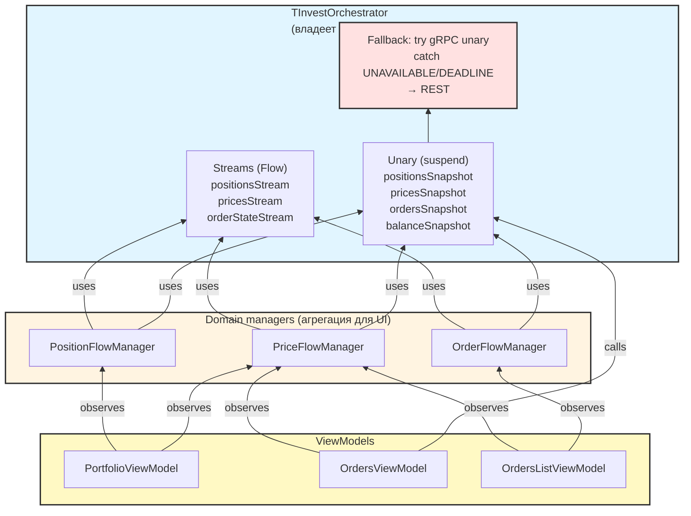

# ROADMAP

План задач проекта TScalp (разработка): что в работе, что
запланировано, что отложено. Формат — секция на задачу,
со статусом и оценкой.

CI/CD-планирование → `docs/ci-roadmap.md`.


## Планируемые задачи

---

### UserInstrumentsApi

**Мобильная работа:** невозможно (сборка + тесты).

**Статус:** запланировано.

**Контекст.**

`BrokerApi` содержит 2 метода инструментов для
**пользовательского пути** (поиск и статусы торговли):
- `findInstruments(query: String): List<InstrumentUi>` —
  bulk-поиск, для фьючерсов возвращает **неполный**
  `InstrumentUi` (без margin, `pointValue` из
  minPriceIncrement); полный инструмент — через
  `BrokerInstrumentApi.fetchFullInstrument` (#3, отдельная
  роль);
- `getTradingStatuses(ids): Map<String, TradingAvailability>` —
  статусы доступности торговли.

**Не путать с `BrokerInstrumentApi` (#3).** Тот — внутренняя
инфраструктура (один uid → один полный инструмент, кэш
`InstrumentRepository`). `UserInstrumentsApi` —
пользовательский путь (bulk-поиск, статусы).

Реализации (grep 2026-10-25):
- `TInvestBrokerAPI` — **2/2** реальных
  (`marketData.findInstruments`, `marketData.getTradingStatuses`);
- `BcsBrokerApi` — 0/2 (`emptyList` / все `UNKNOWN`);
- `FinamBrokerApi` — 0/2 (`emptyList` / `emptyMap`).

Потребители (grep 2026-10-25):
- `InvestRepository.searchInstrumentsResult` (стр. 63) —
  `findInstruments` через `getDefaultBroker()`;
- `InvestRepository.getTradingStatusesResult` (стр. 200) —
  `getTradingStatuses` через `getBroker(brokerName)`;
- `SearchCache.search` (стр. 41) — `findInstruments` через
  `getBroker(brokerName)`.

**Цель.** `UserInstrumentsApi` — nullable-val роль по
образцу `OrdersApi` / `AccountsApi` / `SandboxApi`.
`BrokerApi.userInstruments: UserInstrumentsApi?` (имя с
префиксом `user`, чтобы в фасаде не путать с `instrument:
BrokerInstrumentApi?`). Потребители переходят на
`broker.userInstruments?.<метод>`; при `null` — `AppResult.Failure`
(в `InvestRepository`) или `emptyList` (в `SearchCache`).

**Решение (nullable-val, Scenario2).**
- Методы `UserInstrumentsApi`: `findInstruments`,
  `getTradingStatuses`.
- TInvest: supertype `UserInstrumentsApi`,
  `userInstruments = this` (2/2).
- BCS: `userInstruments = null`, **без** supertype (0/2).
- Finam: `userInstruments = null`, **без** supertype (0/2).
- `InvestRepository.searchInstrumentsResult`: `broker.userInstruments
  ?: return Failure(...)` + `userInstruments.findInstruments(...)`.
- `InvestRepository.getTradingStatusesResult`: аналогично.
- `SearchCache.search`: `broker.userInstruments?.findInstruments(query)
  ?: emptyList()` (текущее поведение при `emptyList` сохраняется).

**Предусловия:**
- Umbrella `### Рефакторинг ролей BrokerApi (nullable-val,
  Scenario2)` — #1–#6 закрыты; Move закрыт.

**Файлы:**
- `domain/api/roles/UserInstrumentsApi.kt` (новый).
- `domain/api/BrokerApi.kt` — `val userInstruments:
  UserInstrumentsApi?`.
- `data/api/TInvestBrokerApi.kt` — supertype
  `UserInstrumentsApi`, `userInstruments = this`, 2 метода →
  `override`.
- `data/api/BcsBrokerApi.kt` — `userInstruments = null`, **без**
  supertype.
- `data/api/FinamBrokerApi.kt` — `userInstruments = null`,
  **без** supertype.
- `data/repository/InvestRepository.kt` — 2 callsites
  (`searchInstrumentsResult:63`, `getTradingStatusesResult:200`).
- `data/repository/SearchCache.kt` — 1 callsite (`search:41`).

**Шаги:**
1. `UserInstrumentsApi` (2 метода + KDoc с разграничением от
   `BrokerInstrumentApi`).
2. `BrokerApi.userInstruments: UserInstrumentsApi?`.
3. TInvest: supertype + `userInstruments = this`, 2 метода →
   `override`.
4. BCS: `userInstruments = null` (без supertype).
5. Finam: `userInstruments = null` (без supertype).
6. `InvestRepository`: 2 callsites → `broker.userInstruments
   ?: return Failure` + `userInstruments.<метод>`.
7. `SearchCache`: `broker.userInstruments?.findInstruments(query)
   ?: emptyList()`.
8. Гейт: `testDebugUnitTest / lintDebug / ktlintCheck /
   detekt`.

**Тесты.** `InvestRepositoryTest` / `SearchCacheTest` не
существуют. Замена — тривиальная делегация. **Дефолт:** без
новых unit-тестов (по образцу #3–#6).

**Референсы:**
- `f8569ee` (#1 StreamsApi) — образец supertype у TInvest,
  `null` у BCS/Finam.
- `cccbdd5` (#4 OrdersApi), `08c5c4f` (#5 AccountsApi) —
  образец `broker.<role> ?: Failure` в `InvestRepository`.
- `dc909e6` (#6 SandboxApi) — образец для проверки anchor
  через `repr()` (в `SearchCache.search` отступы — смотреть
  до скрипта).

**Ограничения:**
- **Supertype только у TInvest.** BCS/Finam — `null` без
  supertype (AGENTS.md «Nullable-val роли»).
- **Импорты по алфавиту** (AGENTS.md «Порядок импортов при
  вставке»): `UserInstrumentsApi` идёт **последним** среди
  `domain.api.roles.*` (`...StreamsApi < UserInstrumentsApi`).
- **Anchor indent через `repr()`** (AGENTS.md «Anchor на
  строку с отступом — проверять `repr()`»): в
  `SearchCache.search` и `InvestRepository` anchor на одну
  строку — отступы смотреть через `repr()`, не визуально.
- **`getTradingStatusesResult` уже обрабатывает `ids.isEmpty()`**
  — этот check оставить до `userInstruments`-check
  (возврат `Success(emptyMap())` для пустого списка без
  обращения к брокеру).
- Не смешивать с `### Реализация BCS Broker API` /
  `### Реализация Finam Broker API`.
- `synchronized(startLock)` в менеджерах не трогать.

**Критерий готовности:**
- `UserInstrumentsApi` создан (2 метода + KDoc, разграничение
  с `BrokerInstrumentApi`).
- `BrokerApi.userInstruments: UserInstrumentsApi?`.
- TInvest `userInstruments = this` + supertype; BCS/Finam
  `userInstruments = null` без supertype.
- `grep "broker.findInstruments\|broker.getTradingStatuses"`
  в `InvestRepository` / `SearchCache` — пусто (все через
  `userInstruments`).
- Гейт зелёный.

**Оценка:** ~1.25 ч (UserInstrumentsApi 10 мин, BrokerApi 5,
TInvest 10, BCS 5, Finam 5, InvestRepository 2 callsites 15,
SearchCache 10, гейт 10, резерв 15).

**Зависимости:** umbrella #1–#6 закрыты, Move закрыт.

**Связано:**
- Umbrella `### Рефакторинг ролей BrokerApi (nullable-val,
  Scenario2)` — #7 в порядке.
- `### TInvest-specific: fetchFullInstrument` (#3, закрыта) —
  разграничение `UserInstrumentsApi.findInstruments` (bulk,
  неполный) vs `BrokerInstrumentApi.fetchFullInstrument`
  (один uid, полный).
- `### Реализация BCS Broker API` / `### Реализация Finam
  Broker API` — реализация `findInstruments` /
  `getTradingStatuses` у BCS/Finam, отдельные задачи (не
  блокируют).

**Открытые вопросы:** нет.

---

### Live-test Broker lifecycle API: BCS/Finam

**Мобильная работа:** невозможно (нужен девайс/эмулятор + adb).

**Статус:** отложено.

**Контекст:** `### Broker lifecycle API` (#2 umbrella, закрыт
2026-10-25) прошёл live-тест только по TInvest. BCS/Finam lifecycle
не проверены: оба брокера — заглушки (`getAccounts`/`getOrders`/
etc.), стримы не реализованы. Тест сейчас вернул бы «initialize:
success, стримы не идут» — не проверка, а констатация известного
состояния. Defer по 2d — временное решение с задачей на полное
закрытие.

**Предусловия:**
- `### Реализация BCS Broker API` закрыта.
- `### Реализация Finam Broker API` закрыта.

**Что делать:**

Повторить процедуру live-теста из `### Broker lifecycle API`
(`docs/live-test.md`, режим B) для BCS/Finam:

1. **Login BCS** через `SettingsViewModel.initializeBcs` —
   `lifecycle.initialize(BrokerCredentials.Bcs)` →
   `isInitialized = true`, стримы поднимаются, `initialize:
   success` в логе.
2. **Login Finam** через `SettingsViewModel.initializeFinam` —
   `lifecycle.initialize(BrokerCredentials.Finam)` →
   `isInitialized = true`, стримы поднимаются.
3. **Logout BCS / Finam** —
   `clearBrokerCredentials: <broker> deinitialized`,
   `isInitialized = false`.
4. **Restart приложения** с сохранёнными credentials —
   `restoreBcs` восстанавливает BCS, Finam — через UI (Finam
   сейчас в `restoreBrokerConnection` — `Unit`, требует
   `initialize` из UI, см. `TScalpApplication.restoreBrokerConnection`).

**Файлы:** нет правок в коде. Только лог (`~/lifecycle-live-bcs-finam.log`).

**Шаги:** без правок кода — только запуск и анализ лога по
процедуре `docs/live-test.md`.

**Референсы:**
- `docs/live-test.md` — процедура, фильтры logcat, режим B.
- `### Broker lifecycle API` (закрыт) — TInvest-only live-тест,
  образец.

**Ограничения:**
- Не менять код — только тест. Если при тесте обнаружится
  регрессия в lifecycle — отдельная задача/фикс.
- Не смешивать с задачей `### Реализация Finam Broker API` —
  там реализация, здесь верификация lifecycle.

**Критерий готовности:**
- Login / logout / restart для BCS и Finam проходят по логу
  (сценарии 1–4 выше).
- `isInitialized` переключается корректно.
- Красных флагов в логе нет.

**Оценка:** ~30 мин.

**Зависимости:**
- `### Реализация BCS Broker API`
- `### Реализация Finam Broker API`

**Связано:**
- `### Broker lifecycle API` (закрыт 2026-10-25, TInvest-only).
- `### Реализация BCS Broker API`, `### Реализация Finam Broker API`.

**Открытые вопросы:** нет.

---

### PortfolioApi: ревизия fetchPositionsSnapshot

**Мобильная работа:** невозможно (сборка и тесты).

**Статус:** запланировано.

**Контекст:** `BrokerApi.fetchPositionsSnapshot(accountId, sandboxMode)`
возвращает `List<PortfolioPosition>` — presentation-модель
(`totalValue`, `profitPercent`, `priceChangePercent` — вычисляемые
для карточки). Domain-контракт возвращает presentation-модель —
нарушение Clean (dependency rule: presentation зависит от domain,
а не наоборот).

**Известный долг, зафиксирован в:**
- `BrokerApi.kt` → KDoc `fetchPositionsSnapshot`: «Полная модель
  для UI. Не путать с [BrokerSnapshotApi.positionsSnapshot]:
  тот partial [PositionStreamItem]».
- `docs/ROADMAP.md` → `### TInvest-specific методы в *FlowManager`
  → «Известный долг (B из обсуждения)».
- `docs/ROADMAP.md` → `### Рефакторинг архитектурного долга
  (detekt-группа 3)` → `#### BrokerApi-реализации` → «Известный
  долг (включается в D)».
- `docs/architecture.md` (раздел 7, при создании).

**Цель:** убрать presentation-модель из domain-контракта. Либо
унифицировать на `PositionStreamItem`, либо оставить как есть с
явной фиксацией отклонения по 2c.

**Варианты:**

- **A. Оставить как есть, только KDoc.**
  - `BrokerApi.fetchPositionsSnapshot` → `List<PortfolioPosition>`.
  - KDoc: «presentation-модель в domain-контракте — осознанное
    отклонение по 2c. Clean-альтернатива — B. Отклонение
    обосновано: `PortfolioPosition` содержит вычисляемые поля
    (`profitPercent` через `calculateProfitPercent` с `pointValue`),
    которые domain-слой не должен считать; UI нужен готовый
    снимок».
  - **+** Ноль работы, ноль риска.
  - **−** Нарушение Clean остаётся. Presentation-модель в domain —
    долг, но с явной пометкой.

- **B. Унифицировать на `PositionStreamItem`.**
  - `BrokerApi.fetchPositionsSnapshot` → `List<PositionStreamItem>`.
  - В domain-слое (usecase / `PositionFlowManager`) — конвертация
    в `PortfolioPosition` через `toPortfolioPosition()` (уже
    существует, `Portfolio.kt`).
  - Вычисляемые поля (`profitPercent` через `calculateProfitPercent`)
    остаются в `PortfolioPosition`, но считаются в domain-слое
    (при конвертации), не в data.
  - **+** Domain-контракт чистый. Data-слой не знает про
    presentation.
  - **−** Меняет сигнатуру `fetchPositionsSnapshot` — 3 брокера,
    `InvestRepository`, тесты. Плюс `InvestRepository` (единственный
    потребитель) должен конвертировать в `PortfolioPosition` перед
    возвратом в UI.
  - **−** Дублирование: `fetchPositionsSnapshot` (полный
    `PositionStreamItem` с P&L) и `BrokerSnapshotApi.positionsSnapshot`
    (partial `PositionStreamItem` для merge со stream) — почти
    одинаковые, но с разной семантикой. Объединять или оставить
    два — отдельный вопрос.

- **C. Выделить `PortfolioApi` с `fetchFullPortfolio`:**
  - `interface PortfolioApi { suspend fun fetchFullPortfolio(accountId): List<PortfolioPosition> }`
  - `val portfolio: PortfolioApi?` в `BrokerApi` (nullable-val,
    по образцу `snapshot`).
  - KDoc на `PortfolioApi`: «presentation-модель в domain —
    осознанное отклонение по 2c. Clean-альтернатива — B».
  - **+** Явный контракт «этот метод — исключение». Отдельная
    роль, KDoc понятен.
  - **−** Не решает Clean-проблему, только формализует её. Та же
    fat `BrokerApi` + лишний слой. По сути A, но с ролью.

**Рекомендация:** **B** — единственный вариант, реально убирающий
presentation-модель из domain. Но перед этим — ревизия: сравнить
`PositionStreamItem` от `fetchPositionsSnapshot` и от
`BrokerSnapshotApi.positionsSnapshot`. Возможно, это одна и та же
модель в двух ролях, и унификация позволит объединить методы.

**Отложить до:**
- Завершения рефакторинга ролей (nullable-val) — чтобы
  `PortfolioApi` вписался в единый паттерн.
- Решения по `fetchPositionsSnapshot` vs `positionsSnapshot`
  (в `### TInvest-specific методы в *FlowManager` уже отмечено,
  что это разные роли).

**Файлы:**
- `domain/api/BrokerApi.kt` — сигнатура `fetchPositionsSnapshot`.
- `domain/api/roles/BrokerSnapshotApi.kt` — возможно, объединение с
  `positionsSnapshot`.
- `data/api/TInvestBrokerAPI.kt` / `BcsBrokerApi.kt` /
  `FinamBrokerApi.kt` — реализации.
- `data/api/TInvestMarketDataService.kt` — `fetchPositionsSnapshot`
  (возвращает `PortfolioPosition` сейчас).
- `data/repository/InvestRepository.kt` — `fetchPositionsResult`,
  конвертация в `PortfolioPosition` (при варианте B).
- `domain/models/Portfolio.kt` — `toPortfolioPosition()` уже есть.
- `presentation/screens/portfolio/PortfolioViewModel.kt` — потребитель.

**Шаги (для варианта B):**
1. Ревизия: сравнить `PositionStreamItem` от `fetchPositionsSnapshot`
   и от `positionsSnapshot`. Решить, объединять методы или оставить
   два.
2. `BrokerApi.fetchPositionsSnapshot` → `List<PositionStreamItem>`.
3. Реализации: `TInvestMarketDataService.fetchPositionsSnapshot`
   возвращает partial `PositionStreamItem` (без `profitPercent` —
   он считается в domain).
4. `InvestRepository.fetchPositionsResult`: конвертация
   `List<PositionStreamItem>` → `List<PortfolioPosition>` через
   `toPortfolioPosition()`.
5. Тесты: `InvestRepositoryTest` (или аналог) на конвертацию.
6. KDoc: обновить `fetchPositionsSnapshot`, `positionsSnapshot`,
   `InvestRepository.fetchPositionsResult`.
7. Гейт: `testDebugUnitTest / lintDebug / ktlintCheck / detekt`.

**Тесты:**
- При B: unit-тест на конвертацию `PositionStreamItem` →
  `PortfolioPosition` (граничные случаи: `currentPrice = null`,
  `expectedYield = null`, `pointValue = null`).
- При A/C: тесты не требуются (только KDoc).

**Референсы:**
- `BrokerApi.kt` → KDoc `fetchPositionsSnapshot` — текущая
  семантика.
- `BrokerSnapshotApi.kt` → `positionsSnapshot` — partial-модель
  для merge.
- `Portfolio.kt` → `toPortfolioPosition()` — конвертация.
- `TInvestMarketDataService.fetchPositionsSnapshot` — текущая
  реализация (возвращает `PortfolioPosition`).
- `docs/ROADMAP.md` → `### TInvest-specific методы в *FlowManager`.

**Ограничения:**
- Не менять `PortfolioPosition` без санкции (UI-модель).
- Не смешивать с `### TInvest-specific методы в *FlowManager` —
  там `BrokerSnapshotApi`, здесь `fetchPositionsSnapshot`. Разные
  задачи.
- Не выделять `PortfolioApi` (вариант C) до завершения
  рефакторинга ролей.

**Критерий готовности:**
- Domain-контракт `BrokerApi` не возвращает presentation-модель.
- Или, при выборе A/C, — явное KDoc с обоснованием и ссылкой на
  Clean-альтернативу.
- Гейт зелёный.

**Оценка:** ~2–3 ч (вариант B); ~20 мин (вариант A/C — только
KDoc + фиксация отклонения по 2c).

**Зависимости:** после завершения рефакторинга ролей
(nullable-val) — чтобы `PortfolioApi` вписался в единый паттерн.

**Связано:**
- `### Рефакторинг ролей BrokerApi (nullable-val, Scenario2)` — umbrella, #9 в порядке.
- `### TInvest-specific методы в *FlowManager` — там
  `BrokerSnapshotApi.positionsSnapshot` (partial), здесь
  `fetchPositionsSnapshot` (полный).
- `### Рефакторинг архитектурного долга (detekt-группа 3)` →
  `#### BrokerApi-реализации` — общий рефакторинг `BrokerApi`.
- `docs/architecture.md` (раздел 7) — при создании добавить
  ссылку на эту задачу.

**Открытые вопросы:**
- `PortfolioPosition` содержит `profit` (серверный `expectedYield`
  при >0, иначе клиентский — см. `### Рефакторинг расчёта P&L для
  PortfolioPosition`). При варианте B конвертация в domain — где
  именно? `InvestRepository` или отдельный usecase? Решить при
  старте.
- Объединять `fetchPositionsSnapshot` и `positionsSnapshot` в
  один метод или оставить два с разной семантикой? Решить на
  шаге 1 (ревизия).


---

### Рефакторинг ролей BrokerApi (nullable-val, Scenario2)

**Мобильная работа:** невозможно (сборка + тесты на десктопе).

**Статус:** запланировано.

**Контекст.**

`BrokerApi` — fat-интерфейс: 19 методов + 3 свойства
(`name`, `isInitialized`, `snapshot`). Три реализации:
`TInvestBrokerAPI` (полная), `BcsBrokerApi` (25 функций,
большинство — заглушки: `UnsupportedOperationException`,
`emptyList`, no-op), `FinamBrokerApi` (24 функции, все —
заглушки). Потребителей: 52 callsite в 9 файлах (по grep
`broker\.` — нижняя граница). Кастов `as? <ConcreteApi>` — 9
в 3 файлах (`TScalpApplication`, `SettingsViewModel`,
`InstrumentRepository`).

**Прецедент.** Паттерн nullable-val уже работает для
`BrokerSnapshotApi`: `val snapshot: BrokerSnapshotApi?` в
`BrokerApi`; `TInvestBrokerAPI.snapshot = this`,
`BcsBrokerApi.snapshot = null`, `FinamBrokerApi.snapshot = null`.
Используется тремя менеджерами (`PositionFlowManager`,
`OrderFlowManager`, `PriceFlowManager`) через `broker.snapshot`,
без кастов. Это то, что расширяем.

**Решение (Scenario2).**

Каждая роль — отдельный интерфейс в `domain.api.roles`; в
`BrokerApi` — `val <role>: <RoleApi>?`. Брокер:
`override val <role> = this` (поддерживает) или `= null`
(не поддерживает). Потребители с узкими нуждами (менеджеры,
`SettingsViewModel`, `TScalpApplication`, `SearchCache`,
`InstrumentRepository`) инжектят роль напрямую (гибрид DI:
resolver + инъекция для дефолтного брокера — утверждено).
`InvestRepository` остаётся на fat `BrokerApi` — осознанное
отклонение.

**Обоснование по 2c (3 обязательных элемента).**

1. **Правило Clean, которое нарушено.** Interface Segregation
   Principle: `InvestRepository` зависит от fat `BrokerApi`
   (19 методов, 29 callsite, использует все). `BrokerApi`
   остаётся fat — нет ISP на callsite для `InvestRepository`.

2. **Clean-альтернатива (B→A).** Супертипы
   (`BrokerApi : Roles`) → `BrokerRoleResolver` → удаление
   `BrokerApi`. Все потребители, включая `InvestRepository`,
   мигрируют на resolver.
   - **+:** полный ISP на определении и на callsite;
     `BrokerApi` удалён; единый механизм DI.
   - **−:** +5–7 ч и +2 PR; риск переделки 29 callsite в
     `InvestRepository`; при супертипах у BCS/Finam — заглушки
     (`throw` / `emptyList`), то есть фиктивный контракт
     («метод есть, но не работает») — тоже не Clean.

3. **Выгоды Scenario2 относительно B→A.**
   - Продолжает **существующий паттерн** (`snapshot` уже
     nullable-val), не ломает его.
   - **2 из 9 шагов уже в ROADMAP** (`### Broker lifecycle API`,
     `### TInvest-specific: fetchFullInstrument`) — не новая
     работа, а закрытие существующих задач в едином стиле.
   - Каждый PR **независим** — можно остановиться на любом
     шаге, откат тривиален.
   - **`InvestRepository` (29 callsite) не трогается** —
     самый рискованный файл вне работы.
   - **Честная опциональность:** `null` = «не поддерживаю»,
     компилятор заставляет проверить (`?.`, `?:`, `!!`).
   - **Меньше на ~5–7 ч и ~2 PR** (по сравнению с B→A).
   - **Цена:** `BrokerApi` остаётся fat — фиксация в KDoc
     (шаг #10).

**Порядок работ (#1–#11).**

Сверху — роли с потребителями-**не-фасадами** (менеджеры,
`SearchCache`, `TScalpApplication`, `SettingsViewModel`).
Низ — роли, нужные только `InvestRepository` (фасад, ему
fat-интерфейс подходит). Если остановиться после #3 —
3/4 потребителей мигрированы.

| # | Роль / задача | Где | Потребители (callsite) | Касты | Оценка |
|---|---|---|---|---|---|
| 1 | `StreamsApi` | ✅ done | 3 менеджера (по 1) + `InvestRepository.subscribeLastPrices` (legacy, удалён) | 0 | 2.5–3 ч |
| 2 | `BrokerLifecycleApi` | ✅ done | `SettingsViewModel` (6), `TScalpApplication` (2) | 8 | 3–4 ч |
| 3 | `BrokerInstrumentApi` | ✅ done | `InstrumentRepository` (1) | 1 | 45 мин |
| 4 | `OrdersApi` | ✅ done | `InvestRepository` (6) | 0 | 2 ч |
| 5 | `AccountsApi` | ✅ done | `TScalpApplication` (1), `InvestRepository` (1) | 0 | 1 ч |
| 6 | `SandboxApi` | ✅ done | `InvestRepository` (3), `TScalpApplication` (1) | 0 | 1.5 ч |
| 7 | `UserInstrumentsApi` | новая | `InvestRepository` (2), `SearchCache` (1) | 0 | 1.25 ч |
| 8 | `BalanceApi` | новая | `InvestRepository` (1) | 0 | 30 мин |
| 9 | `PortfolioApi` | ROADMAP | `InvestRepository` (1) | 0 | 2–3 ч |
| 10 | KDoc на `BrokerApi` (fat, отклонение по 2c) | в плане | — | — | 15 мин |
| 11 | `Рефакторинг BrokerApi-реализаций` (D) | ROADMAP | — | — | 3–4 ч |

Суммарно по ролям (#1–#10): **~11.5–13.5 ч**. `#11` — отдельно,
**~3–4 ч**.

**Детали по новым ролям (#1, #4–#8, #10).**
Для #2, #3, #9, #11 — подробные планы в отдельных секциях
(ссылки в «Связанные задачи» ниже), здесь не дублируются.

**#1 StreamsApi (~2.5–3 ч).** См. отдельную секцию `### StreamsApi: выделение роли из BrokerApi` (шаг #1 в порядке). Содержит полный план: файлы, шаги, тесты, критерий готовности.

**#4 OrdersApi (~1.5 ч).**
- Методы: `postOrder(BrokerOrderRequest): OrderResult`,
  `postStopOrder(StopOrderRequest): String`,
  `getOrders(accountId): List<OrderListItem>`,
  `getStopOrders(accountId): List<OrderListItem>`,
  `cancelOrder(accountId, orderId)`,
  `cancelStopOrder(accountId, stopOrderId)`.
- Файл: `domain/api/roles/OrdersApi.kt` (новый).
- `BrokerApi.orders: OrdersApi?`.
- TInvest: `orders = this` (все 6 через
  `TInvestOrdersService` — работают). BCS: `orders = null`
  (у BCS работают только `postOrder`; `postStopOrder` —
  заглушка, `getOrders`/`getStopOrders` — `emptyList`,
  `cancel*` — `UnsupportedOperationException`. Частичная
  поддержка не выражается nullable-val одной роли — честно
  `null`). Finam: `null`.
- Потребители: `InvestRepository` — 6 callsite (`postOrderResult`,
  `postStopOrderResult`, `getAllOrdersResult` — `getOrders` +
  `getStopOrders`, `cancelOrderResult`, `cancelStopOrderResult`).
  Замены: `broker.postOrder` → `broker.orders?.postOrder ?: throw
  AppError.Unknown("Брокер не поддерживает заявки")` (внутри
  `runCatchingAppResult` — упадёт в `Failure`, ок).
- Тесты: `InvestRepositoryTest` (если есть) — мок `broker.orders`.
- Критерий: `InvestRepository` не вызывает `broker.postOrder`
  напрямую, только через `broker.orders?.`.
- Зависимости: после #1 (паттерн nullable-val обкатан).

**#5 AccountsApi (~1 ч).**
- Метод: `getAccounts(sandboxMode): List<BrokerAccount>`.
  Sandbox-операции — в `SandboxApi` (#6), чтобы BCS честно
  поддерживал `getAccounts`, но не sandbox.
- Файл: `domain/api/roles/AccountsApi.kt` (новый).
- `BrokerApi.accounts: AccountsApi?`.
- TInvest: `accounts = this`. BCS: `accounts = this`
  (`getAccounts` реализован через портфель). Finam: `null`.
- Потребители:
  - `TScalpApplication`: `broker.getAccounts(sandbox)` →
    `broker.accounts?.getAccounts(sandbox)` (в
    `restoreTInvest` — каст уходит по #2, но `getAccounts`
    остаётся). При `null` — fallback на `savedAccountId`.
  - `InvestRepository.getAccountsResult` —
    `broker.accounts?.getAccounts(sandbox)`.
- Тесты: `InvestRepositoryTest` (если есть) — мок `broker.accounts`.
  `TScalpApplication` — live-тест.
- Критерий: `broker.getAccounts` напрямую — пусто (только через
  `broker.accounts?.`).
- Зависимости: после #1.

**#6 SandboxApi (~1 ч).**
- Методы: `openSandboxAccount(): String`,
  `closeSandboxAccount(accountId)`,
  `sandboxPayIn(accountId, amount: SandboxMoney)`.
- Файл: `domain/api/roles/SandboxApi.kt` (новый).
- `BrokerApi.sandbox: SandboxApi?`.
- TInvest: `sandbox = this`. BCS: `sandbox = null` (у BCS
  `open`/`close` → `UnsupportedOperationException`, `payIn` —
  no-op с warning. Смешанное поведение — честно `null`).
  Finam: `null`.
- Потребители: `InvestRepository` — 3 callsite
  (`sandboxPayInResult`, `openSandboxAccountResult`,
  `closeSandboxAccountResult`). Замены:
  `broker.sandbox?.` + `?: AppResult.Failure(AppError.Unknown("Брокер не поддерживает песочницу"))`.
- Тесты: `InvestRepositoryTest` (если есть) — мок `broker.sandbox`.
- Критерий: `broker.openSandboxAccount` / `sandboxPayIn` /
  `closeSandboxAccount` напрямую — пусто.
- Зависимости: после #5 (симметрия).

**#7 UserInstrumentsApi (~1 ч).**
- Методы: `findInstruments(query): List<InstrumentUi>`,
  `getTradingStatuses(ids): Map<String, TradingAvailability>`.
- Файл: `domain/api/roles/UserInstrumentsApi.kt` (новый).
- `BrokerApi.instruments: UserInstrumentsApi?`.
- TInvest: `instruments = this`. BCS: `instruments = null`
  (`findInstruments` → `emptyList`, `getTradingStatuses` →
  `UNKNOWN` — заглушки). Finam: `null`.
- Потребители: `SearchCache` — 1 callsite
  (`broker.findInstruments` → `broker.instruments?.findInstruments
  ?: emptyList()`), `InvestRepository.getTradingStatusesResult`
  — 1 (`broker.instruments?.getTradingStatuses`).
- Тесты: `SearchCacheTest` (если есть) — мок `broker.instruments`.
- Критерий: `broker.findInstruments` / `broker.getTradingStatuses`
  напрямую — пусто.
- Зависимости: после #1.

**#8 BalanceApi (~30 мин).**
- Метод: `getBalance(accountId): Double`.
- Файл: `domain/api/roles/BalanceApi.kt` (новый).
- `BrokerApi.balance: BalanceApi?`.
- TInvest: `balance = this`. BCS: `balance = null` (у BCS
  `getBalance` возвращает `0.0` — заглушка). Finam: `null`.
- Потребители: `InvestRepository.getBalanceResult` — 1
  (`broker.balance?.getBalance ?: 0.0`).
- Тесты: `InvestRepositoryTest` (если есть).
- Критерий: `broker.getBalance` напрямую — пусто.
- Зависимости: после #1.

**#10 KDoc на BrokerApi (~15 мин).**
- Файл: `domain/api/BrokerApi.kt` — KDoc на интерфейсе.
- Что: «fat-интерфейс осознанно. Потребители с узкими нуждами
  инжектят роль напрямую (`StreamsApi`, `BrokerLifecycleApi`,
  ...); доступ — через `broker.<role>?`. `InvestRepository` —
  мультиброкерный фасад на fat `BrokerApi`: 29 callsite, все
  методы. Отклонение по 2c: нарушено ISP для `InvestRepository`;
  Clean-альтернатива — B→A (супертипы → `BrokerRoleResolver`,
  +5–7 ч, +2 PR, риск 29 callsite); выгоды Scenario2 —
  продолжает существующий паттерн `snapshot`, каждый PR
  независим, `InvestRepository` не трогается, честная
  опциональность».
- Оценка: 15 мин.
- Зависимости: после #1–#9 (фиксация итогового состояния).

**Связанные задачи.**

- `### StreamsApi: выделение роли из BrokerApi` — #1. Отдельная секция, полный план.
- `### Broker lifecycle API` — #2. Отдельная секция, полный
  план (вариант A: `BrokerCredentials` sealed +
  `BrokerLifecycleApi?`).
- `### TInvest-specific: fetchFullInstrument` — #3. Отдельная
  секция, полный план (`BrokerInstrumentApi?`).
- `### PortfolioApi: ревизия fetchPositionsSnapshot` — #9.
  Отдельная секция (ревизия `fetchPositionsSnapshot` vs
  `positionsSnapshot`; варианты A/B/C).
- `### Рефакторинг BrokerApi-реализаций` (detekt-группа 3,
  `#### BrokerApi-реализации`) — #11. «Уборка» после всех
  ролей: разбить `TInvestBrokerAPI` / `BcsBrokerApi` /
  `FinamBrokerApi` на сервисы по образцу
  `TInvestMarketDataService` / `TInvestOrdersService`.
- `### TInvest-specific методы в *FlowManager` (закрыта) —
  **предшественник** umbrella: паттерн nullable-val
  (`BrokerSnapshotApi?`) установлен здесь.
- `### Рефакторинг архитектурного долга (detekt-группа 3)` —
  общий контекст: `TooManyFunctions` на `BrokerApi` (19) и
  реализациях (25/24/22).
- `docs/architecture.md` → раздел 7 (BrokerApi) — обновить
  после umbrella: перечислить все роли и паттерн nullable-val.

**Критерий готовности (umbrella).**

- Все 9 ролей выделены (#1–#9): `StreamsApi`,
  `BrokerLifecycleApi`, `BrokerInstrumentApi`, `OrdersApi`,
  `AccountsApi`, `SandboxApi`, `UserInstrumentsApi`, `BalanceApi`,
  `PortfolioApi`.
- `BrokerApi` содержит 9 nullable-val (snapshot + 8 новых ролей,
  включая `lifecycle`, `instrument`, `portfolio`).
- `InvestRepository` — на fat `BrokerApi`; вызовы, затронутые
  nullable-val ролями, адаптированы (`broker.<role>?.`).
- KDoc на `BrokerApi` фиксирует отклонение по 2c (все три
  элемента: правило, альтернатива, выгоды).
- 9 кастов `as? <ConcreteApi>` устранены (#2 — 6, #3 — 1,
  #5 — 2).
- Гейт (`testDebugUnitTest / lintDebug / ktlintCheck / detekt`)
  зелёный на каждом шаге.

**Оценка.** ~11.5–13.5 ч по ролям (#1–#10). #11 — отдельно,
~3–4 ч.

**Зависимости.** Нет. **Разблокирует**
`### Рефакторинг BrokerApi-реализаций` (D).

**Открытые вопросы.**

- `PortfolioApi` (#9): форма — `fetchFullPortfolio` с
  `PortfolioPosition` (презентационная модель, отклонение по
  2c с KDoc) или унификация на `PositionStreamItem` (чистый
  domain-контракт)? Решится в `### PortfolioApi: ревизия
  fetchPositionsSnapshot` на шаге 1 (ревизия
  `fetchPositionsSnapshot` vs `BrokerSnapshotApi.positionsSnapshot`).
- `BcsBrokerApi.orders`: `postOrder` работает, остальное —
  заглушки. Честный nullable-val → `orders = null`.
  Если BCS-торговля через `postOrder` понадобится —
  разделить `OrdersApi` на `OrdersQueryApi` /
  `OrdersCommandApi` (отдельная задача
  `### Реализация BCS Broker API`).
- `BcsBrokerApi.sandbox`: `payIn` — no-op, `open`/`close` —
  throw. Честный nullable-val → `sandbox = null`.
- После umbrella — нужен ли `BrokerRoleResolver`? Пока нет
  (один потребитель fat — `InvestRepository`). Пересмотреть
  при появлении второго мультиброкерного фасада или второго
  разработчика.
- `:domain-api` отдельным Gradle-модулем — в рамках
  KMP-миграции, не сейчас (утверждено).


---


---

### Архитектурный документ (docs/architecture.md)

**Мобильная работа:** полное закрытие (правки .md — через proot;
mermaid-рендер — визуальная проверка, не блокирует).

**Статус:** запланировано.

**Контекст:** архитектурные решения разбросаны по AGENTS.md,
ROADMAP (закрытые задачи), docs/streams.md, docs/live-test.md,
KDoc. Нет единой точки входа. Нужен `docs/architecture.md` —
справочник с mermaid-диаграммами.

**Цель:** новый читатель за одно чтение понимает: слои, где
живёт fallback, как managers агрегируют данные, какие
идентификаторы, какие долги известны.

**Известные архитектурные особенности (собраны 2026-10-23):**

1. **Слои и границы.**
    - presentation → domain → data. ViewModel не ходит к брокеру —
      только через `InvestRepository` или `*FlowManager`.
    - Orchestrator (`TInvestOrchestrator`) — транспорты.
    - Managers (`PriceFlowManager`, `PositionFlowManager`,
      `OrderFlowManager`) — merge stream + polling + домен.
    - Repository (`InvestRepository`) — навигация по брокерам.

2. **Транспорты и fallback.**
    - Stream-уровень (orchestrator): gRPC stream ↔ WS stream через
      `streamWithFallback(primary, fallback, polling = null)`.
      Polling — `null` с StreamState (перенесён в managers).
    - Unary-уровень (orchestrator): gRPC unary → REST unary на
      транспортные ошибки (`UNAVAILABLE` / `DEADLINE_EXCEEDED` /
      `UNIMPLEMENTED`); бизнес-ошибки не fallback.
    - Merge-уровень (managers): stream ↔ polling. Обогащение
      (P&L, money/blocked, TTL-эвикция) — в managers.
    - Fallback-логика принадлежит оркестратору (transport-level);
      managers видят только `Flow` + `suspend fun`.

3. **Managers lifecycle.**
    - `start` / `stop` / `reapplyDebugFlags` — единая точка.
    - `synchronized(startLock)` — защита check-then-set
      (race-фикс PR #34; регрессия покрыта тестами).
    - `job: Job?` + `coroutineScope { launch × 3 }` (stream,
      polling, `stateWatchdog`).
    - `Dispatchers.IO.limitedParallelism(1)` — сериализация
      мутабельного состояния; `synchronized` не нужен.
    - `stateTracker: StreamStateTracker` — `LIVE` / `POLLING` /
      `STALE` / `STOPPED`. Watchdog tick 1s.
    - `reapplyDebugFlags` — no-op, если менеджер не запущен.

4. **Идентификаторы.**
    - `tscalpInstrumentId` (domain) ↔ `uid` (T-Invest) / `figi`
      (BCS) / `ticker+exchange` (Finam).
    - Трансляция — в data-слое (репозиторий / брокер).
    - `InstrumentUi.ttech_uid` — специфика T-Invest (исключение).

5. **Потоки данных (domain).**
    - `PriceFlowManager._prices: SharedFlow(replay = 0)` — one-shot
      updates; подписчик подтягивает через `pricesSnapshot`.
    - `PositionFlowManager._flow: SharedFlow(replay = 1)` —
      stateful snapshot; сброс при смене счёта.
    - `OrderFlowManager._orders: StateFlow` + `_hasLoaded`.

6. **Domain-модели.**
    - `PositionStreamItem` — full / partial; маркер
      `currentPrice != null`.
    - `PortfolioPosition` — always full, для UI.
    - `OrderState` — transport event; `OrderListItem` — sum-type
      через `isStopOrder` (антипаттерн, план: `sealed interface
     Order { Regular, Stop }`).
    - `InstrumentUi` — open class, `FutureUi` / `ShareUi`,
      `pointValue` только у futures.

7. **BrokerApi.**
    - 19 функций + `snapshot: BrokerSnapshotApi?`,
      `@Suppress("TooManyFunctions")`.
    - `fetchPositionsSnapshot` — unary с fallback на уровне
      брокера; полный `PortfolioPosition` (UI + база для
      оркестратора, конвертируется в `PositionStreamItem` в
      `positionsSnapshot`). Известный долг: возвращает
      presentation-модель — кандидат на унификацию на
      `PositionStreamItem`.
    - `pricesSnapshot` / `ordersSnapshot` / `positionsSnapshot` —
      `BrokerSnapshotApi` (композиция через `BrokerApi.snapshot`).
      `TInvestBrokerAPI`: `snapshot = this`. `BcsBrokerApi` /
      `FinamBrokerApi`: `snapshot = null` → в менеджере `return`
        + `AppLogger.e` (STALE, не POLLING).
    - Ролевые интерфейсы (`PortfolioApi`, `OrdersApi`,
      `MarketDataApi`, `StreamsApi`, `SnapshotApi`) — отдельная
      задача `### Рефакторинг BrokerApi-реализаций` (D).

8. **Обработка ошибок.**
    - `AppResult<T>` (Success/Failure) на границах слоёв.
    - `BrokerErrorMessages` — расшифровка кодов брокеров.
    - `GrpcExceptionGuard` — глобальный
      `UncaughtExceptionHandler` для `io.grpc.StatusException`
      (late callback); non-fatal.

9. **Debug-инфраструктура.**
    - `DebugConfig` gated `BuildConfig.DEBUG` (release — `false`).
    - `AppLogger` — `Log.d` только в debug.
    - WS `logFrames` — `BuildConfig.DEBUG`.
    - Матрица 8 комбинаций флагов — `### Debug-тумблеры`.

**Ссылки на существующие docs (не дублировать):**
`docs/streams.md`, `docs/live-test.md`, `docs/brokers.md`,
`docs/rate-limits.md`, `docs/git-flow.md`, `AGENTS.md`.

**Файлы:**
- `docs/architecture.md` (новый)
- `AGENTS.md` → «Документы проекта» — добавить ссылку
- `README.md` — ссылка (опционально)

**Шаги:**

1. Создать `docs/architecture.md`: шапка, обзор, ссылки.
2. Разделы 1–3 с mermaid: `flowchart` (слои), `sequenceDiagram`
   (fallback), `stateDiagram-v2` (StreamState).
3. Разделы 4–6: `flowchart` (идентификаторы), таблица (replay
   semantics).
4. Разделы 7–9: таблицы + ссылки.
5. Раздел «Ссылки на docs».
6. Обновить `AGENTS.md` → «Документы проекта».
7. Проверка mermaid — визуальная (десктоп / GitLab UI).

**Референсы:**
- `docs/streams.md` — T-Invest стримы, WS.
- `docs/live-test.md` — процедура, сценарии.
- `docs/git-flow.md` — образец mermaid.
- ROADMAP → `### Ktor REST для позиций/заявок/баланса` —
  образец `flowchart` слоёв.

**Ограничения:**
- Не дублировать `docs/streams.md`, `docs/live-test.md`,
  `docs/brokers.md`, `docs/rate-limits.md` — только ссылки.
- Не переносить рабочие правила из AGENTS.md.
- Mermaid: не дублировать текст дословно.
- Не менять код в этой задаче.
- Язык документа — русский (как весь проект).

**Критерий готовности:**
- `docs/architecture.md` создан, все 9 разделов + ссылки.
- Mermaid-диаграммы: 3+ (слои, fallback, StreamState).
- Cross-references на 5+ существующих docs.
- `AGENTS.md` → «Документы проекта» содержит ссылку.
- Нет дублирования с `docs/streams.md` / `docs/live-test.md`.

**Оценка:** ~2–3 часа (разделы 1–3 — 1 ч, 4–6 — 40 мин,
7–9 — 40 мин, ссылки + AGENTS — 20 мин).

**Зависимости:** `### TInvest-specific` — решение принято
(C-вариант, `BrokerApi.snapshot: BrokerSnapshotApi?`), раздел 7
обновлён (2026-10-23). Задача больше не блокирована.

**Открытые вопросы:**
- Раздел 7 (BrokerApi) — **решено 2026-10-23**: C-вариант
  (`BrokerApi.snapshot: BrokerSnapshotApi?`), см. обновлённый
  раздел 7 и `### TInvest-specific`.
- `InstrumentUi.ttech_uid` — в раздел 4 (идентификаторы) или
  отдельный пункт в 6 (domain-модели)? По смыслу — в 4
  (исключение), ссылка из 6.
- Clean архитектура (umbrella-задача) — создаётся после
  `docs/architecture.md`, из раздела «Известные долги».
  Не входит в эту задачу.


---

### Rate-limiter для unary-запросов T-Invest

**Мобильная работа:** невозможно (сборка + тесты на десктопе;
правки `.kt` через proot — можно, но без проверки).

**Статус:** запланировано.

**Контекст:** в проекте **нет rate-limiter для unary-запросов**
к T-Invest. Единственные механизмы ограничения частоты —
периодичность polling (`RETRY_DELAY_MS = 10_000L` для позиций,
`5_000L` для цен) и backoff переподключения стримов
(`GRPC_RETRY_DELAYS_MS`, `RETRY_DELAYS_MS`). Это не ограничители
частоты API, а расписания. При параллельных запросах
(например, `getTradingStatuses` через
`coroutineScope { awaitAll() }` — N параллельных unary на
N инструментов) лимит легко превышается.

Официальные лимиты T-Invest записаны в `docs/rate-limits.md`:
не более 50 запросов в секунду суммарно, плюс по-сервисные
лимиты в минуту (Instruments 200, Users 100, MarketData 300,
Orders 100 — из них `getOrders` 200, `postOrder` 15/сек,
и т.д.).

**Зачем:** без rate-limiter'а возможны `RESOURCE_EXHAUSTED`
от API, троттлинг на стороне сервера, деградация UX
(запросы уходят в отказ, UI показывает ошибки). Особенно
критично для `postOrder` (15/сек) и `getTradingStatuses`
(N параллельных).

**Предусловия:** нет.

**Файлы:**

- `app/src/main/kotlin/com/gitlab/biomorf/tscalp/data/api/TInvestRateLimiter.kt` (новый) —
  rate-limiter (токен-бакет) с учётом лимитов по сервисам и
  общего лимита 50/сек.
- `app/src/main/kotlin/com/gitlab/biomorf/tscalp/data/api/TInvestMarketDataService.kt` —
  обернуть `getLastPricesByTscalpInstrumentId`,
  `getTradingStatuses`, `getPortfolio`, `fetchPositionsSnapshot`
  (внутри — unary) в rate-limiter.
- `app/src/main/kotlin/com/gitlab/biomorf/tscalp/data/api/TInvestOrdersService.kt` —
  обернуть `postOrder` (15/сек), `postStopOrder`,
  `getOrders`/`getStopOrders`, `cancel*`.
- `app/src/main/kotlin/com/gitlab/biomorf/tscalp/di/DataModule.kt` —
  Hilt-провайдер `TInvestRateLimiter` как `@Singleton`.

**Шаги:**

1. **Вынести лимиты в константы** (`TInvestRateLimits` в
   `data/api/`): таблицы из `docs/rate-limits.md` — по каждому
   сервису, отдельные строки для `getOrders` и `postOrder`,
   общий лимит 50/сек.
2. **Реализовать токен-бакет** (`TInvestRateLimiter`): метод
   `suspend fun <T> withPermission(service: TInvestService, block: suspend () -> T): T`.
   Внутри — `Semaphore` или `Channel`-based limiter с
   двумя уровнями: per-service (N/мин) и глобальный (50/сек).
3. **Интегрировать** в `TInvestMarketDataService` и
   `TInvestOrdersService`: обернуть каждый unary-вызов в
   `rateLimiter.withPermission(...) { broker.method() }`.
4. **Особый случай `getTradingStatuses`:** сейчас
   `coroutineScope { ids.map { async { ... } }.awaitAll() }` —
   N параллельных. С rate-limiter'ом либо (а) последовательно
   через limiter, либо (б) батчинг (если API даст метод
   batch-запроса), либо (в) ограничить concurrency — например,
   `Semaphore(10)` поверх rate-limiter'а.
5. **Опционально: `GetUserTariff`** — unary-метод, возвращает
   актуальные лимиты для пользователя. Вызывать при старте
   приложения (после `initialize`), кэшировать, использовать
   в rate-limiter вместо статических констант. Для грейдов
   4–5 лимиты выше, чем в таблице.
6. **Тесты:** unit-тест на `TInvestRateLimiter` — что N
   запросов не превышают лимит, что `postOrder` не чаще
   15/сек, что общий лимит 50/сек соблюдается.

**Референсы:**

- `docs/rate-limits.md` — официальные лимиты (полные таблицы).
- Официальная документация T-Invest:
  `https://developer.tbank.ru/invest/intro/developer/limits` —
  раздел «Лимиты запросов».
- `GetUserTariff` в proto-контракте:
  `ru.tinkoff.piapi.contract.v1.UsersService/GetUserTariff`.

**Ограничения:**

- Не менять публичные контракты `BrokerApi`. Rate-limiter —
  внутренняя деталь `TInvestBrokerAPI` и его сервисов.
- Не смешивать с задачей `stream-orchestrator` — это отдельная
  работа по data-слою, не про WS.
- Не трогать BCS / Finam — у них свои лимиты, отдельные задачи
  при интеграции.
- Держать поведение `getTradingStatuses` прежним по контракту
  (тот же `Map<uid, TradingAvailability>`), меняется только
  внутренняя реализация.
- Если rate-limiter не может дать разрешение (запрос ждёт
  слишком долго) — вернуть `AppResult.Failure` с
  `AppError.Unknown("rate limit")` или дождаться с таймаутом.
  Решение зафиксировать в KDoc.

**Критерий готовности:**

- `TInvestRateLimiter` реализован, покрыт unit-тестами.
- Все unary-вызовы в `TInvestMarketDataService` и
  `TInvestOrdersService` проходят через rate-limiter.
- `getTradingStatuses` не превышает лимит `MarketData`
  (300/мин для gRPC) даже при 100 инструментах за раз.
- `postOrder` не чаще 15/сек.
- Общий лимит 50/сек с одного IP соблюдается (замер в unit-тесте).
- 63 теста зелёные, ktlint и detekt чистые.

**Оценка:** ~3–5 часов (токен-бакет 1–1.5 ч, интеграция
1–1.5 ч, `GetUserTariff` 0.5–1 ч, тесты 0.5–1 ч).

**Зависимости:** нет. **Разблокирует:** безопасный переход на
более агрессивный polling, добавление батч-операций по
инструментам, торговлю без риска `RESOURCE_EXHAUSTED`.

**Открытые вопросы:**

- Использовать `GetUserTariff` сразу или начать со статических
  лимитов и добавить динамические позже. Решить при старте.
- Как вести себя при долгом ожидании (timeout vs fail vs
  ждать) — унифицировать через `AppResult`.
- Нужен ли отдельный rate-limiter для REST-эндпоинтов T-Invest
  (REST-прокси), если они будут использоваться — у REST
  лимиты ниже (см. таблицу). Пока REST не используется,
  не актуально.


---

### UI-индикатор состояния стримов

**Статус:** запланировано. **UI — требует санкции.**

**Контекст:** пользователь не может оценить на глаз,
актуальны ли данные. Индикатор снимает вопрос
«это задержка или данные устарели».

**Предусловия:** `StreamState` реализован во всех трёх
менеджерах (факт), но задача StreamState **не закрыта** —
deferred closure, ждёт фикса debug-тумблеров и повторного
live-теста. UI-индикатор блокируется **закрытием** StreamState,
не реализацией.

**Файлы:**
- `presentation/.../MainScreen.kt` (или где определён NavBar) —
  бейдж-точка на иконке вкладки.
- `presentation/.../SettingsScreen.kt` — раздел «Диагностика».
- `presentation/.../MainViewModel.kt` (или соответствующие
  ViewModels) — проброс `StreamState` в UI.

**UI-описание:**

- **Бейдж-точка** на иконке вкладки:
  - Заявки → `PriceFlowManager.connectionState`;
  - Портфель → `PositionFlowManager.connectionState`;
  - POLLING → 🟡 (`MaterialTheme.colorScheme.tertiary`);
  - STALE → 🔴 (`MaterialTheme.colorScheme.error`);
  - LIVE / INITIALIZING / STOPPED → **бейджа нет** (тишина = норма).
- **Snackbar** при переходе в деградацию:
  - debounce 3 секунды;
  - тексты: см. п. «Тексты» ниже;
  - восстановление в LIVE — без Snackbar.
- **Раздел «Диагностика»** в Настройках:
  - текущее состояние обоих стримов;
  - время последнего обновления;
  - источник (gRPC/REST/WS);
  - расшифровка цветов бейджа.

**Тексты:**
- POLLING (цены): «Стрим цен: резервный режим. Обновление раз в 5 секунд.»
- POLLING (позиции): «Стрим позиций: резервный режим. Обновление раз в 10 секунд.»
- STALE (цены): «Стрим цен: нет данных. Проверьте соединение.»
- STALE (позиции): «Стрим позиций: нет данных. Проверьте соединение.»

**Ограничения:**
- **Не менять** цвет текста NavBar — конфликт с семантикой
  selected/unselected.
- **Не делать** long-press на вкладке — не discoverable,
  конфликт с системным long-press. Подсказка доступна через
  раздел «Диагностика».

**Критерий готовности:**
- При переходе стрима в POLLING появляется жёлтая точка
  и один Snackbar (не повторяется каждые N секунд).
- При STALE — красная точка и Snackbar.
- Раздел «Диагностика» показывает актуальное состояние.

**Оценка:** ~2 часа.

**Зависимости:** блокируется StreamState.


---

### Split order domain into sealed Regular/Stop

**Мобильная работа:** невозможно (массовый рефакторинг,
сборка и визуальная проверка UI — на десктопе).

**Статус:** запланировано. **Ревизия после завершения
`OrderFlowManager` (задача A):** уточнить форму по
фактическим потребностям UI, обновить оценку.

**Триггер к реализации:** UI начнёт использовать поля из
stream-событий (`executedQuantity`, `executedPrice`), которые
сейчас в `OrderListItem` отсутствуют; или появится третья
модель заявки (например, для Finam); или `isStopOrder: Boolean`
начнёт обрастать доп. nullable-полями «только для stop».

**Контекст:** `domain/models/OrderModels.kt` содержит две
модели заявок:

- `OrderListItem` — используется unary-путём (`getOrders`,
  `getStopOrders`) через `InvestRepository` → `OrdersListViewModel`
  → UI. Содержит `isStopOrder: Boolean` + `stopPrice: Double?`
  как sum-type через флаг.
- `OrderState` — используется stream-путём
  (`subscribeOrderState` → `OrderFlowManager` — A).
  Transport-модель WS/gRPC, без stop-полей (asyncapi:
  `OrderStateStream` не стримит stop-orders).

Проблема: `OrderListItem` — God-модель в зачатке. Расширение
stream-полями (`executedQuantity`, `executedPrice`) через
nullable-поля сделает её хуже. `isStopOrder: Boolean` —
антипаттерн «флаг + опциональное поле» вместо sum-type.
Отмена заявки выбирает `cancelOrder` vs `cancelStopOrder`
через флаг — компилятор не проверяет.

**Форма (выбрана `sealed interface`, не `sealed class`):**

    sealed interface Order {
        val orderId: String
        val ticker: String
        val tscalpInstrumentId: String
        val instrumentType: String
        val direction: String
        val quantity: Long
        val status: String
        val orderDate: Long?

        data class Regular(
            override val orderId: String,
            // ... common
            val price: Double,
            val orderType: String,
            val executedQuantity: Long? = null,
            val executedPrice: Double? = null,
        ) : Order

        data class Stop(
            override val orderId: String,
            // ... common
            val stopPrice: Double,
            val limitPrice: Double? = null,
            val orderType: String,
        ) : Order
    }

**Обоснование `sealed interface` (осознанное отклонение от
существующего `sealed class AppResult` в проекте):**

1. `Order` — чистый value type, без shared state и поведения.
   Только `val`-контракт. Всё это — признак interface.
2. Композиция понадобится: `Order.Regular : Order, Cancellable`
   и `Order.Stop : Order, Cancellable` с разными реализациями
   `cancel()` через разные use cases. Sealed class закрывает
   эту возможность (только одно наследование).
3. Официальная рекомендация Kotlin 1.5+: `sealed interface`
   для sum types без shared state.
4. `AppResult` — не тот же кейс: у него `sealed class` с
   генерик-параметром и фабричными методами. Оставляем как
   есть; см. «Связанный вопрос» ниже.

**Предусловия:**
- `OrderFlowManager` (задача A) реализован и вмержен.
- Ревизия формы по фактическим полям, которые UI потребляет
  из stream: возможно, `executedQuantity` / `executedPrice`
  не нужны в UI вообще — тогда `Regular` не расширяем.

**Что меняется:**
- `domain/models/OrderModels.kt`: `OrderListItem` → удалить,
  добавить `sealed interface Order` с `Regular` / `Stop`.
- `data/api/TInvestOrdersMapper.kt`: `mapOrder` → `Order.Regular`,
  `mapStopOrder` → `Order.Stop` (без `isStopOrder: true`).
- `data/api/TInvestOrderStateWsMapper.kt`: `mapOrderState` →
  `Order.Regular` (stream не отдаёт stop).
- `domain/api/OrderFlowManager.kt` (из A): `Map<orderId, Order>`.
- `data/repository/InvestRepository.kt`: `getAllOrdersResult` →
  `List<Order>`.
- `domain/api/BrokerApi.kt`: `getOrders`, `getStopOrders`,
  `subscribeOrderState` — типы меняются.
- `data/api/{BcsBrokerApi,FinamBrokerApi}.kt` — сигнатуры
  (сейчас возвращают `emptyList()`, правка косметическая).
- `ui/components/OrdersListViewModel.kt`: `OrderListItem` → `Order`,
  `when` по типу для карточки и отмены.
- `ui/components/OrdersListDialog.kt`, `OrdersScreen.kt`:
  карточка заявки — `when (order) { is Regular -> ..., is Stop -> ... }`.
- `ui/components/OrderCard.kt` (если есть): отображение stop-цены
  только для `Stop`.

**Шаги:**
1. Заменить `OrderListItem` на `sealed interface Order` +
   `Regular` / `Stop` в `OrderModels.kt`.
2. Обновить `TInvestOrdersMapper`: `mapOrder` → `Regular`,
   `mapStopOrder` → `Stop`. Убрать `isStopOrder` из обоих.
3. Обновить `TInvestOrderStateWsMapper`: `mapOrderState` →
   `Regular`.
4. Обновить `InvestRepository`: сигнатура `getAllOrdersResult`.
5. Обновить `BrokerApi`: три сигнатуры.
6. Обновить `BcsBrokerApi`, `FinamBrokerApi` — сигнатуры.
7. Обновить `OrderFlowManager` (A): `Map<String, Order>`.
8. Обновить `OrdersListViewModel`: коллекция `List<Order>`,
   `when` для отмены (`Regular` → `cancelOrder`,
   `Stop` → `cancelStopOrder`).
9. Обновить UI-карточку: `when` по типу для отображения
   (stop-цена, тип, кнопка отмены).
10. Обновить тесты: мапперы, ViewModel, если есть.
11. Гейт: полный набор (testDebugUnitTest + lintDebug +
    ktlintCheck + detekt).
12. Ручная проверка: создать лимитную и stop-заявку, отменить
    обе через UI.

**Файлы (ключевые):**
- `domain/models/OrderModels.kt`
- `data/api/TInvestOrdersMapper.kt`
- `data/api/TInvestOrderStateWsMapper.kt`
- `data/repository/InvestRepository.kt`
- `domain/api/BrokerApi.kt`
- `data/api/BcsBrokerApi.kt`, `data/api/FinamBrokerApi.kt`
- `domain/api/OrderFlowManager.kt` (A)
- `ui/components/OrdersListViewModel.kt`
- `ui/components/OrderCard.kt`, `OrdersListDialog.kt`,
  `OrdersScreen.kt`

**Ограничения:**
- Не смешивать с A: A закрывает stream-snapshot, B —
  рефакторинг моделей. Отдельные PR.
- UI-изменения требуют санкции (правило 1 AGENTS.md).
  Тексты/иконки карточки stop-заявки согласовать до правки.
- Не удалять `OrderState` (transport-модель) — она остаётся
  для WS/gRPC DTO → domain-конверсии.
- Не менять `StopOrderRequest` (домен для отправки stop-заявки) —
  это отдельная сущность, не путать.

**Критерий готовности:**
- `OrderListItem` удалён, `sealed interface Order` используется
  везде.
- `when` по `Order` exhaustive (компилятор проверяет).
- UI: лимитная и stop-заявки отображаются и отменяются
  корректно.
- Тесты зелёные, гейт зелёный.

**Оценка:** ~5–6 часов (модели + мапперы 1.5 ч, репозиторий +
BrokerApi + брокеры 1 ч, ViewModel + UI 2 ч, тесты + гейт +
ручная проверка 1–1.5 ч).

**Зависимости:** блокируется задачей A (`OrderFlowManager`).
**Разблокирует** унификацию доменных моделей заявок между
брокерами (BCS, Finam).

**Открытые вопросы:**
- Нужны ли `executedQuantity` / `executedPrice` в UI-карточке?
  Сейчас в `OrderListItem` их нет; stream их отдаёт. Решить
  после ревизии A: если UI не показывает — `Regular` без них.
- Как в `OrdersScreen` отображать `Stop` vs `Regular`?
  Отдельные карточки или одна с `when`-ветвлением? Решить
  перед реализацией (нужна санкция на UI).
- **Связанный вопрос: `AppResult` / `AppError`.** Сейчас
  `sealed class`. Пересмотреть на `sealed interface` по той
  же логике (нет shared state, только `val`-контракт), но
  **только после оценки необходимости**: если рефакторинг B
  пройдёт гладко и выявит реальную пользу `sealed interface`,
  вернуться к `AppResult`. Отдельная задача пока не заводится.


---

### UI: отображение blocked на валютной карточке

**Мобильная работа:** частичное (план и правки `.kt` — через
proot; сборка и визуальная проверка — на десктопе).

**Статус:** запланировано. **UI — требует санкции.**
Сейчас задача — план, не реализация: как именно показывать
`blocked` на карточке, не решено.

**Контекст:** валютная позиция (ticker `RUB000UTSTOM`)
отображается обычной `AssetPositionCard`. После WS-интеграции
в `PositionStreamItem` появились `money` (свободные) и
`blocked` (заблокированные) — но до UI они не доходят,
`PortfolioPosition` этих полей не имеет, а `toPortfolioPosition()`
их отбрасывает. Пользователь видит только `quantity` (в
polling — рубли), без разбивки на свободные/заблокированные.

**Предусловия:**
- WS-интеграция money/blocked в `PositionFlowManager`
  закрыта (сделано, коммит `0167c03`).
- Формула связи `money`, `blocked`, `quantity` — не
  подтверждена (`docs/ROADMAP.md` → «Оркестратор стримов
  и Ktor WS transport»). До выяснения показывать `money`
  и `blocked` как **отдельные значения**, а не производные.

**Файлы:**
- `app/src/main/kotlin/.../domain/models/Portfolio.kt` —
  добавить `money: Double? = null`, `blocked: Double? = null`
  в `PortfolioPosition`; пробросить в
  `PositionStreamItem.toPortfolioPosition()`.
- `app/src/main/kotlin/.../presentation/screens/portfolio/PortfolioViewModel.kt` —
  `updatePortfolioItem` (копирование полей при обновлении,
  сейчас `old.copy(...)` не переносит `money`/`blocked`).
- `app/src/main/kotlin/.../ui/components/AssetPositionCard.kt` —
  отображение (варианты ниже).
- `app/src/main/kotlin/.../presentation/screens/portfolio/PortfolioScreen.kt` —
  проброс параметров, если добавляются отдельными аргументами.

**Варианты отображения (требуют санкции):**

- **A. Дополнительная строка в карточке.** Под текущей суммой
  — «Свободно: X ₽ · Заблокировано: Y ₽». Появляется только
  для `instrumentType == "currency"` и при непустом
  `blocked`. Минимум правок, явно.
- **B. Развёрнутая карточка по тапу.** Обычный вид —
  `quantity`; по тапу раскрывается детализация с `money` /
  `blocked`. Не засоряет список, но требует состояния
  «раскрыта» в `AssetPositionCard` (сейчас такого нет).
- **C. Badge с суммой блокировки.** Маленький бейдж в углу
  карточки при `blocked != null && blocked > 0`. Минимум
  текста, но неочевидно без подсказки.

Рекомендация: **A**. Самое прозрачное, без новых состояний
в composable, легко тестируется превью.

**Шаги:**
1. Добавить `money`/`blocked` в `PortfolioPosition` (domain).
2. Пробросить в `PositionStreamItem.toPortfolioPosition()`.
3. Обновить `PortfolioViewModel.updatePortfolioItem` — при
   обновлении переносить `money`/`blocked` (по аналогии с
   `expectedYield`).
4. **Санкция на UI** — согласовать вариант (A/B/C) и тексты.
5. Реализовать отображение в `AssetPositionCard`.
6. Compose Preview для трёх состояний: `blocked == null`,
   `blocked == 0.0`, `blocked > 0.0`.
7. Unit-тест на `toPortfolioPosition()` (money/blocked
   доходят).
8. Сборка, 84+ теста зелёные, ручная проверка на устройстве.

**Референсы:**
- `docs/ROADMAP.md` → «Оркестратор стримов и Ktor WS transport»
  (фаза 2, money/blocked merge).
- `docs/ISSUES.md` → «PositionsStream over WS не отдаёт
  данные в песочнице» (prod-only поведение).
- `TInvestPositionsWsMapperTest`, `PositionFlowManagerTest` —
  образец тестов на доменный merge.

**Ограничения:**
- Не менять UI без санкции (правило 1 AGENTS.md) — вариант
  и тексты согласуются до правки.
- Не показывать `blocked` для не-валютных инструментов.
- Не выводить `money + blocked` как «итог», пока формула
  не подтверждена — только отдельные значения.
- Не трогать `OrdersScreen` — карточка там используется в
  контексте заявок, к заблокированным средствам отношения
  не имеет.

**Критерий готовности:**
- `PortfolioPosition.money` / `.blocked` заполняются из
  WS-события.
- На карточке `RUB000UTSTOM` видно `blocked` (по варианту,
  согласованному с пользователем).
- Для не-валютных инструментов внешний вид не изменился.
- Тесты на `toPortfolioPosition` добавлены.
- Сборка и тесты зелёные.

**Оценка:** ~2–3 часа (domain+ViewModel — 1 ч, UI — 1 ч,
превью+тесты — 1 ч).

**Зависимости:** нет. **Блокирует** отображение полной
картины валютной позиции (свободные + заблокированные).

**Открытые вопросы:**
- Как именно пользователь хочет видеть `blocked`? Вариант
  A/B/C — нужно решение.
- Формула `money` ↔ `blocked` ↔ `quantity` — проверить на
  реальном счёте с ненулевым `blocked`. До этого показывать
  раздельно.
- Показывать ли `money` отдельно от `quantity`, или
  заменить текущее значение? Зависит от формулы.
- Нужно ли отображать `blocked` в `OrdersScreen` (карточка
  позиции в контексте заявки) — сейчас нет, но при
  блокировке инструмента биржей может быть полезно.


---

### Плавный переход Hilt → Koin

**Мобильная работа:** частичное (правки `.kt`/`.kts` — через
proot; сборка и проверка графа — на десктопе).

**Статус:** отложено.
**Ветка:** feature/hilt-koin-inventory (последний коммит
2026-10-17 18:47, `e6b093a` — inventory-фаза).

**Причина приостановки:** приоритет отдан задачам,
разблокирующим BCS/Finam (race, REST polling). Миграция не
блокирует текущую работу; в KMP-фазу не идёт.

**Когда возобновить:** перед стартом iOS/KMP-фазы
(эта задача — предусловие).

**Контекст:** Hilt не поддерживает Kotlin Multiplatform —
Android/JVM only. Koin — основной KMP-совместимый DI,
работает на Android, iOS, JVM из одного кода. При появлении
iOS-задачи миграция станет обязательной. Сейчас — удобный
момент для плавного перехода: сосуществование Hilt и Koin
возможно через мост `koin-android-dagger`, миграция — по
модулям без остановки проекта.

**Зачем заранее:** переписывание всего DI-графа за один
раз — большая остановка. Поэтапный переход растворяется в
текущей работе, не блокирует другие задачи.

**Предусловия:**

- Задачи, затрагивающие DI-модули (`RepositoryModule`,
  `UseCaseModule`, `DataModule`), выполнены или
  остановлены.
- Koin Compiler Plugin доступен и совместим с Kotlin 2.4.20
  — проверить при старте, нужно для compile-time проверки
  графа.
- Koin 4.x или новее — уточнить актуальную версию на
  Maven Central.

**Ключевые принципы:**

- **Сосуществование до полного перехода.** Hilt и Koin
  работают параллельно через `koin-android-dagger`. Каждый
  модуль переводится отдельно.
- **Порядок «от листьев к корню».** Сначала модули без
  Hilt-специфичных зависимостей (`RepositoryModule`,
  `UseCaseModule`), потом `DataModule` (там
  `@ApplicationContext`), потом ViewModel и Activity.
- **Compile-time проверка графа.** Koin Compiler Plugin
  (требует Kotlin 2.3.20+) сохраняет проверку графа на
  этапе компиляции — как у Hilt. Рантайм-резолвинг без
  плагина — регресс, не использовать.
- **После каждого модуля — сборка и тесты.** Коммит после
  каждого переведённого модуля (правило 4b AGENTS.md).

**Фазы:**

**Фаза 1 — Инвентаризация и инфраструктура.**
- Составить список всех Hilt-модулей (`@Module`,
  `@InstallIn`), точек инъекции (`@Inject`,
  `@AndroidEntryPoint`, `@HiltViewModel`), их зависимостей.
- Добавить Koin-зависимости: `koin-android`,
  `koin-androidx-compose`, `koin-android-dagger`,
  Koin Compiler Plugin.
- В `TScalpApplication.onCreate` вызвать `startKoin` **до**
  инициализации Hilt-компонентов (иначе bridge упадёт).
- Проверка: приложение запускается, все зависимости
  разрешаются. Hilt пока управляет всем.

**Фаза 2 — Пилотный модуль (`RepositoryModule`).**
- Создать `app/di/koin/RepositoryKoinModule.kt` с
  провайдерами репозиториев.
- Для получения зависимостей из Hilt использовать
  `scope.dagger<HiltEntryPoint>().someDependency()`.
- Удалить соответствующие `@Module @InstallIn` из
  `RepositoryModule.kt`.
- Проверка: сборка, 63 теста, smoke-тест приложения.

**Фаза 3 — Постепенный перенос модулей.**
- Порядок: `UseCaseModule` → `DataModule`
  (`@ApplicationContext` → `androidContext(...)`) →
  `BrokerModule` → ViewModels → Activity.
- ViewModel: `@HiltViewModel` → `koinViewModel()` в
  Compose.
- Activity: `@AndroidEntryPoint` → `KoinComponent` или
  ручная инициализация.
- После каждого модуля: сборка + тесты + коммит.

**Фаза 4 — Удаление Hilt.**
- Проверка: `grep -r "@Hilt\|@Inject\|@Module\|@InstallIn"`
  не находит совпадений.
- Удалить зависимости: `hilt-android`,
  `hilt-android-compiler`, `hilt-navigation-compose`.
- Удалить плагин `dagger.hilt.android.plugin` из
  корневого `build.gradle.kts`.
- Финальная проверка: полная сборка, тесты, ручной прогон.

**Файлы:**

- `gradle/libs.versions.toml` или `build.gradle.kts` —
  версии Koin.
- `app/build.gradle.kts` — зависимости Koin и плагин
  compiler.
- `TScalpApplication.kt` — `startKoin` в `onCreate`.
- `app/di/koin/*.kt` (новые) — Koin-модули по мере
  перевода.
- `app/di/*.kt` (существующие) — удаление Hilt-модулей по
  мере перевода.
- ViewModel-файлы — `@HiltViewModel` → `koinViewModel`.
- `MainActivity.kt` — замена `@AndroidEntryPoint`.

**Референсы:**

- Koin Android: `https://insert-koin.io/docs/reference/koin-android/`
- Koin Compiler Plugin:
  `https://insert-koin.io/docs/reference/koin-compiler-plugin/`
- `koin-android-dagger` bridge:
  `https://insert-koin.io/docs/reference/koin-android/koin-dagger/`
- Koin для Compose Multiplatform:
  `https://insert-koin.io/docs/reference/koin-compose/`

**Ограничения:**

- Не откусывать сразу всё: один модуль — один коммит.
- Не переводить ViewModel и Activity до модулей нижнего
  уровня — они зависят от всего графа.
- Не использовать Koin без Compiler Plugin — теряется
  compile-time safety.
- Не смешивать миграцию с другими изменениями в тех же
  модулях — отдельные коммиты.
- `:transport-ktor` (если уже есть) не знает про DI —
  провайдеры живут в `:app`. Koin-модуль для него
  создаётся на фазе 2 или 3.

**Критерий готовности:**

- Hilt полностью удалён из проекта.
- Все зависимости разрешаются через Koin.
- Compile-time проверка графа работает (Compiler Plugin).
- 63 unit-теста зелёные, ktlint и detekt чистые.
- Приложение собирается и запускается на устройстве.

**Оценка:** ~8–12 часов суммарно (фаза 1: 2 ч;
фаза 2: 1–2 ч; фаза 3: 4–6 ч; фаза 4: 1–2 ч).

**Зависимости:** нет. **Разблокирует** iOS-фазу
(перенос кода в KMP-модуль без Hilt).

**Открытые вопросы:**

- Точная совместимость Koin Compiler Plugin с Kotlin
  2.4.20 и AGP 9.4.0. Проверить при старте фазы 1.
- Актуальная версия Koin на Maven Central.
- Нужен ли `koin-androidx-compose` отдельно или хватает
  `koin-compose` в текущей версии. Уточнить по
  документации.
- `startKoin` до Hilt — что именно «до»: в `onCreate`
  перед `super.onCreate()` или после? Проверить по
  документации bridge.


---

### Рефакторинг расчёта P&L для PortfolioPosition

**Мобильная работа:** невозможно (требует сборки и проверки
на реальных данных).

**Статус:** запланировано.

**Контекст:** расчёт `profit` и `profitPercent` в
`TInvestMarketDataService.fetchPositionsSnapshot` содержит
непоследовательность, которая может давать расхождения между
прибыльными и убыточными позициями.

**Обнаруженные проблемы:**

1. **Условная логика выбора источника.** Текущий код:
   ```kotlin
   val profit: Double? = if (expectedYield > 0.0) {
       expectedYield          // серверный P&L
   } else if (avgPrice != null && avgPrice > 0.0) {
       (currentPrice - avgPrice) * quantity  // клиентский
   } else null
   ```
    - Для **положительного** P&L — берётся серверный
      `expectedYield`.
    - Для **отрицательного** или **нулевого** — клиентский
      расчёт.
    - Профит и убыток считаются по разным формулам.
    - `expectedYield == 0.0` (нет изменения) уходит в клиентскую
      ветку.

2. **Клиентский расчёт для фьючерсов.** Формула
   `(currentPrice - avgPrice) * quantity` **не учитывает
   `pointValue`**. Для фьючерсов цена в пунктах, реальный
   P&L зависит от стоимости пункта. В закрытой задаче
   «Унификация profitPercent для PortfolioPosition» починили
   `profitPercent`, но не сам `profit`.

3. **Источники серверного P&L.** `expectedYield` от T-Invest
   может отличаться от `(currentPrice - avgPrice) * quantity`
   из-за комиссий, дивидендов, корпоративных событий,
   НКД по облигациям. Серверный — точнее, но не всегда
   положительный/нулевой корректно обрабатывается.

**Связано:** задача «gRPC-стрим позиций». Стрим
`PositionsStream` даёт только `balance` (количество) и
идентификаторы, но **не даёт** `expectedYield`,
`averagePositionPrice`, `currentPrice`. Если рефакторинг
P&L не сделан до интеграции стрима, карточки потеряют P&L
при переходе на gRPC.

**Варианты решения:**

**A. Только серверный `expectedYield`.**
- `profit = expectedYield` всегда (если оно есть в ответе).
- Плюс: единая формула, точнее учёт комиссий/дивидендов.
- Минус: зависимость от того, что сервер всегда присылает
  поле. Если `expectedYield` = 0, непонятно — это «нет
  изменения» или «сервер не посчитал».

**B. Только клиентский расчёт.**
- `profit = (currentPrice - avgPrice) * quantity * pointValue`
  — универсальная формула.
- Плюс: работает без серверного `expectedYield`, единая
  логика для всех типов инструментов.
- Минус: не учитывает комиссии, дивиденды, корпоративные
  события. Для точного P&L — недостаточно.

**C. Гибрид с приоритетом серверного.**
- Если `expectedYield` есть (не null) — используем его.
- Иначе — клиентский расчёт.
- Плюс: серверный в приоритете (точнее), клиентский —
  fallback.
- Минус: нужно чётко определить, когда `expectedYield`
  считается «есть» (в proto у него double, нет отдельного
  `hasExpectedYield`).

**D. Разделить поля.**
- `profit` — всегда серверный `expectedYield`.
- `clientProfit` — клиентский расчёт.
- UI решает, что показывать.
- Плюс: обе цифры доступны для сверки.
- Минус: удвоение модели, UI должен выбрать.

**Рекомендация:** **A** для `profit`, с fallback на
клиентский расчёт только если сервер вернул 0 и это
подозрительно (нужен критерий). `profitPercent` — уже
унифицирован, оставить.

**Файлы:**
- `data/api/TInvestMarketDataService.kt` — метод
  `fetchPositionsSnapshot`.
- `domain/models/Portfolio.kt` — модель и
  `calculateProfitPercent`, если потребуется.
- `domain/models/Instruments.kt` — `FutureUi.pointValue`,
  если потребуется.

**Шаги:**

1. Собрать данные на реальных аккаунтах: сравнить серверный
   `expectedYield` и клиентский расчёт на разных позициях
   (акции, фьючерсы, положительный / отрицательный /
   нулевой P&L).
2. Определить, воспроизводится ли расхождение и в каких
   случаях.
3. Выбрать вариант (A/B/C/D).
4. Реализовать.
5. Покрыть unit-тестами:
    - акция с положительным P&L;
    - акция с отрицательным P&L;
    - фьючерс с положительным P&L (проверка `pointValue`);
    - фьючерс с отрицательным P&L;
    - отсутствие `expectedYield`.

**Референсы:**
- `docs/ROADMAP.md` → «Унификация profitPercent для
  PortfolioPosition» (закрытая) — что уже сделано.
- Официальная документация T-Invest API → `PositionData` →
  `expectedYield`, `averagePositionPrice`.
- Proto-контракт: `ru.tinkoff.piapi.contract.v1.PositionData`.

**Ограничения:**
- Не менять модель `PortfolioPosition` без согласования —
  она используется в UI.
- Не смешивать с задачей «gRPC-стрим позиций» — отдельная
  работа.
- Серверный `expectedYield` остаётся приоритетным, если
  применим вариант A или C.

**Критерий готовности:**
- Формула расчёта P&L однозначна (не зависит от знака).
- Фьючерсы корректно учитывают `pointValue`.
- Поведение покрыто unit-тестами.
- Расхождения серверного и клиентского P&L либо устранены,
  либо объяснены и задокументированы.

**Оценка:** ~2–3 часа (включая сбор данных на реальных
аккаунтах).

**Зависимости:** нет. **Желательно до** интеграции
gRPC-стрима позиций — иначе переход на стрим сломает P&L
в карточках.


---

### UI выбора даты истечения стоп-заявки (GOOD_TILL_DATE)

**Мобильная работа:** частичное (правки `.kt` — через proot;
сборка и UI-проверка — на десктопе).

**Статус:** запланировано. **UI — требует санкции.**

**Контекст:** `GOOD_TILL_DATE` в домене и proto есть, но
пользователь физически не может его выбрать — UI всегда
отправляет `GOOD_TILL_CANCEL` (`OrdersUiState.expirationType`
дефолт, DatePicker'а нет).

Диагностика 2026-10-22 показала: цепочка `expireDate` рвётся
в **четырёх** местах, а не в одном `parseDate`.
Восстановление только backend'а (`parseDate` + `setExpireDate`)
эффекта не даст — `expireDate` из UI не приходит. Это не
«потерянная логика», а **нереализованная UI-фича**.

**Цепочка (что сломано):**
1. **UI (`OrdersScreen.kt`)** — нет поля выбора даты
   (ни DatePicker, ни текстового ввода). `expirationType`
   не переключается с `GOOD_TILL_CANCEL`.
2. **`OrdersUiState`** — поле `expireDate: String?` есть,
   но UI его не заполняет. `expirationType` фиксирован.
3. **`OrdersViewModel.postOrder`** — не передаёт
   `state.expireDate` в `PrepareOrderRequestUseCase.prepare`.
4. **`PrepareOrderRequestUseCase.prepare`** — нет параметра
   `expireDate`, `StopOrderRequest.expireDate` всегда `null`.
5. **`TInvestOrdersService.postStopOrder`** — вызов
   `builder.setExpireDate(parseDate(...))` закомментирован.
6. **`parseDate`** — закомментирован, в исходной версии
   возвращал пустой `Timestamp` (ничего не парсил).

**Что уже есть:** домен `StopOrderRequest.expireDate: String?`,
enum `StopOrderExpirationType { GOOD_TILL_CANCEL,
GOOD_TILL_DATE }`, proto-поле `PostStopOrderRequest.expire_date`
(`com.google.protobuf.Timestamp`).

**Файлы:**
- `presentation/screens/orders/OrdersScreen.kt` — UI:
  DatePicker или текстовое поле.
- `presentation/screens/orders/OrdersUiState.kt` — модель
  (уже есть, не трогать).
- `presentation/screens/orders/OrdersViewModel.kt` — проброс
  `expireDate` в use case.
- `domain/usecases/PrepareOrderRequestUseCase.kt` — параметр
  `expireDate`, проброс в `StopOrderRequest`.
- `data/api/TInvestOrdersService.kt` — восстановить
  `parseDate` + `builder.setExpireDate(...)`.

**Шаги:**
1. **Санкция на UI** (правило 1 AGENTS.md): согласовать
   формат выбора даты (DatePicker vs текстовое поле) и
   тексты.
2. UI: добавить поле выбора даты + переключатель
   `expirationType`. Показывать дату только при
   `GOOD_TILL_DATE`.
3. ViewModel: прокинуть `state.expireDate` в
   `prepareOrderRequest.prepare(...)`.
4. UseCase: добавить параметр `expireDate: String?`,
   пробросить в `StopOrderRequest`.
5. Service: реализовать `parseDate` — формат из UI →
   `com.google.protobuf.Timestamp` (seconds + nanos).
   Восстановить `builder.setExpireDate(...)` при
   `GOOD_TILL_DATE`. Ошибка парсинга → `AppResult.Failure`.
6. Тесты: `parseDate` (валидный формат, невалидный → null),
   `prepare` (expireDate пробрасывается).
7. Live-тест: stop-заявка с `GOOD_TILL_DATE` создаётся
   и принимается биржей.

**Референсы:**
- Документация T-Invest API → PostStopOrder → `expire_date`.
- `com.google.protobuf.Timestamp` (seconds, nanos).
- Текущее состояние секции — в git-истории (первоначальная
  неверная постановка «потерянная логика»).

**Ограничения:**
- UI-изменение требует санкции (правило 1 AGENTS.md).
- Не менять публичный контракт `StopOrderRequest` без
  миграции вызывающих.
- Не смешивать с «Split order domain into sealed
  Regular/Stop» — `StopOrderRequest` там не трогается.
- Формат `expireDate` в домене — `String?` (ISO-8601 или
  дата без времени — решить при санкции). После парсинга
  в `Timestamp` — UTC.

**Критерий готовности:**
- В UI можно выбрать `GOOD_TILL_DATE` и дату.
- Stop-заявка с датой создаётся и принимается биржей.
- `expireDate` в `PostStopOrderRequest` совпадает с UI.
- Ошибка парсинга → `AppResult.Failure` с понятным
  сообщением (не падение).
- Покрыто тестами.

**Оценка:** ~2–3 часа (санкция на UI 10 мин, UI 1 ч,
ViewModel+UseCase 30 мин, Service+parseDate 30 мин,
тесты 30 мин, live-тест 30 мин).

**Зависимости:** нет. **Разблокирует:** пользовательский
сценарий `GOOD_TILL_DATE` (сейчас недоступен).

**Открытые вопросы:**
- Формат выбора: DatePicker (с ограничениями диапазона?) или
  текстовое поле (ISO-8601)? Решить на санкции.
- Ограничения T-Invest на `expire_date` — минимальная /
  максимальная дата? Проверить в документации.
- Смена типа с `GOOD_TILL_DATE` на `GOOD_TILL_CANCEL` —
  очищать `expireDate` или оставлять?


---

### Переход на edge-to-edge (statusBarColor deprecated)

**Статус:** запланировано, требует отдельной подготовки.

**Что:** `window.statusBarColor` и `window.navigationBarColor` устарели.
С Android 15 система применяет edge-to-edge принудительно для приложений
с target SDK 35+.

**Действия:**
1. Убрать `window.statusBarColor = ...` из `Theme.kt`.
2. Убедиться, что в `MainActivity` вызывается `enableEdgeToEdge()`.
3. Проверить все 4 экрана (Заявки, Портфель, Настройки, MainScreen)
   на Android 12, 13, 14, 15.
4. При необходимости — добавить `WindowInsets` в `Scaffold`-ы.

**Оценка:** ~2 часа + прогон на устройствах разных версий.
**Когда:** при подготовке релиза под Android 15 или target SDK 36.


---

### Рефакторинг архитектурного долга (detekt-группа 3)

**Статус:** запланировано.

**Контекст:** при внедрении detekt 2.0.0-alpha.6 (см. задачу
`detekt` в разделе выше) выявлены 10 групп архитектурного
долга. Правила `LongMethod`, `CyclomaticComplexMethod`,
`TooManyFunctions`, `LargeClass` подавлены в коде через
`@Suppress` со ссылкой на эту секцию. `MagicNumber` (45
записей) зафиксирован в `app/detekt-baseline.xml`.

**Общие предусловия:**
- Перед рефакторингом каждой группы — прогнать тесты,
  зафиксировать текущее поведение.
- Разбивать на подзадачи: один класс / одна функция за раз,
  коммит после каждого шага (правило 4b AGENTS.md).
- После рефакторинга — снять `@Suppress`, убедиться что
  detekt проходит без него.

**Общие ограничения:**
- Не менять UI без санкции (правило 1 AGENTS.md).
- Не ломать публичные контракты без миграции вызывающих.
- Тесты (63 unit) должны оставаться зелёными.

**Общий критерий готовности:** все `@Suppress` из этой секции
сняты; `:app:detekt` проходит без новых подавлений; тесты
зелёные.

**Оценка:** ~15–20 часов суммарно.

**Зависимости:** нет.


---

#### Compose-экраны

**Файлы:**
- `presentation/screens/orders/OrdersScreen.kt` — `OrdersScreen`
  (646 строк, complexity 69), `InstrumentSearchField`
  (130 строк, complexity 16).
- `presentation/screens/portfolio/PortfolioScreen.kt` (161 строка,
  complexity 19).
- `presentation/screens/settings/SettingsScreen.kt` —
  `TInvestSettingsPanel` (324 строки, complexity 35),
  `BcsSettingsPanel` (182), `FinamSettingsPanel` (149).

**Пути решения:** вынести секции экрана в приватные
composables. Для `OrdersScreen` — отдельно форма заявки,
список, поиск, диалоги.

**Дополнительно — Compose Preview (вариант C):**
после разделения экранов на wrapper + content добавить
`@Preview` для каждого экрана во всех состояниях
(loading / error / empty / data). Обёртка с `hiltViewModel()`
остаётся без превью; чистый content принимает `uiState`
и колбэки, для него — превью с моками. Это ускорит
дальнейшие UI-итерации (см. ROADMAP → «Compose Preview
для компонентов», варианты A/B).

**Оценка:** ~6 часов на рефакторинг + ~1–2 часа на preview
всех экранов (вариант C).


---

#### Compose-компоненты

**Файлы:**
- `ui/components/AssetPositionCard.kt` — `AssetPositionCard`
  (109 строк), `AssetCardContent` (136 строк, complexity 20).
- `ui/components/BrokerAccountDialog.kt` (105 строк).
- `ui/components/OrdersListViewModel.kt` — `loadOrders`
  (62 строки).

**Оценка:** ~2 часа.


---

#### ViewModel-слой

**Файлы:**
- `presentation/screens/orders/OrdersViewModel.kt` — 49 функций,
  LargeClass; `postOrder` (172 строки, complexity 28).
- `presentation/screens/portfolio/PortfolioViewModel.kt` —
  12 функций; `payInSandbox` (61 строка).
- `presentation/screens/settings/SettingsViewModel.kt` —
  20 функций.

**Пути решения:** вынести бизнес-логику в UseCase,
оставить во ViewModel только состояние и делегирование.
Для `OrdersViewModel` — возможно разделение на
`OrderFormViewModel` / `OrderListViewModel`.

**Оценка:** ~5 часов.


---

#### BrokerApi-реализации

**Файлы:** `data/api/BcsBrokerApi.kt` (25 функций),
`data/api/FinamBrokerApi.kt` (24), `data/api/TInvestBrokerApi.kt`
(22), `domain/api/BrokerApi.kt` (интерфейс, 19).

**Пути решения:**
- Разделить `BrokerApi` на ролевые интерфейсы с агрегацией:
  - `AccountsApi` — `getAccounts`, `openSandboxAccount`,
    `closeSandboxAccount`;
  - `OrdersApi` — `postOrder`, `postStopOrder`, `getOrders`,
    `getStopOrders`, `cancelOrder`, `cancelStopOrder`;
  - `MarketDataApi` — `getLastPricesByTscalpInstrumentId`,
    `getTradingStatuses`, `fetchPositionsSnapshot`,
    `getBalance`, `sandboxPayIn`, `findInstruments`,
    `checkTradeAvailability`;
  - `StreamsApi` — `subscribePositions`,
    `subscribeOrderState`, `subscribeLastPrices`;
  - `SnapshotApi` — `pricesSnapshot`, `ordersSnapshot`,
    `positionsSnapshot` (переезд `BrokerSnapshotApi` из
    `### TInvest-specific`).
- Разбить реализации на сервисы по образцу
  `TInvestMarketDataService` / `TInvestOrdersService`.

**Известный долг (включается в D):**
- `fetchPositionsSnapshot` возвращает `PortfolioPosition`
  (presentation-модель) — кандидат на унификацию на
  `PositionStreamItem`. См. `docs/architecture.md`, раздел 7.

**Оценка:** ~3–4 часа (было ~3; +1 ч на `SnapshotApi` и явное
разделение `MarketDataApi`/`StreamsApi`).

**Связано:**
- `### Рефакторинг ролей BrokerApi (nullable-val, Scenario2)` — umbrella, #11 в порядке; уборка после всех ролей.
- `### TInvest-specific` (C-вариант) реализуется до D;
  `SnapshotApi` — переезд `BrokerSnapshotApi` в ролевую
  структуру.
- `docs/architecture.md`, раздел 7 — целевая архитектура.


---

#### Репозитории

**Файлы:** `data/repository/InvestRepository.kt` (17 функций),
`data/repository/SettingsRepository.kt` (15).

**Пути решения:** разбить по доменным областям (аккаунты,
заявки, портфель, стримы — для `InvestRepository`; токены,
настройки UI, режим sandbox — для `SettingsRepository`).

**Оценка:** ~2 часа.


---

#### UseCase-слой

**Файлы:**
- `domain/usecases/CalculateTradeDetailsUseCase.kt` —
  `calculate` (complexity 25).
- `domain/usecases/PrepareOrderRequestUseCase.kt` —
  `prepare` (92 строки, complexity 20).

**Пути решения:** разбить `calculate` на отдельные функции
по типу заявки (market/limit/stop). `prepare` — вынести
валидацию, сборку request, разрешение uid в отдельные шаги.

**Оценка:** ~2 часа.


---

#### Data-слой T-Invest

**Файлы:**
- `data/api/TInvestMarketDataService.kt` — 19 функций;
  `fetchPositionsSnapshot` (complexity 26).
- `data/api/TInvestInstrumentMapper.kt` — `mapProtoToDomain`
  (118 строк).

**Пути решения:** `fetchPositionsSnapshot` разбить на
`fetchPositions` + `enrichWithInstrumentData` +
`enrichWithMarginData`. `mapProtoToDomain` — на
`mapFutures` / `mapShares` / `mapDefault`.

**Оценка:** ~2 часа.


---

#### Классификатор ошибок

**Файлы:**
- `util/AppResultExtensions.kt` — `Throwable.toAppError`
  (66 строк, complexity 26).

**Пути решения:** разбить на per-broker обработчики
(`toTInvestError`, `toBcsError`, `toFinamError`) с
диспетчеризацией по `BrokerName`.

**Оценка:** ~1 час.


---

#### Индикатор доступности инструмента в карточке позиции

**Файлы:**
- `ui/components/AssetPositionCard.kt` — параметр
  `tradingAvailability` объявлен, но не используется.

**Контекст:** данные передаются из UI (`PortfolioScreen`,
`OrdersScreen`), но визуальный индикатор не реализован.
UI-изменение требует санкции (правило 1 AGENTS.md).

**Пути решения:** добавить в карточку бейдж или цветовой
индикатор статуса. Тексты и иконки согласовать заранее.

**Оценка:** ~1 час (после санкции на UI).

**Когда вернуться:** при следующей итерации по UI портфеля.


---

### Реализация Finam Broker API

**Статус:** запланировано.

**Контекст:** `FinamBrokerApi` — заглушка. Все методы
`BrokerApi` либо возвращают пустые значения (`emptyList`,
`emptyMap`, `0.0`), либо бросают `NotImplementedError` через
`TODO("Not yet implemented")`. Брокер зарегистрирован
в `DataModule` наравне с T-Invest и BCS, но фактически
не работает.

**Предусловия:**
- Доступ к Finam API (документация, тестовый токен).
- Завершена задача «Оркестратор стримов и Ktor WS transport» —
  `:transport-ktor` даёт HTTP-клиент для REST и WS.
  У Finam есть gRPC, WS и REST — все три транспорта,
  как у T-Invest.

**Файлы:**
- `data/api/FinamBrokerApi.kt` — основная реализация.
- `util/FinamErrorMessages.kt` — расшифровка кодов ошибок
  (может не существовать, см. ROADMAP → «Расшифровка
  кодов ошибок брокеров»).
- `data/api/FinamModels.kt` (новый) — data-классы для
  JSON-ответов API.
- `data/api/FinamConverters.kt` (новый) — конвертеры
  JSON ↔ доменные модели.

**Шаги:**

1. Изучить документацию Finam API: базовый URL
   (боевой и sandbox), авторизация, формат запросов
   и ответов.
2. Реализовать `getAccounts(sandboxMode)`.
3. Реализовать `fetchPositionsSnapshot(accountId, sandboxMode)`.
4. Реализовать `getBalance(accountId)`.
5. Реализовать `findInstruments(query)`.
6. Реализовать `postOrder` / `postStopOrder` /
   `cancelOrder` / `cancelStopOrder`.
7. Реализовать `getOrders` / `getStopOrders`.
8. Реализовать `getLastPricesByTscalpInstrumentId`.
9. Реализовать `getTradingStatuses`.
10. Реализовать стримы (`subscribePositions`,
    `subscribeOrderState`, `subscribeLastPrices`):
    gRPC-stream — primary, WS — fallback, REST — polling.
    Композиция через `FinamOrchestrator` по образцу
    `TInvestOrchestrator`.
11. Заполнить `FinamErrorMessages.kt` по мере
    появления кодов ошибок.
12. Покрыть unit-тестами (моки OkHttp).

**Референсы:**
- Официальная документация Finam API:
  - gRPC: https://api.finam.ru/docs/grpc/#introduction
  - WebSocket (AsyncAPI): https://api.finam.ru/docs/async-api/
  - REST: https://api.finam.ru/docs/rest/
- Существующая реализация `BcsBrokerApi` — образец
  REST-клиента.
- `TInvestOrchestrator` — образец композиции транспортов
  с fallback'ами.

**Ограничения:**
- **Не оставлять `TODO("Not yet implemented")`** в коде,
  который может быть вызван: заменять на явный
  `AppResult.Failure` или `emptyList` с KDoc, если операция
  не поддерживается.
- Логирование — через `AppLogger`, не `printStackTrace`.
- Идентификаторы инструментов — через `tscalpInstrumentId`
  в domain-слое (см. AGENTS.md).

**Критерий готовности:**
- Все методы `BrokerApi` реализованы через REST-запросы
  к Finam API.
- `TODO("Not yet implemented")` в `FinamBrokerApi.kt`
  отсутствуют.
- В UI Finam выбирается наравне с T-Invest и BCS,
  выполняет базовые операции (счёт, портфель, заявка).

**Оценка:** ~8–12 часов (зависит от документации
и наличия тестового доступа).

**Зависимости:** нет. Блокирует полноценное использование
Finam в UI.


---

### Расшифровка кодов ошибок брокеров

**Статус:** частично закрыто.

**Сделано:**
- `util/BrokerErrorMessages.kt` — центральный реестр
  `Map<BrokerName, Map<code, msg>>`.
- `util/TInvestErrorMessages.kt` — ~130 кодов T-Invest по
  официальной документации.
- `AppError.Api` расширен полями `brokerName`, `brokerCode`.
- `toAppError(brokerName)` и `runCatchingAppResult(brokerName, block)`.
- `InvestRepository` передаёт `brokerName` во все вызовы.

**Осталось:**
- `BcsErrorMessages.kt` — заполнить по мере нахождения кодов BCS.
- `FinamErrorMessages.kt` — то же.
- Дополнять T-Invest таблицу новыми кодами по мере появления в логах.

**Оценка:** 15 минут на нового брокера + 5 минут на новый код.


---

## Закрытые задачи

### ✅ Единый источник цен (PriceStreamManager)

Реализовано в серии из 6 подкоммитов:
1. `PriceConsumer` enum + скелет `PriceFlowManager`.
2. Union + gRPC-стрим с пересозданием при смене union.
3. REST-fallback раз в 5 секунд.
4. Миграция `OrdersViewModel`.
5. Миграция `PortfolioViewModel` (+ фикс карточек в `OrdersScreen`:
   цена берётся из `uiState.currentPrice`, а не из медленного
   `portfolioPositions`).
6. Переименование `SharedPositionStreamManager` → `PositionFlowManager`.

### ✅ Унификация profitPercent для PortfolioPosition

Введён `calculateProfitPercent(yield, avgPrice, quantity, pointValue)` —
единая формула для всех типов инструментов. Для акций совпадает
с прежними формулами, для фьючерсов корректно учитывает
`pointValue`. Покрыто 11 тестами.

### ✅ Переход на DataStore

`SettingsRepository` и `TradingStateRepository` работают на
`DataStore<Preferences>`. `SharedPreferences` удалён из проекта
полностью. Все методы стали `suspend`, ViewModel'и обновляют
кэшированное состояние в `uiState` реактивно.

### ✅ Версионирование debug-сборок по последнему релизу

`versionName` debug-сборок получает префикс последнего релизного
тега: `1.0.2-dev.26.10.08.1430` вместо `1.26.10.08.1430`. Видно,
от какого релиза отпочковалась сборка.

Реализовано функцией `lastReleaseVersion()` в
`app/build.gradle.kts` — вызывает
`git tag --sort=-v:refname --list 'v*'`, fallback `0.0.0` при
отсутствии тегов. В `.gitlab-ci.yml` добавлен глобальный
`GIT_DEPTH: 0`, чтобы теги были видны в job'ах `test`-стадии.

Release-сборки не затронуты: при наличии
`-PreleaseVersionName=X.Y.Z` git не вызывается.

### ✅ Обновление Gradle 9.3.1 → 9.8.1

Wrapper обновлён до 9.8.1. Локальная сборка зелёная,
предупреждений об устаревании Kotlin DSL не осталось.

Попутно устранены устаревшие делегаты `by tasks.registering`
(удалены в Gradle 9.6) — заменены на
`tasks.register<Copy>("name") { ... }` в `build.gradle.kts`.

Kotlin 2.4.20 официально поддерживает Gradle до 9.7.0;
9.8.1 вне заявленного диапазона, но работает. Вернуться при
апгрейде Kotlin, если появятся проблемы.

### ✅ Обновление AGP 9.0.0 → 9.4.0

AGP обновлён до 9.4.0. Требования: Gradle 9.6.0+ (у нас 9.8.1),
JDK 17+ (у нас 25). Kotlin 2.4.20 и KSP 2.3.12 совместимы.

Плагин `org.jetbrains.kotlin.android` остался объявленным в root
build-скрипте. AGP 9.x его не требует, но и не конфликтует с ним —
сборка проходит с обоими. Удаление плагина — отдельная задача
по чистке, не часть этого апгрейда.

### ✅ Обновление зависимостей до актуальных версий

Обновлены:

- `androidx.core:core` 1.18.0 → 1.19.1
- `androidx.lifecycle:lifecycle-runtime-ktx` 2.9.4 → 2.11.0
- Compose BOM 2025.12.00 → 2026.09.00
- `androidx.navigation:navigation-compose` 2.9.8 → 2.10.2
- `kotlinx-coroutines-android` 1.10.2 → 1.11.0
- `kotlinx-coroutines-test` 1.10.2 → 1.11.0
- `io.grpc:*` 1.80.0 → 1.84.1
- `com.squareup.okhttp3:okhttp` 5.3.2 → 5.4.0
- `com.google.code.gson:gson` 2.13.2 → 2.14.0

Попутно:

- Убраны явные версии у `activity-compose`,
  `lifecycle-viewmodel-compose`, `lifecycle-runtime-compose` —
  управляются Compose BOM.
- Удалён дублирующий `grpc-stub` из блока «ManagedChannel»;
  он и так приходит транзитивно через `grpc-kotlin-stub` и
  `grpc-protobuf-lite`.

**Не трогали:** `protobuf-java` и `protobuf-kotlin` остаются
`3.25.8` — намеренный pin для совместимости с gRPC и
T-Invest SDK.

### ✅ Удаление legacy `.webp`-иконок

Удалены `ic_launcher.webp` и `ic_launcher_round.webp` из
`mipmap-{hdpi,mdpi,xhdpi,xxhdpi,xxxhdpi}/`. Файлы
`ic_launcher_foreground.webp` оставлены — на них ссылается
adaptive XML `mipmap-anydpi/ic_launcher.xml`. Иконка
в лаунчере проверена на устройстве.

**Возможное улучшение в будущем:** перенести
`ic_launcher_foreground` в `drawable-{density}/` или заменить
векторным foreground. Отдельная задача, не в этой.

### ✅ Смена лицензии GPL v3 → Apache 2.0

`LICENSE` заменён на Apache 2.0, `README.md` обновлён.
Автор один, стороннего GPL-кода нет, SPDX-заголовков
в исходниках нет. Юридическая оговорка о неотзываемости
GPL для уже распространённых копий зафиксирована в README.

### ✅ Обновление compileSdk до 37

`compileSdk = 37`, `targetSdk = 36`. AGP 9.4.0 поддерживает
API 37. Доступ к новым API Android 17 без активации изменений
поведения. `targetSdk` оставлен на 36 — Google Play пока
требует только его.

### ✅ Reconnect-loop для gRPC-стрима цен

`PriceStreamManager.runGrcpStream` теперь переподключается
при ошибке с экспоненциальным backoff.

**Сделано:**

- `subscribeLastPrices` обёрнут в
  `while (currentCoroutineContext().isActive)` с `try/catch`.
- `CancellationException` пробрасывается — штатная отмена job
  не логируется как ошибка.
- Backoff `[1s, 5s, 15s, 30s, 60s]`, cap 60 секунд — по
  рекомендации официальной документации T-Invest
  («Что делать при разрыве стрима»).
- Нормальное завершение стрима сервером (`collect` вернулся
  без исключения) сбрасывает счётчик попыток и переподключается
  без задержки.
- Логи с префиксом `[prices]`: `W [prices] gRPC error (attempt=N),
  retry in Xms` и `D [prices] gRPC stream completed by server,
  reconnecting`.
- Parallel polling (`runPolling`) не тронут — продолжает
  работать, прикрывая паузы между попытками.

**Итог:** при обрыве gRPC-стрима цены продолжают идти через
polling (раз в 5 с), а основной источник восстанавливается
самостоятельно. Один коммит: `feat(prices): add reconnect-loop
for gRPC price stream` (PR #10).

### ✅ Переименование fetchPositionsRest → fetchPositionsSnapshot

Метод в `BrokerApi` переименован: имя отражает семантику
(«снимок» vs «стрим»), а не транспорт.

**Сделано:**

- `domain/api/BrokerApi.kt` — интерфейс + KDoc очищен:
  убраны дублирующие формулировки, транспорт-зависимость
  описана явно (gRPC unary для T-Invest, REST для
  BCS / Finam).
- `data/api/TInvestBrokerApi.kt` — override.
- `data/api/TInvestMarketDataService.kt` — реализация
  + 2 внутренних вызова.
- `data/api/BcsBrokerApi.kt` — override + 2 внутренних
  вызова.
- `data/api/FinamBrokerApi.kt` — override + 2 внутренних
  вызова.
- `data/repository/InvestRepository.kt` — вызов.
- `docs/ROADMAP.md` — 5 упоминаний обновлены.

**Итог:** имя унифицировано по семантике (snapshot / stream),
транспорт больше не «протекает» в название. Разблокирует
задачи по fallback-каскадам для стримов (позиции, цены,
ордера), где важна прозрачность «снимок vs стрим».

Один коммит: `refactor(domain): rename fetchPositionsRest
to fetchPositionsSnapshot` (PR #17).

### ✅ gRPC-стрим позиций

gRPC-стрим позиций реализован и работает в боевом и
песочнице. Основной источник обновлений количества;
polling остаётся параллельным fallback'ом.

**Что сделано:**

- **Разведка артефакта SDK 1.51.0.** Подтверждено:
  `OperationsStreamServiceAsync.positionsStream` доступен,
  классы `PositionsStreamRequest` / `PositionsStreamResponse`
  есть. Сервис был и в 1.48.1 — прошлые попытки падали
  не из-за отсутствия классов, а из-за несуществующего
  имени `PositionsStreamServiceGrpc`.
- **`subscribePositionsGrpc`** в `TInvestMarketDataService`.
  Через `api.operationsStreamServiceAsync.positionsStream`,
  с `withInitialPositions = true` (сервер присылает
  снапшот при подключении).
- **Параллельная схема вместо последовательного каскада.**
  `merge(subscribePositionsGrpcWithReconnect, subscribePositionsPolling)`.
  gRPC и polling работают одновременно, эмитят в общий
  поток. Отказ от каскада: gRPC может молчать (в первых
  тестах — да), а polling обязан работать.
- **Автопереподключение gRPC** с экспоненциальным
  backoff `[1s, 5s, 15s, 30s, 60s]`. Ожидание появления
  API внутри flow (без early-return).
- **Обогащение в `PositionFlowManager`.** Полные события
  (от polling, `currentPrice != null`) обновляют
  `snapshotCache`. Неполные события (от gRPC, без P&L)
  дополняются `currentPrice`, `averagePositionPrice`,
  `expectedYield`, `isin`, `pointValue` из кэша.
- **Диагностический лог** `[positions]/gRPC: response — subs=, init=, pos=, ping=, case=`.
  Нужен, потому что `PING` приходит раз в 60 секунд;
  без него не отличить «стрим мёртв» от «стрим жив,
  изменений нет».

**Проверено:**

- Боевой аккаунт: `SUBSCRIPTIONS` → `INITIAL_POSITIONS`
  за 100 мс, затем `PING` раз в 60 секунд.
- Песочница: тот же flow, `hasPosition()` приходит при
  изменении позиции.
- **Обогащение работает:** gRPC-событие `POSITION` для
  `5f72f0f4-...` (qty=7) получило `price=103.54,
  yield=42.08` из кэша polling.
- 63 unit-теста зелёные, ktlint и detekt чистые.

**Ограничение:** валютные остатки (`moneyList`) gRPC-стрим
не отдаёт — обрабатываются только `securities` и `futures`.
Для UI это некритично: цена валюты = 1.0, polling приносит
полные данные.

**Итог:** задача разблокирует WS-уровень в каскаде позиций
(см. `### Каскад обновления позиций`). Миграция
`PositionFlowManager` на стрим как единственный источник
не потребовалась — параллельная схема оказалась надёжнее.

Один коммит с закрытием — см. `docs/ROADMAP.md` → этот
раздел.


---
### ✅ Compose Preview для компонентов

Добавлены `@Preview`-функции для ключевых Compose-компонентов.
Проверены в Android Studio на десктопе — рендерятся без ошибок.

**Вариант A (обязательный):**
- `AssetPositionCard` — 4 превью: акция с профитом,
  акция с убытком, фьючерс, выбранное состояние.
- `OrderCard` — 3 превью: market, limit, executed.

**Вариант B (опциональный):**
- `BrokerAccountDialog` — 3 превью: T-Invest, BCS без
  счетов, Finam без селектора.
- `ConfirmOrderDialog` — 3 превью: market, limit, paired.

**Попутные правки (при проверке на десктопе):**
- `modifier: Modifier = Modifier` перенесён с конца
  сигнатуры в начало в `AssetPositionCard` и `OrderCard`
  (Compose API convention, поведение не меняется).
- Применён `ktlintFormat` к 4 файлам (import ordering,
  blank lines, multiline wrapping).

**Вариант C** (превью экранов после разделения на
wrapper + content) — остаётся в задаче «Рефакторинг
архитектурного долга → Compose-экраны».

Проверено: сборка зелёная, 63 теста, ktlint и detekt
чистые, превью рендерятся в Android Studio.


---
### ✅ Оркестратор стримов и Ktor WS transport

Полный WS-транспорт для T-Invest: позиции, цены, статусы
заявок. Три фазы закрыты, все live-tested на проде.

**Фаза 1 — Оркестратор (2026-10-19).**
- `StreamCombinators.kt` — `streamWithFallback(primary, fallback, polling)`.
- `TInvestOrchestrator.kt` — композиция уровней.
- `TInvestBrokerApi` делегирует в оркестратор.
- `retryWithBackoff` — обёртка gRPC-primary, чтобы обрыв
  канала не ронял `merge()` и не терял WS-fallback.

**Фаза 2 — WS для позиций (2026-10-20).**
- `:transport-ktor` KMP-модуль (Android target).
- `TInvestPositionsWebSocket` — Ktor CIO engine.
- Канал в URL path: `wss://.../ws/tinkoff.public.invest.api.contract.v1.OperationsStreamService/PositionsStream`.
- `encodeDefaults = true` — иначе `withInitialPositions`
  не сериализуется, сервер не присылает снапшот.
- Sandbox URL — `sandbox-invest-public-api.tbank.ru/ws/...`.
- `money` / `blocked` из WS склеиваются с валютной позицией
  из polling по `currency` в `PositionStreamManager.enrichAndCache`.
- Sandbox WS — серверное ограничение (закрывает без кадра,
  подтверждено websocat), в `docs/ISSUES.md`.
- `DebugConfig` — флаги для изоляции источников.

**Фаза 3 — WS для цен и ордеров (2026-10-21).**
- DTO: `MarketDataStreamDto`, `OrderStateStreamDto` + 10 тестов.
- `TInvestPricesWebSocket` — incremental subscription
  (`setInterest` + SUBSCRIBE/UNSUBSCRIBE без переподключения),
  hot `SharedFlow`, `logFrames` под `BuildConfig.DEBUG`.
- `TInvestOrderStateWebSocket` — per-account, как позиции.
- Мапперы: `TInvestPricesWsMapper`, `TInvestOrderStateWsMapper`
  (+10 тестов).
- Оркестратор: `pricesStream(uids)`, `orderStateStream(accountId)`.
- Все WS-клиенты создаются только при `!sandbox` (sandbox WS
  не работает — `docs/ISSUES.md`).
- `DebugConfig.ENABLE_ORDER_STATE_DEBUG` — временный хук для
  live-теста (UI-потребителя `subscribeOrderState` пока нет).
  Default off.

**Live-тесты на проде (2026-10-21):**

- Позиции: `subscriptions` + `initialPositions` за 100 мс,
  `ping` раз в 60 сек.
- Цены: `SUBSCRIPTION_STATUS_SUCCESS` + поток `lastPrice`
  для SBER, TMON@, BRZ6 (~1–2 сек между обновлениями).
- Ордера: `RESULT_SUBSCRIPTION_STATUS_OK` + кадры `orderState`
  (NEW, CANCELLED), маппер отработал.

**Ключевые находки:**
- `subscriptionAction: "SUBSCRIPTION_ACTION_SUBSCRIBE"` в payload
  обязателен. Без него — `SUBSCRIPTION_STATUS_SUBSCRIPTION_ACTION_IS_INVALID`.
- `instrumentId` принимает uid и `ticker_classCode`.
- `OrderStateStream` event-only: чужие заявки (с другого
  устройства) не видны до первого события. Полный snapshot
  — через gRPC unary `getOrders` / `getStopOrders`, REST-fallback
  в задаче «Ktor REST transport для polling».

**Что осталось (в отдельных задачах):**
- `OrderFlowManager` с map + polling — отдельная задача.
- REST fallback для unary (`getOrders`, `getStopOrders`).
- UI-потребитель `subscribeOrderState` — когда появится,
  добавить `stop()` в `TInvestOrderStateWebSocket`
  (ROADMAP → «Add stop() to TInvestOrderStateWebSocket»).
- BCS / Finam WS.


---
### ✅ OrderStreamManager — snapshot + stream merge

Единая точка агрегации активных заявок счёта. Polling
(gRPC unary `getOrders` + `getStopOrders`, 15 сек) + stream
(`subscribeOrderState`, gRPC + WS fallback). `StateFlow<List<OrderListItem>>`
для UI.

**Что сделано:**
- `domain/api/OrderStreamManager.kt` — `@Singleton`, `start`/`stop`,
  `hasLoaded`, merge polling + stream, `Dispatchers.IO.limitedParallelism(1)`
  (без mutex).
- `domain/api/OrderCache.kt` — `internal`, TTL-эвикция по двум
  меткам (`lastSeenAt` / `lastStreamAt`). Чистая Kotlin, без
  Android/DataStore — domain layer.
- `OrderState.toOrderListItem()` — extension в `OrderModels.kt`.
- `OrdersListViewModel` — подписка на `combine(orders, hasLoaded)`
  вместо одноразового `getAllOrdersResult`. `loadOrders()` теперь
  только `getAccounts` + `start()`. `onCleared` → `stop()`.
- `A1a/A1b` (перед A): `OrderState` расширен `orderType` и
  `tscalpInstrumentId`; reflection в gRPC-маппере заменён на
  typed getters SDK 1.51.0.

**Почему TTL:** `OrderStateStream` не отдаёт stop-orders (asyncapi)
и может терять regular-события при обрыве. Без эвикции отменённые
и исполненные заявки остаются в кэше навсегда (фантомы в popup
«Список заявок»). Эвикция — только при успешном polling-цикле
(если polling упал, `lastSeenAt` не обновляется — эвикция снесла
бы валидные).

**Live-тест (2026-10-21):**
- Стоп-заявка с другого устройства → исчезла из UI через 30–45 сек
  (TTL, stream по stop не приходит — ожидаемо).
- Лимитная заявка с другого устройства → исчезла мгновенно
  (`stream: ... status=CANCELLED`).
- Фантомные не возвращались.

**Наблюдение:** `stream: ... status=CANCELLED` пришёл дважды в
одну миллисекунду — gRPC-stream и WS одновременно доставили
одно событие (`streamWithFallback` = merge). `OrderCache.putFromStream`
идемпотентен, UI не задвоил. Причина шума в логах — не баг.

**Что осталось (в отдельных задачах):**
- Snapshot «чужих» заявок при полном отказе gRPC (WS жив) — только
  события, не snapshot. REST fallback: ROADMAP → «Ktor REST
  transport для polling» (получил `getOrders` / `getStopOrders` в
  план).
- Доменная модель в `sealed interface Order { Regular, Stop }`:
  ROADMAP → «Split order domain into sealed Regular/Stop».


---
### ✅ Add stop() to TInvestOrderStateWebSocket

`TInvestOrderStateWebSocket` приведён к lifecycle
`TInvestPricesWebSocket`: соединение живёт в переданном `scope`,
управляется `setInterest(accountId)` / `stop()`.

**Что сделано:**
- `scope: CoroutineScope` в конструктор.
- `setInterest(accountId)` вместо `subscribeOrderState(accountId)`:
  идемпотентен для того же счёта, пересоздаёт соединение при
  смене счёта (incremental в `OrderStateStream` нет).
- `stop()` — cancel соединения и сброс интереса.
- `states: SharedFlow<OrderStateStreamResponseDto>` — hot, без
  буфера (SUSPEND). Заявки критичны (`CANCELLED` / `FILL` нельзя
  терять); Ktor буферизует кадры при отсутствии подписчика.
- `logFrames: Boolean` — паритет с prices, `BuildConfig.DEBUG`.
- `TInvestBrokerApi.deinitialize` вызывает
  `orderStateWebSocket?.stop()` перед обнулением.
- `buildOrderStateWsFallback` — через `setInterest` + `states`.

**Триггер (сработал 2026-10-21):** `OrderFlowManager` стал
постоянным потребителем `subscribeOrderState`. Без `stop()`
WS-соединение переживало `deinitialize()`.

**Гейт:** `testDebugUnitTest / lintDebug / ktlintCheck / detekt /
transport-ktor:allTests` — зелёные.


---
### ✅ Переименование `*StreamManager` → `*FlowManager`

**Мобильная работа:** полное закрытие (правки `.kt` — через
proot; сборка и тесты — на десктопе).

**Контекст:** семантическое разделение слоёв.
- **Оркестратор** (`TInvestOrchestrator`) — владеет транспортами,
  работает со стримами (gRPC, WS) и unary-запросами.
- **Менеджеры** (`PositionFlowManager`, `PriceFlowManager`,
  `OrderFlowManager`) — агрегируют данные из разных
  источников (транспортные стримы, polling) в единый `StateFlow`
  для ViewModel.

Слово `Stream` в названии менеджеров перегружено: оно означает
и транспортный стрим, и Kotlin `Flow`. По сути менеджер
производит `Flow` (в виде `StateFlow`) из данных от разных
источников. Имя `*FlowManager` лучше отражает эту роль и
разводит семантику с оркестратором.

**Файлы:**
- `domain/api/PositionStreamManager.kt` → `PositionFlowManager.kt`
- `domain/api/PriceStreamManager.kt` → `PriceFlowManager.kt`
- `domain/api/OrderStreamManager.kt` → `OrderFlowManager.kt`
- Все места использования: ViewModel, DI, тесты, KDoc.

**Шаги:**
1. `git mv` трёх файлов менеджеров.
2. Переименовать классы и переменные во всех ссылках.
3. Сборка и тесты.
4. Обновить документацию (`AGENTS.md`, `docs/*.md`), если там
   упоминаются старые имена.

**Ограничения:**
- Не менять логику менеджеров, только имена.
- Не смешивать с задачей «Ktor REST transport для polling» —
  отдельный PR (chore).

**Критерий готовности:**
- В кодовой базе не осталось `*StreamManager`.
- Сборка и тесты зелёные.

**Оценка:** ~30–40 минут.


---

### ✅ Race в start/stop `*FlowManager` — дублирование стримов

**Мобильная работа:** частичное (правки `.kt` — через proot;
сборка и тесты — на десктопе).

**Контекст:** в `start/stop/reapplyDebugFlags` трёх менеджеров
(`PositionFlowManager`, `PriceFlowManager`, `OrderFlowManager`)
есть критическая секция без синхронизации между проверкой
идемпотентности и присваиванием `job`. При двух параллельных
вызовах (main + worker) оба проходят проверку и создают по
job'у, второй перезаписывает ссылку — первый становится orphan
и продолжает эмитить в `_flow` до перезапуска процесса.

Подтверждено логом 2026-10-22: два `Перезапуск потока позиций`
из разных нитей в одну миллисекунду, два `[stream/gRPC/TInvest]:
connecting (attempt=1)`, два `[WS/ktor/TInvest] connecting`.
Полный разбор — `docs/ISSUES.md` → «Race в start/stop
*FlowManager — дублирование стримов».

**Предусловия:** нет.

**Файлы:**
- `app/src/main/kotlin/.../domain/api/PositionFlowManager.kt`
- `app/src/main/kotlin/.../domain/api/PriceFlowManager.kt`
- `app/src/main/kotlin/.../domain/api/OrderFlowManager.kt`
- `app/src/test/kotlin/.../domain/api/PositionFlowManagerTest.kt`
  (дополнить тест на конкурентный `start`)

**Шаги:**
1. В каждый менеджер добавить `private val startLock = Any()`.
2. Обернуть в `synchronized(startLock)`:
   - `PositionFlowManager`: `start` / `stop` / `reapplyDebugFlags`;
   - `PriceFlowManager`: `setInterest` / `clearInterest` /
     `reapplyDebugFlags`;
   - `OrderFlowManager`: `start` / `stop`.
3. Гейт: полный набор.

Unit-тест на race (два параллельных `start()` → один
`subscribePositions`) вынесен в отдельную задачу
(«Race-тесты для `*FlowManager`»): без fake-broker
`TInvestBrokerAPI` (final class, `@Inject constructor`) тест
не воспроизводит race, а sequential-вариант утверждает
неверное поведение.

**Референсы:**
- `docs/ISSUES.md` → «Race в start/stop *FlowManager —
  дублирование стримов» — симптом, interleaving, последствия.
- `docs/ROADMAP.md` → «Оркестратор стримов и Ktor WS transport»
  — downstream композиция корректна, проблема upstream.

**Ограничения:**
- Не менять публичные контракты (`start` / `stop` / `setInterest`
  — те же сигнатуры).
- Не удалять debug-тумблеры — они нужны для live-тестов
  транспортов. Фикс `synchronized` закрывает и их race.
- `synchronized`, не `Mutex`: в критической секции нет
  suspension points.

**Критерий готовности:**
- При старте приложения в logcat — **по одному** `connecting`
  на каждый транспорт (gRPC, WS), не два.
- Полный гейт зелёный.

**Live-тест (2026-10-22, эмулятор Pixel 8a, Android 14):**

Было (до фикса, лог 2026-10-22, старая сборка):

    PositionFlowManager: Перезапуск потока позиций: null → 2309452027
    PositionFlowManager: Перезапуск потока позиций: null → 2309452027
    TInvestMarketData:   [stream/gRPC/TInvest]: connecting (attempt=1)
    TInvestMarketData:   [stream/gRPC/TInvest]: connecting (attempt=1)
    TInvestWS:           [WS/ktor/TInvest]  connecting (attempt=1)
    TInvestWS:           [WS/ktor/TInvest]  connecting (attempt=1)

Стало (после фикса, новая сборка):

    PositionFlowManager: Перезапуск потока позиций: null → 2309452027
    TInvestMarketData:   [stream/gRPC/TInvest]: connecting (attempt=1)
    TInvestWS:           [WS/ktor/TInvest]  connecting (attempt=1)
    PositionFlowManager: Поток позиций уже запущен для 2309452027
    PositionFlowManager: Поток позиций уже запущен для 2309452027

Второй вызов `start()` (из `PortfolioViewModel`) теперь корректно
отсекается проверкой идемпотентности — race между проверкой и
присвоением `job` закрыт `synchronized(startLock)`.

`PriceFlowManager`: два `setInterest` (из разных ViewModel) идут
**последовательно**, с законным изменением union
(`0 → 1 → 2`), каждое изменение → ровно один `restart`. Дублей
транспорта нет.

Debug-тумблеры (`toggleGrpc` / `toggleWs` / `toggleRest`) проверены
на лету: `reapplyDebugFlags` даёт ровно один `stopped` + один
`started`, `forceRest` перенаправляет polling на
`[REST/ktor/TInvest]`. Приложение живо, крашей в logcat нет.

**Оценка:** ~40 минут.

**Зависимости:** нет. **Разблокирует** корректное поведение
менеджеров при добавлении BCS / Finam (без orphan job'ов и
лишнего расхода rate-limits), а также корректную проверку
8 комбинаций debug-переключателей
(ROADMAP → «Полировка debug-переключателей») — иначе
проверка ловит race самого `reapplyDebugFlags`, а не
тестируемую логику.

**Открытые вопросы:** нет.


---


---
### ✅ Ktor REST transport для polling (prices)

**Мобильная работа:** невозможно (требует сборки и проверки
на реальных данных).

Реализован REST fallback только для цен — единственный
REST-метод, доведённый до production в этой задаче. Остальные
методы вынесены в отдельные задачи (см. ниже).

**Что сделано (PR #30, PR #31):**
- `TInvestRestTransport` в `:transport-ktor` — Ktor Client,
  метод `getLastPrices`.
- `pricesRestFallback` в `TInvestOrchestrator` — автоматический
  fallback gRPC → REST на `UNAVAILABLE` / `DEADLINE_EXCEEDED`.
- `DebugConfig.forceRest` — принудительный REST для live-теста.
- Unary-обёртки в оркестраторе (шаги 1a/1b, PR #30).
- Live-тест (2026-10-22 17:13): `forceRest=true` →
  `[REST/ktor/TInvest] POST .../GetLastPrices` → цены
  обновляются, крашей нет.

**Что НЕ вошло (вынесено в отдельные задачи):**
- REST для позиций / заявок / баланса — см.
  `### Ktor REST для позиций/заявок/баланса`.
- Миграция BCS на Ktor — см. `### Миграция BCS на Ktor`
  (отложено, приоритет — T-Invest).

**Гейт:** `testDebugUnitTest / lintDebug / ktlintCheck /
detekt` — зелёные.


---


---
### ✅ Race-тесты для `*FlowManager` (мок-инфраструктура)

**Мобильная работа:** невозможно (сборка и прогон тестов —
на десктопе).

**Контекст:** при фиксе race в `start/stop` (задача «Race в
start/stop `*FlowManager`») unit-тест на конкурентный `start`
не был написан: `TInvestBrokerAPI` — final class с
`@Inject constructor` и множеством зависимостей
(`channelFactory`, `httpClient`, `orchestrator`).

**Уточнение 2026-10-22 (при старте задачи):** `mockk` **уже
подключён** в `app/build.gradle.kts`
(`testImplementation("io.mockk:mockk:1.13.13")`). ROADMAP
говорил «mockk отсутствует» — это устарело, mockk добавлен в
одной из предыдущих сессий и не использовался. Значит,
setup-шага нет, начинаем сразу с тестов.

**Зачем:** синхронизация сейчас держится на код-ревью. Без
теста регрессия (убрали `synchronized` при рефакторинге) не
будет поймана. При добавлении BCS / Finam race повторится на
каждом новом менеджере — тест-контракт должен существовать
до этого.

**Варианты:**

- **A. Добавить `mockk`.** `io.mockk:mockk` подключается,
  мокирует `TInvestBrokerAPI` (final class — mockk справится
  через inline-agent). Тест: 50 параллельных `start()` из
  разных корутин → `subscribePositions` вызван ровно 1 раз.
- **B. Рефакторинг `BrokerApi`.** Вынести интерфейс
  `BrokerStreamSource` для `subscribePositions` /
  `subscribeOrderState` / `subscribeLastPrices`, инжектить
  в менеджеры, fake реализация в тестах. ~2–3 ч (рефакторинг
  + тесты).
- **C. Тест-хук.** `@VisibleForTesting internal fun
  startCountForTest()` — счётчик внутри менеджера, тест
  на sequential идемпотентность. Race не проверяется
  (полумера).

**Рекомендация:** **A**. Минимальное проникновение в
production-код, race проверяется реально.

**Файлы:**
- `app/src/test/kotlin/.../domain/api/PositionFlowManagerTest.kt` —
  новый тест `concurrent start creates single job`.
- `app/src/test/kotlin/.../domain/api/OrderFlowManagerTest.kt` —
  новый файл, аналогичный тест.
- `app/src/test/kotlin/.../domain/api/PriceFlowManagerTest.kt` —
  новый файл, тест на `setInterest` race.

**Шаги:**
1. `PositionFlowManager` — `start` race: 50 параллельных
   `start("acc")`, `subscribePositions` called once.
2. `OrderFlowManager` — `start` race: тот же паттерн,
   `subscribeOrderState` + `ordersSnapshot` once.
3. `PriceFlowManager` — `setInterest` race: `subscribeLastPrices`
   once (AtomicInteger activeCount == 1).
4. `PositionFlowManager` — `reapplyDebugFlags` race: 50
   параллельных после `start`, activeCount == 1.
5. `PriceFlowManager` — `reapplyDebugFlags` race: тот же паттерн.
6. Проверка «красный без fix» для каждого теста.
7. Гейт: полный набор.

Тесты `stop` (Position, Order) и `clearInterest + setInterest`
interleaved — рассмотрены, отклонены:
- `stop` в изоляции не race (нет check-then-set).
- `clearInterest + setInterest` interleaved — defensive тест
  от несуществующего сценария (методы вызываются только из
  `Dispatchers.Main.immediate`), инвариант требует рефлексии
  на private `interests`, тест будет flaky.

**Референсы:**
- `docs/ISSUES.md` → «Race в start/stop `*FlowManager` —
  дублирование стримов» — симптом, interleaving.
- `docs/ROADMAP.md` → «Race в start/stop `*FlowManager`» —
  фикс без теста (deferred test).

**Ограничения:**
- Не менять production-код под тесты (никаких
  `@VisibleForTesting` хуков, никаких open-модификаторов на
  `TInvestBrokerAPI`).
- Не использовать mockk вне этого теста — только точечно
  для fake-broker.
- Не смешивать с рефакторингом `BrokerApi` — отдельная задача,
  если понадобится.

**Критерий готовности:**
- Тест на race для каждого из трёх менеджеров — красный при
  удалённом `synchronized`, зелёный с ним (проверка:
  временно убрать `synchronized` в одной ветке, прогнать —
  должен упасть).
- Полный гейт зелёный.

**Оценка:** ~1.5 часа фактически (5 тестов + 3 доп. проверки
«красный без fix»). Mockk setup не понадобился.

**Зависимости:** нет. Разблокирована — фикс из «Race в
start/stop `*FlowManager`» в `dev` (PR #34), тест проверяет
его от регрессии.

**Открытые вопросы:**
- mockk inline-agent может конфликтовать с существующими
  instrumentation-тестами (если появятся). Проверить при
  старте.
- Нужны ли фейки для `BrokerManager` или хватит `emptyMap()`
  + мокнутого брокера. Уточнить при написании первого теста.


### Полировка debug-переключателей

**Мобильная работа:** невозможно (требует сборки и визуальной
проверки на устройстве).

**Статус:** запланировано.

**Контекст:** в рамках задачи «Ktor REST transport для polling»
добавлены три независимых тумблера (gRPC, WS, REST) для
динамической проверки транспортов. Проверены базовые сценарии
(bypass REST, отключение gRPC/WS). Однако не проверены все 8
возможных комбинаций, особенно при резких переключениях
(race conditions, корректность жизненного цикла корутин,
залипание состояний).

**Триггер:** обнаружение аномалий (зависания, лишние
переподключения, дубли логов) в следующих задачах (например,
`GrpcExceptionGuard`). **Триггер сработал (2026-10-22):** дубли
подключений (gRPC и WS) в logcat при старте приложения — см.
`docs/ISSUES.md` → «Race в start/stop *FlowManager —
дублирование стримов».

**Файлы:**
- `presentation/screens/settings/SettingsViewModel.kt`
- `presentation/screens/settings/SettingsScreen.kt`
- `domain/api/PriceFlowManager.kt`
- `domain/api/PositionFlowManager.kt`

**Шаги:**
1. Прогнать все 8 комбинаций тумблеров.
2. Исправить найденные race conditions.
3. Добавить сохранение состояния тумблеров в DataStore
   (опционально).

**Находка из live-теста 2026-10-22 (PR #35,
`settingsvm-duplicate-init`):** проверка `forceRest` требует
**непустого union** цен — быть на экране «Заявки» или
«Портфель», не в «Настройках». Иначе
`PriceFlowManager.restart(emptySet())` ничего не запускает,
ветка `forceRest` не проверяется (в логе — `Union empty,
gRPC stream stopped`). Покрыто отдельно в live-тесте PR #34
(`pricesSnapshot: forceRest=true` → `TInvestRest: POST
.../GetLastPrices` → `[manager/polling]`). При прогоне
8 комбинаций — учитывать: сначала открыть экран с
активными ценами, потом переключать.

**Оценка:** ~1–2 часа.

**Зависимости:** нет. Разблокирована — фикс race в
`reapplyDebugFlags` в `dev` (PR #34). См.
`docs/ROADMAP.md` → закрытая «Race в start/stop `*FlowManager`».


---


---
### ✅ Ktor REST для позиций/заявок/баланса

**Мобильная работа:** невозможно (сборка и проверка на реальных данных).

**Целевая архитектура транспорта:**

Оркестратор — единственное место, где живёт транспорт. Стримы (Flow) и unary (suspend) оба проходят через него. Менеджеры вызывают `xxxStream` для стрима и `xxxSnapshot` в polling-loop, не зная про REST. Fallback gRPC→REST живёт только в оркестраторе.



**Что уже сделано (PR #30):**
- **Шаг 1a** — unary-обёртки в оркестраторе: `positionsSnapshot`, `pricesSnapshot`, `ordersSnapshot`, `balanceSnapshot`. Тонкие делегаты, без fallback.
- **Шаг 1b** — переключение менеджеров на эти обёртки: `PriceFlowManager.runPolling` и `OrderFlowManager.collectPolling` больше не дёргают репозиторий напрямую, а идут через `broker.pricesSnapshot()` / `broker.ordersSnapshot()`, которые делегируют в оркестратор.

**Что осталось (Шаг 2 и 3):**
- **Шаг 2** — REST transport и fallback:
  - `TInvestRestTransport` в `:transport-ktor` (Ktor Client).
  - В `TInvestOrchestrator` обернуть unary-методы: `try { gRPC } catch (UNAVAILABLE | DEADLINE_EXCEEDED | UNIMPLEMENTED) { REST }`.
  - Логика: только на транспортные ошибки, не на бизнес-ошибки.
- **Шаг 3** — live-тест fallback:
  - `DebugConfig.FORCE_REST_FOR_POLLING` (уже есть для цен, расширить на позиции/заявки/баланс).
  - Live-тест: позиции, заявки, баланс обновляются через REST при `FORCE_REST` и при физическом отключении gRPC.

**Файлы:**
- `transport-ktor/src/commonMain/kotlin/.../TInvestRestTransport.kt` — добавить методы `fetchPositionsSnapshot`, `getBalance`, `getOrders`, `getStopOrders`.
- `app/src/main/kotlin/.../data/orchestrator/TInvestOrchestrator.kt` — добавить fallback (сейчас там только `pricesRestFallback`).
- `app/src/main/kotlin/.../di/DataModule.kt` — прокинуть REST-транспорт в оркестратор для новых методов.

**Референсы:**
- `TInvestRestTransport.getLastPrices` — образец.
- `docs/rate-limits.md` — REST лимиты (6 запросов/сек).

**Ограничения:**
- Не трогать BCS — отдельная задача.
- Не менять публичный контракт `BrokerApi`.
- Логика fallback — в оркестраторе (как `pricesRestFallback`).

**Критерий готовности:**
- REST-фолбэк работает для всех четырёх методов.
- `forceRest` перенаправляет позиции, заявки, баланс на REST.
- Тесты зелёные.

**Оценка:** ~2–3 часа.

**Зависимости:** нет. **Разблокирует:** устойчивость polling при полном отказе gRPC.

**Открытые вопросы:**
- Формат REST-ответов для `getOrders` / `getStopOrders` — совпадает ли с gRPC по структуре? Уточнить при реализации.
- `getPositions` и `fetchPositionsSnapshot` — REST-метод один и тот же или разные? Уточнить по Swagger.

---

### ✅ Debug-тумблеры: применить ко всем менеджерам

**Мобильная работа:** невозможно (сборка + live-тест).

**Контекст:** во время live-теста StreamState (2026-10-23,
`docs/live-test.md`, режим B) обнаружены четыре бага в
`SettingsViewModel` и `OrderFlowManager`. Планировали StreamState
без этой задачи — выяснилось, что сценарий
`LIVE → INITIALIZING → POLLING` невозможен без фикса тумблеров,
а `→ STOPPED` для Order не срабатывает.

**Матрица флагов (семантика, полная, 8 комбинаций):**

`disableGrpc` / `disableWs` отключают только соответствующие
стримы, unary (polling) не трогают. `forceRest` переключает
unary с gRPC на REST, стримы не трогает. Полная матрица:

| `disableGrpc` | `disableWs` | `forceRest` | Стримы    | Unary (polling) |
| ------------- | ----------- | ----------- | --------- | --------------- |
| off           | off         | off         | gRPC + WS | gRPC unary      |
| on            | off         | off         | WS only   | gRPC unary      |
| off           | on          | off         | gRPC only | gRPC unary      |
| on            | on          | off         | нет       | gRPC unary      |
| off           | off         | on          | gRPC + WS | REST            |
| on            | off         | on          | WS only   | REST            |
| off           | on          | on          | gRPC only | REST            |
| on            | on          | on          | нет       | REST            |

Ключевое следствие: `forceRest=true` сам по себе **не**
отключает стрим — только unary уходит на REST. Отключение
стрима — через `disableGrpc` / `disableWs`. Этот контракт —
для live-тестов и `DebugConfig: только для debug-сборок`.

**Диагностика (по коду, 2026-10-23):**

Для каждого бага — файл, симптом, причина, как чинить.

**B1 — `toggleGrpc` / `toggleWs` не применяют флаги на лету.**

- **Файл:** `presentation/screens/settings/SettingsViewModel.kt`
  (`toggleGrpc` ~334, `toggleWs` ~340).
- **Симптом:** включение `disableGrpc` / `disableWs` в Настройках
  не даёт `LIVE → INITIALIZING` ни у одного менеджера. Флаги
  применяются только при следующем
  `setInterest` / `clearInterest` / `start`.
- **Причина:** оба метода устанавливают `DebugConfig.*`,
  обновляют `_uiState`, но **не вызывают** `reapplyDebugFlags()`.
- **Fix:** в обоих методах после `_uiState.update` — три вызова:
  `priceFlowManager.reapplyDebugFlags()`,
  `positionFlowManager.reapplyDebugFlags()`,
  `orderFlowManager.reapplyDebugFlags()`.

**B2 — `toggleRest` не перезапускает Order.**

- **Файл:** `presentation/screens/settings/SettingsViewModel.kt`
  (`toggleRest` ~346).
- **Симптом:** включение `forceRest` не переводит Order на REST.
- **Причина:** `toggleRest` вызывает reapply только для Price и
  Position, `orderFlowManager` пропущен.
- **Fix:** добавить `orderFlowManager.reapplyDebugFlags()`.

**B3 — у `OrderFlowManager` нет `reapplyDebugFlags()`.**

- **Файл:** `domain/api/OrderFlowManager.kt`.
- **Симптом:** B1/B2-фиксы без этого метода не скомпилируются.
- **Причина:** метод есть только у `PositionFlowManager` (~251)
  и `PriceFlowManager` (~147). Order добавлен в агрегацию
  позже, метод не добавлен.
- **Fix:** симметрично `PositionFlowManager`:

  ```kotlin
  fun reapplyDebugFlags() =
      synchronized(startLock) {
          val accountId = currentAccountId ?: return@synchronized
          AppLogger.d(TAG, "reapplyDebugFlags: restarting stream")
          doStart(accountId, forceRestart = true)
      }
  ```

  **No-op** если `currentAccountId == null` — не стартовать
  Order по тумблеру, если UI ещё не открывал вкладку «Заявки».

**B4 — logout не останавливает `OrderFlowManager`.**

- **Файл:** `presentation/screens/settings/SettingsViewModel.kt`
  (`clearBrokerCredentials`, TInvest-ветка ~150).
- **Симптом:** при logout `PositionFlowManager` и `PriceFlowManager`
  уходят в STOPPED (в live-тесте: 17:15:03.167 / .170), а Order
  остаётся в POLLING.
- **Причина:** в `clearBrokerCredentials` есть
  `positionFlowManager.stop()`, но `orderFlowManager.stop()` —
  нет. `OrdersListViewModel.onCleared()` вызывает `stop()`, но
  при logout из «Настроек» VM не уничтожается (`onCleared` не
  срабатывает). `PriceFlowManager` останавливается через
  `clearInterest` из ViewModel-цепочки — у Order такого
  механизма нет, только `stop()`.
- **Fix:** в TInvest-ветке `clearBrokerCredentials`, рядом с
  `positionFlowManager.stop()` — `orderFlowManager.stop()`.

**Дополнительно — инъекция в `SettingsViewModel`.**

- **Файл:** `presentation/screens/settings/SettingsViewModel.kt`.
- `@Inject` конструктор — добавить `orderFlowManager: OrderFlowManager`.
  Без неё B1/B2/B4-фиксы не скомпилируются.

**Следствие:** сценарий live-теста `disableGrpc && disableWs →
LIVE → INITIALIZING → POLLING` невозможен ни для одного
менеджера (B1/B2/B3), а `→ STOPPED` для Order не наступает
(B4).

**Предусловия:** нет.

**Файлы:**
- `domain/api/OrderFlowManager.kt` — новый
  `reapplyDebugFlags()` (B3).
- `presentation/screens/settings/SettingsViewModel.kt` —
  - `@Inject` конструктор: `orderFlowManager: OrderFlowManager`
    (без этого B1/B2/B4 не компилируются);
  - `toggleGrpc` / `toggleWs` → reapply на всех трёх (B1);
  - `toggleRest` → добавить Order (B2);
  - `clearBrokerCredentials` (TInvest-ветка) → добавить
    `orderFlowManager.stop()` рядом с
    `positionFlowManager.stop()` (B4).
- `domain/api/OrderFlowManagerTest.kt` — тесты на
  `reapplyDebugFlags` (B3).

**Шаги:**

1. **B3.** `OrderFlowManager.reapplyDebugFlags()` — симметрично
   `PositionFlowManager`: `synchronized(startLock) {
   currentAccountId ?: return@synchronized; doStart(accountId,
   forceRestart = true) }`. **No-op** если менеджер не
   запущен — не стартовать Order по тумблеру, если UI ещё
   не открывал вкладку «Заявки».
2. `SettingsViewModel` — `@Inject` конструктор: добавить
   `orderFlowManager: OrderFlowManager`.
3. **B1.** `SettingsViewModel.toggleGrpc` — добавить
   `priceFlowManager.reapplyDebugFlags()`,
   `positionFlowManager.reapplyDebugFlags()`,
   `orderFlowManager.reapplyDebugFlags()`.
4. **B1.** `SettingsViewModel.toggleWs` — то же.
5. **B2.** `SettingsViewModel.toggleRest` — добавить
   `orderFlowManager.reapplyDebugFlags()`.
6. **B4.** `SettingsViewModel.clearBrokerCredentials`
   (TInvest-ветка) — добавить `orderFlowManager.stop()`
   рядом с `positionFlowManager.stop()`. **Не трогать**
   `priceFlowManager` — Price останавливается через
   `clearInterest` из ViewModel-цепочки (подтверждено
   live-тестом).
7. `OrderFlowManagerTest` — B3-тесты (см. «Резюме по тестам»).
8. Гейт: полный набор (`testDebugUnitTest / lintDebug /
   ktlintCheck / detekt`).
9. Live-тест (`docs/live-test.md`, режим B):
   `disableGrpc` → `disableWs` → `toggleRest` → logout.
   Критерии — в «Резюме по тестам».

**Референсы:**
- `PositionFlowManager.kt:251` — образец метода.
- `PriceFlowManager.kt:147` — образец.
- `docs/live-test.md` — процедура повторного live-теста.
- `docs/ISSUES.md` — запись про race в `start/stop`
  (PR #34) — `synchronized(startLock)` обязателен.

**Ограничения:**
- Не менять поведение `forceRest` — только добавить Order
  в `toggleRest`.
- `OrderFlowManager.reapplyDebugFlags()` не должен
  запускать Order, если `currentAccountId == null`
  (симметрия с `stop()`).
- `synchronized(startLock)` в Order сохранить — регрессия
  race-фикса PR #34 недопустима.

**Критерий готовности:**
- `disableGrpc && disableWs` в Настройках → три
  `LIVE → INITIALIZING → POLLING` (Position, Price, Order).
- Live-тест StreamState проходит полностью (включая
  `→ STOPPED`).
- Тест на `reapplyDebugFlags` в Order зелёный.
- Полный гейт зелёный.

**Резюме по тестам:**

- **Unit (покрывается):** B3 — `OrderFlowManagerTest`:
  - `reapplyDebugFlags after start creates single active stream`
    (симметрия с `PositionFlowManagerTest` /
    `PriceFlowManagerTest`);
  - `reapplyDebugFlags before start is no-op`.
- **Unit (не покрывается, причина):** B1, B2, B4 — фиксы в
  `SettingsViewModel`, для unit-теста нужна mock-инфраструктура
  (`DataStore`, `BrokerManager`, `TInvestBrokerAPI`,
  `InvestRepository`, `TradingStateRepository`, три
  `*FlowManager`). Это отдельная задача по тестам ViewModel-слоя
  (ROADMAP → «Рефакторинг ViewModel-слоя»). Покрытие — live-тест.
- **Live (по `docs/live-test.md`, режим B, один сценарий):**
  - `disableGrpc` → три `LIVE → INITIALIZING → POLLING`;
  - `disableWs` → без изменений в состоянии (уже POLLING);
  - `toggleRest` → Order перезапускается (видно в логе
    `OrderFlowManager: reapplyDebugFlags`);
  - logout → три `→ STOPPED` (Position / Price / Order).

**Оценка:** ~1.5 часа (B3 15 мин, `@Inject` 5 мин, B1 10 мин,
B2 5 мин, B4 5 мин, B3-тесты 15 мин, gate 5 мин, live 30 мин).

**Зависимости:** нет. **Блокирует** `### StreamState в
data-слое`. **Предшествует** `### DebugConfig: только для
debug-сборок`.

**Открытые вопросы:** нет.

**Что сделано:**
- **B1.** `toggleGrpc` / `toggleWs` вызывают `reapplyDebugFlags()` на всех трёх менеджерах (`SettingsViewModel`).
- **B2.** `toggleRest` добавляет `orderFlowManager.reapplyDebugFlags()`.
- **B3.** `OrderFlowManager.reapplyDebugFlags()` + `forceRestart` в `doStart` + `@Inject orderFlowManager` в `SettingsViewModel`.
- **B4.** `clearBrokerCredentials` (TInvest) вызывает `orderFlowManager.stop()` рядом с `positionFlowManager.stop()`.
- Матрица 8 комбинаций флагов — `docs/ROADMAP.md` (`3304f07`).
- Live-тест (2026-10-23): 4 угла матрицы + logout, B1–B4 подтверждены; `19:09:10.075 Order: POLLING → STOPPED`.
- 2 unit-теста в `OrderFlowManagerTest` (race + no-op).

---

### ✅ StreamState в data-слое

**Мобильная работа:** невозможно (требует сборки и проверки
реактивного поведения).
**Подтверждение:** выполнено (2026-10-23, `docs/live-test.md`,
режим B). Live-лог подтвердил переходы для Position / Price /
Order:

- старт: `STOPPED → INITIALIZING → LIVE` (Position — сразу,
  Price — через ~6 сек; Order — `→ POLLING`, event-only);
- toggle (`disableGrpc` + `disableWs`): `LIVE/POLLING →
  INITIALIZING → POLLING` (несколько раз за сессию);
- STALE (авиарежим 31–35 сек): три `POLLING → STALE`
  (19:32:13–19:32:21);
- восстановление (возврат сети): три `STALE → POLLING`
  (19:34:21–19:34:29);
- logout: три `→ STOPPED` (19:34:52).

**Следующий шаг:** выполнен — live-тест StreamState
(2026-10-23, см. `**Подтверждение:**`). Следующий —
`### Унификация имён и KDoc в *FlowManager` (приоритет,
«не менее горячая»).

**Контекст:** нужна индикация того, получает ли менеджер данные
из быстрого источника (стрим) или из медленного (polling),
или данные вообще перестали поступать.

**Важно:** `StreamState` сигнализирует **менеджер** (так как он
агрегирует данные и знает источники), а не оркестратор.

**Предусловия:** нет (разблокировано PR #30, #37; фикс
race — PR #34 — в `dev`).

**Файлы:**
- `domain/models/StreamState.kt` — новый файл.
- `data/orchestrator/TInvestOrchestrator.kt` — разделить
  `positionsStream` (stream-only) и `positionsSnapshot`
  (unary с fallback).
- `data/api/TInvestBrokerAPI.kt` — новый `positionsSnapshot`
  (TInvest-specific, по образцу `ordersSnapshot`).
- `domain/api/BrokerApi.kt` — KDoc `subscribePositions`
  (обновить: stream-only).
- `domain/api/PositionFlowManager.kt` — рефакторинг (Вариант B) +
  `connectionState`.
- `domain/api/PriceFlowManager.kt` — структурный рефакторинг
  (Order-style) + `connectionState`.
- `domain/api/OrderFlowManager.kt` — `connectionState`.
- `domain/models/PositionStreamItem.kt` — KDoc (центральная модель).
- `docs/streams.md` — раздел «PositionsStream» (polling перенесён
  в менеджер).

**Шаги:**

1. **Рефакторинг `PositionFlowManager` (Вариант B).**
   Сейчас `TInvestOrchestrator.positionsStream` возвращает
   **готовый merge** stream+polling
   (`streamWithFallback(primary, fallback, polling = positionsPolling(...))`),
   а `PositionFlowManager` просто собирает его — не зная источника.
   Привести к схеме `OrderFlowManager` (Order-style):
   - В `TInvestOrchestrator.positionsStream` убрать `polling =
     positionsPolling(...)` — оставить stream-only (gRPC + WS).
     Удалить private `positionsPolling`.
   - `positionsSnapshot(accountId, sandboxMode): List<PositionStreamItem>`
     — return type меняется с `List<PortfolioPosition>`;
     конвертация через `marketData.convertToStreamItem`.
   - `TInvestBrokerAPI.positionsSnapshot(accountId): List<PositionStreamItem>`
     — новый TInvest-specific метод, делегирует в оркестратор.
   - `PositionFlowManager.start` — Order-style:
     - scope → `Dispatchers.IO.limitedParallelism(1)` (mutable
       `snapshotCache` разделяется stream/polling, нужна
       сериализация; Price без этого — у него нет mutable state).
     - один `job`, внутри `coroutineScope { launch { collectStream };
       launch { runPolling } }`.
     - при смене accountId — `snapshotCache.clear()` +
       `_flow.resetReplayCache()` (фикс ISSUES «Позиции не
       обновляются при смене счёта»).
     - `synchronized(startLock)` сохранить (регрессия race-фикса
       PR #34 недопустима).
   - `collectStream(broker, accountId)`:
     `broker.subscribePositions(accountId).collect { emitEnriched(it) }`.
   - `runPolling(broker, accountId)`: цикл раз в 10 сек через
     `broker.positionsSnapshot(accountId)`, `emitEnriched` на
     каждый элемент; NOT_FOUND → выход из цикла; прочие ошибки —
     лог + продолжение.
   - `emitEnriched(item)`: `enrichAndCache(item)?.let { _flow.emit(it) }`.
   - `enrichAndCache` — `private` (Clean: детали реализации не
     торчат наружу; тесты — через `_flow.collect`).
   - `reapplyDebugFlags` — `doStart(accountId, forceRestart = true)`.
   - `stop` — cancel `job`, `_flow.resetReplayCache()`,
     `currentAccountId = null`.
2. Создать `enum class StreamState { INITIALIZING, LIVE, POLLING, STALE, STOPPED }`
   в `domain/models/StreamState.kt`.
3. `PriceFlowManager` — структурный рефакторинг + `connectionState`:
   - Структура: `streamJob` / `pollingJob` (два независимых `Job?`)
     → один `job` + `coroutineScope { launch { runGrcpStream };
     launch { runPolling }; launch { stateWatchdog } }` (Order-style).
     Отмена всех трёх job'ов одним `job.cancel()`.
   - `connectionState: StateFlow<StreamState>`:
     - LIVE — эмиссия из `runGrcpStream` за последние 15 сек;
     - POLLING — эмиссия только из `runPolling`, стрим молчит > 15 сек;
     - STALE — нет эмиссий из обоих > 30 сек;
     - STOPPED — union пуст (`restart(emptySet())`).
4. `PositionFlowManager` — аналогично (LIVE = эмиссия из
   `collectStream`, POLLING = только `runPolling`, STALE = нет
   эмиссий > 30 сек, STOPPED = `stop()` или пустой accountId).
5. `OrderFlowManager` — аналогично (LIVE = эмиссия из
   `collectStream`, POLLING = только `collectPolling`, STALE =
   нет эмиссий > 30 сек, STOPPED = `stop()`). Переименование
   `collectPolling` → `runPolling` — в задаче унификации,
   здесь не трогаем.
6. «Биржа закрыта» ≠ STALE: если polling возвращает цену
   (пусть и неизменную), состояние остаётся POLLING.

**Тесты:**
- `enrichAndCache` — `private`. `PositionFlowManagerTest.kt` переписать:
  тесты 1–4 (ws currency × 3, full share × 1) — через `_flow.collect`
  вместо прямого вызова.
- Тесты 5–6 (`concurrent start`, `reapplyDebugFlags`) — без изменений.
- Новые тесты на `StreamState`-переходы (integration, в каждом
  `*FlowManagerTest`): Position — LIVE + polling-only POLLING;
  Price — LIVE; Order — LIVE + polling-only POLLING.
- Price polling-only намеренно не покрыт: `runPolling` стартует с
  `delay(5_000)`, тест занял бы 5+ секунд. Путь
  `INITIALIZING + onPollingSuccess → POLLING` покрыт
  `StreamStateTrackerTest`, плюс live-тест на десктопе.
- `TInvestOrchestratorFallbackTest` — обновить под новый
  `positionsSnapshot: List<PositionStreamItem>`.

**Референсы:**
- `OrderFlowManager.kt` — образец Order-style (один job,
  `limitedParallelism(1)`, `collectStream`/`collectPolling`).
- `PriceFlowManager.kt` — образец `_connectionState`-поля.

**Ограничения:**
- **Не менять** публичный контракт `prices: SharedFlow<...>`.
- Не путать STALE с отсутствием интереса — STOPPED при пустом union.
- `synchronized(startLock)` сохранить — регрессия race-фикса
  PR #34 недопустима.
- `enrichAndCache` — `private`. `PositionFlowManagerTest.kt`
  переписать: тесты через `_flow.collect` вместо прямого
  вызова `enrichAndCache`.

**Критерий готовности:**
- `connectionState` реактивно меняется при переключении
  источников и при отсутствии данных.
- В `logcat` при смене состояния видно `[stream] state: LIVE → POLLING`
  (или аналогичное).
- При старте — ровно один `connecting` на транспорт
  (регрессия race не вернулась).
- `docs/streams.md` обновлён: раздел «PositionsStream» →
  polling перенесён в `PositionFlowManager`.
- `TInvestOrchestratorFallbackTest` обновлён под новый
  `positionsSnapshot`.

**Оценка:** ~2.5 часа (оркестратор 20 мин, broker 10 мин,
PositionFlowManager 45 мин, PriceFlowManager структурный
рефакторинг + StreamState 45 мин, StreamState в Position/Order
20 мин, KDoc PositionStreamItem 15 мин, тесты 30 мин, docs 10 мин).

**Зависимости:** нет.

**Связанные задачи (обязательны к закрытию после):**
- `### Унификация имён и KDoc в *FlowManager` — переименования
  в Price/Order, KDoc.
- `### DebugConfig: только для debug-сборок` — флаги в release.

**Планировали / Сделали (ревизия 2026-10-23):**

- **Планировали:** enum + `connectionState` в трёх менеджерах;
  рефакторинг `PositionFlowManager` (Variant B); структурный
  рефакторинг `PriceFlowManager` — как отдельная задача.
- **Сделали:** всё, кроме пункта «структурный рефакторинг Price
  отдельно» — он вошёл в эту задачу по решению 2026-10-23
  (Option B). Плюс создан `docs/live-test.md` (процедура
  live-теста, не планировалась).
- **Отличие:** `PriceFlowManager` реструктурирован здесь, а не
  в `### Унификация имён и KDoc в *FlowManager`. Обоснование:
  без единого `job` нельзя добавить третий (stateWatchdog) без
  трёх независимых `Job?` — структурный рефакторинг стал
  необходимым для StreamState, а не отдельной чисткой.

**Что сделано (фактически):**

- `StreamState` enum + `StreamStateTracker` (14 тестов на fake-time)
- `PositionFlowManager`: Order-style, polling перенесён из оркестратора
- `PriceFlowManager`: единый `job` + `coroutineScope`, `disableGrpc && disableWs` в `runGrcpStream`
- `OrderFlowManager`: `connectionState` hooks только
  (`reapplyDebugFlags` — **не добавлен**, см. ниже)
- `connectionState: StateFlow<StreamState>` во всех трёх менеджерах
- Фикс replay-cache при смене счёта (ISSUES)
- `docs/streams.md` обновлён
- `docs/live-test.md` создан (процедура, режимы A/B)

**Обнаружено и решено (2026-10-23):**

Live-тест (`docs/live-test.md`, режим B) показал: старт-переходы
`INITIALIZING → LIVE` у Position и Price — корректны; Order
стартует в `POLLING` (стрим не успел). Но сценарий
`disableGrpc && disableWs → LIVE → INITIALIZING → POLLING`
**не срабатывает** из-за трёх багов в `SettingsViewModel`
(B1/B2/B3, см. `### Debug-тумблеры`). Переход `→ STOPPED`
не проверен (logout в окне захвата не выполнен).

**Решено:** B1/B2/B3 (toggle flags — `reapplyDebugFlags` на
всех трёх менеджерах, Order `reapplyDebugFlags`, `@Inject`
`orderFlowManager` в `SettingsViewModel`) и B4 (Order
`stop()` при logout) — fixed in PR #39 (`0ca10f1`).
Повторный live-тест StreamState (2026-10-23) — зелёный,
все переходы подтверждены (см. `**Подтверждение:**`).

**Текущее состояние:** закрыта 2026-10-23. Live-тест
(`docs/live-test.md`, режим B) подтвердил все переходы:

- **Position:** `STOPPED → INITIALIZING → LIVE` при старте;
  watchdog `LIVE → POLLING` (15 сек без стрим-эмиссий);
  toggle → `POLLING → INITIALIZING → POLLING`; авиарежим →
  `POLLING → STALE` (через ~34 сек); возврат сети →
  `STALE → POLLING`; logout → `LIVE → STOPPED`.
- **Price:** `STOPPED → INITIALIZING → POLLING` при старте
  (event-only, первый `lastPrice` не успел за 6 сек);
  toggle → `POLLING → INITIALIZING → POLLING`; авиарежим →
  `POLLING → STALE` (через ~35 сек); возврат сети →
  `STALE → POLLING`; далее toggle → `INITIALIZING → LIVE`;
  logout → `LIVE → STOPPED`.
- **Order:** `STOPPED → INITIALIZING → POLLING` при старте
  (event-only); toggle → `POLLING → INITIALIZING → POLLING`;
  авиарежим → `POLLING → STALE` (через ~38 сек); возврат
  сети → `STALE → POLLING`; logout → `POLLING → STOPPED`.

Все четыре перехода (`INITIALIZING → LIVE/POLLING`, toggle,
STALE/восстановление, STOPPED) подтверждены. `STALE` ранее
не входил в критерий — добавлен перед live-тестом (коммит
`8627b4a`). B1–B4 из live-теста Debug-тумблеров исправлены
(PR #39, `0ca10f1`), повторный live-тест StreamState —
зелёный.

---

### ✅ Унификация имён и KDoc в *FlowManager

**Мобильная работа:** невозможно (сборка и тесты).

**Связанная:** с `### StreamState` — закрыта 2026-10-23 (`a02ce24`).
**Контекст:** после рефакторинга `PositionFlowManager` (StreamState,
Variant B) три менеджера организованы единообразно по структуре
(Order-style), но имена методов и redundant-проверки различаются.

**Что меняется:**
- `PriceFlowManager`: `runGrcpStream` → `collectStream`
  (опечатка `Grcp` → `Grpc`, глагол `run` → `collect`).
  Убрать `if (DebugConfig.forceRest) return` в начале
  `runGrcpStream` — **семантически неверно**: `forceRest`
  переключает unary на REST, а не отключает стрим. Стрим
  отключается через `disableGrpc && disableWs` (эта проверка
  остаётся). При `forceRest=true` стрим должен работать —
  через gRPC/WS согласно `disableGrpc`/`disableWs`.
- `OrderFlowManager`: `collectPolling` → `runPolling` (природа
  polling — unary, не stream; глагол `run`).
- KDoc на domain-модели в `Portfolio.kt`: `PortfolioPosition`
  и **`PositionStreamItem`** (хвост StreamState — сейчас inline
  `//`, не KDoc). По полям — часть неочевидна: `pointValue`,
  `profit` (серверный `expectedYield` при >0, иначе клиентский),
  `instrumentType` (строковый enum), `money`/`blocked` у currency.
- KDoc на `PriceFlowManager` / `OrderFlowManager` — проверить
  полноту (какие поля, зачем, откуда).
- KDoc на `_prices: replay=0` — объяснить семантику (цены —
  one-shot updates; `_flow: replay=1` позиции — stateful
  snapshot; это не консистентно, но осознанно).
- **Рассмотреть** KDoc на `InstrumentUi`, `OrderListItem`,
  `OrderState` (поглощено из `### KDoc на PortfolioPosition`).
- **Решить:** разовая задача (только эти модели) или
  консистентный подход — KDoc на всех domain-моделях.
  Решение — в этой задаче, при старте.

**Планировали / Сделали (ревизия 2026-10-23):**

- **Планировали:** переименования (`runGrcpStream` →
  `collectStream`, `collectPolling` → `runPolling`, `Grcp` →
  `Grpc`), убрать redundant `DebugConfig` в Price, KDoc.
- **Сделали:** полностью (см. `**Что сделано:**`). Задача начата и закрыта 2026-10-23.
- **Отличие:** планировали структурный рефакторинг Price
  здесь — сделали в StreamState (см. «Не входит в задачу»
  ниже).

**Не входит в задачу:** структурный рефакторинг Price
(`streamJob`/`pollingJob` → один `job` + `coroutineScope`) —
выполнен в `### StreamState в data-слое`.

**Поглощает задачи:** `### KDoc на PortfolioPosition` —
удалена этой правкой. Содержимое (рассмотреть `InstrumentUi`,
`OrderListItem`, `OrderState`; решение разовая vs консистентный;
оценка) перенесено в «Что меняется» и «Оценка». Ревизия
2026-10-23 сохранена в истории (коммит `ccabc4a`).

**Файлы:**
- `domain/api/PriceFlowManager.kt`
- `domain/api/OrderFlowManager.kt`
- `domain/models/Portfolio.kt` (KDoc на `PortfolioPosition`
  и `PositionStreamItem`)
- `domain/models/Instruments.kt` — рассмотреть KDoc на `InstrumentUi`
- `domain/models/OrderModels.kt` — рассмотреть KDoc на
  `OrderListItem`, `OrderState`

**Шаги:**

1. **Price.** `runGrcpStream` → `collectStream` (опечатка
   `Grcp` → `Grpc`, глагол `run` → `collect`). Обновить вызов
   в `restart` (`launch { collectStream(union) }`), сигнатуру,
   KDoc, все `AppLogger.d(TAG, "... runGrcpStream ...")` — на
   `collectStream`. `runPolling` — без изменений (уже верно).
2. **Price.** Удалить `if (DebugConfig.forceRest) return` в
   начале `collectStream` (было `runGrcpStream`). `if
   (DebugConfig.disableGrpc && disableWs) return` — **оставить**.
   `forceRest` = unary через REST, стрим не трогает;
   отключение стрима — `disableGrpc && disableWs`.
3. **Order.** `collectPolling` → `runPolling` (симметрия с
   `PriceFlowManager`: polling — unary, глагол `run`).
   Обновить `launch { collectPolling(broker, accountId) }`,
   сигнатуру, KDoc, все `AppLogger.d(TAG, "... collectPolling ...")`.
   `collectStream` — без изменений (уже верно).
4. **KDoc на `Portfolio.kt`.** `PortfolioPosition` — KDoc на
   поля: `profit` (серверный `expectedYield` при >0, иначе
   клиентский), `profitPercent` (формула),
   `pointValue` (только futures), `instrumentType` (строковый
   enum — какие значения), `averagePrice` (nullable — что
   значит null). `PositionStreamItem` — inline `//` → KDoc
   (хвост StreamState, обещали): `money`/`blocked` (валюта,
   формула не подтверждена), `currency`, `tscalpInstrumentId`.
5. **KDoc на `PriceFlowManager` / `OrderFlowManager`** —
   проверить полноту: что за `job`, `stateTracker`,
   `startLock`, `_prices` / `_orders`, зачем `limitedParallelism(1)`.
6. **KDoc на `PriceFlowManager._prices: replay=0`** —
   объяснить контраст с `_flow: replay=1` (Position): цены —
   one-shot updates (подписчик подтягивает актуальное через
   `pricesSnapshot`); позиции — stateful snapshot (нужен
   replay=1, чтобы новый подписчик получил текущее состояние).
   Не консистентно, но осознанно.
7. **Рассмотреть KDoc на `InstrumentUi`, `OrderListItem`,
   `OrderState`** — решить на старте задачи: разовая (в этой
   задаче) или консистентный подход (отдельная задача в
   ROADMAP). Если отдельная — записать в ROADMAP, не
   блокировать эту.
8. **Гейт:** `testDebugUnitTest / lintDebug / ktlintCheck /
   detekt` — зелёный. Тесты не меняются: `runGrcpStream` /
   `collectPolling` — private, тесты на них не ссылаются
   (проверено `grep`).

**Референсы:**
- `PositionFlowManager` — образец пары `collectStream` /
  `runPolling` (уже после StreamState).
- `StreamStateTracker.kt` — образец KDoc на `internal`-классе.
- `docs/ROADMAP.md` → `### Debug-тумблеры` → «Матрица флагов» —
  семантика `forceRest` / `disableGrpc` / `disableWs`.

**Ограничения:**
- Не менять поведение — только переименования + KDoc.
- `if (DebugConfig.disableGrpc && disableWs) return` в
  `collectStream` — **оставить** (стрим отключается здесь,
  не через `forceRest`).
- Логи: `AppLogger.d(TAG, "... runGrcpStream ...")` и
  `"... collectPolling ..."` — обновить на новые имена
  (иначе лог врёт).
- KDoc на `InstrumentUi` / `OrderListItem` / `OrderState` —
  **только если** решено «разовая»; иначе — отдельная задача,
  в этой не трогаем.

**Критерий готовности:**
- `runGrcpStream` → `collectStream` в `PriceFlowManager.kt`
  (вызов, сигнатура, KDoc, логи); `Grcp` → `Grpc` в KDoc.
- `collectPolling` → `runPolling` в `OrderFlowManager.kt`
  (вызов, сигнатура, KDoc, логи).
- `if (DebugConfig.forceRest) return` удалён в
  `collectStream`; `disableGrpc && disableWs` — остался.
- KDoc на `PortfolioPosition` и `PositionStreamItem` —
  все неочевидные поля (см. шаг 4).
- KDoc на `PriceFlowManager` / `OrderFlowManager` /
  `_prices: replay=0` — см. шаги 5, 6.
- Решение по `InstrumentUi` / `OrderListItem` / `OrderState`
  зафиксировано: сделано в этой задаче или отдельная задача
  в ROADMAP.
- Гейт зелёный.

**Резюме по тестам:**
- Unit — **не меняются**: `runGrcpStream` / `collectPolling` —
  private, тесты на них не ссылаются; `setInterest` / `start` /
  `stop` — сигнатуры не меняются. Гейт — доказательство.
- KDoc — тесты не нужны.
- Live — **не нужен** (refactor без изменения поведения).
- Если `InstrumentUi` / `OrderListItem` / `OrderState` KDoc
  попадут в эту задачу — +30 мин, без тестов.

**Оценка:** ~1.5-2 часа (переименования + удаление
`forceRest`-check 30 мин; KDoc на `PortfolioPosition` +
`PositionStreamItem` 30-40 мин; KDoc на Price/Order + `_prices`
20-30 мин; решение по `InstrumentUi` / `OrderListItem` /
`OrderState` 10-15 мин; гейт 5 мин). Если 3 модели — в
отдельную задачу, оценка ~1-1.5 часа.

**Связано:**
- блокируется `### StreamState в data-слое` (закрыта 2026-10-23,
  `a02ce24`).
- поглощает `### KDoc на PortfolioPosition` (удалена этой правкой).
- **Разблокирует** `### DebugConfig: только для debug-сборок` —
  после переименований `DebugConfig`-флаги проверяются по
  актуальным именам.

**Открытые вопросы (решены 2026-10-23):**

- `InstrumentUi` / `OrderListItem` / `OrderState` — разовая
  задача (в этой) или консистентный подход (отдельная)?
  **Решено:** variant A — KDoc в этой задаче, коммит
  `95c1960`.
- `runGrcpStream` → `collectStream`: переименовывать ли
  `runPolling` → тоже `collectPolling` (для симметрии
  `collectStream` + `collectPolling`)?
  **Решено:** `runPolling` **не** переименовываем — пара
  `collectStream` / `runPolling` (Q-U1).

**Что сделано:**
- **Переименования:** `runGrcpStream` → `collectStream` в
  `PriceFlowManager` (вызов, сигнатура, логи);
  `collectPolling` → `runPolling` в `OrderFlowManager`
  (вызов, сигнатура).
- **`forceRest`-check удалён** в `collectStream`
  (`PriceFlowManager`). `disableGrpc && disableWs` —
  оставлен. Семантика флагов — по матрице
  (`### Debug-тумблеры`).
- **KDoc на `Portfolio.kt`:** `PortfolioPosition` и
  `PositionStreamItem` — `@property` на все неочевидные поля,
  inline-комментарии сохранены дословно.
- **KDoc на `*FlowManager`:** `_prices: replay=0`
  (контраст с `_flow: replay=1`), `scope`
  (`limitedParallelism(1)`), `stateWatchdog`, `runPolling`,
  `collectStream`, `stateTracker`.
- **KDoc на domain-моделях** (variant A): `InstrumentUi`
  (`ttech_uid` T-Invest-specific, `ttech_figi` временно),
  `OrderState` (transport, без stop), `OrderListItem`
  (sum-type через `isStopOrder`, ссылка на
  `### Split order domain`).
- **Поглощена** `### KDoc на PortfolioPosition` — удалена
  (содержимое в этой задаче).
- **Гейт** зелёный на каждом шаге; тесты не менялись
  (private-методы).

---

### ✅ DebugConfig: только для debug-сборок

**Мобильная работа:** невозможно.

**Контекст:** в задаче «Ktor REST transport для polling»
добавлены флаги `DebugConfig.forceRest` / `disableGrpc` /
`disableWs` + UI-тумблеры в Settings для динамической проверки
транспортов. Флаги доступны в release-сборке, UI-секция
отображается. Идея — активировать только в debug.

**Планировали / Сделали (ревизия 2026-10-23):**

- **Планировали:** `BuildConfig.DEBUG`-гейт в `DebugConfig` +
  скрыть UI-секцию в Settings.
- **Сделали:** полностью. Код уже был корректен к моменту старта — задача закрыта статической проверкой (grep + чтение кода), без правок. См. `**Что сделано:**`.
- **Отличие:** из live-теста StreamState выяснилось, что флаги
  не применяются на лету (B1/B2/B3 в `### Debug-тумблеры`).
  Эта задача — про скрытие в release, не про применение.
  Порядок: сначала Debug-тумблеры (флаги работают), потом
  DebugConfig (флаги скрыты в release).

**Что меняется:**
- `DebugConfig`: флаги проверяют `BuildConfig.DEBUG` (в release
  всегда `false`).
- Settings: секция debug-переключателей отображается только
  при `BuildConfig.DEBUG`.
- Проверить: есть ли `BuildConfig.DEBUG` в других местах проекта
  для консистентности.

**Файлы:**
- `data/orchestrator/DebugConfig.kt`
- `presentation/screens/settings/SettingsViewModel.kt`
- `presentation/screens/settings/SettingsScreen.kt`

**Оценка:** ~1-1.5 часа.

**Связано:** с `### StreamState` — закрыта 2026-10-23 (`a02ce24`).

**Что сделано:**
- **Гейт в `DebugConfig`** (сеттеры): `field = BuildConfig.DEBUG && value`
  в `disableGrpc` / `disableWs` / `forceRest`. В release
  (`BuildConfig.DEBUG == false`) любое присваивание даёт `false` —
  даже если кто-то вызовет `toggle*` из release-кода.
- **KDoc** на `DebugConfig`: «Не для прода. В release-сборке
  все флаги принудительно `false`». `internal object` — не виден
  за пределами модуля.
- **UI-секция скрыта** (`SettingsScreen.kt:976`):
  `if (BuildConfig.DEBUG) { DebugSwitchesSection(uiState, viewModel) }`.
- **Консистентность `BuildConfig.DEBUG`** в проекте (5 мест):
  `DebugConfig` (3 сеттера), `SettingsScreen:976`, `AppLogger:18`,
  `TInvestBrokerApi:147,156` (`logFrames`), `TScalpApplication:251`
  (AppMetrica `withLogs`).
- **Live-тест не требуется:** критерий задачи — статический
  гейт, не runtime-поведение. Закрытие по grep + чтению кода.

---

### ✅ TInvest-specific методы в *FlowManager

**Мобильная работа:** невозможно.


**Контекст:** `PriceFlowManager`, `OrderFlowManager`,
`PositionFlowManager` кастуют
`brokerManager.getBroker(TINVEST) as? TInvestBrokerAPI` и
вызывают TInvest-specific `pricesSnapshot`/`ordersSnapshot`/
`positionsSnapshot`. Эти методы — **не** методы `BrokerApi`.
Причина: polling с fallback gRPC→REST живёт в оркестраторе,
методы брокер-специфичны. Отступление от Clean: domain-слой
знает про data-implementation (`TInvestBrokerAPI`).

**Планировали / Сделали (ревизия 2026-10-23):**

- **Планировали:** ревизия после StreamState.
- **Сделали:** C-вариант реализован. 5 коммитов в `feature/tinvest-specific-snapshot` (1a–1d), см. `**Что сделано:**`.
- **Отличие:** после StreamState у всех трёх менеджеров есть
  `*Snapshot`-вызов через каст к `TInvestBrokerAPI`
  (`positionsSnapshot` добавлен в StreamState). Вопрос «выносить
  ли в `BrokerApi`» стал острее: теперь каст в трёх местах, а
  не в двух.

**Решение (Clean, 2026-10-23):**

Вариант **C — композиция**: `BrokerApi.snapshot: BrokerSnapshotApi?`.

- `BrokerSnapshotApi` (новый, `domain/api/`) — три метода:
  `pricesSnapshot`, `ordersSnapshot`, `positionsSnapshot`.
- `BrokerApi.snapshot: BrokerSnapshotApi?` — опциональный
  контракт. `TInvestBrokerAPI`: `override val snapshot = this`.
  `BcsBrokerApi` / `FinamBrokerApi`: `override val snapshot = null`.
- Managers: `brokerManager.getBroker(TINVEST)?.snapshot` вместо
  каста `as? TInvestBrokerAPI`. При `null` — `return` +
  `AppLogger.e` (STALE, не POLLING: честно «брокер не
  поддерживает», а не «пустые данные»).

**Отклонено:**

- **A. Расширить `BrokerApi`** тремя `*Snapshot` с default
  `emptyMap`/`emptyList` — God-interface (22 функции), default
  маскирует «не поддерживает» под «пусто».
- **B. Каст к `BrokerSnapshotApi`** (`broker as?
  BrokerSnapshotApi`) — каст остаётся, только к абстракции.
  C чище: явный контракт через `null`.
- **D. Ролевые интерфейсы** (`PortfolioApi`, `OrdersApi`,
  `MarketDataApi`, `StreamsApi`, `SnapshotApi`) — **отдельная
  задача** `### Рефакторинг BrokerApi-реализаций` (в
  «Рефакторинг архитектурного долга»). План — обновляется
  отдельно.

**Известный долг (B из обсуждения):** `fetchPositionsSnapshot`
возвращает `PortfolioPosition` (presentation-модель) —
кандидат на унификацию на `PositionStreamItem`. Отдельная
задача, не в этой. Упомянуто в arch-doc (раздел 7).

**Что меняется:**

- Новый `domain/api/BrokerSnapshotApi.kt`:
  `suspend fun pricesSnapshot(ids: List<String>): Map<String, Double?>`,
  `suspend fun ordersSnapshot(accountId: String): List<OrderListItem>`,
  `suspend fun positionsSnapshot(accountId: String): List<PositionStreamItem>`.
- `domain/api/BrokerApi.kt`: `val snapshot: BrokerSnapshotApi?`.
- `data/api/TInvestBrokerApi.kt`: `override val snapshot =
  this` + `override` на трёх `*Snapshot` (перенести из «вне
  BrokerApi»).
- `data/api/BcsBrokerApi.kt` / `FinamBrokerApi.kt`: `override
  val snapshot: BrokerSnapshotApi? get() = null`.
- `domain/api/PositionFlowManager.kt` / `PriceFlowManager.kt` /
  `OrderFlowManager.kt`: заменить `as? TInvestBrokerAPI` →
  `?.snapshot`, при `null` — `AppLogger.e` + `return`.
- `fetchPositionsSnapshot` (в `BrokerApi`) — **оставить**,
  KDoc: полный `PortfolioPosition` для UI + база для
  оркестратора; не дубль `positionsSnapshot` (partial).

**Файлы:**
- `domain/api/BrokerSnapshotApi.kt` (новый)
- `domain/api/BrokerApi.kt`
- `data/api/TInvestBrokerApi.kt`
- `data/api/BcsBrokerApi.kt`
- `data/api/FinamBrokerApi.kt`
- `domain/api/PositionFlowManager.kt`
- `domain/api/PriceFlowManager.kt`
- `domain/api/OrderFlowManager.kt`
- Тесты: `PositionFlowManagerTest.kt`,
  `PriceFlowManagerTest.kt`, `OrderFlowManagerTest.kt`

**Шаги:**

1. Создать `BrokerSnapshotApi` (3 метода + KDoc).
2. `BrokerApi.snapshot: BrokerSnapshotApi?` (KDoc: опциональный,
   `null` = не поддерживает).
3. `TInvestBrokerAPI`: `override val snapshot = this`;
   три метода → `override`.
4. `BcsBrokerApi` / `FinamBrokerApi`: `override val snapshot =
   null`.
5. Managers (3): `brokerManager.getBroker(TINVEST)?.snapshot`;
   при `null` — `AppLogger.e` + `return`.
6. KDoc на `BrokerApi.fetchPositionsSnapshot` — развести с
   `positionsSnapshot`.
7. Тесты (3): `*Snapshot`-моки переезжают на
   `BrokerSnapshotApi` (мок через `every { mockBroker.snapshot }
   returns mockSnapshot`). Остальные моки `TInvestBrokerAPI`
   без изменений.
8. Гейт: `testDebugUnitTest / lintDebug / ktlintCheck / detekt`.

**Ограничения:**

- Не менять поведение `fetchPositionsSnapshot` (UI-путь).
- `snapshot == null` в менеджере — `return` (no-op), не
  `emptyMap`/`emptyList` (иначе ложный POLLING вместо STALE).
- `synchronized(startLock)` в managers сохранить.
- Не смешивать с D (ролевые интерфейсы) — отдельная задача.
- BCS / Finam `snapshot = null` — до реализации `*Snapshot` в
  этих брокерах (отдельные задачи).

**Критерий готовности:**

- `BrokerSnapshotApi` создан, 3 метода.
- `BrokerApi.snapshot` добавлен.
- `TInvestBrokerAPI.snapshot = this`; три метода — `override`.
- `BcsBrokerApi` / `FinamBrokerApi` — `snapshot = null`.
- Три менеджера не кастуют `TInvestBrokerAPI` для `*Snapshot`
  (grep `as? TInvestBrokerAPI` в managers — пусто).
- KDoc на `fetchPositionsSnapshot` — разведён с
  `positionsSnapshot`.
- Все тесты зелёные.
- Гейт зелёный.

**Резюме по тестам:**

- Unit (меняются): `PositionFlowManagerTest` (8 тестов),
  `PriceFlowManagerTest` (4), `OrderFlowManagerTest` (5) —
  добавлено `every { mockBroker.snapshot } returns mockBroker`
  + в Price `every { mockBroker.isInitialized } returns true`.
  `coEvery { mockBroker.pricesSnapshot / ordersSnapshot /
  positionsSnapshot }` остаются как есть (mockk матчит по
  method descriptor, а не по типу интерфейса).
- Unit (без изменений): `subscribePositions` /
  `subscribeOrderState` / start/stop — `TInvestBrokerAPI`-мок
  сохраняется.
- Live — не нужен (refactor без изменения поведения;
  fallback-логика уже в оркестраторе).
- Оценка тестов: +15 мин на три файла.

**Оценка:** ~2-3 часа (BrokerSnapshotApi 20 мин, BrokerApi 10,
TInvest 20, BCS/Finam 10, managers 30, KDoc 15, тесты 30,
гейт 15).

**Связано:**
- с `### StreamState в data-слое` — закрыта 2026-10-23
  (`a02ce24`), предпосылка выполнена.
- разблокирует корректную работу BCS / Finam (после
  реализации `snapshot` в этих брокерах — отдельные задачи).
- D (ролевые интерфейсы) — `### Рефакторинг
  BrokerApi-реализаций` (в «Рефакторинг архитектурного
  долга»).
- `### Архитектурный документ` — раздел 7 обновлён
  C-вариантом.

**Открытые вопросы:**
- BCS / Finam `snapshot = null` — до реализации `*Snapshot`
  в этих брокерах. Fallback polling (`subscribePositions` →
  `fetchPositionsSnapshot`) на уровне брокера работает.
- **4 `as? TInvestBrokerAPI` вне scope** (не `*Snapshot`, не в
  этой задаче; зафиксировано 2026-10-23):
  - `data/repository/InstrumentRepository.kt:35` —
    `fetchFullInstrument`;
  - `TScalpApplication.kt:89` — `restoreTInvest` (initialize);
  - `presentation/screens/settings/SettingsViewModel.kt:133` —
    `deinitialize`;
  - `presentation/screens/settings/SettingsViewModel.kt:236` —
    `initialize`.
  Кандидат на расширение `### TInvest-specific` (следующая
  итерация) или отдельную задачу. Пока — известный долг, в
  arch-doc «Известные долги».
- D (ролевые) — план в `### Рефакторинг BrokerApi-реализаций`
  (обновляется отдельной правкой).

**Что сделано:**
- **1a** (`cd4e377`) — `domain/api/BrokerSnapshotApi.kt`
  (3 метода + KDoc); `BrokerApi.snapshot: BrokerSnapshotApi?`;
  `TInvestBrokerAPI: BrokerApi, BrokerSnapshotApi`,
  `snapshot = this`, три метода `override`.
- **1b** (`854230d`) — `BcsBrokerApi` / `FinamBrokerApi`:
  `override val snapshot: BrokerSnapshotApi? = null`.
- **1c-i + 1d-i** (`cfbfc20`) — `PositionFlowManager` без каста:
  `broker.snapshot`, `null` → `AppLogger.e` + skip `runPolling`
  (stream живёт); `collectStream(broker: BrokerApi)`,
  `runPolling(snapshotApi: BrokerSnapshotApi)`; тест +8 stubs.
- **1c-ii + 1d-ii** (`db806c7`) — `OrderFlowManager` аналогично;
  лог generic (`broker.name.key`); тест +5 stubs.
- **1c-iii + 1d-iii** (`9fb9280`) — `PriceFlowManager.runPolling`
  без каста, добавлен `isInitialized` check (было отсутствует;
  поведение унифицировано с Position/Order); тест +8 stubs
  (isInitialized + snapshot).
- **1d** (`2153b03`) — KDoc `BrokerApi.fetchPositionsSnapshot`
  разведён с `BrokerSnapshotApi.positionsSnapshot`
  (full `PortfolioPosition` для UI vs partial
  `PositionStreamItem` для merge).
- **Гейт** зелёный на каждом шаге: `testDebugUnitTest /
  lintDebug / ktlintCheck / detekt`.

---

### Миграция BCS на Ktor

**Мобильная работа:** невозможно (сборка и проверка на
реальных данных).

**Статус:** отложено.

**Контекст:** `BcsBrokerApi` работает на отдельном
`OkHttpClient()` (без shared `CustomTrustManager`). В задаче
«Ktor REST transport для polling» планировалась фаза 3 —
перевод BCS на Ktor, единый HTTP-клиент для всех REST-брокеров.

**Причина отложенности:** BCS не блокирует текущую работу —
работает на OkHttp, TLS на стандартных CA. Приоритет —
T-Invest (там REST-fallback для всех методов ещё не готов).
Отдельная миграция BCS добавляет риск без прямого benefit.

**Когда возобновить:**
- при интеграции BCS WS (WS на Ktor уже используется —
  логично унифицировать клиент);
- при первой жалобе на TLS BCS (см. `docs/ISSUES.md` →
  «BcsBrokerApi создаёт OkHttpClient без CustomTrustManager»);
- при появлении третьего брокера (Finam), где Ktor уже
  обязателен — тогда унифицировать сразу все.

**Оценка:** ~2 часа.

**Зависимости:** нет.


### Установка GrpcExceptionGuard

**Мобильная работа:** невозможно (требует сборки и проверки
краша на устройстве/эмуляторе).

**Статус:** в работе.
**Подтверждение:** ожидает (PR #33 merged, ветка удалена;
AppMetrica, 2–3 дня после релиза; критерий: нет новых fatal
`io.grpc.StatusException`, появились non-fatal
`"Unhandled gRPC"`; детали — «Критерий закрытия» ниже).
**Триггер сработал (2026-10-21):** AppMetrica зафиксировала
краш `io.grpc.StatusException`.

**Контекст:** `io.grpc.kotlin.ClientCalls` при ошибке канала
доставляет `StatusException` через поздний callback в уже
завершённую suspend-корутину. Доставить некому → исключение
уходит в `Thread.getDefaultUncaughtExceptionHandler()` →
kill process. `CoroutineExceptionHandler` и `.catch { }` не
помогают.

**Файлы:**
- `app/src/main/kotlin/.../TScalpApplication.kt` — установка
  глобального `UncaughtExceptionHandler`.

**Шаги:**
1. В `TScalpApplication.onCreate` обернуть оригинальный
   `Thread.getDefaultUncaughtExceptionHandler()`.
2. Если `throwable is StatusException || throwable is StatusRuntimeException`:
   - логировать через `AppLogger.e` (с расшифровкой из
     `TInvestErrorMessages`);
   - отправить в AppMetrica как **нефатальную** ошибку
     (`AppMetrica.reportError("Unhandled gRPC", throwable)`);
   - **не пробрасывать** дальше в оригинальный handler
     (приложение выживает).
3. Иначе — пробросить в оригинальный handler (пусть падает
   как обычно).
4. Проверка: включить авиарежим на эмуляторе, дождаться
   gRPC-ошибки, убедиться, что приложение не падает, а в
   логах есть запись об ошибке.

**Ограничения:**
- Не глотать ошибку молча — обязательно логировать и
  отправлять в AppMetrica. Иначе скроем реальные сетевые
  проблемы (см. `docs/ISSUES.md`).
- Не перехватывать `CancellationException` — это штатная
  отмена, она не должна попадать в handler.

**Критерий готовности:**
- Приложение не падает при gRPC-ошибках в фоне.
- Ошибки видны в AppMetrica (как non-fatal) и в логах.
- Остальные краши (не gRPC) по-прежнему валят приложение и
  видны в AppMetrica.

**Live-смоук (2026-10-22, эмулятор Pixel 8a, Android 14):**
- Guard установлен, старт приложения не сломан
  (`initAppMetrica` → `installGrpcExceptionGuard`, порядок
  сохраняет fatal-reпортинг AppMetrica).
- Авиарежим → `UNAVAILABLE` во всех стримах; guard молчит
  (штатные ошибки ловятся в своих корутинах — `try/catch`,
  `.catch` — до глобального handler не доходят). Ожидаемое
  поведение.
- Возврат сети → gRPC-reconnect и WS-reconnect, данные
  пошли, приложение живо.
- `AndroidRuntime: FATAL EXCEPTION` — нет.
- Исходный race (`ClientCalls` доставляет `StatusException`
  в уже завершённую корутину) по команде не воспроизводится —
  этим смоуком не проверялся. Регрессий не внёс, но и
  доказательством работы guard не является.

**Критерий закрытия:** наблюдение AppMetrica 2–3 дня после
релиза. Задача подтверждена, если одновременно:
- не появляются новые **fatal** `io.grpc.StatusException`;
- появляются **non-fatal** `"Unhandled gRPC"` (из
  `AppMetrica.reportError` в guard).

Если оба условия выполнены — `docs(roadmap): mark
grpc-exception-guard done`. Если появились новые fatal —
guard не срабатывает, разбираться отдельно.

**Оценка:** ~1 час.


---

### ✅ StreamsApi: выделение роли из BrokerApi

**Мобильная работа:** невозможно (сборка + тесты).


**Контекст.**

`BrokerApi` содержит три стрим-метода: `subscribePositions`,
`subscribeOrderState`, `subscribeLastPrices`. Их потребители:

- `PositionFlowManager` — `broker.subscribePositions(accountId)`.
- `OrderFlowManager` — `broker.subscribeOrderState(accountId)`.
- `PriceFlowManager` — `repository.subscribeLastPrices(broker, union)`
  (legacy-обёртка в `InvestRepository`, единственный потребитель
  которой — `PriceFlowManager`, подтверждено grep).

Все три потребителя берут `brokerManager.getBroker(TINVEST)` и
вызывают один метод. Это идеальные кандидаты на роль. Паттерн
nullable-val уже работает для `BrokerSnapshotApi`
(`val snapshot: BrokerSnapshotApi?`), три менеджера используют
`broker.snapshot` без кастов.

**Проблема.** Сейчас менеджеры видят fat `BrokerApi` (19 методов)
ради одного метода каждый. Рефакторинг на nullable-val роль
сужает зависимость до 3 методов, честно декларирует
«не поддерживаю» для BCS/Finam.

**Цель:** `StreamsApi` — отдельная роль в `domain.api` по образцу
`BrokerSnapshotApi`. `BrokerApi.streams: StreamsApi?`. Менеджеры
инжектят `BrokerApi` (fat, до шага гибрид-DI) и берут
`broker.streams?.<метод>`. Legacy `InvestRepository.subscribeLastPrices`
удаляется — `PriceFlowManager` идёт напрямую.

**Решение (nullable-val, Scenario2).**

- Методы `StreamsApi`:
  `subscribePositions(accountId): Flow<PositionStreamItem>`,
  `subscribeOrderState(accountId): Flow<OrderState>`,
  `subscribeLastPrices(uids): Flow<Pair<String, Double>>`.
- `BrokerApi.streams: StreamsApi?` — nullable.
- TInvest: `streams = this` — все 3 работают (gRPC + WS fallback
  через `TInvestOrchestrator`).
- BCS: `streams = null` — ни один из 3 не работает как стрим.
  `subscribePositions` — polling-loop, транспорт соединения с BCS
  сломан, отладка отложена. `subscribeOrderState` → `flowOf()`;
  `subscribeLastPrices` → `emptyFlow()`. Заглушки.
- Finam: `streams = null` — все методы заглушки.
- Потребители:
  - `PositionFlowManager.collectStream`:
    `broker.streams?.subscribePositions(accountId)`.
    При `null` — стрим не запускается, polling остаётся
    (через `broker.snapshot?.positionsSnapshot`).
  - `OrderFlowManager.collectStream`:
    `broker.streams?.subscribeOrderState(accountId)`.
  - `PriceFlowManager.collectStream`:
    `broker.streams?.subscribeLastPrices(union)`.
    Убрать зависимость от `repository`.

**Предусловия.**

- Umbrella `### Рефакторинг ролей BrokerApi (nullable-val, Scenario2)`
  утверждена (`f0847f6`, `5cc8251`).
- `BrokerSnapshotApi` работает как прецедент (три менеджера
  используют `broker.snapshot`, кастов нет).

**Файлы.**

Новые:
- `domain/api/StreamsApi.kt`.

Правятся:
- `domain/api/BrokerApi.kt` — `val streams: StreamsApi?`.
- `data/api/TInvestBrokerApi.kt` — `override val streams = this`.
- `data/api/BcsBrokerApi.kt` — `override val streams = null` +
  закомментировать polling-loop в `subscribePositions`, заглушка
  `emptyFlow()` + KDoc.
- `data/api/FinamBrokerApi.kt` — `override val streams = null`
  (заглушки уже, проверить).
- `domain/api/PositionFlowManager.kt` —
  `broker.streams?.subscribePositions`.
- `domain/api/OrderFlowManager.kt` —
  `broker.streams?.subscribeOrderState`.
- `domain/api/PriceFlowManager.kt` —
  `broker.streams?.subscribeLastPrices`. Убрать зависимость от
  `InvestRepository`.
- `data/repository/InvestRepository.kt` — удалить метод
  `subscribeLastPrices` (строки 223, 231).

Тесты:
- `app/src/test/.../PositionFlowManagerTest.kt` —
  `every { broker.streams } returns broker` (поддерживает) +
  `returns null` (не поддерживает).
- `app/src/test/.../OrderFlowManagerTest.kt` — то же.
- `app/src/test/.../PriceFlowManagerTest.kt` — убрать
  `mockRepo.subscribeLastPrices` (5 мест), добавить `mockStreams`.

**Шаги.**

1. Создать `StreamsApi` (3 метода + KDoc).
2. `BrokerApi.streams: StreamsApi?` (KDoc: nullable-val,
   `null` = не поддерживает).
3. `TInvestBrokerAPI`: `override val streams: StreamsApi get() = this`.
4. `BcsBrokerApi`: `override val streams: StreamsApi? get() = null`
   + закомментировать polling-loop в `subscribePositions`,
   заменить на `emptyFlow()` + KDoc.
5. `FinamBrokerApi`: `override val streams: StreamsApi? get() = null`.
6. `PositionFlowManager.collectStream`:
   `broker.streams?.subscribePositions(accountId)?.collect { ... }`.
   При `null` — стрим не запускается, polling остаётся.
7. `OrderFlowManager.collectStream`: аналогично
   `broker.streams?.subscribeOrderState(accountId)`.
8. `PriceFlowManager.collectStream`:
   `broker.streams?.subscribeLastPrices(union)?.collect { ... }`.
   Убрать `repository: InvestRepository` из конструктора.
9. `InvestRepository`: удалить `subscribeLastPrices` (метод +
   импорты).
10. Тесты: `PositionFlowManagerTest`, `OrderFlowManagerTest` —
    `every { broker.streams } returns broker` в настройке;
    `PriceFlowManagerTest` — 5 моков `mockRepo.subscribeLastPrices`
    → `mockStreams.subscribeLastPrices`.
11. Гейт: `testDebugUnitTest / lintDebug / ktlintCheck / detekt`.

**Тесты.**

- `PositionFlowManagerTest`:
  - стрим работает (`streams != null`) — события приходят через
    `subscribePositions`;
  - стрим не работает (`streams = null`) — polling работает
    (если `snapshot != null`), `StreamState` переходит в
    `POLLING`.
- `OrderFlowManagerTest`: то же.
- `PriceFlowManagerTest`: замена моков `mockRepo` на
  `mockStreams.subscribeLastPrices(any())`.

**Референсы.**

- `BrokerSnapshotApi.kt` — прецедент nullable-val роли.
- `PositionFlowManager.kt:162`, `OrderFlowManager.kt:237`,
  `PriceFlowManager.kt:218` — текущие callsite'ы.
- `BcsBrokerApi.kt` (`subscribePositions` с polling-loop) —
  заглушка.
- `InvestRepository.kt:223, 231` — legacy-метод.

**Ограничения.**

- **Не менять публичный контракт `BrokerApi`.** `subscribePositions`,
  `subscribeOrderState`, `subscribeLastPrices` — остаются (fat,
  для `InvestRepository`). Добавляется только `val streams`.
- **BCS `subscribePositions` — закомментировать**, не удалять
  полностью. Сохраняет след для будущей реализации.
- **Не выводить `PriceFlowManager` из `BrokerApi`.** Он инжектит
  `brokerManager.getBroker(TINVEST)` (уже так), плюс `streams`.
- **`synchronized(startLock)`** в менеджерах сохранить.
- **Прямая Hilt-инъекция роли** — не на этом шаге. Гибрид-DI
  применяем после #1–#9 (паттерн должен устояться).

**Критерий готовности.**

- `StreamsApi` создан (3 метода + KDoc).
- `BrokerApi.streams: StreamsApi?` добавлен.
- TInvest: `streams = this`; BCS: `streams = null` (заглушки);
  Finam: `streams = null`.
- Три менеджера используют `broker.streams?.<метод>` вместо
  `broker.<метод>` / `repository.subscribeLastPrices`.
- `InvestRepository.subscribeLastPrices` удалён.
- `grep "broker.subscribe" app/src/main` в трёх менеджерах —
  пусто (только через `broker.streams?.`).
- `grep "repository.subscribeLastPrices" app/src` — пусто.
- Все тесты зелёные.
- Гейт зелёный.

**Что сделано:** 2026-10-25, 5 коммитов в
`feature/streams-api` (5d3e80c → 4a3143f).

- **#1** `StreamsApi` — новый интерфейс в `domain.api` (3 метода:
  `subscribePositions`, `subscribeOrderState` (`suspend`), `subscribeLastPrices`)
  + KDoc. Коммит `5d3e80c`.
- **#2–5** `BrokerApi.streams: StreamsApi?`; TInvest `streams = this`
  (`override`, `StreamsApi` добавлен в supertypes); BCS `streams = null`,
  сломанный polling-loop в `subscribePositions` закомментирован и
  заменён на `emptyFlow()` (транспорт BCS не отлажен до успешного
  соединения — решение зафиксировано в KDoc); Finam `streams = null`.
  Все три брокера + `BrokerApi` в одном коммите `f8569ee`.
- **#6** `PositionFlowManager` → `broker.streams?.subscribePositions`,
  `PositionFlowManagerTest` — `every { mockBroker.streams } returns mockBroker`
  во всех 8 тестах. Коммит `42b651b`.
- **#7** `OrderFlowManager` → `broker.streams?.subscribeOrderState`,
  `OrderFlowManagerTest` — то же в 5 тестах. Коммит `14f9fff`.
- **#8** `PriceFlowManager` → `broker.streams?.subscribeLastPrices`
  (через локальную `val streams = brokerManager.getBroker(broker)?.streams`
  перед `while`); убрана зависимость от `InvestRepository`;
  `InvestRepository.subscribeLastPrices` удалён (легаси-обёртка,
  единственный потребитель — `PriceFlowManager`, подтверждено grep);
  `PriceFlowManagerTest` — `mockRepo` → `mockStreams`, `every` в 4 тестах,
  `verify` → `mockStreams.subscribeLastPrices(any())`. Коммит `4a3143f`.
- **#9** Поглощён #8: `InvestRepository.subscribeLastPrices` удалён в том
  же коммите `4a3143f`, отдельного не потребовалось.
- **#10** Поглощён #6–#8: тесты правились в каждом шаге по 5a (коммит
  только после зелёного гейта); отдельного коммита под тесты нет.
- **#11** Финальный прогон гейта (2026-10-25):
  `testDebugUnitTest / lintDebug / ktlintCheck / detekt` — зелёные,
  143 теста, только известный warning `statusBarColor`
  (`Theme.kt:48`, в `docs/ISSUES.md`).
- **Критерий готовности** — все три grep-проверки пройдены:
  `broker.subscribe` в трёх менеджерах — пусто;
  `repository.subscribeLastPrices` в `app/src` — пусто;
  все три менеджера маршрутизируют через `broker.streams`
  (Position/Order напрямую, Price через локальную `val streams`).

**Оценка:** ~2.5–3 ч (StreamsApi 15 мин, BrokerApi 5, TInvest 5,
BCS 20 + заглушка, Finam 5, PositionFlowManager 20,
OrderFlowManager 20, PriceFlowManager 30, InvestRepository
удаление 5, тесты 30–40, гейт 10).

**Зависимости.**

- Umbrella `### Рефакторинг ролей BrokerApi (nullable-val, Scenario2)`
  (`f0847f6`, `5cc8251`).
- `BrokerSnapshotApi` как прецедент (закрыт).

**Связанные задачи.**

- Umbrella — `### Рефакторинг ролей BrokerApi (nullable-val, Scenario2)`.
- `### Broker lifecycle API` — #2 в порядке, следующий шаг.
- `### TInvest-specific: fetchFullInstrument` — #3.
- `### PortfolioApi: ревизия fetchPositionsSnapshot` — #9.
- `### Рефакторинг BrokerApi-реализаций` (D) — #11 (уборка
  после всех ролей).

**Открытые вопросы.**

- `BcsBrokerApi.subscribePositions` — заглушка `emptyFlow()`,
  закомментировать polling-loop. Восстановление — задача
  `### Реализация BCS Broker API` (в ROADMAP явно не выделена,
  это пробел; может быть создана позже, но не в этой задаче).
- `BcsBrokerApi.subscribeOrderState` — `flowOf()`,
  `subscribeLastPrices` — `emptyFlow()`. Уже заглушки, ничего
  не меняется.
- После #1 (StreamsApi) — следующая роль `### Broker lifecycle API`
  (#2), по плану из этой секции.


---

### ✅ Broker lifecycle API

**Мобильная работа:** невозможно (сборка + live-тест login/logout/restart).


**Контекст:** в коде 8 `as? <ConcreteApi>` в lifecycle/auth
(проверено grep 2026-10-25):

| Файл:строка | Каст | Метод |
|---|---|---|
| `TScalpApplication:89` | `as? TInvestBrokerAPI` | `initialize` |
| `TScalpApplication:180` | `as? BcsBrokerApi` | `initialize` |
| `SettingsViewModel:133` | `as? TInvestBrokerAPI` | `deinitialize` |
| `SettingsViewModel:135` | `as? BcsBrokerApi` | `deinitialize` |
| `SettingsViewModel:137` | `as? FinamBrokerApi` | `deinitialize` |
| `SettingsViewModel:236` | `as? TInvestBrokerAPI` | `initialize` |
| `SettingsViewModel:268` | `as? BcsBrokerApi` | `initialize` |
| `SettingsViewModel:296` | `as? FinamBrokerApi` | `initialize` |

(`InstrumentRepository:35` — `fetchFullInstrument`, это #3
`### TInvest-specific: fetchFullInstrument`, не #2.)

Сигнатуры `initialize` **разные** у трёх брокеров:
- TInvest — `fun initialize(token, sandbox: Boolean)`;
- BCS — **`suspend fun initialize(refreshToken, clientId)`**;
- Finam — `fun initialize(token)`.

`SettingsViewModel.initializeTInvest/Bcs/Finam` возвращают
`Boolean` (успех/провал для UI). BCS `clientId` — derived
(`trade-api-write` / `trade-api-read`) из `isWriteMode`,
конвертация сейчас снаружи (`TScalpApplication:180`,
`SettingsViewModel:268`).

**Цель:** убрать касты, ввести общий lifecycle-контракт с
типизированными credentials. Clean: domain не знает про
data-implementation (`TInvestBrokerAPI`, `BcsBrokerApi`,
`FinamBrokerApi`).

**Предусловия:**
- **Желательно после** `### Архитектурный документ` — lifecycle
  слой должен быть описан (раздел 1 «Слои», раздел 8
  «Обработка ошибок» / auth). Не блокер.

*2026-10-25: предусловие «требует `### TInvest-specific`
закрытой» удалено — это #3 в порядке, идёт после #2, не
блокирует. `StreamsApi` (#1) закрыт, паттерн nullable-val
установлен.*

**Варианты:**

- **A. Sealed credentials + lifecycle interface.**
  `sealed interface BrokerCredentials { TInvest(token, sandbox);
  Bcs(refreshToken, isWriteMode); Finam(token) }`.
  `BrokerLifecycleApi { suspend fun initialize(credentials:
  BrokerCredentials); fun deinitialize() }`.
  `BrokerApi.lifecycle: BrokerLifecycleApi?`. Каждый брокер
  реализует `initialize(credentials)` через `when` (принимает
  только свой тип, иначе `IllegalArgumentException`).
  **+** Полный Clean, типизация на compile-time.
  **−** `when` + runtime проверка типа; `IllegalArgumentException`
  при неверном типе.

- **B. Три метода в `BrokerLifecycleApi`** — **отклонено
  по 2c.** `initializeTInvest` / `initializeBcs` /
  `initializeFinam` с default-реализациями no-op.
  **+** Без `when`, compile-time проверка на уровне интерфейса.
  **−** Интерфейс знает про всех брокеров (протекание data
  в domain); у BCS/Finam — no-op заглушки вместо честной
  типизации. Нарушение Clean, отклонено.

- **C. Оставить как есть, KDoc на каст.** — **отклонено.**
  Не Clean, каст остаётся.

**Рекомендация и решение: A** (утверждено 2026-10-25) —
единый контракт, типизация, минимальное протекание (sealed
credentials — domain-модель, не data).

**Решение (форма, утверждено 2026-10-25).**

    sealed interface BrokerCredentials {
        data class TInvest(val token: String, val sandbox: Boolean) : BrokerCredentials
        data class Bcs(val refreshToken: String, val isWriteMode: Boolean) : BrokerCredentials
        data class Finam(val token: String) : BrokerCredentials
    }

    interface BrokerLifecycleApi {
        suspend fun initialize(credentials: BrokerCredentials): Boolean
        fun deinitialize()
    }

- `initialize` — `suspend` (у BCS `initialize` suspend),
  возвращает `Boolean` (успех/провал для UI;
  `SettingsViewModel.initializeTInvest/Bcs/Finam` сейчас
  возвращают `Boolean`).
- `deinitialize` — `Unit` (сейчас у всех трёх — `Unit`).
- BCS `clientId = if (isWriteMode) "trade-api-write" else "trade-api-read"`
  — конвертация **внутри** `BcsBrokerApi.initialize`, не
  снаружи. `TScalpApplication:180` и `SettingsViewModel:268`
  перестают конвертировать.

**Файлы:**
- `domain/api/BrokerCredentials.kt` (новый) — sealed interface.
- `domain/api/BrokerLifecycleApi.kt` (новый) — `initialize`,
  `deinitialize`.
- `domain/api/BrokerApi.kt` — `val lifecycle: BrokerLifecycleApi?`.
- `data/api/TInvestBrokerApi.kt` — `BrokerLifecycleApi` в
  supertypes (рядом с `BrokerApi, BrokerSnapshotApi, StreamsApi`);
  `override val lifecycle: BrokerLifecycleApi get() = this`;
  `initialize(credentials)` через `when (credentials) { is TInvest
  -> ...; else -> error }`.
- `data/api/BcsBrokerApi.kt`, `FinamBrokerApi.kt` — то же, свой
  `when`.
- `TScalpApplication` — без каста:
  - `restoreTInvest` (line 89): `broker.lifecycle?.initialize(BrokerCredentials.TInvest(token, sandbox))`;
  - `restoreBcs` (line 180): `broker.lifecycle?.initialize(BrokerCredentials.Bcs(refreshToken, isWriteMode))`;
    `clientId` больше не вычисляется снаружи — уехал в
    `BcsBrokerApi.initialize`.
- `SettingsViewModel.clearBrokerCredentials` / `initializeTInvest` /
  `initializeBcs` / `initializeFinam` — без каста: через
  `broker.lifecycle?.initialize(credentials)` /
  `broker.lifecycle?.deinitialize()`.
- Тесты: **сложно** (mock DataStore + BrokerManager + 3 брокера).
  **Дефолт** — без unit-тестов, live-тест.

**Шаги:**

1. `BrokerCredentials` (sealed interface, 3 data-класса).
2. `BrokerLifecycleApi` (initialize, deinitialize + KDoc).
3. `BrokerApi.lifecycle: BrokerLifecycleApi?`.
4. TInvest / BCS / Finam: `BrokerLifecycleApi` в supertypes
   (`TInvestBrokerAPI : BrokerApi, BrokerSnapshotApi, StreamsApi,
   BrokerLifecycleApi`); `override val lifecycle: BrokerLifecycleApi
   get() = this`; `initialize(credentials)` через `when` с
   проверкой типа (неверный тип — `IllegalArgumentException`).
5. `TScalpApplication`: убрать касты, через `lifecycle`.
6. `SettingsViewModel`: убрать касты, через `lifecycle`.
7. Гейт: `testDebugUnitTest / lintDebug / ktlintCheck / detekt`.
8. **Live-тест** (обязателен): login TInvest / BCS / Finam →
   logout → restart приложения. Проверить:
   - login: `initialize` через lifecycle, `isInitialized = true`;
   - logout: `deinitialize`, `isInitialized = false`;
   - restart: `restoreTInvest` восстанавливает по сохранённым
     credentials.

**Ограничения:**
- **Не менять поведение** login/logout/restore — только каст → lifecycle.
- `lifecycle == null` (BCS/Finam без реализации) — `AppLogger.e`
  + `return` (no-op). После реализации `lifecycle` в BCS/Finam —
  отдельные задачи.
- **Live-тест обязателен** — critical path (старт приложения).
- `synchronized(startLock)` в менеджерах не трогать.
- Не смешивать с `### TInvest-specific: fetchFullInstrument`
  (отдельная задача, `BrokerInstrumentApi`).

**Критерий готовности:**
- `BrokerCredentials` + `BrokerLifecycleApi` созданы.
- `BrokerApi.lifecycle` добавлен.
- TInvest/BCS/Finam — `lifecycle = this` + `initialize` через `when`.
- `grep "as? TInvestBrokerAPI" TScalpApplication.kt SettingsViewModel.kt` — пусто.
- Login / logout / restart приложения работают (live-тест).
- Гейт зелёный.

**Что сделано:** 2026-10-25, 5 коммитов в
`feature/broker-lifecycle-api` (508875a → 013f938).

- **#1** `BrokerCredentials` sealed interface (TInvest / Bcs /
  Finam с типизированными полями) + KDoc. Коммит `508875a`.
- **#2** `BrokerLifecycleApi` — `suspend fun initialize(credentials):
  Boolean` + `fun deinitialize()`. KDoc: почему `initialize`
  возвращает `Boolean`, почему B-вариант (3 метода) отклонён по 2c.
  Коммит `5fbbe19`.
- **#3–#4** `BrokerApi.lifecycle: BrokerLifecycleApi?`; TInvest
  добавляет `BrokerLifecycleApi` в supertypes (сейчас
  `BrokerApi, BrokerSnapshotApi, StreamsApi, BrokerLifecycleApi`),
  `lifecycle = this`; BCS/Finam — `lifecycle = this`;
  `initialize(credentials)` через `when` с проверкой типа
  (`IllegalArgumentException` на неверный тип); BCS derives
  `clientId` из `isWriteMode` **внутри** `initialize(credentials)`.
  `deinitialize()` помечен `override` во всех трёх (сигнатура
  совпадала с интерфейсом, нужен был только модификатор). Коммит
  `b142bbd`.
- **#5** `TScalpApplication`: 2 каста (`as? TInvestBrokerAPI` в
  `restoreTInvest`, `as? BcsBrokerApi` в `restoreBcs`) →
  `lifecycle?.initialize(BrokerCredentials.<Type>)`.
  `resolveTInvestAccountId` / `tryOpenSandboxAccount` — сигнатура
  `TInvestBrokerAPI` → `BrokerApi` (использовались только
  `getAccounts` / `openSandboxAccount`, доступные через
  fat-интерфейс). Коммит `3742534`.
- **#6** `SettingsViewModel`: 6 кастов → 1× `lifecycle?.deinitialize()`
  (в `clearBrokerCredentials`, вместо `when (brokerName)` с тремя
  кастами) + 3× `lifecycle?.initialize(BrokerCredentials.<Type>)`
  (`initializeTInvest` / `initializeBcs` / `initializeFinam`).
  `clientId`-конвертация уехала внутрь `BcsBrokerApi.initialize`.
  Коммит `f239fc4`.
- **ISSUES:** зафиксирована «Асимметрия lifecycle: старт менеджеров
  после login vs restore» (первое обнаружение — в live-тесте этой
  задачи). Коммит `013f938`.
- **Гейт** зелёный на каждом шаге: `testDebugUnitTest / lintDebug /
  ktlintCheck / detekt`.
- **Live-тест** (2026-10-25, эмулятор/девайс, `docs/live-test.md`,
  режим B): **TInvest — PASS**. Проверены:
  - старт с сохранёнными credentials → `restoreTInvest`, стримы
    gRPC+WS поднимаются, `anyInitialized = true`;
  - logout → `clearBrokerCredentials: TINVEST deinitialized`,
    `anyInitialized = false`;
  - login (sandbox=false) → `initializeTInvest: success`, стримы
    переподнялись;
  - force-stop + restart → автоматический `restoreTInvest`, стримы
    поднялись.
  Красных флагов нет: `IllegalArgumentException` — 0,
  `lifecycle.initialize failed` — 0, `ClassCastException` — 0.
- **BCS/Finam live-test — deferred.** Оба брокера — заглушки
  (`### Реализация BCS Broker API`, `### Реализация Finam Broker
  API`). Тест сейчас вернул бы «initialize: success, стримы не
  идут». Отдельная задача `### Live-test Broker lifecycle API:
  BCS/Finam` в «Планируемые», триггер — закрытие этих двух задач.
- **Критерий готовности:**
  - `grep "as? TInvestBrokerAPI|as? BcsBrokerApi|as? FinamBrokerApi"`
    в `TScalpApplication` и `SettingsViewModel` — пусто (8/8
    устранены);
  - `BrokerCredentials.` — 2 в App + 3 в Settings;
  - `lifecycle?.` — 2 в App + 4 в Settings;
  - гейт зелёный;
  - live-тест TInvest PASS.

**Оценка:** ~3–4 часа (credentials 20, lifecycle 15, BrokerApi 5,
TInvest/BCS/Finam 40, TScalpApplication 25, SettingsViewModel 30,
гейт 15, live-тест 30). Если с unit-тестами — +2 ч (сложная
mock-инфраструктура).

**Зависимости:**
- **Желательно после** `### Архитектурный документ` (lifecycle
  слой должен быть описан).
- **Требует** `### TInvest-specific` закрытой (`2153b03`) —
  прецедент C-варианта.

**Связано:**
- `### Рефакторинг ролей BrokerApi (nullable-val, Scenario2)` — umbrella, #2 в порядке.
- `### StreamsApi: выделение роли из BrokerApi` (#1, закрыт
  2026-10-25) — установил паттерн nullable-val, на который
  опирается эта задача.
- `### TInvest-specific: fetchFullInstrument` (#3) — другой
  каст (не auth), идёт **после** этой задачи, не блокирует.
- `### Архитектурный документ` — раздел 1 (слои) и раздел 8
  (ошибки/auth).
- `### Рефакторинг BrokerApi-реализаций` (D) — lifecycle в
  ролевых интерфейсах.

**Открытые вопросы:**
- Вариант A (sealed credentials) или B (три метода)? Дефолт — A.
- После реализации `lifecycle` в BCS/Finam — `deinitialize`
  у BCS уже есть, `initialize` — по месту. Отдельные задачи
  при интеграции BCS/Finam.
- Unit-тесты для lifecycle — **сложно** (mock DataStore +
  BrokerManager + 3 брокера). Дефолт — без, live-тест.


---

### ✅ Move domain/api into roles/ and managers/

**Мобильная работа:** невозможно (сборка + тесты).


**Контекст:** после закрытия umbrella `### Рефакторинг ролей
BrokerApi (nullable-val, Scenario2)` (#1–#11) в `domain/api/`
накопится ~18 файлов: 9 ролей (интерфейсы `*Api`), агрегатор
`BrokerApi`, `BrokerCredentials` (часть контракта
`BrokerLifecycleApi`), три `*FlowManager`, `OrderCache`,
`StreamStateTracker`, `PriceConsumer`. Плоский пакет перестаёт
быть навигируемым; контракты ролей не отделены от агрегатора
и менеджеров.

**Цель:** структурировать `domain/` по семантическим
подпакетам.

```
domain/
├── api/
│   ├── BrokerApi.kt                  (фасад, остаётся)
│   └── roles/
│       ├── BrokerSnapshotApi.kt
│       ├── StreamsApi.kt
│       ├── BrokerLifecycleApi.kt
│       ├── BrokerCredentials.kt
│       └── (#4–#9 роли при реализации)
├── managers/
│   ├── PositionFlowManager.kt
│   ├── PriceFlowManager.kt
│   ├── OrderFlowManager.kt
│   ├── OrderCache.kt
│   ├── StreamStateTracker.kt
│   └── PriceConsumer.kt
├── models/                           (без изменений)
└── usecases/                         (без изменений)
```

**Правила разбиения:**
- `api/` — только фасад `BrokerApi.kt` (fat-интерфейс).
- `api/roles/` — все роли nullable-val (`*Api.kt`)
  и `BrokerCredentials.kt` (часть контракта
  `BrokerLifecycleApi`).
- `managers/` — три `*FlowManager`, их internal детали
  (`OrderCache`, `StreamStateTracker`), публичный enum
  `PriceConsumer`.
- `models/`, `usecases/` — без изменений.
- `presentation/`, `data/` — без изменений.

**Предусловия:** нет (пересмотрено 2026-10-25).
Первоначальный план требовал «umbrella #1–#11 закрыт, все
роли (#4–#9) реализованы». Отклонение от первоначального
плана: перенос выполняется **до** #3–#9, чтобы структура
устаканилась сразу и новые роли создавались в целевом
месте, без второй миграции. Блокер снят — перенос
существующих файлов делается сейчас, будущие (#3–#9) сразу
пишутся в `api/roles/`.

**Файлы:**
- `git mv` 13 файлов (10 основных + 3 теста):
  - `domain/api/{BrokerSnapshotApi,StreamsApi,BrokerLifecycleApi,BrokerCredentials}.kt`
    → `domain/api/roles/`;
  - `domain/api/{PositionFlowManager,PriceFlowManager,OrderFlowManager,OrderCache,StreamStateTracker,PriceConsumer}.kt`
    → `domain/managers/`;
  - `test/.../domain/api/{PositionFlowManagerTest,PriceFlowManagerTest,OrderFlowManagerTest}.kt`
    → `test/.../domain/managers/`.
- Импорты в ~30 файлах по всему проекту (`presentation/`,
  `data/`, тесты).
- `AGENTS.md` → «Проект» — упомянуть структуру
  `domain/api/roles/`, `domain/managers/`.
- `docs/architecture.md` — **не существует** на момент
  выполнения Move (это задача `### Архитектурный документ` в
  «Планируемые»). При её создании учесть структуру
  `roles/` / `managers/` (раздел 1 «Слои», раздел 7
  «BrokerApi + roles»).

**Шаги:**
1. `git mv` файлов ролей → `domain/api/roles/`.
2. `git mv` менеджеров + internal → `domain/managers/`.
3. Массовая замена `import com.gitlab.biomorf.tscalp.domain.api.<File>`
   → `.api.roles.<File>` / `.managers.<File>` в ~30 файлах
   (sed / python).
4. Гейт: `testDebugUnitTest / lintDebug / ktlintCheck / detekt`.
5. `AGENTS.md`, `docs/architecture.md` — обновить структуру.

**Критерий готовности:**
- Файлы ролей — в `domain/api/roles/`.
- Менеджеры — в `domain/managers/`.
- В `app/src` нет импортов старых путей к перенесённым файлам
  (проверить `grep -rn "import com.gitlab.biomorf.tscalp.domain.api.<File>"`
  по каждому из 10 имён — пусто).
- Гейт зелёный.

**Что сделано:** 2026-10-25, PR #46 (merge `cc718f7`),
5 коммитов в `feature/move-domain-structure`
(`06b2fbf` → `0ff31bd`).

- **git mv 15 файлов** (renamed, 10 production + 5 tests):
  - 4 роли → `domain/api/roles/`:
    `BrokerSnapshotApi`, `StreamsApi`, `BrokerLifecycleApi`,
    `BrokerCredentials`;
  - 6 менеджеров/утилит → `domain/managers/`:
    `PositionFlowManager`, `PriceFlowManager`, `OrderFlowManager`,
    `OrderCache`, `StreamStateTracker`, `PriceConsumer`;
  - 5 тестов → `test/.../domain/api/managers/`:
    `PositionFlowManagerTest`, `PriceFlowManagerTest`,
    `OrderFlowManagerTest`, `OrderCacheTest`,
    `StreamStateTrackerTest`.
- **Package-декларации** обновлены во всех 15 перенесённых файлах.
- **Импорты** обновлены в 10 внешних потребителях
  (`TScalpApplication`, три брокера, три ViewModel,
  `OrdersListViewModel`); в `BrokerApi.kt` добавлены 4 импорта
  ролей (были same-package); в трёх менеджерах — по 2 импорта
  (`BrokerApi`, `BrokerSnapshotApi`, были same-package).
- **AGENTS.md:** новый блок «**Структура `domain/`:**» под
  разделом «Проект» (что где лежит, правило «новая роль — в
  `api/roles/`, новый менеджер — в `managers/`»).
- **CI-цикл** (3 итерации):
  1. `d92637b` — `fix(test): add missing StreamsApi import`
     (CI упал на `compileDebugUnitTestKotlin`: `Unresolved
     reference StreamsApi` в `PriceFlowManagerTest`, был
     same-package до mv).
  2. `5d13e1a` — `fix(domain): ktlint issues` (порядок ролей-
     импортов в `BrokerApi.kt`, два unused imports в
     `PriceFlowManager.kt`).
  3. `gate` зелёный на `0ff31bd` (`fast-check` +
     `full-build`).
- **Отклонения, зафиксированные в PR body:**
  - 5a: WIP-коммиты без локального гейта (proot на телефоне
    не запускает Gradle). `fast-check` на CI покрыл те же
    четыре задачи; правило 5a в этом же PR переформулировано
    под WIP-vs-PR boundary (`0ff31bd`).
  - 5g категория 2: AGENTS.md-правка ушла в feature вместо
    прямого push в `dev` (ошибка инструктирования, не
    cherry-picked обратно — merge PR сам её занёс).
  - 5g.4/5g.5: `mark done` отложен до этого коммита — разовое
    исключение (см. ниже), правило не изменено.
- **Критерий готовности:** все `grep`-проверки пройдены
  (нет старых `domain.api.<File>` импортов для перенесённых
  файлов), `gate` на CI зелёный, AGENTS.md содержит блок
  структуры.

**Оценка:** ~1.5 ч (git mv 10 мин, import-правка 30 мин,
гейт 10 мин, docs 15 мин, резерв 25 мин).

**Зависимости:** после закрытия umbrella (всех #1–#11).

**Связано:**
- Umbrella `### Рефакторинг ролей BrokerApi (nullable-val,
  Scenario2)` — источник всех ролей и менеджеров.
- `docs/architecture.md` — раздел 1 (слои) и раздел 7
  (BrokerApi).

**Открытые вопросы:** нет.


---

### ✅ TInvest-specific: fetchFullInstrument

**Мобильная работа:** невозможно (сборка + тесты).


**Контекст:** после `### TInvest-specific` (C-вариант, `2153b03`)
в коде остался **один** `as? TInvestBrokerAPI` для метода
`fetchFullInstrument` (полный доменный инструмент по uid) —
`InstrumentRepository:35`. Тот же layer violation, что был у
`*Snapshot`, но другая семантика (полный `InstrumentUi`,
не partial stream item).

*2026-10-25: остальные касты (`TScalpApplication.restoreTInvest`,
`TScalpApplication.restoreBcs`, `SettingsViewModel.initialize*`,
`SettingsViewModel.deinitialize*`) устранены в задаче
`### Broker lifecycle API` (#2 umbrella, закрыта 2026-10-25,
merge `0318a8c`). Единственный оставшийся каст lifecycle /
`*Snapshot` пути в `app/src/main` — этот (`fetchFullInstrument`).*

**Предусловия:** нет. `### TInvest-specific` закрыта (`2153b03`),
`### Broker lifecycle API` закрыта (`0318a8c`).

**Файлы:**
- `domain/api/roles/BrokerInstrumentApi.kt` (новый) —
  `suspend fun fetchFullInstrument(uid: String): InstrumentUi?`.
- `domain/api/BrokerApi.kt` — `val instrument: BrokerInstrumentApi?`.
- `data/api/TInvestBrokerApi.kt` — `BrokerInstrumentApi` в
  supertypes (сейчас `BrokerApi, BrokerSnapshotApi, StreamsApi,
  BrokerLifecycleApi`; станет 5); `override val instrument = this`;
  `fetchFullInstrument` → `override`.
- `data/api/BcsBrokerApi.kt` / `FinamBrokerApi.kt` —
  `override val instrument: BrokerInstrumentApi? = null`.
- `data/repository/InstrumentRepository.kt` — `loadAndCache`
  (private, каст сейчас там на строке 35): без каста,
  `broker.instrument?.fetchFullInstrument(uid)`.
- Тесты: `InstrumentRepositoryTest` (если есть) — мок
  `every { broker.instrument } returns mockk(...)`.

**Шаги:**

1. Создать `BrokerInstrumentApi` (1 метод + KDoc).
2. `BrokerApi.instrument: BrokerInstrumentApi?` (KDoc: опциональный,
   `null` = не поддерживает — InstrumentRepository вернёт `null`).
3. `TInvestBrokerAPI`: `BrokerInstrumentApi` в supertypes
   (`BrokerApi, BrokerSnapshotApi, StreamsApi, BrokerLifecycleApi,
   BrokerInstrumentApi`); `override val instrument: BrokerInstrumentApi
   get() = this`; `override suspend fun fetchFullInstrument`.
4. `BcsBrokerApi` / `FinamBrokerApi`: `override val instrument = null`.
5. `InstrumentRepository.loadAndCache`: без каста, при
   `instrument == null` → `null`.
6. **Тесты:** `InstrumentRepositoryTest` **не существует** —
   добавлять не нужно (прокси-метод, тривиальная делегация;
   тест `loadAndCache` потребовал бы mock `BrokerManager` +
   `BrokerInstrumentApi` ради одной строки — не окупается).
   Если позже появится — `every { broker.instrument } returns
   mockk(...)`.
7. Гейт: `testDebugUnitTest / lintDebug / ktlintCheck / detekt`.

**Референсы:**
- `5c2bfc0` (`BrokerSnapshotApi`, `### TInvest-specific`) — образец
  C-варианта: новый интерфейс `domain/api/BrokerXxxApi.kt` с
  одним–тремя методами; `BrokerApi.xxx: BrokerXxxApi?`;
  `TInvest = this`; BCS/Finam = `null`; при `null` в
  repository — `return null` + `AppLogger.e` (не путать с
  STALE в менеджерах). `synchronized` не нужен (stateless).
- `TInvestBrokerApi:334` — текущая сигнатура
  `suspend fun fetchFullInstrument(uid: String): InstrumentUi?`
  (не `override`, т.к. не в `BrokerApi`).

**Ограничения:**
- Не менять поведение `fetchFullInstrument` (TInvest возвращает
  `InstrumentUi`, как сейчас).
- BCS/Finam `instrument = null` → `InstrumentRepository` вернёт
  `null` (текущее поведение — `BcsBrokerApi`/`FinamBrokerApi` не
  реализуют метод).
- Не смешивать с `### Broker lifecycle API` — отдельная задача.

**Критерий готовности:**
- `BrokerInstrumentApi` создан, 1 метод.
- `BrokerApi.instrument` добавлен.
- `TInvestBrokerAPI.instrument = this`.
- BCS/Finam `instrument = null`.
- `grep "as? TInvestBrokerAPI" InstrumentRepository.kt` — пусто
  (был в `loadAndCache`, строки 35–36).
- Гейт зелёный.

**Что сделано:** 2026-10-25, 4 WIP-коммита в
`feature/broker-instrument-api` (`71c04d9` → `0d48be3`),
PR — см. ниже.

- **#1** `domain/api/roles/BrokerInstrumentApi.kt` — новый
  интерфейс (1 метод `suspend fun fetchFullInstrument(uid):
  InstrumentUi?` + KDoc, разграничивающий с
  `UserInstrumentsApi.findInstruments`). Коммит `71c04d9`.
- **#2–#4** (объединены в один коммит `b2ef717`: без
  объединения WIP-состояние не компилировалось —
  `InstrumentRepository:36` вызывал `broker.fetchFullInstrument`,
  который удалялся из `BrokerApi`):
  - `BrokerApi.instrument: BrokerInstrumentApi?` (nullable-val,
    рядом с `lifecycle`);
  - `TInvestBrokerAPI`: `BrokerInstrumentApi` в supertypes,
    `instrument = this`, `fetchFullInstrument` → `override
    suspend fun`;
  - BCS/Finam: `instrument = null`;
  - `InstrumentRepository.loadAndCache`: без каста
    `as? TInvestBrokerAPI`, `broker.instrument?.fetchFullInstrument
    ?: return null`, импорт `TInvestBrokerAPI` убран.
- **CI-цикл (3 итерации):**
  1. `8ba59f9` — `fix: drop BrokerInstrumentApi supertype from
     BCS/Finam`. Причина: supertype = «реализую все методы»,
     у BCS/Finam `fetchFullInstrument` нет → `Class ... is
     not abstract and does not implement abstract member
     suspend fun fetchFullInstrument(uid: String)`. Nullable-val
     требует **два** отдельных факта: `instrument = null`
     и **отсутствие** supertype.
  2. `0d48be3` — `fix: reorder role imports to lexicographic
     order`. Причина: `BrokerInstrumentApi` вставился после
     `BrokerLifecycleApi` (позиционный anchor), но
     `BrokerInstrumentApi < BrokerLifecycleApi` по алфавиту.
     Правильный порядок: `BrokerCredentials <
     BrokerInstrumentApi < BrokerLifecycleApi <
     BrokerSnapshotApi < StreamsApi`. Исправлено в 4 файлах
     (`BrokerApi`, 3 брокера).
  3. `gate` зелёный на `0d48be3` (`fast-check` +
     `full-build`).
- **Критерий готовности:**
  - `BrokerInstrumentApi` создан (1 метод + KDoc).
  - `BrokerApi.instrument` добавлен.
  - `TInvestBrokerAPI.instrument = this`; BCS/Finam
    `instrument = null` (без supertype).
  - `grep "as? TInvestBrokerAPI" InstrumentRepository.kt` —
    пусто.
  - `gate` зелёный.
- **Workflow-находка (для будущей правки AGENTS.md):**
  вставка role-импорта — **по алфавитному порядку**, не по
  позиционному anchor. Третье повторение в цепочке #1→#2→#3
  (каждый раз ktlint ловил, каждый раз отдельный fix-коммит).
  Зафиксировать в AGENTS.md как правило перед #4, вместе с
  уроком «nullable-val supertype = реализовать все методы,
  не ставить supertype если метод не реализован».

**Оценка:** ~30–40 мин (интерфейс 10, BrokerApi 5, TInvest 10,
BCS/Finam 5, repository 5, гейт 5).

**Зависимости:** разблокирована (`### TInvest-specific` закрыта).

**Связано:**
- `### Рефакторинг ролей BrokerApi (nullable-val, Scenario2)` — umbrella, #3 в порядке.
- `### Broker lifecycle API` — закрыта 2026-10-25 (`0318a8c`),
  устранила 8 кастов lifecycle/auth. Настоящая задача —
  последний оставшийся каст в `app/src/main`.
- `### Архитектурный документ` — раздел 7 дополнить
  `BrokerInstrumentApi`.
**Открытые вопросы:** нет.


---

### ✅ OrdersApi

**Мобильная работа:** невозможно (сборка + тесты).


**Контекст.**

`BrokerApi` содержит 6 методов заявок: `postOrder`,
`postStopOrder`, `getOrders`, `getStopOrders`, `cancelOrder`,
`cancelStopOrder`. Потребитель один — `InvestRepository`
(6 callsite: `postOrderResult`, `postStopOrderResult`,
`getAllOrdersResult` — `getOrders` + `getStopOrders`,
`cancelOrderResult`, `cancelStopOrderResult`).

Реализации (проверено grep 2026-10-25):
- `TInvestBrokerAPI` — 6/6, все делегируют в
  `TInvestOrdersService`.
- `BcsBrokerApi` — 1/6: `postOrder` реальный (HTTP POST),
  `postStopOrder` → фейковый ID (`"bcs-stop-${millis}"`),
  `getOrders` / `getStopOrders` → `emptyList`, `cancelOrder`
  / `cancelStopOrder` → `UnsupportedOperationException`.
- `FinamBrokerApi` — 0/6, все заглушки
  (`TODO("Not yet implemented")`, `emptyList`).

**Цель.** `OrdersApi` — nullable-val роль по образцу
`BrokerSnapshotApi` / `StreamsApi` / `BrokerLifecycleApi` /
`BrokerInstrumentApi`. `BrokerApi.orders: OrdersApi?`.
`InvestRepository` переходит на `broker.orders?.<метод>`;
при `null` — `AppResult.Failure(AppError.Unknown("Брокер
не поддерживает заявки"))` (вместо текущего
`UnsupportedOperationException` / `emptyList`).

**Решение (nullable-val, Scenario2).**
- Методы `OrdersApi`: 6 (см. контекст).
- TInvest: supertype `OrdersApi` (суммарно
  `BrokerApi, BrokerSnapshotApi, StreamsApi,
  BrokerLifecycleApi, BrokerInstrumentApi, OrdersApi`);
  `orders = this` (6/6 реализованы).
- BCS: `orders = null`, **без** supertype (1/6 — только
  `postOrder`; supertype требовал бы реализации всех 6).
- Finam: `orders = null`, **без** supertype (0/6).
- `InvestRepository`: 6 callsite → `broker.orders?.<метод>`.
- KDoc на `BrokerApi.orders`: `null` = не поддерживает.

**Предусловия:**
- Umbrella `### Рефакторинг ролей BrokerApi (nullable-val,
  Scenario2)` — #1 StreamsApi, #2 BrokerLifecycleApi,
  #3 BrokerInstrumentApi закрыты; Move закрыт.

**Файлы:**
- `domain/api/roles/OrdersApi.kt` (новый).
- `domain/api/BrokerApi.kt` — `val orders: OrdersApi?`.
- `data/api/TInvestBrokerApi.kt` — supertype `OrdersApi`,
  `orders = this`, 6 методов → `override`.
- `data/api/BcsBrokerApi.kt` — `orders = null`, **без**
  supertype.
- `data/api/FinamBrokerApi.kt` — `orders = null`, **без**
  supertype.
- `data/repository/InvestRepository.kt` — 6 callsite.

**Шаги:**
1. `OrdersApi` (6 методов + KDoc).
2. `BrokerApi.orders: OrdersApi?`.
3. TInvest: supertype + `orders = this`, 6 методов →
   `override`.
4. BCS: `orders = null` (без supertype).
5. Finam: `orders = null` (без supertype).
6. `InvestRepository`: 6 callsite → `broker.orders?.<метод>`;
   при `null` — `AppResult.Failure(...)`.
7. Гейт: `testDebugUnitTest / lintDebug / ktlintCheck / detekt`.

**Тесты.** `InvestRepositoryTest` не существует. Замена
`broker.postOrder(...)` → `broker.orders?.postOrder(...)` —
тривиальная делегация (proxy-методы). **Дефолт:** без новых
тестов (по образцу #3). Если позже появится
`InvestRepositoryTest` — мок `every { broker.orders } returns
mockStreams`.

**Референсы:**
- `f8569ee` (#1 StreamsApi) — образец: supertype у TInvest,
  `null` у BCS/Finam.
- `b142bbd` (#2 BrokerLifecycleApi) — образец: supertype
  ставится только там, где методы реализованы.
- `8ba59f9` (#3 fix) — контр-пример: supertype без
  реализации → ошибка компиляции.
- `InvestRepository.kt:102-215` — текущие 6 callsite.

**Ограничения:**
- **Supertype только у TInvest.** BCS/Finam — `null` **без**
  supertype (AGENTS.md «Nullable-val роли»).
- **Импорты по алфавиту** (AGENTS.md «Порядок импортов при
  вставке»).
- Не смешивать с `### Split order domain into sealed
  Regular/Stop` — там доменные модели, здесь роль.
- `InvestRepository` остаётся на fat `BrokerApi` (отклонение
  по 2c, зафиксировано в umbrella). Переход 6 callsite на
  `broker.orders?.` — не отказ от отклонения, а использование
  роли там, где она есть.
- `synchronized(startLock)` в менеджерах не трогать.

**Критерий готовности:**
- `OrdersApi` создан (6 методов + KDoc).
- `BrokerApi.orders: OrdersApi?`.
- TInvest `orders = this` + supertype; BCS/Finam
  `orders = null` без supertype.
- `InvestRepository`: `grep "broker.postOrder\|broker.postStopOrder\|broker.getOrders\|broker.getStopOrders\|broker.cancelOrder\|broker.cancelStopOrder"` — пусто
  (только `broker.orders?.`).
- Гейт зелёный.

**Что сделано:** 2026-10-25, 2 WIP-коммита в
`feature/orders-api` (`7612c97` → `977c1d0`), PR — см. ниже.

- **#1** `domain/api/roles/OrdersApi.kt` — новый интерфейс
  (6 методов: `postOrder`, `postStopOrder`, `getOrders`,
  `getStopOrders`, `cancelOrder`, `cancelStopOrder` + KDoc
  с правилом «supertype = реализую все методы»).
  Коммит `7612c97`.
- **#2** (объединено, без промежуточной красной сборки):
  - `BrokerApi.orders: OrdersApi?` (nullable-val, рядом с
    `instrument`);
  - `TInvestBrokerAPI`: supertype `OrdersApi`, `orders = this`;
    **rename** `private val orders = TInvestOrdersService(state)`
    → `ordersService` (конфликт с `override val orders`):
    + orchestrator arg + 6 usages;
  - `BcsBrokerApi` / `FinamBrokerApi`: `orders = null`, **без**
    supertype (BCS 1/6, Finam 0/6);
  - `InvestRepository`: 5 методов (`postOrderResult`,
    `postStopOrderResult`, `cancelStopOrderResult`,
    `getAllOrdersResult`, `cancelOrderResult`) →
    `broker.orders ?: return Failure(...)` + `ordersApi.<метод>`
    (симметрично существующему `broker ?: return Failure`
    паттерну). Коммит `977c1d0`.
- **CI-цикл — 1 итерация.** Впервые без fix-коммитов (в #1, #2,
  #3 было 2–3 цикла). Уроки AGENTS.md сработали:
  - импорты по алфавиту (`add_import_sorted`, не positional
    anchor);
  - supertype только там, где реализованы все методы
    (BCS/Finam — `null` без supertype);
  - grep на конфликт `private val` перед `override val`
    (нашёл `private val orders` = `TInvestOrdersService`
    до правки, переименовал заранее).
- **Критерий готовности:**
  - `OrdersApi` создан (6 методов + KDoc);
  - `BrokerApi.orders` добавлен;
  - TInvest `orders = this` + supertype; BCS/Finam
    `orders = null` без supertype;
  - `grep "broker.postOrder|broker.postStopOrder|broker.getOrders|
    broker.getStopOrders|broker.cancelOrder|broker.cancelStopOrder"`
    в `InvestRepository.kt` — пусто (все через `ordersApi`);
  - `gate` зелёный на `977c1d0` (`fast-check` +
    `full-build`).

**Оценка:** ~2 ч (OrdersApi 15 мин, BrokerApi 5, TInvest 20,
BCS/Finam 10, InvestRepository 6 callsite 40, гейт 15,
резерв 15).

**Зависимости:** umbrella #1–#3 закрыты, Move закрыт.

**Связано:**
- Umbrella `### Рефакторинг ролей BrokerApi (nullable-val,
  Scenario2)` — #4 в порядке.
- `### Split order domain into sealed Regular/Stop` — отдельная
  задача (модели), не блокирует.
- `### Ktor REST для позиций/заявок/баланса` (закрыта) —
  `ordersSnapshot`, не путать с ролью.
- `### OrderFlowManager` / `### Add stop() ...` — менеджеры,
  не роль.

**Открытые вопросы:** нет.


---

### ✅ AccountsApi

**Мобильная работа:** невозможно (сборка + тесты).


**Контекст.**

`BrokerApi` содержит один метод счетов:
`getAccounts(sandboxMode: Boolean): List<BrokerAccount>`.

Потребители (grep 2026-10-25):
- `InvestRepository.getAccountsResult` (стр. 48) — обёртка
  над `broker.getAccounts`, потребитель `SettingsViewModel`
  через репозиторий;
- `TScalpApplication.resolveTInvestAccountId` (стр. 138) —
  fallback при старте (`getAccounts` в try/catch, при
  падении — `savedAccountId`).

Реализации:
- `TInvestBrokerAPI` — реальный (`marketData.getAccounts`,
  gRPC или sandbox-сервис);
- `BcsBrokerApi` — реальный (HTTP GET к портфелю, парсинг
  `accounts` из ответа);
- `FinamBrokerApi` — заглушка (`= emptyList()`, 0/3).

Конфликта имени `private val accounts` в брокерах **нет**
(проверено grep — в отличие от `orders` в #4).

**Цель.** `AccountsApi` — nullable-val роль по образцу
`BrokerSnapshotApi` / `StreamsApi` / `BrokerLifecycleApi` /
`BrokerInstrumentApi` / `OrdersApi`. `BrokerApi.accounts:
AccountsApi?`. `InvestRepository` и `TScalpApplication`
переходят на `broker.accounts?.getAccounts(...)`; при `null`
— `AppResult.Failure` (в `InvestRepository`) или fallback
на `savedAccountId` (в `TScalpApplication`).

**Решение (nullable-val, Scenario2).**
- Метод `AccountsApi`: `getAccounts(sandboxMode)`.
- TInvest: supertype `AccountsApi`, `accounts = this` (реальный);
- BCS: supertype `AccountsApi`, `accounts = this` (реальный);
- Finam: `accounts = null`, **без** supertype (0/3 —
  заглушка `emptyList`).
- `InvestRepository.getAccountsResult`: `broker.accounts
  ?: return Failure(...)` + `accountsApi.getAccounts(...)`.
- `TScalpApplication.resolveTInvestAccountId`:
  `broker.accounts?.getAccounts(sandbox)`; при `null` или
  исключении — fallback на `savedAccountId` (как сейчас при
  `try/catch`).

**Предусловия:**
- Umbrella `### Рефакторинг ролей BrokerApi (nullable-val,
  Scenario2)` — #1–#4 закрыты; Move закрыт.

**Файлы:**
- `domain/api/roles/AccountsApi.kt` (новый).
- `domain/api/BrokerApi.kt` — `val accounts: AccountsApi?`.
- `data/api/TInvestBrokerApi.kt` — supertype `AccountsApi`,
  `accounts = this`, `getAccounts` → `override`.
- `data/api/BcsBrokerApi.kt` — supertype `AccountsApi`,
  `accounts = this`, `getAccounts` → `override`.
- `data/api/FinamBrokerApi.kt` — `accounts = null`,
  **без** supertype.
- `data/repository/InvestRepository.kt` —
  `getAccountsResult`: 1 callsite.
- `TScalpApplication.kt` — `resolveTInvestAccountId`:
  1 callsite (в try/catch).

**Шаги:**
1. `AccountsApi` (1 метод + KDoc).
2. `BrokerApi.accounts: AccountsApi?`.
3. TInvest: supertype + `accounts = this`, `getAccounts` →
   `override`.
4. BCS: supertype + `accounts = this`, `getAccounts` →
   `override`.
5. Finam: `accounts = null` (без supertype).
6. `InvestRepository`: `broker.accounts ?: return Failure` +
   `accountsApi.getAccounts(...)`.
7. `TScalpApplication.resolveTInvestAccountId`:
   `broker.accounts?.getAccounts(sandbox)` + fallback на
   `savedAccountId` при `null` (try/catch оставить на месте —
   `getAccounts` может кинуть `UNAVAILABLE`, fallback
   сохраняется).
8. Гейт: `testDebugUnitTest / lintDebug / ktlintCheck /
   detekt`.

**Тесты.** `InvestRepositoryTest` не существует.
`TScalpApplication` — live-test (fallback при падении
`getAccounts`). Замена в `InvestRepository` — тривиальная
делегация. **Дефолт:** без новых unit-тестов (по образцу
#3, #4).

**Референсы:**
- `f8569ee` (#1 StreamsApi) — образец supertype у TInvest,
  `null` у BCS/Finam.
- `b142bbd` (#2 BrokerLifecycleApi) — supertype только там,
  где методы реализованы.
- `cccbdd5` (#4 OrdersApi) — образец `broker.orders ?:
  Failure` паттерна в `InvestRepository`, и **1 итерация CI**
  (уроки #1–#3 в AGENTS.md).

**Ограничения:**
- **Supertype только у TInvest и BCS** (реальные реализации).
  Finam — `null` **без** supertype (AGENTS.md «Nullable-val
  роли»).
- **Импорты по алфавиту** (AGENTS.md «Порядок импортов при
  вставке»).
- **`TScalpApplication`: try/catch оставить.** `getAccounts`
  может кинуть `UNAVAILABLE: UNAUTHENTICATED: 40003` —
  fallback на `savedAccountId` обязателен (см. `docs/ISSUES.md`
  → «restoreTInvest не использует сохранённый accountId при
  падении getAccounts», закрыто).
- Не смешивать с `### Реализация BCS Broker API` /
  `### Реализация Finam Broker API` — там реализация,
  здесь роль.
- `synchronized(startLock)` в менеджерах не трогать.

**Критерий готовности:**
- `AccountsApi` создан (1 метод + KDoc).
- `BrokerApi.accounts: AccountsApi?`.
- TInvest/BCS `accounts = this` + supertype; Finam
  `accounts = null` без supertype.
- `InvestRepository`: `grep "broker.getAccounts"` — пусто
  (только `accountsApi.getAccounts`).
- `TScalpApplication`: `broker.getAccounts` → `broker.accounts?.getAccounts`.
  `grep "broker.getAccounts"` в `TScalpApplication` — пусто.
- Гейт зелёный.

**Что сделано:** 2026-10-25, 2 WIP-коммита в
`feature/accounts-api` (`d0dabfb` → `216ec9b`), PR — см. ниже.

- **#1** `domain/api/roles/AccountsApi.kt` — новый интерфейс
  (1 метод `suspend fun getAccounts(sandboxMode):
  List<BrokerAccount>` + KDoc). Коммит `d0dabfb`.
- **#2** (объединено):
  - `BrokerApi.accounts: AccountsApi?` (nullable-val, рядом
    с `orders`);
  - `TInvestBrokerAPI`: supertype `AccountsApi`,
    `accounts = this` (реальный, `marketData.getAccounts`);
  - `BcsBrokerApi`: supertype `AccountsApi`, `accounts = this`
    (реальный, HTTP GET к портфелю);
  - `FinamBrokerApi`: `accounts = null`, **без** supertype
    (0/3 — заглушка `emptyList()`);
  - `InvestRepository.getAccountsResult`: `broker.accounts
    ?: return Failure(...)` + `accountsApi.getAccounts(...)`
    (симметрично `orders` паттерну из #4);
  - `TScalpApplication.resolveTInvestAccountId`:
    `broker.accounts?.getAccounts(sandbox)` внутри
    существующего `try/catch`; `accounts` стал
    `List<BrokerAccount>?`, null-check (fallback на
    `savedAccountId`) сохранён. Коммит `216ec9b`.
- **CI-цикл — 1 итерация.** Второй раз подряд без
  fix-коммитов (#4 первый). Уроки AGENTS.md применены:
  импорты по алфавиту (`add_import_sorted`), supertype только
  у TInvest/BCS (Finam `null` без supertype), grep на
  конфликт `private val` перед `override val` (в брокерах
  `private val accounts` нет — в отличие от `orders` в #4).
- **Workflow-находка (для AGENTS.md при следующей правке):**
  при anchor на одну строку с отступом — проверять точное
  число пробелов через `repr()` / `len(lstrip())`, не по
  визуальной оценке. В шаге 2 anchor в `TScalpApplication`
  не сработал с 20 пробелами, реально 16.
- **Критерий готовности:**
  - `AccountsApi` создан (1 метод + KDoc);
  - `BrokerApi.accounts` добавлен;
  - TInvest/BCS `accounts = this` + supertype; Finam
    `accounts = null` без supertype;
  - `grep "broker.getAccounts"` в `InvestRepository` и
    `TScalpApplication` — пусто (все через `accountsApi` /
    `broker.accounts?.`);
  - `gate` зелёный на `216ec9b`.

**Оценка:** ~1 ч (AccountsApi 10 мин, BrokerApi 5, TInvest 10,
BCS 10, Finam 5, InvestRepository 10, TScalpApplication 15,
гейт 10, резерв 5).

**Зависимости:** umbrella #1–#4 закрыты, Move закрыт.

**Связано:**
- Umbrella `### Рефакторинг ролей BrokerApi (nullable-val,
  Scenario2)` — #5 в порядке.
- `### Реализация Finam Broker API` — реализация `getAccounts`
  у Finam, отдельная задача (не блокирует).
- `### Реализация BCS Broker API` — не заведена в ROADMAP,
  упомянута в KDoc `BcsBrokerApi`, пробел (не блокирует).

**Открытые вопросы:** нет.


---

### ✅ SandboxApi

**Мобильная работа:** невозможно (сборка + тесты).


**Контекст.**

`BrokerApi` содержит 3 sandbox-метода:
`openSandboxAccount()`, `closeSandboxAccount(accountId)`,
`sandboxPayIn(accountId, amount)`.

**SandboxApi — T-Invest-специфичная роль.** У BCS и Finam
песочницы нет и не будет — это не «пока не реализовали», а
свойство брокера. Поэтому сигнатура интерфейса **без**
параметра `sandboxMode`: у TInvest все 3 метода — всегда
sandbox, у BCS/Finam — не применимо.

Реализации (grep 2026-10-25):
- `TInvestBrokerAPI` — 3/3 реальные (через `marketData.*`:
  `openSandboxAccount`, `closeSandboxAccount`, `sandboxPayIn`);
- `BcsBrokerApi` — 0/3 рабочих: `open`/`close` →
  `UnsupportedOperationException`, `payIn` → no-op + warning;
- `FinamBrokerApi` — 0/3: `open`/`close` →
  `TODO("Not yet implemented")`, `payIn` — заглушка.

**Цель.** `SandboxApi` — nullable-val роль по образцу
`AccountsApi` / `OrdersApi` / `BrokerInstrumentApi`.
`BrokerApi.sandbox: SandboxApi?`. Потребители переходят на
`broker.sandbox?.<метод>`; при `null` —
`AppResult.Failure` (в `InvestRepository`) или fallback
(в `TScalpApplication`).

**Решение (nullable-val, Scenario2).**
- TInvest: supertype `SandboxApi`, `sandbox = this` (3/3).
- BCS: `sandbox = null`, **без** supertype (0/3 —
  `UnsupportedOperationException`/no-op).
- Finam: `sandbox = null`, **без** supertype (0/3 —
  `TODO`).
- `InvestRepository`: 3 callsites
  (`sandboxPayInResult`, `openSandboxAccountResult`,
  `closeSandboxAccountResult`) → `broker.sandbox ?: return
  Failure(...)` + `sandboxApi.<метод>` (по образцу #4/#5).
- `TScalpApplication.tryOpenSandboxAccount`:
  `broker.sandbox?.openSandboxAccount()` внутри
  существующего `try/catch`. При `null` — тихо вернёт
  `null` (сейчас BCS/Finam кидают исключение → `try/catch`
  ловит → `null`; поведение не меняется).

**Предусловия:**
- Umbrella `### Рефакторинг ролей BrokerApi (nullable-val,
  Scenario2)` — #1–#5 закрыты.

**Файлы:**
- `domain/api/roles/SandboxApi.kt` (новый).
- `domain/api/BrokerApi.kt` — `val sandbox: SandboxApi?`.
- `data/api/TInvestBrokerApi.kt` — supertype `SandboxApi`,
  `sandbox = this`, 3 метода → `override`.
- `data/api/BcsBrokerApi.kt` — `sandbox = null`, **без**
  supertype.
- `data/api/FinamBrokerApi.kt` — `sandbox = null`, **без**
  supertype.
- `data/repository/InvestRepository.kt` — 3 callsites.
- `TScalpApplication.kt` — `tryOpenSandboxAccount`
  (1 callsite).

**Шаги:**
1. `SandboxApi` (3 метода + KDoc с «T-Invest-specific»).
2. `BrokerApi.sandbox: SandboxApi?`.
3. TInvest: supertype + `sandbox = this`, 3 метода →
   `override`.
4. BCS: `sandbox = null` (без supertype).
5. Finam: `sandbox = null` (без supertype).
6. `InvestRepository`: 3 callsites → `broker.sandbox ?:
   return Failure` + `sandboxApi.<метод>`.
7. `TScalpApplication.tryOpenSandboxAccount`:
   `broker.sandbox?.openSandboxAccount()` внутри `try/catch`.
8. Гейт: `testDebugUnitTest / lintDebug / ktlintCheck /
   detekt`.

**Тесты.** `InvestRepositoryTest` не существует,
`TScalpApplication` — live-test (`tryOpenSandboxAccount` в
sandbox-режиме). Замена в `InvestRepository` — тривиальная
делегация. **Дефолт:** без новых unit-тестов (по образцу
#3–#5).

**Референсы:**
- `f8569ee` (#1 StreamsApi) — образец supertype у TInvest,
  `null` у BCS/Finam.
- `977c1d0` (#4 OrdersApi) — образец `broker.orders ?:
  Failure` паттерна в `InvestRepository`.
- `216ec9b` (#5 AccountsApi) — образец `broker.accounts ?:
  Failure` + null-через-`?.` в `TScalpApplication` с
  сохранением `try/catch`.

**Ограничения:**
- **Supertype только у TInvest.** BCS/Finam — `null` без
  supertype (AGENTS.md «Nullable-val роли»). Не потому, что
  «не реализовали», а потому что **песочницы нет по природе
  брокера** — это фиксируется в KDoc `SandboxApi`.
- **Импорты по алфавиту** (AGENTS.md «Порядок импортов при
  вставке»).
- **Anchor indent через `repr()`** (AGENTS.md «Anchor на
  строку с отступом — проверять `repr()`»): в
  `TScalpApplication.tryOpenSandboxAccount` anchor на одну
  строку `broker.openSandboxAccount()` — считать отступ
  через `repr()` перед скриптом.
- Не смешивать с `### Реализация Finam Broker API` /
  `### Реализация BCS Broker API` — у BCS/Finam песочницы
  не будет, задачи не блокируют.
- `synchronized(startLock)` в менеджерах не трогать.

**Критерий готовности:**
- `SandboxApi` создан (3 метода + KDoc, «T-Invest-specific»).
- `BrokerApi.sandbox: SandboxApi?`.
- TInvest `sandbox = this` + supertype; BCS/Finam
  `sandbox = null` без supertype.
- `InvestRepository`: `grep "broker.openSandboxAccount|
  broker.closeSandboxAccount|broker.sandboxPayIn"` — пусто
  (все через `sandboxApi`).
- `TScalpApplication`: `grep "broker.openSandboxAccount"` —
  пусто (через `broker.sandbox?.`).
- Гейт зелёный.

**Что сделано:** 2026-10-25, 2 WIP-коммита в
`feature/sandbox-api` (`c440f6f` → `14ef2cf`), PR — см. ниже.

- **#1** `domain/api/roles/SandboxApi.kt` — новый интерфейс
  (3 метода `openSandboxAccount`, `closeSandboxAccount`,
  `sandboxPayIn` + KDoc с фиксацией «T-Invest-specific: у
  BCS/Finam песочницы нет по природе брокера, `sandbox =
  null` постоянно»). Коммит `c440f6f`.
- **#2** (объединено):
  - `BrokerApi.sandbox: SandboxApi?` (nullable-val, рядом с
    `accounts`);
  - `TInvestBrokerAPI`: supertype `SandboxApi`,
    `sandbox = this` (3/3 реальные);
  - `BcsBrokerApi`: `sandbox = null`, **без** supertype (0/3:
    `UnsupportedOperationException` / no-op);
  - `FinamBrokerApi`: `sandbox = null`, **без** supertype (0/3:
    `TODO`);
  - `InvestRepository`: 3 callsites → `broker.sandbox ?:
    return Failure(...)` + `sandboxApi.<метод>`
    (`sandboxPayInResult` получает новый null-check на
    `broker.sandbox`, `open`/`close` уже имели `broker ?:`,
    sandbox-check добавлен после);
  - `TScalpApplication.tryOpenSandboxAccount`:
    `broker.sandbox?.openSandboxAccount()` (anchor indent 12
    проверен через `repr()` — правило AGENTS.md применено,
    в отличие от #5, где anchor был записан с 20 пробелами
    при фактических 16). При `null` — тихо вернёт `null`
    (было: BCS/Finam бросали, ловились, `null`; поведение
    не изменилось). Коммит `14ef2cf`.
- **CI-цикл — 1 итерация.** Третий раз подряд без
  fix-коммитов (#4, #5, #6). Уроки AGENTS.md применены:
  импорты по алфавиту (`add_import_sorted`), supertype только
  у TInvest, `repr()` для anchor с отступом.
- **Критерий готовности:**
  - `SandboxApi` создан (3 метода + KDoc с «T-Invest-specific»);
  - `BrokerApi.sandbox` добавлен;
  - TInvest `sandbox = this` + supertype; BCS/Finam
    `sandbox = null` без supertype;
  - `grep "broker.openSandboxAccount|broker.closeSandboxAccount|
    broker.sandboxPayIn"` в `InvestRepository.kt` и
    `TScalpApplication.kt` — пусто (все через `sandboxApi` /
    `broker.sandbox?.`);
  - `gate` зелёный на `14ef2cf`.

**Оценка:** ~1.5 ч (SandboxApi 10 мин, BrokerApi 5,
TInvest 10, BCS 5, Finam 5, InvestRepository 3 callsites 25,
TScalpApplication 15, гейт 10, резерв 15).

**Зависимости:** umbrella #1–#5 закрыты.

**Связано:**
- Umbrella `### Рефакторинг ролей BrokerApi (nullable-val,
  Scenario2)` — #6 в порядке.
- `### Реализация Finam Broker API` — реализация `sandboxPayIn`
  у Finam, **не блокирует** (у Finam песочницы не будет).
- `### Реализация BCS Broker API` — не заведена в ROADMAP,
  пробел (не блокирует).

**Открытые вопросы:** нет.

---
