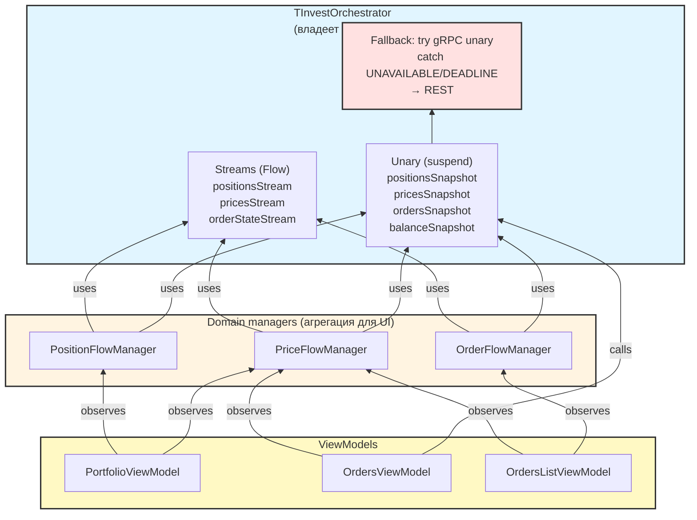

# ROADMAP

План задач проекта TScalp (разработка): что в работе, что
запланировано, что отложено. Формат — секция на задачу,
со статусом и оценкой.

CI/CD-планирование → `docs/ci-roadmap.md`.


## Планируемые задачи


---
### Полировка debug-переключателей

**Мобильная работа:** невозможно (требует сборки и визуальной
проверки на устройстве).

**Статус:** запланировано.

**Контекст:** в рамках задачи «Ktor REST transport для polling»
добавлены три независимых тумблера (gRPC, WS, REST) для
динамической проверки транспортов. Проверены базовые сценарии
(bypass REST, отключение gRPC/WS). Однако не проверены все 8
возможных комбинаций, особенно при резких переключениях
(race conditions, корректность жизненного цикла корутин,
залипание состояний).

**Триггер:** обнаружение аномалий (зависания, лишние
переподключения, дубли логов) в следующих задачах (например,
`GrpcExceptionGuard`).

**Файлы:**
- `presentation/screens/settings/SettingsViewModel.kt`
- `presentation/screens/settings/SettingsScreen.kt`
- `domain/api/PriceStreamManager.kt`
- `domain/api/PositionStreamManager.kt`

**Шаги:**
1. Прогнать все 8 комбинаций тумблеров.
2. Исправить найденные race conditions.
3. Добавить сохранение состояния тумблеров в DataStore
   (опционально).

**Оценка:** ~1–2 часа.


---
### Установка GrpcExceptionGuard

**Мобильная работа:** невозможно (требует сборки и проверки
краша на устройстве/эмуляторе).

**Статус:** в работе.
**Ветка:** bugfix/grpc-exception-guard.
**Триггер сработал (2026-10-21):** AppMetrica зафиксировала
краш `io.grpc.StatusException`.

**Контекст:** `io.grpc.kotlin.ClientCalls` при ошибке канала
доставляет `StatusException` через поздний callback в уже
завершённую suspend-корутину. Доставить некому → исключение
уходит в `Thread.getDefaultUncaughtExceptionHandler()` →
kill process. `CoroutineExceptionHandler` и `.catch { }` не
помогают.

**Файлы:**
- `app/src/main/kotlin/.../TScalpApplication.kt` — установка
  глобального `UncaughtExceptionHandler`.

**Шаги:**
1. В `TScalpApplication.onCreate` обернуть оригинальный
   `Thread.getDefaultUncaughtExceptionHandler()`.
2. Если `throwable is StatusException || throwable is StatusRuntimeException`:
   - логировать через `AppLogger.e` (с расшифровкой из
     `TInvestErrorMessages`);
   - отправить в AppMetrica как **нефатальную** ошибку
     (`AppMetrica.reportError("Unhandled gRPC", throwable)`);
   - **не пробрасывать** дальше в оригинальный handler
     (приложение выживает).
3. Иначе — пробросить в оригинальный handler (пусть падает
   как обычно).
4. Проверка: включить авиарежим на эмуляторе, дождаться
   gRPC-ошибки, убедиться, что приложение не падает, а в
   логах есть запись об ошибке.

**Ограничения:**
- Не глотать ошибку молча — обязательно логировать и
  отправлять в AppMetrica. Иначе скроем реальные сетевые
  проблемы (см. `docs/ISSUES.md`).
- Не перехватывать `CancellationException` — это штатная
  отмена, она не должна попадать в handler.

**Критерий готовности:**
- Приложение не падает при gRPC-ошибках в фоне.
- Ошибки видны в AppMetrica (как non-fatal) и в логах.
- Остальные краши (не gRPC) по-прежнему валят приложение и
  видны в AppMetrica.

**Оценка:** ~1 час.


---
### Split order domain into sealed Regular/Stop

**Мобильная работа:** невозможно (массовый рефакторинг,
сборка и визуальная проверка UI — на десктопе).

**Статус:** запланировано. **Ревизия после завершения
`OrderFlowManager` (задача A):** уточнить форму по
фактическим потребностям UI, обновить оценку.

**Триггер к реализации:** UI начнёт использовать поля из
stream-событий (`executedQuantity`, `executedPrice`), которые
сейчас в `OrderListItem` отсутствуют; или появится третья
модель заявки (например, для Finam); или `isStopOrder: Boolean`
начнёт обрастать доп. nullable-полями «только для stop».

**Контекст:** `domain/models/OrderModels.kt` содержит две
модели заявок:

- `OrderListItem` — используется unary-путём (`getOrders`,
  `getStopOrders`) через `InvestRepository` → `OrdersListViewModel`
  → UI. Содержит `isStopOrder: Boolean` + `stopPrice: Double?`
  как sum-type через флаг.
- `OrderState` — используется stream-путём
  (`subscribeOrderState` → `OrderFlowManager` — A).
  Transport-модель WS/gRPC, без stop-полей (asyncapi:
  `OrderStateStream` не стримит stop-orders).

Проблема: `OrderListItem` — God-модель в зачатке. Расширение
stream-полями (`executedQuantity`, `executedPrice`) через
nullable-поля сделает её хуже. `isStopOrder: Boolean` —
антипаттерн «флаг + опциональное поле» вместо sum-type.
Отмена заявки выбирает `cancelOrder` vs `cancelStopOrder`
через флаг — компилятор не проверяет.

**Форма (выбрана `sealed interface`, не `sealed class`):**

    sealed interface Order {
        val orderId: String
        val ticker: String
        val tscalpInstrumentId: String
        val instrumentType: String
        val direction: String
        val quantity: Long
        val status: String
        val orderDate: Long?

        data class Regular(
            override val orderId: String,
            // ... common
            val price: Double,
            val orderType: String,
            val executedQuantity: Long? = null,
            val executedPrice: Double? = null,
        ) : Order

        data class Stop(
            override val orderId: String,
            // ... common
            val stopPrice: Double,
            val limitPrice: Double? = null,
            val orderType: String,
        ) : Order
    }

**Обоснование `sealed interface` (осознанное отклонение от
существующего `sealed class AppResult` в проекте):**

1. `Order` — чистый value type, без shared state и поведения.
   Только `val`-контракт. Всё это — признак interface.
2. Композиция понадобится: `Order.Regular : Order, Cancellable`
   и `Order.Stop : Order, Cancellable` с разными реализациями
   `cancel()` через разные use cases. Sealed class закрывает
   эту возможность (только одно наследование).
3. Официальная рекомендация Kotlin 1.5+: `sealed interface`
   для sum types без shared state.
4. `AppResult` — не тот же кейс: у него `sealed class` с
   генерик-параметром и фабричными методами. Оставляем как
   есть; см. «Связанный вопрос» ниже.

**Предусловия:**
- `OrderFlowManager` (задача A) реализован и вмержен.
- Ревизия формы по фактическим полям, которые UI потребляет
  из stream: возможно, `executedQuantity` / `executedPrice`
  не нужны в UI вообще — тогда `Regular` не расширяем.

**Что меняется:**
- `domain/models/OrderModels.kt`: `OrderListItem` → удалить,
  добавить `sealed interface Order` с `Regular` / `Stop`.
- `data/api/TInvestOrdersMapper.kt`: `mapOrder` → `Order.Regular`,
  `mapStopOrder` → `Order.Stop` (без `isStopOrder: true`).
- `data/api/TInvestOrderStateWsMapper.kt`: `mapOrderState` →
  `Order.Regular` (stream не отдаёт stop).
- `domain/api/OrderFlowManager.kt` (из A): `Map<orderId, Order>`.
- `data/repository/InvestRepository.kt`: `getAllOrdersResult` →
  `List<Order>`.
- `domain/api/BrokerApi.kt`: `getOrders`, `getStopOrders`,
  `subscribeOrderState` — типы меняются.
- `data/api/{BcsBrokerApi,FinamBrokerApi}.kt` — сигнатуры
  (сейчас возвращают `emptyList()`, правка косметическая).
- `ui/components/OrdersListViewModel.kt`: `OrderListItem` → `Order`,
  `when` по типу для карточки и отмены.
- `ui/components/OrdersListDialog.kt`, `OrdersScreen.kt`:
  карточка заявки — `when (order) { is Regular -> ..., is Stop -> ... }`.
- `ui/components/OrderCard.kt` (если есть): отображение stop-цены
  только для `Stop`.

**Шаги:**
1. Заменить `OrderListItem` на `sealed interface Order` +
   `Regular` / `Stop` в `OrderModels.kt`.
2. Обновить `TInvestOrdersMapper`: `mapOrder` → `Regular`,
   `mapStopOrder` → `Stop`. Убрать `isStopOrder` из обоих.
3. Обновить `TInvestOrderStateWsMapper`: `mapOrderState` →
   `Regular`.
4. Обновить `InvestRepository`: сигнатура `getAllOrdersResult`.
5. Обновить `BrokerApi`: три сигнатуры.
6. Обновить `BcsBrokerApi`, `FinamBrokerApi` — сигнатуры.
7. Обновить `OrderFlowManager` (A): `Map<String, Order>`.
8. Обновить `OrdersListViewModel`: коллекция `List<Order>`,
   `when` для отмены (`Regular` → `cancelOrder`,
   `Stop` → `cancelStopOrder`).
9. Обновить UI-карточку: `when` по типу для отображения
   (stop-цена, тип, кнопка отмены).
10. Обновить тесты: мапперы, ViewModel, если есть.
11. Гейт: полный набор (testDebugUnitTest + lintDebug +
    ktlintCheck + detekt).
12. Ручная проверка: создать лимитную и stop-заявку, отменить
    обе через UI.

**Файлы (ключевые):**
- `domain/models/OrderModels.kt`
- `data/api/TInvestOrdersMapper.kt`
- `data/api/TInvestOrderStateWsMapper.kt`
- `data/repository/InvestRepository.kt`
- `domain/api/BrokerApi.kt`
- `data/api/BcsBrokerApi.kt`, `data/api/FinamBrokerApi.kt`
- `domain/api/OrderFlowManager.kt` (A)
- `ui/components/OrdersListViewModel.kt`
- `ui/components/OrderCard.kt`, `OrdersListDialog.kt`,
  `OrdersScreen.kt`

**Ограничения:**
- Не смешивать с A: A закрывает stream-snapshot, B —
  рефакторинг моделей. Отдельные PR.
- UI-изменения требуют санкции (правило 1 AGENTS.md).
  Тексты/иконки карточки stop-заявки согласовать до правки.
- Не удалять `OrderState` (transport-модель) — она остаётся
  для WS/gRPC DTO → domain-конверсии.
- Не менять `StopOrderRequest` (домен для отправки stop-заявки) —
  это отдельная сущность, не путать.

**Критерий готовности:**
- `OrderListItem` удалён, `sealed interface Order` используется
  везде.
- `when` по `Order` exhaustive (компилятор проверяет).
- UI: лимитная и stop-заявки отображаются и отменяются
  корректно.
- Тесты зелёные, гейт зелёный.

**Оценка:** ~5–6 часов (модели + мапперы 1.5 ч, репозиторий +
BrokerApi + брокеры 1 ч, ViewModel + UI 2 ч, тесты + гейт +
ручная проверка 1–1.5 ч).

**Зависимости:** блокируется задачей A (`OrderFlowManager`).
**Разблокирует** унификацию доменных моделей заявок между
брокерами (BCS, Finam).

**Открытые вопросы:**
- Нужны ли `executedQuantity` / `executedPrice` в UI-карточке?
  Сейчас в `OrderListItem` их нет; stream их отдаёт. Решить
  после ревизии A: если UI не показывает — `Regular` без них.
- Как в `OrdersScreen` отображать `Stop` vs `Regular`?
  Отдельные карточки или одна с `when`-ветвлением? Решить
  перед реализацией (нужна санкция на UI).
- **Связанный вопрос: `AppResult` / `AppError`.** Сейчас
  `sealed class`. Пересмотреть на `sealed interface` по той
  же логике (нет shared state, только `val`-контракт), но
  **только после оценки необходимости**: если рефакторинг B
  пройдёт гладко и выявит реальную пользу `sealed interface`,
  вернуться к `AppResult`. Отдельная задача пока не заводится.


---
### UI: отображение blocked на валютной карточке

**Мобильная работа:** частичное (план и правки `.kt` — через
proot; сборка и визуальная проверка — на десктопе).

**Статус:** запланировано. **UI — требует санкции.**
Сейчас задача — план, не реализация: как именно показывать
`blocked` на карточке, не решено.

**Контекст:** валютная позиция (ticker `RUB000UTSTOM`)
отображается обычной `AssetPositionCard`. После WS-интеграции
в `PositionStreamItem` появились `money` (свободные) и
`blocked` (заблокированные) — но до UI они не доходят,
`PortfolioPosition` этих полей не имеет, а `toPortfolioPosition()`
их отбрасывает. Пользователь видит только `quantity` (в
polling — рубли), без разбивки на свободные/заблокированные.

**Предусловия:**
- WS-интеграция money/blocked в `PositionFlowManager`
  закрыта (сделано, коммит `0167c03`).
- Формула связи `money`, `blocked`, `quantity` — не
  подтверждена (`docs/ROADMAP.md` → «Оркестратор стримов
  и Ktor WS transport»). До выяснения показывать `money`
  и `blocked` как **отдельные значения**, а не производные.

**Файлы:**
- `app/src/main/kotlin/.../domain/models/Portfolio.kt` —
  добавить `money: Double? = null`, `blocked: Double? = null`
  в `PortfolioPosition`; пробросить в
  `PositionStreamItem.toPortfolioPosition()`.
- `app/src/main/kotlin/.../presentation/screens/portfolio/PortfolioViewModel.kt` —
  `updatePortfolioItem` (копирование полей при обновлении,
  сейчас `old.copy(...)` не переносит `money`/`blocked`).
- `app/src/main/kotlin/.../ui/components/AssetPositionCard.kt` —
  отображение (варианты ниже).
- `app/src/main/kotlin/.../presentation/screens/portfolio/PortfolioScreen.kt` —
  проброс параметров, если добавляются отдельными аргументами.

**Варианты отображения (требуют санкции):**

- **A. Дополнительная строка в карточке.** Под текущей суммой
  — «Свободно: X ₽ · Заблокировано: Y ₽». Появляется только
  для `instrumentType == "currency"` и при непустом
  `blocked`. Минимум правок, явно.
- **B. Развёрнутая карточка по тапу.** Обычный вид —
  `quantity`; по тапу раскрывается детализация с `money` /
  `blocked`. Не засоряет список, но требует состояния
  «раскрыта» в `AssetPositionCard` (сейчас такого нет).
- **C. Badge с суммой блокировки.** Маленький бейдж в углу
  карточки при `blocked != null && blocked > 0`. Минимум
  текста, но неочевидно без подсказки.

Рекомендация: **A**. Самое прозрачное, без новых состояний
в composable, легко тестируется превью.

**Шаги:**
1. Добавить `money`/`blocked` в `PortfolioPosition` (domain).
2. Пробросить в `PositionStreamItem.toPortfolioPosition()`.
3. Обновить `PortfolioViewModel.updatePortfolioItem` — при
   обновлении переносить `money`/`blocked` (по аналогии с
   `expectedYield`).
4. **Санкция на UI** — согласовать вариант (A/B/C) и тексты.
5. Реализовать отображение в `AssetPositionCard`.
6. Compose Preview для трёх состояний: `blocked == null`,
   `blocked == 0.0`, `blocked > 0.0`.
7. Unit-тест на `toPortfolioPosition()` (money/blocked
   доходят).
8. Сборка, 84+ теста зелёные, ручная проверка на устройстве.

**Референсы:**
- `docs/ROADMAP.md` → «Оркестратор стримов и Ktor WS transport»
  (фаза 2, money/blocked merge).
- `docs/ISSUES.md` → «PositionsStream over WS не отдаёт
  данные в песочнице» (prod-only поведение).
- `TInvestPositionsWsMapperTest`, `PositionFlowManagerTest` —
  образец тестов на доменный merge.

**Ограничения:**
- Не менять UI без санкции (правило 1 AGENTS.md) — вариант
  и тексты согласуются до правки.
- Не показывать `blocked` для не-валютных инструментов.
- Не выводить `money + blocked` как «итог», пока формула
  не подтверждена — только отдельные значения.
- Не трогать `OrdersScreen` — карточка там используется в
  контексте заявок, к заблокированным средствам отношения
  не имеет.

**Критерий готовности:**
- `PortfolioPosition.money` / `.blocked` заполняются из
  WS-события.
- На карточке `RUB000UTSTOM` видно `blocked` (по варианту,
  согласованному с пользователем).
- Для не-валютных инструментов внешний вид не изменился.
- Тесты на `toPortfolioPosition` добавлены.
- Сборка и тесты зелёные.

**Оценка:** ~2–3 часа (domain+ViewModel — 1 ч, UI — 1 ч,
превью+тесты — 1 ч).

**Зависимости:** нет. **Блокирует** отображение полной
картины валютной позиции (свободные + заблокированные).

**Открытые вопросы:**
- Как именно пользователь хочет видеть `blocked`? Вариант
  A/B/C — нужно решение.
- Формула `money` ↔ `blocked` ↔ `quantity` — проверить на
  реальном счёте с ненулевым `blocked`. До этого показывать
  раздельно.
- Показывать ли `money` отдельно от `quantity`, или
  заменить текущее значение? Зависит от формулы.
- Нужно ли отображать `blocked` в `OrdersScreen` (карточка
  позиции в контексте заявки) — сейчас нет, но при
  блокировке инструмента биржей может быть полезно.


---
### Rate-limiter для unary-запросов T-Invest

**Мобильная работа:** невозможно (сборка + тесты на десктопе;
правки `.kt` через proot — можно, но без проверки).

**Статус:** запланировано.

**Контекст:** в проекте **нет rate-limiter для unary-запросов**
к T-Invest. Единственные механизмы ограничения частоты —
периодичность polling (`RETRY_DELAY_MS = 10_000L` для позиций,
`5_000L` для цен) и backoff переподключения стримов
(`GRPC_RETRY_DELAYS_MS`, `RETRY_DELAYS_MS`). Это не ограничители
частоты API, а расписания. При параллельных запросах
(например, `getTradingStatuses` через
`coroutineScope { awaitAll() }` — N параллельных unary на
N инструментов) лимит легко превышается.

Официальные лимиты T-Invest записаны в `docs/rate-limits.md`:
не более 50 запросов в секунду суммарно, плюс по-сервисные
лимиты в минуту (Instruments 200, Users 100, MarketData 300,
Orders 100 — из них `getOrders` 200, `postOrder` 15/сек,
и т.д.).

**Зачем:** без rate-limiter'а возможны `RESOURCE_EXHAUSTED`
от API, троттлинг на стороне сервера, деградация UX
(запросы уходят в отказ, UI показывает ошибки). Особенно
критично для `postOrder` (15/сек) и `getTradingStatuses`
(N параллельных).

**Предусловия:** нет.

**Файлы:**

- `app/src/main/kotlin/com/gitlab/biomorf/tscalp/data/api/TInvestRateLimiter.kt` (новый) —
  rate-limiter (токен-бакет) с учётом лимитов по сервисам и
  общего лимита 50/сек.
- `app/src/main/kotlin/com/gitlab/biomorf/tscalp/data/api/TInvestMarketDataService.kt` —
  обернуть `getLastPricesByTscalpInstrumentId`,
  `getTradingStatuses`, `getPortfolio`, `fetchPositionsSnapshot`
  (внутри — unary) в rate-limiter.
- `app/src/main/kotlin/com/gitlab/biomorf/tscalp/data/api/TInvestOrdersService.kt` —
  обернуть `postOrder` (15/сек), `postStopOrder`,
  `getOrders`/`getStopOrders`, `cancel*`.
- `app/src/main/kotlin/com/gitlab/biomorf/tscalp/di/DataModule.kt` —
  Hilt-провайдер `TInvestRateLimiter` как `@Singleton`.

**Шаги:**

1. **Вынести лимиты в константы** (`TInvestRateLimits` в
   `data/api/`): таблицы из `docs/rate-limits.md` — по каждому
   сервису, отдельные строки для `getOrders` и `postOrder`,
   общий лимит 50/сек.
2. **Реализовать токен-бакет** (`TInvestRateLimiter`): метод
   `suspend fun <T> withPermission(service: TInvestService, block: suspend () -> T): T`.
   Внутри — `Semaphore` или `Channel`-based limiter с
   двумя уровнями: per-service (N/мин) и глобальный (50/сек).
3. **Интегрировать** в `TInvestMarketDataService` и
   `TInvestOrdersService`: обернуть каждый unary-вызов в
   `rateLimiter.withPermission(...) { broker.method() }`.
4. **Особый случай `getTradingStatuses`:** сейчас
   `coroutineScope { ids.map { async { ... } }.awaitAll() }` —
   N параллельных. С rate-limiter'ом либо (а) последовательно
   через limiter, либо (б) батчинг (если API даст метод
   batch-запроса), либо (в) ограничить concurrency — например,
   `Semaphore(10)` поверх rate-limiter'а.
5. **Опционально: `GetUserTariff`** — unary-метод, возвращает
   актуальные лимиты для пользователя. Вызывать при старте
   приложения (после `initialize`), кэшировать, использовать
   в rate-limiter вместо статических констант. Для грейдов
   4–5 лимиты выше, чем в таблице.
6. **Тесты:** unit-тест на `TInvestRateLimiter` — что N
   запросов не превышают лимит, что `postOrder` не чаще
   15/сек, что общий лимит 50/сек соблюдается.

**Референсы:**

- `docs/rate-limits.md` — официальные лимиты (полные таблицы).
- Официальная документация T-Invest:
  `https://developer.tbank.ru/invest/intro/developer/limits` —
  раздел «Лимиты запросов».
- `GetUserTariff` в proto-контракте:
  `ru.tinkoff.piapi.contract.v1.UsersService/GetUserTariff`.

**Ограничения:**

- Не менять публичные контракты `BrokerApi`. Rate-limiter —
  внутренняя деталь `TInvestBrokerAPI` и его сервисов.
- Не смешивать с задачей `stream-orchestrator` — это отдельная
  работа по data-слою, не про WS.
- Не трогать BCS / Finam — у них свои лимиты, отдельные задачи
  при интеграции.
- Держать поведение `getTradingStatuses` прежним по контракту
  (тот же `Map<uid, TradingAvailability>`), меняется только
  внутренняя реализация.
- Если rate-limiter не может дать разрешение (запрос ждёт
  слишком долго) — вернуть `AppResult.Failure` с
  `AppError.Unknown("rate limit")` или дождаться с таймаутом.
  Решение зафиксировать в KDoc.

**Критерий готовности:**

- `TInvestRateLimiter` реализован, покрыт unit-тестами.
- Все unary-вызовы в `TInvestMarketDataService` и
  `TInvestOrdersService` проходят через rate-limiter.
- `getTradingStatuses` не превышает лимит `MarketData`
  (300/мин для gRPC) даже при 100 инструментах за раз.
- `postOrder` не чаще 15/сек.
- Общий лимит 50/сек с одного IP соблюдается (замер в unit-тесте).
- 63 теста зелёные, ktlint и detekt чистые.

**Оценка:** ~3–5 часов (токен-бакет 1–1.5 ч, интеграция
1–1.5 ч, `GetUserTariff` 0.5–1 ч, тесты 0.5–1 ч).

**Зависимости:** нет. **Разблокирует:** безопасный переход на
более агрессивный polling, добавление батч-операций по
инструментам, торговлю без риска `RESOURCE_EXHAUSTED`.

**Открытые вопросы:**

- Использовать `GetUserTariff` сразу или начать со статических
  лимитов и добавить динамические позже. Решить при старте.
- Как вести себя при долгом ожидании (timeout vs fail vs
  ждать) — унифицировать через `AppResult`.
- Нужен ли отдельный rate-limiter для REST-эндпоинтов T-Invest
  (REST-прокси), если они будут использоваться — у REST
  лимиты ниже (см. таблицу). Пока REST не используется,
  не актуально.


---
### Плавный переход Hilt → Koin

**Мобильная работа:** частичное (правки `.kt`/`.kts` — через
proot; сборка и проверка графа — на десктопе).

**Статус:** в работе.
**Ветка:** feature/hilt-koin-inventory

**Контекст:** Hilt не поддерживает Kotlin Multiplatform —
Android/JVM only. Koin — основной KMP-совместимый DI,
работает на Android, iOS, JVM из одного кода. При появлении
iOS-задачи миграция станет обязательной. Сейчас — удобный
момент для плавного перехода: сосуществование Hilt и Koin
возможно через мост `koin-android-dagger`, миграция — по
модулям без остановки проекта.

**Зачем заранее:** переписывание всего DI-графа за один
раз — большая остановка. Поэтапный переход растворяется в
текущей работе, не блокирует другие задачи.

**Предусловия:**

- Задачи, затрагивающие DI-модули (`RepositoryModule`,
  `UseCaseModule`, `DataModule`), выполнены или
  остановлены.
- Koin Compiler Plugin доступен и совместим с Kotlin 2.4.20
  — проверить при старте, нужно для compile-time проверки
  графа.
- Koin 4.x или новее — уточнить актуальную версию на
  Maven Central.

**Ключевые принципы:**

- **Сосуществование до полного перехода.** Hilt и Koin
  работают параллельно через `koin-android-dagger`. Каждый
  модуль переводится отдельно.
- **Порядок «от листьев к корню».** Сначала модули без
  Hilt-специфичных зависимостей (`RepositoryModule`,
  `UseCaseModule`), потом `DataModule` (там
  `@ApplicationContext`), потом ViewModel и Activity.
- **Compile-time проверка графа.** Koin Compiler Plugin
  (требует Kotlin 2.3.20+) сохраняет проверку графа на
  этапе компиляции — как у Hilt. Рантайм-резолвинг без
  плагина — регресс, не использовать.
- **После каждого модуля — сборка и тесты.** Коммит после
  каждого переведённого модуля (правило 4b AGENTS.md).

**Фазы:**

**Фаза 1 — Инвентаризация и инфраструктура.**
- Составить список всех Hilt-модулей (`@Module`,
  `@InstallIn`), точек инъекции (`@Inject`,
  `@AndroidEntryPoint`, `@HiltViewModel`), их зависимостей.
- Добавить Koin-зависимости: `koin-android`,
  `koin-androidx-compose`, `koin-android-dagger`,
  Koin Compiler Plugin.
- В `TScalpApplication.onCreate` вызвать `startKoin` **до**
  инициализации Hilt-компонентов (иначе bridge упадёт).
- Проверка: приложение запускается, все зависимости
  разрешаются. Hilt пока управляет всем.

**Фаза 2 — Пилотный модуль (`RepositoryModule`).**
- Создать `app/di/koin/RepositoryKoinModule.kt` с
  провайдерами репозиториев.
- Для получения зависимостей из Hilt использовать
  `scope.dagger<HiltEntryPoint>().someDependency()`.
- Удалить соответствующие `@Module @InstallIn` из
  `RepositoryModule.kt`.
- Проверка: сборка, 63 теста, smoke-тест приложения.

**Фаза 3 — Постепенный перенос модулей.**
- Порядок: `UseCaseModule` → `DataModule`
  (`@ApplicationContext` → `androidContext(...)`) →
  `BrokerModule` → ViewModels → Activity.
- ViewModel: `@HiltViewModel` → `koinViewModel()` в
  Compose.
- Activity: `@AndroidEntryPoint` → `KoinComponent` или
  ручная инициализация.
- После каждого модуля: сборка + тесты + коммит.

**Фаза 4 — Удаление Hilt.**
- Проверка: `grep -r "@Hilt\|@Inject\|@Module\|@InstallIn"`
  не находит совпадений.
- Удалить зависимости: `hilt-android`,
  `hilt-android-compiler`, `hilt-navigation-compose`.
- Удалить плагин `dagger.hilt.android.plugin` из
  корневого `build.gradle.kts`.
- Финальная проверка: полная сборка, тесты, ручной прогон.

**Файлы:**

- `gradle/libs.versions.toml` или `build.gradle.kts` —
  версии Koin.
- `app/build.gradle.kts` — зависимости Koin и плагин
  compiler.
- `TScalpApplication.kt` — `startKoin` в `onCreate`.
- `app/di/koin/*.kt` (новые) — Koin-модули по мере
  перевода.
- `app/di/*.kt` (существующие) — удаление Hilt-модулей по
  мере перевода.
- ViewModel-файлы — `@HiltViewModel` → `koinViewModel`.
- `MainActivity.kt` — замена `@AndroidEntryPoint`.

**Референсы:**

- Koin Android: `https://insert-koin.io/docs/reference/koin-android/`
- Koin Compiler Plugin:
  `https://insert-koin.io/docs/reference/koin-compiler-plugin/`
- `koin-android-dagger` bridge:
  `https://insert-koin.io/docs/reference/koin-android/koin-dagger/`
- Koin для Compose Multiplatform:
  `https://insert-koin.io/docs/reference/koin-compose/`

**Ограничения:**

- Не откусывать сразу всё: один модуль — один коммит.
- Не переводить ViewModel и Activity до модулей нижнего
  уровня — они зависят от всего графа.
- Не использовать Koin без Compiler Plugin — теряется
  compile-time safety.
- Не смешивать миграцию с другими изменениями в тех же
  модулях — отдельные коммиты.
- `:transport-ktor` (если уже есть) не знает про DI —
  провайдеры живут в `:app`. Koin-модуль для него
  создаётся на фазе 2 или 3.

**Критерий готовности:**

- Hilt полностью удалён из проекта.
- Все зависимости разрешаются через Koin.
- Compile-time проверка графа работает (Compiler Plugin).
- 63 unit-теста зелёные, ktlint и detekt чистые.
- Приложение собирается и запускается на устройстве.

**Оценка:** ~8–12 часов суммарно (фаза 1: 2 ч;
фаза 2: 1–2 ч; фаза 3: 4–6 ч; фаза 4: 1–2 ч).

**Зависимости:** нет. **Разблокирует** iOS-фазу
(перенос кода в KMP-модуль без Hilt).

**Открытые вопросы:**

- Точная совместимость Koin Compiler Plugin с Kotlin
  2.4.20 и AGP 9.4.0. Проверить при старте фазы 1.
- Актуальная версия Koin на Maven Central.
- Нужен ли `koin-androidx-compose` отдельно или хватает
  `koin-compose` в текущей версии. Уточнить по
  документации.
- `startKoin` до Hilt — что именно «до»: в `onCreate`
  перед `super.onCreate()` или после? Проверить по
  документации bridge.


---
### Ktor REST transport для polling

**Мобильная работа:** невозможно (требует сборки и проверки на реальных данных).

**Статус:** в работе.
**Ветка:** feature/rest-polling-fallback.

**Прогресс:**
- [x] Шаг 1a: unary-обёртки в оркестраторе (PR #30).
- [x] Шаг 1b: переключение менеджеров на оркестратор (PR #30).
- [ ] Шаг 2: TInvestRestTransport + fallback gRPC -> REST.
- [ ] Шаг 3: live-тест с DebugConfig.FORCE_REST_FOR_POLLING.

**Целевая архитектура транспорта (уточнение от 2026-10-21):**

Оркестратор — единственное место, где живёт транспорт. Стримы (Flow) и unary (suspend) оба проходят через него. Менеджеры вызывают `xxxStream` для стрима и `xxxSnapshot` в polling-loop, не зная про REST. Fallback gRPC→REST живёт только в оркестраторе.



**Порядок реализации (по шагам):**

**Шаг 1a — unary-обёртки в оркестраторе (рефакторинг, без смены поведения).**
- `positionsSnapshot(accountId, sandbox): List<PortfolioPosition>`
- `pricesSnapshot(uids): Map<String, Double?>`
- `ordersSnapshot(accountId): List<OrderListItem>`
- `balanceSnapshot(accountId): Double`
- Внутри — тонкие обёртки над `marketData.*` / `orders.*`. Fallback пока нет.
- Гейт, коммит.

**Шаг 1b — переключение менеджеров на оркестратор.**
- `PriceFlowManager.runPolling`: `repository.getLastPricesResult(...)` → `orchestrator.pricesSnapshot(...)`.
- `OrderFlowManager.collectPolling`: `broker.getOrders(...)` + `broker.getStopOrders(...)` → `orchestrator.ordersSnapshot(...)`.
- Поведение не меняется, fallback пока нет.
- Гейт, live-тест (цены и заявки обновляются), коммит.

**Шаг 2 — REST transport и fallback.**
- `TInvestRestTransport` в `:transport-ktor` (Ktor Client).
- В `TInvestOrchestrator` unary-методы: `try { gRPC } catch (UNAVAILABLE | DEADLINE_EXCEEDED | UNIMPLEMENTED) { REST }`.
- Логика: только на транспортные ошибки, не на бизнес-ошибки.
- Гейт, коммит.

**Шаг 3 — live-тест fallback.**
- `DebugConfig.FORCE_REST_FOR_POLLING` — принудительный REST (debug-only).
- Live-тест: позиции, цены, заявки обновляются через REST при `FORCE_REST` и при физическом отключении gRPC (например, через VPN).
- Коммит, закрытие задачи.

**Что НЕ в этой задаче:**
- `getTradingStatuses` — отдельная задача «REST fallback для getTradingStatuses» (отложено). Причина: параллельные N запросов через REST дорого, критичность метода низкая (индикатор доступности, не данные).
- Миграция BCS на Ktor REST — фаза 3 (после T-Invest).


**Статус:** запланировано.

**Контекст:** polling у T-Invest идёт через gRPC unary. REST API у T-Invest — прокси Swagger над gRPC unary-методами. Если gRPC-протокол недоступен (блокировка портов, региональные ограничения), REST даёт альтернативу. У BCS REST — уже основной транспорт, сейчас на OkHttp.

**Снапшот заявок.** `OrderStateStream` (gRPC и WS) отдаёт только
события, без replay — заявки, выставленные на другом устройстве
до подписки, не видны. Для полной картины нужен unary-snapshot
`getOrders` + `getStopOrders`. При отказе gRPC (WS работает) этот
snapshot тоже недоступен — только REST. Поэтому REST-fallback для
этих методов — часть фундамента для `OrderFlowManager`.

**Зачем:** fallback для polling-уровня. Плюс — единый стиль на Ktor для всех REST-запросов (BCS мигрирует с OkHttp). Ktor даёт единый HTTP-клиент для KMP, OkHttp — нет.

**Предусловия:** выполнена задача «Оркестратор стримов и Ktor WS transport» — нужен оркестратор как точка композиции.

**Фазы:**

**Фаза 1 — Ktor REST-клиент для T-Invest.**
- `TInvestRestTransport` в `:transport-ktor/commonMain`.
- Методы: `fetchPositionsSnapshot`, `getLastPrices`, `getBalance`,
  **`getOrders`, `getStopOrders`** (snapshot заявок для
  `OrderFlowManager`).
- Прокси над REST-эндпоинтами T-Invest.

**Фаза 2 — Fallback для polling T-Invest.**
- Оркестратор композирует gRPC-unary + REST в polling-уровне.
- При недоступности gRPC polling идёт через REST.
- Логика переключения — в оркестраторе, не в брокере.
- Потребители REST-snapshot: `fetchPositionsSnapshot` (уже),
  `OrderFlowManager` (snapshot заявок, после реализации),
  `PriceFlowManager` (последние цены).

**Фаза 3 — Миграция BCS на Ktor.**
- Перевести `BcsBrokerApi` с OkHttp на Ktor REST.
- Удалить прямые OkHttp-зависимости (если не останется).
- Опционально — сделать `:transport-ktor` точкой входа для всех REST-брокеров.

**Файлы:**

- `transport-ktor/src/commonMain/kotlin/.../TInvestRestTransport.kt` (новый).
- `transport-ktor/src/commonMain/kotlin/.../BcsRestTransport.kt` (новый).
- `app/data/api/TInvestMarketDataService.kt` — обновить.
- `app/data/api/BcsBrokerApi.kt` — миграция.
- `app/data/orchestrator/TInvestOrchestrator.kt` — композиция polling с REST.

**Референсы:**

- REST API T-Invest: `https://developer.tbank.ru/invest/intro/developer/protocols/restapi`.
- Формат запроса: `POST https://invest-public-api.tbank.ru/rest/tinkoff.public.invest.api.contract.v1.<Service>/<Method>`.
- Ktor Client: `https://ktor.io/docs/client-create-new-application.html`.
- Существующая реализация `BcsBrokerApi` — образец REST-клиента.

**Ограничения:**

- Не смешивать с WS-транспортом (отдельные фазы, отдельные PR).
- Логика fallback — в оркестраторе.
- Лимиты REST те же, что у gRPC unary: 6 запросов/сек.
- Не удалять OkHttp полностью, пока gRPC-транспорт использует его как engine.
- Транспорт не знает про домен — возвращает DTO или сырой JSON, конвертация — в репозитории.

**Критерий готовности:**

- При недоступности gRPC polling идёт через REST.
- `BcsBrokerApi` использует Ktor REST.
- `TInvestOrchestrator` композирует gRPC unary + REST.
- `getOrders` / `getStopOrders` работают через REST
  (snapshot заявок доступен без gRPC).
- Все unit-тесты зелёные (сейчас 94+), ktlint и detekt чистые.

**Оценка:** ~4–6 часов.

**Зависимости:** блокируется «Оркестратор стримов и Ktor WS transport».


---
### Рефакторинг расчёта P&L для PortfolioPosition

**Мобильная работа:** невозможно (требует сборки и проверки
на реальных данных).

**Статус:** запланировано.

**Контекст:** расчёт `profit` и `profitPercent` в
`TInvestMarketDataService.fetchPositionsSnapshot` содержит
непоследовательность, которая может давать расхождения между
прибыльными и убыточными позициями.

**Обнаруженные проблемы:**

1. **Условная логика выбора источника.** Текущий код:
   ```kotlin
   val profit: Double? = if (expectedYield > 0.0) {
       expectedYield          // серверный P&L
   } else if (avgPrice != null && avgPrice > 0.0) {
       (currentPrice - avgPrice) * quantity  // клиентский
   } else null
   ```
    - Для **положительного** P&L — берётся серверный
      `expectedYield`.
    - Для **отрицательного** или **нулевого** — клиентский
      расчёт.
    - Профит и убыток считаются по разным формулам.
    - `expectedYield == 0.0` (нет изменения) уходит в клиентскую
      ветку.

2. **Клиентский расчёт для фьючерсов.** Формула
   `(currentPrice - avgPrice) * quantity` **не учитывает
   `pointValue`**. Для фьючерсов цена в пунктах, реальный
   P&L зависит от стоимости пункта. В закрытой задаче
   «Унификация profitPercent для PortfolioPosition» починили
   `profitPercent`, но не сам `profit`.

3. **Источники серверного P&L.** `expectedYield` от T-Invest
   может отличаться от `(currentPrice - avgPrice) * quantity`
   из-за комиссий, дивидендов, корпоративных событий,
   НКД по облигациям. Серверный — точнее, но не всегда
   положительный/нулевой корректно обрабатывается.

**Связано:** задача «gRPC-стрим позиций». Стрим
`PositionsStream` даёт только `balance` (количество) и
идентификаторы, но **не даёт** `expectedYield`,
`averagePositionPrice`, `currentPrice`. Если рефакторинг
P&L не сделан до интеграции стрима, карточки потеряют P&L
при переходе на gRPC.

**Варианты решения:**

**A. Только серверный `expectedYield`.**
- `profit = expectedYield` всегда (если оно есть в ответе).
- Плюс: единая формула, точнее учёт комиссий/дивидендов.
- Минус: зависимость от того, что сервер всегда присылает
  поле. Если `expectedYield` = 0, непонятно — это «нет
  изменения» или «сервер не посчитал».

**B. Только клиентский расчёт.**
- `profit = (currentPrice - avgPrice) * quantity * pointValue`
  — универсальная формула.
- Плюс: работает без серверного `expectedYield`, единая
  логика для всех типов инструментов.
- Минус: не учитывает комиссии, дивиденды, корпоративные
  события. Для точного P&L — недостаточно.

**C. Гибрид с приоритетом серверного.**
- Если `expectedYield` есть (не null) — используем его.
- Иначе — клиентский расчёт.
- Плюс: серверный в приоритете (точнее), клиентский —
  fallback.
- Минус: нужно чётко определить, когда `expectedYield`
  считается «есть» (в proto у него double, нет отдельного
  `hasExpectedYield`).

**D. Разделить поля.**
- `profit` — всегда серверный `expectedYield`.
- `clientProfit` — клиентский расчёт.
- UI решает, что показывать.
- Плюс: обе цифры доступны для сверки.
- Минус: удвоение модели, UI должен выбрать.

**Рекомендация:** **A** для `profit`, с fallback на
клиентский расчёт только если сервер вернул 0 и это
подозрительно (нужен критерий). `profitPercent` — уже
унифицирован, оставить.

**Файлы:**
- `data/api/TInvestMarketDataService.kt` — метод
  `fetchPositionsSnapshot`.
- `domain/models/Portfolio.kt` — модель и
  `calculateProfitPercent`, если потребуется.
- `domain/models/Instruments.kt` — `FutureUi.pointValue`,
  если потребуется.

**Шаги:**

1. Собрать данные на реальных аккаунтах: сравнить серверный
   `expectedYield` и клиентский расчёт на разных позициях
   (акции, фьючерсы, положительный / отрицательный /
   нулевой P&L).
2. Определить, воспроизводится ли расхождение и в каких
   случаях.
3. Выбрать вариант (A/B/C/D).
4. Реализовать.
5. Покрыть unit-тестами:
    - акция с положительным P&L;
    - акция с отрицательным P&L;
    - фьючерс с положительным P&L (проверка `pointValue`);
    - фьючерс с отрицательным P&L;
    - отсутствие `expectedYield`.

**Референсы:**
- `docs/ROADMAP.md` → «Унификация profitPercent для
  PortfolioPosition» (закрытая) — что уже сделано.
- Официальная документация T-Invest API → `PositionData` →
  `expectedYield`, `averagePositionPrice`.
- Proto-контракт: `ru.tinkoff.piapi.contract.v1.PositionData`.

**Ограничения:**
- Не менять модель `PortfolioPosition` без согласования —
  она используется в UI.
- Не смешивать с задачей «gRPC-стрим позиций» — отдельная
  работа.
- Серверный `expectedYield` остаётся приоритетным, если
  применим вариант A или C.

**Критерий готовности:**
- Формула расчёта P&L однозначна (не зависит от знака).
- Фьючерсы корректно учитывают `pointValue`.
- Поведение покрыто unit-тестами.
- Расхождения серверного и клиентского P&L либо устранены,
  либо объяснены и задокументированы.

**Оценка:** ~2–3 часа (включая сбор данных на реальных
аккаунтах).

**Зависимости:** нет. **Желательно до** интеграции
gRPC-стрима позиций — иначе переход на стрим сломает P&L
в карточках.


---
### Парсинг expireDate для stop-order'ов GOOD_TILL_DATE

**Мобильная работа:** частичное (парсер + unit-тест — с
телефона; сборка и прогон теста — с десктопа).

**Статус:** запланировано. Потерянная логика.

**Контекст:** в `TInvestOrdersService.kt:155` устанавливался
`expireDate` через `parseDate(request.expireDate)`, но метод
`parseDate` возвращал пустой `com.google.protobuf.Timestamp` —
то есть фактически ничего не парсил. Это была недописанная
логика. При чистке detekt-issues (UnusedParameter) метод
и его вызов удалены, чтобы не оставлять сломанный код.

**Последствие:** при создании stop-order с типом экспирации
`GOOD_TILL_DATE` поле `expireDate` в `PostStopOrderRequest`
не устанавливается. Такие заявки либо отклоняются биржей,
либо обрабатываются некорректно.

**Файлы:**
- `data/api/TInvestOrdersService.kt` — восстановить парсинг.
- `domain/models/OrderModels.kt` — `expireDate` в
  `StopOrderRequest` (нужно уточнить формат — String?).

**Шаги:**
1. Уточнить формат `expireDate`, приходящего из UI
   (ISO-8601? unix timestamp? yyyy-MM-dd?).
2. Уточнить формат, ожидаемый T-Invest API:
   `com.google.protobuf.Timestamp` (секунды + наносекунды
   от epoch UTC).
3. Реализовать парсер с обработкой ошибок
   (невалидный формат → возвращать `AppResult.Failure`).
4. Восстановить вызов `builder.setExpireDate(...)` при
   `expirationType == GOOD_TILL_DATE`.
5. Покрыть unit-тестом.

**Референс:**
- Документация T-Invest API → PostStopOrder → expireDate.
- `com.google.protobuf.Timestamp` — стандартный proto-тип,
  поля `seconds` (int64), `nanos` (int32).

**Критерий готовности:**
- Stop-order с `GOOD_TILL_DATE` создаётся и принимается
  биржей; `expireDate` в запросе совпадает с UI-значением.
- Покрыто тестом.

**Оценка:** ~1 час.

**Зависимости:** нет.


---
### UI-индикатор состояния стримов

**Статус:** запланировано. **UI — требует санкции.**

**Контекст:** пользователь не может оценить на глаз,
актуальны ли данные. Индикатор снимает вопрос
«это задержка или данные устарели».

**Предусловия:** StreamState реализован в обоих менеджерах.

**Файлы:**
- `presentation/.../MainScreen.kt` (или где определён NavBar) —
  бейдж-точка на иконке вкладки.
- `presentation/.../SettingsScreen.kt` — раздел «Диагностика».
- `presentation/.../MainViewModel.kt` (или соответствующие
  ViewModels) — проброс `StreamState` в UI.

**UI-описание:**

- **Бейдж-точка** на иконке вкладки:
  - Заявки → `PriceFlowManager.connectionState`;
  - Портфель → `PositionFlowManager.connectionState`;
  - POLLING → 🟡 (`MaterialTheme.colorScheme.tertiary`);
  - STALE → 🔴 (`MaterialTheme.colorScheme.error`);
  - LIVE / INITIALIZING / STOPPED → **бейджа нет** (тишина = норма).
- **Snackbar** при переходе в деградацию:
  - debounce 3 секунды;
  - тексты: см. п. «Тексты» ниже;
  - восстановление в LIVE — без Snackbar.
- **Раздел «Диагностика»** в Настройках:
  - текущее состояние обоих стримов;
  - время последнего обновления;
  - источник (gRPC/REST/WS);
  - расшифровка цветов бейджа.

**Тексты:**
- POLLING (цены): «Стрим цен: резервный режим. Обновление раз в 5 секунд.»
- POLLING (позиции): «Стрим позиций: резервный режим. Обновление раз в 10 секунд.»
- STALE (цены): «Стрим цен: нет данных. Проверьте соединение.»
- STALE (позиции): «Стрим позиций: нет данных. Проверьте соединение.»

**Ограничения:**
- **Не менять** цвет текста NavBar — конфликт с семантикой
  selected/unselected.
- **Не делать** long-press на вкладке — не discoverable,
  конфликт с системным long-press. Подсказка доступна через
  раздел «Диагностика».

**Критерий готовности:**
- При переходе стрима в POLLING появляется жёлтая точка
  и один Snackbar (не повторяется каждые N секунд).
- При STALE — красная точка и Snackbar.
- Раздел «Диагностика» показывает актуальное состояние.

**Оценка:** ~2 часа.

**Зависимости:** блокируется StreamState.


---
### StreamState в data-слое

**Мобильная работа:** невозможно (требует сборки и проверки
реактивного поведения).

**Статус:** запланировано.

**Контекст:** для UI-индикатора деградации стримов нужен
реактивный источник состояния. Полезен и без UI — для логов,
AppMetrica, отладки.

**Предусловия:** имеет смысл делать после каскада позиций
(иначе состояние не будет отражать все уровни).

**Файлы:**
- `domain/models/StreamState.kt` — новый файл.
- `domain/api/PriceFlowManager.kt` — добавить
  `connectionState: StateFlow<StreamState>`.
- `domain/api/PositionFlowManager.kt` — то же.

**Шаги:**

1. Создать `enum class StreamState { INITIALIZING, LIVE, POLLING, STALE, STOPPED }`.
2. В `PriceFlowManager` завести `private val _connectionState =
   MutableStateFlow(StreamState.STOPPED)` и `val connectionState`.
   Обновлять при переходе между gRPC и polling, при ошибках,
   при отсутствии обновлений > 15 секунд (→ STALE).
3. В `PositionFlowManager` — аналогично. Порог STALE — 30 секунд.
4. «Биржа закрыта» ≠ STALE: если polling возвращает цену
   (пусть и неизменную), состояние остаётся POLLING.

**Референсы:** нет.

**Ограничения:**
- **Не менять** публичный контракт `prices: SharedFlow<...>`.
- Не путать STALE с отсутствием интереса — STOPPED при пустом union.

**Критерий готовности:**
- `connectionState` реактивно меняется при переключении
  источников и при отсутствии данных.
- В `logcat` при смене состояния видно `[stream] state: LIVE → POLLING`
  (или аналогичное).

**Оценка:** ~30 минут.

**Зависимости:** блокируется «Оркестратором стримов и Ktor
WS transport» — нужен финальный слой композиции, иначе
состояние не отражает все уровни.


---
### Переход на edge-to-edge (statusBarColor deprecated)

**Статус:** запланировано, требует отдельной подготовки.

**Что:** `window.statusBarColor` и `window.navigationBarColor` устарели.
С Android 15 система применяет edge-to-edge принудительно для приложений
с target SDK 35+.

**Действия:**
1. Убрать `window.statusBarColor = ...` из `Theme.kt`.
2. Убедиться, что в `MainActivity` вызывается `enableEdgeToEdge()`.
3. Проверить все 4 экрана (Заявки, Портфель, Настройки, MainScreen)
   на Android 12, 13, 14, 15.
4. При необходимости — добавить `WindowInsets` в `Scaffold`-ы.

**Оценка:** ~2 часа + прогон на устройствах разных версий.
**Когда:** при подготовке релиза под Android 15 или target SDK 36.


---
### Рефакторинг архитектурного долга (detekt-группа 3)

**Статус:** запланировано.

**Контекст:** при внедрении detekt 2.0.0-alpha.6 (см. задачу
`detekt` в разделе выше) выявлены 10 групп архитектурного
долга. Правила `LongMethod`, `CyclomaticComplexMethod`,
`TooManyFunctions`, `LargeClass` подавлены в коде через
`@Suppress` со ссылкой на эту секцию. `MagicNumber` (45
записей) зафиксирован в `app/detekt-baseline.xml`.

**Общие предусловия:**
- Перед рефакторингом каждой группы — прогнать тесты,
  зафиксировать текущее поведение.
- Разбивать на подзадачи: один класс / одна функция за раз,
  коммит после каждого шага (правило 4b AGENTS.md).
- После рефакторинга — снять `@Suppress`, убедиться что
  detekt проходит без него.

**Общие ограничения:**
- Не менять UI без санкции (правило 1 AGENTS.md).
- Не ломать публичные контракты без миграции вызывающих.
- Тесты (63 unit) должны оставаться зелёными.

**Общий критерий готовности:** все `@Suppress` из этой секции
сняты; `:app:detekt` проходит без новых подавлений; тесты
зелёные.

**Оценка:** ~15–20 часов суммарно.

**Зависимости:** нет.

#### Compose-экраны

**Файлы:**
- `presentation/screens/orders/OrdersScreen.kt` — `OrdersScreen`
  (646 строк, complexity 69), `InstrumentSearchField`
  (130 строк, complexity 16).
- `presentation/screens/portfolio/PortfolioScreen.kt` (161 строка,
  complexity 19).
- `presentation/screens/settings/SettingsScreen.kt` —
  `TInvestSettingsPanel` (324 строки, complexity 35),
  `BcsSettingsPanel` (182), `FinamSettingsPanel` (149).

**Пути решения:** вынести секции экрана в приватные
composables. Для `OrdersScreen` — отдельно форма заявки,
список, поиск, диалоги.

**Дополнительно — Compose Preview (вариант C):**
после разделения экранов на wrapper + content добавить
`@Preview` для каждого экрана во всех состояниях
(loading / error / empty / data). Обёртка с `hiltViewModel()`
остаётся без превью; чистый content принимает `uiState`
и колбэки, для него — превью с моками. Это ускорит
дальнейшие UI-итерации (см. ROADMAP → «Compose Preview
для компонентов», варианты A/B).

**Оценка:** ~6 часов на рефакторинг + ~1–2 часа на preview
всех экранов (вариант C).

#### Compose-компоненты

**Файлы:**
- `ui/components/AssetPositionCard.kt` — `AssetPositionCard`
  (109 строк), `AssetCardContent` (136 строк, complexity 20).
- `ui/components/BrokerAccountDialog.kt` (105 строк).
- `ui/components/OrdersListViewModel.kt` — `loadOrders`
  (62 строки).

**Оценка:** ~2 часа.

#### ViewModel-слой

**Файлы:**
- `presentation/screens/orders/OrdersViewModel.kt` — 49 функций,
  LargeClass; `postOrder` (172 строки, complexity 28).
- `presentation/screens/portfolio/PortfolioViewModel.kt` —
  12 функций; `payInSandbox` (61 строка).
- `presentation/screens/settings/SettingsViewModel.kt` —
  20 функций.

**Пути решения:** вынести бизнес-логику в UseCase,
оставить во ViewModel только состояние и делегирование.
Для `OrdersViewModel` — возможно разделение на
`OrderFormViewModel` / `OrderListViewModel`.

**Оценка:** ~5 часов.

#### BrokerApi-реализации

**Файлы:** `data/api/BcsBrokerApi.kt` (25 функций),
`data/api/FinamBrokerApi.kt` (24), `data/api/TInvestBrokerApi.kt`
(22), `domain/api/BrokerApi.kt` (интерфейс, 19).

**Пути решения:**
- Разделить `BrokerApi` на ролевые интерфейсы (`AccountsApi`,
  `OrdersApi`, `MarketDataApi`, `StreamsApi`) с агрегацией.
- Разбить реализации на сервисы по образцу
  `TInvestMarketDataService` / `TInvestOrdersService`.

**Оценка:** ~3 часа.

#### Репозитории

**Файлы:** `data/repository/InvestRepository.kt` (17 функций),
`data/repository/SettingsRepository.kt` (15).

**Пути решения:** разбить по доменным областям (аккаунты,
заявки, портфель, стримы — для `InvestRepository`; токены,
настройки UI, режим sandbox — для `SettingsRepository`).

**Оценка:** ~2 часа.

#### UseCase-слой

**Файлы:**
- `domain/usecases/CalculateTradeDetailsUseCase.kt` —
  `calculate` (complexity 25).
- `domain/usecases/PrepareOrderRequestUseCase.kt` —
  `prepare` (92 строки, complexity 20).

**Пути решения:** разбить `calculate` на отдельные функции
по типу заявки (market/limit/stop). `prepare` — вынести
валидацию, сборку request, разрешение uid в отдельные шаги.

**Оценка:** ~2 часа.

#### Data-слой T-Invest

**Файлы:**
- `data/api/TInvestMarketDataService.kt` — 19 функций;
  `fetchPositionsSnapshot` (complexity 26).
- `data/api/TInvestInstrumentMapper.kt` — `mapProtoToDomain`
  (118 строк).

**Пути решения:** `fetchPositionsSnapshot` разбить на
`fetchPositions` + `enrichWithInstrumentData` +
`enrichWithMarginData`. `mapProtoToDomain` — на
`mapFutures` / `mapShares` / `mapDefault`.

**Оценка:** ~2 часа.

#### Классификатор ошибок

**Файлы:**
- `util/AppResultExtensions.kt` — `Throwable.toAppError`
  (66 строк, complexity 26).

**Пути решения:** разбить на per-broker обработчики
(`toTInvestError`, `toBcsError`, `toFinamError`) с
диспетчеризацией по `BrokerName`.

**Оценка:** ~1 час.

#### Индикатор доступности инструмента в карточке позиции

**Файлы:**
- `ui/components/AssetPositionCard.kt` — параметр
  `tradingAvailability` объявлен, но не используется.

**Контекст:** данные передаются из UI (`PortfolioScreen`,
`OrdersScreen`), но визуальный индикатор не реализован.
UI-изменение требует санкции (правило 1 AGENTS.md).

**Пути решения:** добавить в карточку бейдж или цветовой
индикатор статуса. Тексты и иконки согласовать заранее.

**Оценка:** ~1 час (после санкции на UI).

**Когда вернуться:** при следующей итерации по UI портфеля.


---
### Реализация Finam Broker API

**Статус:** запланировано.

**Контекст:** `FinamBrokerApi` — заглушка. Все методы
`BrokerApi` либо возвращают пустые значения (`emptyList`,
`emptyMap`, `0.0`), либо бросают `NotImplementedError` через
`TODO("Not yet implemented")`. Брокер зарегистрирован
в `DataModule` наравне с T-Invest и BCS, но фактически
не работает.

**Предусловия:**
- Доступ к Finam API (документация, тестовый токен).
- Завершена задача «Оркестратор стримов и Ktor WS transport» —
  `:transport-ktor` даёт HTTP-клиент для REST и WS.
  У Finam есть gRPC, WS и REST — все три транспорта,
  как у T-Invest.

**Файлы:**
- `data/api/FinamBrokerApi.kt` — основная реализация.
- `util/FinamErrorMessages.kt` — расшифровка кодов ошибок
  (может не существовать, см. ROADMAP → «Расшифровка
  кодов ошибок брокеров»).
- `data/api/FinamModels.kt` (новый) — data-классы для
  JSON-ответов API.
- `data/api/FinamConverters.kt` (новый) — конвертеры
  JSON ↔ доменные модели.

**Шаги:**

1. Изучить документацию Finam API: базовый URL
   (боевой и sandbox), авторизация, формат запросов
   и ответов.
2. Реализовать `getAccounts(sandboxMode)`.
3. Реализовать `fetchPositionsSnapshot(accountId, sandboxMode)`.
4. Реализовать `getBalance(accountId)`.
5. Реализовать `findInstruments(query)`.
6. Реализовать `postOrder` / `postStopOrder` /
   `cancelOrder` / `cancelStopOrder`.
7. Реализовать `getOrders` / `getStopOrders`.
8. Реализовать `getLastPricesByTscalpInstrumentId`.
9. Реализовать `getTradingStatuses`.
10. Реализовать стримы (`subscribePositions`,
    `subscribeOrderState`, `subscribeLastPrices`):
    gRPC-stream — primary, WS — fallback, REST — polling.
    Композиция через `FinamOrchestrator` по образцу
    `TInvestOrchestrator`.
11. Заполнить `FinamErrorMessages.kt` по мере
    появления кодов ошибок.
12. Покрыть unit-тестами (моки OkHttp).

**Референсы:**
- Официальная документация Finam API:
  - gRPC: https://api.finam.ru/docs/grpc/#introduction
  - WebSocket (AsyncAPI): https://api.finam.ru/docs/async-api/
  - REST: https://api.finam.ru/docs/rest/
- Существующая реализация `BcsBrokerApi` — образец
  REST-клиента.
- `TInvestOrchestrator` — образец композиции транспортов
  с fallback'ами.

**Ограничения:**
- **Не оставлять `TODO("Not yet implemented")`** в коде,
  который может быть вызван: заменять на явный
  `AppResult.Failure` или `emptyList` с KDoc, если операция
  не поддерживается.
- Логирование — через `AppLogger`, не `printStackTrace`.
- Идентификаторы инструментов — через `tscalpInstrumentId`
  в domain-слое (см. AGENTS.md).

**Критерий готовности:**
- Все методы `BrokerApi` реализованы через REST-запросы
  к Finam API.
- `TODO("Not yet implemented")` в `FinamBrokerApi.kt`
  отсутствуют.
- В UI Finam выбирается наравне с T-Invest и BCS,
  выполняет базовые операции (счёт, портфель, заявка).

**Оценка:** ~8–12 часов (зависит от документации
и наличия тестового доступа).

**Зависимости:** нет. Блокирует полноценное использование
Finam в UI.


---
### Расшифровка кодов ошибок брокеров

**Статус:** частично закрыто.

**Сделано:**
- `util/BrokerErrorMessages.kt` — центральный реестр
  `Map<BrokerName, Map<code, msg>>`.
- `util/TInvestErrorMessages.kt` — ~130 кодов T-Invest по
  официальной документации.
- `AppError.Api` расширен полями `brokerName`, `brokerCode`.
- `toAppError(brokerName)` и `runCatchingAppResult(brokerName, block)`.
- `InvestRepository` передаёт `brokerName` во все вызовы.

**Осталось:**
- `BcsErrorMessages.kt` — заполнить по мере нахождения кодов BCS.
- `FinamErrorMessages.kt` — то же.
- Дополнять T-Invest таблицу новыми кодами по мере появления в логах.

**Оценка:** 15 минут на нового брокера + 5 минут на новый код.


---
## Закрытые задачи

### ✅ Единый источник цен (PriceStreamManager)

Реализовано в серии из 6 подкоммитов:
1. `PriceConsumer` enum + скелет `PriceFlowManager`.
2. Union + gRPC-стрим с пересозданием при смене union.
3. REST-fallback раз в 5 секунд.
4. Миграция `OrdersViewModel`.
5. Миграция `PortfolioViewModel` (+ фикс карточек в `OrdersScreen`:
   цена берётся из `uiState.currentPrice`, а не из медленного
   `portfolioPositions`).
6. Переименование `SharedPositionStreamManager` → `PositionFlowManager`.

### ✅ Унификация profitPercent для PortfolioPosition

Введён `calculateProfitPercent(yield, avgPrice, quantity, pointValue)` —
единая формула для всех типов инструментов. Для акций совпадает
с прежними формулами, для фьючерсов корректно учитывает
`pointValue`. Покрыто 11 тестами.

### ✅ Переход на DataStore

`SettingsRepository` и `TradingStateRepository` работают на
`DataStore<Preferences>`. `SharedPreferences` удалён из проекта
полностью. Все методы стали `suspend`, ViewModel'и обновляют
кэшированное состояние в `uiState` реактивно.

### ✅ Версионирование debug-сборок по последнему релизу

`versionName` debug-сборок получает префикс последнего релизного
тега: `1.0.2-dev.26.10.08.1430` вместо `1.26.10.08.1430`. Видно,
от какого релиза отпочковалась сборка.

Реализовано функцией `lastReleaseVersion()` в
`app/build.gradle.kts` — вызывает
`git tag --sort=-v:refname --list 'v*'`, fallback `0.0.0` при
отсутствии тегов. В `.gitlab-ci.yml` добавлен глобальный
`GIT_DEPTH: 0`, чтобы теги были видны в job'ах `test`-стадии.

Release-сборки не затронуты: при наличии
`-PreleaseVersionName=X.Y.Z` git не вызывается.

### ✅ Обновление Gradle 9.3.1 → 9.8.1

Wrapper обновлён до 9.8.1. Локальная сборка зелёная,
предупреждений об устаревании Kotlin DSL не осталось.

Попутно устранены устаревшие делегаты `by tasks.registering`
(удалены в Gradle 9.6) — заменены на
`tasks.register<Copy>("name") { ... }` в `build.gradle.kts`.

Kotlin 2.4.20 официально поддерживает Gradle до 9.7.0;
9.8.1 вне заявленного диапазона, но работает. Вернуться при
апгрейде Kotlin, если появятся проблемы.

### ✅ Обновление AGP 9.0.0 → 9.4.0

AGP обновлён до 9.4.0. Требования: Gradle 9.6.0+ (у нас 9.8.1),
JDK 17+ (у нас 25). Kotlin 2.4.20 и KSP 2.3.12 совместимы.

Плагин `org.jetbrains.kotlin.android` остался объявленным в root
build-скрипте. AGP 9.x его не требует, но и не конфликтует с ним —
сборка проходит с обоими. Удаление плагина — отдельная задача
по чистке, не часть этого апгрейда.

### ✅ Обновление зависимостей до актуальных версий

Обновлены:

- `androidx.core:core` 1.18.0 → 1.19.1
- `androidx.lifecycle:lifecycle-runtime-ktx` 2.9.4 → 2.11.0
- Compose BOM 2025.12.00 → 2026.09.00
- `androidx.navigation:navigation-compose` 2.9.8 → 2.10.2
- `kotlinx-coroutines-android` 1.10.2 → 1.11.0
- `kotlinx-coroutines-test` 1.10.2 → 1.11.0
- `io.grpc:*` 1.80.0 → 1.84.1
- `com.squareup.okhttp3:okhttp` 5.3.2 → 5.4.0
- `com.google.code.gson:gson` 2.13.2 → 2.14.0

Попутно:

- Убраны явные версии у `activity-compose`,
  `lifecycle-viewmodel-compose`, `lifecycle-runtime-compose` —
  управляются Compose BOM.
- Удалён дублирующий `grpc-stub` из блока «ManagedChannel»;
  он и так приходит транзитивно через `grpc-kotlin-stub` и
  `grpc-protobuf-lite`.

**Не трогали:** `protobuf-java` и `protobuf-kotlin` остаются
`3.25.8` — намеренный pin для совместимости с gRPC и
T-Invest SDK.

### ✅ Удаление legacy `.webp`-иконок

Удалены `ic_launcher.webp` и `ic_launcher_round.webp` из
`mipmap-{hdpi,mdpi,xhdpi,xxhdpi,xxxhdpi}/`. Файлы
`ic_launcher_foreground.webp` оставлены — на них ссылается
adaptive XML `mipmap-anydpi/ic_launcher.xml`. Иконка
в лаунчере проверена на устройстве.

**Возможное улучшение в будущем:** перенести
`ic_launcher_foreground` в `drawable-{density}/` или заменить
векторным foreground. Отдельная задача, не в этой.

### ✅ Смена лицензии GPL v3 → Apache 2.0

`LICENSE` заменён на Apache 2.0, `README.md` обновлён.
Автор один, стороннего GPL-кода нет, SPDX-заголовков
в исходниках нет. Юридическая оговорка о неотзываемости
GPL для уже распространённых копий зафиксирована в README.

### ✅ Обновление compileSdk до 37

`compileSdk = 37`, `targetSdk = 36`. AGP 9.4.0 поддерживает
API 37. Доступ к новым API Android 17 без активации изменений
поведения. `targetSdk` оставлен на 36 — Google Play пока
требует только его.

### ✅ Reconnect-loop для gRPC-стрима цен

`PriceStreamManager.runGrcpStream` теперь переподключается
при ошибке с экспоненциальным backoff.

**Сделано:**

- `subscribeLastPrices` обёрнут в
  `while (currentCoroutineContext().isActive)` с `try/catch`.
- `CancellationException` пробрасывается — штатная отмена job
  не логируется как ошибка.
- Backoff `[1s, 5s, 15s, 30s, 60s]`, cap 60 секунд — по
  рекомендации официальной документации T-Invest
  («Что делать при разрыве стрима»).
- Нормальное завершение стрима сервером (`collect` вернулся
  без исключения) сбрасывает счётчик попыток и переподключается
  без задержки.
- Логи с префиксом `[prices]`: `W [prices] gRPC error (attempt=N),
  retry in Xms` и `D [prices] gRPC stream completed by server,
  reconnecting`.
- Parallel polling (`runPolling`) не тронут — продолжает
  работать, прикрывая паузы между попытками.

**Итог:** при обрыве gRPC-стрима цены продолжают идти через
polling (раз в 5 с), а основной источник восстанавливается
самостоятельно. Один коммит: `feat(prices): add reconnect-loop
for gRPC price stream` (PR #10).

### ✅ Переименование fetchPositionsRest → fetchPositionsSnapshot

Метод в `BrokerApi` переименован: имя отражает семантику
(«снимок» vs «стрим»), а не транспорт.

**Сделано:**

- `domain/api/BrokerApi.kt` — интерфейс + KDoc очищен:
  убраны дублирующие формулировки, транспорт-зависимость
  описана явно (gRPC unary для T-Invest, REST для
  BCS / Finam).
- `data/api/TInvestBrokerApi.kt` — override.
- `data/api/TInvestMarketDataService.kt` — реализация
  + 2 внутренних вызова.
- `data/api/BcsBrokerApi.kt` — override + 2 внутренних
  вызова.
- `data/api/FinamBrokerApi.kt` — override + 2 внутренних
  вызова.
- `data/repository/InvestRepository.kt` — вызов.
- `docs/ROADMAP.md` — 5 упоминаний обновлены.

**Итог:** имя унифицировано по семантике (snapshot / stream),
транспорт больше не «протекает» в название. Разблокирует
задачи по fallback-каскадам для стримов (позиции, цены,
ордера), где важна прозрачность «снимок vs стрим».

Один коммит: `refactor(domain): rename fetchPositionsRest
to fetchPositionsSnapshot` (PR #17).

### ✅ gRPC-стрим позиций

gRPC-стрим позиций реализован и работает в боевом и
песочнице. Основной источник обновлений количества;
polling остаётся параллельным fallback'ом.

**Что сделано:**

- **Разведка артефакта SDK 1.51.0.** Подтверждено:
  `OperationsStreamServiceAsync.positionsStream` доступен,
  классы `PositionsStreamRequest` / `PositionsStreamResponse`
  есть. Сервис был и в 1.48.1 — прошлые попытки падали
  не из-за отсутствия классов, а из-за несуществующего
  имени `PositionsStreamServiceGrpc`.
- **`subscribePositionsGrpc`** в `TInvestMarketDataService`.
  Через `api.operationsStreamServiceAsync.positionsStream`,
  с `withInitialPositions = true` (сервер присылает
  снапшот при подключении).
- **Параллельная схема вместо последовательного каскада.**
  `merge(subscribePositionsGrpcWithReconnect, subscribePositionsPolling)`.
  gRPC и polling работают одновременно, эмитят в общий
  поток. Отказ от каскада: gRPC может молчать (в первых
  тестах — да), а polling обязан работать.
- **Автопереподключение gRPC** с экспоненциальным
  backoff `[1s, 5s, 15s, 30s, 60s]`. Ожидание появления
  API внутри flow (без early-return).
- **Обогащение в `PositionFlowManager`.** Полные события
  (от polling, `currentPrice != null`) обновляют
  `snapshotCache`. Неполные события (от gRPC, без P&L)
  дополняются `currentPrice`, `averagePositionPrice`,
  `expectedYield`, `isin`, `pointValue` из кэша.
- **Диагностический лог** `[positions]/gRPC: response — subs=, init=, pos=, ping=, case=`.
  Нужен, потому что `PING` приходит раз в 60 секунд;
  без него не отличить «стрим мёртв» от «стрим жив,
  изменений нет».

**Проверено:**

- Боевой аккаунт: `SUBSCRIPTIONS` → `INITIAL_POSITIONS`
  за 100 мс, затем `PING` раз в 60 секунд.
- Песочница: тот же flow, `hasPosition()` приходит при
  изменении позиции.
- **Обогащение работает:** gRPC-событие `POSITION` для
  `5f72f0f4-...` (qty=7) получило `price=103.54,
  yield=42.08` из кэша polling.
- 63 unit-теста зелёные, ktlint и detekt чистые.

**Ограничение:** валютные остатки (`moneyList`) gRPC-стрим
не отдаёт — обрабатываются только `securities` и `futures`.
Для UI это некритично: цена валюты = 1.0, polling приносит
полные данные.

**Итог:** задача разблокирует WS-уровень в каскаде позиций
(см. `### Каскад обновления позиций`). Миграция
`PositionFlowManager` на стрим как единственный источник
не потребовалась — параллельная схема оказалась надёжнее.

Один коммит с закрытием — см. `docs/ROADMAP.md` → этот
раздел.


---
### ✅ Compose Preview для компонентов

Добавлены `@Preview`-функции для ключевых Compose-компонентов.
Проверены в Android Studio на десктопе — рендерятся без ошибок.

**Вариант A (обязательный):**
- `AssetPositionCard` — 4 превью: акция с профитом,
  акция с убытком, фьючерс, выбранное состояние.
- `OrderCard` — 3 превью: market, limit, executed.

**Вариант B (опциональный):**
- `BrokerAccountDialog` — 3 превью: T-Invest, BCS без
  счетов, Finam без селектора.
- `ConfirmOrderDialog` — 3 превью: market, limit, paired.

**Попутные правки (при проверке на десктопе):**
- `modifier: Modifier = Modifier` перенесён с конца
  сигнатуры в начало в `AssetPositionCard` и `OrderCard`
  (Compose API convention, поведение не меняется).
- Применён `ktlintFormat` к 4 файлам (import ordering,
  blank lines, multiline wrapping).

**Вариант C** (превью экранов после разделения на
wrapper + content) — остаётся в задаче «Рефакторинг
архитектурного долга → Compose-экраны».

Проверено: сборка зелёная, 63 теста, ktlint и detekt
чистые, превью рендерятся в Android Studio.


---
### ✅ Оркестратор стримов и Ktor WS transport

Полный WS-транспорт для T-Invest: позиции, цены, статусы
заявок. Три фазы закрыты, все live-tested на проде.

**Фаза 1 — Оркестратор (2026-10-19).**
- `StreamCombinators.kt` — `streamWithFallback(primary, fallback, polling)`.
- `TInvestOrchestrator.kt` — композиция уровней.
- `TInvestBrokerApi` делегирует в оркестратор.
- `retryWithBackoff` — обёртка gRPC-primary, чтобы обрыв
  канала не ронял `merge()` и не терял WS-fallback.

**Фаза 2 — WS для позиций (2026-10-20).**
- `:transport-ktor` KMP-модуль (Android target).
- `TInvestPositionsWebSocket` — Ktor CIO engine.
- Канал в URL path: `wss://.../ws/tinkoff.public.invest.api.contract.v1.OperationsStreamService/PositionsStream`.
- `encodeDefaults = true` — иначе `withInitialPositions`
  не сериализуется, сервер не присылает снапшот.
- Sandbox URL — `sandbox-invest-public-api.tbank.ru/ws/...`.
- `money` / `blocked` из WS склеиваются с валютной позицией
  из polling по `currency` в `PositionStreamManager.enrichAndCache`.
- Sandbox WS — серверное ограничение (закрывает без кадра,
  подтверждено websocat), в `docs/ISSUES.md`.
- `DebugConfig` — флаги для изоляции источников.

**Фаза 3 — WS для цен и ордеров (2026-10-21).**
- DTO: `MarketDataStreamDto`, `OrderStateStreamDto` + 10 тестов.
- `TInvestPricesWebSocket` — incremental subscription
  (`setInterest` + SUBSCRIBE/UNSUBSCRIBE без переподключения),
  hot `SharedFlow`, `logFrames` под `BuildConfig.DEBUG`.
- `TInvestOrderStateWebSocket` — per-account, как позиции.
- Мапперы: `TInvestPricesWsMapper`, `TInvestOrderStateWsMapper`
  (+10 тестов).
- Оркестратор: `pricesStream(uids)`, `orderStateStream(accountId)`.
- Все WS-клиенты создаются только при `!sandbox` (sandbox WS
  не работает — `docs/ISSUES.md`).
- `DebugConfig.ENABLE_ORDER_STATE_DEBUG` — временный хук для
  live-теста (UI-потребителя `subscribeOrderState` пока нет).
  Default off.

**Live-тесты на проде (2026-10-21):**

- Позиции: `subscriptions` + `initialPositions` за 100 мс,
  `ping` раз в 60 сек.
- Цены: `SUBSCRIPTION_STATUS_SUCCESS` + поток `lastPrice`
  для SBER, TMON@, BRZ6 (~1–2 сек между обновлениями).
- Ордера: `RESULT_SUBSCRIPTION_STATUS_OK` + кадры `orderState`
  (NEW, CANCELLED), маппер отработал.

**Ключевые находки:**
- `subscriptionAction: "SUBSCRIPTION_ACTION_SUBSCRIBE"` в payload
  обязателен. Без него — `SUBSCRIPTION_STATUS_SUBSCRIPTION_ACTION_IS_INVALID`.
- `instrumentId` принимает uid и `ticker_classCode`.
- `OrderStateStream` event-only: чужие заявки (с другого
  устройства) не видны до первого события. Полный snapshot
  — через gRPC unary `getOrders` / `getStopOrders`, REST-fallback
  в задаче «Ktor REST transport для polling».

**Что осталось (в отдельных задачах):**
- `OrderFlowManager` с map + polling — отдельная задача.
- REST fallback для unary (`getOrders`, `getStopOrders`).
- UI-потребитель `subscribeOrderState` — когда появится,
  добавить `stop()` в `TInvestOrderStateWebSocket`
  (ROADMAP → «Add stop() to TInvestOrderStateWebSocket»).
- BCS / Finam WS.


---
### ✅ OrderStreamManager — snapshot + stream merge

Единая точка агрегации активных заявок счёта. Polling
(gRPC unary `getOrders` + `getStopOrders`, 15 сек) + stream
(`subscribeOrderState`, gRPC + WS fallback). `StateFlow<List<OrderListItem>>`
для UI.

**Что сделано:**
- `domain/api/OrderStreamManager.kt` — `@Singleton`, `start`/`stop`,
  `hasLoaded`, merge polling + stream, `Dispatchers.IO.limitedParallelism(1)`
  (без mutex).
- `domain/api/OrderCache.kt` — `internal`, TTL-эвикция по двум
  меткам (`lastSeenAt` / `lastStreamAt`). Чистая Kotlin, без
  Android/DataStore — domain layer.
- `OrderState.toOrderListItem()` — extension в `OrderModels.kt`.
- `OrdersListViewModel` — подписка на `combine(orders, hasLoaded)`
  вместо одноразового `getAllOrdersResult`. `loadOrders()` теперь
  только `getAccounts` + `start()`. `onCleared` → `stop()`.
- `A1a/A1b` (перед A): `OrderState` расширен `orderType` и
  `tscalpInstrumentId`; reflection в gRPC-маппере заменён на
  typed getters SDK 1.51.0.

**Почему TTL:** `OrderStateStream` не отдаёт stop-orders (asyncapi)
и может терять regular-события при обрыве. Без эвикции отменённые
и исполненные заявки остаются в кэше навсегда (фантомы в popup
«Список заявок»). Эвикция — только при успешном polling-цикле
(если polling упал, `lastSeenAt` не обновляется — эвикция снесла
бы валидные).

**Live-тест (2026-10-21):**
- Стоп-заявка с другого устройства → исчезла из UI через 30–45 сек
  (TTL, stream по stop не приходит — ожидаемо).
- Лимитная заявка с другого устройства → исчезла мгновенно
  (`stream: ... status=CANCELLED`).
- Фантомные не возвращались.

**Наблюдение:** `stream: ... status=CANCELLED` пришёл дважды в
одну миллисекунду — gRPC-stream и WS одновременно доставили
одно событие (`streamWithFallback` = merge). `OrderCache.putFromStream`
идемпотентен, UI не задвоил. Причина шума в логах — не баг.

**Что осталось (в отдельных задачах):**
- Snapshot «чужих» заявок при полном отказе gRPC (WS жив) — только
  события, не snapshot. REST fallback: ROADMAP → «Ktor REST
  transport для polling» (получил `getOrders` / `getStopOrders` в
  план).
- Доменная модель в `sealed interface Order { Regular, Stop }`:
  ROADMAP → «Split order domain into sealed Regular/Stop».


---
### ✅ Add stop() to TInvestOrderStateWebSocket

`TInvestOrderStateWebSocket` приведён к lifecycle
`TInvestPricesWebSocket`: соединение живёт в переданном `scope`,
управляется `setInterest(accountId)` / `stop()`.

**Что сделано:**
- `scope: CoroutineScope` в конструктор.
- `setInterest(accountId)` вместо `subscribeOrderState(accountId)`:
  идемпотентен для того же счёта, пересоздаёт соединение при
  смене счёта (incremental в `OrderStateStream` нет).
- `stop()` — cancel соединения и сброс интереса.
- `states: SharedFlow<OrderStateStreamResponseDto>` — hot, без
  буфера (SUSPEND). Заявки критичны (`CANCELLED` / `FILL` нельзя
  терять); Ktor буферизует кадры при отсутствии подписчика.
- `logFrames: Boolean` — паритет с prices, `BuildConfig.DEBUG`.
- `TInvestBrokerApi.deinitialize` вызывает
  `orderStateWebSocket?.stop()` перед обнулением.
- `buildOrderStateWsFallback` — через `setInterest` + `states`.

**Триггер (сработал 2026-10-21):** `OrderFlowManager` стал
постоянным потребителем `subscribeOrderState`. Без `stop()`
WS-соединение переживало `deinitialize()`.

**Гейт:** `testDebugUnitTest / lintDebug / ktlintCheck / detekt /
transport-ktor:allTests` — зелёные.


---
### ✅ Переименование `*StreamManager` → `*FlowManager`

**Мобильная работа:** полное закрытие (правки `.kt` — через
proot; сборка и тесты — на десктопе).

**Контекст:** семантическое разделение слоёв.
- **Оркестратор** (`TInvestOrchestrator`) — владеет транспортами,
  работает со стримами (gRPC, WS) и unary-запросами.
- **Менеджеры** (`PositionFlowManager`, `PriceFlowManager`,
  `OrderFlowManager`) — агрегируют данные из разных
  источников (транспортные стримы, polling) в единый `StateFlow`
  для ViewModel.

Слово `Stream` в названии менеджеров перегружено: оно означает
и транспортный стрим, и Kotlin `Flow`. По сути менеджер
производит `Flow` (в виде `StateFlow`) из данных от разных
источников. Имя `*FlowManager` лучше отражает эту роль и
разводит семантику с оркестратором.

**Файлы:**
- `domain/api/PositionStreamManager.kt` → `PositionFlowManager.kt`
- `domain/api/PriceStreamManager.kt` → `PriceFlowManager.kt`
- `domain/api/OrderStreamManager.kt` → `OrderFlowManager.kt`
- Все места использования: ViewModel, DI, тесты, KDoc.

**Шаги:**
1. `git mv` трёх файлов менеджеров.
2. Переименовать классы и переменные во всех ссылках.
3. Сборка и тесты.
4. Обновить документацию (`AGENTS.md`, `docs/*.md`), если там
   упоминаются старые имена.

**Ограничения:**
- Не менять логику менеджеров, только имена.
- Не смешивать с задачей «Ktor REST transport для polling» —
  отдельный PR (chore).

**Критерий готовности:**
- В кодовой базе не осталось `*StreamManager`.
- Сборка и тесты зелёные.

**Оценка:** ~30–40 минут.

