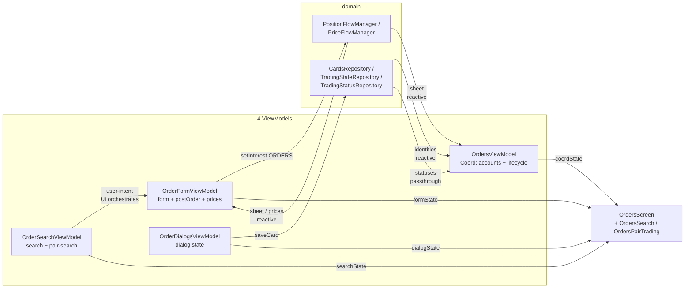
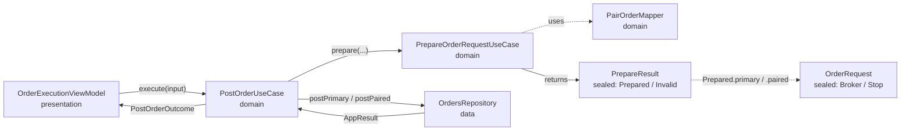
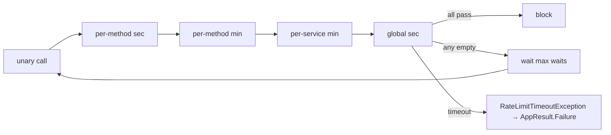

# Architecture

Справочник архитектурных решений TScalp. Читается вместе с `AGENTS.md`
(правила) и `docs/clean-audit.md` (отклонения).

Архитектурные решения и планы проверяются по триаде Clean + MVVM +
KMP-ready — `AGENTS.md` → 2e. Три поля фиксации в задаче:
`**Соответствие Clean:**`, `**MVVM:**`, `**KMP:**`.

<!-- SECTION_BEGIN: architecture -->
## Data flow: позиции (portfolio positions)

<!-- SUBSECTION_BEGIN: architecture-1 -->
___
### architecture-1 Модели
**Domain (`domain/models/Portfolio.kt`):**

- `Position` (sealed interface, 7 subtypes: `SharePosition` / `FuturePosition` /
  `BondPosition` / `OptionPosition` / `EtfPosition` / `CurrencyPosition` /
  `OtherPosition`) — позиция по инструменту в конкретном счёте. Поле
  `instrument: Instrument` типизировано по subtype (компилятор проверяет
  соответствие `Position` ↔ `Instrument`). Общие поля: `accountId`,
  `brokerName`, `quantity: Double`, `currentPrice`, `averagePrice?`,
  `profit?`, `lockedQuantity?`, `priceChangePercent?`. Computed getters:
  `totalValue` (`= currentPrice * quantity * instrument.moneyPerPointOfPrice`),
  `profitPercent` (от `averagePrice`).
- `AccountBalance(currency, money, blocked)` — деньги по валюте в счёте.
  Computed `total`.
- `AccountPortfolio(accountId, brokerName, positions: List<Position>,
  balances: List<AccountBalance>)` — агрегат одного счёта. Computed
  `totalProfit`.
- `AccountKey(brokerName, accountId)` — составной ключ счёта.
- `PortfolioSheet(accounts: Map<AccountKey, AccountPortfolio>)` —
  мультисчётный агрегат. **Единственный публичный эмитируемый тип**
  `PositionFlowManager`.
- `PositionStreamItem` — internal-событие источника (stream / polling).
  Наружу не эмитится; конверсия в `Position` / `AccountBalance` — через
  `toPosition(instrument)` / `toAccountBalance()`.

**Почему (Clean):**

- `Position` — domain-факт; subtype соответствует subtype `Instrument`.
- Derived-поля (`totalValue`, `profitPercent`) — computed getters,
  нечего «забыть обновить».
- Presentation-формат (Locale / Compose / цвета) — вне domain.

**Решение по clean-audit Н5 (исправлено, PR #90):** `PortfolioPosition`
удалён; `Position` (sealed) — единственная модель. Presentation-поля
(`priceChangePercent` day-change, цвета) — в `PositionFormatter` и
presentation-util.
<!-- SUBSECTION_END: architecture-1 -->

<!-- SUBSECTION_BEGIN: architecture-2 -->
___
### architecture-2 Обогащение (SSoT)
**Владелец:** `PositionFlowManager` (`domain/api/managers/PositionFlowManager.kt`).

- **`sheet: StateFlow<PortfolioSheet>`** — единственный источник истины.
- **Polling** (`broker.portfolio?.fetchPortfolioPositions(accountId, sandboxMode)`,
  раз в 10 сек): возвращает `AccountPortfolio`. Заменяет
  `sheet.accounts[accountKey]` целиком. Existing `AccountBalance`
  сохраняются, если polling не дал balances (`GetPortfolio` не отдаёт
  `money/blocked`; интеграция через `GetPositions` — отдельная задача).
- **Stream** (`broker.streams?.subscribePositions(accountId)`):
  - `Position` уже есть в `sheet.accounts[accountKey].positions` →
    `mergeStreamItem` (top-level extension `Position.mergeStreamItem(item)`;
    обновляет `quantity`, `currentPrice`, `averagePrice`, `profit`).
  - `Position` нет, `Instrument` есть в `instrumentCache` →
    `toPosition(instrument)`.
  - `Instrument` нет → skip (ждём polling, который заполнит
    `instrumentCache`).
- **Domestic currency** (`isDomesticCurrency = true`) → `mergeBalance`
  в `AccountBalance`. Иностранная валюта → `CurrencyPosition` через
  общий merge.
- **`instrumentCache: Map<AccountKey, Map<tscalpInstrumentId, Instrument>>`** —
  заполняется polling'ом.

**Seed (`start(accountKeys, sandboxMode, seed = PortfolioSheet?)`):**
начальный снимок из `PortfolioViewModel.loadPortfolio` (первичный fetch +
`getBalanceResult` per-account → `AccountBalance(currency = "rub",
money, blocked = 0.0)`). `applySeed()` merge-ит seed в `_sheet`: новый
счёт → seed целиком, существующий → только `balances` (positions
остаются из manager'а — polling / WS могли обновить свежее). Без seed
первый polling emit (раз в 10 сек) перезаписал бы `_sheet` пустыми
balances (`GetPortfolio` не отдаёт `money/blocked`) → шапка счёта
«нет данных».

**Правило `mergeStreamItem`:** `quantity` — из события; `currentPrice` /
`averagePrice` / `profit` — non-null fallback. Политика фильтрации
partial-событий — в manager.

**Окно отката:** polling раз в 10 сек может «откатить» свежее WS-обновление
(≤10 сек). Приемлемо.
<!-- SUBSECTION_END: architecture-2 -->

<!-- SUBSECTION_BEGIN: architecture-3 -->
___
### architecture-3 ViewModels
#### `PortfolioViewModel`

- Подписывается на `positionFlowManager.sheet` (`StateFlow<PortfolioSheet>`).
- Читает `uiState.sheet.accounts` напрямую (per-account группировка —
  по `AccountKey(brokerName, accountId)` в `PortfolioScreen`).
- Overlay `currentPrice` / `priceChangePercent` из `PriceFlowManager`
  (tick-to-tick, presentation-логика) — `uiState.prices` /
  `uiState.priceChangePercents`; day-change — задача
  `### Position: источники priceChangePercent и lockedQuantity`.

#### `OrdersViewModel` split (4 VM)

**Историческая справка (до C2).** Описание 4-VM структуры после split 13d. После C2 (Phase 3.1–7.2): Coord `OrderFormViewModel` удалён, 4 sub-VM + Mediator + UI-orchestration (`OrdersScreen` 4 `LaunchedEffect`). Таблица и диаграмма ниже — состояние **до C2**; актуальное — «Data flow: заявки» и «C2 target» ниже.

После 13d (split `OrdersViewModel`) — 4 VM:

| VM | State | Use cases / domain API | Lifecycle |
|---|---|---|---|
| `OrdersViewModel` (Coord) | `OrdersCoordState` (8 полей: accounts, selectedAccountId, isApiInitialized, lastSelectedInstruments, portfolioPositions, isLoading, statusMessage, isError) + **passthrough** `tradingStatuses: StateFlow<Map>` = `tradingStatusRepository.statuses` | `LoadOrdersAccountsUseCase`, `CheckBrokerInitializationUseCase`, `UpdateTradingStatusesUseCase`, `RefreshSelectedInstrumentsUseCase`; `CardsRepository`; `PositionFlowManager` | `startPositionUpdates` / `stopPositionUpdates` / `onCleared` (stop) |
| `OrderFormViewModel` | `OrderFormState` (29 полей: instrument / quantity / orderType / prices / pair / confirm / status) | `SelectInstrumentUseCase`, `SelectPairedInstrumentUseCase`, `RestoreOrderFormUseCase`, `PlaceOrderUseCase`, `CalculateTradeDetailsUseCase`, `CalculatePairExecUseCase`; `PriceFlowManager.setInterest`; `TradingStateRepository`, `TradingPreferencesRepository` | `onCleared` (clearInterest ORDERS) |
| `OrderSearchViewModel` | `OrderSearchState` (15 полей: search / pair-search / broker dialogs / status) | `SearchInstrumentsUseCase`; `SearchCacheRepository`; `BrokerRegistry` | — (stateless) |
| `OrderDialogsViewModel` | `OrderDialogsState` (6 полей: dialog flag / ticker / broker / account / swipe reset) | `LoadCardAccountsUseCase`, `SaveCardSettingsUseCase`; `CardsRepository`, `AccountSelectionRepository`, `SandboxPreferencesRepository` | — (stateless) |

**Cross-VM — 5 связей, все через domain или UI-orchestration (не через `_uiState`):**

1. **Search → Form** (user-intent, **UI оркестрирует**, P4 KDoc):
   `onSearchResultSelected` + `formVM.onInstrumentSelected`;
   `onPairedSearchResultSelected` + `formVM.onPairedInstrumentSelected`.
2. **Dialogs → Coord** (domain): `saveBrokerSettings` →
   `SaveCardSettingsUseCase` → `CardsRepository.identities` →
   Coord подписан (A4-b-1).
3. **Coord → Form** (data-flow, domain): `PositionFlowManager.sheet`
   — оба читают.
4. **Search → UI** (data-flow, domain): Coord passthrough
   `TradingStatusRepository.statuses` (P1) — UI читает
   `coordVM.tradingStatuses`.
5. **Form → Form** (data-flow, domain): `PriceFlowManager.setInterest(
   ORDERS, uids)` — Form-метод (`syncPriceInterest`).

Подпись: 4-VM структура `Orders` после split 13d — 4 state, 5 cross-VM связей через domain / UI-orchestration, ноль `_uiState`-чтений.
<!-- SUBSECTION_END: architecture-3 -->

<!-- SUBSECTION_BEGIN: architecture-4 -->
___
### architecture-4 Границы (dependency rule)
~~~
presentation → domain ← data
~~~

- `domain` не знает о `data` (`PositionStreamItem` — internal источника)
  и `presentation` (формат / цвета).
- `data` создаёт `PositionStreamItem` (raw) и `AccountPortfolio`
  (полный polling-снимок), отдаёт менеджеру.
- `presentation` читает `PortfolioSheet` (готовый), не мержит.
<!-- SUBSECTION_END: architecture-4 -->

<!-- SUBSECTION_BEGIN: architecture-5 -->
___
### architecture-5 Связанные документы
- `docs/domain_models.md` → `## Портфель (Portfolio)` §1–§12 —
  проектный мастер-план.
- `docs/clean-audit.md` → Н5 (исправлено, merge `d04ecc4`, PR #90: legacy
  `PortfolioPosition` удалён), Н24 (SSoT; `mergeWith` удалён в H5,
  SSoT — `PositionFlowManager.sheet` + `mergeStreamItem`).
- `AGENTS.md` → 2c (отклонения), 2d (временные решения).
- `docs/ROADMAP.md` → `### ✅ OrdersViewModel: миграция на PortfolioSheet`,
  `### ✅ H5. PortfolioPosition removed` (`ROADMAP-ARCHIVE.md`,
  legacy `PortfolioPosition`),
  `### Position: источники priceChangePercent и lockedQuantity`
  (day-change, lockedQuantity, balances),
  `### P&L: sandbox client-side fallback для Position` (отдельная задача).
<!-- SUBSECTION_END: architecture-5 -->

<!-- SUBSECTION_BEGIN: architecture-6 -->
___
### architecture-6 Модели и контракт
**`OrderRequest` (`domain/models/OrderModels.kt`)** — sealed interface для
готовой к отправке заявки. Два подтипа: `Broker(BrokerOrderRequest)` и
`Stop(StopOrderRequest)`. Заменяет `Any`-поля в `PreparedOrders` (B1, PR #132).

**`PrepareResult`** (внутри `PrepareOrderRequestUseCase`) — sealed interface:
- `Prepared(primary: OrderRequest, paired: OrderRequest?)` — обе заявки готовы.
- `Invalid(reason: String)` — валидационная ошибка (StopLoss без `stopPrice`,
  pair-stop без `stopPrice`). Маппится в `PostOrderOutcome.InvalidRequest(reason)`.

**`PrepareOrderRequestUseCase.prepare(...)`** — собирает `primary` и (если pair
включена) `paired`. Внутри: `buildPrimaryRequest` → `buildPairedRequest`
(только если `pairedInstrument != null && pairedAccountId != null`) → `PrepareResult`.

**`PostOrderUseCase.execute(input)`** — orchestration: `checkAvailability` →
`prepare` → `postPrimary` → (если `paired != null`) `postPaired`. Все `when`
по `OrderRequest` — exhaustive, 0 `as`-cast.
<!-- SUBSECTION_END: architecture-6 -->

<!-- SUBSECTION_BEGIN: architecture-7 -->
___
### architecture-7 Диаграмма — поток заявки

Подпись: `OrderExecutionViewModel` вызывает `PostOrderUseCase`, который внутри
разделяет «проверка» (checkAvailability), «подготовка» (prepare →
PrepareResult) и «отправка» (postPrimary / postPaired по sealed OrderRequest).
`PrepareResult.Invalid` — единственная точка валидации до API.
<!-- SUBSECTION_END: architecture-7 -->

<!-- SUBSECTION_BEGIN: architecture-8 -->
___
### architecture-8 Границы (dependency rule)
- **`domain`** — `OrderRequest`, `PrepareResult`, `BrokerOrderRequest`,
  `StopOrderRequest`.
- **`data`** — `OrdersRepository.postOrderResult(BrokerOrderRequest)` /
  `postStopOrderResult(StopOrderRequest)`. Адаптер — в `PostOrderUseCase`
  (`when (OrderRequest) { is Broker -> ...; is Stop -> ... }`).
- **`presentation`** — `PostOrderOutcome` (Success / InsufficientFunds /
  Error / InvalidRequest); сообщения и форматирование — в `OrderExecutionViewModel`.
<!-- SUBSECTION_END: architecture-8 -->

<!-- SUBSECTION_BEGIN: architecture-9 -->
___
### architecture-9 Atomicity парной сделки
Идеально — 2 заявки одной транзакцией. T-Invest / BCS / Finam **не
поддерживают batch**: primary уходит → paired отдельно; `PairedOutcome.Failed`
не откатывает primary. **Вне scope** (broker limitation). При появлении
потребности — `cancelOnPairedFailure` rollback отдельной задачей.
<!-- SUBSECTION_END: architecture-9 -->

<!-- SUBSECTION_BEGIN: architecture-10 -->
___
### architecture-10 Валидация и нормализация: по слоям
Валидация рассредоточена по трём слоям, с чётким разделением ролей.

**Presentation — нормализация ввода (TextField):**
- `OrderInputViewModel` мутаторы: `onQuantityChanged` (digit), `onLimitPriceChanged` / `onStopPriceChanged` (digit + `.`).
- Presentation-обязанность: не пустить в state символы, которые TextField не должен принимать. Не бизнес-правило.

**Presentation — UI-фидбэк (disabled кнопки):**
- `OrderFormValidation.kt`: `isFormValid(instrument, input, isApiInitialized)` → `isBasicValid` + `isLimitPriceValid` + `isStopPriceValid` + `isPairValid`.
- Роль: **предварительная** проверка для UI (disabled кнопки «Купить»/«Продать»). Финальное решение — domain.

**Presentation — guard на границе presentation→domain:**
- `OrderPlaceRequestMapper.toPlaceRequest(instrumentState, inputState)`: `selectedInstrument ?: return null`, `quantityAsLong ?: return null`, `pairedMultiplier.toLongOrNull() ?: return null`.
- Роль: не отдавать в domain неполный `PlaceOrderRequest`. Null → `PostOrderOutcome.InvalidRequest` / no-op. UI передаёт `toPlaceRequest(instrVM.state.value, inputVM.state.value)` в `execVM.onConfirmOrder(request)` / `onBuyClickDirect(request)` / `onSellClickDirect(request)` (см. `OrdersScreen`).

**Domain — настоящая бизнес-валидация:**
- `PrepareOrderRequestUseCase` → `PrepareResult.Invalid(reason)`: StopLoss/TakeProfit/StopLimit без `stopPrice` → `Step.Invalid`; парная stop-заявка без `stopPrice` → `Invalid`.
- `PostOrderUseCase.checkAvailability` → `TradeCheckResult.Error` / `InsufficientFunds`.
- Роль: **окончательное** решение.

**Связанные:** `docs/clean-audit.md` → M017, M013, M018. C2 выполнен: `OrderFormViewModel` удалён в Phase 6.1, `OrderFormState` / `OrderFormStateMapper` — в Phase 7.1.
<!-- SUBSECTION_END: architecture-10 -->

<!-- SUBSECTION_BEGIN: architecture-11 -->
___
### architecture-11 Связанные документы
- `docs/roadmap/ROADMAP-ARCHIVE.md` → `### ✅ PrepareOrderRequestUseCase: sealed OrderRequest + decompose (B1+B2)`.
- `docs/ISSUES.md` → `ClassCastException в PostOrderUseCase при StopLoss без stopPrice` (решён, PR #132).
- `docs/clean-audit.md` → M017 (`buildPlaceOrderRequest`), M013 / A2 (orchestration) — контекст оркестрации заявок.
<!-- SUBSECTION_END: architecture-11 -->

<!-- SUBSECTION_BEGIN: architecture-12 -->
___
### architecture-12 CardIdentity — иммутабельный identity
`CardIdentity(tscalpInstrumentId, brokerName, accountId)` — **иммутабельная**
identity карточки. Все три поля задаются при создании и не меняются до
удаления карточки.

- `tscalpInstrumentId` — broker-specific паспорт (`uid` T-Invest / `figi`
  BCS / `id` Finam). См. `docs/domain_models.md` §3.
- `brokerName` — брокер, у которого найден инструмент.
- `accountId` — счёт этого брокера.

**Различие карточек — по полному composite.** Один `tscalpInstrumentId`
сам по себе не уникален между брокерами и счетами:

- `(uid_1, T, A)` и `(uid_1, T, B)` — **две разные** карточки (один
  инструмент, один брокер, разные счета);
- `(uid_1, T, A)` и `(uid_2, B, A)` — **две разные** карточки (разные
  инструменты у разных брокеров);
- `(uid_1, T, A)` и `(uid_1, B, A)` — **две разные** карточки (один uid
  у разных брокеров, если такое встретится).

`ticker` в identity **не входит** — только data-граница (BCS/Finam-запросы)
и display.
<!-- SUBSECTION_END: architecture-12 -->

<!-- SUBSECTION_BEGIN: architecture-13 -->
___
### architecture-13 Создание карточки
1. Пользователь задаёт брокера в свойствах слота (до поиска).
2. В строке поиска ищет инструмент у этого брокера.
3. Выбирает инструмент → карточка создаётся с
   `(tscalpInstrumentId, brokerName слота, accountId)`.
   `accountId` на момент создания может быть `null`.
4. В свойствах карточки выбирается `accountId` → карточка
   **пересоздаётся** `(uid, broker, A)`. Старая `(uid, broker, null)`
   умирает.

**Смена счёта — пересоздание identity, не мутация.** `SaveCardSettings` —
не «обновляет account в карточке», а «удаляет старую identity + создаёт
новую».
<!-- SUBSECTION_END: architecture-13 -->

<!-- SUBSECTION_BEGIN: architecture-14 -->
___
### architecture-14 Слоты (primary / pair)
На экране «Заявки» два независимых слота: основной и парный. В каждом —
своя **активная карточка** (или none до выбора).

Каждый слот имеет собственные свойства (broker + account), независимые
от другого слота. Поиск в слоте — у брокера слота.

- `activeCardFor(slot)` — find по полному `CardIdentity` слота
  `(uid, broker, accountId)`.
- Один и тот же инструмент в двух слотах — **две разные** карточки
  (разные `accountId` или разные `broker`).
<!-- SUBSECTION_END: architecture-14 -->

<!-- SUBSECTION_BEGIN: architecture-15 -->
___
### architecture-15 Коллизия при смене счёта
Если пользователь в свойствах карточки выбирает `accountId`, который
уже занят **другой** карточкой того же `(uid, broker)` в этом или
соседнем слоте — счёт в диалоге **disabled** (α-вариант).

Иначе одна identity оказалась бы в двух местах — неоднозначно для
`activeCardFor` и `SaveCardSettings`.

**Swap слотов** при α: через временный счёт или удаление + пересоздание.
Быстрый swap отдельной кнопкой рядом со slider «Парная торговля» —
отдельная задача (`### UI: кнопка swap слотов`).
<!-- SUBSECTION_END: architecture-15 -->

<!-- SUBSECTION_BEGIN: architecture-16 -->
___
### architecture-16 Портфель на карточке
Если инструмент `(uid, broker, accountId)` уже есть в портфеле (на этом
счёте у этого брокера) — карточка показывает `quantity` / `averagePrice`
/ `profit` как на вкладке «Портфель». Источник —
`PositionFlowManager.sheet`, ключ `AccountKey(broker, accountId)`.
<!-- SUBSECTION_END: architecture-16 -->

<!-- SUBSECTION_BEGIN: architecture-17 -->
___
### architecture-17 Границы (Clean)
`CardIdentity` — domain-модель. Presentation конструирует её только через
usecase (`SelectInstrumentUseCase` / `SaveCardSettingsUseCase`); прямая
конструкция в UI запрещена (M4). `SaveCardSettings` и `OpenCardDialog` —
usecase с I/O и бизнес-правилом (пересоздание карточки / коллизия), не
presentation-функции.
<!-- SUBSECTION_END: architecture-17 -->

<!-- SUBSECTION_BEGIN: architecture-18 -->
___
### architecture-18 Блокеры в domain
| # | Что | Где | Фикс |
|---|---|---|---|
| 2 | `javax.inject.Inject` / `Singleton` | 4 менеджера | Koin (без аннотаций) — задача `### Плавный переход Hilt → Koin` |

**Принцип (2e → KMP → DI):** `domain` не содержит DI-аннотаций
(`javax.inject.Inject` / `Singleton`, `@HiltViewModel`). DI-граф —
снаружи (`di/` сейчас, Koin потом). `domain/usecases/*` — без
`@Inject`: DI через `@Provides` в 6 доменных `*UseCaseModule.kt`
(Orders / OrderForm / OrderSearch / Broker / Accounts / Portfolio;
split одного `UseCaseModule.kt` — detekt `TooManyFunctions`).
Известный долг — 4 менеджера в `domain/api/managers/` (строка #2):
там нужен Koin, не `@Provides` (многослойные зависимости).

**`javax.inject` — 4 файла** в `domain/api/managers/`: `PositionFlowManager`, `PriceFlowManager`, `OrderFlowManager`, `BrokerLifecycleManager`. Аудит 2026-10-29 зафиксировал 3; `BrokerLifecycleManager` добавлен позже (PR #77, H50, 2026-10-31). Строка #4 (PR #74) — 3 менеджера, потому что `BrokerLifecycleManager` тогда ещё не существовал.

**Исправлено (PR #73, `dev`, 2026-10-30):**

- #1 — `java.time.Instant` → `kotlin.time.Instant` (stdlib, KMP-safe); 14 полей в `InstrumentUi`/`FutureUi`/`ShareUi`.
- #3 — `System.currentTimeMillis()` → инжект `kotlin.time.Clock`; `StreamStateTracker`/`OrderCache` на `Instant`/`Duration`; `di/TimeModule.kt`.

**Исправлено (PR #74, `dev`, 2026-10-30):**

- #4 — `Dispatchers.IO` → инжект `CoroutineDispatcher` через DI (`di/DispatcherModule.kt`); `limitedParallelism(1)` сохранён (доменная сериализация); 3 менеджера + тесты.
<!-- SUBSECTION_END: architecture-18 -->

<!-- SUBSECTION_BEGIN: architecture-19 -->
___
### architecture-19 Чисто (KMP-safe)
- `domain/models/*` — KMP-safe (PR #73: `kotlin.time.Instant`).
- `domain/api/repository/*` (8 интерфейсов) — ноль platform.
- `domain/api/roles/*` — чисто.
- `domain/log/Logger` — pure Kotlin interface.
- `domain/usecases/*` — **без DI-аннотаций** (24 файла очищены,
  задача `### ✅ Н37b: usecases без DI-аннотаций (2e → KMP → DI)`).
  DI через `@Provides` в 6 доменных `*UseCaseModule.kt`.
  `CalculateTradeDetailsUseCase` / `PrepareOrderRequestUseCase` —
  уже были чистыми.
<!-- SUBSECTION_END: architecture-19 -->

<!-- SUBSECTION_BEGIN: architecture-20 -->
___
### architecture-20 Не в этой фазе
- `data/` — не готов к `commonMain` (`android.*`: Context, DataStore, CustomTrustManager → `androidMain`; `java.*` в 8 файлах; `javax.inject` → уйдёт с Koin).
- Koin — предусловие (задача `### Плавный переход Hilt → Koin`).
<!-- SUBSECTION_END: architecture-20 -->

<!-- SUBSECTION_BEGIN: architecture-21 -->
___
### architecture-21 Порядок
1. ✅ Фикс #1 (`Instant`) + #3 (`currentTimeMillis`) — закрыто в PR #73.
2. ✅ Фикс #4 (`Dispatchers.IO` → инжект `CoroutineDispatcher`) — закрыто (PR #74).
3. Koin — снимает #2.
4. `domain` → `:shared/commonMain` (umbrella-задача `### KMP: domain → commonMain`).
5. `data` → split `commonMain`/`androidMain` (отдельная фаза).
<!-- SUBSECTION_END: architecture-21 -->

<!-- SUBSECTION_BEGIN: architecture-22 -->
___
### architecture-22 Rate-limiter (transport layer)
**Что/зачем.** Ограничитель частоты unary-запросов к брокеру. Защищает от `RESOURCE_EXHAUSTED` при burst (поиск, cold start, polling). Broker-agnostic интерфейс; domain про лимиты не знает — это свойство транспорта (2a, 2e).

**Где живёт (data-слой).**
- `data/api/common/TransportRateLimiter` — интерфейс (`withUnaryPermission`, `withStreamSlot`).
- `data/api/tinvest/TInvestRateLimiter` — реализация (token-bucket + stream semaphore).
- `data/api/tinvest/TInvestRateLimits` — per-broker конфиг (лимиты из `docs/rate-limits.md`).
- BCS/Finam — свои `<Broker>RateLimits.kt` + impl при интеграции.

**Четыре уровня unary (narrow → broad, all-or-nothing acquire).** На каждый unary-вызов проверяются все применимые уровни; если хотя бы один пуст — ждём `max(waits)`, ничего не списывая:
1. **per-(protocol, service.method) per-second** — `postOrder` 15/sec.
2. **per-(protocol, service.method) per-minute** — `getOrders` 200, `getStopOrders` 60, `getHistory` 30 REST, `cancelOrder`/`replaceOrder` 300.
3. **per-(protocol, service) per-minute** — Instruments 200 (gRPC) / 100 (REST), MarketData 600, Orders 100.
4. **global per-second** — 50/sec, все транспорты, все сервисы.

**Per-method override заменяет per-service cap** (не добавляется): `getOrders` 200/min > `orders` 100/min — берётся только override + global.

**Bucket capacity = 1s burst.** Для per-minute bucket `capacity = limit / 60.0` (1 секунда токенов), не `limit` (полная минута). Иначе burst N за < 1 сек превышает серверный per-second cap → `RESOURCE_EXHAUSTED` (`l-kotlin-115`, PR #162). Per-second bucket — `capacity = limit` (уже 1s).

**Timeout.** `RateLimitTimeoutException` при `waitedMs + waitMs > timeoutMs` (5s) → caller на границе data → `AppResult.Failure`. Ниже — поток одного вызова:

**Stream limiter (1b).** `withStreamSlot` — per-(protocol, service) semaphore; WS и gRPC-streaming делят бюджеты (флаг `WS_SHARES_STREAM_BUDGET`). 4 уровня unary к стримам не применяются.

**Clean:** соответствует — data-layer infrastructure, domain не знает. **KMP:** `kotlin.time.Clock` (injected), `kotlinx.coroutines.sync.*` — без `java.*` / `android.*`.

**Связанные:** T-3 umbrella (`docs/roadmap/ROADMAP-wip.md`); PR #162 (burst-capacity fix); `docs/rate-limits.md` (лимиты API); `l-kotlin-115` (bucket capacity); 1b (stream limiter, план).
<!-- SUBSECTION_END: architecture-22 -->

<!-- SUBSECTION_BEGIN: architecture-23 -->
___
### T-10: unary → AppResult — предостережения
### architecture-23 T-10: unary → AppResult — предостережения

**Контекст:** T-10 (`docs/roadmap/ROADMAP-plan.md`) — унификация контракта data-слоя: unary-методы 6 `TInvest*Service` → `AppResult<T>`, `RateLimitTimeoutException` → `AppError.RateLimited`. Ниже — четыре предостережения, выявленные при диагностике (2026-11-17), с обоснованием. Решения по ним — часть плана T-10, не отдельные задачи (кроме #4).

**Соответствие Clean:** соответствует (data → domain, `AppResult` — domain-модель; исключения не пересекают границу domain↔data).
**MVVM:** соответствует (presentation получает `AppResult<T>`, не исключение; маппинг `AppError → String` — в presentation-util, не в VM — см. #3).
**KMP:** соответствует (см. #1 — proto не оборачивается в `AppResult`; `RateLimited` — KMP-safe domain-модель).

#### #1 — `internal`-методы с proto не оборачивать в `AppResult`

**Правило:** `internal`-методы `TInvest*Service`, возвращающие proto-типы (`ru.tinkoff.piapi.contract.v1.*`), **не** оборачиваются в `AppResult<T>`. Остаются как есть (`throw` / nullable).

**Затронуто:** `TInvestInstrumentsService.fetchProtoInstrument(uid): ProtoInstrument?` (internal), `getFuturesMargin(figi): Double?` (internal, fallback на null).

**Обоснование:**
- **KMP-блокер:** `AppResult<ProtoInstrument>` = proto-тип в domain-модели `AppResult`. Нарушает `architecture-18` → «`io.grpc` не протекает в domain» (категория `transport` в 2e). Proto не должен появляться в generic-параметре domain-модели.
- **Clean:** proto — транспортный тип data-слоя. Обёртка в `AppResult` «легализует» его в domain-контракте. `internal` — единственная защита; обёртка её снимает.
- **Практика:** `getFuturesMargin` — обогащение, `null` при ошибке — сознательная деградация (не потеря, не ошибка вызова). `AppResult` здесь не нужен — вызывающий (`TInvestPortfolioService`) уже в data.

**Проверка:** `grep -rn "AppResult<.*Proto\|AppResult<.*ru.tinkoff" app/src/main --include="*.kt"` — пусто.

**Связано:** T-10 (шаги 3b, 3e — не трогают internal-методы); `architecture-18` (KMP-блокеры).

#### #2 — `runCatchingAppResult` убирать только из TInvest-веток

**Правило:** в `*RepositoryImpl` шаг 5 T-10 убирает `runCatchingAppResult` **только** из TInvest-веток (`when (broker) { TINVEST -> ... }`). BCS/Finam-ветки **оставляют** `runCatchingAppResult` — их `*Service` ещё не возвращают `AppResult`.

**Затронуто:** 4 `*RepositoryImpl` (`Accounts`, `MarketData`, `Orders`, `Portfolio`) — 15 callsites, из них TInvest-веток ~8, BCS/Finam-веток ~7.

**Обоснование:**
- **Clean:** BCS/Finam-сервисы возвращают «сырые» типы (`throw`). Если убрать `runCatchingAppResult` — исключения пересекут границу data→domain, нарушая `code-project` («`AppResult<T>`, не исключения на границах слоёв»).
- **Согласованность:** граница `data → domain` — **всегда** `AppResult`, независимо от брокера. Убирать обёртку можно только когда **сервис** уже возвращает `AppResult` (шаги 2–3 — только TInvest).
- **Поэтапность:** BCS/Finam-миграция — отдельные задачи (T-30, T-31). Сейчас — не трогаем.

**Проверка:** `grep -rn "runCatchingAppResult" app/src/main/kotlin/com/gitlab/biomorf/tscalp/data/repository/` — TInvest-ветки без обёртки, BCS/Finam — с обёрткой.

**Связано:** T-10 (шаг 5); T-30, T-31 (BCS/Finam API).

#### #3 — `AppError → String` — в `*Formatter`, не в VM

**Правило:** маппинг `AppError` → UI-сообщение (`RateLimited` → «Слишком много запросов. Подождите», `Network` → «Ошибка сети» и т.д.) — в presentation-util (`*Formatter` / новый `AppErrorFormatter`), **не** в ViewModel.

**Обоснование:**
- **MVVM (M1):** VM, форматирующая сообщения — делает не-свою обязанность (presentation-форматирование вместо state-менеджмента). `architecture-10` уже фиксирует: «Presentation-формат (Locale / Compose / цвета) — вне domain» — но и вне VM (M7-риск: VM конвертирует domain↔presentation).
- **M7:** если VM делает `when (error) { is RateLimited -> "..." }` — это конвертация domain-модели (`AppError`) в presentation-строку. Правильно: `AppErrorFormatter.format(error): String` (presentation-util), VM отдаёт `AppError` в state, Composable вызывает formatter.
- **Тестируемость:** formatter тестируется отдельно (unit-тест, без VM/Compose); VM-тест не зависит от строк.
- **Локализация:** строки — в `strings.xml` (Android resource), formatter читает оттуда. VM не знает про `R.string.*`.

**Проверка:** `grep -rn "is RateLimited ->" app/src/main/kotlin/com/gitlab/biomorf/tscalp/presentation/` — только в `*Formatter`, не в `*ViewModel`.

**Связано:** T-10 (шаг 6); `architecture-10` (валидация/нормализация по слоям); `docs/clean-audit.md` → M001–M007 (типы MVVM).

#### #4 — общий `RateLimitedException` для всех брокеров (временное решение → задача в ROADMAP)

**Правило:** сейчас `toAppError` (в `data/error/AppErrorMapper.kt`) проверяет `is RateLimitTimeoutException` — TInvest-specific исключение. Это **временное решение** (r2d). При появлении BCS/Finam rate-limiter'ов — вынести общий `interface RateLimitedException` в `data/api/common/`, реализации (`TInvestRateLimitTimeoutException`, `BcsRateLimitTimeoutException`) — в `data/api/<broker>/`.

**Обоснование:**
- **Clean:** `toAppError` — общий маппер для всех брокеров. Импорт TInvest-specific исключения — временная связанность data→data (не нарушение, но запах). При втором брокере — общий интерфейс.
- **KMP:** `RateLimitTimeoutException` — data-слой, в domain не протекает. `RateLimited` — domain-модель, KMP-safe. Сейчас — соответствует.
- **r2d:** временное решение **явно маркируется** и **закрывается задачей** в `docs/ROADMAP.md` в той же сессии. Задача — `### Общий RateLimitedException для всех брокеров` (DEFER, `docs/roadmap/ROADMAP-defer.md`), зависимость — T-30 / T-31 (BCS/Finam API).

**Проверка:** `grep -rn "RateLimitTimeoutException" app/src/main/kotlin/com/gitlab/biomorf/tscalp/data/error/` — только в `toAppError`; маркер `// TODO(T-NN): общий RateLimitedException` — в коде.

**Связано:** T-10 (шаг 1); T-30, T-31; `architecture-22` (rate-limiter).

**Источник:** диагностика 2026-11-17 (T-10, расширенная диагностика); ответы пользователя Q4–Q11 (все утверждены).
<!-- SUBSECTION_END: architecture-23 -->

<!-- SECTION_END: architecture -->
