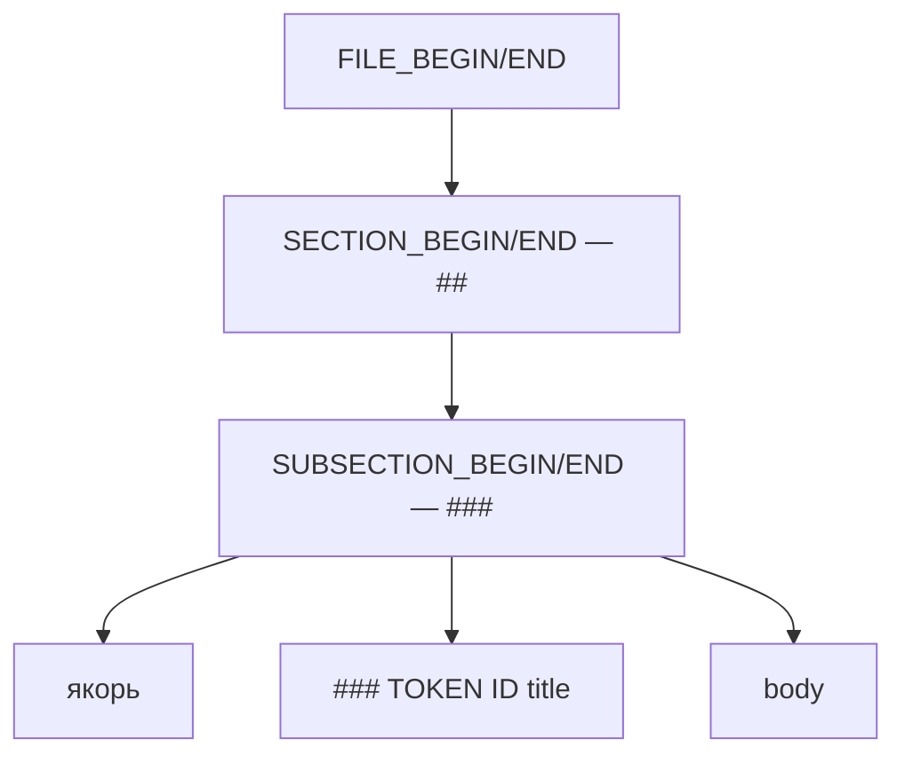

<!-- FILE_BEGIN -->
# Structure — SSoT по стилю оформления документации

Канон стиля `.md`-файлов проекта. `AGENTS/` — директивы по применению
инструментов: ссылки сюда, без дублирования стиля. Скрипты
(`AGENTS/scripts/`) — реализация: при расхождении прав документ,
код правится под него.

Два типа требований:
- инвариант — поддерживается всегда, проверяется гейтом;
- миграция — разовое действие, закрывается задачей.

Статус каждого правила — три поля: Правило / Инструмент / Файлы,
запись `правило ✅ / инструмент ⏳ / файлы ⏳`.

Ссылки на задачи — по ID (`T-44`), не по номерам шагов: шаги
перенумеровываются, документ от этого врать не должен.

Ревизия 2026-11-20: документ переписан с нуля. Таблица переходов,
статусы «по источнику в коде» и сводка открытых вопросов упразднены.


<!-- SECTION_BEGIN: scope -->
## 1. Назначение и область

Три уровня применения:

- Уровень 1 — все `.md` без исключений: `FILE_BEGIN` / `FILE_END`.
  Это часть integrity policy: маркеры нужны для отчётов о прочтении
  и задают границы вырезки/вставки.
- Уровень 2 — любой `.md`, содержащий `##`-разделы:
  `SECTION_BEGIN` / `SECTION_END` и разделители между секциями.
- Уровень 3 — семейства `AGENTS/AGENTS-*.md`,
  `AGENTS/AGENTS-LESSONS-*.md`, `docs/roadmap/ROADMAP-*.md`,
  `docs/roadmap/ci-roadmap-*.md` и их индексы: `SUBSECTION`-маркеры,
  токены, ID, якоря, индексы.

Вне области (отдельные задачи): `docs/issues/`, `docs/clean-audit/`.

Архивы (`ROADMAP-ARCHIVE.md`, `CI-ROADMAP-ARCHIVE.md`): уровень 1
применяется; структурный стиль не применяется; содержимое заморожено.
Ассистент архивы в контекст не загружает.

<!-- SECTION_END: scope -->


<!-- SECTION_BEGIN: headings -->
## 2. Заголовки

`## <title>` — без токена и без ID.

`### [TOKEN] <ID> <title>` — для всех подсекций уровня 3.

TOKEN выводится из имени файла. Приоритет проверки явный:
1. `AGENTS-LESSONS-*.md` → `[AGENTS-LESSONS]`;
2. иначе `AGENTS-*.md` → `[AGENTS]`;
3. `ROADMAP-{wip,plan,defer,done}.md` → `[WIP]` / `[PLAN]` / `[DEFER]` / `[DONE]`;
4. `ci-roadmap-{wip,plan,defer,done}.md` → те же токены, префикс ID — `C-`.

Глоб `AGENTS-*.md` включает `AGENTS-LESSONS-*.md`, поэтому порядок
проверки 1 → 2 обязателен.

Регистр ID:
- маркер — всегда kebab-case lower (`t-44`, `r4k`);
- заголовок roadmap / ci-roadmap — UPPER (`T-44`, `C-5`);
- заголовок AGENTS / AGENTS-LESSONS — kebab-case lower (`r4k`).

Соответствие маркера и заголовка жёсткое:
- roadmap / ci-roadmap: `marker.id == lower(heading.ID)`;
- AGENTS / AGENTS-LESSONS: точное строковое равенство.

Цепочка статуса: имя файла → токен → статус. Маппинг:
`WIP` → «в работе», `PLAN` → «запланировано», `DEFER` → «отложено»,
`DONE` → «выполнено». Строка `**Статус:**` обязана соответствовать
токену. Смена статуса — перенос блока в другой файл, а не правка
текста. Размещение — решение человека; токен и статус приводятся
автоматически. Для AGENTS цепочка не применяется: там токен — тип
документа, а не статус.

<!-- SECTION_END: headings -->


<!-- SECTION_BEGIN: markers -->
## 3. Маркеры и якоря

Форматы — plain, без префиксов:
- `<!-- FILE_BEGIN -->` / `<!-- FILE_END -->`;
- `<!-- SECTION_BEGIN: id -->` / `<!-- SECTION_END: id -->`;
- `<!-- SUBSECTION_BEGIN: id -->` / `<!-- SUBSECTION_END: id -->`.

Префиксные варианты (`AGENTS_FILE_BEGIN`, `LESSONS_SECTION_BEGIN` и т. п.)
запрещены. При миграции префиксный маркер заменяется на plain,
а не дополняется вторым.

`FILE_BEGIN` — первая строка файла, `FILE_END` — последняя; ровно по
одному; всё содержимое — между ними.

Вложенность: `FILE` > `SECTION` > `SUBSECTION`. `SUBSECTION` — только
внутри `SECTION`.



ID маркеров — kebab-case lower. Уникальность — в пределах индекса,
а не файла: перемещение блока между файлами id не меняет. Проверка
уникальности — пересборка индекса и гейт, не пофайловый нормализатор.
Канонический индекс один; корневые указатели таблицу не дублируют.

Якорь — производный элемент: `<a id="<id>"></a>`, генерируется из id
маркера, руками не пишется. Позиция — первая строка блока, сразу
после `SUBSECTION_BEGIN`. Гейт проверяет наличие, позицию и
совпадение с id маркера.

<!-- SECTION_END: markers -->


<!-- SECTION_BEGIN: blocks -->
## 4. Структура блока и разделители

Скелет подсекции — всегда одинаковый, без исключений:

```markdown
<!-- SUBSECTION_BEGIN: <id> -->
<a id="<id>"></a>
### [TOKEN] <ID> <title>
<тело>

---
<!-- SUBSECTION_END: <id> -->
```

- Тело начинается сразу после заголовка, без пустой строки.
- Перед `---` ровно одна пустая строка. Если их больше — лишние
  удаляются. Перевод строки последней текстовой строки не трогается.
- `---` — единственный визуальный разделитель. `___` не используется.
  Отдельные строки `---` между секциями запрещены; `|---|` в таблицах
  и линии внутри кода разделителями не считаются.

Переходы: между любыми блоками, между секциями, перед `SECTION_END`
и перед `FILE_END` — ровно 10 пустых строк. Других разделителей нет.

Якорь и `---` — производные элементы: генерируются нормализатором,
при вырезке/вставке едут вместе с блоком.

<!-- SECTION_END: blocks -->


<!-- SECTION_BEGIN: indexes -->
## 5. Индексы

Канонические индексы: `AGENTS/AGENTS.md`, `AGENTS/AGENTS-LESSONS.md`,
`docs/roadmap/ROADMAP.md`, `docs/roadmap/ci-roadmap.md`.

Формат — 5 колонок, заголовок единый для всех четырёх:
`| TOKEN | ID | Title | File | Anchor |`. TOKEN — в квадратных
скобках; ID — как в заголовке; ячейка Anchor — кликабельная ссылка
на `<File>#<id>` с текстом `#<id>` (из маркера).

AGENTS-индексы: TOKEN — тип документа (`[AGENTS]`,
`[AGENTS-LESSONS]`), не статус.

Корневые указатели (`AGENTS.md`, `AGENTS-LESSONS.md`,
`docs/ROADMAP.md`, `docs/ci-roadmap.md`) — тонкие: список файлов
или гейт обязательного чтения плюс ссылка на канонический индекс.
Таблицы не дублируются.

Нумерация (только roadmap / ci-roadmap): в шапке индекса до
таблицы — строка `**Next ID:** T-45` (для ci-roadmap — `C-<n>`).
Значение — id следующей задачи; после выдачи инкремент. Инвариант:
`Next ID` больше максимального ID в индексе. Пересборка индекса
строку сохраняет. Первичная установка — разовым скриптом по максимуму
индекса и архива; дальше архив не читается. ID не переиспользуются.

<!-- SECTION_END: indexes -->


<!-- SECTION_BEGIN: tools -->
## 6. Инструменты и проверки

Описание инструментов (аргументы, примеры) — в
`AGENTS/scripts/README.md`. Здесь — только требования: скрипты
создают и поддерживают описанный порядок автоматически.

Гейт (`docs/scripts/check-docs.sh`) обязан проверять:
1. `FILE_BEGIN` — первая строка, `FILE_END` — последняя (§1, §3).
2. Отсутствие префиксных маркеров (§3).
3. Парность маркеров и вложенность `FILE` > `SECTION` > `SUBSECTION` (§3).
4. Соответствие `marker.id` и `heading.ID` с учётом регистра (§2).
5. Уникальность id в пределах индекса (§3, §5).
6. Наличие якоря, позиция, совпадение с id маркера (§3, §4).
7. Скелет блока: тело сразу после заголовка; ровно одна пустая
   строка перед `---`; `---` перед каждым `SUBSECTION_END`;
   `___` отсутствует (§4).
8. 10 пустых строк на всех переходах (§4).
9. Соответствие токена имени файла (§2).
10. Соответствие `**Статус:**` токену (§2).
11. `Next ID` присутствует и больше максимального ID (§5).

Инвариант без проверки — дефект документа или гейта.

<!-- SECTION_END: tools -->


<!-- SECTION_BEGIN: refs -->
## 7. Связанные документы

- `AGENTS/AGENTS-integrity.md` — роль маркеров в отчётах о прочтении
  (ссылка сюда, без определения форматов).
- `AGENTS/AGENTS-project-docs.md` → `project-docs-section-order` —
  ссылка сюда.
- `AGENTS/AGENTS-style-docs.md` → `r4j` — ссылка на
  `AGENTS/scripts/README.md`.
- `AGENTS/scripts/README.md` — описание инструментов.

<!-- SECTION_END: refs -->


<!-- FILE_END -->
