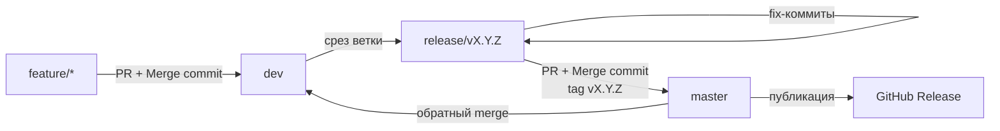
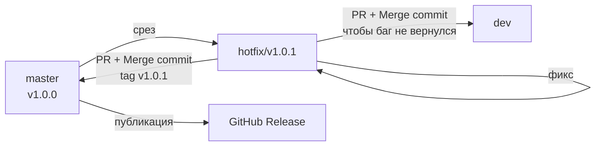

# Git-flow

Соглашение о ветвлении и слияниях в проекте TScalp.
Описывает схему веток, стратегии merge, жизненные циклы
релиза и hotfix.

Документ — **справочник**. План задач по внедрению GitFlow
и связанных изменений — в `docs/ci-roadmap.md` → «Переход
на полный GitFlow».

---

## Схема веток

Две постоянные ветки (`master`, `dev`) и четыре типа
временных (`feature/*`, `bugfix/*`, `release/*`,
`hotfix/*`).

### Диаграмма — gitGraph

Показывает историю как её видит git: коммиты, точки
ветвления, моменты merge. Точнее отражает механику —
видно, что `release/*` отпочковывается от `dev`,
а `hotfix/*` — от тега на `master`.

```mermaid
gitGraph
    commit id: "base"
    branch dev
    checkout dev
    commit id: "init"
    branch feature/analytics
    checkout feature/analytics
    commit id: "feat 1"
    commit id: "feat 2"
    checkout dev
    merge feature/analytics
    branch release/v1.1.0
    checkout release/v1.1.0
    commit id: "rc1"
    commit id: "bugfix"
    checkout master
    merge release/v1.1.0 tag: "v1.1.0"
    checkout dev
    merge master
```

### Диаграмма — flowchart

Схема процесса без детализации коммитов. Проще читается,
если цель — понять поток, а не механику git.



---

## Постоянные ветки

### `master`

Релизная ветка. Содержит только принятый, готовый к продакшену
код. Любой коммит в `master` — потенциальный релиз.

- Прямой push запрещён (Ruleset `Protect master`).
- Изменения — только через PR.
- Источник PR: `release/*` или `hotfix/*`.
- Каждый merge в `master` сопровождается тегом `vX.Y.Z`.

### `dev`

Интеграционная ветка. Здесь встречается код из feature- и
bugfix-веток. Отражает текущее состояние разработки — то,
что будет в следующем релизе.

- Прямой push запрещён (Ruleset `Protect dev`).
- Изменения — только через PR.
- Источники PR: `feature/*`, `bugfix/*`, `release/*`
  (обратный merge), `hotfix/*` (обратный merge).
- Служит базой для среза `release/*`.

**Отклонение от канона:** канонический GitFlow называет эту
ветку `develop`. У нас — `dev` (см. раздел «Осознанные
отклонения»).

---

## Временные ветки

### `feature/<name>`

Одна фича — одна ветка. Отпочковывается от `dev`, после
завершения сливается обратно в `dev`.

- Имя: `feature/<короткое-описание>` (например,
  `feature/positions-stream-grpc`).
- Живёт от нескольких часов до нескольких дней.
- Merge в `dev` — Merge commit (не Squash, не Rebase).

**Пример:**

```bash
git checkout dev
git pull
git checkout -b feature/positions-stream-grpc
# ... работа, коммиты ...
git push -u origin feature/positions-stream-grpc
# PR feature/positions-stream-grpc -> dev через web
```

### `bugfix/<issue-id>`

Один баг — одна ветка. Отпочковывается от `dev`, сливается
обратно в `dev`. Используется, когда баг не в проде, а в
разработке.

- Имя: `bugfix/<issue-id>` или `bugfix/<короткое-описание>`.
- Merge в `dev` — Merge commit.

**Пример:**

```bash
git checkout dev
git pull
git checkout -b bugfix/123-empty-positions-list
# ... фикс ...
git push -u origin bugfix/123-empty-positions-list
```

### `release/vX.Y.Z`

Стабилизация перед релизом. Отпочковывается от `dev`, когда
все фичи для релиза готовы. Сливается в `master` с тегом.

- Имя: `release/v<semver>` (например, `release/v1.1.0`).
- Сюда допускаются **только фиксы**, никаких новых фич.
- Merge в `master` — Merge commit + тег `vX.Y.Z`.
- После merge в `master` — обратный merge `master → dev`,
  чтобы фиксы стабилизации не потерялись.

**Пример:**

```bash
git checkout dev
git pull
git checkout -b release/v1.1.0
# ... фиксы, найденные при тестировании ...
git push -u origin release/v1.1.0
# PR release/v1.1.0 -> master через web
# После merge: тег, затем обратный merge master -> dev
```

### `hotfix/vX.Y.Z`

Экстренный фикс прода. Отпочковывается от **тега** на
`master` (не от `master`-ветки — именно от проблемной
версии). После фикса сливается в `master` (с тегом) и в
`dev`.

- Имя: `hotfix/v<semver>` (например, `hotfix/v1.0.1`).
- База: тег предыдущего релиза.
- Merge в `master` — Merge commit + тег `vX.Y.Z`.
- Merge в `dev` — Merge commit (или Cherry-pick — решить
  на практике).

**Пример:**

```bash
git checkout v1.0.0
git checkout -b hotfix/v1.0.1
# ... фикс креша ...
git push -u origin hotfix/v1.0.1
# PR hotfix/v1.0.1 -> master через web
# После merge: тег v1.0.1
# Затем PR hotfix/v1.0.1 -> dev (чтобы баг не вернулся)
```

---

## Стратегии merge

| Source | Target | Метод | Тег |
|---|---|---|---|
| `feature/*` | `dev` | Merge commit | — |
| `bugfix/*` | `dev` | Merge commit | — |
| `release/*` | `master` | Merge commit | `vX.Y.Z` |
| `master` | `dev` | Merge commit | — |
| `hotfix/*` | `master` | Merge commit | `vX.Y.(Z+1)` |
| `hotfix/*` | `dev` | Merge commit или Cherry-pick | — |

**Почему Merge commit везде:** сохранение SHA. Squash и
Rebase переписывают SHA коммитов, из-за чего `dev` и
`master` расходятся — при следующем релизе merge даёт
конфликт в файлах, которые не менялись. Это зафиксировано
в `docs/release-process.md`. См. также «Осознанные
отклонения».

**В UI:** в Rulesets разрешён только Merge. Кнопки
«Squash and merge» и «Rebase and merge» отключены —
защита от случайного нажатия.

---

## Жизненный цикл релиза

Полный путь от фичи до публикации.

### 1. Работа над фичами

Разработчики создают `feature/*` от `dev`, вливают через PR.

```bash
git checkout dev && git pull
git checkout -b feature/<name>
# ... работа ...
git push -u origin feature/<name>
# PR feature/<name> -> dev
```

### 2. Срез `release/*`

Когда все фичи для релиза в `dev`, создаётся release-ветка.

```bash
git checkout dev && git pull
git checkout -b release/v1.1.0
git push -u origin release/v1.1.0
```

### 3. Стабилизация

Только фиксы. Каждый фикс — отдельный коммит в
`release/v1.1.0`.

### 4. Merge в `master`

```bash
# PR release/v1.1.0 -> master через web (Merge commit)
git checkout master && git pull
git tag -a v1.1.0 -m "Release v1.1.0"
git push origin v1.1.0
```

CI на тег запускает `release.yml`: сборка release APK,
публикация в GitHub Releases.

### 5. Обратный merge в `dev`

Чтобы фиксы стабилизации не потерялись при следующем
релизе.

```bash
# PR master -> dev через web (Merge commit)
```

**Диаграмма:**

```mermaid
gitGraph
    commit id: "base"
    branch dev
    checkout dev
    commit id: "init"
    branch feature/analytics
    checkout feature/analytics
    commit id: "feat 1"
    commit id: "feat 2"
    checkout dev
    merge feature/analytics
    branch release/v1.1.0
    checkout release/v1.1.0
    commit id: "rc1"
    commit id: "bugfix"
    checkout master
    merge release/v1.1.0 tag: "v1.1.0"
    checkout dev
    merge master
```

---

## Жизненный цикл hotfix

Экстренный фикс на проде. Короче релиза — не нужен срез
от `dev`, работаем от тега.

### Диаграмма — gitGraph

```mermaid
gitGraph
    commit id: "v1.0.0" tag: "v1.0.0"
    branch hotfix/v1.0.1
    checkout hotfix/v1.0.1
    commit id: "fix crash"
    checkout master
    merge hotfix/v1.0.1 tag: "v1.0.1"
    checkout dev
    merge hotfix/v1.0.1
```

### Диаграмма — flowchart



### Шаги

1. **Срез от тега.**

   ```bash
   git checkout v1.0.0
   git checkout -b hotfix/v1.0.1
   ```

2. **Фикс + пуш.**

   ```bash
   # ... работа над фиксом ...
   git push -u origin hotfix/v1.0.1
   ```

3. **Merge в `master` + тег.**

   ```bash
   # PR hotfix/v1.0.1 -> master через web
   git checkout master && git pull
   git tag -a v1.0.1 -m "Hotfix v1.0.1"
   git push origin v1.0.1
   ```

4. **Обратный merge в `dev`.**

   ```bash
   # PR hotfix/v1.0.1 -> dev через web
   ```

   **Альтернатива:** `git cherry-pick` коммита фикса, если
   в `dev` уже далеко ушли от точки среза. Решается по
   ситуации при первом hotfix.

---

## Осознанные отклонения от канона

Канон GitFlow (Vincent Driessen, 2010) предполагает
некоторые детали, от которых мы сознательно отходим.
Каждое отклонение — с обоснованием.

### 1. Имя ветки `dev` вместо `develop`

**Канон:** `develop`.

**У нас:** `dev`.

**Причина:** миграция имени требует обновления Rulesets,
workflows, документации, локальных ветвей у всех
участников. Экономия от соответствия канону не окупает
эту работу.

**Как учитывать:** в командах `git flow` (плагин
`git-flow`) имя базовой ветки по умолчанию `develop` — при
использовании плагина переопределяется флагом
(`git flow init -d` с указанием `dev`).

### 2. Merge commit везде, без Squash

**Канон:** Squash и merge для feature-ветвей — «схлопнуть
50 коммитов в один чистый». Rebase — линейная история.

**У нас:** Merge commit везде, включая `feature/* → dev`.

**Причина:** сохранение SHA. Squash/Rebase переписывают
SHA коммитов, из-за чего `dev` и `master` расходятся —
при следующем merge GitHub видит конфликт в файлах,
которые не менялись. Merge commit сохраняет оригинальные
SHA коммитов из `feature/*`, ветки не расходятся,
конфликты почти исключены.

**Минус:** нелинейная история с отдельным merge-коммитом
на каждый PR. Приемлемо для одиночного проекта, и
компенсируется тем, что мы не теряем промежуточные
коммиты (в них видно эволюцию решения).

**Отдельная задача:** «Рассмотреть Squash vs Merge commit»
в `docs/ci-roadmap.md`. Решение может быть пересмотрено.

---

## Защита веток и тегов

Защита реализована через GitHub Rulesets:
`master`, `dev`, `release/**`, `hotfix/**` — только через
PR, с обязательным статусом CI, запретом force-push и
удаления. Теги `v*` — иммутабельны, создание только для
Maintainers.

**Детали, список Rulesets, известные ограничения GitHub
(picker, имя job'а, gate-job) и GitLab Protected Branches —
в `docs/repo-protection.md`.**

---

## Связанные документы

- `docs/repo-protection.md` — защита веток и тегов,
  GitHub Rulesets, GitLab Protected Branches, известные
  ограничения платформ.
- `docs/release-process.md` — процедура релиза,
  versionName / versionCode, теги, секреты.
- `docs/ci-roadmap.md` — план задач по CI/CD и
  инфраструктуре. Закрытая задача «Переход на полный
  GitFlow» — история внедрения этой схемы.
- `AGENTS.md` → правило 5g — жизненный цикл задачи
  в ROADMAP при работе с feature-ветками.
- `AGENTS.md` → правило 2b — организационные практики
  воспроизводятся по индустриальным стандартам.


